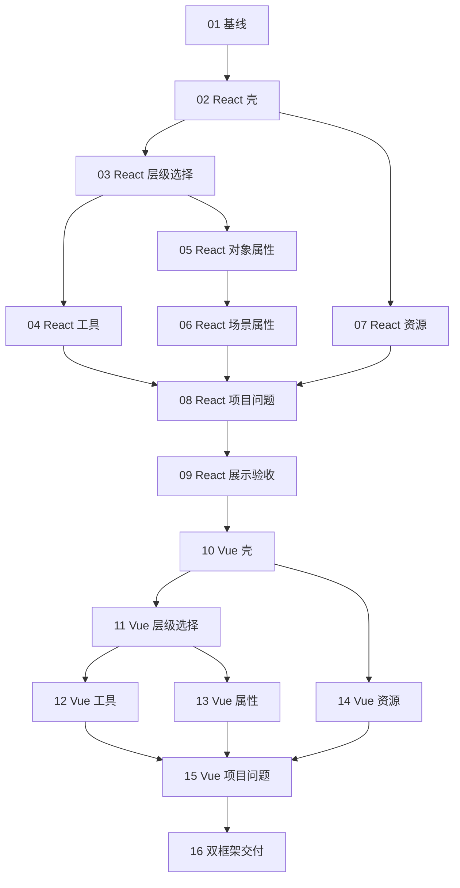

# 桌面工作台改版：规格与实现任务

[规格](spec.md)与 16 项任务已获用户确认，于 2026-09-14 发布为 ready-for-agent。当前尚未开始实现；首个可执行任务为 [01 恢复工作台类型与回归基线](issues/01-baseline.md)。

## 已确认测试边界

现有宿主级浏览器闭环作为跨框架端到端主边界，适配器 DOM 行为及 package-root 类型测试补充；Core 行为保持不变时不新增 Core 测试或抽象。

## 任务拆分

每项任务独立成文，包含交付行为、阻塞任务、user story 映射、验收清单和测试要求。

| 任务 | Blocked by | User stories |
| --- | --- | --- |
| [01 恢复工作台类型与回归基线](issues/01-baseline.md) | 无 | 30, 32, 33, 35 |
| [02 React 桌面壳与可调面板](issues/02-react-shell.md) | 01 | 1, 2, 3, 4, 5, 29, 31, 32, 34 |
| [03 React 场景层级与选择](issues/03-react-hierarchy.md) | 02 | 6, 7, 31 |
| [04 React 视口工具与节点操作](issues/04-react-tools.md) | 03 | 8, 9, 10, 11, 12, 31 |
| [05 React 对象属性与材质槽编辑](issues/05-react-object-inspector.md) | 03 | 9, 13, 14, 15, 31 |
| [06 React 环境、灯光与相机编辑](issues/06-react-scene-inspector.md) | 05 | 13, 16, 17, 18, 31 |
| [07 React 资源导入、维护与重导入](issues/07-react-assets.md) | 02 | 19, 20, 21, 22, 23, 31 |
| [08 React 项目往返与可修复问题抽屉](issues/08-react-project-problems.md) | 04, 06, 07 | 24, 25, 26, 27, 30, 34 |
| [09 可恢复展示场景与 React 视觉验收](issues/09-react-showcase.md) | 08 | 1, 5, 28, 29, 35 |
| [10 Vue 桌面壳与宿主扩展](issues/10-vue-shell.md) | 09 | 1, 2, 3, 4, 5, 29, 31, 33, 34 |
| [11 Vue 场景层级与选择](issues/11-vue-hierarchy.md) | 10 | 6, 7, 31, 33 |
| [12 Vue 视口工具与节点操作](issues/12-vue-tools.md) | 11 | 8, 9, 10, 11, 12, 31, 33 |
| [13 Vue 对象、材质、环境与场景属性](issues/13-vue-inspector.md) | 11 | 13, 14, 15, 16, 17, 18, 30, 31, 33 |
| [14 Vue 资源导入、维护与重导入](issues/14-vue-assets.md) | 10 | 19, 20, 21, 22, 23, 30, 31, 33 |
| [15 Vue 项目往返与可修复问题抽屉](issues/15-vue-project-problems.md) | 12, 13, 14 | 24, 25, 26, 27, 30, 33, 34 |
| [16 双框架展示与最终交付验收](issues/16-parity-delivery.md) | 15 | 1, 5, 28, 29, 30, 32, 33, 34, 35 |

依赖图：

01 是有已复现问题依据的最小前置任务。02 内含必要的导航/内容分离，避免单独建立横向 UI 框架。07 在 02 后可与 03–06 并行，04 与 05–06 可并行；Vue 的 14 在 10 后可与 11–13 并行。Vue 在 09 完成 React 验收后才开始。

## 执行规则

用户已确认测试边界、粒度和阻塞关系。全部任务位于 issues/，保留编号、Parent、Blocked by、用户故事映射与验收清单。ready-for-agent 表示任务定义可执行，并不表示所有前置依赖已完成。

每个实现会话从一个依赖已完成的任务开始，并引用规格和原型成果；不要一次执行整个任务集合。实施过程中若发现用户范围或公开 API 需要改变，先记录差异。
