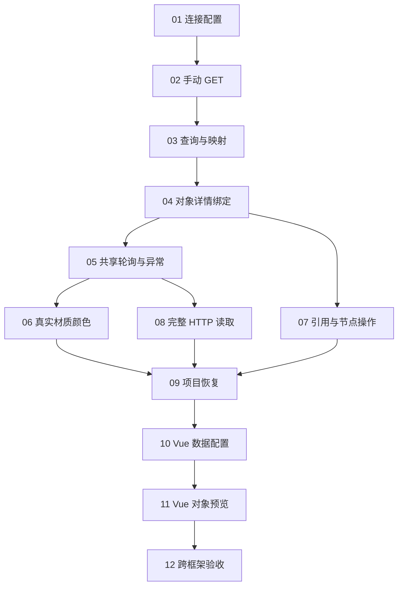

# HTTP 数据源管理实施计划

[正式规格](spec.md)与 12 张实现任务已整理完成，日期为 2026-10-26。用户认可了原型流程，当前只要求规划，尚未授权修改正式代码或开始任务。

任务的 Status 为 ready-for-agent，表示任务定义已具备实现入口；Blocked by 仍必须满足，不代表任务已领取或已完成。全部任务尚未开始，无测试完成或发布声明。

## 规格与原型

- [正式实现规格](spec.md)：范围、32 个用户故事、core/React/Vue/宿主职责、13 项技术决策及 AC01–AC15 验收。
- [交互原型](../http-data-source-prototype/index.html)：流程来源为分支 codex/http-data-source-prototype、提交 d719828；SVG、内存模拟与固定业务字段不作为正式实现。
- [原型说明](../http-data-source-prototype/README.md)：可运行方式、走查记录与简化范围。
- [历史需求草案](requirements-draft.md)及[调研](../../docs/research/2026-10-25-http-data-source-best-practices.md)：保留讨论依据，冲突时以正式规格为准。

## 分阶段交付

| 阶段 | 任务 | 可独立演示的结果 | 主责 |
| --- | --- | --- | --- |
| 一 接入与解释数据 | 01–03 | 保存连接，真实手动 GET，映射单对象/数组并保存命名查询 | core 契约与执行；React 配置界面 |
| 二 对象实时展示 | 04–06 | 给真实 GLB 对象绑定详情，共享轮询，状态颜色和停止/异常恢复 | core 数据运行态与投影；React 绑定及预览 |
| 三 配置维护与恢复 | 07–09 | 引用保护、节点复制/删除、完整读取配置、项目导出恢复与重新连接 | core 引用/HTTP/项目；React 维护反馈 |
| 四 Vue 对齐与交付 | 10–12 | Vue 全流程，React/Vue/vanilla 互通，同源 HTTP 与真实 WebGL 验收 | Vue 原生 UI；三包共同验证与文档 |

阶段是按演示成果分组，不强制相邻阶段全部串行；开工条件只看任务依赖。07 在 04 后可与 05/06 并行；05 完成后 06 和 08 可分别推进；09 汇合三条路径。Vue 数据界面从 React 完整基线 09 之后开始，避免同步维护尚未稳定的交互。

## 包职责

| 范围 | 必须承担 | 不应复制到此处的职责 |
| --- | --- | --- |
| core | v9 durable schema、command/history、参数/映射/引用、执行门面、共享调度与诊断、NodeId/材质覆盖、恢复/销毁、框架无关工作台模型和文案描述符 | 不依赖 React/Vue，不保管宿主密钥，不新增后端代理产品 |
| React | 数据导航与宽配置窗口、请求/映射草稿、Inspector/规则/详情卡、hook 订阅、焦点/双语、render props 与包内样式 | 不另写轮询、映射、引用 reducer 或 Three.js 材质修改 |
| Vue | 相同用户流程的组件/composable/scoped-slot 实现、ref 替换/卸载、焦点/双语和等价展示 | 不导入 React UI，不另建 Vue 业务状态机 |
| 宿主与示例 | 注入实际 HTTP executor、凭证描述与认证 revision，控制网络边界；示例显式开启受控数据夹具 | 不把真实秘密写回 scene；不由编辑器包承担业务服务管理 |

## 任务与阻塞关系

| 任务 | Blocked by | 阶段 | 交付行为 |
| --- | --- | --- | --- |
| [01 建立可保存的连接配置与数据工作区](issues/01-connection-authoring.md) | 无 | 阶段一 | 在 React 数据工作区创建、编辑、复制与删除尚未使用的连接，保存/撤销后配置与列表一致；旧宿主继续正常工作。 |
| [02 从已保存连接执行手动 GET 查询](issues/02-manual-http-query.md) | 01 | 阶段一 | 在 React 请求表单填写相对路径和带类型参数，运行一次真实受控 GET，查看请求摘要、响应及错误，并能取消。 |
| [03 完成查询保存与设备属性映射预览](issues/03-query-mapping.md) | 02 | 阶段一 | 从真实或示例 JSON 配置单设备/设备数组映射，对照原值与标准属性，最后将查询和映射一次保存。 |
| [04 给对象绑定设备并显示实时详情](issues/04-object-binding-details.md) | 03 | 阶段二 | 选中一个真实 GLB object node，选择查询、参数和设备，保存详情字段并手动预览；点击对象查看数据详情卡。 |
| [05 让多个对象共享轮询并正确处理异常](issues/05-shared-preview-runtime.md) | 04 | 阶段二 | 多个对象复用同一读取上下文，预览期间自动刷新；用户能理解过期、失败、空结果与认证暂停，并修复或停止。 |
| [06 把有效数据投影为对象颜色并可靠恢复](issues/06-runtime-color-preview.md) | 05 | 阶段二 | 在真实 GLB 对象上按有序规则显示状态颜色，可单对象试用草稿；停止、无效和过期时恢复最新 authored 材质。 |
| [07 保护配置引用并让节点操作携带正确绑定](issues/07-references-and-node-operations.md) | 04 | 阶段三 | 修改或删除连接/查询前能定位使用位置；复制、粘贴、删除和恢复对象时，绑定与依赖仍然正确。 |
| [08 完成只读 POST、认证引用和请求配置](issues/08-http-contract-completeness.md) | 05 | 阶段三 | 同一配置流程可接入需要 JSON body、API Key 或业务成功字段的读取接口，保存与展示仍不泄漏凭证。 |
| [09 让项目导出恢复保持配置并停止旧运行态](issues/09-project-restore.md) | 06, 07, 08 | 阶段三 | 将有多个数据源和对象绑定的真实场景导出/恢复到新 host，配置完整、旧预览清理、缺凭证仍能编辑并重新连接。 |
| [10 在 Vue 完成连接、查询与映射配置流程](issues/10-vue-source-configuration.md) | 09 | 阶段四 | Vue 使用者可在原生 Workbench 完成与 React 等价的数据源接入、测试、映射预览和配置维护。 |
| [11 在 Vue 完成对象绑定、数据预览和颜色交互](issues/11-vue-object-preview.md) | 10 | 阶段四 | Vue 用户可给对象绑定设备，查看实时详情和颜色，在异常时定位修复并停止恢复，与 React 完整闭环一致。 |
| [12 验收跨框架闭环并完成文档和发布准备](issues/12-cross-framework-delivery.md) | 11 | 阶段四 | 使用同一真实 HTTP/GLB 夹具验证 React、Vue、vanilla 的配置往返与运行态边界，并给宿主提供可安装、可集成的正式能力。 |

只列直接阻塞边，不重复所有传递依赖。12 张任务均包含 Parent、职责矩阵、用户故事/决策映射、验收清单、测试范围与范围外约束。

## 验收责任映射

| 验收 | 主要任务 |
| --- | --- |
| AC01 配置持久化、旧项目与空宿主 | 01、09、12 |
| AC02 实际 GET 与三种参数隔离 | 02、08、10 |
| AC03 对象/数组及明确转换 | 03、10 |
| AC04 错误与字段隔离 | 03、05、10 |
| AC05 对象绑定与展示 | 04、06、11 |
| AC06 请求共享与身份隔离 | 05、11、12 |
| AC07 新鲜度与立即回退 | 05、06、11 |
| AC08 取消、晚到、退避与只读 POST | 02、05、08 |
| AC09 材质隔离、重投影与试用 | 06、11 |
| AC10 引用与原子编辑 | 01、03、07 |
| AC11 节点操作与 clipboard | 07、09 |
| AC12 迁移和项目包 | 01、09、12 |
| AC13 生命周期与框架所有权 | 02、05、10、11 |
| AC14 跨框架、真实夹具与交互 | 10、11、12 |
| AC15 配置与秘密/样本隔离 | 02、03、08、09、12 |

## 实施顺序与范围控制

1. 收到实现指令后，从直接阻塞已完成的任务开始；当前第一项为 01。每个实现会话先读正式规格和当前任务，完成一个可验证切片，再记录结果。
2. 任务可以由同一个实现会话按依赖推进，也可分会话执行；本索引不自动创建 agent、不授予任务间消息或调度权限。
3. 每项以公开 Editor/数据服务和既有宿主边界测试；新增语义在 core 验证，adapter 只测配置、交互与生命周期，避免三处重复算法测试。
4. 不能把“原型流程可用”当作正式 HTTP、Three.js 材质、项目恢复或性能已经验证。最终以 12 的真实夹具和完整检查为准。
5. POST 首期只手动，默认空宿主零请求、恢复预览关闭、凭证只保存引用，均是跨阶段不可削弱的约束。
6. 暂不改变实际包版本、代码、依赖、构建配置、示例或正式能力文档；相关改动仅作为后续任务交付项。

## Comments

2026-10-26：用户认可原型流程，要求正式规格与分阶段任务，并明确先不修改正式代码。本轮仅整理文档和依赖，不启动实现。
