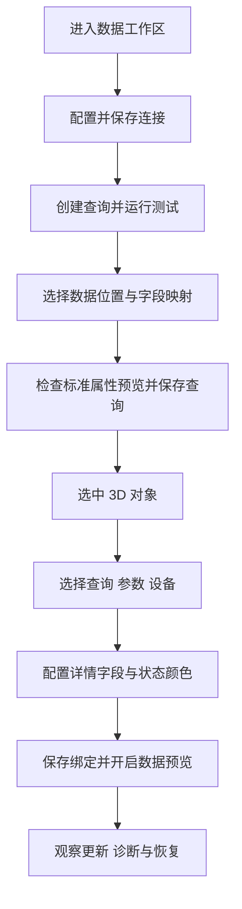

# HTTP 数据源管理首期需求与交互草案

历史材料：本稿保留 2026-10-25 的讨论记录。2026-10-26 用户认可原型流程后，已形成[正式实现规格](spec.md)与[阶段任务](README.md)；范围、默认值及验收冲突时以正式规格为准。

日期：2026-10-25。阶段：需求评审。范围：连接、查询、字段映射、3D 对象绑定与数据预览。

首期让场景编辑者接入一个已有 HTTP JSON 服务，把设备最新状态映射成稳定属性，再将属性配置到 3D 对象的数据详情和状态颜色中。成功标准是一条可保存、可恢复、异常可解释的完整使用流程。

依据：[实践调研](../../docs/research/2026-10-25-http-data-source-best-practices.md)、[交互约定](../../docs/interactions.md)、[架构](../../docs/architecture.md)、[设计决策](../../docs/decisions.md)。本稿中的默认值与范围为评审建议；不包含实现代码、实现任务或新的 ADR。

## 1. 首期范围与工作假设

| 项目 | 本稿建议 |
| --- | --- |
| 主要用户 | 了解接口地址、参数及 JSON 字段的场景编辑者；宿主开发者负责提供网络执行和凭证接入 |
| 配置归属 | 配置随当前 Scene Snapshot 保存；同场景内复用。跨场景连接库后置 |
| 数据类型 | 设备最新属性值；支持一次返回一个设备或一个设备数组 |
| HTTP | GET 与明确只读的 POST；JSON 响应。外部写入及设备控制后置 |
| 映射 | 字段选择、明确类型、简单数值换算、布尔/枚举转换、单位与可选源时间 |
| 对象绑定 | 首期限定 GLB object node 整对象；每个对象一个查询上下文，可配置多个详情字段及一组状态颜色规则 |
| 展示 | 点击对象打开数据详情卡；在数据预览期间应用整对象状态颜色 |
| 更新 | 手动执行与可控轮询，同查询及参数复用请求；默认不开启数据预览 |
| 交付一致性 | React/Vue 相同配置语义、状态与错误处理，沿用 English/简体中文能力 |

历史曲线、时间回放、MQTT/WebSocket/SSE、分页自动取全量、任意脚本、跨接口拼接、OpenAPI 导入、自由布局标签、3D 文本、动画与变换绑定、事件流程编排、设备控制、团队权限及凭证管理后台均后置。

首期选择整对象颜色，是为了形成明确的最小视觉闭环。模型内部节点、材质槽、group、light 和 camera 暂不作为首期数据绑定目标；选中这些目标时显示原因，并提供显式选择所属对象的入口，不自动改变目标。

## 2. 用户需要理解的四个概念

| 概念 | 配置内容 | 示例 |
| --- | --- | --- |
| 连接 | 访问哪一个服务、用哪一种认证 | 工厂设备服务，服务地址、凭证引用 |
| 查询 | 调用哪一个接口、传什么参数、如何更新 | 水泵最新状态，GET `/pumps/status`，区域 A |
| 字段映射 | 响应中的字段代表什么业务属性 | `tempRaw` → 温度，乘 0.1，单位 ℃ |
| 对象绑定 | 哪个模型使用哪个设备的哪些属性 | 水泵模型 A → `pump-01`，显示温度、按运行状态着色 |

字段映射是查询的一部分，不再要求用户创建一个独立的“数据模型资源”。设备候选从查询结果中识别，不建立单独的设备管理系统。

业务身份以“连接来源 + 设备 ID + 属性键”表达；绑定同时保留所选查询及参数，明确数据由哪一次查询执行提供。不同查询的结果独立管理，不因属性同名就互相覆盖，也不在首期做自动合并。

## 3. 界面入口与信息组织

### 3.1 左侧新增数据工作区

与现有场景、资源、项目并列增加“数据”。列表按连接组织查询，显示名称、配置完整性、当前会话最近执行结果和对象引用数。支持搜索、新建、编辑、复制、查看使用位置、删除。

列表状态分别呈现“配置待完善”和“运行失败/过期”，避免把一次网络失败当作配置丢失。未执行过的连接或查询显示“尚未验证”，不显示成功状态。

复杂表单通过较宽的配置窗口打开，避免将原始 JSON 和映射表塞入窄左栏。窗口内设置“请求”“字段映射”“执行结果”页签；连接基础配置可从上方连接摘要进入。关闭后回到原工作区及选择位置，不重建 viewport。

### 3.2 右侧对象 Inspector 增加数据绑定组

对象摘要、变换与材质保持现有职责。数据绑定组显示所选查询、参数、设备 ID、详情字段、颜色规则及当前状态。支持添加、编辑、停用、解除绑定和定位到查询。

首期只编辑单个 object node。多选时显示“请选择一个对象配置数据绑定”，不把一次编辑隐式套到多个对象。

### 3.3 预览入口

工具栏提供“数据预览”开关及运行状态。开启后执行已启用绑定所需的查询并应用展示规则；停止后取消请求与轮询、关闭详情卡并恢复 authored 场景外观。预览开关属于会话状态，重新打开项目默认关闭。

## 4. 主流程



用户也可从对象 Inspector 的“添加数据绑定”进入。没有可用查询时提供“新建查询”；完成后回到原对象及绑定草稿，不要求重新选中对象。

首次接入使用“连接 → 查询请求 → 字段映射”的引导。连接步骤的按钮明确为“保存连接并继续”；查询与映射共用一个草稿，最后点击“保存查询”。中途取消查询创建时，已经保存的连接保留，未保存的查询草稿丢弃。

## 5. 连接配置

| 字段 | 配置方式与要求 |
| --- | --- |
| 名称 | 必填；同场景内不重复，列表中不依赖 URL 辨认服务 |
| 服务地址 | 必填 HTTP/HTTPS 地址，可包含固定路径前缀；不允许在地址中嵌入用户名、密码或 token |
| 认证方式 | 无认证、Bearer、API Key（请求头）；认证凭证通过宿主提供的凭证入口选择 |
| 凭证引用 | 保存逻辑引用；显示已配置/待提供/不可用，不展示密钥明文 |
| 公共请求头 | 可选键值表，用于不含秘密的固定头；认证头由认证配置产生，禁止重复覆盖 |
| 默认超时 | 建议初始为 10 秒；查询可覆盖 |
| 请求执行方式 | 由宿主提供，显示当前模式及是否可用；普通编辑者无需选择底层网络实现 |

连接可独立保存。服务地址、认证类型和头部格式错误阻止保存；暂时无网络或缺少可用凭证不阻止保存配置，分别显示待处理状态。

“验证连接”使用用户选定的已有读取查询；没有查询时引导创建并测试首个查询。不要默认请求服务根路径或假定后端提供 `/health`。结果说明实际验证了哪个请求、耗时和状态；查询成功仍不能代替字段校验。

修改连接地址或认证引用时显示受影响查询及对象数量；保存后停止受影响的旧请求，并在预览开启时按新配置重新执行。不得把旧地址的结果当作新连接当前值。连接内部身份在重命名或改地址时保持稳定。

## 6. 查询配置

### 6.1 请求与参数

| 字段 | 配置方式与要求 |
| --- | --- |
| 查询名称 | 必填，同连接下不重复，例如“区域水泵最新状态” |
| 所属连接 | 必选；展示继承的地址与认证摘要 |
| 方法 | 默认 GET；POST 必须标为只读查询；不提供写入方法 |
| 接口路径 | 相对于连接地址前缀；预览最终地址，不允许另填绝对地址绕开连接 |
| 参数定义 | 名称、类型、必填、默认值；首期为 string、number、boolean |
| 参数用途 | 在路径、查询参数或 POST JSON body 中通过“插入参数”选择 |
| 查询参数与请求头 | 键值表；请求头只能覆盖允许的非认证公共头 |
| 请求体 | POST 支持 JSON；参数按类型插入，不要求用户拼接字符串或编写脚本 |
| 成功条件 | 默认按 HTTP 成功与 JSON 解析判断；可选增加一个业务字段条件，例如 `code` 等于数字 0 |
| 更新策略 | 手动或轮询；GET 轮询建议默认 5 秒，可修改；POST 默认手动 |
| 过期阈值 | 建议初始为 15 秒，可修改；与轮询间隔不合理时提示调整 |

参数默认值是查询配置；绑定可覆盖参数值，测试也可临时覆盖。三个位置必须明确标记，测试值不会自动写成默认值或改掉对象绑定。

首期绑定参数只能是显式常量，不支持任意表达式、其他对象的字段、全局变量或查询之间的依赖。缺少必填参数时在字段旁指出原因，不发请求。

POST 的轮询与自动重试默认关闭。确需自动刷新时，配置者必须明确该接口是只读且可幂等执行，并由宿主执行策略允许；“使用 POST”本身不构成开启理由。此开关不提供设备控制能力。

### 6.2 运行测试

“运行测试”只执行当前草稿一次。运行期间可取消；编辑参数、路径或映射后，旧结果标记为来自旧配置，不能继续显示为本次配置已验证。

结果区显示最终请求摘要、响应状态、耗时、原始 JSON、业务条件结果及映射诊断；认证信息脱敏。保留草稿后切换页签不会丢失结果，关闭项目或恢复后结果清空。

网络不可用时可粘贴示例 JSON 完成映射，始终显示“示例数据”；示例与实时请求结果互不冒充。粘贴样本只用于当前配置会话，不随项目保存，也不用于全局实时预览。

查询在配置结构有效时可保存，即使接口暂不可达或尚未执行过。列表显示相应验证状态，不用网络可用性阻止离线配置。

保存查询要求请求配置完整、必填参数有明确定义、设备身份规则有效，且至少定义一个输出属性；未取得真实响应不构成保存错误。缺少映射时保留当前窗口草稿并定位待填字段，不把半成品标记为可绑定查询。

## 7. 字段映射配置

### 7.1 选择数据位置与设备身份

先从 JSON 树选择实际数据位置，再选择“单设备对象”或“设备数组”。首期路径选择支持固定对象字段和数组元素中的字段，不支持通配筛选、任意递归或脚本。

设备数组每行代表一个设备。设备 ID 从行内字段取值；单设备对象也可从明确指定的查询参数或固定值取设备 ID。支持可选设备显示名字段，用于搜索和下拉选项；显示名不能代替 ID。

设备 ID 为空时该行无效；同一结果中重复 ID 时整次映射失败并列出冲突行，不选择任意一行覆盖。ID 保留原始字符串，例如 `001` 不自动变成 `1`；数字 ID 需显式转换为字符串。

### 7.2 配置属性表

| 配置项 | 行为 |
| --- | --- |
| 属性键 | 稳定英文键，例如 `temperature`、`running`；同一查询内唯一 |
| 显示名 | 用户可读名称，例如“温度”；允许重命名而不影响绑定 |
| 源字段 | 在所选设备对象中选字段；界面显示源路径及样本值 |
| 输出类型 | number、string、boolean；由用户确认，样本识别只作建议 |
| 转换 | 默认原值；可选明确数值转换、乘系数加偏移、布尔值/枚举对应表 |
| 单位 | 可选显示元数据，例如 ℃；填写单位不会自动做换算 |
| 可空 | 明确是否允许 null；缺失字段与 null 分别诊断 |
| 合法值 | 可选数值范围或枚举集合，用于校验；不在此配置视觉告警阈值 |

可选配置源采样时间字段及格式：ISO 时间、Unix 秒或毫秒。没有时间字段时保留未知，并单独展示接收时间；已配置但内容无效时显示数据校验问题，不能悄悄用接收时间替代。

设备质量字段可选；若需要，使用显式映射得到 good、uncertain、bad，未提供为 unknown。未知质量不等于无数据；默认允许展示类型有效且未过期的值，同时标记“源质量未提供”。

### 7.3 映射示例

假定响应中 `data.items` 为：

```json
[
  { "deviceCode": "pump-01", "name": "一号水泵", "tempRaw": 426, "run": 1 },
  { "deviceCode": "pump-02", "name": "二号水泵", "tempRaw": 381, "run": 0 }
]
```

| 配置 | 选择 |
| --- | --- |
| 数据位置 | `data.items`，设备数组 |
| 设备 ID / 名称 | `deviceCode` / `name` |
| 温度 | 属性键 `temperature`；源字段 `tempRaw`；number；乘 0.1；单位 ℃ |
| 运行状态 | 属性键 `running`；源字段 `run`；boolean；1 对应 true、0 对应 false |

标准数据预览显示 `pump-01` 温度 42.6 ℃、运行 true；`pump-02` 温度 38.1 ℃、运行 false。逐字段显示原值、转换后值及校验结果。

### 7.4 保存与响应变化

空响应不自动生成字段定义，也不删除已配置的字段。映射可手动完成并保存。类型转换失败不自动填 0、false 或空字符串。

一个属性失败时，其余设备及属性仍可使用；出错属性立即进入不可用状态，可另显示上一有效值及其时间。重复设备 ID、数据根位置类型不符等结果结构错误会使整次结果不可用。

每次成功响应按完整结果处理，不作为增量补丁；设备或属性从新结果消失时立即标记本次缺失，不能无限沿用旧值。HTTP 204 或有效空数组显示“本次无数据”；业务条件失败、非 JSON 响应和解析错误分别显示原因。

被绑定的属性键及输出类型不能直接修改；显示使用位置，要求先解除或调整引用。显示名、单位和兼容的转换可以修改；保存时重新校验受影响绑定。查询参数的删除或类型变化同样需要先处理引用。

## 8. 3D 对象绑定配置

### 8.1 选择数据上下文

选中一个 GLB object node，在 Inspector 点击“添加数据绑定”，按顺序配置：

1. **查询**：选择已保存查询，显示连接和可用字段摘要；可跳转修改或新建。
2. **参数**：展示查询默认值，可为当前对象覆盖。参数变化后必须重新测试或明确提示结果尚未更新。
3. **设备**：从当前参数的结果中按设备 ID/显示名搜索；也可手动填写稳定 ID，便于离线配置。候选来自样本时标记来源；未匹配到设备时允许保存并提示“等待该设备数据”。
4. **展示**：配置详情字段及状态颜色规则。
5. **预览并保存**：使用匹配当前上下文的最近结果预览；没有结果时可手动执行查询。保存只提交绑定配置，不默认开启全场景轮询。

绑定至少需要一个详情字段或一组颜色规则，参数类型必须匹配查询定义。设备尚未返回可作为待连接配置保存；缺少设备 ID、引用不存在的查询或属性则阻止保存。

绑定窗口的“试用效果”只在全局数据预览关闭时临时作用于当前对象，不启动轮询。示例样本须显示“示例效果”；取消、关闭或结束试用后恢复原始外观。全局预览开启时可编辑数据配置，但试用草稿效果前需先停止全局预览。

例如：对象“水泵模型 A”选择“区域水泵最新状态”，参数 `areaId=A`，设备 `pump-01`。修改模型名称、移动或重新分组不改变设备绑定。

每个对象首期只设置一个查询上下文。信息卡与颜色复用该上下文；多个对象使用同一查询及相同参数时共用请求，选择不同设备仅从结果中取不同数据。接口若是 `/pumps/{deviceId}`，不同 deviceId 形成不同请求。

数据工作区的查询详情提供“绑定到所选对象”快捷入口；没有可绑定的单一对象时禁用并显示原因。该入口与 Inspector 使用同一绑定表单，不再维护第二套绑定配置。

### 8.2 数据详情卡

在映射好的字段中勾选展示项，配置顺序、标签及数字小数位；单位默认使用属性定义。无需编写文本模板。

数据预览时点击对象打开详情卡，显示对象名、设备 ID/名称、字段值、接收/采样时间与状态。卡片内容由绑定配置决定；卡片开关和位置属于会话状态。

首期提供屏幕信息卡，不新增可拖动的 3D 标签对象。字段无数据时显示 `—` 和具体原因，不能显示成 0。保留上一有效值时标注“上次有效值”，与当前值分开展示。

### 8.3 状态颜色

选择一个属性，配置简单规则及颜色。boolean/string 支持等于/不等于；number 支持比较和单区间判断。规则按显示顺序匹配，第一条命中生效，最后固定提供“未匹配时使用原始材质颜色”。

示例：`running=true` 为绿色，`running=false` 为灰色；或 `temperature >= 60` 为红色，其他恢复原始颜色。首期不组合多个属性做 AND/OR，也不让同一对象同时存在两套颜色规则竞争。

颜色只作用于当前对象可支持的材质基础色，不改变纹理、透明度和其他参数，也不修改另一个共享资产的对象。材质能力不支持时保留详情绑定，并禁用颜色设置、说明原因。纹理和灯光会影响最终视觉，预览显示实际效果，不承诺精确像素等于色板。

字段缺失、无效、质量 bad/uncertain、过期或请求失败时停止应用数据颜色，恢复 authored 材质；unknown 质量单独提示但不自动判失败。停止预览、停用或解除绑定后也恢复 authored 外观。首期不增加可自定义的多套异常回退规则。

### 8.4 修改、复制与删除

修改数据上下文、详情字段或颜色规则需显式保存，支持撤销/重做。停用保留配置，解除删除当前对象的绑定配置。

复制/粘贴对象时复制绑定配置，目标指向新 NodeId，默认仍绑定同一设备，并显示绑定摘要；需要另一设备时由用户修改。只复制配置，不复制样本、请求或凭证。

删除对象同时清理其绑定，撤销恢复配置。删除查询或连接前列出使用位置；有引用时阻止直接删除，引导逐项解除或更换绑定，不默默连带删除场景对象。查询复制产生新身份，现有对象不自动改绑。

GLB 重导入保留同一 object node 时保留整对象绑定；模型或材质未解析时保留配置并显示目标不可用。不得按相似名称自动转移到另一个对象。

## 9. 数据预览与异常反馈

### 9.1 执行规则

- 普通编辑状态不轮询；运行测试为一次性动作，测试结果不自动驱动全场景。
- 开启数据预览时，已启用绑定引用的查询先执行一次，再按各自策略更新；手动策略仅执行首次和用户点击刷新。
- 请求按查询、参数、有效认证上下文及配置版本复用；新增相同引用不额外发送重复请求。
- 同一执行上下文不重叠请求；执行未结束时不堆积定时触发。上下文变化、停用及停止预览后取消旧请求，丢弃晚到响应。
- 网络失败、超时与服务端暂时失败可对允许自动执行的读取采用有上限的退避；401/403 停止该上下文并提示处理认证，用户修复后点击重试。其他不可重试错误保留诊断，配置修改或显式重试后再执行。
- 过期状态按最后有效值的接收时间推导；有可信源采样时间时还检查采样年龄。收到响应与收到新测量值分别显示，不把反复返回的旧测量值当成持续更新。
- 预览保留选择、镜头导航、详情查看及数据配置编辑；暂时关闭场景变换、基础材质等编辑工具。退出后恢复这些入口，数据颜色不被保存成材质编辑结果。

轮询间隔、超时和过期阈值的数值是首期交互建议，不构成设备规模或吞吐承诺。完整结果体需要受宿主允许的响应大小与请求频率限制；超限时明确报错，不无提示地截断为有效设备集合。

### 9.2 状态与用户动作

| 状态 | 呈现 | 可执行动作 |
| --- | --- | --- |
| 未启动 | “开启数据预览后获取实时数据” | 开启预览或手动测试 |
| 首次加载 | 加载标记；值为 `—`；保留原始外观 | 取消/停止 |
| 有效数据 | 当前值、更新时间；颜色按规则生效 | 刷新、查看详情 |
| 正在刷新 | 保留仍在有效期内的当前值，并显示刷新中 | 取消；不重复排队 |
| 本次无数据/设备不存在 | 明确显示设备或属性缺失，颜色恢复原始 | 检查设备 ID、参数、映射或刷新 |
| 字段错误/源质量异常 | 定位到具体设备及字段；历史有效值单独标记 | 打开映射或源质量说明 |
| 数据过期 | 显示最后有效时间及过期原因；颜色恢复原始 | 刷新、检查更新策略或后端 |
| 请求失败 | 区分 HTTP/业务条件/解析/超时等；不将设备直接判为离线 | 重试、编辑查询或修复凭证 |
| 连接/目标不可用 | 保留配置，定位缺失凭证、查询或对象 | 重新提供凭证或修复引用 |

请求状态、新鲜度、字段有效性和源质量分别保留，可同时展示；状态表为常见组合，不把多个维度压成唯一互斥状态。部分设备/属性失败时，其他有效绑定继续更新。

问题抽屉提供查询、对象和字段定位入口；数据工作区及 Inspector 显示各自相关摘要。同一故障按稳定位置合并更新，避免每次轮询新增一条问题。

## 10. 草稿、保存与项目恢复

| 内容 | 保存与撤销规则 |
| --- | --- |
| 连接、查询参数/策略、映射、对象绑定 | 进入版本化 Scene Snapshot，通过编辑 command 提交，可撤销/恢复 |
| 连接/查询/绑定表单草稿 | 保存前为 UI 会话状态；切页保留，关闭时提示放弃或继续编辑 |
| 测试覆盖值、示例 JSON、响应、实时样本及最近执行结果 | 会话/运行态；不写入 Snapshot、history 或 `.ek3d` |
| 请求、计时器、AbortController、订阅、Three.js 对象及投影结果 | 运行态；随停止/销毁清理 |
| 密钥和凭证解析结果 | 宿主保管；项目仅保存引用；普通 headers/body/query 参数不得作为秘密存储 |
| 预览开关、详情卡状态、面板位置 | 会话状态 |

打开旧项目时默认没有数据源与绑定；配置迁移与版本设计留到实现规格。恢复含数据配置的项目后保持预览关闭，值为未加载；宿主重新解析凭证，不能把导出前的成功状态当作当前连接健康状态。

缺少凭证或执行能力时允许继续编辑和导出，清楚提示需重新接入；恢复不自动执行请求。导出不因实时网络不可用而失败，但配置自身引用损坏须明确报告。

未保存的绑定/映射不能混入全局预览。保存一份草稿是一项有明确边界的编辑操作；每次键入、测试和样本变化均不新增 history。撤销/恢复配置时取消相关旧执行，不复用旧配置的当前值。

## 11. 验收场景

| 编号 | 操作 | 预期结果 |
| --- | --- | --- |
| AC01 | 创建连接，再建一个设备数组 GET 查询 | 认证与地址复用；可看到最终请求和原始 JSON |
| AC02 | 按示例映射温度、运行状态 | 得到 42.6 ℃/true；原值、转换和值类型可核对 |
| AC03 | 单设备接口以路径参数指定设备 | 参数能用于请求及明确的设备身份映射；缺参不发请求 |
| AC04 | 对象 A/B 使用同查询同参数，分别选不同设备 | 共用一次查询执行；各自显示匹配设备的值 |
| AC05 | 为对象 A 配置信息卡与颜色规则，开启预览 | 点击查看字段；新值驱动规则；未绑定对象不受影响 |
| AC06 | 响应缺少温度、返回 null、非法布尔值或重复 ID | 各类错误区分；无假 0/false；重复 ID 不发生随机覆盖 |
| AC07 | 下一次结果移除某设备或返回空数组 | 原设备立即显示本次缺失；旧值不会继续作为当前有效数据 |
| AC08 | 返回业务失败、非 JSON、401、超时或旧采样时间 | 正确定位失败；认证停止待修复；过期数据不继续着色 |
| AC09 | 多次轮询期间编辑/停止预览 | 无请求堆积；晚到响应不覆盖新配置；停止恢复原材质 |
| AC10 | 保存并撤销/重做绑定或映射；复制/删除对象 | 配置与目标引用正确变化；刷新不产生撤销项；复制仍明确指向原设备 |
| AC11 | 重命名、移动、分组或重导入同一 GLB 对象 | 稳定对象身份保留绑定；不按显示名误绑定其他对象 |
| AC12 | 导出并恢复项目，宿主未提供凭证 | 四类配置保留；不包含密钥/样本；默认不发请求；可修复后预览 |
| AC13 | 无网络时粘贴样本配置，再保存 | 可以完成映射与绑定草稿；示例标记清楚；样本不进入项目 |
| AC14 | 两个对象共享模型资产，只有一对象绑定颜色 | 仅目标对象变化；停止后恢复原外观 |
| AC15 | 在 React/Vue 分别完成主流程并切换语言 | 字段、默认值、校验、状态、保存语义一致；布局与语言切换不重建 runtime |

本阶段以需求走查验收，不运行实现测试；后续实现应从这些用户行为中选择必要的 core、adapter 与 browser 覆盖。

## 12. 评审时最值得确认的选择

本稿按以下默认方向完整展开，用户调整任何一项后更新受影响流程：

1. 首期配置随场景保存，暂不做跨场景数据源库。
2. 首期绑定整对象，展示为点击详情卡加状态颜色，暂不做常驻 3D 标签或内部材质槽绑定。
3. 每个对象使用一个查询上下文；首期不做多查询拼接。
4. 宿主提供网络执行与凭证能力；编辑器负责可移植配置与配置体验。
5. 首期以秒级最新状态展示作为场景假设；明确规模、数据量及允许的接口时效后，再定性能验收门槛。

这些是需求范围选择，不改变当前 Snapshot-first、稳定 NodeId、runtime projection 和薄框架适配层的架构方向。后续可在本稿评审后再整理实现规格与任务。
