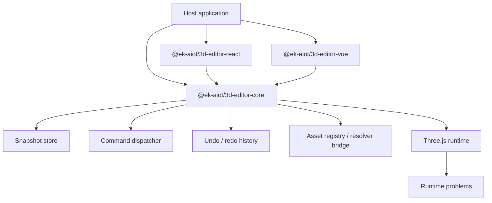
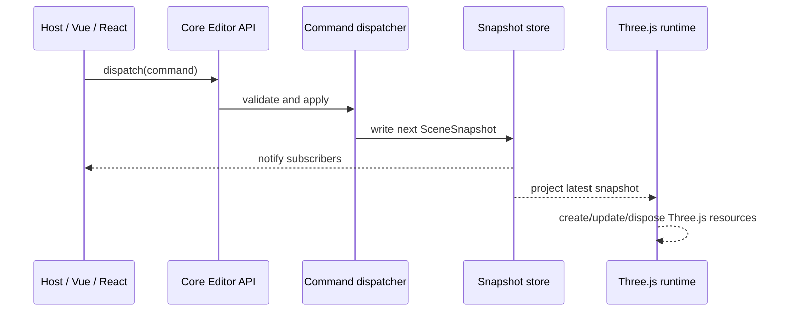
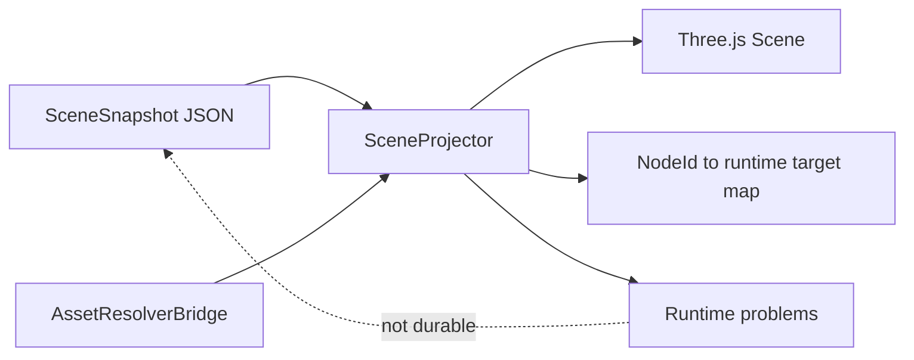

# 技术架构

## 架构目标

本项目的核心目标是建立一个可被 Vue、React 和 vanilla host 复用的 3D 编辑器契约：

- Scene Snapshot 是唯一 durable source of truth。
- 所有持久化编辑都通过 command 进入 core。
- Three.js 是 runtime projection，不是状态来源。
- React/Vue shell 是生命周期和 UI 适配层，不拥有编辑语义。
- `.ek3d` 项目包只在需要携带二进制资产时使用；普通 Snapshot 始终保持 JSON-compatible。

## 包拓扑



## Durable 编辑流



关键点：

- UI 不直接改 Snapshot。
- runtime 可以为交互做 preview，但 commit 必须变成 command。
- command 返回 `CommandResult`，包含最新 Snapshot 和可控错误。
- undo/redo 恢复 Snapshot，runtime 通过订阅重新投影。

## Core 内部边界

Core 内部可以分成两层：

- Durable contract：`snapshot`、`commands`、`history`、`editor`、`assets`、`materials`、`environment`、`lights`、`dataSources`、`problems`、`project`。
- Runtime projection：`runtime` 下的 Three.js scene projector、loader adapter、texture/HDR projector、PMREM adapter、picking、transform transaction。

Durable contract 应尽量可在无 DOM / 无 WebGL 环境中测试。Runtime projection 允许使用 Three.js 和浏览器 DOM，但必须有明确 dispose 路径。

## Snapshot 与 runtime 的关系



Snapshot 保存：

- scene identity
- node identity / hierarchy / selection / transform target
- object payload identity / asset reference
- material overrides
- environment/background authoring intent
- light definitions and their light node targets
- `dataSources` 中的已保存连接、查询配置与设备属性映射、对象绑定的查询/设备/参数覆盖/详情字段配置；host credentials、请求草稿、示例 JSON、执行器、原始响应、有效参数、预览状态和测试参数都留在 runtime
- presentation state, including authored camera views and the default presentation view pointer
- imported GLB target identity, owner hierarchy constraints, source descriptors, optional transform overrides, imported material slot descriptors, and JSON-compatible reimport remap metadata
- authored problem metadata
- JSON-compatible metadata

Runtime 保存或派生：

- `Object3D`
- loaded GLB scene
- projected empty groups and light objects
- loaded texture / HDR texture
- PMREM render target
- renderer / camera / scene
- editor camera navigation, OrbitControls state, camera helper output, and controls target object
- data service run state: request descriptors, raw response text/JSON, elapsed timing, generations, cancellation, and recoverable request diagnostics
- object data runtime: effective binding parameters, per-object runtime status/fields/timestamps/quality, preview enabled/refreshing/last-refresh flags, and derived detail models
- resolver output
- recoverable runtime problem
- imported target match records linking durable imported nodes to loaded GLB descendants

Runtime 派生结果不得写回 Snapshot。

Imported GLB target 是 durable target identity，不是 runtime traversal cache。Runtime projector 会把 imported node 解析成 loaded owner GLB scene 内的 descendant link，并把该 link 注册到 `ThreeObjectMap`。Pointer picking、selection bounds、camera framing 和 TransformControls 都复用这张 runtime target map。Core 不会把 loaded glTF scene graph、Three.js `Object3D`、material/texture、loader parser、resolver result、base transform cache 或 runtime problem 写回 Snapshot。Reimport remap 和 slot-aware material projection 必须从 v5 imported target key/slot key contract 派生，而不是重新发明一套 runtime-only ID。无法解析的 reimport target/slot 会保留 durable marker，并投影为 runtime/workbench problem。

Authored camera view 是 presentation resource，不是 runtime camera。Runtime capture/apply helper 负责在 plain JSON view data 和 transient `PerspectiveCamera`/controls target 之间转换；只有 camera view commands 会写入 `SceneSnapshot.presentation`。`resolveDefaultPresentationView()` 是 pure resolver，供 viewer startup 或 host preview 找到默认 authored view，但不会挂载 renderer 或启用 editor controls。

Material projection 只消费 durable material assignment、imported slot descriptor 和 runtime target map。Object-level assignment 是 broad pass；material-slot assignment 是 narrower pass，只覆盖匹配 primitive mesh 或 material array index 的 projection-owned clone。Texture loader result、shared texture resource owner、slot resolver result、cloned material 和 projection problem 都属于 runtime projection，不能写回 Snapshot 或 `.ek3d`。

Data service 与 viewport 独立：`editor.getDataService()` 在无 DOM/WebGL 环境也能读取运行态、订阅、执行草稿查询、取消和销毁。请求执行器由宿主通过 `createEditor({ executor })` 注入；core 只产生带 `credentialRef` 的请求描述，不读取或保存秘密，也不使用 global `fetch` 作为回退。请求描述包含方法、只读确认、已合并的公共/查询头、typed JSON body、认证引用、超时和宿主响应上限；认证头名由 core 保留，不能被公共/查询头覆盖。GET 与已确认只读的 POST 共用同一构建、执行和响应判定路径：HTTP 失败、认证失败、业务成功条件失败、204/空响应、非 JSON、解析失败和响应超限分别产生可区分结果；POST 只在手动测试、首次预览或显式刷新时执行，不自动轮询或重试。运行结果、取消标记、timer 和 generation 都是 runtime-only；草稿修改、连接配置变化、undo/redo 或 dispose 会失效旧 generation，即使宿主执行器忽略 abort，晚到响应也不会提交为当前结果。已保存的 query 与 mapping 属于 durable `dataSources.queries`；只有经 command/history 的保存会写入 Snapshot，窗口内请求草稿、示例 JSON、测试覆盖和预览样本不会进入 Snapshot。

对象数据预览也由同一个 core service 驱动：`startPreview()` 开启预览并立即刷新一次，`refreshPreview()` 只在预览开启时按当前 durable 绑定重试/刷新上下文，`stopPreview()` 清空全部对象运行态并中止在途请求，但保留 binding 配置。每个启用的 binding 用自己的 `parameterOverrides` 解析有效参数；query、有效参数、连接/查询配置、查询头与宿主认证 revision 相同的 binding 共用一个读取上下文，GET 每周期只发一次请求，POST 只在首次预览或显式刷新时执行。首期每个 editor 最多 4 个并发上下文，其余去重排队；下一次轮询只在前次完成后调度，刷新在途上下文不产生平行请求。响应按 query mapping 映射后以 `entityId` 精确匹配 binding 的 `deviceId`，不会在 React 侧另做匹配或取数。`buildDataObjectDetailModel()` 只消费 Snapshot 配置与传入的 runtime state，生成有序详情字段、标签覆盖、单位、精度、接收/采样时间、独立新鲜度、历史值和历史接收时间；缺失字段、缺失设备、空结果、过期、认证暂停及 HTTP/映射失败都保留明确 problem，不填充假值。任何影响 binding、其查询或其连接配置的 `dataSources` 事务、auth revision 变化、executor 替换、停止与 dispose 都会取消对应 generation；晚到响应不得提交，相关上下文按新配置重启。结果更新不写 Snapshot/history。

## Asset 解析边界

Snapshot 中只保存稳定资产引用：

```ts
{
  id: "simple-box",
  kind: "glb",
  label: "Simple box"
}
```

Host 通过 `AssetResolverBridge` 把引用解析为 runtime 可加载资源：

```ts
const resolver = new AssetResolverBridge((asset) =>
  asset.kind === "glb" ? { uri: `/assets/${asset.id}.glb` } : null
);
```

如果解析失败，runtime 暴露 problem；对象和资产引用仍保留在 Snapshot 中。

## Inspector 架构

Core 的 `buildInspectorModel()` 生成框架无关 inspector model。React/Vue 只渲染这个 model，并通过 core 提供的 command builder 或 `editor.dispatch()` 提交修改。

当前 inspector 覆盖：

- selected node transform when the node kind supports transform
- selected object node material override
- scene environment/background
- selected light node editing and light list operations
- authored camera view list, fields, capture/apply/default/delete affordances
- runtime/authored problems

这样做的原因是保证 React 和 Vue 的字段、默认值、校验和 command 语义一致。

## Workbench 架构

React `EditorWorkbench` 使用 render props 暴露扩展区域。Vue `EditorWorkbench` 使用 scoped slots 暴露同样上下文。

Workbench context 包含：

- `editor`
- `snapshot`
- `inspector`
- `runtimeProblems`
- `activeLightId`
- `activeLightNodeId`
- `activeCameraViewId`
- `selectedCameraViewId`
- `selection.cameraViewId`
- `operations`
- `selectionCount`
- `selectedNodeId`
- `selectedNodeIds`
- `selectedNodeKind`
- `selectedObjectId`
- `selectedObjectIds`
- `selectedLightId`
- `snap`
- `setActiveLightId()`
- `setActiveCameraViewId()`
- `captureCameraView()`
- `applyCameraView()`
- `refreshProblems()`
- `dispatch()`
- `importProject()`
- `exportProject()`
- `replaceAsset()`
- `assets.reimportGlbAsset()`

Workbench 不形成插件系统，也不暴露私有 runtime projector。

高级操作通过 core 的 `editor.operations` 暴露，React/Vue 只负责把 toolbar、slot/render-prop、keydown shortcut intent 路由到这些 helper。默认复制/粘贴、删除、组合、select all、clear selection 作用于 node selection；显式传入 object IDs 的旧 helper 仍作为 object-only 兼容路径。所有操作都保持 command/history 语义一致，不在 shell 中重写节点层级、payload cleanup 或 material cleanup。

## 生命周期

Core editor 生命周期：

1. `createEditor({ snapshot })`
2. `editor.subscribe(...)`
3. `editor.mountRuntime({ container, resolver, loader, rendererFactory })`
4. `editor.dispatch(...)` 或 `editor.importGlbAsset()` / `editor.reimportGlbAsset()`
5. `editor.serialize()` / `editor.exportProject()`
6. `runtime.dispose()` 或组件卸载自动 dispose
7. `editor.dispose()`

`editor.reimportGlbAsset()` 是 async lifecycle API：它先用 host loader 分析 replacement GLB，再构建 pure remap plan。`commit: false` 只返回 preview；提交时先替换同一 asset ID 的 transient payload，再 dispatch `reimport-glb`。如果 payload replace 或 command 失败，core 会恢复旧 payload/snapshot 并通知 asset workspace 订阅者。

同一个 editor 同一时间只应由一个 viewport/runtime 挂载。React/Vue 组件会在卸载时 dispose runtime；如果 editor 由宿主传入，workbench 不会在卸载时 dispose 宿主 editor。

## 错误与问题模型

项目区分三类失败：

- command/validation error：同步返回 `CommandResult.error`，不改变 Snapshot。
- runtime problem：resolver/loader/PMREM/projection 失败，通过 runtime problem 订阅暴露。
- project problem：`.ek3d` 导入/导出校验问题，通过 `ProjectImportResult` / `ProjectExportResult` 返回。

这三类失败都不应该把 runtime-only 对象写入 Snapshot。
