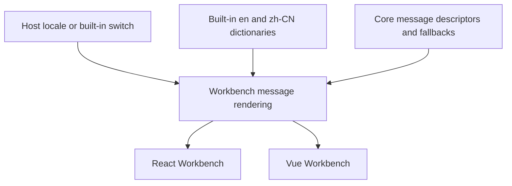

# Requirements: Bilingual Workbench i18n

## Summary

Add first-class English and Simplified Chinese support to the default React and Vue Workbench surfaces for npm package users. The first version should make the shipped Workbench usable in Chinese without forcing host applications to build their own UI, while keeping locale as host/UI state rather than durable scene state.

---

## Problem Frame

The current default Workbench experience exposes English text across toolbar actions, side panels, status labels, inspector fields, and problem descriptions. npm package users who want a Chinese product surface currently have to tolerate English or replace larger parts of the Workbench than the package contract should require.

The editor already treats durable project data carefully: scene state belongs in the versioned snapshot, while runtime and UI concerns stay outside serialized state. i18n should follow the same boundary. Language selection is a Workbench rendering concern, not part of `SceneSnapshot` or `.ek3d` project data.

Because React and Vue adapters are both public package surfaces, bilingual support must preserve parity across both. Because core currently contributes some display-oriented labels and problem text, the i18n contract also needs enough framework-neutral message identity to avoid duplicating English strings or binding core to a third-party i18n runtime.

---

## Key Decisions

- **Default Workbench first.** The first target is the default React and Vue Workbench shipped to npm users, not a fully custom host-application localization platform.
- **English and Simplified Chinese ship together.** `en` and `zh-CN` are built-in dictionaries for the first release. Additional languages are deferred.
- **Host control and built-in switching both matter.** Hosts must be able to set the Workbench locale from application state, and the default Workbench must also offer a built-in language switch that hosts can hide or control.
- **Coverage is full for shipped UI.** The first acceptable version covers toolbar, left panel, status bar, inspector fields, problem/diagnostic surfaces, empty states, placeholders, `title` attributes, and accessibility labels.
- **No required i18n runtime dependency.** The first version should not require npm users to install `i18next`, `react-i18next`, Vue I18n, or a similar runtime just to use the default bilingual Workbench.
- **Locale is not durable editor state.** Language choice must not be serialized into `SceneSnapshot`, `.ek3d`, asset manifests, history entries, or other durable scene data.
- **User-authored content stays as authored.** Scene names, object names, asset names, material names, file labels, and imported metadata are displayed as user data rather than translated UI text.

---

## Requirements

**Language Surface**

- R1. The default React Workbench must support `en` and `zh-CN` out of the box.
- R2. The default Vue Workbench must support `en` and `zh-CN` out of the box.
- R3. Host applications must be able to control the current Workbench locale through adapter-level configuration.
- R4. The default Workbench must provide a built-in language switch for package users who do not build their own settings UI.
- R5. Hosts must be able to hide, disable, or externally control the built-in language switch without forking Workbench components.
- R6. Changing locale must update Workbench text without requiring scene reload, asset re-import, editor recreation, or snapshot mutation.

**Text Coverage**

- R7. All default toolbar labels, button titles, aria labels, tooltips, and mode labels must be localized in both languages.
- R8. All default left-panel labels, tabs, section headings, empty states, recovery prompts, asset labels, and hierarchy UI chrome must be localized in both languages.
- R9. All default status bar text, selection summaries, transform status, loading state, and problem indicators must be localized in both languages.
- R10. All default inspector section headings, field labels, descriptions, validation messages, placeholders, select options, and action labels must be localized in both languages.
- R11. Problem and diagnostic displays must localize stable user-facing titles, explanations, severities, and suggested actions in both languages.
- R12. Raw runtime error messages from loaders, decoders, browsers, or host code may remain as fallback detail when no stable localized message exists, but the surrounding problem surface must still be localized.
- R13. User-authored names and imported metadata must render exactly as authored unless the host application explicitly changes those values.

**State and API Boundaries**

- R14. Locale and built-in switch state must remain session or host UI state and must not be written to `SceneSnapshot`, `.ek3d`, command history, asset records, or serialized runtime metadata.
- R15. Core and framework-neutral display models that currently expose literal English text must expose enough stable message identity, fallback text, and interpolation values for adapters to render localized messages.
- R16. Core must not depend on React, Vue, `i18next`, Vue I18n, or another framework-specific i18n runtime to provide message identity.
- R17. React and Vue adapters should share message keys and built-in dictionaries wherever their default Workbench surfaces represent the same concept.
- R18. Public adapter APIs should allow host applications to integrate their own translation layer later without replacing the entire Workbench.

**Quality and Maintenance**

- R19. Tests must verify representative React Workbench text in both `en` and `zh-CN`.
- R20. Tests must verify representative Vue Workbench text in both `en` and `zh-CN`.
- R21. Tests must verify that changing locale does not change serialized scene snapshots.
- R22. Browser or DOM-level checks must cover Chinese text fit in the toolbar, left panel, inspector, and status bar at narrow and desktop widths.
- R23. The repository should include a guardrail or reviewable audit path for newly introduced hardcoded default Workbench strings, with an allowlist for technical constants and user-authored content.
- R24. npm-facing docs must show how to use the default locale, how to control locale from a host app, how to use or hide the built-in switch, and why locale should not be persisted into scene state.

---

## Key Flows

- F1. npm user renders the default Workbench in Chinese
  - **Trigger:** A React or Vue package user configures the default Workbench with `zh-CN`.
  - **Actors:** Host application, React or Vue adapter, default Workbench.
  - **Steps:** The host passes locale configuration; the adapter selects the built-in Chinese dictionary; Workbench components render localized UI text.
  - **Outcome:** Toolbar, left panel, status bar, inspector, placeholders, titles, and accessibility labels appear in Simplified Chinese.
  - **Covers:** R1, R2, R3, R7, R8, R9, R10.

- F2. User switches language inside the default Workbench
  - **Trigger:** A package user relies on the built-in Workbench language switch.
  - **Actors:** Editor user, default Workbench, host application.
  - **Steps:** The user changes language from English to Chinese or Chinese to English; Workbench text updates; editor scene and asset state remain unchanged.
  - **Outcome:** The UI language changes immediately, and exported scene/project data does not contain locale or switch state.
  - **Covers:** R4, R5, R6, R14, R21.

- F3. Localized problem appears during runtime work
  - **Trigger:** An import, restore, validation, or runtime operation produces a known problem or diagnostic.
  - **Actors:** Core, adapter, default Workbench, editor user.
  - **Steps:** Core exposes a stable problem identity and fallback detail; the adapter renders the localized title, explanation, severity, and action; raw loader detail remains available when useful.
  - **Outcome:** Chinese users see a localized problem surface without losing technical fallback details needed for debugging.
  - **Covers:** R11, R12, R15, R16.

- F4. Host app controls language externally
  - **Trigger:** A host application has its own settings area or account-level language preference.
  - **Actors:** Host application, adapter, default Workbench.
  - **Steps:** The host passes its current locale to the Workbench and hides or controls the built-in switch; later host preference changes update the Workbench locale.
  - **Outcome:** The Workbench follows host application language without forcing duplicate controls.
  - **Covers:** R3, R5, R6, R18.

---

## Acceptance Examples

- AE1. **Covers R1, R2, R3, R7, R8, R9, R10.** Given the default React or Vue Workbench is configured with `zh-CN`, when the editor renders a normal scene, then the toolbar, left panel, status bar, inspector, titles, placeholders, and accessibility labels appear in Chinese.
- AE2. **Covers R4, R6, R14, R21.** Given a scene has been edited, when the user changes language through the built-in switch and then exports a snapshot, then the exported durable scene data does not contain locale or language switch state.
- AE3. **Covers R11, R12, R15.** Given a known asset-resolution problem occurs in Chinese locale, when the problem is displayed, then the problem title and suggested action are localized while raw loader detail remains available as fallback detail.
- AE4. **Covers R13.** Given an imported asset is named `motor-control-panel.glb` and an object is named `Pump A`, when the locale changes to `zh-CN`, then those user-authored labels remain unchanged.
- AE5. **Covers R17, R19, R20.** Given equivalent default Workbench surfaces in React and Vue, when representative locale tests run for English and Chinese, then shared concepts use the same message keys and equivalent translated text.
- AE6. **Covers R22.** Given Chinese locale on narrow and desktop viewport sizes, when the toolbar, panels, inspector, and status bar render, then localized text does not visibly overlap, clip critical content, or make controls unusable.

---

## Success Criteria

- npm package users can use the default React or Vue Workbench in Simplified Chinese without replacing major Workbench UI.
- English remains the built-in baseline and continues to work without extra configuration.
- Host applications can choose between external locale control and the built-in language switch.
- Locale changes never alter scene snapshots, project packages, history, assets, or runtime persistence data.
- React and Vue Workbench surfaces stay behaviorally and linguistically aligned for shared default UI.
- Known problems and diagnostics are understandable in Chinese while preserving technical fallback detail when needed.

---

## Scope Boundaries

### In Scope

- Built-in `en` and `zh-CN` message dictionaries for default Workbench UI.
- Locale configuration for React and Vue default Workbench adapters.
- Optional built-in language switch in the default Workbench.
- Localization for default toolbar, left panel, status bar, inspector, problems, diagnostics, placeholders, titles, and accessibility labels.
- Framework-neutral message identity for core-produced display models and problem descriptors.
- Tests and docs needed to make the bilingual package behavior reliable for npm users.

### Deferred

- Languages beyond English and Simplified Chinese.
- Machine translation workflows, translation management services, or external localization pipelines.
- Requiring or deeply integrating `i18next`, `react-i18next`, Vue I18n, FormatJS, or another runtime.
- Full async dictionary loading, remote locale packs, or third-party plugin language packs.
- Translating user-authored scene, object, asset, material, file, or metadata names.
- Persisting user language preference across browser sessions inside the editor package. Host applications may persist preferences externally.
- Full localization of arbitrary raw errors from browsers, loaders, decoders, or host-provided callbacks.

### Outside This Feature

- Changing the scene snapshot schema for language preference.
- Adding a new core plugin API.
- Reworking the Workbench layout beyond changes required to fit localized strings.
- Building a broader settings system unrelated to language selection.

---

## Dependencies and Assumptions

- The first audience is npm package users consuming the default React and Vue Workbench.
- `zh-CN` means Simplified Chinese copy for the first version.
- Existing render-prop, slot, and extension-region customization remains available but should not be required for basic Chinese usage.
- Raw third-party errors may remain English fallback text when the editor cannot reliably classify them.
- The editor continues to treat durable scene state and runtime/UI state as separate concerns.

---

## Outstanding Questions

### Deferred to Planning

- What exact adapter API names should represent host-controlled locale and built-in switch visibility?
- Should English or browser/application locale be the default when no locale is configured?
- Should dictionaries live in core, a shared internal package module, adapter packages, or generated artifacts?
- What minimal hardcoded-string guard should be added without creating noisy false positives?
- Which browser viewport sizes should be used for Chinese layout checks?
- How should host-provided custom labels or custom extension regions participate in localization?

---

## Sources

- Ideation artifact: `docs/ideation/2026-06-17-bilingual-i18n-support-ideation.html`
- Project overview and durable-state boundary: `README.md`
- Existing deferred localized shortcut note: `docs/plans/2026-06-01-001-feat-advanced-editor-operations-plan.md`
- Core inspector display model: `packages/core/src/inspector/types.ts`
- Core material inspector strings: `packages/core/src/inspector/material.ts`
- Core environment inspector strings: `packages/core/src/inspector/environment.ts`
- Core Workbench model strings and problem text: `packages/core/src/workbench/workbench-model.ts`
- React Workbench UI surfaces: `packages/react/src/components/WorkbenchToolbar.tsx`, `packages/react/src/components/WorkbenchLeftPanel.tsx`, `packages/react/src/components/WorkbenchStatusBar.tsx`, `packages/react/src/components/CameraInspector.tsx`
- Vue Workbench UI surfaces: `packages/vue/src/components/WorkbenchToolbar.vue`, `packages/vue/src/components/WorkbenchLeftPanel.vue`, `packages/vue/src/components/WorkbenchStatusBar.vue`, `packages/vue/src/components/CameraInspector.vue`
- i18next documentation: https://www.i18next.com/
- react-i18next documentation: https://react.i18next.com/
- Vue I18n documentation: https://vue-i18n.intlify.dev/
- MDN `Intl`: https://developer.mozilla.org/en-US/docs/Web/JavaScript/Reference/Global_Objects/Intl
