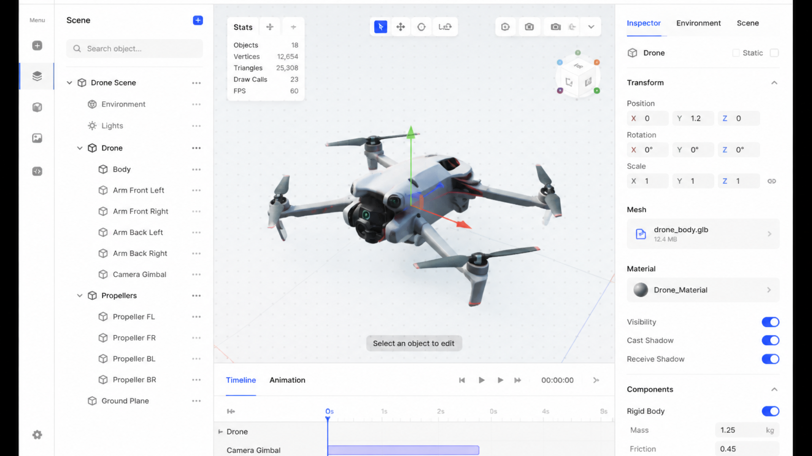

# 桌面工作台视觉改版：已确认设计与原型目标

日期：2026-09-14。讨论时仓库基线：`main` / `3ac1f12`。

本文保存用户已确认的设计方向，供独立原型会话使用；尚不是正式实现规格。当前完成了需求讨论和资料保存，尚未制作原型、修改工作台或验证视觉效果。

## 参考图

原图已从用户提供的剪贴板临时文件复制到 `assets/reference.png`，保留原始 3840 × 2160 像素。它是视觉参考，图中的标签、数值和功能不自动构成需求。

## 已确认设计

用户明确要求调整现有风格和布局，采纳下列建议；适配范围明确为“不需要考虑手机”。

| 部分 | 设计决定 |
| --- | --- |
| 视觉方向 | 整体布局、比例感和控件视觉尽量贴近参考图；控件按现有功能组织。白色连续面板、浅灰视口、细分隔线、低对比输入框、蓝色选中与激活状态。 |
| 空间组织 | 铺满桌面窗口，面板连续衔接，中央模型是视觉中心。支持不同桌面窗口尺寸，不做手机布局。 |
| 最左导航 | 独立窄导航栏，切换场景、资源、项目；左上项目菜单承接打开、导出等项目操作。 |
| 左侧面板 | 随导航展示场景树、资源库或项目信息，保留现有功能入口。 |
| 中央视口 | 大视口，顶部浮动工具栏。选择、变换放在顶部中央；撤销/重做保持直接可点；相机和辅助显示按操作关联分组。 |
| 右侧面板 | 通过对象属性、环境、场景分组组织编辑内容。具体字段归属在原型中检查。 |
| 底部 | 默认紧凑状态栏；点击问题入口展开详情。关闭详情后将空间还给视口。 |
| 面板操作 | 左右面板可分别收起、可拖动调整宽度；默认比例接近参考图。 |
| 展示场景 | 纳入首版：提供可直接编辑的展示模型，配置初始镜头和光照；保留导入用户模型的入口。无需复刻无人机模型。 |
| 实施顺序 | React 工作台作为首版设计基准，视觉和交互确认后再同步 Vue。Vanilla 不作为本轮视觉基准。 |
| 功能范围 | 第一阶段重排现有编辑能力；动画时间轴、动画编辑、刚体物理等不纳入本轮。 |

参考图底部时间轴改为上述状态与问题区域，因此中央视口高度不必机械复刻原图。图中的 Stats、摄像按钮、Static、Components 等只在已有能力适用时映射，不因截图出现而新增能力。

## 原型要回答的问题

核心问题：将现有功能放入这套桌面布局后，是否同时达到参考图的视觉效果、足够的模型展示空间和清晰的操作入口？

在已确认方向内验证以下细节，不重新开展无关风格探索：

1. 场景树与属性面板同时打开时，默认宽度、字号、行高是否兼顾可读性与视口空间。
2. 浮动工具栏的分组、密度和位置是否便于操作，是否遮挡模型或其他视口控件。
3. 收起、展开、调整左右面板宽度后，视口与浮动控件是否仍正确布局。
4. 底部问题详情展开后是否容易阅读，关闭后是否恢复视口空间。
5. 默认模型、镜头、光照和背景组合是否具有参考图的视觉完成度。
6. 场景、资源、项目切换以及右侧各组是否能容纳现有编辑入口；空选择、对象选中与问题状态是否清晰。

建议验证桌面窗口 1440 × 900 与 1920 × 1080，并人工缩窄窗口检查面板收放。尺寸是原型验证建议，不是用户指定的最低分辨率。模型资产、精确尺寸、图标和字体尚未选定，由原型选择并记录依据。

## 原型交付与验收

- 在独立原型工作目录中制作可预览的 React UI，明确标记为原型；给出一条启动命令。
- 至少演示导航切换、对象选择与属性展示、左右面板收放和调宽、问题区域展开与关闭。
- 展示场景中的模型可选中并变换，便于判断真实编辑状态下的视觉效果；优先复用已有运行时与可用资产。
- 记录哪些行为已真实接入，哪些仅模拟；原型不承担完整编辑器回归验收。
- 输出默认布局、面板收起、问题详情展开等关键状态截图，以及上述问题的结论和待决定项。
- 用户依据实际画面确认原型结论后，带回原型路径、分支、截图与结论，进入规格与任务拆分。

UI 原型技能若建议多种风格，本次以用户已确认参考图为约束，只比较有必要的布局密度或控件组织差异。原型无需扩展动画、物理或手机支持。

## 现有实现的定位线索

以下为讨论阶段的只读核对结果；接手时按当前代码局部确认，不将其当作已完成改造。

- React 示例入口：`examples/react-proof-loop/src/App.tsx`；完整布局由 `packages/react/src/components/EditorWorkbench.tsx` 提供。
- 现有布局为顶部工具栏、左面板、中间视口、右 Inspector、底部状态栏；样式在 `packages/react/src/components/workbench.css`。
- 左侧 Scene / Assets / Project 内容：`packages/react/src/components/WorkbenchLeftPanel.tsx`。
- 全局与视口操作目前集中于 `packages/react/src/components/WorkbenchToolbar.tsx`，改版需要重新分组。
- 属性、材质、环境、灯光、相机及问题入口：`packages/react/src/components/InspectorView.tsx`。
- 现有底部状态：`packages/react/src/components/WorkbenchStatusBar.tsx`；当前没有可编辑动画时间轴。
- Vue 对应工作台：`packages/vue/src/components/EditorWorkbench.vue`。Vanilla 当前是运行时 proof loop，不是完整工作台 UI。

原型接入真实编辑行为时，遵守仓库约束：持久编辑数据属于版本化 Scene Snapshot；Three.js 对象、File、Blob、object URL、已加载资源与面板 UI 状态不写入持久快照。需要理解架构或改变接口时，先阅读仓库 `docs/agents/domain.md` 及相关架构文档。

## 后续流程

本轮仅保存资料和交接入口。下阶段使用 `/prototype` 验证视觉，将结论通过 `/handoff` 带回；之后用 `/to-spec`、`/to-tickets` 形成可实现的规格与任务，最后逐项 `/implement`。

创建规格与任务前，读取 `docs/agents/issue-tracker.md`，使用仓库约定的 `.scratch/<feature>/` 目录。本文保持为讨论与视觉参考来源，不冒充已验收规格。
