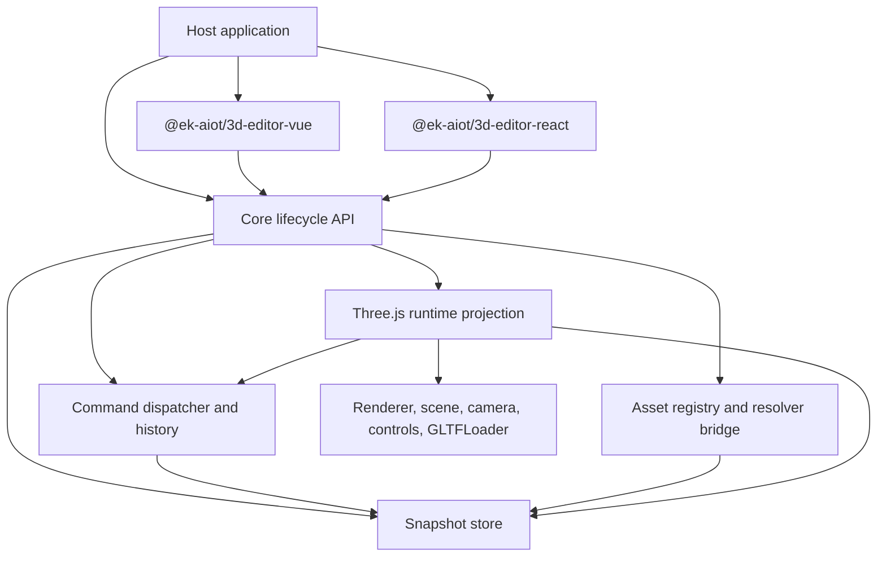
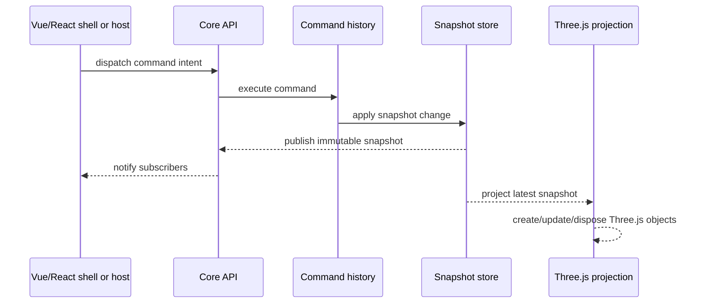
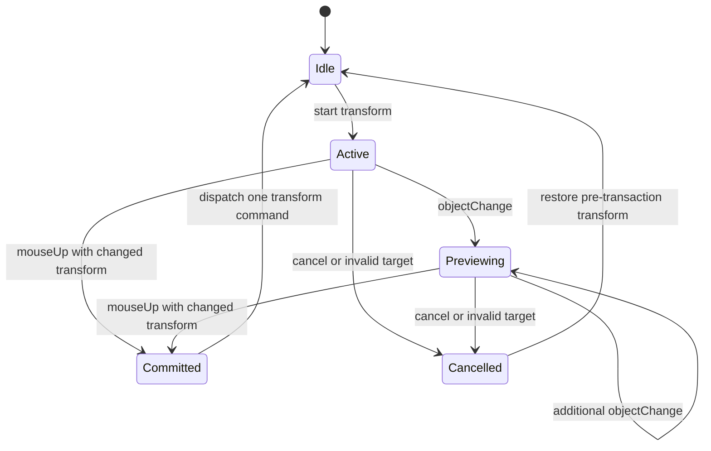
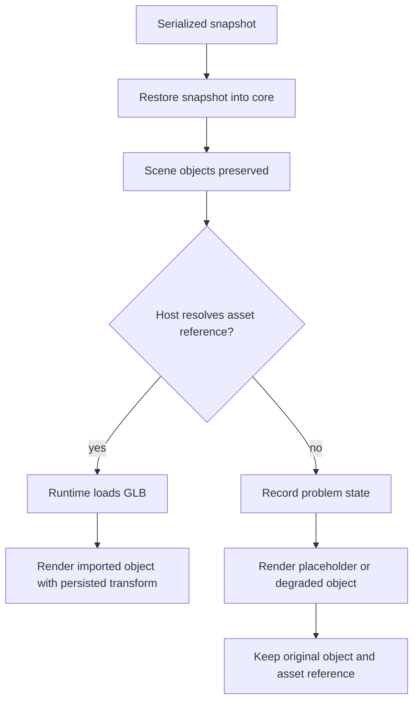

# feat: Establish 3D editor core contract

## Summary

Establish the first usable 3D editor package contract around `@ek-aiot/3d-editor-core`, `@ek-aiot/3d-editor-vue`, and `@ek-aiot/3d-editor-react`. The work builds a snapshot-first core that owns durable scene state, command/history behavior, asset references, Three.js runtime projection, GLB loading, object selection, transform transactions, serialization/restore, and thin framework shells for the first proof loop.

The target proof loop remains intentionally narrow: import a GLB, select it, transform it, undo/redo the transform, serialize the scene snapshot, and restore the snapshot into an equivalent rendered scene.

---

## Problem Frame

The repository is currently a greenfield git repository with only ideation and requirements documents. That means there are no existing source conventions, package boundaries, test harnesses, or runtime abstractions to preserve. The first implementation therefore needs to create the technical foundation and the proof loop together, while avoiding the main product risk from the origin document: letting durable editor state leak into Three.js objects, framework component state, object URLs, `File` objects, or ad hoc event handlers.

The plan follows the origin decision that Three.js runtime support belongs inside core for v1, while still splitting pure state logic from browser-bound runtime code internally. That keeps the first release to three npm packages and lets Vue and React shells depend on one framework-neutral editing contract rather than duplicating command, history, asset, or runtime lifecycle behavior (see origin: `docs/brainstorms/2026-05-28-core-editor-contract-requirements.md`).

---

## Requirements

### Core State Contract

- R1. `@ek-aiot/3d-editor-core` exposes a versioned, JSON-compatible scene snapshot as durable editor state.
- R2. The snapshot represents the first-loop scene data: scene identity, object identity, object hierarchy, object transform, selected object state, asset references, and runtime metadata needed to restore imported GLB objects.
- R3. The snapshot excludes Three.js instances, framework component state, Blob objects, object URLs, File objects, and browser-only runtime references.
- R4. Serialization and restoration round-trip the proof loop without requiring Vue or React.

### Commands and History

- R5. Durable edits flow through command execution rather than direct snapshot mutation from shells.
- R6. The first command set covers GLB import, selection change, transform change, undo, and redo.
- R7. Transform dragging commits as one undoable transform command per completed drag interaction.
- R8. Command execution updates the snapshot first; runtime projection reflects the resulting state.
- R9. Undo and redo restore both snapshot state and rendered runtime state for the proof loop.

### Three.js Runtime Projection

- R10. Core owns the Three.js runtime projection needed for the proof loop.
- R11. Runtime mounts into a host-provided DOM container and exposes deterministic disposal.
- R12. Runtime projects snapshot state into Three.js objects for imported GLB scene nodes, selected object state, and transforms.
- R13. Runtime supports core-owned object picking or an equivalent selection mechanism that dispatches selection commands.
- R14. Runtime integrates transform editing as a transaction with start, preview, commit, and cancel paths.
- R15. Runtime disposal cleans renderer, controls, loaded assets, event listeners, and Three.js resources.

### Assets and GLB Handling

- R16. Imported GLB resources are represented by stable asset references, not browser runtime objects.
- R17. Host applications can resolve asset references to loadable resources.
- R18. GLB import creates a scene object with stable identity, persisted transform, and enough asset metadata to restore after serialization.
- R19. Restore with a missing GLB preserves the scene object and surfaces problem state instead of deleting it.

### Framework and Package Contract

- R20. Core exposes a framework-neutral lifecycle API: create editor, mount runtime, subscribe to state, dispatch commands, serialize/restore snapshot, and dispose.
- R21. Core state subscription works for both React and Vue without framework-specific behavior in core.
- R22. Vue and React shells implement the first proof loop without duplicating command logic, asset logic, history behavior, or Three.js runtime lifecycle.
- R23. The first npm package boundary is `@ek-aiot/3d-editor-core`, `@ek-aiot/3d-editor-vue`, and `@ek-aiot/3d-editor-react`.
- R24. `@ek-aiot/3d-editor-core` may depend on Three.js directly in v1.
- R25. Vue and React remain peer dependencies of their shell packages, not dependencies of core.
- R26. Public exports expose only the first-loop and shell-integration contracts; internal runtime details stay private.

---

## Key Technical Decisions

- KTD1. Snapshot is the only durable source of truth: The core store writes durable edits into a versioned scene snapshot before runtime projection observes them. This preserves save/load, undo/redo, shell parity, and npm reuse, and it directly enforces R1-R9.
- KTD2. One core package, two internal layers: Core includes Three.js in v1, but the implementation should keep pure snapshot, command, history, serialization, and asset contract logic separate from browser-bound runtime classes. This honors R10 and R24 without making tests or non-DOM consumers depend on WebGL.
- KTD3. Host-resolved asset references: Imported GLB files enter snapshots as stable asset references plus metadata, while hosts resolve those references to URLs or other loadable resources at runtime. Missing assets become derived diagnostics and placeholders, not destructive model changes or replacement snapshot state.
- KTD4. Commands are the public editing contract: UI shells and runtime interactions dispatch command intent; they do not mutate snapshots directly. Import, selection, and transform changes become commands, and undo/redo operates on committed command history.
- KTD5. TransformControls is transaction-backed: Three.js `TransformControls` events are mapped to a start/preview/commit/cancel transaction. Preview may move runtime objects for responsiveness, but only the completed interaction creates one durable transform command.
- KTD6. Runtime projection owns Three.js side effects: Core owns renderer creation, scene projection, GLB loading, object maps, picking, controls, resize/listener wiring, and disposal. Vue and React shells should mount and dispose this runtime, not recreate its logic.
- KTD7. Shells are lifecycle adapters, not alternate editors: React uses an external-store subscription shape compatible with `useSyncExternalStore`, and Vue uses mount/unmount hooks with raw editor instances kept outside deep reactivity. Both shells call the same core API.
- KTD8. Publishable package boundaries exist from day one: Use a pnpm workspace with explicit package `exports`, TypeScript declarations, peer dependency boundaries, and private internal files. This prevents accidental public API from hardening before the editor contract is proven.
- KTD9. Initial build/test tooling is pragmatic, not product-defining: Start with TypeScript, Vite library mode for browser-oriented package builds, and Vitest for state and browser-capable tests. The exact bundler may be swapped during implementation if it fails the package contract, but the package API and test expectations stay stable.

---

## High-Level Technical Design

### Package and Runtime Topology



### Durable Edit Flow



### Transform Transaction Lifecycle



### Restore and Missing Asset Flow



---

## Output Structure

The expected greenfield shape is a scope declaration for the first implementation pass. The implementer may adjust small internal file splits if implementation reveals a cleaner layout, but the package boundaries and public contracts should remain stable.

```text
package.json
pnpm-workspace.yaml
tsconfig.base.json
vitest.config.ts
packages/
  core/
    package.json
    src/
      index.ts
      editor/
      snapshot/
      commands/
      history/
      assets/
      runtime/
      testing/
    test/
      fixtures/
  vue/
    package.json
    src/
      index.ts
      components/
      composables/
    test/
  react/
    package.json
    src/
      index.ts
      components/
      hooks/
    test/
examples/
  vanilla-proof-loop/
  vue-proof-loop/
  react-proof-loop/
docs/
  plans/
  brainstorms/
```

---

## Resolved Planning Questions

- Package names are fixed as `@ek-aiot/3d-editor-core`, `@ek-aiot/3d-editor-vue`, and `@ek-aiot/3d-editor-react`.
- Initial package build direction is Vite library mode plus TypeScript declaration generation. This is an implementation starting point, not an immutable API commitment.
- Core should be one npm package in v1 but internally split pure state modules from browser runtime modules so serialization, commands, and history remain testable without DOM or WebGL.
- The minimal GLB fixture should be a tiny generated box or equivalent static model under the core test fixtures. It should exercise metadata and transform restore without introducing a large binary dependency.
- React StrictMode and Vue unmount/remount behavior should be verified through shell lifecycle tests that mount, unmount, remount, and assert subscription/disposal behavior.

---

## Implementation Units

### U1. Workspace and package boundary scaffold

- **Goal:** Create the publishable TypeScript workspace skeleton for the three npm packages and examples.
- **Requirements:** R20-R26.
- **Dependencies:** None.
- **Files:** `package.json`, `pnpm-workspace.yaml`, `tsconfig.base.json`, `vitest.config.ts`, `packages/core/package.json`, `packages/core/src/index.ts`, `packages/core/src/public-api.test.ts`, `packages/vue/package.json`, `packages/vue/src/index.ts`, `packages/vue/src/public-api.test.ts`, `packages/react/package.json`, `packages/react/src/index.ts`, `packages/react/src/public-api.test.ts`.
- **Approach:** Use pnpm workspace package boundaries with package names `@ek-aiot/3d-editor-core`, `@ek-aiot/3d-editor-vue`, and `@ek-aiot/3d-editor-react`. Keep root scripts package-oriented and make each package declare explicit `exports` and declaration outputs. Core may depend on Three.js; Vue and React packages depend on core through workspace ranges and keep framework libraries as peers.
- **Patterns to follow:** Origin package-boundary decision; Node package `exports`; pnpm workspace protocol; Vite library mode for browser-oriented library builds.
- **Test scenarios:**
  - Importing each package root resolves only the intended public entry point and does not require framework packages from core.
  - Attempting to import internal runtime paths through package exports is rejected by the package boundary or absent from exported declarations.
  - The Vue package declares Vue as a peer dependency and core as a workspace dependency.
  - The React package declares React and React DOM as peer dependencies and core as a workspace dependency.
- **Verification:** The workspace has three independently addressable packages, type declarations are part of the package contract, and public entry points are narrow enough to keep internal runtime details private.

### U2. Snapshot store and serialization contract

- **Goal:** Define the versioned scene snapshot schema, editor store, state subscription, and serialize/restore APIs.
- **Requirements:** R1-R4, R20-R21; supports F3 and AE1, AE3.
- **Dependencies:** U1.
- **Files:** `packages/core/src/snapshot/types.ts`, `packages/core/src/snapshot/defaults.ts`, `packages/core/src/snapshot/validation.ts`, `packages/core/src/editor/store.ts`, `packages/core/src/editor/serialization.ts`, `packages/core/src/editor/subscription.ts`, `packages/core/src/snapshot/snapshot.test.ts`, `packages/core/src/editor/serialization.test.ts`, `packages/core/src/editor/subscription.test.ts`.
- **Approach:** Model snapshot data as plain JSON-compatible records with explicit version, scene ID, object IDs, hierarchy, transform values, selection state, asset references, and object metadata. Expose immutable subscriber snapshots so React and Vue can consume state without framework-specific behavior. Restoration should validate the first-loop schema and preserve unknown-but-allowed future metadata only when it remains JSON-compatible.
- **Execution note:** Start with failing round-trip and JSON-compatibility tests before broadening the schema.
- **Patterns to follow:** Origin snapshot-first contract; React external-store snapshot stability requirements; JSON serialization constraints from the ideation artifact.
- **Test scenarios:**
  - Covers AE1. Given a blank editor snapshot, when a GLB-backed object record is added and serialized, then the output contains scene ID, object ID, asset reference, and transform fields.
  - Given a snapshot containing a Three.js instance, Blob, File, object URL, function, or framework object, when validation runs, then validation rejects it before serialization.
  - Given a serialized proof-loop snapshot, when a fresh core instance restores it, then scene identity, object hierarchy, transforms, selection state, and asset references match the source snapshot.
  - Given no state changes between subscriber reads, when the store snapshot is read repeatedly, then subscribers receive a stable immutable snapshot reference or equivalent change-token behavior.
- **Verification:** The core can serialize and restore the first proof-loop scene without DOM, WebGL, Vue, or React.

### U3. Command dispatcher, selection, transforms, and history

- **Goal:** Implement the durable edit path for command execution, undo, redo, selection change, and transform change.
- **Requirements:** R5-R9, R13-R14; supports F2, F3 and AE2.
- **Dependencies:** U2.
- **Files:** `packages/core/src/commands/types.ts`, `packages/core/src/commands/dispatcher.ts`, `packages/core/src/commands/select-object.ts`, `packages/core/src/commands/set-transform.ts`, `packages/core/src/history/history.ts`, `packages/core/src/history/history.test.ts`, `packages/core/src/commands/dispatcher.test.ts`, `packages/core/src/commands/select-object.test.ts`, `packages/core/src/commands/set-transform.test.ts`.
- **Approach:** Keep commands as typed intents that apply snapshot changes through one dispatcher. Selection and transform commands should store enough before/after state for undo and redo. Runtime projection should observe store updates after command execution rather than acting as the source of durable state.
- **Execution note:** Implement new command behavior test-first because command semantics become the cross-package editing contract.
- **Patterns to follow:** Three.js editor's command/history architecture as prior-art inspiration, without copying its UI or broad command surface.
- **Test scenarios:**
  - Given a valid object ID, when a selection command is dispatched, then the snapshot selection changes and subscribers are notified once.
  - Given an unknown object ID, when a selection command is dispatched, then the command fails or reports a controlled problem without mutating snapshot state.
  - Given an object transform, when a transform command is executed, undone, and redone, then snapshot transform values move to after, before, and after states in order.
  - Covers AE2. Given several preview transform updates followed by one committed command, when history is inspected, then only one transform edit is undoable for that drag.
  - Given undo then a new command, when redo is requested, then stale redo history is cleared.
- **Verification:** Durable command execution is the only path used by selection and committed transform edits, and undo/redo restores snapshot state deterministically.

### U4. Asset registry and GLB import contract

- **Goal:** Add stable asset references, host asset resolution, GLB import command behavior, GLB restore metadata, and missing-asset problem state.
- **Requirements:** R2-R4, R6, R16-R19; supports F1, F3, F4 and AE1, AE5.
- **Dependencies:** U2, U3.
- **Files:** `packages/core/src/assets/types.ts`, `packages/core/src/assets/registry.ts`, `packages/core/src/assets/resolver.ts`, `packages/core/src/assets/problems.ts`, `packages/core/src/commands/import-glb.ts`, `packages/core/src/assets/registry.test.ts`, `packages/core/src/assets/resolver.test.ts`, `packages/core/src/commands/import-glb.test.ts`, `packages/core/test/fixtures/simple-box.glb`.
- **Approach:** Represent assets with stable IDs or URIs plus metadata needed to reload a GLB. The host provides resolver behavior, while the snapshot stores only references and durable import metadata. The import command creates a scene object through the command pipeline. Missing resolution produces derived problem state tied to the object and asset reference without replacing or deleting the durable object.
- **Patterns to follow:** Origin asset-reference decision; Three.js `GLTFLoader` supports GLB/glTF and optional decoder integrations, but Draco, KTX2, and Meshopt decoder configuration stay deferred.
- **Test scenarios:**
  - Covers AE1. Given a registered GLB asset, when import is dispatched, then the snapshot contains a stable asset reference, object identity, parent relationship, and default transform.
  - Given a browser `File` or object URL supplied by a host, when import completes, then the snapshot stores only the stable asset reference and metadata, not the runtime object or URL.
  - Covers AE5. Given a restored snapshot whose asset reference cannot be resolved, when restoration completes, then the scene object remains and a problem state is available.
  - Given two imports of the same source asset, when commands execute, then object identities remain distinct while asset references remain stable.
- **Verification:** GLB import and restore are portable across sessions and non-destructive when assets cannot be resolved.

### U5. Three.js runtime projection, picking, and disposal

- **Goal:** Implement the core-owned browser runtime that mounts into a DOM container, projects snapshots into Three.js, supports object picking, and disposes deterministically.
- **Requirements:** R8-R15, R17-R19; supports F1-F4 and AE4, AE5.
- **Dependencies:** U2, U3, U4.
- **Files:** `packages/core/src/runtime/editor-runtime.ts`, `packages/core/src/runtime/scene-projector.ts`, `packages/core/src/runtime/three-object-map.ts`, `packages/core/src/runtime/gltf-loader-adapter.ts`, `packages/core/src/runtime/picking.ts`, `packages/core/src/runtime/disposal.ts`, `packages/core/src/runtime/problems.ts`, `packages/core/src/runtime/editor-runtime.test.ts`, `packages/core/src/runtime/scene-projector.test.ts`, `packages/core/src/runtime/disposal.test.ts`, `packages/core/src/runtime/picking.browser.test.ts`.
- **Approach:** Treat Three.js as a projection of the latest snapshot. Maintain a mapping from scene object IDs to runtime `Object3D` instances, load GLB assets through the host resolver, dispatch selection commands from picking, and centralize disposal of renderer, controls, loaded object graphs, textures, materials, geometries, event listeners, and animation loops.
- **Execution note:** Use adapter/fake-based tests for most lifecycle behavior and browser-capable tests for the mount/picking behaviors that require DOM or canvas semantics.
- **Patterns to follow:** Three.js `GLTFLoader` lifecycle notes; Three.js disposal expectations for geometries/materials/textures; origin runtime-projection decision.
- **Test scenarios:**
  - Given a snapshot with a resolvable GLB object, when runtime projects it, then a Three.js object is created and associated with the durable scene object ID.
  - Given a transform command updates the snapshot, when runtime observes the change, then the projected object transform matches the committed snapshot transform.
  - Given a pickable object is clicked or otherwise selected by the runtime selection mechanism, when the runtime resolves the object ID, then a selection command is dispatched rather than direct snapshot mutation.
  - Covers AE4. Given a mounted runtime with loaded GLB content and controls, when dispose is called, then renderer resources, controls, listeners, object maps, and loaded Three.js resources are released.
  - Given dispose is called twice, when the second call runs, then it is safe and does not throw or leak duplicate cleanup behavior.
  - Covers AE5. Given a missing asset problem, when runtime projects the object, then a placeholder or degraded problem object is rendered while preserving the scene object mapping.
- **Verification:** Core can mount, render, update, pick, and dispose the proof-loop runtime without Vue or React owning Three.js behavior.

### U6. TransformControls transaction integration

- **Goal:** Wire Three.js transform editing into the command/history model with preview, commit, and cancel semantics.
- **Requirements:** R7, R9, R12, R14; supports F2 and AE2.
- **Dependencies:** U3, U5.
- **Files:** `packages/core/src/runtime/transform/transform-controller.ts`, `packages/core/src/runtime/transform/transform-transaction.ts`, `packages/core/src/runtime/transform/transform-mode.ts`, `packages/core/src/runtime/transform/transform-transaction.test.ts`, `packages/core/src/runtime/transform/transform-controller.browser.test.ts`.
- **Approach:** Attach transform controls to the selected runtime object, capture the pre-drag transform at transaction start, allow runtime preview during movement, and dispatch one transform command on commit. Cancellation restores the pre-transaction runtime transform and leaves history unchanged.
- **Patterns to follow:** Three.js `TransformControls` exposes translate/rotate/scale modes plus `mouseDown`, `objectChange`, and `mouseUp` events that map naturally to transaction boundaries.
- **Test scenarios:**
  - Covers AE2. Given an imported object, when a transform starts, previews multiple object changes, and commits, then history receives exactly one transform command.
  - Given an active transform is cancelled, when cancellation completes, then the projected object returns to its pre-transaction transform and no durable command is recorded.
  - Given the selected object changes during an active transform, when the transaction resolves, then the transaction either cancels safely or commits only against the original object according to the core policy, with no partial snapshot mutation.
  - Given translate, rotate, and scale modes, when each mode commits a transform, then only the relevant transform fields change and undo restores the prior values.
- **Verification:** Transform editing feels interactive but history remains readable: one completed drag equals one undoable command.

### U7. Framework-neutral editor lifecycle API

- **Goal:** Expose the minimal core API that shell packages and vanilla hosts use to create, mount, subscribe, dispatch, serialize, restore, and dispose editor instances.
- **Requirements:** R4, R8-R11, R20-R22; supports F3 and AE3, AE4.
- **Dependencies:** U2, U3, U4, U5, U6.
- **Files:** `packages/core/src/editor/create-editor.ts`, `packages/core/src/editor/editor-api.ts`, `packages/core/src/editor/lifecycle.ts`, `packages/core/src/editor/create-editor.test.ts`, `packages/core/src/editor/lifecycle.test.ts`, `packages/core/src/editor/proof-loop.test.ts`.
- **Approach:** Compose store, dispatcher, history, asset registry, serialization, and optional runtime mounting behind one framework-neutral editor instance. The API should make browser runtime mounting explicit so pure state tests and non-visual flows remain possible. Disposal should be idempotent and should close both runtime and subscription resources.
- **Patterns to follow:** Origin framework-neutral lifecycle requirement; React external store integration; Vue mount/unmount lifecycle.
- **Test scenarios:**
  - Given a new editor, when a subscriber is registered and a command is dispatched, then the subscriber sees the updated immutable snapshot and can unsubscribe.
  - Given a serialized proof-loop snapshot, when a new editor restores it without mounting runtime, then core state and history behavior still work.
  - Given an editor mounts runtime into a DOM container and then disposes, then runtime disposal and store subscription cleanup both occur.
  - Covers AE3. Given the same restored snapshot, when accessed through the core API, then no framework-specific command or runtime lifecycle hook is required.
  - Covers AE4. Given dispose is called after mount and import, then all core-owned runtime and editor resources are released through the same lifecycle API.
- **Verification:** A vanilla host can complete the proof loop through core alone, proving that Vue and React are adapters over the same contract.

### U8. Vue shell adapter and proof-loop example

- **Goal:** Build the Vue package as a thin adapter over core lifecycle, state subscription, and runtime mounting.
- **Requirements:** R20-R22, R25-R26; supports F1-F3 and AE3, AE4.
- **Dependencies:** U7.
- **Files:** `packages/vue/src/composables/use-editor.ts`, `packages/vue/src/components/EditorViewport.vue`, `packages/vue/src/index.ts`, `packages/vue/test/use-editor.test.ts`, `packages/vue/test/editor-viewport.test.ts`, `examples/vue-proof-loop/package.json`, `examples/vue-proof-loop/src/App.vue`, `examples/vue-proof-loop/src/main.ts`.
- **Approach:** Keep Vue-specific code responsible for component lifecycle and presentation only. Use Vue mount/unmount hooks to create or bind editor instances and dispose runtime, and keep the core editor instance out of deep reactivity. Import, select, transform, undo/redo, serialize, and restore should call core APIs.
- **Patterns to follow:** Vue composition lifecycle hooks; Vue `shallowRef` and raw-instance patterns from the origin ideation.
- **Test scenarios:**
  - Covers AE3. Given a restored snapshot, when the Vue shell mounts it, then it renders through core runtime without custom Vue command or asset logic.
  - Given the Vue viewport component mounts and unmounts, when lifecycle hooks run, then core mount and dispose are called exactly through the shell contract.
  - Given the Vue shell remounts with the same editor or restored snapshot, when subscriptions are recreated, then stale subscribers and duplicate runtime listeners are not retained.
  - Given a Vue user action requests undo or redo, when the action fires, then the shell dispatches core history behavior rather than maintaining Vue-local history.
- **Verification:** Vue proves the first proof loop without owning command, asset, history, or Three.js runtime logic.

### U9. React shell adapter and proof-loop example

- **Goal:** Build the React package as a thin adapter over core lifecycle, state subscription, and runtime mounting.
- **Requirements:** R20-R22, R25-R26; supports F1-F3 and AE3, AE4.
- **Dependencies:** U7.
- **Files:** `packages/react/src/hooks/use-editor.ts`, `packages/react/src/components/EditorViewport.tsx`, `packages/react/src/index.ts`, `packages/react/test/use-editor.test.tsx`, `packages/react/test/editor-viewport.test.tsx`, `packages/react/test/strict-mode.test.tsx`, `examples/react-proof-loop/package.json`, `examples/react-proof-loop/src/App.tsx`, `examples/react-proof-loop/src/main.tsx`.
- **Approach:** Expose hooks and components that subscribe to core state using a stable external-store contract and mount runtime in effects. React code should handle StrictMode double setup/cleanup in development by making mount/dispose idempotent through core lifecycle calls.
- **Patterns to follow:** React `useSyncExternalStore` for external state; React effect cleanup expectations; origin thin-shell decision.
- **Test scenarios:**
  - Covers AE3. Given a restored snapshot, when the React shell mounts it, then it renders through core runtime without custom React command or asset logic.
  - Given React StrictMode mounts, cleans up, and remounts the viewport, when the component settles, then runtime disposal is balanced and no duplicate listeners or subscriptions remain.
  - Given core state changes, when a React component reads editor state through the hook, then it re-renders from the core snapshot and does not create a new subscribe function every render.
  - Given a React user action requests import, transform commit, undo, redo, save, or restore, when the action fires, then it delegates to core APIs.
- **Verification:** React proves the same proof loop and lifecycle semantics as Vue without duplicating editor behavior.

### U10. Cross-package proof-loop verification and docs

- **Goal:** Add the end-to-end validation surface and minimal documentation for the first proof loop across vanilla core, Vue, and React.
- **Requirements:** R1-R26; covers F1-F4 and AE1-AE5.
- **Dependencies:** U1-U9.
- **Files:** `examples/vanilla-proof-loop/package.json`, `examples/vanilla-proof-loop/src/main.ts`, `examples/vanilla-proof-loop/src/proof-loop.ts`, `packages/core/src/editor/proof-loop.integration.test.ts`, `packages/core/src/runtime/missing-asset.integration.test.ts`, `packages/vue/test/vue-proof-loop.integration.test.ts`, `packages/react/test/react-proof-loop.integration.test.tsx`, `README.md`, `packages/core/README.md`, `packages/vue/README.md`, `packages/react/README.md`.
- **Approach:** Create a minimal vanilla proof loop and shell examples that exercise the same imported fixture and asset resolver shape. Documentation should describe the experimental `0.x` contract, package names, snapshot-first rule, asset resolver responsibility, and the deliberately deferred workbench/material/environment scope.
- **Execution note:** Treat this as characterization of the public contract: tests should assert user-visible proof-loop outcomes, not private class names.
- **Patterns to follow:** Origin success criteria and scope boundaries; package README should avoid promising deferred editor breadth.
- **Test scenarios:**
  - Covers AE1. Given a blank vanilla core editor and the fixture GLB, when import and serialize run, then the saved snapshot includes stable asset reference, object identity, and transform.
  - Covers AE2. Given the fixture object, when a transform interaction commits once, then undo returns to the pre-drag transform and redo reapplies the committed transform.
  - Covers AE3. Given the same restored snapshot and resolver, when loaded through Vue and React examples, then both shells rely on core command/runtime lifecycle behavior.
  - Covers AE4. Given each proof-loop surface mounts runtime and imports a GLB, when it disposes, then core resource cleanup is invoked and no shell-specific cleanup of Three.js internals is required.
  - Covers AE5. Given the proof snapshot references an unresolvable asset, when restored through core and shells, then scene object identity remains and problem state is visible to shell-level UI.
- **Verification:** The first proof loop is demonstrable without frameworks and through both shell packages using the same core contract.

---

## Phased Delivery

| Phase | Units | Outcome |
|---|---|---|
| Foundation | U1-U4 | Publishable workspace, snapshot/store contract, command/history engine, and GLB asset references exist without needing DOM or WebGL. |
| Runtime | U5-U7 | Core can mount Three.js runtime, project snapshots, pick objects, transform with one command per drag, serialize/restore, and dispose. |
| Shell parity | U8-U10 | Vue and React adapters prove the same proof loop and documentation explains the experimental package contract. |

---

## Scope Boundaries

### In Scope for This Plan

- Snapshot state contract for the first proof loop.
- Command execution and undo/redo for import, selection, and transform.
- Core-owned Three.js runtime projection.
- GLB import and restore through asset references.
- Runtime lifecycle required by Vue and React shells.
- Experimental npm package boundaries for `@ek-aiot/3d-editor-core`, `@ek-aiot/3d-editor-vue`, and `@ek-aiot/3d-editor-react`.
- Minimal vanilla, Vue, and React proof-loop examples.

### Deferred for Later Planning

- Material editing for `MeshStandardMaterial` fields.
- HDR environment, skybox, PMREM controls, and lighting inspector.
- Full editor workbench: hierarchy panel, inspector panel, problems panel, toolbar, shortcuts, and layout polish.
- Schema-driven inspector definitions shared by Vue and React.
- Project package format such as `.ek3d` zip bundles with assets and manifest.
- Draco, KTX2, and Meshopt decoder configuration beyond the minimal GLB path.
- Multi-select, grouping, copy/paste, duplicate, delete, snapping UI, and transform gizmo polish.
- Public developer documentation beyond the examples needed for internal reuse.
- Changesets release workflow, CI publish gates, and package provenance hardening.

### Outside This Product Identity for MVP

- Full Le5le-style low-code platform behavior.
- MQTT/WebSocket data binding.
- Event orchestration, animation timeline, multi-scene linkage, and runtime dashboard publishing.
- Model marketplace or bundled model library.
- WebGPU-first renderer.
- Shader editor, node material editor, physics editor, CAD tooling, 3D Tiles, or large-model streaming.

---

## System-Wide Impact

- **Public API surface:** Package `exports`, type declarations, snapshot schema, command names, asset reference shape, editor lifecycle methods, and shell hooks/components become the first reusable contract for future applications.
- **State lifecycle:** Durable state moves through snapshot and commands only. Runtime projection, framework component state, and asset resolver outputs must remain derived or transient.
- **Runtime lifecycle:** Core owns renderer/control/loader/listener cleanup. Shell packages should not need to know which Three.js resources exist internally.
- **Asset trust boundary:** Core should load assets only through the host-provided resolver contract. The resolver output is runtime input, not durable state, and failures should be surfaced through diagnostics rather than hidden fallback mutation.
- **Cross-framework parity:** Vue and React examples become parity tests for the core contract. A behavior available in one shell should be available through core and therefore usable in the other shell.
- **Future package extraction:** Keeping pure core logic separate from browser runtime modules inside `@ek-aiot/3d-editor-core` preserves the option to split runtime into a separate package later without forcing it in v1.

---

## Risks and Dependencies

| Risk / Dependency | Impact | Mitigation |
|---|---|---|
| Browser/WebGL tests can become brittle or slow. | Runtime and shell lifecycle defects may be hard to verify reliably. | Put most behavior behind fakes/adapters and reserve browser-capable tests for mount, picking, and transform interactions that require DOM/canvas semantics. |
| Snapshot schema may overfit the first GLB fixture. | Later material, lights, and environment work could require breaking schema changes. | Version the snapshot from the start, keep metadata extensible but JSON-compatible, and document that `0.x` API stability is experimental. |
| Transform preview can drift from committed snapshot state. | Visual state and durable history could disagree after drag or cancel. | Keep preview inside an explicit transaction, restore on cancel, and assert commit/undo/redo outcomes against snapshot and runtime projection. |
| Asset resolver behavior is host-provided. | Different applications may resolve local files, URLs, or CDN assets differently. | Keep the resolver interface small, persist only asset references, and test missing-asset recovery as a first-class flow. |
| Host-resolved assets are a trust boundary. | Core could accidentally normalize arbitrary URLs or runtime blobs into durable state. | Require all loads to pass through the resolver contract, keep resolver outputs transient, and reject browser runtime references during snapshot validation. |
| Large GLB files can create resource pressure. | Renderer memory, texture lifetime, or long parsing work can make the proof loop unstable. | Keep the first fixture small, centralize disposal, and defer large-model streaming or decoder tuning to later planning. |
| Package exports can accidentally expose internal runtime details. | Internal classes may become public API too early. | Gate public entry points through explicit `exports` and add public API tests before implementation grows. |
| React and Vue shells may drift. | Consumers could get different editor behavior by framework. | Keep shells thin and assert parity through shared proof-loop scenarios and shared core commands. |

---

## Acceptance Examples

| ID | Acceptance Example | Covered By |
|---|---|---|
| AE1 | Given a blank editor, when a GLB is imported and the snapshot is serialized, then the snapshot includes a stable asset reference, stable object identity, and that object's transform. | U2, U4, U10 |
| AE2 | Given an imported object, when the user drags it for several seconds and releases, then history contains one transform edit; undo returns the object to its pre-drag transform; redo reapplies the committed transform. | U3, U6, U10 |
| AE3 | Given the same restored snapshot, when it is loaded through the core from either a Vue or React shell, then neither shell needs custom command or runtime lifecycle logic to render and edit the object. | U2, U7, U8, U9, U10 |
| AE4 | Given an editor instance has mounted and loaded a GLB, when the host disposes the core, then renderer resources, controls, event listeners, and loaded Three.js resources are released through the core-owned dispose path. | U5, U7, U8, U9, U10 |
| AE5 | Given a saved snapshot references a GLB the host cannot resolve, when the snapshot is restored, then the object remains in the scene model and a problem state is available to the shell. | U4, U5, U10 |

---

## Documentation and Operational Notes

- Package READMEs should state that the API is experimental `0.x` and optimized for the author's own applications first.
- Root README should describe the three packages, the snapshot-first rule, the proof loop, and the current non-goals.
- Example documentation should show host asset resolution conceptually without introducing project packaging or asset bundling promises.
- Release automation, Changesets, provenance hardening, and CI publish gates remain deferred; package metadata should still be structured so those can be added later without renaming packages.

---

## Deferred Implementation Notes

- Exact internal class/function names should be decided during implementation, as long as the public API remains narrow and typed.
- The final browser test provider can be chosen during implementation based on what works reliably with WebGL in this repo.
- The fixture GLB can be generated or checked in, but it should stay tiny and deterministic.
- If Vite library mode proves awkward for declaration output or peer externalization, implementation may switch to another bundler while preserving package exports, peer dependencies, and tests.

---

## Sources and Research

- Origin requirements: `docs/brainstorms/2026-05-28-core-editor-contract-requirements.md`
- Origin ideation: `docs/ideation/2026-05-28-threejs-3d-editor-mvp-ideation.md`
- Repository research: current repo has no source files, package config, tests, `STRATEGY.md`, or `docs/solutions/`; it is a greenfield planning target.
- Three.js `TransformControls`: https://threejs.org/docs/pages/TransformControls.html
- Three.js `GLTFLoader`: https://threejs.org/docs/pages/GLTFLoader.html
- React `useSyncExternalStore`: https://react.dev/reference/react/useSyncExternalStore
- Vue composition lifecycle hooks: https://vuejs.org/api/composition-api-lifecycle
- Node package `exports`: https://nodejs.org/api/packages.html
- pnpm workspaces: https://pnpm.io/workspaces
- Vite library mode: https://vite.dev/guide/build#library-mode
- Vitest browser mode: https://vitest.dev/guide/browser/
