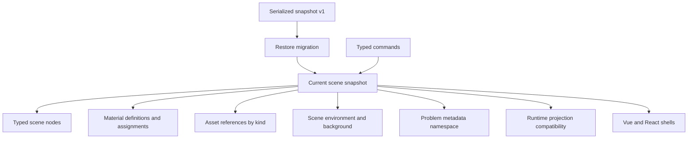
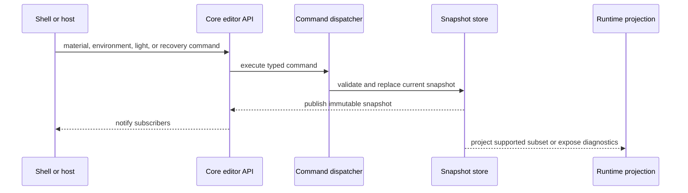
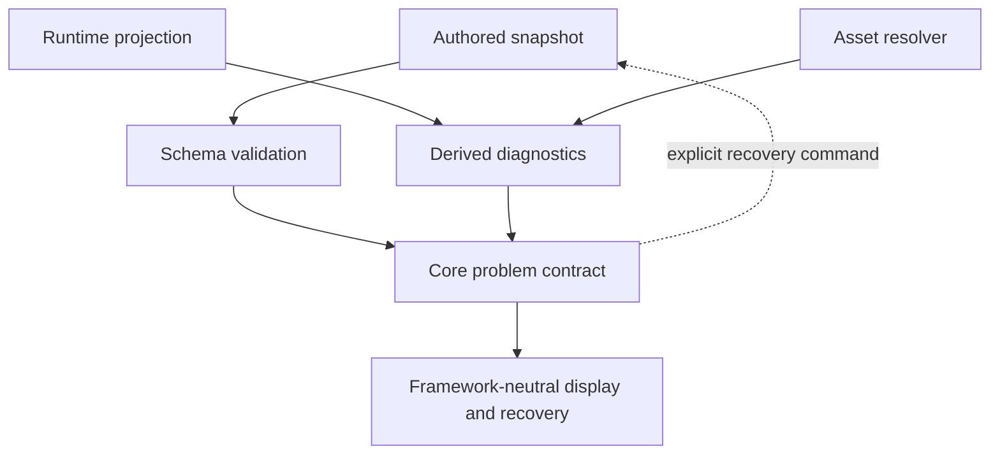

# feat: Extend core schema for editable scene properties

## Summary

Extend `@ek-aiot/3d-editor-core` from the first GLB proof-loop schema into a versioned scene model that can durably represent editable material overrides, texture/HDR asset references, scene environment settings, light definitions, and richer framework-neutral problem metadata.

This is a schema-first follow-up. It prepares the contract that runtime rendering and inspector UX will consume later, while preserving the snapshot-first rule, command/history path, JSON compatibility, and Vue/React neutrality established by the first plan.

---

## Problem Frame

The completed core contract proves the first loop: import a GLB, select it, transform it, undo/redo, serialize, restore, and project it through the core runtime. The current model is intentionally narrow: `SceneSnapshot` version 1 stores GLB scene objects, transforms, selection, GLB assets, and minimal runtime-derived problems.

The next backlog item should be `Core schema` because material editing, environment/HDR work, light editing, inspector panels, and richer asset recovery all depend on a durable contract. If those capabilities are implemented directly in Three.js runtime objects or framework panels first, the project reintroduces the exact risk the origin document avoided: durable editor state scattered across runtime objects, UI state, and ad hoc event handlers.

This plan expands the core contract, not the full visual editor surface. Runtime capability can later map the new environment, material, texture, and light schema to Three.js with PMREM, texture disposal, and helpers. Inspector UX can later render controls from these contracts without inventing separate Vue and React behavior.

---

## Requirements

### Versioning and Compatibility

- R1. The core must introduce a new current snapshot schema that extends the first proof-loop model without storing Three.js instances, framework state, browser files, object URLs, functions, or other runtime references.
- R2. Existing version 1 proof-loop snapshots must restore through a defined migration or normalization path into the new current schema.
- R3. Serialization must continue to emit portable JSON-compatible state with stable scene identity, node identity, hierarchy, transform, selection, assets, and metadata.
- R4. Snapshot validation must reject invalid ranges, missing references, non-finite numbers, unsupported enum values, and non-JSON-compatible metadata before state reaches command history.

### Materials and Texture Assets

- R5. The schema must represent a deliberately small editable `MeshStandardMaterial` subset: color, metalness, roughness, emissive, emissive intensity, opacity, transparency, side, environment intensity, and basic texture slots.
- R6. Texture and HDR inputs must be represented by stable asset references and texture-slot metadata, not loaded `Texture` instances, `ImageBitmap`, `Blob`, `File`, object URLs, or renderer outputs.
- R7. Material edits must flow through command execution so undo/redo and cross-framework behavior remain consistent.
- R8. The material model must leave room for GLB material-slot discovery without requiring this plan to solve full per-mesh material extraction.

### Environment and Lights

- R9. The schema must represent scene-level background and environment intent: color, texture/HDR asset references, intensity, rotation, and background blur where relevant.
- R10. The schema must represent editable light definitions with stable IDs, names, transforms where meaningful, color/intensity fields, and type-specific fields for the MVP light set.
- R11. Environment and light edits must use command/history behavior rather than direct snapshot mutation from runtime or shell code.
- R12. The runtime projection must remain compatible with snapshots containing the new schema, even though full HDR/PMREM, skybox rendering, light helpers, and texture lifecycle policies are deferred to the runtime-capability plan.

### Problem Metadata and Public Contract

- R13. The core must expose a richer problem contract with stable IDs, severity, code, source, target, asset references when applicable, recoverability, and framework-neutral display metadata.
- R14. Runtime load failures and resolver failures must remain derived diagnostics by default; they must not be silently written into authored scene data during projection.
- R15. The public API must export the new schema, command, asset, and problem types needed by shell packages and future inspector controls without exposing private runtime implementation details.
- R16. The existing vanilla, Vue, and React proof-loop behavior must remain valid after the schema expansion.

---

## Key Technical Decisions

- KTD1. Snapshot version advances with migration support: Treat the schema expansion as a new current snapshot version and make restoration accept the first proof-loop snapshot through a migration path. This keeps future schema changes explicit while protecting existing saved proof-loop scenes.
- KTD2. Scene nodes become a typed durable model: Keep the existing hierarchy and transform concepts, but evolve the object model into a typed scene-node contract that can represent GLB-backed nodes and future editable light nodes without creating separate framework-owned selection or hierarchy systems.
- KTD3. Material edits are overrides, not a full GLTF material graph: The first material contract should model editor-authored `MeshStandardMaterial` overrides and texture slots. It should not attempt to persist every Three.js material field, clone a complete GLTF material tree, or introduce node/shader materials.
- KTD4. Asset references grow by kind: Extend the asset contract beyond GLB so material textures, HDR environments, and skybox/background images use the same host-resolution boundary. Resolver outputs remain transient runtime inputs.
- KTD5. Environment schema captures intent, not PMREM implementation: Store scene background and environment fields that map cleanly to Three.js `Scene` concepts, but defer loader wiring, PMREM render targets, GPU texture disposal, and visual skybox polish to runtime capability work.
- KTD6. Light schema is authoring data first: Define stable light records and command semantics now; require runtime projection compatibility but defer full helper UI, shadows, RectAreaLight setup, and polished light rendering controls.
- KTD7. Problems separate authored state from diagnostics: Persist only schema-owned metadata or explicit user-authored recovery state. Derived resolver/runtime problems should be exposed through the core problem contract without mutating the saved snapshot.
- KTD8. Commands remain the editing boundary: New material, environment, light, and problem-recovery operations should enter through typed commands so history and shell parity do not fork.

---

## High-Level Technical Design

### Schema Expansion Flow

### Durable Edit Path

### Problem Ownership

---

## Implementation Units

### U1. Snapshot version 2 foundation and migration

- **Goal:** Introduce the new current snapshot version, migration from the first proof-loop schema, expanded validation, and serialization/restore compatibility.
- **Requirements:** R1-R4, R16.
- **Dependencies:** None.
- **Files:** `packages/core/src/snapshot/types.ts`, `packages/core/src/snapshot/defaults.ts`, `packages/core/src/snapshot/validation.ts`, `packages/core/src/snapshot/immutability.ts`, `packages/core/src/snapshot/migrations.ts`, `packages/core/src/editor/serialization.ts`, `packages/core/src/editor/create-editor.ts`, `packages/core/src/snapshot/snapshot.test.ts`, `packages/core/src/editor/serialization.test.ts`, `packages/core/src/editor/proof-loop.test.ts`.
- **Approach:** Add explicit versioned serialized snapshot types and keep the editor store on the current normalized shape. Restore should accept the previous proof-loop snapshot and normalize it into the new schema with default material, environment, and problem metadata. Validation should remain strict about JSON compatibility and structural references, while allowing future-compatible metadata only where it is explicitly typed as JSON.
- **Execution note:** Start with migration and round-trip tests before adding feature-specific schema fields.
- **Patterns to follow:** Existing `SNAPSHOT_VERSION`, `createEmptySnapshot`, `validateSceneSnapshot`, `immutableClone`, and proof-loop serialization tests.
- **Test scenarios:**
  - Given a version 1 serialized proof-loop snapshot, when it is restored, then the editor stores the current snapshot version while preserving scene ID, object ID, transform, selection, and GLB asset reference.
  - Given a current empty snapshot, when it is serialized and restored, then default material, environment, light, and problem namespaces are present in normalized form.
  - Given metadata containing a function, `Blob`, `File`, object URL, Three.js object, circular reference, or non-finite number, when validation runs, then the snapshot is rejected before history records the change.
  - Given a migrated proof-loop scene, when import, select, transform, undo, redo, serialize, and restore run, then the first proof-loop behavior remains unchanged.
- **Verification:** Current editor instances can consume both old proof-loop snapshots and new schema snapshots without framework or runtime objects entering durable state.

### U2. Material and texture schema contract

- **Goal:** Add the core material model, texture asset references, material validation, material commands, and undo/redo behavior.
- **Requirements:** R5-R8, R15-R16.
- **Dependencies:** U1.
- **Files:** `packages/core/src/materials/types.ts`, `packages/core/src/materials/defaults.ts`, `packages/core/src/materials/validation.ts`, `packages/core/src/materials/materials.test.ts`, `packages/core/src/assets/types.ts`, `packages/core/src/assets/registry.ts`, `packages/core/src/assets/registry.test.ts`, `packages/core/src/commands/types.ts`, `packages/core/src/commands/dispatcher.ts`, `packages/core/src/commands/set-material.ts`, `packages/core/src/commands/set-material.test.ts`, `packages/core/src/public-api.ts`, `packages/core/src/public-api.test.ts`.
- **Approach:** Model material edits as editor-authored overrides with stable IDs and assignment targets rather than serialized Three.js material instances. Support a small `MeshStandardMaterial` subset and texture slots that point to asset references. Use validation to reject invalid numeric ranges, unsupported sides, missing asset references, and incompatible texture-slot shapes before command history records the edit.
- **Patterns to follow:** Existing asset registry and command dispatcher patterns; Three.js `MeshStandardMaterial` metallic-roughness fields; Three.js `Material` opacity, transparency, and side behavior; Three.js `Texture` color-space and disposal constraints.
- **Test scenarios:**
  - Given a GLB object and a material override command setting color, metalness, roughness, opacity, and side, when the command executes, then the snapshot stores only JSON-compatible material data and history records one undoable edit.
  - Given a texture slot referencing a registered texture asset, when serialization runs, then the snapshot contains the stable asset reference and texture-slot metadata, not a runtime `Texture`, image object, or object URL.
  - Given metalness, roughness, opacity, emissive intensity, or environment intensity outside the supported range, when validation runs, then the command fails without mutating the snapshot.
  - Given undo and redo around a material command, when the editor state is inspected, then material assignments return to the previous and next values deterministically.
  - Given a migrated version 1 snapshot with no material namespace, when a material command targets a GLB object, then defaults are created through the current schema instead of patching ad hoc fields onto the old shape.
- **Verification:** Future inspector controls can edit the supported material subset through core commands, and future runtime work can resolve texture references without changing the saved material contract.

### U3. Environment and background schema contract

- **Goal:** Add durable scene environment/background fields, asset kinds for HDR and image-backed environments, validation, commands, and restore behavior.
- **Requirements:** R6, R9, R11-R12, R15-R16.
- **Dependencies:** U1.
- **Files:** `packages/core/src/environment/types.ts`, `packages/core/src/environment/defaults.ts`, `packages/core/src/environment/validation.ts`, `packages/core/src/environment/environment.test.ts`, `packages/core/src/assets/types.ts`, `packages/core/src/assets/registry.ts`, `packages/core/src/commands/types.ts`, `packages/core/src/commands/dispatcher.ts`, `packages/core/src/commands/set-environment.ts`, `packages/core/src/commands/set-environment.test.ts`, `packages/core/src/public-api.ts`, `packages/core/src/public-api.test.ts`.
- **Approach:** Store environment intent as scene data: none, solid color, texture/skybox asset, or HDR/equirectangular asset, with intensity, rotation, and background blur fields where they map to Three.js scene concepts. Do not store PMREM render targets, loaded textures, or loader outputs. Commands should replace or patch environment state through the same validation and history path used by transform commands.
- **Patterns to follow:** Three.js `Scene.background`, `Scene.environment`, `backgroundIntensity`, `environmentIntensity`, and rotation fields; Three.js `HDRLoader` as the likely runtime loader for HDR assets; `PMREMGenerator` as deferred runtime processing.
- **Test scenarios:**
  - Given an environment command setting a solid background color, when serialization runs, then the snapshot stores a JSON-compatible color value and no runtime texture state.
  - Given an HDR environment asset reference, when the environment command executes, then the snapshot references the asset by stable ID and preserves intensity and rotation fields.
  - Given a command referencing an unknown environment asset, when validation runs, then the command fails without mutating the snapshot.
  - Given undo and redo around environment changes, when the snapshot is inspected, then previous and next environment states are restored exactly.
  - Given a scene with environment fields, when the current runtime projects a GLB proof-loop object before full HDR runtime support exists, then projection remains compatible and does not delete or corrupt environment state.
- **Verification:** The core has a durable environment contract that later HDR, skybox, and PMREM runtime work can implement without changing how scenes are saved.

### U4. Light schema and command contract

- **Goal:** Add durable editable light definitions and command/history behavior while preserving the existing scene hierarchy and transform model.
- **Requirements:** R10-R12, R15-R16.
- **Dependencies:** U1.
- **Files:** `packages/core/src/lights/types.ts`, `packages/core/src/lights/defaults.ts`, `packages/core/src/lights/validation.ts`, `packages/core/src/lights/lights.test.ts`, `packages/core/src/snapshot/types.ts`, `packages/core/src/commands/types.ts`, `packages/core/src/commands/dispatcher.ts`, `packages/core/src/commands/add-light.ts`, `packages/core/src/commands/update-light.ts`, `packages/core/src/commands/remove-light.ts`, `packages/core/src/commands/light-commands.test.ts`, `packages/core/src/commands/select-object.test.ts`, `packages/core/src/commands/set-transform.test.ts`, `packages/core/src/runtime/scene-projector.ts`, `packages/core/src/runtime/scene-projector.test.ts`, `packages/core/src/public-api.ts`.
- **Approach:** Represent lights as durable scene nodes or node-adjacent records with stable IDs, names, transforms where meaningful, color/intensity fields, and type-specific data. Include ambient, directional, hemisphere, point, and spot as the first authoring set; keep shadows, helpers, RectAreaLight, IES, and physically polished defaults deferred. Runtime projection should tolerate these records and preserve proof-loop GLB behavior, but full lighting projection quality belongs to the runtime-capability plan.
- **Patterns to follow:** Existing transform command semantics; Three.js `AmbientLight`, `DirectionalLight`, and `HemisphereLight` field shapes; Three.js directional light target behavior.
- **Test scenarios:**
  - Given an add-light command for an ambient light, when it executes, then the snapshot stores a stable light ID, name, color, and intensity and records one undoable command.
  - Given a directional light with position and target, when serialization and restore run, then both transform intent and target intent survive without storing Three.js `Object3D` instances.
  - Given an invalid light kind, negative intensity where unsupported, malformed color, or missing target reference, when validation runs, then the command fails without mutating the snapshot.
  - Given update-light, undo, and redo, when the light state is inspected, then type-specific fields return to before and after values deterministically.
  - Given a snapshot containing light records, when runtime projection handles the current proof-loop GLB object, then it remains compatible and does not assume every durable record is a GLB asset.
- **Verification:** Lights are durable authoring data in core, ready for later runtime rendering and inspector controls without requiring framework-specific light state.

### U5. Problem metadata and derived diagnostics contract

- **Goal:** Expand the framework-neutral problem model and clarify which problem state is derived, persisted, recoverable, or display-only.
- **Requirements:** R13-R15.
- **Dependencies:** U1, U2, U3, U4.
- **Files:** `packages/core/src/assets/problems.ts`, `packages/core/src/runtime/problems.ts`, `packages/core/src/runtime/scene-projector.ts`, `packages/core/src/assets/resolver.ts`, `packages/core/src/assets/resolver.test.ts`, `packages/core/src/runtime/missing-asset.integration.test.ts`, `packages/core/src/problems/types.ts`, `packages/core/src/problems/validation.ts`, `packages/core/src/problems/problems.test.ts`, `packages/core/src/public-api.ts`, `packages/core/src/public-api.test.ts`.
- **Approach:** Define a richer `Problem` contract with structured target metadata for scene, node, asset, material, texture slot, environment, light, or command failures. Derived runtime and resolver failures should be exposed through APIs such as runtime problem lists, not written into snapshots automatically. If the schema needs persisted recovery metadata, require an explicit command so authored state changes remain undoable and visible.
- **Patterns to follow:** Existing missing-asset problem behavior; origin requirement that missing assets preserve scene identity; existing runtime `getProblems()` behavior.
- **Test scenarios:**
  - Given an unresolved GLB, texture, or HDR asset during projection or resolver lookup, when problems are requested, then the problem includes severity, source, target, asset ID, recoverability, and a stable code.
  - Given a derived runtime problem, when the scene is serialized, then the problem is not automatically persisted as authored snapshot data.
  - Given an explicit recovery or acknowledgement command if included, when undo and redo run, then persisted recovery metadata changes through history like other durable edits.
  - Given validation detects a missing material assignment target or unknown environment asset, when the command result is returned, then it surfaces a structured problem or controlled error without partial snapshot mutation.
  - Given Vue or React consumes the public problem type, when the core package is imported, then no runtime-private class or Three.js type is required to display the problem.
- **Verification:** Future problem panels can render consistent metadata across Vue and React, while save/load remains non-destructive and free of transient runtime errors.

### U6. Public API, compatibility tests, and documentation

- **Goal:** Publish the expanded core contract through package exports, keep shell packages compiling, and document the new schema boundaries without promising deferred runtime or inspector work.
- **Requirements:** R1-R16.
- **Dependencies:** U1-U5.
- **Files:** `packages/core/src/index.ts`, `packages/core/src/public-api.ts`, `packages/core/src/public-api.test.ts`, `packages/core/README.md`, `README.md`, `packages/vue/src/index.ts`, `packages/vue/src/public-api.test.ts`, `packages/react/src/index.ts`, `packages/react/src/public-api.test.ts`, `packages/vue/test/vue-proof-loop.integration.test.ts`, `packages/react/test/react-proof-loop.integration.test.tsx`, `packages/core/src/editor/proof-loop.integration.test.ts`.
- **Approach:** Export the new durable types and commands from core while keeping runtime implementation details private. Update documentation to describe schema versioning, supported editable material subset, asset-reference rule, environment/light authoring boundaries, derived problems, and deferred runtime/inspector work. Shell packages should not gain duplicate editing logic in this plan; their tests should prove they still consume the shared core API.
- **Patterns to follow:** Existing package export tests, root README non-goals, core README contract summary, Vue/React proof-loop parity tests.
- **Test scenarios:**
  - Given a consumer imports core public types, when TypeScript resolves package exports, then material, environment, light, asset, command, and problem types are available only through the intended public entry point.
  - Given a Vue or React shell proof-loop test, when the expanded schema is present, then first proof-loop import/select/transform/save/restore behavior still uses core logic and does not duplicate material or light command behavior.
  - Given documentation examples describe texture or HDR inputs, when reviewed against the schema, then they show asset references rather than object URLs, files, or loaded textures in snapshots.
  - Given deferred capabilities are listed, when a reader scans the README, then full HDR/PMREM rendering, inspector UI, project archives, shadows, and release automation are not implied to be part of this plan.
- **Verification:** The expanded schema is discoverable and usable as a public experimental contract, and existing examples remain honest about what is implemented now versus deferred.

---

## Scope Boundaries

### In Scope for This Plan

- Snapshot versioning, migration, validation, serialization, and restore for the expanded core schema.
- Material override schema for a small `MeshStandardMaterial` subset.
- Texture, HDR, skybox/background asset references as durable references.
- Scene environment/background schema and commands.
- Light authoring schema and commands for the first editable light set.
- Richer framework-neutral problem metadata and derived diagnostics policy.
- Public core exports, compatibility tests, and documentation for the schema contract.

### Deferred to Follow-Up Work

- Runtime capability for HDR loading, skybox rendering, PMREM generation, environment texture lifecycle, real light projection quality, helper objects, and texture disposal policies.
- Inspector UX for transform, material, light, environment, asset problems, and problem recovery.
- Schema-driven inspector definitions shared by Vue and React.
- Project package format such as `.ek3d` archives, asset manifests, replacement flows, and missing-resource recovery UX.
- Draco, KTX2, Meshopt, compressed textures, large-model streaming, and advanced decoder configuration.
- Shadows, RectAreaLight, IES lights, physically polished light presets, and light gizmo polish.
- Node materials, shader editing, `MeshPhysicalMaterial`, full GLTF material graph editing, and per-submesh material extraction beyond the first override contract.
- npm release automation, Changesets, provenance hardening, and publish CI.

### Outside This Product Identity for MVP

- Full Le5le-style low-code platform behavior.
- MQTT/WebSocket data binding.
- Event orchestration, animation timeline, multi-scene linkage, and runtime dashboard publishing.
- Model marketplace or bundled model library.
- WebGPU-first renderer.
- Physics editor, CAD tooling, 3D Tiles, shader/node material editor, or large-model streaming as MVP commitments.

---

## System-Wide Impact

- **Snapshot persistence:** The current snapshot version changes, so restore, serialization, validation, tests, and documentation must all agree on version boundaries and migration behavior.
- **Public API surface:** Material, environment, light, asset, command, and problem types become part of the experimental core contract consumed by both shell packages.
- **Runtime projection contract:** The runtime must no longer assume every durable scene record is a GLB asset. Even before full runtime capability work, projection must tolerate expanded schema state without corrupting snapshots.
- **Asset trust boundary:** More asset kinds increase the importance of keeping resolver outputs transient and keeping durable snapshots free of URLs, browser file objects, textures, and render targets.
- **Future inspector parity:** Vue and React inspector controls should later render against the same core contracts rather than inventing framework-specific material, environment, light, or problem state.
- **Backward compatibility:** Existing proof-loop examples and saved version 1 snapshots remain important characterization tests while the schema expands.

---

## Risks and Dependencies

| Risk / Dependency | Impact | Mitigation |
|---|---|---|
| Schema scope can grow into a full material or rendering engine. | The plan could stall before unlocking runtime and inspector work. | Limit materials to a small `MeshStandardMaterial` override subset and defer node materials, `MeshPhysicalMaterial`, and full GLTF graph editing. |
| Version migration may be underspecified. | Existing proof-loop snapshots or examples could break silently. | Add explicit migration tests from version 1 and keep current store shape normalized after restore. |
| Material slot identity for imported GLB content is not fully known yet. | Later per-mesh editing may need schema adjustment. | Store editor-authored overrides and assignment targets with room for future slot discovery, while avoiding hard dependency on runtime extraction in this plan. |
| Runtime may accidentally persist derived problems. | Saved scenes could accumulate transient load failures or environment-specific errors. | Separate derived diagnostics from authored snapshot changes and require explicit commands for persisted recovery metadata. |
| Expanded asset kinds increase resolver ambiguity. | Hosts may resolve GLB, texture, HDR, and skybox assets inconsistently. | Keep the resolver interface typed by asset kind and validate references before commands enter history. |
| Light schema may overlap runtime capability work. | The schema plan could drift into visual light rendering and helper UI. | Require projection compatibility only; defer polished light rendering, shadows, helpers, and HDR/PMREM work. |
| Public exports may harden too many internals. | Runtime implementation details could become accidental API. | Keep exported types focused on durable schema, command input, and problem contracts; maintain public API tests. |

---

## Acceptance Examples

| ID | Acceptance Example | Covered By |
|---|---|---|
| AE1 | Given a saved version 1 proof-loop snapshot, when it is restored through the expanded core, then it becomes the current schema without losing the imported GLB, transform, selection, or asset reference. | U1, U6 |
| AE2 | Given a GLB object, when a material override command edits color, roughness, texture slot, and opacity, then the snapshot stores portable JSON and undo/redo restores before and after material state. | U2 |
| AE3 | Given a scene environment uses an HDR asset reference, when the scene is serialized and restored, then the asset reference, intensity, rotation, and background intent survive without storing any loaded texture or PMREM output. | U3 |
| AE4 | Given a directional light is added and transformed, when the scene is serialized, restored, undone, and redone, then the light's durable ID, target intent, color, intensity, and transform remain consistent. | U4 |
| AE5 | Given a runtime cannot resolve a GLB, texture, or HDR asset, when problems are requested and the scene is serialized, then the problem is available to shells but is not automatically persisted into authored snapshot data. | U5 |
| AE6 | Given Vue and React shells consume the expanded core package, when their proof-loop tests run, then they continue to use core commands and lifecycle behavior rather than duplicating schema logic. | U6 |

---

## Documentation and Operational Notes

- The root README should continue to describe the project as experimental `0.x` and should distinguish schema support from fully rendered editor capability.
- Core README should explain versioned snapshots, migration from the first proof-loop schema, supported editable material fields, asset-reference rules, and derived problem behavior.
- Shell package READMEs should avoid promising inspector panels or HDR/light UI until those follow-up plans are implemented.
- Examples should keep using asset references conceptually and should not introduce object URLs or runtime files into serialized snapshots.

---

## Deferred Implementation Notes

- Exact type and helper names can be decided during implementation as long as public exports remain narrow and tests preserve the contract.
- The final material assignment shape may start with object-level overrides and leave per-mesh slot discovery for runtime work, provided the schema does not block that later expansion.
- The runtime compatibility layer may ignore unsupported v2 visual fields or expose derived diagnostics until the runtime-capability plan implements full projection.
- Numeric validation can reject unsupported values rather than silently clamping when a failed command gives shell UI a clearer recovery path.

---

## Sources and Research

- Origin requirements and backlog: `docs/brainstorms/2026-05-28-core-editor-contract-requirements.md`
- Prior implementation plan: `docs/plans/2026-05-28-001-feat-core-editor-contract-plan.md`
- MVP ideation material/environment/light direction: `docs/ideation/2026-05-28-threejs-3d-editor-mvp-ideation.md`
- Current schema and validation: `packages/core/src/snapshot/types.ts`, `packages/core/src/snapshot/validation.ts`, `packages/core/src/editor/serialization.ts`
- Current command and history path: `packages/core/src/commands/types.ts`, `packages/core/src/commands/dispatcher.ts`, `packages/core/src/history/history.ts`
- Current runtime and problem behavior: `packages/core/src/runtime/scene-projector.ts`, `packages/core/src/runtime/disposal.ts`, `packages/core/src/assets/problems.ts`
- Three.js `MeshStandardMaterial`: https://threejs.org/docs/pages/MeshStandardMaterial.html
- Three.js `Material`: https://threejs.org/docs/pages/Material.html
- Three.js `Texture`: https://threejs.org/docs/pages/Texture.html
- Three.js `Scene`: https://threejs.org/docs/pages/Scene.html
- Three.js `HDRLoader`: https://threejs.org/docs/pages/HDRLoader.html
- Three.js `PMREMGenerator`: https://threejs.org/docs/pages/PMREMGenerator.html
- Three.js `AmbientLight`: https://threejs.org/docs/pages/AmbientLight.html
- Three.js `DirectionalLight`: https://threejs.org/docs/pages/DirectionalLight.html
- Three.js `HemisphereLight`: https://threejs.org/docs/pages/HemisphereLight.html
- Three.js `PointLight`: https://threejs.org/docs/pages/PointLight.html
- Three.js `SpotLight`: https://threejs.org/docs/pages/SpotLight.html
