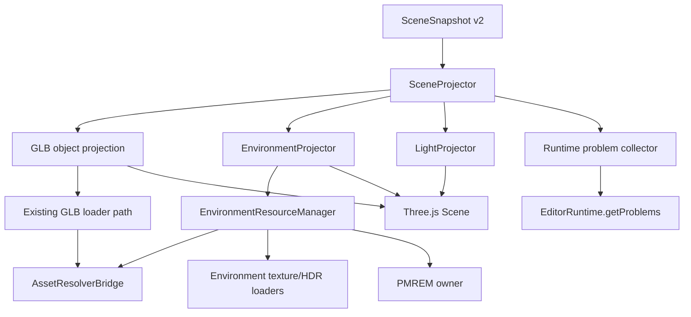
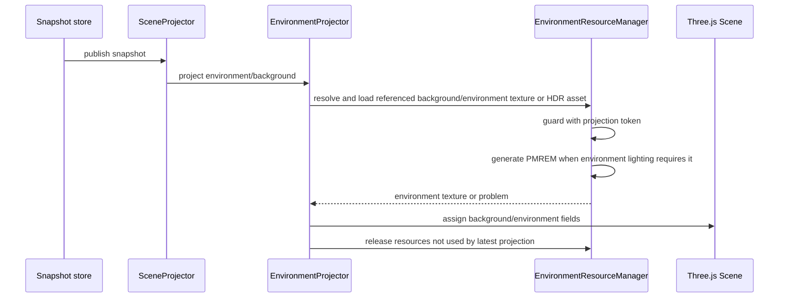
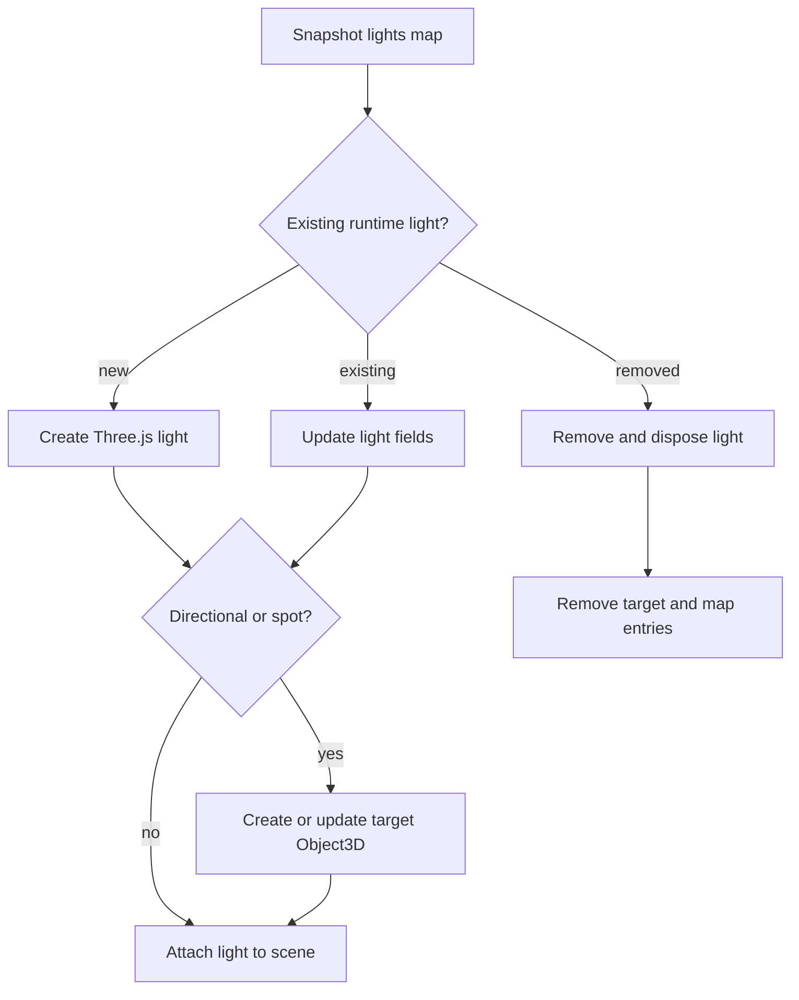

# feat: Add runtime environment and light projection

## Summary

Add the Runtime capability backlog item from the core editor contract: project durable environment, background, HDR, skybox-style background, and light state into the core-owned Three.js runtime, with PMREM generation and deterministic texture/render-target disposal.

This plan assumes the schema expansion is the prerequisite. Environment, background, light, and asset-reference state are already durable snapshot data; this work makes the runtime honor those fields without moving authored state into Three.js objects. Material texture slots remain snapshot-only until full material override projection is planned.

---

## Problem Frame

The first core contract proved that Three.js is a runtime projection of portable snapshot state. The schema extension then introduced durable namespaces for environment/background intent, HDR and texture asset references, light definitions, material texture slots, and richer problem metadata. The current runtime still mostly projects GLB objects and only tolerates the expanded schema.

The next risk is implementing environment and lighting directly as renderer-side state with unclear ownership. HDR textures, PMREM render targets, skybox-style background textures, light target objects, and loaded environment/background texture resources all have GPU lifecycles that must be explicit. If those resources are cached, replaced, or disposed ad hoc, the editor will leak memory, surface stale visuals, or accidentally persist derived runtime failures into snapshots.

This plan keeps the origin decision intact: durable state remains JSON-compatible snapshot data, while core owns the Three.js runtime projection needed by Vue and React shells (see origin: `docs/brainstorms/2026-05-28-core-editor-contract-requirements.md`).

---

## Requirements

### Environment and Background Projection

- R1. The runtime must project `SceneEnvironment` into Three.js scene background and environment state for `none`, `solid`, `texture`, and `hdr` modes, including skybox-style behavior only where the current schema can express it through background texture or HDR fields.
- R2. Solid background projection must use runtime-only Three.js color state and must not change serialized snapshots.
- R3. Environment/background texture and HDR projection must resolve stable asset references through the existing asset resolver boundary.
- R4. HDR or equirectangular environment projection must generate and apply PMREM output for scene lighting when needed.
- R5. Runtime projection must apply supported environment intensity, background intensity, background blur, and environment/background rotation fields when Three.js supports them.

### Runtime Resource Lifecycle

- R6. Environment/background texture, HDR, PMREM render target, and related loader-created runtime resources must be owned by a deterministic environment resource manager.
- R7. Replacing or clearing environment/background state must dispose stale environment/background textures and render targets that are no longer referenced.
- R8. Runtime disposal must clean environment/background resources, PMREM internals, light objects, light target objects, GLB object trees, renderer resources, event listeners, and object maps through the core dispose path.
- R9. Async environment/background texture or HDR loading must ignore or dispose stale load results when a newer projection supersedes them.

### Light Projection

- R10. Runtime projection must create, update, and remove Three.js lights for durable ambient, hemisphere, directional, point, and spot light definitions.
- R11. Directional and spot lights must project their target intent with runtime target objects because Three.js computes their direction from position to target.
- R12. Light projection must preserve durable fields supported by the schema: color, intensity, transform where meaningful, ground color, distance, decay, angle, penumbra, and target.
- R13. Removing a light from the snapshot must remove and dispose the corresponding runtime light and target objects.

### Problems, API, and Compatibility

- R14. Missing or failed environment/background texture or HDR asset resolution must surface as derived runtime problems without mutating authored snapshot state.
- R15. Runtime problems from object loading, environment projection, and light projection must be combined behind the existing runtime `getProblems()` contract.
- R16. Loader and PMREM behavior must be internally injectable or otherwise testable without requiring real WebGL in unit tests.
- R17. Existing GLB import, selection, transform, undo/redo, serialize, restore, missing-asset, React, and Vue proof-loop behavior must remain valid.
- R18. Public exports and documentation must expose only the experimental runtime integration surface needed by hosts; private resource-management details and test seams must not become accidental public API.

---

## Key Technical Decisions

- KTD1. Runtime capability consumes the schema; it does not extend product state: The plan treats `SceneEnvironment`, light definitions, asset references, and problem contracts as already defined by the schema extension. Any missing durable fields should go back to a schema follow-up instead of being smuggled into runtime metadata.
- KTD2. Add projection subcomponents under `SceneProjector`: Keep `SceneProjector` as the orchestration boundary, but split environment/background projection, light projection, and environment resource ownership into focused internal modules. This keeps GLB projection, environment projection, light projection, and problems testable without turning one class into the whole renderer.
- KTD3. Environment resources are cached and disposed by ownership, not by snapshot identity alone: An internal environment resource manager should track resolved asset identity, load tokens, raw background/environment textures, PMREM render targets, and reference use from current projection. This prevents stale async results and avoids disposing a shared environment resource while still in use.
- KTD4. PMREM output is runtime-only: For HDR/equirectangular lighting, `Scene.environment` should receive runtime PMREM output where appropriate, while the snapshot keeps only the stable asset reference and authoring fields. PMREM render targets and generator internals must be disposed through runtime ownership.
- KTD5. Background visuals and environment lighting are separate runtime assignments: The same asset may feed both, but `Scene.background` and `Scene.environment` have different Three.js semantics, intensity fields, blur fields, and disposal concerns. The projection layer should model them separately even when they share a loaded source texture.
- KTD6. Light target objects are owned runtime details: Directional and spot target vectors should become internal `Object3D` targets added to the scene as required by Three.js. These target objects are never durable scene nodes and should not affect picking or selection.
- KTD7. Derived problems stay outside authored snapshots: Resolver failures, loader failures, PMREM failures, and unsupported runtime projection states should be exposed through runtime problem lists, matching the current missing-GLB behavior. The runtime must not write those failures into `snapshot.problems.acknowledged`.
- KTD8. Full material override rendering remains deferred: Material texture-slot loading, projection, diagnostics, and disposal are out of scope. Any environment texture lifecycle helper should stay internal and should not become a general material runtime API in this plan.

---

## High-Level Technical Design

### Runtime Projection Topology

### Environment Asset Lifecycle

### Light Projection Lifecycle

---

## Implementation Units

### U1. Environment resource and PMREM ownership foundation

- **Goal:** Add internal runtime infrastructure for resolving, loading, caching, invalidating, and disposing environment/background texture, HDR, and PMREM output.
- **Requirements:** R3-R9, R14, R16.
- **Dependencies:** None.
- **Files:** `packages/core/src/runtime/environment-resource-manager.ts`, `packages/core/src/runtime/texture-loader-adapter.ts`, `packages/core/src/runtime/pmrem-adapter.ts`, `packages/core/src/runtime/problems.ts`, `packages/core/src/runtime/disposal.ts`, `packages/core/src/runtime/environment-resource-manager.test.ts`, `packages/core/src/runtime/disposal.test.ts`.
- **Approach:** Introduce internal adapter contracts for environment/background texture and HDR loading plus PMREM generation so tests can inject fakes while production uses Three.js loaders and `PMREMGenerator`. Track resources by asset reference plus resolved URI and projection token. Loaded environment resources should be reusable while referenced, releasable when projection changes, and disposable on runtime shutdown. Failed resolution or loading should return structured runtime problems rather than throwing through the entire projection pass. Keep these adapters private unless an existing host integration proves a public seam is required.
- **Patterns to follow:** Existing `AssetResolverBridge`, `GltfLoaderAdapter`, missing-asset problem behavior, `disposeObjectTree`, and stale GLB load-token handling in `SceneProjector`.
- **Test scenarios:**
  - Given a background texture asset that resolves to a URI, when the manager loads it twice during one projection generation, then the same runtime resource is reused and not disposed between uses.
  - Given an unresolved HDR asset, when the manager resolves it for environment projection, then it returns a runtime problem with asset target metadata and does not mutate the snapshot.
  - Given a background texture load that fails, when the manager reports problems, then the problem includes source `runtime`, a stable code, the asset ID, recoverability, and display metadata.
  - Given projection token A starts loading and token B supersedes it before A completes, when A resolves later, then A's texture or render target is disposed or ignored and token B remains authoritative.
  - Given runtime disposal, when raw textures, PMREM render targets, and PMREM generator internals exist, then each owned resource is disposed exactly once.
- **Verification:** Environment-capable runtime resources can be loaded and released deterministically without requiring real WebGL in tests.

### U2. Environment and background runtime projection

- **Goal:** Project durable `SceneEnvironment` state into Three.js scene background/environment assignments, including solid color, texture, HDR, intensity, blur, rotation, and cleanup behavior.
- **Requirements:** R1-R9, R14-R17.
- **Dependencies:** U1.
- **Files:** `packages/core/src/runtime/environment-projector.ts`, `packages/core/src/runtime/scene-projector.ts`, `packages/core/src/runtime/editor-runtime.ts`, `packages/core/src/runtime/environment-projector.test.ts`, `packages/core/src/runtime/scene-projector.test.ts`, `packages/core/src/runtime/editor-runtime.test.ts`, `packages/core/src/runtime/missing-asset.integration.test.ts`.
- **Approach:** Add an `EnvironmentProjector` owned by `SceneProjector`. It should clear scene background/environment for `none`, assign a Three.js color for solid background, resolve assets for existing texture/HDR background fields, apply PMREM output to environment lighting where needed, and apply supported intensity/blur/rotation fields to the runtime scene. Projection should preserve the snapshot exactly and surface runtime-only problems for missing or failed environment/background assets.
- **Patterns to follow:** Existing snapshot-first projection flow in `SceneProjector.project`, environment schema in `packages/core/src/environment/types.ts`, command behavior in `packages/core/src/commands/set-environment.ts`, and Three.js `Scene.background`, `Scene.environment`, `backgroundIntensity`, `backgroundBlurriness`, `backgroundRotation`, `environmentIntensity`, and `environmentRotation` fields.
- **Test scenarios:**
  - Given `background.mode` is `solid` with color `#202530`, when projection runs, then the Three.js scene background becomes a runtime color and serialized snapshot output is unchanged.
  - Given an HDR asset is used for environment lighting, when projection runs, then the asset is resolved, PMREM output is assigned to scene environment, and intensity/rotation fields are applied.
  - Given an HDR or texture asset is used as background, when projection runs, then the Three.js scene background is assigned and background intensity, blur, and rotation are applied where supported.
  - Given environment mode switches from HDR to none, when projection runs again, then stale background/environment assignments are cleared and previously owned runtime resources are released when no longer referenced.
  - Given a referenced environment asset cannot be resolved or loaded, when projection completes, then `getProblems()` includes a derived runtime problem and `snapshot.environment` remains intact.
  - Given the existing GLB proof-loop scene plus environment state, when projection runs, then GLB object mapping and transform projection continue to work.
- **Verification:** The runtime visually honors durable environment/background state while keeping asset failures non-destructive and resource cleanup deterministic.

### U3. Light runtime projection

- **Goal:** Create, update, and remove Three.js light objects from durable light definitions.
- **Requirements:** R10-R13, R15-R17.
- **Dependencies:** None.
- **Files:** `packages/core/src/runtime/light-projector.ts`, `packages/core/src/runtime/scene-projector.ts`, `packages/core/src/runtime/disposal.ts`, `packages/core/src/runtime/light-projector.test.ts`, `packages/core/src/runtime/scene-projector.test.ts`.
- **Approach:** Add a `LightProjector` that maintains a runtime map from light IDs to Three.js light objects and, for directional/spot lights, target objects. It should diff the snapshot light map on each projection, create missing lights, update existing lights in place when possible, remove stale lights, and keep target objects as internal runtime details. Runtime lights should not be selectable scene objects unless a later inspector/hierarchy plan explicitly introduces light selection.
- **Patterns to follow:** Durable light schema in `packages/core/src/lights/types.ts`, light command tests, `ThreeObjectMap` ownership style, and Three.js light docs for ambient, hemisphere, directional, point, and spot lights.
- **Test scenarios:**
  - Given an ambient light definition, when projection runs, then an `AmbientLight` with matching color and intensity is attached to the scene.
  - Given a hemisphere light definition, when projection runs, then sky color, ground color, and intensity are applied.
  - Given a point light definition with transform, distance, and decay, when projection runs, then position, distance, and decay match the snapshot.
  - Given a directional light definition with transform and target, when projection runs, then the light position and runtime target object match durable intent, and the target is attached as required by Three.js.
  - Given a spot light definition with angle, penumbra, distance, decay, transform, and target, when projection runs, then all supported runtime fields are applied.
  - Given a light is updated or removed by command history, when projection runs after undo and redo, then runtime light objects reflect the current snapshot and stale target objects are removed.
- **Verification:** Durable light authoring state has a one-way runtime projection that updates and cleans itself without changing snapshot state.

### U4. Projection orchestration, problems, and lifecycle integration

- **Goal:** Integrate object, environment, light, resource, and problem projection into the existing runtime lifecycle.
- **Requirements:** R7-R9, R14-R17.
- **Dependencies:** U1, U2, U3.
- **Files:** `packages/core/src/runtime/scene-projector.ts`, `packages/core/src/runtime/editor-runtime.ts`, `packages/core/src/runtime/problems.ts`, `packages/core/src/runtime/disposal.ts`, `packages/core/src/editor/lifecycle.ts`, `packages/core/src/runtime/editor-runtime.test.ts`, `packages/core/src/runtime/scene-projector.test.ts`, `packages/core/src/runtime/missing-asset.integration.test.ts`, `packages/core/src/editor/proof-loop.integration.test.ts`.
- **Approach:** Make `SceneProjector.project` orchestrate a full projection pass: prune stale GLB objects, project GLB hierarchy, project environment/background state, project lights, release stale environment resources, then expose a combined problem list. The editor runtime should render after async projection settles and should dispose all projection subcomponents through one deterministic path. Existing shell APIs should continue to call `mountRuntime`, `project`, `getObject`, `getProblems`, and `dispose` without duplicating runtime behavior.
- **Patterns to follow:** Current `ThreeEditorRuntime` mount/subscribe/dispose flow, `SceneProjector.problems`, `CoreEditor.mountRuntime`, missing-asset integration test, and proof-loop integration tests.
- **Test scenarios:**
  - Given a snapshot containing one GLB object, one HDR environment, and multiple lights, when runtime projection completes, then object mapping, scene environment assignment, light objects, and combined problems all reflect the same snapshot.
  - Given object asset load succeeds but environment asset load fails, when projection completes, then the object remains rendered and `getProblems()` reports only the environment failure.
  - Given projection is called repeatedly with unchanged snapshot state, when resources are inspected through fakes, then the runtime does not reload or dispose reusable resources unnecessarily.
  - Given runtime disposal after GLB, environment, PMREM, and light projection, when dispose completes, then renderer, GLB object trees, environment resources, PMREM resources, light objects, target objects, subscriptions, and maps are released.
  - Given the existing import/select/transform/undo/redo/serialize/restore proof loop, when environment and light projection support is present, then the proof loop still passes without framework-specific runtime logic.
- **Verification:** Runtime capability becomes part of the core lifecycle, not a separate shell concern, and existing proof-loop guarantees remain intact.

### U5. Runtime API surface, documentation, and example boundaries

- **Goal:** Update public typing, package exports, documentation, and examples only where needed to make the runtime capability usable and honest.
- **Requirements:** R16-R18.
- **Dependencies:** U1-U4.
- **Files:** `packages/core/src/public-api.ts`, `packages/core/src/index.ts`, `packages/core/src/public-api.test.ts`, `packages/core/README.md`, `README.md`, `examples/vanilla-proof-loop/src/proof-loop.ts`, `examples/react-proof-loop/src/App.tsx`, `examples/vue-proof-loop/src/App.vue`, `packages/react/test/react-proof-loop.integration.test.tsx`, `packages/vue/test/vue-proof-loop.integration.test.ts`.
- **Approach:** Keep new resource managers, projectors, and loader internals private by default. Add public exports only if an existing host-facing runtime option truly requires them, and cover any such export with public API tests. Update documentation to explain what runtime now projects, what remains snapshot-only, and what is still deferred.
- **Patterns to follow:** Current `public-api.test.ts` package-boundary checks, core README's "Runtime values are never saved" rule, and thin React/Vue proof-loop shell tests.
- **Test scenarios:**
  - Given a package consumer imports core public API, when TypeScript resolves exports, then internal projectors/resource managers and texture/HDR/PMREM adapters remain private unless a host-facing option proves otherwise.
  - Given React and Vue proof-loop tests, when runtime capability exists, then shells still mount and dispose the core runtime without reimplementing environment, light, asset, or PMREM logic.
  - Given documentation shows an HDR or skybox asset reference, when reviewed against the schema, then the example stores only stable asset references in snapshots and keeps runtime objects out of serialized data.
  - Given deferred capabilities are listed, when a reader scans the README, then full material override rendering, inspector panels, shadows, helpers, project archives, and advanced decoder configuration are not implied to be included.
- **Verification:** Consumers can understand and use the runtime capability through the existing core lifecycle, while private implementation details remain private.

---

## Scope Boundaries

### In Scope for This Plan

- Runtime projection for durable environment/background state.
- Environment/background texture and HDR asset resolution through stable asset references.
- PMREM generation and disposal for environment lighting.
- Runtime background assignment using Three.js scene fields.
- Skybox-style projection through the current background texture/HDR schema.
- Runtime projection for ambient, hemisphere, directional, point, and spot lights.
- Runtime target objects for directional and spot lights.
- Derived runtime problems for missing or failed environment/background assets.
- Deterministic disposal for environment/background texture, HDR, PMREM, light, target, and GLB runtime resources.
- Public API and documentation updates required by runtime options and examples.

### Deferred to Follow-Up Work

- Full material override projection onto imported GLB meshes.
- Material texture-slot loading, projection, diagnostics, and disposal.
- True cubemap skybox authoring if the durable schema later needs fields beyond background texture/HDR references.
- Inspector UX for environment, lights, materials, and asset problems.
- Light helper gizmos, hierarchy panel light selection, and transform editing for light objects.
- Shadows, shadow-map controls, physically polished presets, RectAreaLight, IES lights, and spot-light texture cookies.
- Draco, KTX2, Meshopt, compressed texture, and advanced decoder configuration.
- Project package format, asset manifest, replacement flow, and missing-resource recovery UX.

### Outside This Product Identity for MVP

- Full Le5le-style low-code platform behavior.
- MQTT/WebSocket data binding.
- Event orchestration, animation timeline, multi-scene linkage, and runtime dashboard publishing.
- Model marketplace or bundled model library.
- WebGPU-first renderer.
- Shader editor, node material editor, physics editor, CAD tooling, 3D Tiles, or large-model streaming as MVP commitments.

---

## System-Wide Impact

- **Runtime memory ownership:** The runtime will own more GPU resources than GLB object trees alone, so disposal coverage becomes a core correctness requirement rather than an optimization.
- **Projection ordering:** Runtime projection now combines GLB objects, environment/background, lights, async asset resolution, PMREM generation, and derived problems in one pass.
- **Problem reporting:** `EditorRuntime.getProblems()` becomes the unified surface for GLB, environment/background texture or HDR, and projection failures.
- **Public API pressure:** Testability should use internal seams where possible. Any new public runtime option type should be justified by an existing host-facing need because projectors and resource managers are implementation details.
- **Framework parity:** Vue and React shells should benefit automatically through `mountRuntime`; they should not gain separate environment or light logic.
- **Future material work:** Material texture-slot loading and disposal stay deferred; environment resource helpers should not be generalized into a material projection system in this plan.

---

## Risks and Dependencies

| Risk / Dependency | Impact | Mitigation |
|---|---|---|
| PMREM and environment/background texture resources leak across environment changes. | Long-lived editors can accumulate GPU memory and show stale environments. | Make U1 resource ownership and disposal tests the dependency for environment projection. |
| Three.js scene fields vary by version. | Runtime projection could silently skip intensity, blur, or rotation behavior. | Use the installed Three.js type surface and official docs as implementation constraints; test behavior through fakes where jsdom lacks WebGL. |
| Async asset loading races with rapid snapshot changes. | Older loads can overwrite newer projection state. | Reuse the existing load-token pattern and dispose stale late results. |
| Directional and spot lights ignore rotation by design. | A naive transform-only projection would render lights in the wrong direction. | Project durable target vectors into runtime target objects and attach them to the scene. |
| Full material projection is tempting scope creep. | Runtime capability could become too broad and block environment/light delivery. | Keep material override rendering deferred; only create environment texture lifecycle foundations needed for environment/background projection. |
| Public runtime options can expose too many internals. | Private implementation choices could harden into API. | Keep projectors, resource managers, and loader adapters internal unless an existing host-facing option proves a public type is required. |

---

## Acceptance Examples

- AE1. Given a scene snapshot with solid background color `#202530`, when the runtime projects it, then the Three.js scene uses that color as background and serializing the editor still contains only JSON-compatible environment fields.
- AE2. Given a scene snapshot with an HDR asset assigned to environment lighting and background, when the runtime resolves the asset, then PMREM output is applied for lighting, the background is assigned, intensity/blur/rotation fields are honored where supported, and disposal cleans the raw and generated resources.
- AE3. Given a saved snapshot references an HDR asset the host cannot resolve, when runtime projection runs, then the scene snapshot is preserved and `getProblems()` returns a derived runtime problem for that asset.
- AE4. Given ambient, hemisphere, directional, point, and spot light definitions, when projection runs, then the matching Three.js lights appear with supported fields applied, and directional/spot targets use runtime target objects.
- AE5. Given a light is updated, undone, redone, and removed through command history, when projection runs after each state, then runtime light objects follow the current snapshot and stale lights or target objects are removed.
- AE6. Given an editor instance has projected a GLB, HDR environment, PMREM render target, background texture, and lights, when the host disposes the editor, then all owned renderer, object, texture, render-target, PMREM, light, target, subscription, and map resources are released through the core dispose path.

---

## Sources and Research

- Origin requirements and backlog: `docs/brainstorms/2026-05-28-core-editor-contract-requirements.md`
- Schema prerequisite plan: `docs/plans/2026-05-29-001-feat-core-schema-extension-plan.md`
- Current runtime projection patterns: `packages/core/src/runtime/scene-projector.ts`, `packages/core/src/runtime/editor-runtime.ts`, `packages/core/src/runtime/disposal.ts`, `packages/core/src/runtime/gltf-loader-adapter.ts`
- Current durable schema contracts: `packages/core/src/environment/types.ts`, `packages/core/src/lights/types.ts`, `packages/core/src/materials/types.ts`, `packages/core/src/assets/types.ts`
- Current tests to preserve and extend: `packages/core/src/runtime/scene-projector.test.ts`, `packages/core/src/runtime/editor-runtime.test.ts`, `packages/core/src/runtime/disposal.test.ts`, `packages/core/src/runtime/missing-asset.integration.test.ts`, `packages/core/src/commands/set-environment.test.ts`, `packages/core/src/commands/light-commands.test.ts`
- Three.js Scene docs for background, environment, intensity, blur, and rotation fields: https://threejs.org/docs/pages/Scene.html
- Three.js PMREMGenerator docs for equirectangular/cubemap PMREM generation and disposal: https://threejs.org/docs/pages/PMREMGenerator.html
- Three.js Texture docs for texture mutation and disposal constraints: https://threejs.org/docs/pages/Texture.html
- Three.js TextureLoader docs for async texture loading: https://threejs.org/docs/pages/TextureLoader.html
- Three.js light docs for target and supported field behavior: https://threejs.org/docs/pages/DirectionalLight.html, https://threejs.org/docs/pages/SpotLight.html, https://threejs.org/docs/pages/AmbientLight.html, https://threejs.org/docs/pages/HemisphereLight.html, https://threejs.org/docs/pages/PointLight.html
