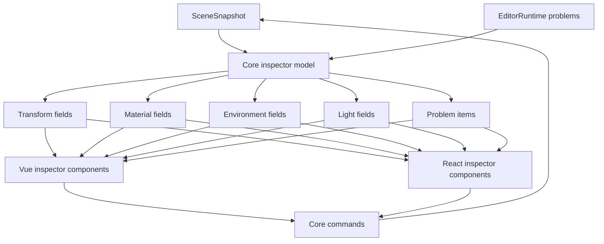
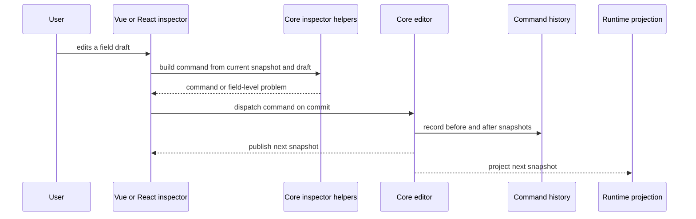
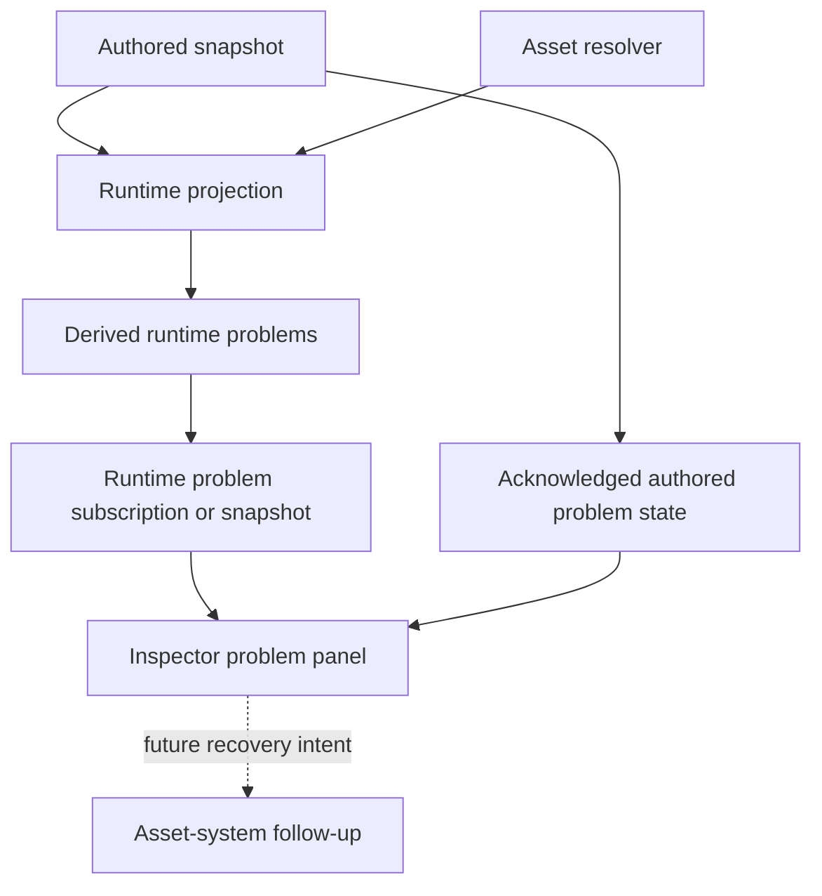

# feat: Add inspector UX for editable scene fields

## Summary

Add the Inspector UX backlog item from the core editor contract: reusable inspector panels for transform, material, light, environment, and asset problem state across the Vue and React shells.

The work should make editable scene fields usable without weakening the snapshot-first contract. Inspector components read core snapshots and runtime problems, keep only draft UI state locally, and commit durable edits through core commands so Vue and React remain thin adapters over one editor contract.

---

## Problem Frame

The core contract now has a versioned snapshot, commands/history, asset references, runtime projection, shell mounting, material schema, environment schema, light schema, and derived runtime problem metadata. The examples can mount a runtime and prove save/restore behavior, but there is still no user-facing surface for editing the durable fields beyond direct command calls in tests and examples.

The Inspector UX follow-up is the first visible editing surface over the expanded schema. The main risk is implementing panels as Vue-local and React-local form logic that duplicate command construction, validation assumptions, material defaults, light field behavior, and problem interpretation. That would recreate the split ownership the origin document explicitly avoided: durable behavior living partly in framework UI code instead of in the core contract.

This plan keeps the inspector narrowly focused. It does not create a full workbench, hierarchy panel, asset package workflow, material texture runtime projection, or polished Le5le-style editor. It adds a shared inspector field contract plus framework components that can edit the existing snapshot fields through the existing command path (see origin: `docs/brainstorms/2026-05-28-core-editor-contract-requirements.md`).

---

## Requirements

### Shared Inspector Contract

- R1. The core must expose framework-neutral inspector models for selected-object transform, selected-object material override, scene environment/background, lights, and runtime/authored problems.
- R2. Inspector edits must dispatch core commands rather than mutating snapshots, runtime objects, framework component state, or Three.js instances directly.
- R3. Inspector models must preserve the snapshot-first rule: descriptors and draft values may describe JSON-compatible fields, but they must not store Three.js objects, loaded textures, object URLs, `File` objects, `Blob` objects, functions, or framework component instances.
- R4. Inspector field metadata must reflect the supported core field contract: numeric ranges, color formats, enum options, asset kinds, texture slot references, light-kind-specific fields, and problem recoverability.
- R5. Public exports must expose only the shared inspector contract needed by shell packages and consumers; private runtime projectors, resource managers, and loader internals must remain private.

### Editing Behavior

- R6. Transform inspector edits must target the currently selected GLB object and commit `set-transform` commands at deliberate field commit boundaries, not on every transient keystroke.
- R7. Material inspector edits must target the selected object by default, with room to target an already-known material slot if core exposes one later; this plan must not invent material-slot discovery.
- R8. Environment inspector edits must support background/environment modes, colors, texture/HDR asset references, intensity, blur, and rotation without persisting PMREM output or loaded textures.
- R9. Light inspector edits must list, add, update, and remove ambient, hemisphere, directional, point, and spot light definitions through core light commands.
- R10. Light focus for inspector editing may remain UI-local for this plan; durable selection remains object selection until a later hierarchy or scene-node plan changes that contract.
- R11. Undo and redo must work for inspector-committed transform, material, environment, and light edits because those edits use the existing command history.

### Problems and Recovery Boundaries

- R12. The problem inspector must display derived runtime problems and authored acknowledgement state through the shared problem contract without writing transient runtime failures into snapshots.
- R13. Missing or failed GLB, texture, HDR, environment, or projection problems must surface severity, source, target, asset ID when available, recoverability, and display metadata.
- R14. The inspector may expose recovery affordance boundaries such as "replace asset" or "acknowledge" intent, but actual asset replacement, project archive mutation, and persisted recovery commands remain deferred unless an existing core command already supports them.

### Framework Shells and Examples

- R15. Vue and React packages must export inspector components and hooks/composables that share the core inspector model and do not duplicate command/history behavior.
- R16. Vue inspector components must use Vue lifecycle and reactivity safely without wrapping editor instances in deep reactive proxies or leaking subscriptions.
- R17. React inspector components must use external-store semantics and remain stable under React StrictMode mount/unmount behavior.
- R18. Example workbenches must demonstrate a viewport plus inspector layout for the proof scene while keeping the components usable outside the examples.
- R19. Documentation must clearly distinguish implemented inspector editing from deferred hierarchy, asset package, material runtime projection, and full workbench polish.

---

## Key Technical Decisions

- KTD1. Core owns inspector semantics; shells own rendering: Put field descriptors, selection-derived inspector state, command builders, and problem normalization in core. Vue and React render those models into controls, but they should not each invent material field ranges, light-kind branching, or command shapes.
- KTD2. Export a narrow inspector contract from core: The inspector model is part of the experimental editor API because both shell packages need it through package boundaries. Keep it pure data and functions; do not export Vue/React components, runtime projectors, PMREM/resource managers, or Three.js implementation classes from core.
- KTD3. Components hold drafts; commands hold durable edits: Text inputs, sliders, and color pickers may use local draft state while the user is editing. Durable state changes happen on explicit commit points such as blur, Enter, slider release, select change, or button action, producing one command per committed user edit.
- KTD4. Object selection stays the durable selection model: The current core selection targets GLB objects. This plan should not introduce durable light selection, material-slot discovery, or a hierarchy/tree model. Light focus can be component-local so light panels are useful without forcing the unresolved scene-node decision, and material inspection should start from the selected object rather than promising per-submesh slot browsing.
- KTD5. Runtime problems need a UI-observable surface: `getProblems()` is enough for tests, but an inspector panel needs a safe way to refresh after projection changes. Add a narrow runtime problem subscription or versioned problem snapshot surface that reports derived problems without persisting them.
- KTD6. Asset recovery UI stops at the boundary: Show enough problem metadata for a user or host to understand the missing asset and where recovery would attach, but defer project packages, asset replacement flows, and persistent recovery commands to the asset-system backlog.
- KTD7. Material texture projection remains out of scope: The material inspector can edit texture slot references because the schema supports them. It should not promise that texture slots are projected onto imported GLB materials until material runtime projection is planned.
- KTD8. Inspector UI is dense and operational: This is an editor tool surface, not a landing page. Use compact panels, stable control dimensions, accessible labels, keyboard-friendly inputs, and restrained visual styling that can sit beside the viewport.

---

## High-Level Technical Design

### Inspector Contract Topology

### Inspector Edit Flow

### Runtime Problem Flow

---

## Implementation Units

### U1. Core inspector contract foundation

- **Goal:** Add framework-neutral inspector types, selectors, field descriptors, command-builder utilities, and public exports that Vue and React can share.
- **Requirements:** R1-R5, R15, R19.
- **Dependencies:** `docs/plans/2026-05-28-001-feat-core-editor-contract-plan.md`, `docs/plans/2026-05-29-001-feat-core-schema-extension-plan.md`.
- **Files:** `packages/core/src/inspector/types.ts`, `packages/core/src/inspector/selection.ts`, `packages/core/src/inspector/fields.ts`, `packages/core/src/inspector/commands.ts`, `packages/core/src/inspector/inspector.test.ts`, `packages/core/src/public-api.ts`, `packages/core/src/index.ts`, `packages/core/src/public-api.test.ts`, `packages/core/README.md`.
- **Approach:** Model inspector state as pure, immutable data derived from `SceneSnapshot`, optional `EditorRuntime` problem state, and small UI inputs such as active light ID. Field descriptors should carry labels, supported control kind, numeric bounds, enum options, disabled/read-only state, and command-builder metadata. Keep command builders defensive: they should return controlled field problems for missing selection or incompatible targets rather than letting framework components assemble invalid commands ad hoc.
- **Execution note:** Start with core inspector selector and command-builder tests before creating Vue or React components.
- **Patterns to follow:** Existing `public-api.test.ts` export-boundary checks, `createEmptySnapshot`, command tests for `set-transform`, `set-material`, `set-environment`, and light commands, and the README rule that runtime values are never saved.
- **Test scenarios:**
  - Given an empty snapshot, when the inspector model is built, then transform and material sections are disabled, environment and light sections are available, and no framework/runtime objects appear in the model.
  - Given a selected GLB object, when the inspector model is built, then transform fields mirror the selected object's position, rotation, and scale and material fields target that object.
  - Given registered GLB, texture, image, and HDR assets, when material and environment descriptors are built, then texture slots offer only texture/image asset references and HDR environment fields offer only HDR asset references.
  - Given a light map containing ambient, hemisphere, directional, point, and spot lights, when descriptors are built for each kind, then only fields supported by that kind are editable.
  - Given a field draft references missing selection, unknown asset, or unsupported field type, when a command builder runs, then it returns a controlled problem result and does not mutate the snapshot.
  - Given a package consumer imports core public API, when TypeScript resolves exports, then inspector types and helpers are available from the package root while runtime projectors/resource managers remain private.
- **Verification:** Vue and React can consume one core inspector contract through public package exports, and no inspector behavior requires importing private core internals.

### U2. Runtime problem observation for inspector panels

- **Goal:** Provide a safe UI-observable problem source for inspector panels while keeping derived runtime diagnostics out of serialized snapshots.
- **Requirements:** R12-R14, R15, R19.
- **Dependencies:** U1, `docs/plans/2026-05-29-002-feat-runtime-capability-plan.md`.
- **Files:** `packages/core/src/runtime/editor-runtime.ts`, `packages/core/src/runtime/scene-projector.ts`, `packages/core/src/runtime/problems.ts`, `packages/core/src/runtime/editor-runtime.test.ts`, `packages/core/src/runtime/missing-asset.integration.test.ts`, `packages/core/src/inspector/problems.ts`, `packages/core/src/inspector/problems.test.ts`, `packages/core/src/public-api.ts`, `packages/core/src/public-api.test.ts`.
- **Approach:** Add the narrowest runtime problem observation surface that inspector UI needs: either a subscription, a versioned problem snapshot, or both if the implementation shows they are paired. The surface should report deduplicated derived runtime problems after projection attempts and clear/update them on later projections and disposal. Core inspector problem helpers should combine runtime problems with authored acknowledgement state without writing derived diagnostics into `snapshot.problems`.
- **Patterns to follow:** Existing `EditorRuntime.getProblems()`, `SceneProjector.problems`, missing-asset integration tests, environment problem helpers, and `EditorStore.subscribe` semantics.
- **Test scenarios:**
  - Given a GLB asset cannot be resolved during projection, when runtime problems are observed, then the inspector source reports a derived problem with object target, asset ID, severity, recoverability, and display metadata.
  - Given an HDR environment asset cannot be resolved, when projection completes, then the problem source reports background/environment role metadata and serialization still omits the derived runtime problem.
  - Given projection later succeeds for a previously missing asset, when problem observation refreshes, then the stale derived problem is removed or superseded.
  - Given an authored acknowledgement exists in the snapshot, when problem helpers combine problem state, then the acknowledgement is represented separately from derived runtime failures.
  - Given runtime disposal, when a problem subscriber or observer is active, then it is cleaned up and no further problem notifications are emitted.
- **Verification:** Inspector problem panels can update from runtime projection results without introducing durable transient problem state.

### U3. Transform and material inspector behavior

- **Goal:** Add shared inspector behavior for selected-object transforms and selected-object material override fields.
- **Requirements:** R2-R7, R11, R15.
- **Dependencies:** U1.
- **Files:** `packages/core/src/inspector/transform.ts`, `packages/core/src/inspector/material.ts`, `packages/core/src/inspector/transform.test.ts`, `packages/core/src/inspector/material.test.ts`, `packages/core/src/commands/set-transform.test.ts`, `packages/core/src/commands/set-material.test.ts`, `packages/core/src/public-api.ts`.
- **Approach:** Use the current object selection contract to derive editable transform and material sections. Transform helpers should produce complete `set-transform` patches from committed field drafts and preserve untouched axes. Material helpers should target object-level assignment by default, preserve existing override fields when patching one field, and use asset-reference fields for texture slots. If future core state exposes concrete material-slot targets, these helpers can accept that target shape without this plan adding slot discovery UI. Components will own draft strings/numbers, but core helpers define which draft values are valid and which command should be dispatched.
- **Patterns to follow:** Existing `SetTransformCommand`, `SetMaterialCommand`, material validation ranges, material assignment ID behavior, command history tests, and proof-loop undo/redo expectations.
- **Test scenarios:**
  - Given a selected object with position `[1, 2, 3]`, when the X position draft commits to `4`, then the command builder returns one `set-transform` command that preserves Y/Z, rotation, and scale.
  - Given no selected object, when a transform field tries to commit, then the helper returns a controlled disabled/problem state and no command.
  - Given a selected object with an existing material override, when only roughness changes, then the command builder preserves color, metalness, texture slots, and other existing override fields.
  - Given a texture slot draft references a registered texture asset, when the material command is built, then the command contains only the stable asset ID and slot metadata.
  - Given a texture slot draft references a GLB asset or an unknown asset, when the command builder validates the draft, then it reports the asset-kind problem before dispatch.
  - Given transform and material commits followed by undo and redo, when snapshots are inspected, then transform and material state move through history exactly once per committed edit.
- **Verification:** The inspector can edit selected-object transform and material data through core commands with no framework-specific command construction.

### U4. Environment and light inspector behavior

- **Goal:** Add shared inspector behavior for scene environment/background controls and light list/edit controls.
- **Requirements:** R2-R5, R8-R11, R15.
- **Dependencies:** U1.
- **Files:** `packages/core/src/inspector/environment.ts`, `packages/core/src/inspector/lights.ts`, `packages/core/src/inspector/environment.test.ts`, `packages/core/src/inspector/lights.test.ts`, `packages/core/src/commands/set-environment.test.ts`, `packages/core/src/commands/light-commands.test.ts`, `packages/core/src/public-api.ts`.
- **Approach:** Environment helpers should derive mode-specific field groups and build `set-environment` commands that clear stale fields through existing command behavior. Light helpers should derive a list model, an active light editing model from UI-local active light ID, and add/update/remove command builders for supported light kinds. Keep light focus out of durable snapshot selection until hierarchy or scene-node work resolves the broader model.
- **Patterns to follow:** Existing `SceneEnvironment` defaults and validation, `SetEnvironmentCommand`, `AddLightCommand`, `UpdateLightCommand`, `RemoveLightCommand`, light defaults, and residual review note that GLB objects and lights are still separate durable models.
- **Test scenarios:**
  - Given background mode changes from HDR to solid, when the environment command is built and dispatched, then stale asset/blur fields are cleared through the existing environment command path.
  - Given environment mode is HDR, when asset options are built, then only registered HDR assets are valid for environment lighting.
  - Given a directional light is active in UI-local focus, when the target vector draft commits, then the command builder returns an `update-light` command and does not alter object selection.
  - Given an ambient light is active, when a directional-only field is requested, then the inspector model omits or disables that field.
  - Given a user adds a point light through the inspector, when undo and redo run, then the light appears, disappears, and reappears through command history.
  - Given a user removes the active light, when the light list model rebuilds, then UI-local focus moves to a valid remaining light or empty state without writing selection into the snapshot.
- **Verification:** Scene-level environment and light editing works through core commands while respecting the current durable object-selection boundary.

### U5. Vue inspector components and composable

- **Goal:** Add Vue inspector components that render the shared core inspector model and commit edits through the core editor.
- **Requirements:** R2-R19.
- **Dependencies:** U1-U4.
- **Files:** `packages/vue/src/components/InspectorPanel.vue`, `packages/vue/src/components/TransformInspector.vue`, `packages/vue/src/components/MaterialInspector.vue`, `packages/vue/src/components/EnvironmentInspector.vue`, `packages/vue/src/components/LightInspector.vue`, `packages/vue/src/components/ProblemsPanel.vue`, `packages/vue/src/components/inspector.css`, `packages/vue/src/composables/use-inspector.ts`, `packages/vue/src/index.ts`, `packages/vue/src/public-api.test.ts`, `packages/vue/test/inspector.test.ts`, `packages/vue/test/vue-proof-loop.integration.test.ts`, `packages/vue/README.md`.
- **Approach:** Build compact, accessible Vue panels using the existing `useEditor` composable pattern. Keep editor instances raw, use shallow snapshot refs, hold field drafts locally, and dispatch commands only on commit events. The top-level `InspectorPanel` should compose transform, material, environment, light, and problems sections with predictable collapsed/empty states. Styling should be restrained and scoped under package-specific class names so examples can place it beside the viewport without adopting a larger design system.
- **Patterns to follow:** `packages/vue/src/composables/use-editor.ts`, `EditorViewport.vue`, Vue lifecycle tests, Vue proof-loop parity tests, and the root Vitest jsdom setup.
- **Test scenarios:**
  - Given a Vue editor with no selected object, when `InspectorPanel` renders, then transform and material sections show disabled/empty state while environment, lights, and problems remain available.
  - Given a selected object, when a transform input commits a changed value, then the component dispatches one core command and snapshot subscribers observe the updated transform.
  - Given a material color input commits `#336699`, when the component updates, then the selected object receives a material override through `set-material` and undo restores the previous material state.
  - Given an HDR asset is registered, when the environment section selects it for environment lighting, then a `set-environment` command is dispatched with the stable asset ID.
  - Given the light section adds, updates, and removes a light, when history is inspected, then each durable edit is undoable and no Vue-local command logic bypasses core.
  - Given runtime projection reports missing GLB or HDR problems, when `ProblemsPanel` renders, then severity, title/detail, target, and recovery boundary are visible without serializing runtime problems.
  - Given the Vue inspector unmounts, when subscriptions are inspected through fakes, then snapshot/problem subscriptions are released.
- **Verification:** Vue consumers can mount a viewport and inspector around the same core editor without duplicating editor behavior.

### U6. React inspector components and hooks

- **Goal:** Add React inspector components that render the shared core inspector model and stay stable under React external-store and StrictMode behavior.
- **Requirements:** R2-R19.
- **Dependencies:** U1-U4.
- **Files:** `packages/react/src/components/InspectorPanel.tsx`, `packages/react/src/components/TransformInspector.tsx`, `packages/react/src/components/MaterialInspector.tsx`, `packages/react/src/components/EnvironmentInspector.tsx`, `packages/react/src/components/LightInspector.tsx`, `packages/react/src/components/ProblemsPanel.tsx`, `packages/react/src/components/inspector.css`, `packages/react/src/hooks/use-inspector.ts`, `packages/react/src/index.ts`, `packages/react/src/public-api.test.ts`, `packages/react/test/inspector.test.tsx`, `packages/react/test/strict-mode.test.tsx`, `packages/react/test/react-proof-loop.integration.test.tsx`, `packages/react/README.md`.
- **Approach:** Build React components around `useEditorSnapshot` and a new inspector hook that memoizes core inspector models from the current snapshot, editor, runtime problem state, and component-local active light ID. Components should keep draft input values local and commit through `editor.dispatch`. Avoid effects that recreate editors or runtimes; follow the existing viewport behavior for mount/dispose.
- **Patterns to follow:** `packages/react/src/hooks/use-editor.ts`, `EditorViewport.tsx`, React proof-loop parity tests, React StrictMode tests, and package export boundary tests.
- **Test scenarios:**
  - Given a React editor with a selected object, when `InspectorPanel` renders, then transform and material fields reflect the same snapshot values as the Vue inspector model.
  - Given a user changes a transform field and commits it, when the component re-renders, then exactly one `set-transform` command is dispatched for that commit and undo restores the previous transform.
  - Given a user updates material opacity and side, when the command succeeds, then the material override is stored in the snapshot and no React state contains runtime texture objects.
  - Given a user edits environment mode and background color, when the command commits, then the snapshot environment changes through core and the runtime projection can follow through existing subscription behavior.
  - Given a spot light is active in component-local focus, when angle or target fields commit, then `update-light` is dispatched and object selection remains unchanged.
  - Given runtime problems are published after projection, when the problem hook updates, then `ProblemsPanel` renders the new problem list and does not write it into serialized output.
  - Given React StrictMode mounts, unmounts, and remounts the inspector, when subscriptions are inspected through fakes, then there are no duplicate problem/snapshot subscriptions and no editor recreation for a provided editor.
- **Verification:** React consumers get the same inspector behavior as Vue through shared core models and React-safe subscriptions.

### U7. Example workbenches, documentation, and visual verification

- **Goal:** Demonstrate the inspector beside the viewport in examples and document the UX boundaries honestly.
- **Requirements:** R15-R19.
- **Dependencies:** U5, U6.
- **Files:** `examples/react-proof-loop/src/App.tsx`, `examples/react-proof-loop/src/main.tsx`, `examples/react-proof-loop/src/styles.css`, `examples/vue-proof-loop/src/App.vue`, `examples/vue-proof-loop/src/main.ts`, `examples/vue-proof-loop/src/styles.css`, `examples/vanilla-proof-loop/src/proof-loop.ts`, `packages/core/README.md`, `packages/vue/README.md`, `packages/react/README.md`, `README.md`, `packages/react/test/react-proof-loop.integration.test.tsx`, `packages/vue/test/vue-proof-loop.integration.test.ts`, `packages/core/src/editor/proof-loop.integration.test.ts`.
- **Approach:** Update React and Vue proof-loop examples into compact workbench layouts with viewport plus inspector. Keep the examples utilitarian: stable two-column layout on desktop, stacked layout on narrow screens, compact controls, clear empty states, and no marketing hero content. The vanilla example may remain command-first unless a lightweight inspector API demonstration is useful without building a DOM UI. Documentation should describe what inspector controls are implemented, how edits flow through commands/history, and which adjacent capabilities are deferred.
- **Patterns to follow:** Existing proof-loop examples, package README contract summaries, frontend guidance for dense app/tool surfaces, and package-level parity tests.
- **Test scenarios:**
  - Given the React example mounts, when the initial scene is created, then the inspector can display the imported object, ambient light, environment defaults, and any runtime problems without custom React editor logic.
  - Given the Vue example mounts, when the same initial scene is created, then the inspector displays the same editable field groups and commits through the same core commands.
  - Given a narrow viewport layout, when the example workbench renders, then viewport and inspector do not overlap and controls remain usable with stable dimensions.
  - Given documentation examples mention asset problems or texture/HDR controls, when reviewed against the implemented behavior, then they do not imply project archive replacement, material texture projection, shadows, or hierarchy selection.
  - Given package public API tests run, when inspector exports are present, then each package exposes intended components/hooks only from its root entry point.
- **Verification:** Users can open the examples and operate the first inspector surface without mistaking it for a full workbench or asset-management workflow.

---

## Scope Boundaries

### In Scope for This Plan

- Shared framework-neutral inspector field models and command builders in core.
- Transform inspector for selected GLB object position, rotation, and scale.
- Material inspector for the supported `MeshStandardMaterial` override subset and texture slot asset references.
- Environment/background inspector for supported modes, asset references, intensity, blur, and rotation.
- Light inspector for ambient, hemisphere, directional, point, and spot light add/update/remove behavior.
- Runtime/authored problem inspector display and narrow runtime problem observation support.
- Vue inspector components/composable and React inspector components/hooks.
- Example viewport-plus-inspector layouts and package documentation updates.
- Accessibility and responsive layout expectations for the inspector tool surface.

### Deferred to Follow-Up Work

- Full hierarchy panel, scene tree, durable light selection, scene-node unification, grouping, duplicate, delete, copy/paste, and multi-select workflows.
- Schema-driven inspector definitions as a broader public plugin/extension system beyond the first shared field model.
- Material runtime projection onto imported GLB meshes, per-submesh material slot discovery, full GLTF material graph editing, node materials, and shader editing.
- Asset replacement flow, `.ek3d` project package format, asset manifest mutation, and missing-resource recovery persistence.
- Texture/HDR upload UI, drag-and-drop asset import, decoder configuration, compressed texture handling, and large-model streaming.
- Light helper gizmos, transform editing for light objects in the viewport, shadows, shadow-map controls, RectAreaLight, IES lights, and physically polished light presets.
- Full workbench layout polish: hierarchy panel, toolbar, problems dock, keyboard shortcuts, command palette, persisted UI layout, theming system, and design tokens.
- npm release automation, Changesets, provenance hardening, and publish CI.

### Outside This Product Identity for MVP

- Full Le5le-style low-code platform behavior.
- MQTT/WebSocket data binding.
- Event orchestration, animation timeline, multi-scene linkage, and runtime dashboard publishing.
- Model marketplace or bundled model library.
- WebGPU-first renderer.
- Physics editor, CAD tooling, 3D Tiles, shader/node material editor, or large-model streaming as MVP commitments.

---

## System-Wide Impact

- **Public API pressure:** Core will expose a new inspector contract. Keep it pure and narrow so it does not harden runtime internals or framework-specific UI decisions into public API.
- **Framework parity:** Vue and React will gain more than viewport wrappers for the first time. Shared core inspector helpers are the guardrail against divergent editor behavior.
- **Runtime observability:** Derived runtime problems become user-visible state. The observation surface must not change the existing rule that runtime problems are not serialized automatically.
- **Undo/redo expectations:** Inspector controls make command history user-facing. Field commit boundaries must be deliberate enough that undo history remains readable.
- **Design surface:** The examples become a simple workbench instead of a bare viewport. That raises responsive layout, focus state, empty state, and component sizing expectations.
- **Future scene-node work:** Keeping light focus UI-local avoids forcing a durable scene-node refactor now, but the plan should leave that future path open.

---

## Risks and Dependencies

| Risk / Dependency | Impact | Mitigation |
|---|---|---|
| Vue and React panels duplicate command-building logic. | Framework parity breaks and future schema changes require two UI rewrites. | Put field metadata and command builders in core, then test both shells against the same model behavior. |
| Inspector helpers expose too much core internals. | Runtime projectors, loaders, or resource managers could become accidental public API. | Export only pure inspector models/helpers from package root and cover the package boundary with public API tests. |
| Field controls dispatch on every keystroke. | Undo history becomes noisy and invalid intermediate drafts can reach commands. | Keep drafts local and commit on deliberate field boundaries. |
| Runtime problem updates are not observable enough for UI. | Problem panel can show stale or missing diagnostics. | Add a narrow problem observation surface tied to projection completion and disposal. |
| Light inspector implies durable light selection. | The plan could accidentally force unresolved hierarchy/scene-node work. | Keep active light focus local to the inspector and document hierarchy selection as deferred. |
| Asset recovery UI overpromises. | Users may expect project package mutation or replacement flows that do not exist yet. | Show problem details and recovery boundaries only; defer replacement/archive workflows to the asset-system backlog. |
| Responsive example layout is treated as full workbench polish. | Scope expands into toolbar, hierarchy, shortcuts, and dock layout work. | Limit examples to viewport plus inspector and route broader workbench polish to follow-up. |

---

## Acceptance Examples

- AE1. Given an imported and selected GLB object, when a user changes its X position through either Vue or React inspector and commits the field, then one `set-transform` command updates the snapshot and undo returns the object to the previous transform.
- AE2. Given a selected GLB object and a registered texture asset, when a user assigns a material color and texture slot through the inspector, then the snapshot stores a material override with a stable asset reference and no loaded texture or object URL.
- AE3. Given a registered HDR asset, when a user assigns it to environment lighting and background through the inspector, then a `set-environment` command updates durable environment fields and runtime PMREM output remains runtime-only.
- AE4. Given ambient, hemisphere, directional, point, and spot lights in a scene, when a user edits each kind through the light inspector, then only fields supported by that light kind are shown and edits flow through add/update/remove light commands.
- AE5. Given a saved snapshot references a missing GLB or HDR asset, when runtime projection reports a derived problem, then the problem inspector shows severity, target, asset ID, and recovery affordance metadata without serializing that derived problem into the snapshot.
- AE6. Given the same saved snapshot is opened through the Vue and React examples, when a user performs transform, material, environment, and light edits, then both shells use the shared core inspector helpers and command/history behavior rather than framework-local editor logic.

---

## Sources and Research

- Origin requirements and backlog: `docs/brainstorms/2026-05-28-core-editor-contract-requirements.md`
- Core contract prerequisite: `docs/plans/2026-05-28-001-feat-core-editor-contract-plan.md`
- Schema prerequisite: `docs/plans/2026-05-29-001-feat-core-schema-extension-plan.md`
- Runtime prerequisite: `docs/plans/2026-05-29-002-feat-runtime-capability-plan.md`
- Current core public API: `packages/core/src/public-api.ts`, `packages/core/src/index.ts`
- Current command contracts: `packages/core/src/commands/types.ts`, `packages/core/src/commands/dispatcher.ts`
- Current shell patterns: `packages/vue/src/composables/use-editor.ts`, `packages/vue/src/components/EditorViewport.vue`, `packages/react/src/hooks/use-editor.ts`, `packages/react/src/components/EditorViewport.tsx`
- Existing proof-loop examples: `examples/react-proof-loop/src/App.tsx`, `examples/vue-proof-loop/src/App.vue`, `examples/vanilla-proof-loop/src/proof-loop.ts`
- Residual review context: `docs/residual-review-findings/feat-core-schema-extension.md`, `docs/residual-review-findings/feat-runtime-capability.md`
