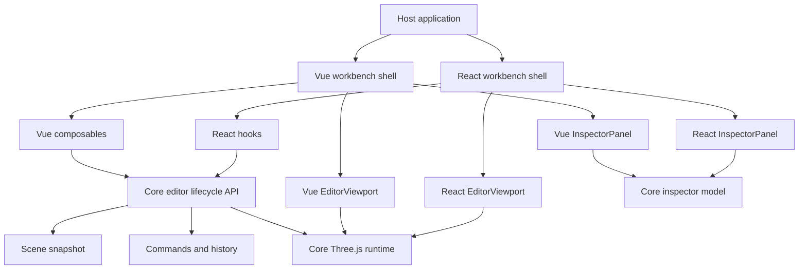
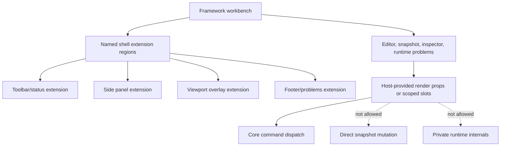
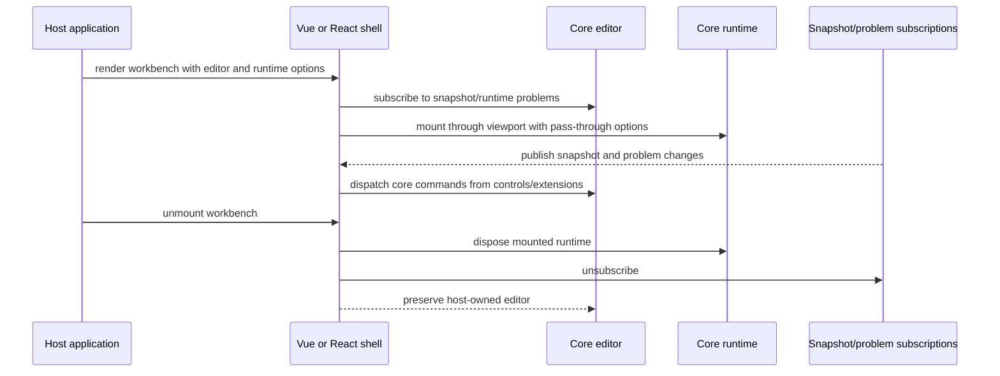

# feat: Add framework shell workbenches

## Summary

Add the Framework shells backlog item from the core editor contract: reusable Vue and React workbench shells that compose the existing core editor lifecycle, runtime viewport, inspector panels, hooks/composables, framework-native extension points, and examples without duplicating core editing behavior.

This plan treats the shell packages as parity adapters over the snapshot-first core. React keeps external-store and StrictMode discipline; Vue keeps shallow/raw lifecycle discipline; both packages expose convenience workbench surfaces while leaving schema, runtime projection, command/history, asset handling, and inspector semantics in core.

---

## Problem Frame

The core package now owns durable scene state, commands/history, asset references, runtime projection, environment/light projection, inspector models, and runtime/authored problem metadata. The React and Vue packages already expose primitive adapters such as editor hooks/composables, `EditorViewport`, and `InspectorPanel`, and the examples can show a viewport beside an inspector.

The remaining framework-shell risk is letting real application integration drift into two separate shell-specific editors. If React and Vue examples each grow their own workbench orchestration, toolbar wiring, extension-region conventions, editor ownership rules, asset resolver setup, and lifecycle cleanup, framework parity will erode even though the core contract is shared. This follow-up makes the shell layer explicit: reusable workbench components and hooks/composables compose existing primitives, pass runtime options through to core, surface shell-native extension points, and prove the same behavior in React and Vue examples.

The plan does not reopen the core schema, runtime capability, inspector field semantics, or full editor workbench product shape. Those are already defined by the origin document and sibling plans (see origin: `docs/brainstorms/2026-05-28-core-editor-contract-requirements.md`).

---

## Requirements

### Shell Composition Contract

- R1. React and Vue shell packages must expose optional workbench-level components that compose the existing editor, viewport, inspector, runtime problem, and command surfaces without replacing the lower-level primitives.
- R2. Workbench shells must accept a caller-provided core editor and must not recreate or dispose that editor unless the shell explicitly created it through its own hook/composable.
- R3. Workbench shells must pass runtime options such as asset resolver, loader, and renderer factory through to core-owned runtime mounting rather than reimplementing runtime lifecycle logic.
- R4. Workbench shells must preserve the core command boundary: shell UI and extensions dispatch core commands or call core APIs; they must not mutate snapshots, Three.js objects, or framework-local durable state.

### Framework Parity and Lifecycle

- R5. React shell state must remain compatible with `useSyncExternalStore` snapshot semantics and React StrictMode effect cleanup behavior.
- R6. Vue shell state must keep editor/runtime instances out of deep reactivity by using shallow/raw lifecycle patterns and deterministic unmount cleanup.
- R7. Runtime problem observation must remain framework-neutral: both shell packages can display runtime/authored problems through the existing core problem subscription/model surface.
- R8. React and Vue shell behavior must stay equivalent for the proof workbench: mount runtime, show inspector state, commit edits, observe runtime problems, serialize/restore through core, and dispose cleanly.

### Extension Points

- R9. The first extension surface must be framework-native: React uses render props or component props; Vue uses slots or scoped slots.
- R10. Extension points must receive enough context to build shell-level controls around the editor, snapshot, inspector model, runtime problem state, and command dispatch, without exposing private core runtime internals.
- R11. Extension points must be additive around the workbench layout and examples; they must not become a core plugin API, schema-driven inspector plugin system, or persistent layout engine in this plan.

### Examples, Package Contract, and Documentation

- R12. React and Vue proof-loop examples must become parity proof surfaces for the framework shells, not separate application-specific editors.
- R13. Example layouts must remain compact editor workbenches with stable viewport/inspector sizing, responsive stacking, and no marketing or landing-page structure.
- R14. Package public exports must expose intended workbench components, hooks/composables, and types from package roots while keeping core internals and shell-private helpers private.
- R15. Documentation must distinguish implemented shell workbench composition from deferred hierarchy panels, toolbar systems, persisted layouts, asset replacement flows, npm release automation, and Le5le-style low-code features.

---

## Key Technical Decisions

- KTD1. Shells stay composition adapters: The shell packages should compose `EditorViewport`, `InspectorPanel`, editor state hooks/composables, and runtime problem observation instead of creating new editing logic. This preserves origin requirements R20-R22 around one framework-neutral core lifecycle and shared command/history behavior.
- KTD2. Workbench components are convenience surfaces, not replacements: Keep primitive exports available for applications that want custom layout. The new workbench layer provides a fast path for normal usage and examples, while advanced consumers can still compose primitives directly.
- KTD3. Use framework-native extension points first: React render props/component props and Vue slots/scoped slots are enough for the first shell-level customization surface. A core plugin API would be premature because schema-driven inspector extensions, persisted layout, and broader plugin lifecycle are explicitly deferred.
- KTD4. Editor ownership is explicit: A provided editor belongs to the host and is not disposed by shell workbench unmount. If a shell hook/composable creates an editor for convenience, that owner surface is responsible for cleanup.
- KTD5. Runtime options pass through unchanged: Asset resolution, loader injection, renderer factories, and runtime problem updates stay owned by core. Shell workbenches pass options to the viewport/runtime boundary and render results; they do not branch on asset kinds or Three.js runtime state.
- KTD6. Styling is namespaced and host-overridable: Workbench CSS should use package-prefixed classes and stable layout constraints, matching the existing inspector style. The shell packages should not introduce a design-system dependency or global app theme.
- KTD7. Examples are the parity contract: React and Vue examples should demonstrate the same initial scene, shell composition, extension regions, inspector edits, runtime problem display, save/restore path, and responsive layout. Vanilla remains the core proof-loop example rather than a shell-workbench feature surface.

---

## High-Level Technical Design

### Shell Workbench Topology

### Extension Boundary

### Lifecycle Parity

---

## Implementation Units

### U1. Shell workbench API boundary

- **Goal:** Define and export the public shell workbench contract for React and Vue while keeping primitive components and core contracts available.
- **Requirements:** R1-R4, R9-R11, R14-R15.
- **Dependencies:** `docs/plans/2026-05-28-001-feat-core-editor-contract-plan.md`, `docs/plans/2026-05-29-003-feat-inspector-ux-plan.md`.
- **Files:** `packages/react/src/index.ts`, `packages/react/src/public-api.test.ts`, `packages/react/src/components/EditorWorkbench.tsx`, `packages/react/src/hooks/use-workbench.ts`, `packages/react/test/workbench.test.tsx`, `packages/vue/src/index.ts`, `packages/vue/src/public-api.test.ts`, `packages/vue/src/components/EditorWorkbench.vue`, `packages/vue/src/composables/use-workbench.ts`, `packages/vue/test/workbench.test.ts`.
- **Approach:** Add a workbench layer that composes existing viewport and inspector primitives and exports its types from each shell package root. Keep public API shape narrow: editor ownership, runtime option pass-through, class/style customization, extension regions, and workbench state access. Do not add core exports for plugins or shell layout state unless implementation discovers a missing core contract that belongs in a separate follow-up.
- **Execution note:** Start with package public API and ownership tests so the new shell surface does not accidentally widen core or private shell internals.
- **Patterns to follow:** Existing `packages/react/src/index.ts`, `packages/vue/src/index.ts`, `packages/react/src/hooks/use-editor.ts`, `packages/vue/src/composables/use-editor.ts`, `EditorViewport`, `InspectorPanel`, and package `public-api.test.ts` coverage.
- **Test scenarios:**
  - Given a package consumer imports each shell package root, when TypeScript resolves exports, then the workbench component, workbench hook/composable, primitive viewport, primitive inspector, and intended prop/result types are available from the package root.
  - Given a consumer attempts to import shell-private helper files through package exports, when package boundary tests inspect exports, then private helpers remain unavailable.
  - Given a host provides a core editor to the workbench contract, when the workbench unmounts, then the host-owned editor is not disposed.
  - Given a shell-owned editor is created through the shell owner helper, when that owner is disposed or unmounted, then subscriptions and any mounted runtime are cleaned up.
  - Given runtime options are passed into the workbench contract, when the viewport mounts, then those options are forwarded to core runtime mounting rather than interpreted by shell code.
- **Verification:** Both shell packages expose a deliberate workbench API while retaining the lower-level primitives and protecting private implementation details.

### U2. React workbench component, hook, and render props

- **Goal:** Add the React workbench implementation with React-safe state subscriptions, StrictMode-safe lifecycle cleanup, and render-prop extension regions.
- **Requirements:** R1-R5, R7-R11, R13-R15.
- **Dependencies:** U1.
- **Files:** `packages/react/src/components/EditorWorkbench.tsx`, `packages/react/src/hooks/use-workbench.ts`, `packages/react/src/components/workbench.css`, `packages/react/src/index.ts`, `packages/react/test/workbench.test.tsx`, `packages/react/test/strict-mode.test.tsx`, `packages/react/test/react-proof-loop.integration.test.tsx`, `packages/react/src/public-api.test.ts`, `packages/react/README.md`.
- **Approach:** Build the workbench around `useEditorSnapshot`, `useInspector`, `EditorViewport`, and `InspectorPanel`. Render props should receive stable shell context derived from the current editor, snapshot, inspector model, active light state, and runtime problem state, but commands still flow through the core editor. Effects must mount and cleanup viewport/runtime subscriptions predictably under StrictMode. A provided editor should stay stable across re-renders.
- **Patterns to follow:** Existing React external-store hook, `EditorViewport` effect cleanup, `InspectorPanel` composition, React StrictMode lifecycle tests, and React official guidance that external-store snapshots must be immutable/cached while effects must clean up correctly in development StrictMode.
- **Test scenarios:**
  - Given a provided editor with a selected object, when the React workbench renders, then viewport and inspector receive the same editor and inspector fields reflect the core snapshot.
  - Given React StrictMode mounts, unmounts, and remounts the workbench, when renderer and subscription fakes are inspected, then runtime cleanup and problem/snapshot unsubscriptions are balanced.
  - Given a render-prop extension is provided for a toolbar or status region, when the workbench renders, then the extension receives editor, snapshot, inspector model, and runtime problem state without importing private core runtime internals.
  - Given an extension dispatches a core transform, material, environment, or light command, when the snapshot updates, then the built-in inspector and extension context observe the same new snapshot.
  - Given runtime projection reports a missing asset problem after the workbench has mounted, when problem state updates, then both built-in problem UI and extension context can observe the problem without serializing it.
  - Given the workbench unmounts with a host-owned editor, when the editor is inspected afterward, then it remains usable and undisposed.
- **Verification:** React consumers can use one workbench component for the normal viewport-plus-inspector shell while preserving React external-store semantics, StrictMode cleanup, and core-owned editing behavior.

### U3. Vue workbench component, composable, and scoped slots

- **Goal:** Add the Vue workbench implementation with shallow/raw editor handling, deterministic lifecycle cleanup, and scoped-slot extension regions.
- **Requirements:** R1-R4, R6-R11, R13-R15.
- **Dependencies:** U1.
- **Files:** `packages/vue/src/components/EditorWorkbench.vue`, `packages/vue/src/composables/use-workbench.ts`, `packages/vue/src/components/workbench.css`, `packages/vue/src/index.ts`, `packages/vue/test/workbench.test.ts`, `packages/vue/test/editor-viewport.test.ts`, `packages/vue/test/vue-proof-loop.integration.test.ts`, `packages/vue/src/public-api.test.ts`, `packages/vue/README.md`.
- **Approach:** Compose `useEditor`, `useInspector`, `EditorViewport`, and `InspectorPanel` through a Vue component that keeps editor/runtime instances raw and snapshot/problem values shallow. Scoped slots should expose workbench context for host controls while preserving command dispatch through the core editor. Unmount cleanup should release shell-created subscriptions and mounted runtime while preserving host-owned editor instances.
- **Patterns to follow:** Existing `markRaw`, `toRaw`, `shallowRef`, `onBeforeUnmount` usage in Vue shell code, `EditorViewport.vue` lifecycle behavior, Vue official lifecycle guidance for side-effect cleanup on unmount, and Vue advanced reactivity guidance for using shallow/raw APIs with external state.
- **Test scenarios:**
  - Given a provided raw editor with a selected object, when the Vue workbench mounts, then viewport and inspector use the same editor and the displayed snapshot matches core state.
  - Given scoped slots are provided for toolbar, side panel, viewport overlay, or status regions, when the workbench renders, then slot props expose editor, snapshot, inspector model, and runtime problems without proxy-wrapping editor internals.
  - Given a scoped-slot control dispatches a core command, when Vue reactivity flushes, then built-in inspector fields and slot props reflect the same updated snapshot.
  - Given runtime projection reports GLB or environment asset problems after viewport mount, when problem observation updates, then the Vue workbench exposes those problems through the same model as the inspector.
  - Given the Vue workbench unmounts, when subscription and renderer fakes are inspected, then runtime disposal and snapshot/problem unsubscriptions have run exactly once for that mounted workbench.
  - Given a host-owned editor is passed into the workbench, when the component unmounts, then the editor is not disposed and can still serialize its snapshot.
- **Verification:** Vue consumers can mount a reusable workbench shell without deep-reactive editor proxies, duplicate command logic, or shell-owned runtime behavior.

### U4. Example workbench parity and extension proof

- **Goal:** Upgrade React and Vue proof-loop examples into matching shell workbench examples that demonstrate extension points, runtime pass-through, inspector edits, problems, and save/restore behavior.
- **Requirements:** R8, R12-R15.
- **Dependencies:** U2, U3.
- **Files:** `examples/react-proof-loop/src/App.tsx`, `examples/react-proof-loop/src/main.tsx`, `examples/react-proof-loop/src/styles.css`, `examples/react-proof-loop/package.json`, `examples/vue-proof-loop/src/App.vue`, `examples/vue-proof-loop/src/main.ts`, `examples/vue-proof-loop/src/styles.css`, `examples/vue-proof-loop/package.json`, `packages/react/test/react-proof-loop.integration.test.tsx`, `packages/vue/test/vue-proof-loop.integration.test.ts`.
- **Approach:** Make both examples exercise the same shell story: create or receive a core editor, import/select the proof object, register an HDR or texture asset reference, mount runtime through the workbench, show inspector panels, expose a small extension region for host controls/status, and prove save/restore remains a core operation. Keep vanilla focused on the core proof loop unless implementation needs a tiny comparison note in docs.
- **Patterns to follow:** Current React and Vue proof-loop examples, existing responsive `workbench` layout CSS, package aliases in example Vite configs, and proof-loop integration tests.
- **Test scenarios:**
  - Given the React example mounts, when the initial scene is created, then the workbench displays viewport, inspector, extension region content, selected object transform/material fields, environment state, lights, and runtime problems from one core editor.
  - Given the Vue example mounts, when the same initial scene is created, then it exposes the same workbench regions and core state as the React example.
  - Given a user commits a transform or environment edit through either example, when save/restore is triggered by example host controls, then the restored editor snapshot preserves the durable state and the shell does not perform custom serialization.
  - Given an asset resolver intentionally cannot resolve a referenced asset, when runtime projection completes, then both examples surface the derived runtime problem through inspector/problem context without writing it into serialized output.
  - Given a narrow viewport layout, when example workbenches render, then viewport, inspector, and extension regions stack without overlap and controls remain usable with stable dimensions.
- **Verification:** The examples demonstrate framework parity as a shell contract, not as two bespoke app implementations.

### U5. Package styles, build boundaries, and public API hardening

- **Goal:** Keep shell workbench CSS, package builds, peer dependencies, and export boundaries consistent with the existing package contract.
- **Requirements:** R5-R6, R13-R15.
- **Dependencies:** U1-U4.
- **Files:** `packages/react/src/components/workbench.css`, `packages/react/src/components/inspector.css`, `packages/react/vite.config.ts`, `packages/react/package.json`, `packages/react/test/build-config.test.ts`, `packages/react/src/public-api.test.ts`, `packages/vue/src/components/workbench.css`, `packages/vue/src/components/inspector.css`, `packages/vue/vite.config.ts`, `packages/vue/package.json`, `packages/vue/src/public-api.test.ts`, `examples/react-proof-loop/src/styles.css`, `examples/vue-proof-loop/src/styles.css`.
- **Approach:** Namespace workbench styles with existing `ek-` class conventions, keep CSS import behavior compatible with current Vite library builds, and verify React/Vue remain peer dependencies of their shell packages. If shared CSS duplication becomes meaningful during implementation, prefer a small documented duplication or package-local shared file over introducing a new styling package.
- **Patterns to follow:** Current package Vite externals, package peer dependency declarations, existing duplicated inspector CSS, and responsive example styles.
- **Test scenarios:**
  - Given the React package builds, when Rollup externals are inspected by build-config tests, then React, React DOM, React JSX runtime, and core remain external as intended.
  - Given the Vue package builds, when package metadata and exports are inspected, then Vue remains a peer dependency and core remains the shell dependency.
  - Given workbench CSS is imported through shell components, when package output is inspected, then the CSS is included for consumers without exposing private helper modules.
  - Given React and Vue workbench class names are rendered, when host `className` or class overrides are provided, then host styles can target layout containers without breaking inspector sizing.
  - Given example CSS renders desktop and narrow layouts, when layout assertions or browser checks inspect dimensions, then viewport and inspector regions do not overlap and no text controls overflow their containers.
- **Verification:** Framework shells remain publishable library packages with stable styling boundaries and no accidental framework/core dependency drift.

### U6. Documentation and shell contract guidance

- **Goal:** Document how consumers should use primitive shell pieces, workbench components, hooks/composables, extension regions, editor ownership, and deferred workbench scope.
- **Requirements:** R1-R15.
- **Dependencies:** U1-U5.
- **Files:** `README.md`, `packages/react/README.md`, `packages/vue/README.md`, `packages/core/README.md`, `examples/react-proof-loop/src/App.tsx`, `examples/vue-proof-loop/src/App.vue`, `packages/react/src/public-api.test.ts`, `packages/vue/src/public-api.test.ts`.
- **Approach:** Update documentation to show the shell layering: core owns durable behavior, primitive shell exports offer custom composition, workbench exports offer conventional layout, and extension regions are shell-level customization only. Make deferred boundaries explicit so readers do not infer hierarchy panels, asset replacement, material texture projection, release automation, or Le5le-style low-code behavior from the new workbench examples.
- **Patterns to follow:** Current README non-goals, origin scope boundaries, sibling plan deferred sections, and existing package README summaries.
- **Test scenarios:**
  - Given documentation shows a React or Vue workbench example, when compared with public exports, then all referenced shell components/hooks/composables are actually exported from package roots.
  - Given docs describe editor ownership, when read against shell lifecycle tests, then they correctly distinguish host-owned editors from shell-created editors.
  - Given docs describe extension regions, when read against implementation, then they do not imply a core plugin API, persisted layout engine, schema-driven inspector plugin system, or private runtime access.
  - Given docs mention asset/runtime behavior, when reviewed against core behavior, then they keep asset resolution and runtime projection as core-owned responsibilities.
  - Given docs list deferred capabilities, when compared with origin scope boundaries, then hierarchy, full toolbar/workbench polish, asset packaging, advanced editor operations, data binding, and release automation remain out of this plan.
- **Verification:** Consumers can choose primitive or workbench shell integration confidently, and future implementation work has clear documentation boundaries.

---

## Scope Boundaries

### In Scope for This Plan

- React and Vue workbench-level shell components around the existing core editor, viewport, inspector, runtime problem, and command surfaces.
- React workbench hook and Vue workbench composable for conventional shell state composition.
- Framework-native extension points: React render props/component props and Vue slots/scoped slots.
- Runtime option pass-through for resolver, loader, renderer factory, and existing runtime problem observation.
- Host-owned versus shell-owned editor lifecycle rules.
- React StrictMode and external-store lifecycle coverage.
- Vue shallow/raw lifecycle and unmount cleanup coverage.
- React and Vue proof-loop examples as shell parity demos.
- Package exports, build boundaries, styles, and README updates needed for the shell contract.

### Deferred to Follow-Up Work

- Full hierarchy panel, scene tree, durable light selection, scene-node unification, grouping, duplicate, delete, copy/paste, multi-select, and shortcut workflows.
- Full toolbar system, command palette, dockable panels, persisted layout, design tokens, theming system, and polished editor workbench UI.
- Core-level plugin API, third-party extension lifecycle, schema-driven inspector plugin system, and persisted extension registry.
- Asset replacement flow, `.ek3d` project package format, asset manifest mutation, upload UI, and missing-resource recovery persistence.
- Material texture projection onto GLB meshes, per-submesh material slot discovery, full GLTF material graph editing, node materials, and shader editing.
- Light helper gizmos, transform editing for light objects in the viewport, shadows, shadow-map controls, RectAreaLight, IES lights, and physically polished light presets.
- npm release automation, Changesets, provenance hardening, publish CI, and public developer documentation beyond shell examples.

### Origin Backlog Boundaries Preserved

- The origin backlog's schema, runtime capability, and inspector UX tracks are handled by sibling plans and are prerequisites for this shell plan rather than work to reopen here.
- The origin backlog's asset system, npm release, advanced editor, and Le5le-like feature tracks remain outside this plan.

### Outside This Product Identity for MVP

- Full Le5le-style low-code platform behavior.
- MQTT/WebSocket data binding.
- Event orchestration, animation timeline, multi-scene linkage, and runtime dashboard publishing.
- Model marketplace or bundled model library.
- WebGPU-first renderer.
- Shader editor, node material editor, physics editor, CAD tooling, 3D Tiles, or large-model streaming.

---

## System-Wide Impact

- **Framework parity:** React and Vue become more than viewport/inspector adapters. Their workbench APIs must stay equivalent in capability even though their extension mechanisms are framework-native.
- **Public API pressure:** Workbench exports widen the shell public surface. Package boundary tests should protect against accidentally exposing private shell helpers or core runtime internals.
- **Lifecycle ownership:** A reusable workbench increases the chance of hidden editor/runtime ownership bugs. Tests must distinguish host-owned editors from shell-created editors and verify unmount cleanup.
- **Examples as contract:** React and Vue examples will become the clearest demonstration of how applications should integrate the editor. Divergence between them should be treated as a shell contract problem unless intentionally documented.
- **Future workbench scope:** This plan creates a composition layer, not the final Le5le-like workbench. Deferring toolbar, hierarchy, persisted layout, and extension plugin systems keeps shell work from swallowing advanced editor planning.

---

## Risks and Dependencies

| Risk / Dependency | Impact | Mitigation |
|---|---|---|
| Sibling plans are only partially implemented when this starts. | Workbench shells could target unstable inspector/runtime contracts. | Treat core, schema, runtime, and inspector plans as prerequisites; implement against their public exports, not private internals. |
| React and Vue extension APIs drift in capability. | Consumers get different shell behavior and parity becomes hard to verify. | Define equivalent extension regions and test both frameworks against the same scenario-level expectations. |
| Workbench wrapper becomes a hidden editor owner. | Host applications can lose editor state or leak runtime subscriptions on unmount/remount. | Make editor ownership explicit and cover host-owned versus shell-created lifecycle paths in tests. |
| Render props or slots expose too much internal state. | Private runtime details can harden into public API before the contract is stable. | Expose editor, snapshot, inspector model, runtime problems, and dispatch boundaries; keep projectors/resource managers/private loaders out of extension context. |
| CSS becomes global app styling. | Library consumers may get unexpected layout or theme conflicts. | Keep styles namespaced, utilitarian, and overridable; avoid global resets beyond examples. |
| Examples imply full workbench maturity. | Users may expect hierarchy, toolbar, asset replacement, or project packaging that is not planned here. | Keep docs and example UI narrow, with explicit deferred boundaries. |

---

## Acceptance Examples

- AE1. **Covers R1-R4, R8.** Given the same core editor snapshot, when it is mounted through React and Vue workbench shells, then both shells display the viewport and inspector from the same core state and commit edits through core commands.
- AE2. **Covers R2, R5-R6.** Given a host-owned editor, when a React StrictMode workbench or Vue workbench mounts, unmounts, and remounts, then runtime/subscription cleanup is balanced and the host-owned editor remains undisposed.
- AE3. **Covers R9-R11.** Given a React render prop or Vue scoped slot adds a small host control, when the control dispatches a core command, then built-in workbench UI and extension context observe the same snapshot update without private runtime access.
- AE4. **Covers R7, R12.** Given a missing GLB or HDR asset during runtime projection, when React and Vue examples render the workbench, then both surface the derived runtime problem without writing it into serialized snapshots.
- AE5. **Covers R13-R15.** Given a reader opens the shell package README and examples, when they scan implemented and deferred behavior, then workbench composition is clear and full hierarchy, toolbar, asset package, plugin, and release workflows are not implied.

---

## Documentation and Operational Notes

- Documentation should present the shell packages in layers: core editor, primitive shell components, workbench shell components, and examples.
- React documentation should call out external-store semantics and StrictMode cleanup expectations at a usage level, not as implementation internals.
- Vue documentation should call out raw editor instances, shallow snapshot state, and unmount cleanup at a usage level.
- Example docs should describe extension regions as shell-level composition points, not as a stable third-party plugin system.
- No release automation or npm publishing workflow is included here; package versioning and Changesets remain deferred.

---

## Sources and Research

- Origin requirements: `docs/brainstorms/2026-05-28-core-editor-contract-requirements.md`.
- Core contract plan: `docs/plans/2026-05-28-001-feat-core-editor-contract-plan.md`.
- Schema extension plan: `docs/plans/2026-05-29-001-feat-core-schema-extension-plan.md`.
- Runtime capability plan: `docs/plans/2026-05-29-002-feat-runtime-capability-plan.md`.
- Inspector UX plan: `docs/plans/2026-05-29-003-feat-inspector-ux-plan.md`.
- Existing React shell patterns: `packages/react/src/hooks/use-editor.ts`, `packages/react/src/hooks/use-inspector.ts`, `packages/react/src/components/EditorViewport.tsx`, `packages/react/src/components/InspectorPanel.tsx`.
- Existing Vue shell patterns: `packages/vue/src/composables/use-editor.ts`, `packages/vue/src/composables/use-inspector.ts`, `packages/vue/src/components/EditorViewport.vue`, `packages/vue/src/components/InspectorPanel.vue`.
- Existing examples: `examples/react-proof-loop/src/App.tsx`, `examples/vue-proof-loop/src/App.vue`, `examples/vanilla-proof-loop/src/proof-loop.ts`.
- Context7 framework documentation lookup was attempted, but `CONTEXT7_API_KEY` was not configured in the local environment; official framework documentation was used directly instead.
- React external store and StrictMode references: https://react.dev/reference/react/useSyncExternalStore and https://react.dev/reference/react/StrictMode.
- Vue lifecycle and advanced reactivity references: https://vuejs.org/api/composition-api-lifecycle and https://vuejs.org/api/reactivity-advanced.html.
