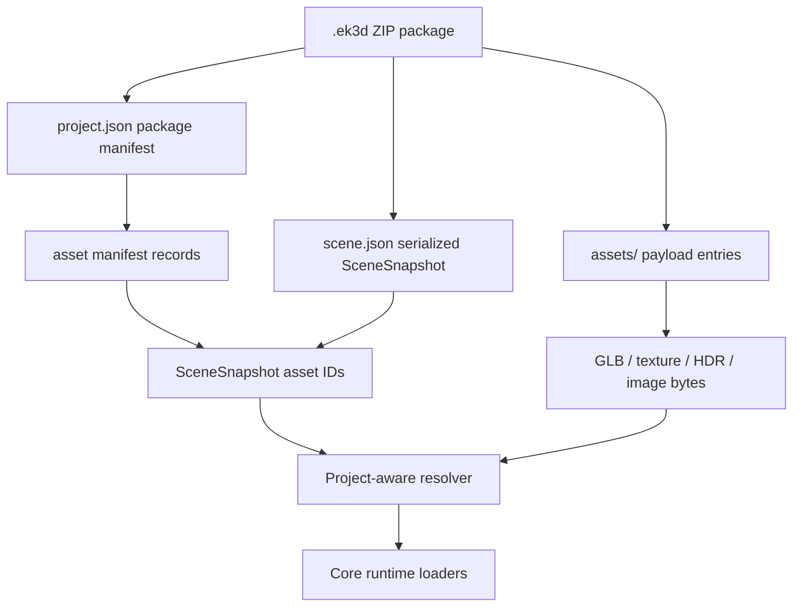
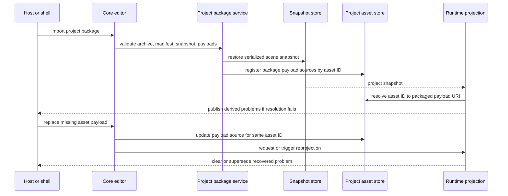

# feat: Add project asset system

## Summary

Add the Asset system backlog item from the core editor contract: a portable project package format, asset manifest, package import/export APIs, asset replacement flow, and missing-resource recovery UX for the existing GLB, texture, HDR, and image asset-reference model.

The plan keeps the current snapshot-first architecture intact. The scene snapshot remains durable JSON-compatible editor state; binary asset payloads and browser file handles live beside it in a project package or transient runtime registry, never inside the snapshot.

---

## Problem Frame

The current editor contract can represent assets as stable references, resolve them through a host boundary, project missing assets as runtime problems, and show those problems through framework inspector panels. That proves the first portable-state boundary, but saved scenes still depend on host-provided resolver state that lives outside the serialized snapshot. A user can save the JSON snapshot and later restore it, but the editor has no first-class way to carry the referenced GLB, texture, HDR, or image payloads with the scene.

The Asset system follow-up should close that portability gap without undoing the origin decision that assets are references, not embedded runtime objects. The right shape is a project package that contains a scene snapshot, an asset manifest, and binary payload entries. Core owns the package contract and replacement semantics; framework shells expose recovery actions over the existing problem UI. Runtime projection continues to consume resolved loadable resources and derived problems, not durable `File`, `Blob`, object URL, Three.js texture, or PMREM objects (see origin: `docs/brainstorms/2026-05-28-core-editor-contract-requirements.md`).

---

## Requirements

### Project Package Contract

- R1. Core must define an experimental `.ek3d` project package format with a versioned package manifest, one serialized scene snapshot, and asset payload entries.
- R2. The project package manifest must map durable asset IDs to asset kind, label, MIME type when known, byte size when known, payload path, checksum or integrity metadata when available, and JSON-compatible asset metadata.
- R3. Project import must validate package structure, manifest references, payload paths, asset kinds, snapshot version, JSON compatibility, and configured archive size/entry-count limits before replacing editor state.
- R4. Project export must include all snapshot-referenced local asset payloads that are available through the project asset store and must report missing payloads instead of silently producing a misleading complete package.
- R5. Project package import/export must preserve scene identity, object identity, transforms, materials, environment fields, lights, selection, asset references, and authored problem state through the existing snapshot serialization contract.

### Asset Store and Resolver Integration

- R6. Core must add a project asset store that can hold transient payload sources for asset references without serializing `File`, `Blob`, object URLs, ArrayBuffers, Three.js objects, textures, PMREM outputs, or resolver results into snapshots.
- R7. Asset registration must distinguish durable reference metadata from transient payload/source metadata so package export can locate payloads while snapshot serialization remains portable JSON.
- R8. Runtime resolution must prefer project-packaged payloads when available and fall back to host-provided resolver behavior without changing the saved snapshot.
- R9. Object URLs or other browser-specific loadable URIs created during package import or replacement must be runtime-owned and revoked through editor/runtime disposal or asset replacement cleanup.
- R10. ZIP or archive handling must be isolated behind an internal adapter so dependency choice, path normalization, zip-slip protections, and binary handling do not leak into public editor APIs.

### Replacement and Recovery

- R11. Core must expose an asset replacement operation that updates the project asset store and asset manifest metadata for an existing asset ID without deleting scene objects, material slots, environment fields, or light state that reference that asset.
- R12. Replacing a missing or failed asset must cause runtime projection to retry affected resources and clear or supersede stale derived problems when resolution succeeds.
- R13. Replacement must be undo/redo-aware only for durable reference or manifest metadata changes; transient payload replacement itself is project-store state and must not be recorded as a scene command unless the durable snapshot changes.
- R14. Problem metadata for missing GLB, texture, HDR, image, or package payload failures must identify the affected asset ID, target, recoverability, and replacement boundary in a framework-neutral way.

### Framework UX and Examples

- R15. React and Vue shells must expose user-facing recovery affordances from existing problem panels without duplicating core asset resolution, package import/export, replacement semantics, or runtime cleanup.
- R16. Framework shell recovery flows may accept browser `File`/`Blob` inputs, but must pass them as transient sources to core and must not persist those objects into snapshots.
- R17. React and Vue examples must demonstrate opening or creating a project, exporting a project package, restoring it into a fresh editor, and replacing a missing asset from the problem UI.
- R18. Documentation must distinguish project package persistence from scene snapshot serialization and must keep marketplace, cloud asset libraries, decoder configuration, and advanced upload management out of scope.

---

## Key Technical Decisions

- KTD1. Project package is the portable artifact, snapshot remains the durable model: `.ek3d` packages should bundle `scene.json`, a package-level asset manifest, and binary asset payload entries. `SceneSnapshot.assets` keeps stable references; the package manifest describes where payloads live in the archive.
- KTD2. Add a project asset layer, not a second scene schema: The asset system should extend `AssetRegistry`/`AssetResolverBridge` with package-aware source storage and resolution. It should not fork a parallel asset graph or duplicate material/environment references outside the existing snapshot model.
- KTD3. Archive implementation is an internal dependency boundary: Use an internal archive adapter around a ZIP-capable library rather than hand-writing ZIP parsing. Current package metadata makes `fflate` the lighter candidate, while `jszip` remains a fallback if implementation needs its higher-level API. The public API should expose project import/export concepts, not the chosen ZIP library.
- KTD4. Normalize and validate archive inputs defensively: Imported packages must be treated as untrusted input. Reject or sanitize absolute paths, `..` traversal, duplicate manifest entries, unsupported compression features, oversized archives, excessive entry counts, missing payloads, and payload paths outside the expected asset directory before using archive contents.
- KTD5. Replacement preserves references by asset ID: A recovery action should normally replace the payload for an existing asset ID so all scene objects, texture slots, environment fields, and future references continue pointing at the same durable asset. Creating a new asset and retargeting references is a separate explicit operation, not the default recovery path.
- KTD6. Runtime retry follows resolver state, not snapshot mutation: When packaged payloads or replacements become available, runtime projection should retry using the resolver bridge and publish fresh derived problems. Successful recovery should not write derived problem cleanup into `snapshot.problems` automatically.
- KTD7. Shell UX is a thin recovery adapter: React and Vue problem panels can render "replace asset" flows and package open/save controls, but core owns package parsing, manifest validation, asset replacement, resolver priority, and cleanup behavior.
- KTD8. Keep first package format local and experimental: The plan targets local project files and browser/Node testable package import/export. Cloud storage, collaborative assets, remote libraries, marketplace metadata, and public format stability are deferred until the editor foundation proves the workflow.
- KTD9. Complete export is the default safety policy: Project export should fail with structured missing-payload problems when snapshot-referenced payloads are unavailable. Partial packages are allowed only through an explicit caller option that marks the result incomplete in package metadata and UX.

---

## High-Level Technical Design

### Project Package Layout

### Import, Export, and Recovery Flow

---

## Implementation Units

### U1. Project package format and archive adapter

- **Goal:** Define the `.ek3d` package contract, internal archive adapter, package manifest types, and validation rules for archive structure.
- **Requirements:** R1-R5, R10, R18.
- **Dependencies:** `docs/plans/2026-05-28-001-feat-core-editor-contract-plan.md`, `docs/plans/2026-05-29-001-feat-core-schema-extension-plan.md`.
- **Files:** `packages/core/package.json`, `pnpm-lock.yaml`, `packages/core/src/project/package-types.ts`, `packages/core/src/project/archive-adapter.ts`, `packages/core/src/project/package-validation.ts`, `packages/core/src/project/package-validation.test.ts`, `packages/core/src/project/archive-adapter.test.ts`, `packages/core/src/public-api.ts`, `packages/core/src/public-api.test.ts`.
- **Approach:** Add a core-internal project package module that treats `.ek3d` as a ZIP-based container. The package should have a small versioned manifest, a fixed scene snapshot entry, and payload entries under a constrained asset directory. Keep the ZIP library behind an adapter so the rest of core works with records of file path, binary bytes, and metadata. Validate path normalization, duplicate records, unsupported asset kinds, missing scene entry, missing manifest entry, missing payload, and non-JSON-compatible metadata before any editor state is replaced.
- **Patterns to follow:** Existing snapshot validation in `packages/core/src/snapshot/validation.ts`, migration in `packages/core/src/snapshot/migrations.ts`, asset kind support in `packages/core/src/snapshot/primitives.ts`, public API boundary tests, and package dependency style in `packages/core/package.json`.
- **Test scenarios:**
  - Given a package with `project.json`, `scene.json`, and `assets/model.glb`, when validation runs, then it accepts only if manifest asset IDs match snapshot asset references and payload paths stay under the asset directory.
  - Given a package entry with an absolute path, `..` traversal, duplicate normalized path, or path outside the asset directory, when import validation runs, then it fails without restoring snapshot or registering payloads.
  - Given a manifest with an unsupported asset kind, mismatched asset ID, non-JSON-compatible metadata, or missing payload, when validation runs, then it returns controlled package problems.
  - Given an archive exceeds configured byte or entry-count limits, when import validation runs, then it fails before replacing editor state or materializing object URLs.
  - Given an archive adapter is swapped for a fake test implementation, when package validation runs, then validation behavior is independent of the concrete ZIP library.
  - Given a consumer imports the core package root, when public API tests inspect exports, then package-facing types are available but archive adapter internals and ZIP library types are not exported.
- **Verification:** Core has a portable package contract and safe archive boundary before import/export mutates any editor state.

### U2. Project asset store and packaged resolver priority

- **Goal:** Add a project-aware asset store and resolver integration that can resolve packaged payloads while preserving snapshot portability.
- **Requirements:** R6-R10, R14.
- **Dependencies:** U1.
- **Files:** `packages/core/src/assets/types.ts`, `packages/core/src/assets/registry.ts`, `packages/core/src/assets/resolver.ts`, `packages/core/src/assets/problems.ts`, `packages/core/src/project/asset-store.ts`, `packages/core/src/project/asset-store.test.ts`, `packages/core/src/assets/registry.test.ts`, `packages/core/src/assets/resolver.test.ts`, `packages/core/src/runtime/missing-asset.integration.test.ts`, `packages/core/src/editor/lifecycle.ts`, `packages/core/src/editor/lifecycle.test.ts`.
- **Approach:** Extend current asset handling with a package asset store that maps asset IDs to transient payload sources and manifest metadata. The resolver bridge should check packaged or replaced payloads first, then delegate to the host resolver. Browser loadable URIs derived from binary payloads should be owned by the asset store or runtime resolver layer and revoked when the asset is replaced, the project is closed, or the editor is disposed. Snapshot `assets` should continue to store only `AssetReference` records.
- **Patterns to follow:** Existing `AssetRegistry`, `AssetResolverBridge`, runtime missing-asset behavior, `CoreEditor.dispose`, and AGENTS.md instruction that `File`, `Blob`, object URLs, loaded textures, and resolver results are not durable state.
- **Test scenarios:**
  - Given an asset reference with a packaged GLB payload, when runtime resolves it, then the resolver returns a loadable transient URI from the package store before consulting the host resolver.
  - Given the package store has no payload for an asset, when a host resolver is configured, then resolution falls back to the host resolver and keeps snapshot state unchanged.
  - Given a browser `File`, `Blob`, or ArrayBuffer-like source is registered as a transient payload, when the editor serializes the scene, then no binary source, object URL, or resolver output appears in the serialized snapshot.
  - Given an asset payload is replaced or the editor is disposed, when object URLs were created for that asset, then they are revoked exactly once and no stale resolver output is reused.
  - Given package import registers GLB, texture, HDR, and image payloads, when material/environment/runtime code resolves references by asset kind, then kind metadata remains consistent with the snapshot asset records.
- **Verification:** Package payloads become runtime-resolvable resources without contaminating durable scene snapshots.

### U3. Project import, export, and editor lifecycle APIs

- **Goal:** Expose core project import/export operations that restore snapshots, register payloads, export available payloads, and report missing package content.
- **Requirements:** R1-R9, R14, R17-R18.
- **Dependencies:** U1, U2.
- **Files:** `packages/core/src/project/import-project.ts`, `packages/core/src/project/export-project.ts`, `packages/core/src/project/project-api.ts`, `packages/core/src/editor/editor-api.ts`, `packages/core/src/editor/lifecycle.ts`, `packages/core/src/editor/serialization.ts`, `packages/core/src/project/import-project.test.ts`, `packages/core/src/project/export-project.test.ts`, `packages/core/src/editor/lifecycle.test.ts`, `packages/core/src/editor/proof-loop.integration.test.ts`, `packages/core/src/public-api.ts`, `packages/core/src/public-api.test.ts`, `packages/core/README.md`.
- **Approach:** Add editor-level APIs for importing a project package into an editor and exporting the current editor/project store into a package. Import should validate the archive, restore the serialized snapshot through the existing migration path, clear command history, replace project asset store contents, and trigger runtime reprojection through existing subscription behavior. Export should serialize the current snapshot, collect payloads for referenced assets, emit package problems for unavailable payloads, and avoid pretending missing assets were packaged. Return structured results with package problems rather than throwing for recoverable missing-payload cases.
- **Patterns to follow:** Existing `Editor.restore`, `serializeSnapshot`, `restoreSnapshot`, history clearing in `CoreEditor.restore`, command result style in `packages/core/src/commands/types.ts`, and runtime problem contracts.
- **Test scenarios:**
  - Given a valid `.ek3d` package, when an editor imports it, then the editor snapshot matches the package scene and the project asset store can resolve each packaged payload.
  - Given import validation fails, when the import call returns, then the prior editor snapshot, history state, runtime asset store, and resolver behavior remain unchanged.
  - Given an editor has local payloads for all snapshot-referenced assets, when export runs, then the package contains a scene entry, manifest entry, and payload entry for each referenced asset.
  - Given an editor references an asset whose payload is not available in the project store, when default export runs, then export fails with a missing-payload problem and does not produce a package that appears complete.
  - Given a caller explicitly opts into partial export, when an asset payload is missing, then the package and result are marked incomplete and identify the missing asset IDs.
  - Given a project is imported into an editor with a mounted runtime, when import completes, then runtime projection uses the imported payloads and exposes derived problems only for assets still unresolved.
  - Given a project import is followed by transform/material/environment/light edits, when export/import round-trip runs through a fresh editor, then durable scene state and asset references survive.
- **Verification:** Hosts can treat `.ek3d` as the portable project artifact while plain snapshot serialization continues to work as the lightweight JSON-only path.

### U4. Asset replacement command surface and runtime recovery

- **Goal:** Implement replacement semantics for missing or failed assets and make runtime projection retry affected resources cleanly.
- **Requirements:** R11-R14, R16.
- **Dependencies:** U2, U3.
- **Files:** `packages/core/src/project/replace-asset.ts`, `packages/core/src/project/asset-store.ts`, `packages/core/src/assets/problems.ts`, `packages/core/src/runtime/scene-projector.ts`, `packages/core/src/runtime/environment-resource-manager.ts`, `packages/core/src/runtime/editor-runtime.ts`, `packages/core/src/runtime/missing-asset.integration.test.ts`, `packages/core/src/project/replace-asset.test.ts`, `packages/core/src/runtime/environment-resource-manager.test.ts`, `packages/core/src/public-api.ts`, `packages/core/src/public-api.test.ts`.
- **Approach:** Add a core replacement operation that targets an existing asset ID and updates the project asset store with a new transient payload plus refreshed manifest metadata. Keep durable scene references stable by default. After replacement, mounted runtime should be able to reproject or be explicitly asked to reproject so missing GLB placeholders, environment failures, and future texture failures can resolve against the new payload. Stale derived problems should disappear when projection succeeds; authored acknowledgements should remain durable until an explicit command changes them.
- **Patterns to follow:** Existing missing GLB placeholder retry behavior in `SceneProjector`, environment resource manager load-token/stale-result patterns, `EditorRuntime.subscribeProblems`, and problem inspector action label behavior.
- **Test scenarios:**
  - Given a restored scene has an unresolved GLB asset and a missing-asset placeholder, when the same asset ID is replaced with a valid GLB payload, then runtime reprojection loads the asset and removes or supersedes the unresolved runtime problem.
  - Given an unresolved HDR environment asset is replaced, when projection retries, then environment resolution uses the new payload and stale environment problems no longer appear.
  - Given replacement uses an asset kind that conflicts with the existing asset reference, when replacement validation runs, then it fails without changing the project asset store or snapshot.
  - Given an asset is referenced by multiple objects or texture/environment fields, when its payload is replaced by asset ID, then all references resolve through the new payload without retargeting individual snapshot fields.
  - Given a replacement succeeds but authored problem acknowledgement state exists, when serialization runs, then derived runtime recovery does not delete authored acknowledgement state automatically.
  - Given a replacement source is a browser `File` or `Blob`, when serialization and export run, then the source is used as transient payload input and only package payload bytes plus manifest metadata are persisted.
- **Verification:** Missing-resource recovery is non-destructive, asset-ID-preserving, and visible through runtime problem updates.

### U5. Framework recovery UX and project controls

- **Goal:** Add React and Vue shell affordances for project open/export and problem-driven asset replacement while keeping core semantics centralized.
- **Requirements:** R15-R18.
- **Dependencies:** U3, U4.
- **Files:** `packages/react/src/components/ProblemsPanel.tsx`, `packages/react/src/components/EditorWorkbench.tsx`, `packages/react/src/hooks/use-workbench.ts`, `packages/react/test/inspector.test.tsx`, `packages/react/test/workbench.test.tsx`, `packages/react/test/react-proof-loop.integration.test.tsx`, `packages/vue/src/components/ProblemsPanel.vue`, `packages/vue/src/components/EditorWorkbench.vue`, `packages/vue/src/composables/use-workbench.ts`, `packages/vue/test/inspector.test.ts`, `packages/vue/test/workbench.test.ts`, `packages/vue/test/vue-proof-loop.integration.test.ts`, `packages/react/src/index.ts`, `packages/vue/src/index.ts`, `packages/react/src/public-api.test.ts`, `packages/vue/src/public-api.test.ts`.
- **Approach:** Extend shell workbench context with project import/export and replace-asset callbacks that call core APIs. Problem panels should render replacement affordances when a problem has a recoverable asset target, but the UI should hand selected `File`/`Blob` sources to core rather than storing them in component state beyond the active input interaction. Keep labels and slots/render props framework-native, while preserving parity between React and Vue.
- **Patterns to follow:** Existing `ProblemsPanel` components, `useWorkbench` context, `EditorWorkbench` extension regions, runtime problem subscription behavior, React StrictMode tests, and Vue shallow/raw editor handling.
- **Test scenarios:**
  - Given a problem item with recoverability `user-action` and an asset ID, when the React problem panel receives a replacement file, then it calls the core replacement API for that asset ID and does not mutate snapshots directly.
  - Given the same missing asset problem appears in Vue, when a replacement file is selected, then the Vue panel routes through the same core replacement semantics and runtime problems update after reprojection.
  - Given a workbench imports a project package, when import succeeds, then viewport, inspector, problem panel, and extension context all reflect the imported snapshot from the same core editor.
  - Given a workbench exports a project with missing payloads, when the export result reports package problems, then the shell can surface those problems without constructing framework-specific validation rules.
  - Given React StrictMode or Vue unmount/remount occurs during project controls, when subscriptions and transient file inputs are inspected through fakes, then no duplicate replacement calls or leaked subscriptions remain.
  - Given package public exports are inspected, when project UX helpers are added, then only intended workbench/component/hook types are exported and core archive internals remain private.
- **Verification:** React and Vue expose equivalent local-project and recovery UX without becoming alternate asset systems.

### U6. Example project workflows and documentation

- **Goal:** Demonstrate the package and recovery workflow in examples and document the asset-system boundary clearly.
- **Requirements:** R15-R18.
- **Dependencies:** U3-U5.
- **Files:** `examples/react-proof-loop/src/App.tsx`, `examples/react-proof-loop/src/styles.css`, `examples/vue-proof-loop/src/App.vue`, `examples/vue-proof-loop/src/styles.css`, `examples/vanilla-proof-loop/src/proof-loop.ts`, `packages/core/README.md`, `packages/react/README.md`, `packages/vue/README.md`, `README.md`, `packages/core/src/project/import-project.test.ts`, `packages/core/src/project/export-project.test.ts`, `packages/react/test/react-proof-loop.integration.test.tsx`, `packages/vue/test/vue-proof-loop.integration.test.ts`.
- **Approach:** Update examples to show the distinction between JSON snapshot save/restore and `.ek3d` project package open/export. Include a missing-asset recovery path in React and Vue examples using the existing problem panel surface. Keep the visual UI compact and utilitarian, and keep the vanilla example as the core API proof rather than a full workbench clone. Documentation should explain package contents, asset reference rules, transient source handling, replacement by asset ID, and deferred asset capabilities.
- **Patterns to follow:** Existing React/Vue workbench examples, current core README sections for snapshot/commands/problems, origin scope boundaries, and package README style.
- **Test scenarios:**
  - Given the React example exports a project and imports it into a fresh editor, when the fresh editor mounts runtime, then the imported object, environment asset reference, lights, and inspector state restore from the project package.
  - Given the Vue example starts with an intentionally missing GLB or HDR payload, when the user replaces the asset through the problem UI, then runtime problems update and the serialized snapshot still contains only asset references.
  - Given documentation describes `.ek3d`, when compared with implementation, then it states that the package contains snapshot JSON, manifest JSON, and asset payloads rather than embedding binary data in `SceneSnapshot`.
  - Given docs mention replacement flow, when compared with core APIs, then they describe asset-ID-preserving replacement and do not imply cloud libraries, model marketplace, or durable upload queues.
  - Given example layouts render on a narrow viewport, when workbench project controls appear, then controls do not overlap the viewport or problem panel.
- **Verification:** Consumers can understand when to use scene snapshots versus project packages and can see recovery behavior in both shell examples.

---

## Scope Boundaries

### In Scope for This Plan

- Experimental `.ek3d` ZIP-based project package contract.
- Package-level manifest for asset ID, asset kind, payload path, MIME/type metadata, size/checksum metadata when available, and JSON-compatible metadata.
- Core project import/export APIs around existing snapshot serialization and restoration.
- Project asset store for transient payload sources and package payload resolution.
- Internal archive adapter and archive path validation.
- Resolver priority for packaged or replaced payloads before host resolver fallback.
- Asset-ID-preserving replacement flow for missing or failed GLB, texture, HDR, and image assets.
- Runtime reprojection and derived problem refresh after replacement.
- React and Vue project controls and problem-panel recovery affordances.
- Examples and documentation that distinguish JSON snapshots from project packages.

### Deferred to Follow-Up Work

- Cloud asset storage, remote libraries, model marketplace, bundled model library, and account-backed uploads.
- Full asset browser, searchable asset library, drag-and-drop batch upload manager, asset thumbnails, and persisted asset folders/tags.
- Project package format stability beyond experimental `0.x` and backward-compatible long-term archive migrations.
- Draco, KTX2, Meshopt, compressed texture pipelines, decoder package configuration, and large-model streaming.
- Material texture projection onto imported GLB meshes and per-submesh material-slot discovery.
- Scene hierarchy, durable light selection, grouping, duplicate, delete, copy/paste, multi-select, and advanced editor operations.
- Release automation, Changesets, package provenance, and public npm publishing workflow.

### Outside This Product Identity for MVP

- Full Le5le-style low-code platform behavior.
- MQTT/WebSocket data binding.
- Event orchestration, animation timeline, multi-scene linkage, and runtime dashboard publishing.
- WebGPU-first renderer.
- Physics editor, CAD tooling, 3D Tiles, shader/node material editor, or marketplace/publishing platform behavior.

---

## System-Wide Impact

- **Public API surface:** Core gains package import/export and asset replacement APIs. Public types should describe project concepts without exposing archive adapter or ZIP-library internals.
- **Persistence semantics:** The project now has two save surfaces: JSON scene snapshots and `.ek3d` packages. Documentation and tests must keep their responsibilities distinct.
- **Runtime resource ownership:** Packaged payload resolution may create object URLs or other transient loadable resources. Their cleanup becomes part of editor/project lifecycle correctness.
- **Framework parity:** React and Vue problem panels become recovery surfaces. They must stay thin wrappers over core replacement APIs to avoid divergent asset behavior.
- **Security boundary:** `.ek3d` import handles untrusted archive paths and binary entries. Path normalization, duplicate detection, and payload validation need explicit test coverage.
- **Dependency footprint:** A ZIP dependency in core affects every shell package transitively. Keeping it internal and choosing a small ESM-friendly library reduces public API and bundle risk.

---

## Risks and Dependencies

| Risk / Dependency | Impact | Mitigation |
|---|---|---|
| Archive import accepts unsafe paths. | A malicious package could overwrite or confuse payload mapping in Node or browser contexts. | Normalize paths, reject traversal/absolute paths, detect duplicates, and test zip-slip-style inputs before state replacement. |
| Archive import allows resource exhaustion. | A large or zip-bomb-style project can freeze browser UI, exhaust memory, or destabilize tests. | Enforce configurable archive byte and entry-count limits before payload materialization, and document the experimental default limits. |
| Binary payloads leak into snapshots. | Save/load portability and AGENTS.md runtime-value rules are broken. | Keep payloads in project asset store and package entries only; add serialization tests with `File`, `Blob`, ArrayBuffer, object URL, and resolver output inputs. |
| ZIP dependency becomes accidental public API. | Future dependency swaps become breaking changes. | Hide it behind `archive-adapter.ts` and export only project package concepts from core. |
| Export silently omits missing payloads. | Users may believe a project package is portable when assets are absent. | Fail export by default; allow partial packages only behind an explicit option that marks the result incomplete. |
| Replacement accidentally retargets scene references. | Objects or material/environment fields can drift away from durable asset IDs. | Default replacement updates payload for the same asset ID; retargeting is deferred as a separate explicit operation. |
| Runtime keeps stale object URLs after replacement/import. | Browser memory leaks and stale visuals can persist. | Make URL revocation part of asset-store replacement, project close/import, and editor disposal tests. |
| Shell recovery UX overpromises asset management. | Users may expect a full asset browser or cloud library. | Keep UI to package open/export and per-problem replacement; document richer asset management as deferred. |

---

## Acceptance Examples

| ID | Acceptance Example | Covered By |
|---|---|---|
| AE1 | Given a scene with a GLB object, HDR environment asset, and image/texture asset references, when it is exported as `.ek3d` and imported into a fresh editor, then the fresh editor restores the scene snapshot and resolves packaged payloads without host-only resolver state. | U1, U2, U3 |
| AE2 | Given a `.ek3d` package contains an unsafe archive path or a manifest payload path outside the asset directory, when import validation runs, then the editor rejects the package and preserves the current editor state. | U1, U3 |
| AE3 | Given an exported scene references an asset whose payload is unavailable, when project export runs, then the export result surfaces a missing-payload problem instead of silently producing a package that appears complete. | U3 |
| AE4 | Given a restored project has a missing GLB asset problem, when the user replaces that asset in either React or Vue using the same asset ID, then runtime reprojection resolves the object and the derived missing-asset problem disappears without changing scene object references. | U4, U5 |
| AE5 | Given a shell receives a browser `File` or `Blob` for replacement, when the project is serialized or exported, then the scene snapshot still contains only asset references and the package contains payload bytes plus manifest metadata. | U2, U4, U5 |
| AE6 | Given the same project package is opened through React and Vue workbench examples, when the user saves, restores, and replaces a missing asset, then both shells use core project APIs and expose equivalent problem recovery behavior. | U5, U6 |

---

## Documentation and Operational Notes

- Core README should define the difference between `editor.serialize()` for JSON snapshot state and project export for portable snapshot-plus-assets persistence.
- Package docs should describe `.ek3d` as experimental and local-first; do not imply long-term format stability, cloud sync, marketplace, or publishing support.
- React and Vue README examples should show project controls as shell affordances over core APIs, not as framework-owned asset managers.
- Dependency notes should mention the internal archive adapter and avoid documenting the ZIP library as a public integration point.
- Example docs should keep replacement focused on problem-driven recovery by asset ID.

---

## Deferred Implementation Notes

- Exact manifest property names can be finalized during implementation, but the manifest must remain JSON-compatible and must keep payload paths separate from scene snapshot asset references.
- Partial export metadata shape can be finalized during implementation, but default export must fail when required payloads are missing and any opt-in partial package must be clearly marked incomplete.
- Checksum algorithm choice can be implementation-driven as long as it is deterministic, documented in the package manifest version, and testable without Web Crypto availability in every unit test.
- If the chosen ZIP library cannot support both browser and Node test environments cleanly, keep the archive adapter contract and swap the dependency rather than leaking library-specific behavior upward.

---

## Sources and Research

- Origin requirements and backlog: `docs/brainstorms/2026-05-28-core-editor-contract-requirements.md`
- Core contract plan: `docs/plans/2026-05-28-001-feat-core-editor-contract-plan.md`
- Schema extension plan: `docs/plans/2026-05-29-001-feat-core-schema-extension-plan.md`
- Runtime capability plan: `docs/plans/2026-05-29-002-feat-runtime-capability-plan.md`
- Inspector UX plan: `docs/plans/2026-05-29-003-feat-inspector-ux-plan.md`
- Framework shells plan: `docs/plans/2026-05-29-004-feat-framework-shells-plan.md`
- Current asset registry and resolver: `packages/core/src/assets/registry.ts`, `packages/core/src/assets/resolver.ts`, `packages/core/src/assets/types.ts`
- Current snapshot and validation contracts: `packages/core/src/snapshot/types.ts`, `packages/core/src/snapshot/validation.ts`, `packages/core/src/editor/serialization.ts`
- Current runtime missing-asset behavior: `packages/core/src/runtime/scene-projector.ts`, `packages/core/src/runtime/missing-asset.integration.test.ts`
- Current problem UI and shell workbench surfaces: `packages/core/src/inspector/problems.ts`, `packages/react/src/components/ProblemsPanel.tsx`, `packages/vue/src/components/ProblemsPanel.vue`, `packages/react/src/hooks/use-workbench.ts`, `packages/vue/src/composables/use-workbench.ts`
- Residual review context: `docs/residual-review-findings/feat-core-schema-extension.md`, `docs/residual-review-findings/feat-runtime-capability.md`
- `fflate` npm metadata checked locally on 2026-05-29: version `0.8.3`, MIT, no runtime dependencies.
- `jszip` npm metadata checked locally on 2026-05-29: version `3.10.1`, `(MIT OR GPL-3.0-or-later)`, with runtime dependencies.
- `fflate` README for ESM, browser/Node support, ZIP support, and package-size positioning: https://github.com/101arrowz/fflate
- JSZip `loadAsync` docs for ZIP input types, Promise failure behavior, and path sanitization precedent: https://stuk.github.io/jszip/documentation/api_jszip/load_async.html
- MDN `Blob.arrayBuffer()` for browser binary reads from `Blob`/`File`: https://developer.mozilla.org/en-US/docs/Web/API/Blob/arrayBuffer
- MDN `File` interface for browser file metadata/content access boundary: https://developer.mozilla.org/en-US/docs/Web/API/File
