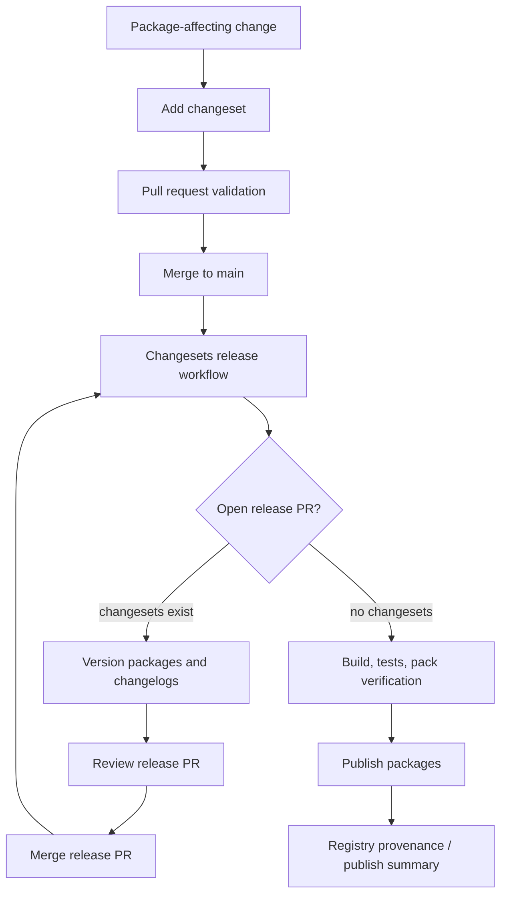
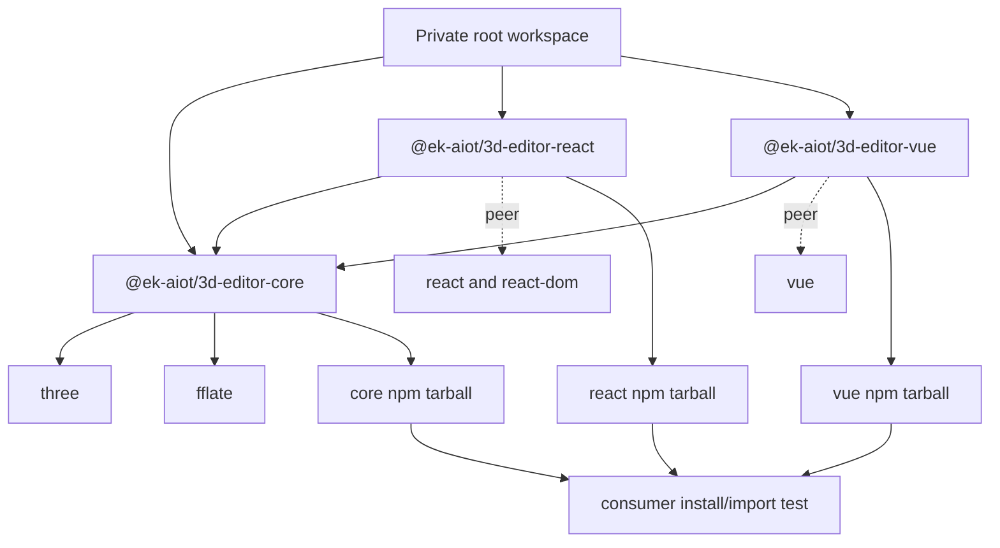

# feat: Add npm release workflow

## Summary

Add the npm release backlog item from the core editor contract: harden the three publishable package boundaries, add Changesets-based versioning and changelog flow, verify packed artifacts before publish, and document a first public `0.x` release path for `@ek-aiot/3d-editor-core`, `@ek-aiot/3d-editor-vue`, and `@ek-aiot/3d-editor-react`.

The plan assumes these package names are the intended npm names. Local registry checks on 2026-05-30 returned 404 for all three packages, so the release workflow should treat the next publish as the first public release under the `@ek-aiot` scope.

---

## Problem Frame

The editor now has the package boundaries the origin requirements asked for, but the repository still treats release automation as deferred work. The root workspace is private, the three package workspaces have initial ESM `exports`, type declaration outputs, README files, and peer dependency declarations, and `pnpm build`, `pnpm typecheck`, and `pnpm test` already target package work. What is missing is the release contract around those packages: stable npm metadata, tarball contents verification, coordinated versioning, changelog generation, publish CI, provenance/trusted-publishing posture, and instructions for maintainers.

This matters because npm reuse was part of the product architecture from the first brainstorm. If release engineering stays ad hoc, private runtime modules can leak through tarballs, workspace dependency ranges can publish incorrectly, examples or test artifacts can ship accidentally, and first release credentials can become a one-off local action rather than a repeatable workflow (see origin: `docs/brainstorms/2026-05-28-core-editor-contract-requirements.md`).

---

## Requirements

### Package Metadata and Public Contract

- R1. The root workspace must stay private while the three package workspaces remain publishable npm packages.
- R2. Each publishable package must declare explicit `type`, `exports`, `main`, `module`, `types`, `files`, repository metadata, license metadata, package description, and public access intent.
- R3. Public package exports must continue to expose only root package entrypoints; private runtime, archive, shell helper, test fixture, and build internals must not become importable public API.
- R4. The React and Vue packages must keep framework libraries as peer dependencies and keep core as an internal package dependency that publishes to a registry semver range rather than an unresolved workspace-only range.
- R5. The core package may depend directly on Three.js and the internal archive dependency, but it must not depend on React or Vue.

### Versioning and Changelog Flow

- R6. The repository must use Changesets to record package-affecting changes, compute package version bumps, update internal package dependency ranges, and generate package changelogs.
- R7. Changesets configuration must publish scoped packages publicly, use the repository's actual default branch, and support independent package versioning unless a future product decision requires linked/fixed versions.
- R8. Root scripts must expose maintainable release workflow entrypoints for adding changesets, versioning packages, dry-run verification, and publishing from CI.
- R9. The first release should stay in experimental `0.x`; the workflow must not imply stable public API guarantees beyond the current snapshot-first contract.

### Artifact Verification and CI Gates

- R10. Release verification must run build, typecheck, normal tests, browser tests when relevant to package output, and package tarball inspection before any publish.
- R11. Packed artifacts must include package `dist`, package README, license metadata, changelogs where generated, and intended CSS/assets; they must exclude source tests, browser fixtures unless intentionally shipped, local examples, `.tsbuildinfo`, source maps if the package policy excludes them, and transient runtime values.
- R12. The release workflow must validate that package root imports resolve from built artifacts rather than only from source aliases.
- R13. CI must separate pull-request validation from release publishing so normal PRs cannot publish packages.

### Publishing, Provenance, and Operations

- R14. Publishing should use GitHub Actions and Changesets as the repeatable path; local publish should be documented only as an emergency or initial bootstrap fallback.
- R15. npm trusted publishing / provenance should be the preferred security posture when the `@ek-aiot` npm scope and GitHub workflow are configured for it.
- R16. If trusted publishing is unavailable for the first release, token-based publish must be a documented fallback with the minimum required secret and without storing tokens in the repository.
- R17. Release documentation must list external prerequisites: npm account or organization ownership, package scope access, registry settings, GitHub repository permissions, trusted publisher or token setup, and the first-release checklist.
- R18. Release notes must preserve scope boundaries from the editor contract: publishing the packages does not promise Le5le-style low-code features, cloud asset libraries, marketplace behavior, or stable non-`0.x` APIs.

---

## Key Technical Decisions

- KTD1. Keep the package set fixed to the origin contract: Publish only `@ek-aiot/3d-editor-core`, `@ek-aiot/3d-editor-vue`, and `@ek-aiot/3d-editor-react`. Examples and the root workspace stay private because they are proof loops and release tooling, not npm products.
- KTD2. Use Changesets for release state: Changesets fits this pnpm monorepo because it records per-package release intent, updates changelogs and versions at release time, and can update internal dependency ranges for packages released together. The plan should not introduce a second versioning tool.
- KTD3. Independent `0.x` versions by default: The packages are related but not necessarily feature-identical after release. Independent versions avoid unnecessary package churn, while Changesets can still bump shell packages when core changes require dependency range updates.
- KTD4. Publish from built package artifacts, not source aliases: Current tests use source aliases for speed, but release confidence needs tarball/install tests that consume each package the way npm users will consume it.
- KTD5. Prefer trusted publishing and provenance, allow token fallback: npm's trusted publishing/OIDC path reduces long-lived token risk, but it requires npm-side configuration outside the repository. The repository should be ready for trusted publishing while documenting token-based release as a fallback.
- KTD6. Keep package `exports` narrow until a real consumer needs more: Root-only exports preserve the origin decision that internal runtime projectors, archive adapters, shell helpers, and test seams should not harden into public API.
- KTD7. Make artifact inspection a release gate: `files` allowlists and package metadata tests are useful, but a packed tarball is the closest pre-publish representation of what users install. Release verification should inspect the actual tarball contents.
- KTD8. Treat `workspace:*` as development-only linkage: pnpm and release tooling can replace workspace protocol ranges during packing/publishing, but the workflow should verify the published manifests contain registry-consumable semver ranges for internal package dependencies.

---

## High-Level Technical Design

### Release Flow

### Package Boundary and Verification

---

## Implementation Units

### U1. Package metadata and publish boundary hardening

- **Goal:** Make the three package manifests ready for public npm publication while keeping the root workspace and examples private.
- **Requirements:** R1-R5, R9, R18.
- **Dependencies:** `docs/plans/2026-05-28-001-feat-core-editor-contract-plan.md`, `docs/plans/2026-05-29-004-feat-framework-shells-plan.md`, `docs/plans/2026-05-29-005-feat-asset-system-plan.md`.
- **Files:** `package.json`, `packages/core/package.json`, `packages/react/package.json`, `packages/vue/package.json`, `packages/core/src/public-api.test.ts`, `packages/react/src/public-api.test.ts`, `packages/vue/src/public-api.test.ts`, `packages/react/test/build-config.test.ts`, `packages/vue/test/build-config.test.ts`, `LICENSE`.
- **Approach:** Add or verify package metadata needed by npm consumers: descriptions, repository/homepage/bugs links, license, keywords, author or maintainer fields if desired, `publishConfig.access`, and root privacy. Keep package `exports` root-only unless implementation proves a specific subpath is necessary. Ensure shell packages keep React/Vue as peers, core as package dependency, and no framework dependency leaks into core. Add a repository license file so package tarballs carry license metadata consistently.
- **Patterns to follow:** Existing package manifests, package public API tests, current package names from the core contract plan, root `private: true`, existing Vite externals for React and Vue, and AGENTS.md package-boundary guidance.
- **Test scenarios:**
  - Given each package manifest is inspected, when metadata tests run, then `name`, `version`, `type`, `exports`, `main`, `module`, `types`, `files`, `description`, `license`, `repository`, and `publishConfig.access` are present and consistent.
  - Given the root manifest is inspected, when release metadata tests run, then the root remains `private: true` and is not part of recursive publishing.
  - Given the core manifest is inspected, when dependency policy tests run, then it depends on `three` and the archive dependency as needed and has no `react`, `react-dom`, or `vue` dependency.
  - Given React and Vue manifests are inspected, when peer policy tests run, then framework packages are peers/dev dependencies and core remains an internal package dependency.
  - Given a consumer attempts to resolve private implementation paths through package `exports`, when Node package resolution is exercised against built manifests, then only intended root exports are available.
- **Verification:** The package manifests communicate the intended npm contract and keep examples, source tests, and private modules outside the public package boundary.

### U2. Build output and tarball verification

- **Goal:** Add release verification that proves built artifacts and packed npm tarballs contain exactly the package surfaces consumers need.
- **Requirements:** R3-R5, R10-R12.
- **Dependencies:** U1.
- **Files:** `package.json`, `packages/core/package.json`, `packages/react/package.json`, `packages/vue/package.json`, `packages/core/test/package-tarball.test.ts`, `packages/react/test/package-tarball.test.ts`, `packages/vue/test/package-tarball.test.ts`, `vitest.config.ts`.
- **Approach:** Extend test coverage or add a focused package-tarball test suite that inspects the outputs produced by package builds and dry-run packing. The tests should assert presence of root entry files, declarations, CSS needed by shell components, README/license/changelog assets when present, and absence of source tests, fixtures not meant for consumers, `.tsbuildinfo`, examples, and private internal entrypoints. Keep verification outcome-oriented; exact tar command mechanics can be decided during implementation.
- **Execution note:** Add characterization tests around current `dist` and package `files` behavior before tightening file allowlists so accidental package content changes are visible.
- **Patterns to follow:** Existing `packages/react/test/build-config.test.ts`, `packages/vue/test/build-config.test.ts`, package `files` allowlists, Vite library output, TypeScript declaration output, and current `dist/index.*` entrypoints.
- **Test scenarios:**
  - Given the core package is built and packed, when tarball contents are inspected, then it includes `dist/index.js`, `dist/index.d.ts`, README, license metadata, and intended runtime declarations while excluding tests, examples, fixtures, and `.tsbuildinfo`.
  - Given the React package is built and packed, when tarball contents are inspected, then it includes JS/declaration output, component CSS needed by exported components, README, license metadata, and no source tests or examples.
  - Given the Vue package is built and packed, when tarball contents are inspected, then it includes JS/declaration output, Vue component declarations/output as produced by the chosen build, component CSS, README, license metadata, and no source tests or examples.
  - Given packed package manifests are inspected, when internal dependencies are checked, then any core dependency in shell packages is a registry-consumable semver range rather than an unresolved workspace-only range.
  - Given a temporary consumer project installs the local package tarballs, when it imports each package root in an ESM TypeScript context, then package exports and declarations resolve without source aliases.
  - Given an internal runtime/archive/shell helper path is imported from a packed package, when resolution runs, then the import fails through the package export boundary.
- **Verification:** Maintainers can inspect the same artifacts npm users will install before a publish occurs.

### U3. Changesets versioning and changelog workflow

- **Goal:** Add Changesets configuration and scripts for package version bumps, changelog generation, and internal dependency range updates.
- **Requirements:** R6-R9, R18.
- **Dependencies:** U1, U2.
- **Files:** `package.json`, `pnpm-lock.yaml`, `.changeset/config.json`, `.changeset/README.md`, `packages/core/CHANGELOG.md`, `packages/react/CHANGELOG.md`, `packages/vue/CHANGELOG.md`, `README.md`.
- **Approach:** Add `@changesets/cli` as a root dev dependency and initialize a minimal config for this monorepo. Use `access: "public"`, `baseBranch: "main"`, independent versions, and an internal dependency update policy that keeps shell package dependency ranges aligned when core releases require it. Add root scripts for changeset creation, versioning, dry-run release verification, and CI publish entrypoints. Keep release docs clear that `0.x` versions are experimental.
- **Patterns to follow:** Current root script naming, Conventional Commit-style repository history, Changesets defaults for monorepos, and package README style.
- **Test scenarios:**
  - Given `.changeset/config.json` is parsed, when configuration tests or review checks run, then `access` is public, `baseBranch` is `main`, private root packages are not published, and linked/fixed version groups are empty unless explicitly justified.
  - Given a changeset references core and React, when the versioning flow is dry-run or fixture-tested, then package versions and changelog entries are updated consistently and shell internal dependency ranges are valid for npm consumers.
  - Given a docs-only change does not affect package output, when release policy is applied, then no changeset is required unless the documentation should appear in package changelogs.
  - Given a package-affecting PR lacks a changeset, when PR release checks run, then the workflow flags the missing release intent without blocking unrelated internal-only changes unnecessarily.
  - Given all changesets have been consumed into a release PR, when the publish workflow runs, then it does not attempt to publish stale changeset files.
- **Verification:** Version and changelog state becomes reviewable before publishing rather than being generated during an opaque local release.

### U4. CI validation and release publishing workflow

- **Goal:** Add GitHub Actions workflows that validate PRs and publish packages from the protected release path.
- **Requirements:** R10-R17.
- **Dependencies:** U1-U3.
- **Files:** `.github/workflows/ci.yml`, `.github/workflows/release.yml`, `package.json`, `pnpm-workspace.yaml`, `.npmrc` or documented CI-generated npm config if needed, `README.md`, `docs/release.md`.
- **Approach:** Add a normal CI workflow for install, build, typecheck, tests, browser tests where relevant, and package verification. Add a release workflow on the default branch that uses Changesets to create a release PR when changesets exist, and publishes packages when the release PR has been merged and no changesets remain. Prefer npm trusted publishing/OIDC with `id-token: write` and registry-side trusted publisher configuration; if the first release cannot use trusted publishing, document an `NPM_TOKEN` fallback stored only as a GitHub secret. Keep publish permissions out of PR workflows.
- **Patterns to follow:** Root `pnpm@9.15.9` package manager pin, current `pnpm build`, `pnpm typecheck`, `pnpm test`, `pnpm test:browser` scripts, GitHub remote `rookielzy/ek-aiot-3d-editor`, Changesets action workflow shape, and npm provenance guidance.
- **Test scenarios:**
  - Given a pull request opens, when CI runs, then it installs with the lockfile, builds all packages, typechecks, runs normal tests, and runs package verification without publishing.
  - Given browser/runtime package output changed, when CI runs, then browser-specific tests are included or the workflow documents why they are not needed for that change.
  - Given a changeset is present on `main`, when the release workflow runs, then it opens or updates a Changesets release PR rather than publishing immediately.
  - Given the release PR is merged and no pending changesets remain, when release workflow verification passes, then only the three publishable packages are published.
  - Given trusted publishing is configured, when the release workflow publishes, then provenance is generated through the CI identity and no long-lived npm token is required.
  - Given trusted publishing is not configured but `NPM_TOKEN` exists, when the fallback path is used, then the token is read from GitHub secrets and never committed into the repository.
  - Given any build, test, tarball verification, or package import check fails, when release workflow reaches publish gating, then publish is skipped.
- **Verification:** Publication is repeatable from CI, gated by the same package contract checks reviewers see before release.

### U5. Release documentation and first-release checklist

- **Goal:** Document the public release process, external prerequisites, package scope assumptions, and what `0.x` publication does and does not promise.
- **Requirements:** R8-R9, R14-R18.
- **Dependencies:** U1-U4.
- **Files:** `README.md`, `docs/release.md`, `packages/core/README.md`, `packages/react/README.md`, `packages/vue/README.md`, `.changeset/README.md`.
- **Approach:** Add a focused release guide that explains package ownership, changeset expectations, release PR review, CI publish behavior, trusted publishing setup, token fallback, first-release checklist, package verification, and rollback/deprecate guidance at a high level. Package READMEs should identify the experimental `0.x` API posture and link to the release guide without implying stable 1.0 support. Root README should move release automation out of "deferred" once implemented.
- **Patterns to follow:** Existing README non-goals, package README concise style, origin scope boundaries, npm organization/scoped package docs, and Changesets contributor guidance.
- **Test scenarios:**
  - Given a maintainer reads `docs/release.md`, when they follow the first-release checklist, then they can identify npm org/scope prerequisites, GitHub workflow permissions, trusted publisher setup, and release PR review responsibilities.
  - Given a contributor changes package-facing code, when they read `.changeset/README.md`, then they can decide whether a changeset is required and which packages should be listed.
  - Given a consumer reads package READMEs, when they scan versioning language, then they understand the packages are experimental `0.x` and should not assume stable non-`0.x` API guarantees.
  - Given docs mention provenance or trusted publishing, when compared with workflow configuration, then docs distinguish the preferred trusted-publishing path from the token fallback.
  - Given docs list published packages, when compared with `pnpm-workspace.yaml`, then examples and root workspace are clearly private and not npm release targets.
- **Verification:** Maintainers and consumers can understand how packages are released and what the first public release means.

### U6. First public release readiness pass

- **Goal:** Prepare the repository for the first actual npm publication without coupling the implementation plan to account-specific secrets.
- **Requirements:** R1-R18.
- **Dependencies:** U1-U5.
- **Files:** `docs/release.md`, `.github/workflows/release.yml`, `.changeset/config.json`, `package.json`, `packages/core/package.json`, `packages/react/package.json`, `packages/vue/package.json`, `packages/core/CHANGELOG.md`, `packages/react/CHANGELOG.md`, `packages/vue/CHANGELOG.md`.
- **Approach:** Add a first-release changeset or release note that covers the currently implemented editor foundation, then run the release verification path up to dry-run packing. Confirm the three package names remain available, the `@ek-aiot` npm scope is controlled by the maintainer, the GitHub workflow is authorized as trusted publisher or has a scoped publish token fallback, and the initial dist tag is appropriate for experimental `0.x` packages. Keep account setup as a documented prerequisite, not repository state.
- **Patterns to follow:** Registry name checks performed during planning, Changesets release PR workflow, package tarball verification, and current package README summaries.
- **Test scenarios:**
  - Given the first release changeset exists, when versioning runs, then all three publishable packages receive the intended initial version bump and changelog entry.
  - Given package names are queried before publish, when any package name is unexpectedly taken or scope access fails, then release stops and docs record the blocking ownership issue.
  - Given a dry-run publish or pack verification runs, when package manifests and tarballs are inspected, then all package names, versions, dependency ranges, access settings, and file lists match the release guide.
  - Given the release workflow is configured for trusted publishing, when npm-side trusted publisher configuration is missing, then the release checklist catches it before publish.
  - Given the fallback token path is used, when the token lacks publish rights or 2FA policy blocks automation, then the publish fails before partial package publication or surfaces a clear remediation.
- **Verification:** The first public publish can proceed from a reviewed release PR once external npm/GitHub prerequisites are satisfied.

---

## Scope Boundaries

### In Scope for This Plan

- Release metadata hardening for `@ek-aiot/3d-editor-core`, `@ek-aiot/3d-editor-vue`, and `@ek-aiot/3d-editor-react`.
- Root-private workspace and example-private publication boundaries.
- Package `exports`, `files`, peer dependency, dependency, license, repository, README, and changelog policy.
- Changesets configuration, versioning workflow, package changelogs, and release scripts.
- Package tarball verification and temporary consumer install/import checks.
- GitHub Actions CI and release workflow for Changesets release PRs and npm publish.
- npm trusted publishing/provenance as the preferred path, with documented token fallback.
- First public `0.x` release checklist and release documentation.

### Deferred to Follow-Up Work

- Multi-registry publishing, private registry mirrors, CDN distribution, or package signing beyond npm provenance/registry signatures.
- Automated API report generation, compatibility diffing, or typedoc-generated public docs.
- Long-term 1.0 stability policy, deprecation windows, support matrix, and formal semantic-versioning governance beyond `0.x`.
- Release automation for examples as deployable demos.
- Automated browser visual demos or hosted documentation site publishing.
- Changes to core schema, runtime projection, asset package behavior, inspector UX, shell workbench features, or advanced editor commands.

### Origin Backlog Boundaries Preserved

- Core schema, runtime capability, inspector UX, framework shells, and asset system tracks remain prerequisites or sibling plans, not work reopened by this release plan.
- Advanced editor and Le5le-like features remain outside release automation.

### Outside This Product Identity for MVP

- Full Le5le-style low-code platform behavior.
- MQTT/WebSocket data binding.
- Event orchestration, animation timeline, multi-scene linkage, and runtime dashboard publishing.
- Model marketplace or bundled model library.
- WebGPU-first renderer.
- Shader editor, node material editor, physics editor, CAD tooling, 3D Tiles, or large-model streaming.

---

## System-Wide Impact

- **Public API hardening:** Once packages are published, root exports, package names, dependency ranges, and tarball contents become real consumer contracts even during `0.x`.
- **Supply-chain posture:** The repository gains publish credentials or OIDC trust relationships. Workflow permissions and secret handling become part of the security boundary.
- **Release cadence:** Changesets makes package-affecting changes explicit in PRs and shifts version review into release PRs.
- **Consumer install behavior:** Packed artifacts and published manifests must work without source aliases, workspace symlinks, or local examples.
- **Documentation expectations:** Public npm packages will attract readers outside the project context. READMEs must be honest about experimental scope and deferred product features.

---

## Risks and Dependencies

| Risk / Dependency | Impact | Mitigation |
|---|---|---|
| npm scope ownership is not configured. | First release cannot publish under `@ek-aiot` even if repository workflow is correct. | Put npm organization/scope ownership in the first-release checklist and stop release before publish if access is missing. |
| Trusted publishing is unavailable or misconfigured. | Provenance path fails during first release. | Prefer trusted publishing but keep token fallback documented; verify OIDC/npm setup before merging the release PR. |
| Workspace dependency ranges leak into published manifests. | Consumers cannot install shell packages from npm. | Add packed-manifest checks that assert registry-consumable semver ranges for internal dependencies. |
| Tarballs include private files or omit required CSS/declarations. | Consumers get bloated, broken, or unstable package contents. | Verify package tarballs after build and keep package `files` allowlists tight. |
| Source-alias tests pass while npm-style imports fail. | Release appears green locally but breaks for consumers. | Add temporary consumer install/import tests against packed tarballs. |
| Changesets creates unnecessary package churn. | Consumers see unrelated version bumps and changelogs. | Use independent versions by default and avoid fixed/linked groups until a real release-management need appears. |
| Token fallback broadens credential risk. | Long-lived npm token can leak or be over-permissioned. | Store only in GitHub secrets, document minimum scope, and prefer trusted publishing once npm-side setup is complete. |
| First release overpromises product maturity. | Users expect stable workbench, cloud assets, marketplace, or Le5le-like runtime behavior. | Keep `0.x` language and README scope boundaries explicit. |

---

## Acceptance Examples

| ID | Acceptance Example | Covered By |
|---|---|---|
| AE1 | Given all three packages are built and packed, when a temporary consumer installs the tarballs, then package root imports and type declarations resolve without workspace aliases. | U2 |
| AE2 | Given shell package tarballs are inspected, when their manifests are read, then core dependencies use registry-consumable semver ranges and React/Vue remain peer dependencies. | U1, U2 |
| AE3 | Given a package-affecting PR is merged with a changeset, when the release workflow runs on `main`, then a release PR updates package versions and changelogs instead of publishing immediately. | U3, U4 |
| AE4 | Given a release PR has been merged and verification passes, when the release workflow publishes, then only the three publishable packages are sent to npm and examples/root workspace are skipped. | U4 |
| AE5 | Given trusted publishing is configured for the npm packages, when CI publishes from GitHub Actions, then the package release is associated with CI provenance and no npm token is committed. | U4, U6 |
| AE6 | Given a maintainer reads the release guide before first publish, when npm scope ownership, workflow permissions, package name availability, and dry-run tarballs are checked, then any external blocker is caught before publish. | U5, U6 |

---

## Documentation and Operational Notes

- Release docs should distinguish normal contributor changesets from maintainer release PRs.
- The first release guide should call out the exact package names and the npm registry 404 status observed during planning as a pre-release check to repeat, not as a permanent guarantee.
- The preferred publish path should be GitHub Actions with trusted publishing/provenance; token-based publish should be marked as fallback.
- Local publish should not be the default release path. If documented, it should require the same build, test, pack, and package-name checks.
- Package READMEs should keep examples concise and link to root docs for current non-goals.
- Release docs should avoid promising API stability beyond `0.x` and should keep cloud asset libraries, marketplace, Le5le-like data binding, and hosted runtime publishing out of scope.

---

## Deferred Implementation Notes

- Exact GitHub Actions versions can be chosen during implementation, but the workflow should respect the pinned package manager and avoid publishing from pull-request events.
- Exact `sourceMap` shipping policy can be decided during tarball verification. If source maps are shipped, the plan still requires excluding tests, examples, fixtures, and `.tsbuildinfo`.
- Exact Changesets changelog formatter can start with the default and move to a GitHub-linked formatter later if maintainers want PR links.
- Exact initial dist tag can be decided at release time. `latest` is acceptable for public `0.x` packages if docs clearly mark experimental status; `next` is acceptable if the maintainer wants a softer first install path.
- If pnpm 9 cannot provide the desired provenance behavior directly, keep Changesets as the version/changelog source and use npm-compatible publish mechanics inside the release workflow without changing the package contract.

---

## Sources and Research

- Origin requirements and backlog: `docs/brainstorms/2026-05-28-core-editor-contract-requirements.md`.
- Core contract plan: `docs/plans/2026-05-28-001-feat-core-editor-contract-plan.md`.
- Framework shells plan: `docs/plans/2026-05-29-004-feat-framework-shells-plan.md`.
- Asset system plan: `docs/plans/2026-05-29-005-feat-asset-system-plan.md`.
- Current package manifests: `package.json`, `packages/core/package.json`, `packages/react/package.json`, `packages/vue/package.json`.
- Current package public API tests: `packages/core/src/public-api.test.ts`, `packages/react/src/public-api.test.ts`, `packages/vue/src/public-api.test.ts`.
- Current build config tests: `packages/react/test/build-config.test.ts`, `packages/vue/test/build-config.test.ts`.
- Current package README surfaces: `README.md`, `packages/core/README.md`, `packages/react/README.md`, `packages/vue/README.md`.
- npm registry checks on 2026-05-30 returned 404 for `@ek-aiot/3d-editor-core`, `@ek-aiot/3d-editor-react`, and `@ek-aiot/3d-editor-vue`.
- Changesets usage and monorepo behavior: https://github.com/changesets/changesets/blob/main/docs/intro-to-using-changesets.md.
- Changesets config options: https://github.com/changesets/changesets/blob/main/docs/config-file-options.md.
- Changesets GitHub Action publishing workflow: https://github.com/changesets/action.
- pnpm workspaces and workspace protocol: https://pnpm.io/workspaces.
- pnpm publish behavior and options: https://pnpm.io/cli/publish and local `pnpm publish --help` for pinned pnpm 9.15.9.
- Node.js package `exports` and package metadata behavior: https://nodejs.org/api/packages.html.
- npm trusted publishing and provenance documentation: https://docs.npmjs.com/trusted-publishers/ and https://docs.npmjs.com/generating-provenance-statements.
