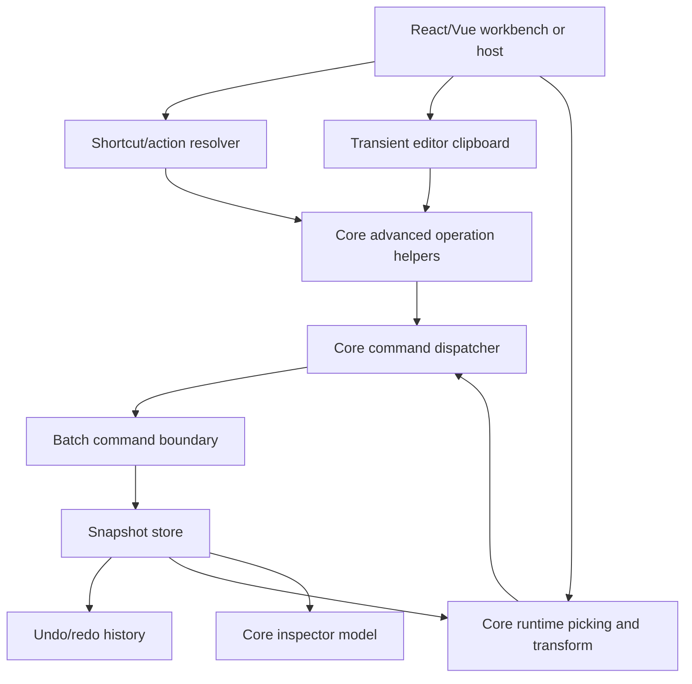
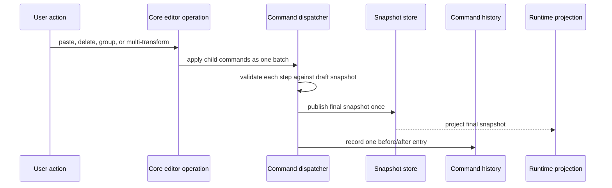
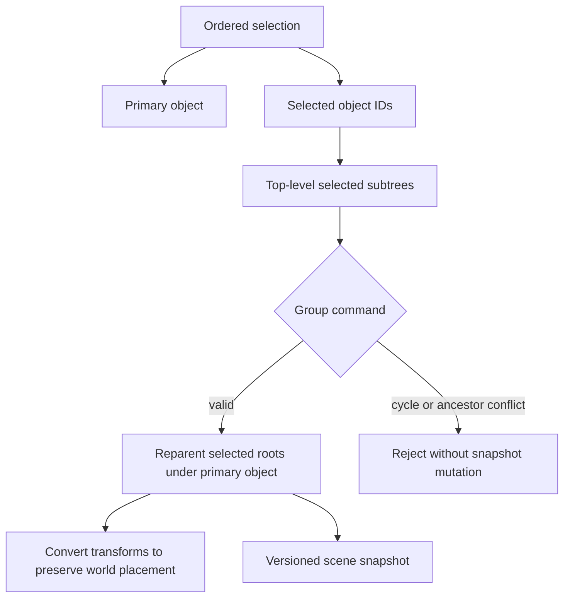
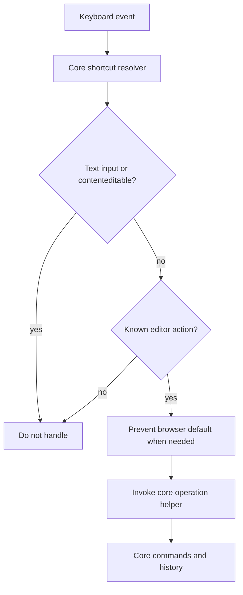

# feat: Add advanced editor operations

## Summary

Add the Advanced editor backlog item from the core editor contract: durable multi-object selection, copy/paste, delete, grouping, snapping, shortcuts, and command batching across the core package and React/Vue workbenches.

The work extends the existing snapshot-first editor foundation. Advanced operations must still enter through core commands, batch into readable history entries, project into Three.js as derived runtime state, and keep React/Vue as thin shell adapters rather than alternate editors.

---

## Problem Frame

The current editor contract can import assets, select one object, transform it, edit inspector fields, project environment/lights, package assets, and expose matching React/Vue workbenches. That foundation is intentionally static-scene oriented, but common editor operations are still missing: selecting multiple objects, duplicating or removing scene content, grouping objects, applying snapping, and invoking operations through shortcuts.

The main risk is adding these operations as shell-specific UI logic or runtime mutations. Multi-select cannot live only in React state; copy/paste cannot clone Three.js objects; delete cannot directly remove runtime nodes; grouping cannot bypass snapshot hierarchy; and shortcuts cannot fork behavior between Vue and React. The plan therefore keeps the same product identity from the origin document: durable scene state is a versioned JSON-compatible snapshot, commands are the editing contract, Three.js is projection, and framework packages render/route user intent only (see origin: `docs/brainstorms/2026-05-28-core-editor-contract-requirements.md`).

This plan covers the full Advanced editor backlog item while holding out adjacent workbench product surfaces: hierarchy panels, box selection, dockable layouts, visual gizmo polish, full multi-object inspector editing, public plugin systems, and Le5le-like data/event/animation behavior.

---

## Requirements

### Selection and Hierarchy

- R1. The current snapshot schema must evolve to represent ordered multi-object selection while preserving a primary selected object for existing inspector and proof-loop behavior.
- R2. Restoring older snapshots must normalize single-object selection into the new multi-selection shape without losing scene identity, object identity, transforms, assets, materials, environment, lights, or authored problems.
- R3. Core selection commands must support replace, toggle, add, remove, clear, and select-all behavior for existing scene objects only.
- R4. Runtime picking and shell interactions must dispatch selection commands instead of mutating snapshots, runtime `Object3D` instances, or framework-local durable state.
- R5. Grouping must use the existing snapshot object hierarchy over GLB-backed scene objects, preserve world-space object placement where possible, and reject cycles or invalid ancestor/descendant selections.

### Advanced Commands and History

- R6. Command batching must apply a set of child commands atomically, validate the final snapshot before publishing it, notify subscribers once, and record one undoable history entry.
- R7. Multi-object transform commits, paste, duplicate, delete, group, and ungroup operations must each be represented as one user-oriented undoable operation, not a stream of low-level history entries.
- R8. Delete must remove selected object subtrees from object hierarchy and selection, clean object-owned authored state such as material assignments, and keep unrelated asset references or project payloads intact.
- R9. Copy must produce a JSON-compatible transient payload from selected top-level object subtrees; paste and duplicate must create new object IDs, preserve relative hierarchy, share asset references, and isolate copied material assignments from the originals.
- R10. All advanced command failures must leave snapshot state, history state, asset registry state, and project asset payload state unchanged.

### Snapping and Runtime Interaction

- R11. Snapping settings must be framework-neutral editor/session state used by transform preview and commit, while only the resulting snapped transforms become durable snapshot state.
- R12. Translation, rotation, and scale snapping must be testable through pure transform helpers and through runtime transform transaction behavior.
- R13. Runtime projection must mark and expose multi-selection state for projected scene objects without making selection highlighting or gizmo visuals durable state.
- R14. Multi-object transform preview may mutate runtime objects for responsiveness, but commit must dispatch one batched durable transform operation and cancel must restore runtime preview state.

### Shortcuts and Shell Parity

- R15. Core must expose a framework-neutral shortcut/action resolver for undo, redo, copy, paste, duplicate, delete, group, ungroup, select all, clear selection, transform-mode changes, and snap toggles.
- R16. React and Vue workbenches must install shortcut handling consistently, respect text inputs/contenteditable controls, support platform modifier differences, and avoid duplicate handlers during remount or StrictMode effect replay.
- R17. Workbench extension contexts must expose advanced editor operations through core-backed helpers so host controls can invoke the same behavior as built-in shortcuts.
- R18. React and Vue examples must demonstrate the same advanced operation surface without duplicating command, history, clipboard, snapping, runtime picking, or project package logic.

### Compatibility and Public Contract

- R19. Existing first proof loop behavior must continue to pass: GLB import, single-object selection, transform, undo/redo, serialize/restore, missing asset handling, and runtime disposal.
- R20. Existing inspector panels may continue to edit the primary selected object; full mixed-value multi-object inspector editing is not required in this plan.
- R21. Public exports must expose only the experimental contracts needed for advanced operations and shell integration; private runtime projectors, command helpers, and test seams must not become accidental public API.
- R22. Documentation must distinguish implemented advanced static-scene editing from deferred hierarchy panels, box select, plugin APIs, data binding, events, animation, and runtime publishing.

---

## Key Technical Decisions

- KTD1. Selection advances through a snapshot version bump: Introduce the next current snapshot version for ordered multi-object selection. Keep `selection.objectId` as the primary selection for compatibility with existing inspector behavior, and add the normalized selected-object collection beside it so existing single-selection flows remain readable.
- KTD2. Advanced operations live in core commands and operation helpers: React, Vue, examples, shortcuts, and runtime interactions should call core operation helpers or dispatch core commands. They should not assemble object hierarchy mutations, clipboard clones, history entries, or delete cleanup independently.
- KTD3. Command batching is a first-class history boundary: Add a composite command or equivalent dispatcher API that applies child commands in memory, validates once, publishes once, and records one history entry. This is the foundation for readable undo/redo for paste, delete, group, and multi-transform.
- KTD4. Clipboard payloads are transient JSON, not browser/runtime state: Copy should produce an editor clipboard payload made from snapshot records. Browser system clipboard integration, rich external paste formats, and asset payload copying are deferred.
- KTD5. First grouping uses existing object hierarchy: Group selected objects under the primary selected object, preserving placement through transform conversion, instead of creating a new empty group object kind or merging GLB assets. A future scene-node/hierarchy plan can introduce empty group nodes if the product needs them.
- KTD6. Delete cleans authored object ownership but not asset storage: Deleting objects should remove object records, hierarchy references, selection, and material assignments that target deleted objects. It should not garbage-collect `snapshot.assets` or project asset payloads because those are separate asset-system concerns.
- KTD7. Snapping is tool/session state: Snap settings affect runtime preview, transform transaction commit, and optional shell controls. They do not become scene authoring data unless a later product decision introduces persistent editor preferences.
- KTD8. Shortcut handling is shared intent resolution with shell-native installation: Core should define action resolution from key events and editor state; React/Vue should install listeners in their lifecycle systems and route accepted actions back to core.
- KTD9. Runtime remains projection: Runtime selection flags, multi-object preview transforms, snapping calculations, and potential visual outlines are derived interaction state. None of those runtime resources or event objects enter snapshots, clipboard payloads, or project packages.

---

## High-Level Technical Design

### Advanced Operation Topology

### Batch Command Flow

### Selection and Grouping Model

### Shortcut Routing

---

## Implementation Units

### U1. Multi-selection snapshot and command contract

- **Goal:** Evolve the durable selection model, migration path, validation, inspector selection helpers, and selection commands for multi-object selection with a primary object.
- **Requirements:** R1-R4, R19-R21; supports origin R1-R9 and R20-R22.
- **Dependencies:** `docs/plans/2026-05-29-001-feat-core-schema-extension-plan.md`, `docs/plans/2026-05-29-003-feat-inspector-ux-plan.md`.
- **Files:** `packages/core/src/snapshot/types.ts`, `packages/core/src/snapshot/defaults.ts`, `packages/core/src/snapshot/validation.ts`, `packages/core/src/snapshot/migrations.ts`, `packages/core/src/editor/serialization.ts`, `packages/core/src/commands/types.ts`, `packages/core/src/commands/select-object.ts`, `packages/core/src/commands/dispatcher.ts`, `packages/core/src/inspector/selection.ts`, `packages/core/src/inspector/transform.ts`, `packages/core/src/inspector/material.ts`, `packages/core/src/public-api.ts`, `packages/core/src/snapshot/snapshot.test.ts`, `packages/core/src/editor/serialization.test.ts`, `packages/core/src/commands/select-object.test.ts`, `packages/core/src/inspector/inspector.test.ts`, `docs/schema.md`, `docs/interactions.md`.
- **Approach:** Advance the current snapshot schema and migrate existing snapshots into a selection shape that carries both primary object and ordered selected object IDs. Keep `select-object` behavior as the single-selection replace path, and add a richer selection command for add/remove/toggle/clear/select-all so existing consumers do not need to switch immediately. Validation should require all selected IDs to exist, keep the primary object either `null` or included in the selected ID collection, and reject duplicate IDs.
- **Execution note:** Start with migration and selection-command tests before touching runtime or shell behavior.
- **Patterns to follow:** Existing `SNAPSHOT_VERSION`, `migrateSerializedSnapshot`, `validateSceneSnapshot`, `applySelectObject`, `getInspectorSelection`, and proof-loop selection tests.
- **Test scenarios:**
  - Given a version 2 snapshot with `selection.objectId = "object-a"`, when it is restored, then the current snapshot keeps `"object-a"` as primary and normalizes the multi-selection collection to contain only `"object-a"`.
  - Given a blank editor with three objects, when selection replace/add/toggle/remove/clear commands run, then snapshot primary selection and ordered selected IDs update deterministically.
  - Given a selection command references an unknown object ID, duplicate object ID, or primary object outside the selected collection, when dispatch runs, then it fails without mutating snapshot state or history.
  - Given the existing single-object inspector model, when multiple objects are selected, then transform/material sections continue to target the primary object and expose enough selection metadata for shell UI to show the multi-selection count.
  - Given a restored proof-loop snapshot, when import, select one object, transform, undo, redo, serialize, and restore run, then the original proof loop remains valid.
- **Verification:** Multi-selection is durable, serializable, migratable, and still compatible with single-object inspector and proof-loop behavior.

### U2. Atomic command batching and history transactions

- **Goal:** Add a core batching boundary so composite editor operations publish one snapshot update and record one undoable history entry.
- **Requirements:** R6-R7, R10, R19-R21; supports origin R5-R9.
- **Dependencies:** U1.
- **Files:** `packages/core/src/commands/types.ts`, `packages/core/src/commands/dispatcher.ts`, `packages/core/src/history/history.ts`, `packages/core/src/editor/editor-api.ts`, `packages/core/src/editor/lifecycle.ts`, `packages/core/src/commands/dispatcher.test.ts`, `packages/core/src/history/history.test.ts`, `packages/core/src/editor/create-editor.test.ts`, `packages/core/src/editor/proof-loop.test.ts`, `packages/core/src/public-api.ts`, `packages/core/src/public-api.test.ts`.
- **Approach:** Introduce a batch command or editor operation API that applies child commands against a draft snapshot and a draft asset registry/project-store view before publishing. Successful batches should notify snapshot subscribers once, clear redo history once, and record one before/after history entry with batch metadata suitable for debugging. Failed batches should roll back all transient command-side changes, matching the current dispatcher rollback behavior for asset registration failures.
- **Execution note:** Implement batching test-first because every later advanced operation depends on one-command-per-user-action history semantics.
- **Patterns to follow:** Existing `CommandDispatcher.dispatch`, `CommandHistory.record`, `EditorStore.replaceSnapshot`, asset-registry rollback behavior in dispatcher tests, and transform transaction history expectations.
- **Test scenarios:**
  - Given two valid transform child commands in a batch, when dispatch succeeds, then subscribers are notified once, history undo count increases by one, and undo restores both transforms together.
  - Given a batch where the second child command is invalid, when dispatch runs, then neither child mutation appears in the store, history is unchanged, redo state is unchanged, and transient asset registry changes are rolled back.
  - Given undo then a new successful batch, when redo is requested, then stale redo history is cleared exactly as with single commands.
  - Given a batch whose child commands make no effective snapshot changes, when dispatch completes, then no unnecessary history entry is recorded.
  - Given the editor public API is imported by React/Vue packages, when TypeScript resolves exports, then the intended batch command/operation types are available from the package root without exposing dispatcher internals.
- **Verification:** Composite advanced operations can be implemented as atomic user-facing edits without leaking low-level command steps into history or shell code.

### U3. Delete, duplicate, copy, and paste operations

- **Goal:** Add core operations for deleting selected objects, copying JSON-compatible scene subtrees, pasting cloned subtrees, and duplicating the current selection.
- **Requirements:** R6-R10, R17-R21; supports origin R1-R9, R16-R19, and R20-R22.
- **Dependencies:** U1, U2.
- **Files:** `packages/core/src/commands/types.ts`, `packages/core/src/commands/delete-objects.ts`, `packages/core/src/commands/paste-objects.ts`, `packages/core/src/commands/duplicate-objects.ts`, `packages/core/src/commands/dispatcher.ts`, `packages/core/src/editor/operations.ts`, `packages/core/src/clipboard/types.ts`, `packages/core/src/clipboard/create-clipboard.ts`, `packages/core/src/snapshot/hierarchy.ts`, `packages/core/src/materials/defaults.ts`, `packages/core/src/public-api.ts`, `packages/core/src/commands/delete-objects.test.ts`, `packages/core/src/commands/paste-objects.test.ts`, `packages/core/src/commands/duplicate-objects.test.ts`, `packages/core/src/editor/operations.test.ts`, `packages/core/src/clipboard/create-clipboard.test.ts`, `packages/core/src/editor/serialization.test.ts`, `packages/core/src/project/export-project.test.ts`.
- **Approach:** Derive top-level selected subtrees before delete/copy so selecting both a parent and its child does not duplicate work. Delete should remove object records and hierarchy links, clear or reduce selection, and remove material assignments that target deleted objects or material slots under those objects. Copy should produce a JSON-compatible transient payload with objects, relevant material definitions/assignments, and asset references by ID only. Paste and duplicate should create fresh object IDs, preserve internal parent/child relationships, share asset references, duplicate material assignments so pasted material edits do not mutate originals, and select the pasted roots as one batch result. Expose core operation helpers over these commands so shortcuts, toolbar controls, and shell extension regions reuse one implementation instead of assembling command batches themselves.
- **Patterns to follow:** Existing `applyImportGlb` hierarchy updates, `applySetMaterial` assignment IDs, snapshot JSON compatibility validation, project export missing-payload policy, and AGENTS.md runtime-only serialization rule.
- **Test scenarios:**
  - Given a parent and child are both selected, when delete runs, then the parent subtree is removed once, root/child references are cleaned, and no orphan object IDs remain.
  - Given a deleted object has object-level and material-slot assignments, when delete commits, then those assignments are removed and unrelated material definitions or assignments remain intact.
  - Given a scene with two selected root objects and nested children, when copy creates a clipboard payload, then the payload is JSON-compatible and contains no `File`, `Blob`, object URL, Three.js object, resolver output, or project payload bytes.
  - Given a clipboard payload is pasted into the same scene, when paste commits, then cloned objects have fresh IDs, preserve relative hierarchy and transforms, reuse asset IDs, duplicate relevant material assignments, and become the active selection.
  - Given duplicate is invoked with a selected object, when undo and redo run, then the duplicated object subtree disappears and reappears as one history entry.
  - Given paste references an asset ID that is absent from the target snapshot, when dispatch runs, then paste fails without partial object creation.
  - Given a scene is copied, pasted, serialized, restored, and projected, when runtime projection completes, then pasted GLB objects resolve through the same asset references as the originals.
  - Given React/Vue workbench helpers invoke copy, paste, duplicate, or delete, when the helpers run, then they call the core operation layer and do not duplicate subtree filtering or material cleanup logic in shell code.
- **Verification:** Object removal and cloning are core-owned, JSON-compatible, undoable, and asset-reference safe.

### U4. Grouping, ungrouping, and hierarchy-safe reparenting

- **Goal:** Add first-pass grouping and ungrouping operations over the existing object hierarchy without introducing a new group node type.
- **Requirements:** R5-R7, R10, R19-R21; supports origin R2, R5-R9, R12, R18.
- **Dependencies:** U1, U2, U3.
- **Files:** `packages/core/src/commands/types.ts`, `packages/core/src/commands/group-objects.ts`, `packages/core/src/commands/ungroup-objects.ts`, `packages/core/src/commands/reparent-object.ts`, `packages/core/src/commands/dispatcher.ts`, `packages/core/src/editor/operations.ts`, `packages/core/src/snapshot/hierarchy.ts`, `packages/core/src/snapshot/transforms.ts`, `packages/core/src/runtime/transform.ts`, `packages/core/src/runtime/scene-projector.ts`, `packages/core/src/commands/group-objects.test.ts`, `packages/core/src/commands/ungroup-objects.test.ts`, `packages/core/src/editor/operations.test.ts`, `packages/core/src/snapshot/snapshot.test.ts`, `packages/core/src/runtime/scene-projector.test.ts`.
- **Approach:** Treat the primary selected object as the group root for the first grouping operation. Other selected top-level roots become its children after validation rejects cycles, duplicate ancestors, and invalid root choices. Reparenting should preserve visual placement by converting world-space transforms into the new parent's local transform, using transient math helpers only. Ungroup should move children of the primary/group root back to the parent level while preserving their world placement, again as one batched edit. Route shell-visible group and ungroup actions through the same core operation helper that prepares the validated command batch.
- **Patterns to follow:** Existing `SceneObject.parentId` and `children` shape, `SceneProjector.#projectObject` hierarchy projection, transform normalization helpers, and the origin decision that runtime objects are never durable state.
- **Test scenarios:**
  - Given three root objects are selected with `"object-a"` as primary, when group runs, then `"object-b"` and `"object-c"` become children of `"object-a"` and the selection remains coherent.
  - Given a selected object is already an ancestor or descendant of the primary root in a way that would create a cycle or duplicate subtree operation, when group runs, then it fails without mutating the snapshot.
  - Given child objects have non-zero transforms, when group or ungroup commits, then their projected world positions remain equivalent within the supported transform precision.
  - Given grouped objects are serialized and restored, when runtime projects the restored snapshot, then parent/child relationships and transforms match the committed snapshot.
  - Given group and ungroup are invoked through undo and redo, when history is inspected, then each user action is one history entry.
  - Given material assignments target grouped children, when grouping changes parent IDs, then assignments continue to target the same object IDs and remain valid.
  - Given a shortcut or workbench control invokes group or ungroup, when the action runs, then it uses the same core operation helper as direct core callers and records the same one-entry history result.
- **Verification:** Grouping is useful for first-pass static scene organization without adding a new scene-node model or merging runtime assets.

### U5. Runtime multi-selection, multi-transform, and snapping

- **Goal:** Extend core runtime picking and transform transactions to support modifier-based multi-selection, selected-object projection flags, multi-object preview/commit, and snapping.
- **Requirements:** R3-R4, R7, R11-R14, R19-R21; supports origin R10-R15.
- **Dependencies:** U1, U2, U4.
- **Files:** `packages/core/src/runtime/editor-runtime.ts`, `packages/core/src/runtime/picking.ts`, `packages/core/src/runtime/scene-projector.ts`, `packages/core/src/runtime/three-object-map.ts`, `packages/core/src/runtime/transform.ts`, `packages/core/src/runtime/transform/transform-controller.ts`, `packages/core/src/runtime/transform/transform-transaction.ts`, `packages/core/src/runtime/transform/transform-mode.ts`, `packages/core/src/runtime/transform/snap.ts`, `packages/core/src/runtime/editor-runtime.test.ts`, `packages/core/src/runtime/picking.browser.test.ts`, `packages/core/src/runtime/transform/transform-transaction.test.ts`, `packages/core/src/runtime/transform/transform-controller.browser.test.ts`, `packages/core/src/runtime/scene-projector.test.ts`, `docs/interactions.md`.
- **Approach:** Add runtime selection modes so pointer picking can replace or toggle selection through core commands. Projection should update each mapped object with derived selected/primary flags. Extend transform transactions to track multiple selected objects, snapshot their pre-preview transforms, apply snapped preview transforms, and commit one batched set of transform child commands. Snapping should be covered by pure helpers for translation, rotation, and scale increments, with runtime integration ready to map to Three.js TransformControls snap settings if the visual gizmo is added later.
- **Patterns to follow:** Existing `ObjectPicker`, `ThreeObjectMap`, `TransformTransaction`, `TransformController`, `SceneProjector` selected `userData`, stale projection generation guards, and Three.js TransformControls snapping concepts.
- **Test scenarios:**
  - Given an object is clicked with replace mode, when picking resolves it, then the snapshot selection becomes that object only.
  - Given an already-selected object is clicked with toggle mode, when picking resolves it, then the object is removed from selection and the next primary object is deterministic.
  - Given multiple objects are selected, when runtime projection runs, then each selected object carries derived selected state and the primary object is distinguishable for shell/runtime UI.
  - Given a multi-object transform previews several changes and commits, when history is inspected, then one batch entry is recorded and undo restores all object transforms.
  - Given a multi-object transform is cancelled, when runtime objects are inspected, then all previewed objects return to their pre-transaction transforms and history remains unchanged.
  - Given translation snapping is enabled at a fixed increment, when preview and commit receive arbitrary positions, then committed transforms use snapped values and remain JSON-compatible.
  - Given rotation and scale snapping are enabled, when pure snap helpers receive boundary and negative values, then outputs are finite and deterministic.
- **Verification:** Multi-object runtime interaction stays responsive while durable state changes remain batched, undoable, and projected from snapshots.

### U6. Shortcut resolver and framework shell routing

- **Goal:** Add a shared shortcut/action layer and wire it through React and Vue workbenches without duplicating editor operation semantics.
- **Requirements:** R15-R18, R21-R22; supports origin R20-R22.
- **Dependencies:** U1-U5.
- **Files:** `packages/core/src/shortcuts/types.ts`, `packages/core/src/shortcuts/resolve-shortcut.ts`, `packages/core/src/shortcuts/actions.ts`, `packages/core/src/editor/editor-api.ts`, `packages/core/src/editor/lifecycle.ts`, `packages/core/src/editor/operations.ts`, `packages/core/src/public-api.ts`, `packages/core/src/shortcuts/resolve-shortcut.test.ts`, `packages/core/src/editor/operations.test.ts`, `packages/core/src/public-api.test.ts`, `packages/react/src/hooks/use-workbench.ts`, `packages/react/src/components/EditorWorkbench.tsx`, `packages/react/test/workbench.test.tsx`, `packages/react/test/strict-mode.test.tsx`, `packages/vue/src/composables/use-workbench.ts`, `packages/vue/src/components/EditorWorkbench.vue`, `packages/vue/test/workbench.test.ts`, `packages/vue/test/editor-viewport.test.ts`.
- **Approach:** Define editor actions separately from DOM event installation. Core should resolve key intent from key/modifier data, current editor state, selection, clipboard availability, and snap state. React and Vue workbenches should install keydown handling on the workbench surface or configured target, ignore editable controls, call `preventDefault` only for handled editor actions, and invoke core-backed workbench operations. Host extension regions should receive the same operation helpers so toolbar buttons and keyboard shortcuts share behavior.
- **Patterns to follow:** Existing React render-prop and Vue scoped-slot workbench contexts, React StrictMode cleanup tests, Vue raw/shallow editor handling, MDN `KeyboardEvent.key` semantics, and current workbench ownership rules.
- **Test scenarios:**
  - Given focus is inside a text input, textarea, select, or contenteditable element, when copy/delete/select-all shortcuts are pressed, then the shortcut resolver ignores the event and does not dispatch editor commands.
  - Given focus is on the workbench surface and objects are selected, when platform copy and paste shortcuts run, then core clipboard and paste operations are invoked through one shared path.
  - Given delete/backspace is pressed with a selected object, when the shell handles the shortcut, then delete dispatches one batch operation and prevents the browser default only for that handled action.
  - Given undo/redo shortcuts run after paste, delete, or group, when history is inspected, then each advanced action undoes/redoes as one entry.
  - Given React StrictMode replays effects, when keydown listeners are inspected through fakes, then shortcut handlers are not duplicated and host-owned editors are not disposed.
  - Given Vue workbench unmounts and remounts, when keydown listeners and editor instances are inspected, then listeners are cleaned up and editor raw/shallow handling remains intact.
  - Given shortcut actions are exported from core, when package public API tests run, then only action types/resolvers intended for consumers are public.
- **Verification:** Keyboard workflows are consistent across React and Vue and route through the same core operations as pointer and toolbar workflows.

### U7. React/Vue advanced workbench UI and examples

- **Goal:** Surface advanced operation state and controls in the React and Vue workbenches and examples while preserving framework parity.
- **Requirements:** R13-R18, R20-R22; supports origin R20-R22 and AE3.
- **Dependencies:** U1-U6.
- **Files:** `packages/react/src/components/EditorWorkbench.tsx`, `packages/react/src/components/EditorViewport.tsx`, `packages/react/src/components/workbench.css`, `packages/react/src/hooks/use-workbench.ts`, `packages/react/test/workbench.test.tsx`, `packages/react/test/react-proof-loop.integration.test.tsx`, `packages/vue/src/components/EditorWorkbench.vue`, `packages/vue/src/components/EditorViewport.vue`, `packages/vue/src/components/workbench.css`, `packages/vue/src/composables/use-workbench.ts`, `packages/vue/test/workbench.test.ts`, `packages/vue/test/vue-proof-loop.integration.test.ts`, `examples/react-proof-loop/src/App.tsx`, `examples/react-proof-loop/src/styles.css`, `examples/vue-proof-loop/src/App.vue`, `examples/vue-proof-loop/src/styles.css`.
- **Approach:** Add compact workbench affordances for selection count, operation availability, snap state, and clipboard availability through existing render-prop/scoped-slot context and optional built-in controls. Viewports should route pointer picking to runtime selection modes. Examples should demonstrate selecting multiple objects, duplicate/paste, delete, group/ungroup, snapping, and shortcuts using the same core editor APIs. Keep UI operational and dense; do not add a full hierarchy panel, toolbar system, or dockable layout in this plan.
- **Patterns to follow:** Existing `EditorWorkbench` composition, `EditorViewport` runtime mount pass-through, workbench CSS namespace, proof-loop example parity, and frontend guidance for compact tool surfaces.
- **Test scenarios:**
  - Given the React workbench renders with multiple selected objects, when the toolbar/status extension reads context, then it can display selection count, primary selection, clipboard availability, snap state, and enabled operations.
  - Given the Vue workbench renders the same scene, when scoped slots read context, then they observe the same advanced operation state as React.
  - Given a user clicks objects in the React viewport with modifier selection, when the snapshot updates, then inspector primary-object fields and selection count reflect the same core state.
  - Given a user performs duplicate, delete, group, and ungroup through example controls, when undo/redo runs, then each operation behaves as one user action in both React and Vue examples.
  - Given snap settings are toggled in either example, when a transform operation commits, then the resulting snapshot transform is snapped and serialization remains runtime-free.
  - Given narrow viewport widths, when advanced controls and inspector render, then controls do not overlap the viewport, text does not overflow controls, and touch targets remain usable.
- **Verification:** Users can exercise the advanced editor loop in both shell examples without either framework owning durable editing semantics.

### U8. Documentation, compatibility coverage, and public API hardening

- **Goal:** Update docs, public exports, package tests, and cross-package regression coverage for the advanced editor contract.
- **Requirements:** R1-R22.
- **Dependencies:** U1-U7.
- **Files:** `packages/core/src/public-api.ts`, `packages/core/src/index.ts`, `packages/core/src/public-api.test.ts`, `packages/react/src/index.ts`, `packages/react/src/public-api.test.ts`, `packages/vue/src/index.ts`, `packages/vue/src/public-api.test.ts`, `packages/core/README.md`, `packages/react/README.md`, `packages/vue/README.md`, `README.md`, `docs/schema.md`, `docs/interactions.md`, `docs/architecture.md`, `docs/decisions.md`, `docs/integration-react.md`, `docs/integration-vue.md`, `docs/integration-vanilla.md`, `docs/project-structure.md`, `packages/core/src/editor/proof-loop.test.ts`, `packages/core/src/editor/proof-loop.integration.test.ts`, `packages/react/test/react-proof-loop.integration.test.tsx`, `packages/vue/test/vue-proof-loop.integration.test.ts`.
- **Approach:** Document the advanced operation boundary in the same language as the existing architecture docs: snapshots are durable, commands own edits, runtime projects, shells route. Public exports should include the new selection, clipboard, batch, shortcut, snap, and operation types that consumers need, while private command helpers and runtime internals remain private. Regression tests should keep the original proof loop green and add a cross-package advanced operation path that exercises save/restore and project/package compatibility.
- **Patterns to follow:** Existing package `public-api.test.ts`, `docs/schema.md` schema style, `docs/interactions.md` capability boundary section, README non-goals, and previous plan deferred-scope wording.
- **Test scenarios:**
  - Given a consumer imports the core package root, when TypeScript resolves exports, then intended advanced operation types and helpers are available and private command/runtime internals remain unavailable.
  - Given old version 2 snapshots from docs/examples, when restore runs, then they migrate into the new selection schema and proof-loop behavior still works.
  - Given docs show copy/paste or grouping examples, when reviewed against implementation, then examples use asset references and commands rather than runtime objects or direct snapshot mutation.
  - Given docs describe shortcuts, when compared with shell tests, then they correctly note input-field exclusion and React/Vue parity.
  - Given deferred capability lists are reviewed, when compared with the origin backlog, then hierarchy panels, box selection, empty group nodes, plugin APIs, data binding, events, animation, and publishing remain out of this plan.
- **Verification:** The advanced editor contract is discoverable, package-safe, and aligned with existing project documentation and tests.

---

## Phased Delivery

| Phase | Units | Outcome |
|---|---|---|
| Foundation | U1-U2 | Multi-selection and batch history exist in core without shell or runtime dependencies. |
| Editing operations | U3-U4 | Delete, copy/paste, duplicate, group, and ungroup mutate snapshots through core commands and one-entry history. |
| Runtime interaction | U5 | Multi-selection, snapping, and multi-transform preview/commit work through runtime projection and transactions. |
| Shell parity | U6-U7 | React/Vue route shortcuts, pointer selection, operations, and examples through the same core contract. |
| Contract hardening | U8 | Public exports, docs, and regression tests describe and protect the advanced editor boundary. |

---

## Scope Boundaries

### In Scope for This Plan

- Snapshot migration for ordered multi-object selection with a primary selected object.
- Core selection commands for replace, add, remove, toggle, clear, and select-all.
- Atomic command batching and one-entry history for composite user actions.
- Delete, copy, paste, duplicate, group, and ungroup over GLB-backed scene objects.
- JSON-compatible transient clipboard payloads for in-editor copy/paste.
- Runtime modifier-based picking and multi-selected object projection state.
- Multi-object transform preview, commit, cancel, and snapping helpers.
- Framework-neutral shortcut/action resolution.
- React and Vue workbench shortcut routing, operation helpers, and parity examples.
- Documentation and public API updates for the advanced static-scene editing contract.

### Deferred to Follow-Up Work

- Box selection, lasso selection, marquee selection, and selection frustum tools.
- A hierarchy/tree panel, object outliner, durable light selection, material-slot browsing, and full scene-node unification.
- Empty group/container nodes, named group assets, prefab-like composition, merged GLB export, and nested group polish beyond first-pass hierarchy grouping.
- Full multi-object inspector editing with mixed values, per-field multi-apply semantics, and conflict resolution UI.
- Visual TransformControls/gizmo polish, selection outlines, handles, helper overlays, grid rendering, ruler guides, and alignment guides.
- Browser system clipboard integration, external paste formats, drag-and-drop duplication, and cross-editor clipboard interchange.
- Persistent shortcut customization, keybinding profiles, command palette UI, and localized shortcut labels.
- Asset garbage collection, asset browser, asset thumbnails, and payload cleanup workflows beyond existing project package behavior.
- Material texture projection onto imported GLB meshes, shadows, helper gizmos, advanced decoder configuration, and large-model streaming.

### Outside This Product Identity for MVP

- Full Le5le-style low-code platform behavior.
- MQTT/WebSocket data binding.
- Event orchestration, animation timeline, multi-scene linkage, and runtime dashboard publishing.
- Model marketplace or bundled model library.
- WebGPU-first renderer.
- Shader editor, node material editor, physics editor, CAD tooling, 3D Tiles, or large-model streaming as MVP commitments.

---

## System-Wide Impact

- **Snapshot persistence:** The current snapshot version changes. Schema docs, migration, validation, serialization, project import/export, and all proof-loop fixtures need to agree on selection semantics.
- **History semantics:** Existing single-command history stays valid, but composite actions now have a formal batch boundary. Review should focus on atomicity, notification count, redo clearing, and rollback behavior.
- **Runtime projection:** Object selection is no longer boolean single-selection state. Projectors, object maps, transform transactions, and picking need to treat primary selection and selected membership separately.
- **Framework shells:** Workbench components gain keyboard and advanced operation responsibilities. They must remain lifecycle adapters and should not become alternate command engines.
- **Docs and public API:** The package contract widens. Export tests and docs need to prevent private implementation details from hardening into API while still making advanced operations usable.

---

## Risks and Dependencies

| Risk | Impact | Mitigation |
|---|---|---|
| Selection migration breaks existing proof-loop snapshots. | Saved scenes may fail restore or inspector may target no object. | Add explicit version migration tests and keep primary selection compatible with existing `selection.objectId` reads. |
| Batch dispatch partially mutates transient asset or project state on failure. | Failed paste/import-like operations could corrupt editor state. | Apply batches against draft state and keep rollback tests around asset registry/project asset store side effects. |
| Grouping under a primary object surprises users expecting empty group nodes. | First-pass grouping is less flexible than mature editors. | Document this as first-pass hierarchy grouping and defer empty group nodes to scene-node/hierarchy planning. |
| Copy/paste accidentally shares material definitions that should be isolated. | Editing a pasted object's material may unexpectedly edit the source object's material. | Duplicate material assignments/definitions for copied object targets while sharing asset references. |
| Shortcut handling captures normal text editing shortcuts. | Inspector inputs become frustrating or destructive. | Resolver must ignore editable targets and shell tests must cover input, textarea, select, and contenteditable cases. |
| Multi-transform math drifts when grouping or snapping combines rotation/scale. | Runtime preview and restored snapshot could diverge visually. | Keep transform math helpers isolated, deterministic, and covered by round-trip projection tests for supported transform shapes. |
| React/Vue workbenches drift in behavior. | Framework parity promise weakens. | Add mirrored workbench tests and examples for the same operation scenarios. |

---

## Acceptance Examples

- AE1. **Multi-selection restore.** Given a scene with three GLB objects and two selected objects, when it is serialized and restored, then the same primary object and selected object collection are available and the existing inspector still targets the primary object.
- AE2. **Copy/paste history.** Given two selected top-level object subtrees, when copy and paste complete, then cloned objects have fresh IDs and shared asset references; undo removes the pasted subtrees in one step and redo restores them in one step.
- AE3. **Delete cleanup.** Given a selected parent and child plus material assignments on both, when delete runs, then the selected top-level subtree is removed once, material assignments for deleted objects are removed, unrelated assets remain, and undo restores the scene.
- AE4. **Group/ungroup placement.** Given multiple root objects with non-zero transforms, when group under the primary object and then ungroup run, then projected world placement remains equivalent and each action is one undoable command.
- AE5. **Shortcut parity.** Given the same scene in React and Vue workbenches, when platform copy, paste, delete, group, undo, and redo shortcuts run outside text inputs, then both shells route to the same core operations and produce equivalent snapshots.
- AE6. **Snapped transform.** Given multi-object selection and translation snapping enabled, when a runtime transform preview commits arbitrary positions, then the saved snapshot contains snapped finite transform values and undo restores all pre-drag transforms together.

---

## Documentation and Operational Notes

- Update `docs/schema.md` before or alongside implementation so snapshot version and selection shape are clear to future work.
- Update `docs/interactions.md` to move multi-select, delete, copy/paste, grouping, snapping, and shortcuts from "not implemented" into current or partial capability sections with precise boundaries.
- Keep examples compact editor workbenches. Advanced operation controls belong in toolbar/status/overlay regions, not in landing-page or marketing layouts.
- Keep `.ek3d` package documentation clear: project packages carry payloads, but advanced copy/paste payloads are transient JSON editor data and do not embed binary asset bytes.
- Record any new public operation helper names in package README files only after implementation confirms the final API shape.

---

## Deferred Implementation Notes

- Exact command names, action IDs, shortcut labels, and workbench prop names should be finalized during implementation after reading the local API ergonomics in context.
- Exact transform conversion math for group/ungroup should be validated against real runtime projection tests; the plan requires preserving placement but does not prescribe method signatures.
- Browser system clipboard support should not be smuggled into the first clipboard payload implementation. If needed, it should be a separate host integration layer over the JSON-compatible payload.
- Snapping defaults should be conservative and easy to disable. Persistent user preferences are out of scope unless a later plan introduces editor preference storage.

---

## Sources and Research

- Origin requirements and backlog: `docs/brainstorms/2026-05-28-core-editor-contract-requirements.md`
- Existing architecture and decisions: `docs/architecture.md`, `docs/decisions.md`, `docs/schema.md`, `docs/interactions.md`, `docs/project-structure.md`
- Current core patterns: `packages/core/src/snapshot/types.ts`, `packages/core/src/snapshot/validation.ts`, `packages/core/src/snapshot/migrations.ts`, `packages/core/src/commands/dispatcher.ts`, `packages/core/src/history/history.ts`, `packages/core/src/runtime/editor-runtime.ts`, `packages/core/src/runtime/picking.ts`, `packages/core/src/runtime/transform/transform-transaction.ts`
- Current shell patterns: `packages/react/src/components/EditorWorkbench.tsx`, `packages/react/src/hooks/use-workbench.ts`, `packages/vue/src/components/EditorWorkbench.vue`, `packages/vue/src/composables/use-workbench.ts`
- Three.js TransformControls documentation for snapping concepts: https://threejs.org/docs/pages/TransformControls.html
- React external store subscription semantics: https://react.dev/reference/react/useSyncExternalStore
- Vue shallow/raw reactivity guidance for external state: https://vuejs.org/api/reactivity-advanced.html
- MDN KeyboardEvent key/modifier behavior: https://developer.mozilla.org/en-US/docs/Web/API/KeyboardEvent/key
