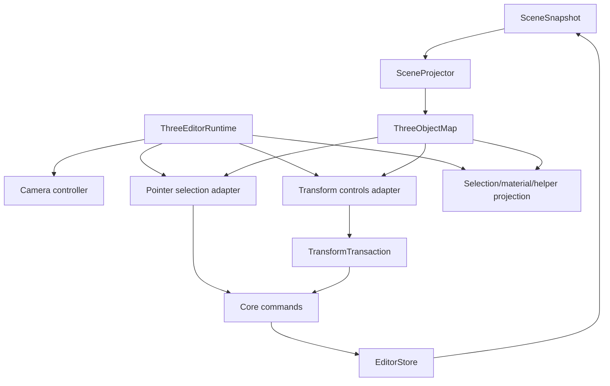
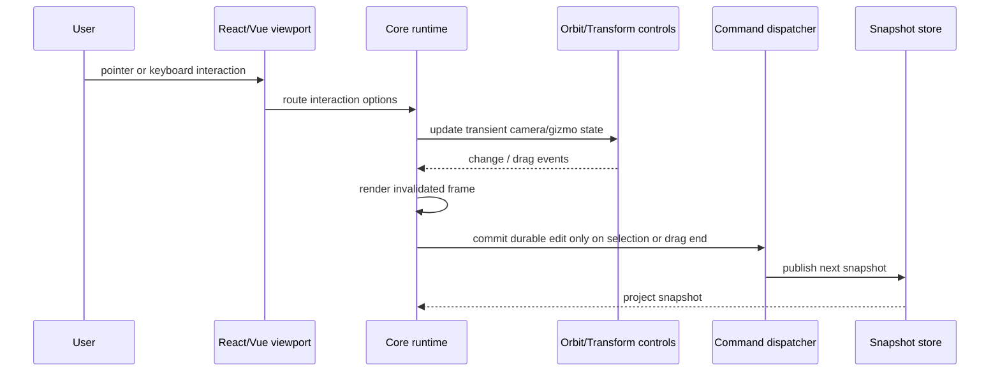
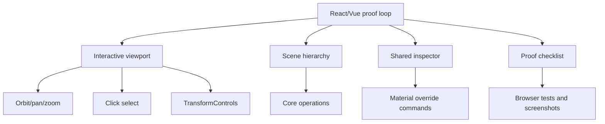

# feat: Add local demo interactions

## Summary

Upgrade the local React and Vue proof-loop demos from command-driven contract proofs into interactive 3D editor demos. The work adds transient viewport navigation, click selection with visible feedback, a Three.js `TransformControls` bridge over the existing transaction model, a compact scene hierarchy/assets surface, minimal runtime material override projection, and browser-backed demo verification.

---

## Problem Frame

The repository has already established the snapshot-first editor contract: durable state lives in `SceneSnapshot`, durable edits flow through commands/history, and Three.js runtime state is projection only. The current local demos prove that contract through toolbar buttons, inspector fields, package import/export, and runtime problem counts. They do not yet let a user validate the behaviors that make a 3D visual editor feel real: orbit/zoom the camera, click an object in the viewport, see what is selected, drag a transform gizmo, and watch material edits affect the rendered model.

This plan keeps the product identity from the origin document: the editor remains a static-scene authoring foundation, not a Le5le-style low-code platform (see origin: `docs/brainstorms/2026-05-28-core-editor-contract-requirements.md`). The new interaction state is transient runtime/UI state. It must not be serialized into snapshots, project packages, clipboard payloads, or framework-owned durable state.

---

## Requirements

### Viewport Interaction

- R1. The core runtime must support transient camera orbit, pan, zoom, resize, render invalidation, camera reset, frame selected, and frame all without storing camera/control state in `SceneSnapshot`.
- R2. React and Vue viewport components must be able to enable the same camera interaction behavior without duplicating core runtime control lifecycle.
- R3. Viewport pointer selection must dispatch core selection commands through runtime picking and support replace plus modifier-based add/toggle behavior.
- R4. Projected objects must show derived selected and primary-selected visual feedback without making outlines, helpers, hover state, or gizmos durable state.

### Direct Manipulation

- R5. A visual Three.js `TransformControls` gizmo must attach to the primary selected object and support translate, rotate, and scale modes.
- R6. Transform drag preview may mutate runtime objects for responsiveness, but commit must dispatch one core command or batch command and undo/redo must restore the committed durable transform.
- R7. Transform drag cancellation, selection changes during drag, object deletion, runtime remount, and component unmount must clean up controls and restore preview state where needed.
- R8. Snap settings must flow from existing editor/session snap state into the gizmo and transaction commit; only the resulting snapped transform becomes durable state.

### Demo Workbench Surface

- R9. React and Vue demos must include a compact scene hierarchy that shows object identity, parent/child nesting, selection state, and problem badges.
- R10. Demo hierarchy and toolbar controls must invoke existing core operations for select, copy, paste, duplicate, delete, group, ungroup, undo, redo, transform mode, snap toggles, and camera helpers.
- R11. Demo asset controls must stay lightweight: they may register/select existing demo assets and surface project replacement flows, but they must not become a full asset library, marketplace, or external paste system.

### Visual Authoring Proof

- R12. Runtime projection must apply object-level `MeshStandardMaterial` overrides visibly to projected GLB objects for the supported inspector subset.
- R13. Runtime material projection must load texture-slot asset references as transient resources, surface resolver/loader failures as runtime problems, and dispose replaced or unused runtime material resources.
- R14. Material runtime projection must stay object-level and MeshStandard-only in this plan; full GLTF material graph editing and per-submesh slot discovery remain deferred.

### Verification and Parity

- R15. React and Vue examples must demonstrate the same visible workflow: camera navigation, click selection, transform drag, inspector material edit, hierarchy operation, export/reopen, and missing-asset recovery.
- R16. Browser tests or visual evidence must verify stable user-observable states for both React and Vue demos, not only serialized snapshot output.
- R17. Public exports must expose only the interaction contracts needed by package consumers; private projectors, loaders, and low-level control internals must not become accidental public API.
- R18. Existing proof-loop behavior must continue to pass: GLB import, selection, transform, undo/redo, serialize/restore, missing asset behavior, project package import/export, and runtime disposal.

---

## Key Technical Decisions

- KTD1. Runtime interaction state remains transient: Camera controls, helper objects, outlines, hover state, transform gizmos, and render-loop bookkeeping live in runtime/UI layers only. They are never written into `SceneSnapshot`, `.ek3d` manifests, clipboard payloads, or React/Vue durable state.
- KTD2. Core owns the reusable viewport interaction seam: React/Vue should mount and configure the same core runtime interaction capabilities instead of each package importing controls and rewriting selection/transform semantics.
- KTD3. Use Three.js addons directly inside core runtime: `OrbitControls` and `TransformControls` are already part of the Three.js addon ecosystem and match the current direct Three.js dependency in `@ek-aiot/3d-editor-core`. This avoids introducing React/Vue-specific 3D wrappers.
- KTD4. Render on invalidation, not permanent animation by default: The runtime should render after projection, camera-control changes, transform-control changes, resize, and helper updates. Continuous animation should be limited to active control needs such as damping or drag, then stopped on idle.
- KTD5. Selection visuals are derived from existing selection flags: The projector already marks `userData.selected` and `userData.primarySelected`. The visual feedback layer should read those derived flags and maintain disposable helper objects rather than mutating durable object records.
- KTD6. TransformControls bridges to existing transactions: The gizmo should be a visual input adapter over `TransformController` / `TransformTransaction`. Drag start captures runtime transforms, drag changes preview, drag end commits one core command or batch command, and cancellation restores preview.
- KTD7. Demo hierarchy is a consumer of snapshot state, not a new scene model: Object tree rendering should derive from `snapshot.objects` and `rootObjectIds`, and operations should route through existing `editor.operations` or commands.
- KTD8. Material projection starts with object-level MeshStandard override: The first visual material proof applies object-target assignments across meshes under the selected scene object. Per-submesh slot identity, full GLTF material graph preservation, node materials, and shader editing are out of scope.
- KTD9. Demo verification focuses on observable behavior: Browser tests should assert selection indicators, transform/history outcomes, material visual state where stable, and React/Vue parity. Avoid brittle pixel-perfect WebGL expectations except for small smoke checks that prove a nonblank rendered viewport.

---

## High-Level Technical Design

### Runtime Interaction Topology

### Interaction Render Flow

### Demo Verification Surface

---

## Scope Boundaries

### In Scope

- Transient OrbitControls-style camera navigation and camera helper commands.
- Viewport click selection with visible selected/primary-selected feedback.
- Single-primary-object `TransformControls` with transaction-backed translate, rotate, scale, snap, undo, redo, and cancellation.
- Compact demo hierarchy and asset/status surface for React and Vue proof loops.
- Object-level runtime projection for the existing `MeshStandardMaterial` override subset.
- Browser-level verification for local demo behaviors and React/Vue parity.

### Deferred to Follow-Up Work

- Box selection and lasso selection.
- Multi-object aggregate transform gizmo and group bounding-box manipulation.
- Full local file import queues for GLB/HDR/image assets.
- System clipboard integration and external paste formats.
- Persistent camera bookmarks, persisted layouts, and user-configurable shortcuts.
- Full asset library, cloud asset storage, marketplace metadata, or model browser.
- Per-submesh material slot discovery and full GLTF material graph editing.
- Shadows, advanced light helpers, physics, animation timeline, runtime dashboard, data binding, events, and hosted publishing.

### Outside This Product Identity for MVP

- Le5le-style low-code orchestration, IoT data binding, event/action programming, deployment flows, and multi-scene dashboard publishing remain outside the current static-scene editor foundation (see origin: `docs/brainstorms/2026-05-28-core-editor-contract-requirements.md`).

---

## Implementation Units

### U1. Runtime viewport interaction foundation

- **Goal:** Add reusable core runtime seams for camera controls, render invalidation, resize observation, pointer picking, and derived selection helper lifecycle.
- **Requirements:** R1-R4, R17-R18; supports origin R10-R15 and F2.
- **Dependencies:** `docs/plans/2026-05-28-001-feat-core-editor-contract-plan.md`, `docs/plans/2026-06-01-001-feat-advanced-editor-operations-plan.md`.
- **Files:** `packages/core/src/runtime/editor-runtime.ts`, `packages/core/src/runtime/viewport-controls.ts`, `packages/core/src/runtime/selection-visuals.ts`, `packages/core/src/runtime/picking.ts`, `packages/core/src/runtime/scene-projector.ts`, `packages/core/src/runtime/disposal.ts`, `packages/core/src/editor/editor-api.ts`, `packages/core/src/editor/lifecycle.ts`, `packages/core/src/public-api.ts`, `packages/core/src/runtime/editor-runtime.test.ts`, `packages/core/src/runtime/viewport-controls.test.ts`, `packages/core/src/runtime/picking.browser.test.ts`, `packages/core/src/runtime/scene-projector.test.ts`, `packages/core/src/public-api.test.ts`.
- **Approach:** Extend `EditorRuntime` with narrow interaction options and helper methods for camera reset/frame commands, pointer selection, and render invalidation. Keep `ObjectPicker` as the command bridge, but let runtime own candidate lookup and modifier-mode mapping. Add a disposable selection visual layer that observes projected object selection flags and renders transient helper state after projection. Use a small render invalidation loop that can be triggered by projection, control changes, resize, and helper changes.
- **Execution note:** Add characterization tests for current mount/dispose/render behavior before introducing control lifecycle.
- **Patterns to follow:** Existing `ThreeEditorRuntime.project()`, `ObjectPicker.selectObject()`, `SceneProjector` `userData.selected` flags, `disposeObjectTree()`, runtime problem subscriber cleanup, and React StrictMode runtime cleanup tests.
- **Test scenarios:**
  - Given an editor runtime with interaction controls disabled, when a snapshot projects, then existing render-on-projection behavior and disposal still work.
  - Given interaction controls are enabled, when camera control changes invalidate the viewport, then the renderer receives a render call without mutating snapshot state.
  - Given a container resize is observed, when dimensions change, then camera aspect, renderer size, and a render invalidation update exactly once per settled resize event.
  - Given two projected objects and a pointer hit on the second object, when pointer selection runs in replace mode, then the runtime dispatches a core selection command and the snapshot primary selection becomes that object.
  - Given modifier-based selection mode is requested, when the same object is clicked in toggle mode, then the existing `select-objects` command path updates ordered selection without direct runtime mutation.
  - Given projected objects are selected and primary-selected, when projection completes, then transient helper state distinguishes selected vs primary-selected and no helper metadata appears in `editor.serialize()`.
  - Given runtime is disposed while a render, resize, or helper update is pending, when the pending callback fires, then no render or helper mutation occurs after disposal.
- **Verification:** Core exposes one reusable runtime interaction foundation, selection still routes through commands, and no camera/helper/control state enters durable snapshots.

### U2. TransformControls transaction bridge

- **Goal:** Mount a visual Three.js `TransformControls` gizmo and bridge its drag lifecycle to existing transform transactions, snap state, history, and undo/redo.
- **Requirements:** R5-R8, R17-R18; supports origin R7, R12-R15, F2, and AE2.
- **Dependencies:** U1, existing advanced operation plan outputs.
- **Files:** `packages/core/src/runtime/transform/transform-controls-adapter.ts`, `packages/core/src/runtime/transform/transform-controller.ts`, `packages/core/src/runtime/transform/transform-transaction.ts`, `packages/core/src/runtime/transform/transform-mode.ts`, `packages/core/src/runtime/transform/snap.ts`, `packages/core/src/runtime/editor-runtime.ts`, `packages/core/src/editor/snap-state.ts`, `packages/core/src/shortcuts/actions.ts`, `packages/core/src/public-api.ts`, `packages/core/src/runtime/transform/transform-controls-adapter.test.ts`, `packages/core/src/runtime/transform/transform-controller.browser.test.ts`, `packages/core/src/runtime/transform/transform-transaction.test.ts`, `packages/core/src/editor/snap-state.test.ts`, `packages/core/src/shortcuts/actions.test.ts`.
- **Approach:** Add a runtime adapter around Three.js `TransformControls` that attaches to the primary selected runtime object, updates mode from editor action state, applies translate/rotate/scale snap values, and disables camera orbit while dragging. Use `TransformController.start()` on drag start, preview runtime object transforms during drag, and call `commit()` once on drag end. If the selected object disappears, runtime remounts, or drag is cancelled, detach controls and cancel the transaction.
- **Execution note:** Implement the adapter against fakes for control events first; browser tests should cover addon integration and disposal.
- **Patterns to follow:** Existing `TransformController.start()/preview()/commit()/cancel()`, `snapTransform()`, `executeEditorAction()`, `EditorSnapState`, batch transform tests from the advanced operations plan, and Three.js `TransformControls` `mode`, snap, and drag event model.
- **Test scenarios:**
  - Covers AE2. Given a selected object and translate mode, when the gizmo drag starts, previews several positions, and ends, then history records one transform edit and undo/redo restore before/after transforms.
  - Given rotate or scale mode is active, when drag commits, then only the corresponding transform channel is written to the durable command.
  - Given snap is enabled for translate/rotate/scale, when a drag previews arbitrary values, then committed transforms use snapped values and remain finite JSON-compatible arrays.
  - Given a drag starts and then selection changes before drag end, when the adapter receives the selection change, then it cancels preview state and does not commit a stale transform.
  - Given a selected object is deleted while controls are attached, when projection updates, then controls detach without throwing and no deleted object transform command is dispatched.
  - Given camera controls are active, when transform dragging starts, then camera orbit is disabled until drag end or cancellation.
  - Given runtime is disposed or remounted during an active transform drag, when cleanup runs, then control event listeners are removed and the transaction is cancelled.
- **Verification:** Users can drag a visible gizmo while the snapshot-first transaction and one-history-entry guarantees remain intact.

### U3. React and Vue viewport/workbench integration

- **Goal:** Expose the core interaction foundation through React and Vue viewport/workbench components with parity for interaction options, runtime readiness, toolbar controls, and lifecycle cleanup.
- **Requirements:** R2-R4, R5-R11, R15, R17-R18; supports origin R20-R22 and AE3-AE4.
- **Dependencies:** U1, U2.
- **Files:** `packages/react/src/components/EditorViewport.tsx`, `packages/react/src/components/EditorWorkbench.tsx`, `packages/react/src/hooks/use-workbench.ts`, `packages/react/src/components/workbench.css`, `packages/react/src/index.ts`, `packages/react/src/public-api.test.ts`, `packages/react/test/editor-viewport.test.tsx`, `packages/react/test/workbench.test.tsx`, `packages/react/test/strict-mode.test.tsx`, `packages/vue/src/components/EditorViewport.vue`, `packages/vue/src/components/EditorWorkbench.vue`, `packages/vue/src/composables/use-workbench.ts`, `packages/vue/src/components/workbench.css`, `packages/vue/src/index.ts`, `packages/vue/src/public-api.test.ts`, `packages/vue/test/editor-viewport.test.ts`, `packages/vue/test/workbench.test.ts`, `packages/vue/test/use-editor.test.ts`.
- **Approach:** Add framework-neutral interaction props or workbench options that pass through to `editor.mountRuntime()` without exposing private projectors. Provide a small runtime-ready callback or context field only if needed for demo controls, keeping it dispose-safe and typed as the public `EditorRuntime` interface. Add toolbar affordances for select/move/rotate/scale, snap toggles, camera reset/frame selected/frame all, undo/redo, and common object operations by routing through existing core actions and operations.
- **Execution note:** Keep React and Vue changes parallel; when adding a prop or context field in one package, add the same capability in the other package in the same unit.
- **Patterns to follow:** Current `EditorViewport` mount/dispose pattern, React `useWorkbench()` render-prop context, Vue `useWorkbench()` scoped-slot context, React StrictMode delayed dispose handling, Vue `toRaw()`/`markRaw()` usage, and existing shortcut routing.
- **Test scenarios:**
  - Given React `EditorViewport` receives interaction options, when it mounts, then the options are forwarded to core runtime and disposed on unmount.
  - Given Vue `EditorViewport` receives the same interaction options, when props change, then old runtime interaction resources are disposed before a new runtime mounts.
  - Given the workbench toolbar switches transform mode, when mode changes, then the core transform adapter receives the selected mode and the same state is visible in React and Vue context.
  - Given snap toggle shortcuts or toolbar buttons are used, when workbench context re-renders, then React and Vue both show updated snap state and future transform commits use it.
  - Given an editable inspector input has focus, when camera/transform shortcuts are pressed, then shortcut handling still ignores editable controls.
  - Given React StrictMode effect replay occurs, when workbench remounts, then runtime controls and event listeners do not duplicate.
  - Given a host-owned editor is passed to React/Vue workbench, when the workbench unmounts, then host editor remains alive and runtime controls are disposed.
- **Verification:** React and Vue expose the same interactive viewport capabilities while remaining thin adapters over core.

### U4. Demo hierarchy, asset/status surface, and proof checklist

- **Goal:** Turn the React and Vue proof-loop examples into usable local demos with a compact hierarchy, asset/status surface, interaction toolbar, and checklist for the expected validation workflow.
- **Requirements:** R9-R11, R15-R16, R18; supports origin F1-F4 and AE1-AE5.
- **Dependencies:** U1, U2, U3.
- **Files:** `examples/react-proof-loop/src/App.tsx`, `examples/react-proof-loop/src/styles.css`, `examples/react-proof-loop/package.json`, `examples/vue-proof-loop/src/App.vue`, `examples/vue-proof-loop/src/styles.css`, `examples/vue-proof-loop/package.json`, `packages/react/test/react-proof-loop.integration.test.tsx`, `packages/vue/test/vue-proof-loop.integration.test.ts`, `docs/interactions.md`, `docs/integration-react.md`, `docs/integration-vue.md`, `docs/README.md`.
- **Approach:** Replace button-only demo controls with a dense workbench surface: a hierarchy panel derived from `snapshot.rootObjectIds` and `snapshot.objects`, visible selected/primary markers, operation buttons routed to `editor.operations`, asset/problem badges, and a proof checklist derived from observable editor/runtime state. The checklist progress is a demo validation view, not durable project or package state. Keep asset handling demo-scoped: use bundled or seeded demo assets and existing replacement flow rather than introducing a full asset library.
- **Execution note:** Update React and Vue examples together; the checklist should use the same labels and expected states across both demos so browser tests can share assertions.
- **Patterns to follow:** Existing React/Vue proof-loop setup, workbench sidePanel/toolbar/status extension regions, `ProblemsPanel` replacement flow, `editor.exportProject()` / `editor.importProject()`, and existing integration tests.
- **Test scenarios:**
  - Covers F1 / AE1. Given the demo starts, when the seeded object appears, then hierarchy lists the object, asset ID, and current selection without reading serialized JSON.
  - Covers F2 / AE2. Given a user selects an object through the hierarchy or viewport, transforms it, and undoes/redoes, then the checklist marks selection, transform, undo, and redo steps complete.
  - Covers F3 / AE3. Given React and Vue demos export and reopen the project package, then the hierarchy, selection, object count, and derived checklist indicators reflect the expected restored scene without reading persisted checklist state.
  - Covers F4 / AE5. Given a missing asset problem appears, when the user replaces the asset through the problem panel, then the problem badge clears while the stable asset ID remains in the snapshot.
  - Given copy, paste, duplicate, delete, group, and ungroup are invoked from the demo panel, then hierarchy nesting and selection count update through core operations.
  - Given a demo user toggles snap and transform mode from toolbar controls, then the status/checklist reflects the active mode and snap state.
  - Given React and Vue demos render the same seeded scene, then their visible checklist labels and object hierarchy content match.
- **Verification:** A local user can follow the demo checklist to validate camera, selection, transform, material, hierarchy, project, and problem flows in both framework examples.

### U5. Runtime material override projection

- **Goal:** Make existing material inspector edits visibly affect projected GLB objects through object-level `MeshStandardMaterial` override projection and transient texture resources.
- **Requirements:** R12-R14, R18; supports the material follow-up scope from `docs/brainstorms/2026-05-28-core-editor-contract-requirements.md`.
- **Dependencies:** Existing schema, inspector, and runtime capability plans; U1 for render invalidation.
- **Files:** `packages/core/src/runtime/material-projector.ts`, `packages/core/src/runtime/material-resource-manager.ts`, `packages/core/src/runtime/scene-projector.ts`, `packages/core/src/runtime/texture-loader-adapter.ts`, `packages/core/src/runtime/problems.ts`, `packages/core/src/runtime/disposal.ts`, `packages/core/src/materials/types.ts`, `packages/core/src/materials/validation.ts`, `packages/core/src/inspector/material.ts`, `packages/core/src/public-api.ts`, `packages/core/src/runtime/material-projector.test.ts`, `packages/core/src/runtime/material-resource-manager.test.ts`, `packages/core/src/runtime/scene-projector.test.ts`, `packages/core/src/runtime/disposal.test.ts`, `packages/core/src/inspector/material.test.ts`, `packages/core/src/public-api.test.ts`, `docs/schema.md`, `docs/interactions.md`, `docs/faq.md`.
- **Approach:** Add an internal material projection layer that resolves material assignments for each scene object and applies supported object-level overrides to MeshStandard-compatible mesh materials under that object. Clone or wrap runtime materials as needed so object-level overrides do not mutate shared source materials unexpectedly. Load texture slots through a material resource manager modeled after `EnvironmentResourceManager`, with separate runtime problems for unresolved, resolve-failed, load-failed, and stale projection cases. Dispose material-projection-owned textures/materials when assignments change, objects unload, or runtime disposes.
- **Execution note:** Start with tests that prove material edits remain snapshot-only until projection, then add projection behavior and disposal coverage.
- **Patterns to follow:** `applySetMaterial()`, `createMaterialAssignmentId()`, `EnvironmentResourceManager`, `EnvironmentProjector`, `disposeMaterialTextures()`, runtime problem shape in `packages/core/src/runtime/problems.ts`, and AGENTS.md runtime-only serialization rule.
- **Test scenarios:**
  - Given an object-level material override sets color, roughness, metalness, opacity, transparency, side, emissive, and envMapIntensity, when runtime projects the object, then MeshStandard materials under the mapped object receive the visible override and the snapshot remains JSON-only.
  - Given a texture slot references a registered texture asset and resolver succeeds, when projection runs, then the loaded texture is assigned to the corresponding material slot and disposed when the slot is cleared.
  - Given a texture slot references a missing asset, resolver failure, or loader failure, when projection runs, then a runtime material problem appears and no runtime-only failure is serialized.
  - Given two objects share the same loaded GLB material source but only one has an object-level override, when projection runs, then only the assigned object's runtime material changes.
  - Given material assignments change rapidly while texture loading is in flight, when older loads resolve after a newer projection wins, then stale textures are disposed and do not overwrite the current material.
  - Given a selected object is deleted, when projection removes its runtime object, then material-projection-owned textures and cloned materials are disposed once.
  - Given project export/import runs after material edits, when the restored runtime projects with resolver assets available, then material overrides and texture asset references are reapplied visibly from durable state.
- **Verification:** Material inspector edits become visible in runtime while loaded textures, cloned materials, and material failures remain transient and disposable.

### U6. Browser demo verification and documentation refresh

- **Goal:** Add browser-level verification and documentation that clearly distinguish implemented interactive demo behavior from deferred full-editor capabilities.
- **Requirements:** R15-R18; supports origin success criteria and AE1-AE5.
- **Dependencies:** U1-U5.
- **Files:** `packages/react/test/react-proof-loop.integration.test.tsx`, `packages/vue/test/vue-proof-loop.integration.test.ts`, `packages/core/src/runtime/transform/transform-controller.browser.test.ts`, `packages/core/src/runtime/picking.browser.test.ts`, `vitest.browser.config.ts`, `README.md`, `docs/README.md`, `docs/interactions.md`, `docs/integration-react.md`, `docs/integration-vue.md`, `docs/faq.md`.
- **Approach:** Expand browser tests to exercise the real demo surfaces rather than only package contracts. Use stable assertions: DOM checklist states, hierarchy text, selection markers, transform/history state, runtime problem counts, nonblank canvas smoke checks, and React/Vue parity. Update docs to describe how to run the demos and what a user should be able to verify locally, while keeping deferred capabilities explicit.
- **Execution note:** Prefer browser tests that drive user-visible controls over direct editor calls when validating demo behavior; keep core unit tests for low-level edge cases.
- **Patterns to follow:** Existing `pnpm test:browser` split, React/Vue proof-loop integration tests, `docs/interactions.md` current capability boundary, and README current non-goals language.
- **Test scenarios:**
  - Given the React proof-loop demo runs in browser tests, when the test follows the checklist, then camera interaction, viewport selection, transform drag outcome, material edit, hierarchy operation, export/reopen, and missing-asset replacement each reach a checked state.
  - Given the Vue proof-loop demo runs the same flow, when the test follows equivalent controls, then it reaches the same checklist states and final snapshot shape as React.
  - Given the viewport canvas renders after projection and camera movement, when a screenshot or pixel smoke check runs, then the canvas is nonblank and remains mounted within the viewport bounds.
  - Given transform dragging commits one edit, when the test inspects history before and after undo/redo, then the history entry count and object transform match the one-command guarantee.
  - Given material override projection is applied in the demo, when the inspector changes a visible material field, then the runtime material state and checklist update without serialized runtime values.
  - Given docs are updated, when a reader scans current non-goals, then box selection, full asset library, data binding, event orchestration, and hosted publishing are still not promised.
- **Verification:** Local demos have repeatable browser evidence, and docs accurately describe both the new interactive proof loop and the remaining product boundaries.

---

## Acceptance Examples

- AE1. Given the React demo opens locally, when the user drags the viewport and uses zoom, then the camera moves visibly and no camera/control state appears in serialized snapshot JSON.
- AE2. Given the Vue demo opens locally with two objects, when the user clicks an object in the viewport with replace mode, then the hierarchy and viewport feedback show the same primary selected object.
- AE3. Given a selected object in either demo, when the user drags the transform gizmo and releases, then one undoable history entry is recorded; undo restores the pre-drag transform and redo reapplies it.
- AE4. Given a selected object with material inspector fields, when the user changes color or opacity, then the object visibly changes in the viewport and serialization still contains only material override JSON.
- AE5. Given a project package is exported and reopened from the demo, when the scene restores, then object hierarchy, selected object, material override, environment/light state, and runtime problem behavior remain coherent.
- AE6. Given an asset cannot be resolved, when the user follows the missing-asset recovery path, then the object remains in the scene, a problem is visible, and replacement clears the problem without changing the stable asset ID.

---

## System-Wide Impact

This plan touches the public behavior of all three package surfaces. `@ek-aiot/3d-editor-core` gains reusable runtime interaction and material projection capabilities. `@ek-aiot/3d-editor-react` and `@ek-aiot/3d-editor-vue` gain matching viewport/workbench options and demo surfaces. The examples become a stronger verification target and should be treated as user-facing proof, not throwaway scaffolding.

The main invariant remains unchanged: durable editor state lives only in the versioned snapshot and command history. Any implementation that stores camera controls, helper objects, `TransformControls`, loaded textures, cloned materials, event objects, `File`, `Blob`, object URLs, PMREM outputs, or resolver results in snapshots is outside this plan.

---

## Risks and Dependencies

- **Three.js addon lifecycle risk:** `OrbitControls` and `TransformControls` install DOM listeners and own disposable objects. Mitigation: centralize lifecycle in core runtime and add dispose/remount tests.
- **Render-loop creep:** Adding controls can accidentally create a permanent render loop. Mitigation: use invalidation-driven rendering and only animate continuously while needed.
- **Shared material mutation risk:** GLB meshes may share material instances. Mitigation: clone or isolate materials when applying object-level overrides and dispose projection-owned resources.
- **Browser test brittleness:** WebGL screenshots can vary by environment. Mitigation: assert stable state, DOM checklist, history, and nonblank canvas smoke before relying on pixel comparisons.
- **Public API creep:** Runtime interaction helpers could expose private projectors. Mitigation: keep public runtime contracts narrow and verify exports with `public-api.test.ts`.
- **Demo state leakage risk:** Proof checklist and interaction status can look like product state. Mitigation: derive checklist/status from editor state, runtime problems, and current workbench session state, and verify project export/import contains no checklist progress or control objects.

---

## Sources and Research

- Origin requirements: `docs/brainstorms/2026-05-28-core-editor-contract-requirements.md`
- Updated ideation: `docs/ideation/2026-05-28-threejs-3d-editor-mvp-ideation.md`
- Advanced operations plan: `docs/plans/2026-06-01-001-feat-advanced-editor-operations-plan.md`
- Current interaction boundary: `docs/interactions.md`
- Current runtime patterns: `packages/core/src/runtime/editor-runtime.ts`, `packages/core/src/runtime/scene-projector.ts`, `packages/core/src/runtime/picking.ts`, `packages/core/src/runtime/transform/transform-transaction.ts`
- Current workbench patterns: `packages/react/src/components/EditorWorkbench.tsx`, `packages/vue/src/components/EditorWorkbench.vue`
- Three.js OrbitControls: https://threejs.org/docs/pages/OrbitControls.html
- Three.js TransformControls: https://threejs.org/docs/pages/TransformControls.html
- Three.js DragControls: https://threejs.org/docs/pages/DragControls.html
