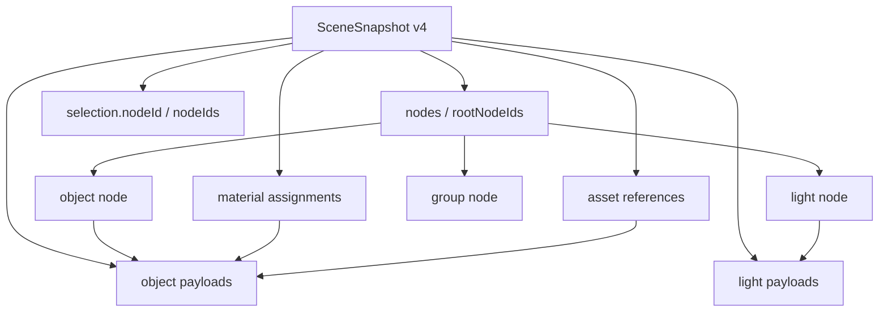
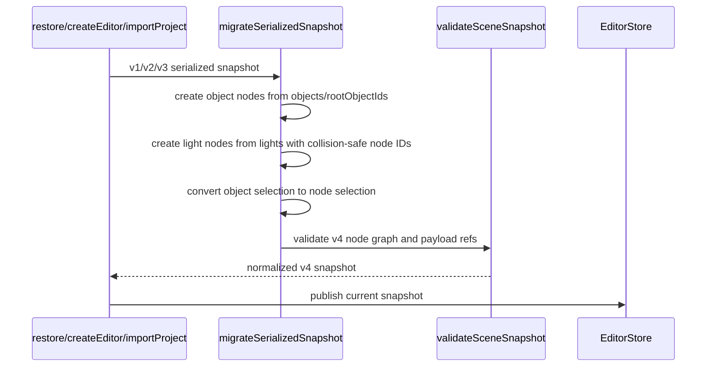
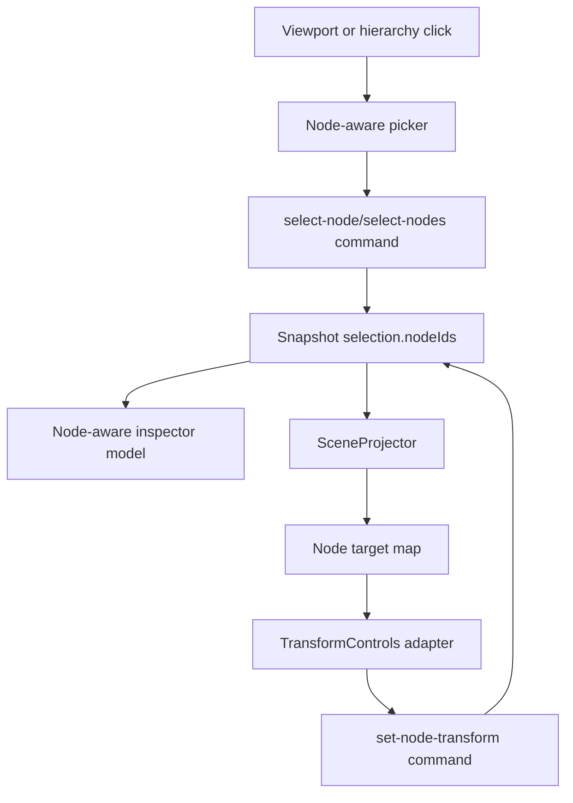
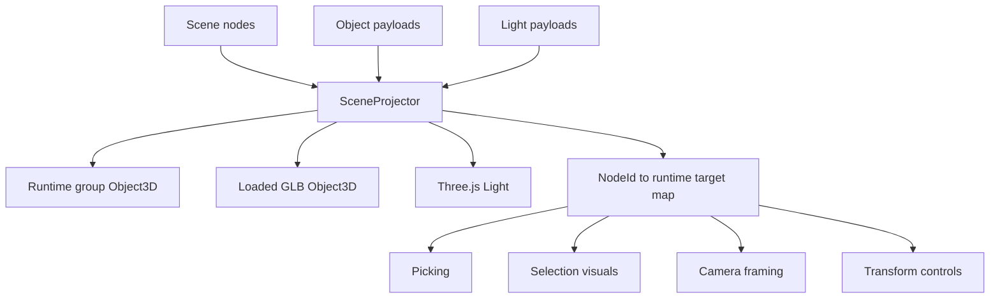

# feat: Establish shared scene node contract

## Summary

Introduce a shared `SceneNode` / `NodeId` contract for the next stage of the 3D editor. The first implementation should make GLB objects, empty groups, and lights share hierarchy, selection, transform targeting, inspector targeting, runtime picking, and command/history semantics.

This is a schema/API plan, not a visual polish pass. It intentionally avoids a full ECS, plugin system, GLB internal hierarchy editor, data-binding runtime, or Agent runtime. The goal is to remove the current structural split where GLB objects live under `objects/rootObjectIds/selection.objectId`, lights live in a separate `lights` map, and workbench light editing depends on UI-local `activeLightId`.

---

## Problem Frame

The MVP and post-MVP proof loops are now strong enough to validate a real static-scene editor foundation: GLB import, selection, transform controls, material/environment/light projection, project package export/reopen, missing-asset recovery, and React/Vue workbench parity all exist.

The next major risk is target identity. Current code has two durable target models:

- GLB objects are scene hierarchy nodes. `SceneObject` owns `parentId`, `children`, `transform`, asset reference, display name, material target identity, selection, and transform commands.
- Lights are durable authoring records, but not hierarchy nodes. They are edited through the inspector light section and selected through `activeLightId`, which is framework/workbench state rather than durable scene selection.

That split is already visible across the repo:

- `SceneSnapshot.version = 3` has `objects`, `rootObjectIds`, object-only `selection`, and separate `lights`.
- `SceneProjector` and `ThreeObjectMap` project and pick object IDs only; `LightProjector` keeps a separate light map.
- `TransformTransaction` commits `set-transform` commands with `objectId`.
- `buildInspectorModel()` has a selected object model plus an independent light section.
- React/Vue workbench context exposes `selectionCount` from object selection and `activeLightId` for lights.
- Demo hierarchy, clipboard, duplicate, delete, group, ungroup, paste, and material assignment are all object-centric.

If the next features add light helpers, empty groups, box selection, GLB imported child nodes, material slots, Agent command targets, or future data-binding targets without a shared node boundary, each feature will create its own target semantics. This plan fixes the authoring contract first, while the API is still experimental `0.x`.

---

## Context and Research

### Repo-Grounded Evidence

- `docs/ideation/2026-06-03-post-mvp-3d-editor-next-stage-ideation.md` ranked shared `SceneNode` / `NodeId` as the highest-leverage next-stage idea because box selection, light helpers, empty groups, GLB child editing, material-slot targets, Agent proposals, and data binding all depend on stable target identity.
- `docs/residual-review-findings/feat-core-schema-extension.md` explicitly left a P2 design follow-up: GLB objects and lights remain separate durable models, and the project should decide whether to introduce a shared `SceneNode` / `NodeId` boundary before deeper inspector/hierarchy work.
- `docs/schema.md` documents the current v3 object-only selection shape and notes that runtime-only values must never enter snapshots.
- `docs/architecture.md` establishes the invariant this plan must preserve: `SceneSnapshot` is the durable source of truth, commands are the durable edit path, Three.js is projection, and React/Vue shells do not own editing semantics.
- `docs/interactions.md` shows the completed local demo interactions and the remaining gaps: durable light selection, box/lasso selection, grid/alignment helpers, command palette, richer asset workflow, Agent editing, and data binding are not implemented.
- `README.md` keeps full low-code workflows, data binding, hosted publishing, schema-driven inspector plugins, full asset libraries, per-submesh material discovery, and stable 1.0 API outside the current product scope.

### Planning Constraint

No new external library decision is needed for this plan. The primary work is local schema, command, validation, runtime projection, and adapter parity. Existing Three.js runtime APIs remain sufficient; the risky part is contract design and migration, not choosing a new dependency.

---

## Requirements

### Durable Scene Graph Contract

- R1. The core must introduce a new current snapshot schema version with a canonical `nodes: Record<NodeId, SceneNode>` map and `rootNodeIds: NodeId[]`.
- R2. `SceneNode` must cover the first three authored node kinds: GLB object node, empty group node, and light node.
- R3. `SceneNode` must own common authoring fields needed by hierarchy and selection: stable `id`, display `name`, `kind`, `parentId`, ordered `children`, optional `transform`, and JSON-compatible `metadata`.
- R4. Object and light payloads may remain separate maps in the first implementation, but hierarchy, selection, transform target, and inspector target must use `NodeId`, not object-only or light-only IDs.
- R5. Snapshot migration must restore v1, v2, and v3 serialized snapshots into the new current schema while preserving scene identity, object identity, object hierarchy, selection, transforms, assets, materials, environment, lights, authored problems, and metadata.
- R6. Migration must define deterministic ID collision behavior when an existing object ID, light ID, or future node ID collides. Existing object IDs should remain object node IDs when possible; colliding light node IDs should be generated predictably without losing the original light payload identity.
- R7. Validation must reject missing node payload references, missing parent references, child-parent mismatches, cycles, duplicate child IDs, duplicate selection IDs, invalid root IDs, invalid transforms, non-finite numbers, and non-JSON-compatible metadata before command history records a change.
- R8. The current snapshot must not serialize Three.js objects, loaded assets, `File`, `Blob`, object URLs, resolver results, PMREM outputs, transform controls, helper objects, or framework state.

### Selection, Hierarchy, and Commands

- R9. Durable selection must become node-based, with primary `nodeId` and ordered `nodeIds`. Legacy object-selection helpers may remain, but they must derive from node selection rather than duplicate durable state.
- R10. Selection must support object nodes, group nodes, and light nodes. Non-spatial light nodes may be selected even when they cannot be transformed.
- R11. Core hierarchy helpers must operate on `nodes` and expose compatibility helpers for object-only callers.
- R12. Core command dispatch must add node commands for selecting nodes, deleting node subtrees, reparenting nodes, creating empty groups, grouping selections under an empty group, ungrouping group nodes, and setting node transforms.
- R13. Existing object commands such as `select-object`, `select-objects`, `set-transform`, `delete-objects`, `duplicate-objects`, `group-objects`, `ungroup-objects`, `reparent-object`, `import-glb`, and `paste-objects` must either delegate to node-aware behavior or remain explicitly object-only with tests and documented disabled states.
- R14. Existing light commands such as `add-light`, `update-light`, and `remove-light` must create, update, and remove light nodes consistently with light payloads. Removing a light node must not leave orphaned light payloads.
- R15. New command inputs should use command-layer DTOs for touched areas instead of directly reusing durable schema shapes. This plan should at least avoid expanding the residual command/schema coupling for node and light commands.
- R16. Undo/redo must continue to restore complete snapshots and reproject runtime state. A grouped node operation, light transform, empty group transform, or migration-normalized selection must remain undoable through existing history semantics.

### Runtime Projection and Direct Manipulation

- R17. Runtime projection must build a selectable runtime target map keyed by `NodeId`, not only object ID.
- R18. Object nodes must still project GLB payloads through the existing asset resolver and loader boundary.
- R19. Empty group nodes must project to transformable runtime groups and participate in hierarchy, frame selected, selection visuals, and transform controls.
- R20. Spatial light nodes must project to Three.js lights and become selectable/transformable where meaningful. Ambient and hemisphere lights must be selectable but should not expose transform controls unless the schema explicitly adds meaningful transform semantics later.
- R21. Runtime picking, selection visuals, camera framing, and transform controls must route through node selection and node transform commands. Light viewport selection may use a minimal transient pick proxy; full light helper visualization remains deferred.
- R22. Runtime light objects, light targets, helper objects, projected groups, and node target maps must remain runtime projection state and must not be exposed as durable data or accidental public API.
- R23. Material projection must continue to apply object-level material assignments to object payloads. This plan must not require per-submesh discovery or GLB material-slot editing.

### Inspector, Workbench, and Framework Parity

- R24. Core inspector selection must become a node selection model. It should describe the selected node kind, selected count, transform availability, object payload when present, light payload when present, and user-facing reason when a section is unavailable.
- R25. Transform inspector must target transformable nodes. Material inspector must remain object-payload-only. Light inspector must target selected light nodes or explicit light-list selection routed through node selection.
- R26. React and Vue workbench context must expose node-aware selection state while preserving compatibility fields where practical for current consumers.
- R27. React and Vue hierarchy/demo surfaces must render object nodes, empty group nodes, and light nodes from the shared node graph, not from `rootObjectIds` only.
- R28. React and Vue must stay thin adapters over core. They must not own separate light selection, grouping, or hierarchy semantics.

### Compatibility and Verification

- R29. Existing v3 proof-loop workflows must keep passing after migration: import GLB, select object, transform, undo/redo, serialize/restore, material edit, environment edit, light edit, project package export/reopen, missing asset recovery, and runtime disposal.
- R30. `.ek3d` project packages must continue to store a JSON scene snapshot plus asset payloads. Project import must migrate old snapshots before exposing them to editor state.
- R31. Clipboard payload behavior must preserve existing object copy/paste. If this plan introduces a node clipboard payload, it must keep accepting the existing object payload version for backward compatibility.
- R32. Public exports must expose durable node types, command DTOs, and compatibility helpers intentionally. Private projector classes, runtime maps, and Three.js implementation details must remain private.
- R33. Documentation must update schema, architecture, interactions, README non-goals, and integration guidance so consumers understand the new node boundary and the deferred features.

---

## Key Technical Decisions

- KTD1. Add `SceneNode` as the canonical hierarchy and target layer, not as a full ECS. A node represents authored placement, selection, hierarchy, transform capability, display name, and metadata. It does not become a generic component bag, plugin container, runtime entity, or data-binding record.
- KTD2. Keep object and light payload maps for the first node release. Object payloads continue to own GLB asset references and material target identity. Light payloads continue to own light kind and light-specific fields. This avoids forcing material projection, asset packaging, and light projection through a second large rewrite in the same plan.
- KTD3. Move common placement fields to nodes. For new v4 code, node owns parent/children and transform target. Existing object and light payload types may keep compatibility fields or view helpers during migration, but command and runtime semantics should read the canonical node graph.
- KTD4. Make v4 selection node-only in durable state. Do not store both `selection.nodeIds` and `selection.objectIds` in current snapshots. Legacy object selection APIs such as `getSelectedObjectIds()` and `select-object` should derive object IDs from selected object nodes.
- KTD5. Use payload references rather than requiring node IDs and payload IDs to always match. Object migration can keep object node IDs equal to existing object IDs. Light migration can preserve existing light IDs while generating collision-free light node IDs. This prevents light/object ID collisions from corrupting saved scenes.
- KTD6. Treat transform as a node capability. GLB object nodes and empty group nodes are transformable. Directional, point, and spot light nodes are transformable. Ambient and hemisphere light nodes are selectable but not transformable in this plan.
- KTD7. Keep legacy object commands as compatibility adapters. New node commands become the canonical path, but existing public command names should continue to work for object workflows while the package is still experimental.
- KTD8. Light inspector targeting should follow node selection. A light list may still exist for discoverability, but choosing a light from that list should select the corresponding light node instead of maintaining a separate durable target.
- KTD9. Runtime gets an internal node target map. Renaming `ThreeObjectMap` or adding a `ThreeNodeMap` is an implementation detail, but the runtime must be able to find the projected runtime object for object, group, and light nodes by `NodeId`.
- KTD10. Material assignments remain object-payload targets. This plan should not rewrite material target semantics to `NodeId` until GLB child hierarchy and material-slot discovery are designed. Node selection can expose material controls only when the selected node references an object payload.
- KTD11. Clipboard can evolve, but it must not block node migration. The minimum requirement is preserving the existing object clipboard behavior. A node clipboard payload is valuable if it can be added without destabilizing the first scene-node release.
- KTD12. This plan intentionally defers Agent/data-binding semantics. The node graph should leave future target headroom, but no Agent command proposal layer, IoT variable binding, event graph, or hosted publishing workflow is implemented here.
- KTD13. Scope command DTO cleanup to new and touched commands. New node commands and light commands changed by this plan should use command-layer input types. A broader material/environment command DTO cleanup is valuable, but belongs to the later public API stabilization pass so this plan stays focused on target identity.
- KTD14. Node transforms are parent-local. Migration preserves existing object transforms as local transforms under their migrated parent nodes. Reparent commands must make the world/local preservation choice explicit through command input rather than hiding it in runtime projection.

---

## High-Level Technical Design

The type sketch below is illustrative. Exact names can change during implementation, but the ownership boundary should remain stable.

```ts
interface SceneSnapshot {
  version: 4;
  scene: { id: string; name: string };
  nodes: Record<string, SceneNode>;
  rootNodeIds: string[];
  selection: {
    nodeId: string | null;
    nodeIds: string[];
  };
  objects: Record<string, SceneObjectPayload>;
  lights: Record<string, LightDefinition>;
  assets: Record<string, AssetReference>;
  materials: MaterialState;
  environment: SceneEnvironment;
  problems: AuthoredProblemState;
  metadata?: Record<string, JsonValue>;
}

type SceneNode =
  | {
      id: string;
      kind: "object";
      name: string;
      objectId: string;
      parentId: string | null;
      children: string[];
      transform: Transform;
      metadata?: Record<string, JsonValue>;
    }
  | {
      id: string;
      kind: "group";
      name: string;
      parentId: string | null;
      children: string[];
      transform: Transform;
      metadata?: Record<string, JsonValue>;
    }
  | {
      id: string;
      kind: "light";
      name: string;
      lightId: string;
      parentId: string | null;
      children: string[];
      transform?: Transform;
      metadata?: Record<string, JsonValue>;
    };
```

### Snapshot v4 Topology



### v3 to v4 Migration Flow



### Node Selection and Transform Flow



### Runtime Projection Shape



---

## Scope Boundaries

### In Scope

- Snapshot v4 node graph with migration from v1/v2/v3.
- Node-based selection, hierarchy validation, and core helpers.
- Empty group node creation, grouping, ungrouping, deletion, reparenting, transform, undo, and redo.
- Light nodes that can be selected through hierarchy/viewport and edited through inspector target semantics.
- Transform controls and camera framing for object nodes, empty group nodes, and spatial light nodes.
- React/Vue workbench and proof-loop demo parity for node hierarchy and node selection.
- Compatibility paths for existing object commands, object material assignments, project packages, and serialized snapshots.
- Documentation for new schema, command, runtime, inspector, and public API boundaries.

### Deferred Follow-Up Work

- GLB internal hierarchy import as editable child nodes.
- Per-submesh material-slot discovery and per-part material overrides.
- Full node clipboard polish if it threatens the first node migration; object clipboard compatibility is still required.
- Box/lasso selection, grid helpers, alignment helpers, visual snap UI, and command palette.
- Full local asset workspace, import queues, asset thumbnails, and search/filter.
- Shadows, advanced light helpers, RectAreaLight, IES lights, and visual quality presets.
- Command proposal / dry-run / Agent editing layer.
- Data binding, IoT variables, event orchestration, dashboards, and hosted publishing.
- Broad command DTO cleanup for material/environment commands that are not directly touched by node migration.

### Outside This Product Stage

- Full ECS architecture.
- Core plugin ecosystem or schema-driven inspector plugin platform.
- Runtime state as a source of truth.
- React/Vue-owned scene semantics.
- Stable 1.0 API guarantees.

---

## Implementation Units

### U1. Snapshot v4 SceneNode schema, migration, and validation

- **Goal:** Introduce the canonical node graph and normalize all saved snapshots into it.
- **Requirements:** R1-R8, R29-R30, R33.
- **Dependencies:** Existing snapshot/schema-extension plans.
- **Files:** `packages/core/src/snapshot/types.ts`, `packages/core/src/snapshot/defaults.ts`, `packages/core/src/snapshot/migrations.ts`, `packages/core/src/snapshot/validation.ts`, `packages/core/src/snapshot/hierarchy.ts`, `packages/core/src/snapshot/transforms.ts`, `packages/core/src/editor/serialization.ts`, `packages/core/src/editor/create-editor.ts`, `packages/core/src/project/package-validation.ts`, `packages/core/src/public-api.ts`, `packages/core/src/snapshot/snapshot.test.ts`, `packages/core/src/editor/serialization.test.ts`, `packages/core/src/project/import-project.test.ts`, `packages/core/src/project/package-validation.test.ts`, `packages/core/src/public-api.test.ts`, `docs/schema.md`.
- **Approach:** Add current snapshot version 4 with `nodes`, `rootNodeIds`, and node-based `selection`. Keep migration functions for v1/v2/v3 and migrate project-package scenes through the same path. Move hierarchy validation from object-only checks to node graph checks. Keep object and light payload validation, but validate node-to-payload references and transform capability by node kind.
- **Patterns to follow:** Existing `SNAPSHOT_VERSION`, `createEmptySnapshot()`, `migrateSerializedSnapshot()`, `validateSceneSnapshot()`, JSON compatibility checks, and migration tests.
- **Test scenarios:**
  - Given a v3 snapshot with two GLB objects, parent/child hierarchy, material assignment, environment, light, and selected object, when restored, then the editor stores v4 with object nodes, a light node, preserved object payloads, preserved material target, and equivalent selected object node.
  - Given a v1 or v2 proof-loop snapshot, when restored, then it reaches v4 and still supports import/select/transform/serialize/restore behavior.
  - Given an object ID and light ID collide during migration, when migration runs, then the object node keeps the object ID and the light node receives a deterministic collision-safe node ID while preserving the light payload.
  - Given a node graph with a missing payload reference, duplicate child ID, child-parent mismatch, cycle, invalid root ID, invalid transform, or duplicate selection ID, when validation runs, then the snapshot is rejected before state reaches history.
  - Given metadata contains a function, class instance, `File`, `Blob`, Three.js object, object URL, circular structure, or non-finite number, when validation runs, then the snapshot is rejected.
  - Given a valid v4 snapshot is exported to `.ek3d` and imported again, when import completes, then the scene remains v4 and asset payload validation still works.
- **Verification:** Current editor state has one canonical node graph, old snapshots still restore, and runtime-only values remain excluded.

### U2. Node selection, hierarchy helpers, and command DTO boundary

- **Goal:** Replace object-only selection/hierarchy semantics with node-aware helpers while preserving object compatibility APIs.
- **Requirements:** R9-R16, R29, R32.
- **Dependencies:** U1.
- **Files:** `packages/core/src/selection/selection.ts`, `packages/core/src/snapshot/hierarchy.ts`, `packages/core/src/commands/types.ts`, `packages/core/src/commands/dispatcher.ts`, `packages/core/src/commands/select-object.ts`, `packages/core/src/commands/select-node.ts`, `packages/core/src/editor/operations.ts`, `packages/core/src/shortcuts/actions.ts`, `packages/core/src/inspector/selection.ts`, `packages/core/src/public-api.ts`, `packages/core/src/commands/select-object.test.ts`, `packages/core/src/commands/dispatcher.test.ts`, `packages/core/src/editor/operations.test.ts`, `packages/core/src/inspector/inspector.test.ts`, `packages/core/src/public-api.test.ts`.
- **Approach:** Add `select-node` and `select-nodes` as canonical commands. Rework selection normalization to validate node IDs, preserve ordered multi-select, and derive object selections through helpers such as `getSelectedObjectIds()` and `getTopLevelSelectedObjectIds()`. Add command-layer input types for new node commands so the new API does not deepen the durable-schema-as-DTO issue.
- **Patterns to follow:** Existing `normalizeSelection()`, `getSelectedObjectIds()`, `getTopLevelSelectedObjectIds()`, `select-objects` modes, command dispatch validation, and advanced operation helpers.
- **Test scenarios:**
  - Given object, group, and light nodes, when `select-nodes` runs in replace, add, remove, toggle, clear, and all modes, then selection is normalized by node IDs and primary selection remains deterministic.
  - Given `select-object` targets an object payload, when the object node exists, then the command selects the corresponding node and legacy `getSelectedObjectIds()` returns the object ID.
  - Given `select-object` targets a light or group ID, when no object payload exists for that ID, then the command fails with a controlled error instead of selecting an invalid node.
  - Given a mixed selection of group, light, and object nodes, when object-only helpers run, then they return only selected object payload IDs in stable order.
  - Given a non-spatial light is selected, when the inspector model is built, then selection exists but transform availability is false with a clear reason.
  - Given node command inputs contain extra durable-schema-only fields, when TypeScript public API tests run, then command DTOs expose only accepted command input shape.
- **Verification:** Selection and hierarchy use nodes as the durable target while existing object APIs remain predictable compatibility paths.

### U3. Node mutation commands for objects, groups, lights, and transforms

- **Goal:** Make durable edits over node targets first-class while adapting object and light command families.
- **Requirements:** R11-R16, R20, R29, R31.
- **Dependencies:** U1, U2.
- **Files:** `packages/core/src/commands/types.ts`, `packages/core/src/commands/dispatcher.ts`, `packages/core/src/commands/import-glb.ts`, `packages/core/src/commands/add-light.ts`, `packages/core/src/commands/update-light.ts`, `packages/core/src/commands/remove-light.ts`, `packages/core/src/commands/set-transform.ts`, `packages/core/src/commands/set-node-transform.ts`, `packages/core/src/commands/delete-objects.ts`, `packages/core/src/commands/delete-nodes.ts`, `packages/core/src/commands/reparent-object.ts`, `packages/core/src/commands/reparent-node.ts`, `packages/core/src/commands/group-objects.ts`, `packages/core/src/commands/group-nodes.ts`, `packages/core/src/commands/ungroup-objects.ts`, `packages/core/src/commands/ungroup-nodes.ts`, `packages/core/src/commands/duplicate-objects.ts`, `packages/core/src/commands/paste-objects.ts`, `packages/core/src/editor/operations.ts`, `packages/core/src/lights/types.ts`, `packages/core/src/lights/defaults.ts`, `packages/core/src/lights/validation.ts`, `packages/core/src/commands/import-glb.test.ts`, `packages/core/src/commands/light-commands.test.ts`, `packages/core/src/commands/set-transform.test.ts`, `packages/core/src/commands/group-objects.test.ts`, `packages/core/src/commands/reparent-object.test.ts`, `packages/core/src/commands/delete-objects.test.ts`, `packages/core/src/commands/duplicate-objects.test.ts`, `packages/core/src/commands/paste-objects.test.ts`.
- **Approach:** Add node-native command handlers for creating groups, deleting node subtrees, reparenting nodes, grouping selections into an empty group, ungrouping group nodes, and setting node transforms. Update `import-glb` to create an object payload plus object node. Update `add-light` to create a light payload plus light node; update/remove light must keep node and payload lifecycle consistent and should move touched light command inputs toward command-layer DTOs. Keep legacy object command names by mapping object IDs to object nodes and preserving existing proof-loop behavior.
- **Patterns to follow:** Existing `removeObjectsFromHierarchy()`, `reparentObject()`, `collectObjectSubtreeIds()`, `applySetTransform()`, `applyImportGlb()`, light command validation, and batch command history behavior.
- **Test scenarios:**
  - Given `import-glb` with no parent, when it executes, then it creates a GLB object payload, an object node, and appends the node to `rootNodeIds`.
  - Given `import-glb` with a parent node, when the parent is a group or object node, then the imported object node becomes a child; when the parent is invalid, the command fails without mutation.
  - Given `add-light` for ambient, directional, hemisphere, point, and spot lights, when commands execute, then each light has a payload and a corresponding light node with correct transform capability.
  - Given `remove-light`, when it removes a light payload, then the corresponding light node and any selected reference to it are removed or normalized.
  - Given selected object and light nodes are grouped, when `group-nodes` executes, then an empty group node is created, selected nodes are reparented under it, and undo restores the original roots and selection.
  - Given a group node is transformed, when undo and redo run, then child world placement projection follows the restored node transform.
  - Given a node is reparented with an explicit preserve-world or local-transform input, when the command executes, then the resulting local transform is deterministic and undo restores the previous parent and transform.
  - Given `set-transform` targets a legacy object ID, when the matching object node exists, then it delegates to `set-node-transform`.
  - Given `set-node-transform` targets ambient or hemisphere light nodes, when command executes, then it fails with a transform-unavailable error and no snapshot mutation.
  - Given `delete-nodes` removes a node subtree containing object and light nodes, when it executes, then object payloads, light payloads, material assignments for removed objects, root IDs, child links, and selection are cleaned consistently.
- **Verification:** Object, light, and group edits share command/history semantics without orphaned payloads or invalid selections.

### U4. Runtime projection, picking, framing, and transform controls by NodeId

- **Goal:** Project the node graph into Three.js runtime targets and route viewport interactions through node commands.
- **Requirements:** R17-R23, R29, R32.
- **Dependencies:** U1-U3.
- **Files:** `packages/core/src/runtime/scene-projector.ts`, `packages/core/src/runtime/light-projector.ts`, `packages/core/src/runtime/three-object-map.ts`, `packages/core/src/runtime/picking.ts`, `packages/core/src/runtime/selection-visuals.ts`, `packages/core/src/runtime/editor-runtime.ts`, `packages/core/src/runtime/material-projector.ts`, `packages/core/src/runtime/transform/transform-controller.ts`, `packages/core/src/runtime/transform/transform-transaction.ts`, `packages/core/src/runtime/transform/transform-controls-adapter.ts`, `packages/core/src/runtime/transform/transform-mode.ts`, `packages/core/src/runtime/viewport-controls.ts`, `packages/core/src/runtime/problems.ts`, `packages/core/src/runtime/disposal.ts`, `packages/core/src/runtime/scene-projector.test.ts`, `packages/core/src/runtime/light-projector.test.ts`, `packages/core/src/runtime/picking.browser.test.ts`, `packages/core/src/runtime/transform/transform-controller.browser.test.ts`, `packages/core/src/runtime/transform/transform-transaction.test.ts`, `packages/core/src/runtime/material-projector.test.ts`, `packages/core/src/runtime/disposal.test.ts`.
- **Approach:** Replace or extend `ThreeObjectMap` with a node target map that can resolve runtime targets for object, group, and light nodes. Project root nodes recursively. Object nodes continue to load GLB assets. Group nodes create plain runtime groups. Spatial light nodes project through the light projector while registering their runtime light target by node ID. Selection visuals, picking, camera framing, and transform controls should read node selection and commit `select-node(s)` / `set-node-transform`.
- **Patterns to follow:** Existing `SceneProjector.project()`, `LightProjector`, `ObjectPicker`, `TransformController`, `TransformTransaction`, selection visuals, frame selected/all helpers, and runtime disposal tests.
- **Test scenarios:**
  - Given a v4 node graph with object, group, and light nodes, when runtime projects it, then runtime targets are registered by node ID and disposed when nodes disappear.
  - Given an object node under a group node, when group transform changes, then runtime hierarchy reflects parent transform and object projection still loads through the asset resolver.
  - Given a spatial light node is selected in the hierarchy, when TransformControls commits a translate edit, then `set-node-transform` updates the light node transform and undo/redo reprojects the light.
  - Given an ambient light node is selected, when TransformControls tries to attach, then it remains detached and no transform command is emitted.
  - Given viewport picking hits a mesh inside a GLB object, when selection runs, then it selects the owning object node.
  - Given viewport picking or hierarchy selection targets a spatial light's minimal pick proxy or runtime light target, when selection runs, then it selects the light node without exposing the runtime light object in snapshot state.
  - Given camera frame selected runs with object, group, or spatial light selection, then it frames the projected node target; with non-spatial light selection, it returns false or frames all with a documented behavior.
  - Given material overrides are projected, when object nodes are nested under groups, then material projection still applies to the object payload and does not target group or light nodes.
  - Given runtime is disposed during active transform/picking/control state, when pending callbacks fire, then listeners are cleaned and no stale node command is dispatched.
- **Verification:** The viewport and runtime can interact with node IDs across objects, groups, and lights while keeping runtime-only state transient.

### U5. Inspector, React/Vue workbench, and proof-loop node hierarchy

- **Goal:** Update framework-neutral inspector models and React/Vue adapters to consume node selection and render the unified hierarchy.
- **Requirements:** R24-R28, R29, R32-R33.
- **Dependencies:** U1-U4.
- **Files:** `packages/core/src/inspector/types.ts`, `packages/core/src/inspector/selection.ts`, `packages/core/src/inspector/transform.ts`, `packages/core/src/inspector/material.ts`, `packages/core/src/inspector/lights.ts`, `packages/core/src/inspector/inspector.test.ts`, `packages/core/src/inspector/transform.test.ts`, `packages/core/src/inspector/material.test.ts`, `packages/core/src/inspector/lights.test.ts`, `packages/react/src/hooks/use-workbench.ts`, `packages/react/src/hooks/use-inspector.ts`, `packages/react/src/components/EditorWorkbench.tsx`, `packages/react/src/components/InspectorView.tsx`, `packages/react/src/components/LightInspector.tsx`, `packages/react/src/components/TransformInspector.tsx`, `packages/react/src/components/MaterialInspector.tsx`, `packages/vue/src/composables/use-workbench.ts`, `packages/vue/src/components/EditorWorkbench.vue`, `packages/vue/src/components/InspectorView.vue`, `packages/vue/src/components/LightInspector.vue`, `packages/vue/src/components/TransformInspector.vue`, `packages/vue/src/components/MaterialInspector.vue`, `examples/react-proof-loop/src/App.tsx`, `examples/vue-proof-loop/src/App.vue`, `packages/react/src/public-api.test.ts`, `packages/vue/src/public-api.test.ts`.
- **Approach:** Replace object-only inspector selection with a node-aware model. Transform section reads transformable node targets. Material section appears only for selected object nodes. Light section can still show all lights, but active target should be a selected light node or a command that selects a light node. Workbench contexts should expose `selectedNodeId`, `selectedNodeIds`, `selectionCount`, node kind, and compatibility object fields. Demo hierarchy should render `rootNodeIds` and nested `nodes`, with markers for object, group, light, selected, primary, and runtime problems.
- **Patterns to follow:** Existing `buildInspectorModel()`, `buildLightSection()`, command builders, React render-prop context, Vue scoped-slot context, proof-loop demo hierarchy, and parity tests.
- **Test scenarios:**
  - Given an object node is selected, when inspector model builds, then transform and material sections are available and light-specific fields are not the selected target.
  - Given a group node is selected, when inspector model builds, then transform is available, material and light payload editing are unavailable with clear reasons, and selection count is correct.
  - Given a point light node is selected, when inspector model builds, then transform and light fields are available and material is unavailable.
  - Given an ambient light node is selected, when inspector model builds, then light fields are available but transform is unavailable.
  - Given a light is chosen from the React or Vue light list, when the UI handles the click, then it dispatches node selection rather than only changing local `activeLightId`.
  - Given React and Vue workbenches render a mixed node graph, then hierarchy rows show object, group, and light nodes with the same selection semantics.
  - Given old host code reads compatibility context such as selected object ID where still exported, then object selection flows remain available for object nodes and return null for non-object nodes.
- **Verification:** Users can select and inspect GLB objects, empty groups, and lights through the same target model in core, React, Vue, and demos.

### U6. Clipboard, project package, public API, docs, and end-to-end compatibility

- **Goal:** Preserve consumer workflows and document the node contract clearly enough for follow-up features.
- **Requirements:** R29-R33.
- **Dependencies:** U1-U5.
- **Files:** `packages/core/src/clipboard/types.ts`, `packages/core/src/clipboard/create-clipboard.ts`, `packages/core/src/commands/paste-objects.ts`, `packages/core/src/commands/duplicate-objects.ts`, `packages/core/src/project/export-project.ts`, `packages/core/src/project/import-project.ts`, `packages/core/src/project/package-types.ts`, `packages/core/src/project/package-validation.ts`, `packages/core/src/editor/proof-loop.test.ts`, `packages/core/src/editor/proof-loop.integration.test.ts`, `packages/core/src/clipboard/create-clipboard.test.ts`, `packages/core/src/project/export-project.test.ts`, `packages/core/src/project/import-project.test.ts`, `packages/core/src/runtime/missing-asset.integration.test.ts`, `packages/react/test/react-proof-loop.integration.test.tsx`, `packages/vue/test/vue-proof-loop.integration.test.ts`, `packages/core/src/index.ts`, `packages/core/src/public-api.ts`, `packages/react/src/index.ts`, `packages/vue/src/index.ts`, `README.md`, `docs/architecture.md`, `docs/schema.md`, `docs/interactions.md`, `docs/project-package.md`, `docs/integration-react.md`, `docs/integration-vue.md`, `docs/faq.md`.
- **Approach:** Keep `.ek3d` project packages snapshot-based and rely on migration at import; the project manifest version does not need to change unless package layout changes beyond the scene snapshot. Preserve existing object clipboard payloads. If feasible, add a v2 node clipboard payload for group/object/light subtrees while accepting v1 object payloads; if that threatens migration quality, keep node clipboard as a deferred follow-up and explicitly disable unsupported copy/paste actions for non-object selections. Audit public exports so durable node types and node command DTOs are exported intentionally, while runtime node maps/projectors remain private.
- **Patterns to follow:** Existing project package scene encoding, `collectSnapshotAssetReferences()`, object clipboard material assignment copying, public API tests, README non-goals, and integration docs.
- **Test scenarios:**
  - Given an old object clipboard payload, when paste runs in a v4 editor, then pasted object nodes and payloads are created and material assignments are preserved.
  - Given an object node is copied in v4, when pasted, then behavior matches the current object proof loop.
  - Given a group node with object descendants is copied, if node clipboard v2 is implemented, then paste restores the group and descendants; if not implemented, UI/action helpers report unsupported copy for that selection without corrupting state.
  - Given a v4 scene with nodes is exported to `.ek3d`, when imported, then node graph, selection, objects, lights, materials, environment, authored problems, and asset references survive.
  - Given public API export tests run, then node types and commands are reachable through intended entry points and private runtime maps are not.
  - Given React and Vue proof-loop integration tests run, then GLB import, selection, transform, material edit, light edit, group operation, project export/reopen, and missing asset recovery still pass.
  - Given docs are reviewed, then they describe `SceneNode` as target/hierarchy contract and clearly defer GLB internal hierarchy, per-submesh materials, data binding, Agent runtime, and hosted publishing.
- **Verification:** The node contract lands without regressing existing proof loops or over-promising follow-up product scope.

---

## Acceptance Examples

- AE1. A v3 saved scene with three GLB objects, one ambient light, object selection, material override, and project assets restores into v4. The restored scene has object nodes, a light node, node selection, preserved object material assignments, and no runtime-only values.
- AE2. A user selects a point light from the hierarchy, moves it with TransformControls, undoes the move, and redoes it. Each step updates node transform through command/history, and the runtime light reprojects accordingly.
- AE3. A user creates an empty group, groups two GLB object nodes under it, moves the group, exports the project, reopens it, and sees the hierarchy and object placement preserved.
- AE4. A user selects an ambient light. The inspector shows light fields, the hierarchy shows the selected light node, and transform controls stay detached because ambient light has no transform capability.
- AE5. A user edits material on a selected GLB object nested under a group. The material inspector targets the object payload, the runtime material override remains visible, and no material assignment is created for the group node.
- AE6. A React demo and Vue demo render the same mixed hierarchy of object, group, and light nodes, and both route hierarchy clicks through node selection.
- AE7. Existing object-only host code using `select-object`, `set-transform`, object material assignment, and project import/export continues to work through compatibility adapters.

---

## System-Wide Impact

- **Snapshot and migration:** All editor initialization, restore, serialization, and project import paths must normalize into v4. Failing to migrate one path creates split behavior between direct `createEditor({ snapshot })` and `.ek3d` import.
- **Command API:** Node commands become canonical, but object commands stay public compatibility paths. Tests must cover both to avoid accidental object workflow breakage.
- **Runtime lifecycle:** Runtime projection will have more target types and parent-child relationships. Disposal tests must cover groups, lights, light targets, selection helpers, transform controls, and asset-backed object nodes.
- **Inspector model:** UI consumers should no longer infer "selected thing" means GLB object. Inspector sections need explicit availability metadata.
- **Framework adapters:** React and Vue context names may need compatibility aliases. Any new context field should be added in both adapters in the same implementation unit.
- **Project packages:** Package format can remain stable because it stores snapshots, but package validation must accept and migrate v4 scene shape.
- **Clipboard and operations:** Object operations should not silently corrupt mixed node selections. Unsupported cases need explicit failure or disabled state until node clipboard is implemented.
- **Documentation:** Schema and architecture docs must make the new target model obvious, otherwise future plans may reintroduce object/light split semantics.

---

## Risks and Mitigations

- **Risk: v4 migration breaks saved scenes.** Mitigate with characterization tests for v1/v2/v3 restore, project import, object selection, materials, environment, lights, and collision cases before changing runtime code.
- **Risk: node/payload ID confusion causes orphaned objects or lights.** Mitigate by making node-to-payload references explicit, validating both directions, and keeping helper names precise (`nodeId`, `objectId`, `lightId`).
- **Risk: scope expands into ECS or plugin architecture.** Mitigate by limiting node kinds to object/group/light and keeping payload maps plus command/history as the durable model.
- **Risk: light transform semantics become inconsistent.** Mitigate by treating transform as a node capability and explicitly marking ambient/hemisphere lights as non-transformable.
- **Risk: React/Vue adapters drift.** Mitigate by adding equivalent workbench context fields and parity tests in the same implementation unit.
- **Risk: object compatibility becomes ambiguous.** Mitigate by preserving object command tests and documenting which APIs are compatibility adapters versus canonical node APIs.
- **Risk: clipboard generalization delays the main migration.** Mitigate by preserving v1 object clipboard behavior first; add node clipboard v2 only if it can be done without destabilizing snapshot migration and command semantics.
- **Risk: runtime projection leaks private objects into public API.** Mitigate through public API tests and by keeping node target maps internal.

---

## Open Questions

- OQ1. Should v4 remove legacy object hierarchy fields from `SceneObject` immediately, or keep compatibility view types during one release? This is implementation-owned, but canonical command/runtime semantics should read `SceneNode`.
- OQ2. Should node clipboard v2 land in this plan or be a follow-up? Decide after U1-U3 complexity is visible. The blocker requirement is preserving current object clipboard behavior.
- OQ3. Should React/Vue public context rename `selectionCount` to `nodeSelectionCount` immediately, or add node fields alongside the existing name? Prefer additive compatibility unless TypeScript tests show the old name is actively misleading.
- OQ4. Should light node display name live only on `SceneNode` or also mirror into `LightDefinition.name` for compatibility? Prefer node-owned display name with compatibility accessors, but implementation can retain mirrored fields if migration cost is lower.

---

## References

- Origin ideation: `docs/ideation/2026-06-03-post-mvp-3d-editor-next-stage-ideation.md`
- MVP ideation: `docs/ideation/2026-05-28-threejs-3d-editor-mvp-ideation.md`
- Current schema: `docs/schema.md`
- Current architecture: `docs/architecture.md`
- Current interactions: `docs/interactions.md`
- Project package docs: `docs/project-package.md`
- Residual schema findings: `docs/residual-review-findings/feat-core-schema-extension.md`
- Residual runtime findings: `docs/residual-review-findings/feat-runtime-capability.md`
- Current snapshot model: `packages/core/src/snapshot/types.ts`
- Current validation and migrations: `packages/core/src/snapshot/validation.ts`, `packages/core/src/snapshot/migrations.ts`
- Current object hierarchy helpers: `packages/core/src/snapshot/hierarchy.ts`
- Current selection helpers: `packages/core/src/selection/selection.ts`
- Current command dispatcher: `packages/core/src/commands/dispatcher.ts`
- Current runtime projection: `packages/core/src/runtime/scene-projector.ts`, `packages/core/src/runtime/light-projector.ts`
- Current workbench adapters: `packages/react/src/hooks/use-workbench.ts`, `packages/vue/src/composables/use-workbench.ts`
