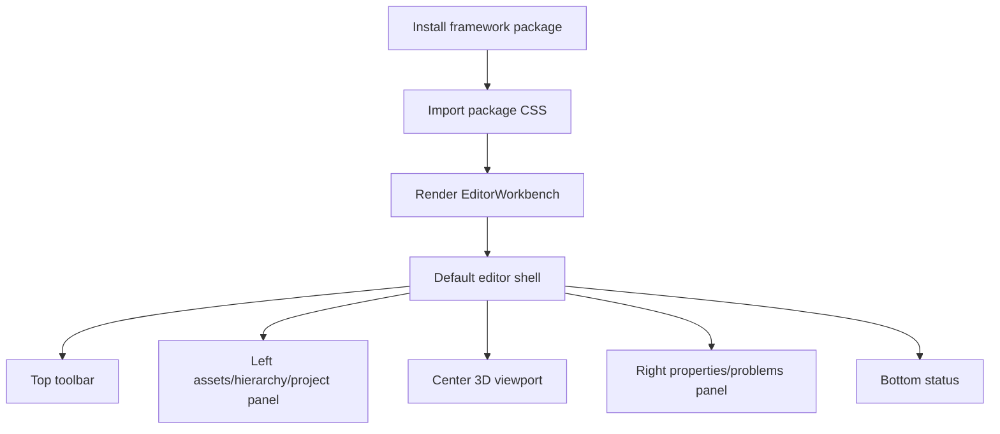
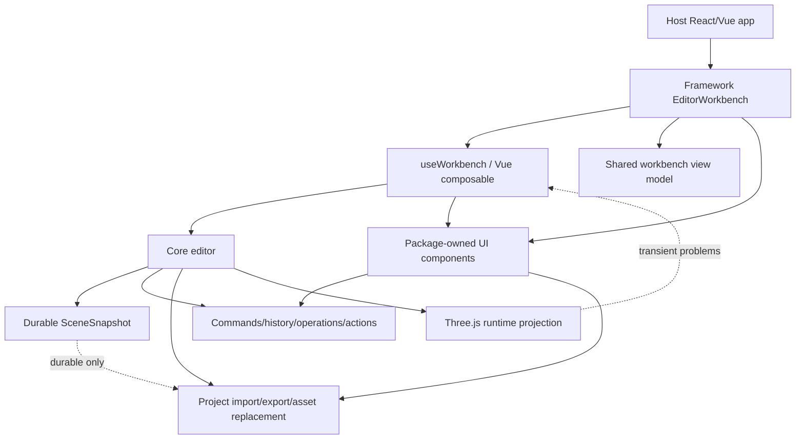
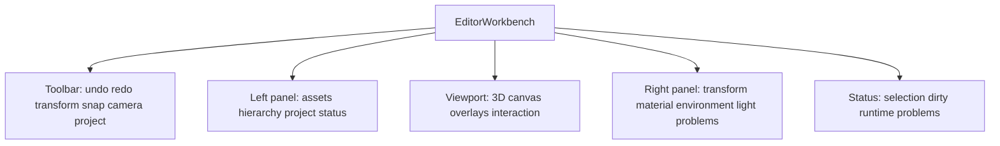

# feat: Build install-ready React/Vue editor workbench

## Summary

Make `@ek-aiot/3d-editor-react` and `@ek-aiot/3d-editor-vue` install-ready editor packages: after a consumer installs the package, imports its CSS, and renders `EditorWorkbench`, they should get a complete default editor rather than a set of primitives that require custom layout work.

The default workbench should be an editor-native shell: top toolbar, left project/assets/hierarchy panel, center 3D viewport, right inspector/problems panel, and bottom status when useful. React and Vue should keep framework-native extension points, but the no-customization path must still support the core flow: import/open, inspect, select, transform, undo/redo, edit properties, resolve missing assets, save/export, and restore.

This plan keeps the existing architecture boundary intact. Core continues to own durable `SceneSnapshot`, commands/history, validation, asset/project APIs, shortcuts/actions, runtime projection, and inspector models. React/Vue own framework lifecycle, layout, state subscriptions, CSS, and host-facing convenience.

---

## Problem Frame

The current React and Vue packages already expose `EditorWorkbench`, `EditorViewport`, inspector components, `useWorkbench`, runtime problem observation, project import/export, asset replacement, transform/snap/camera helpers, and extension regions. The examples prove the capabilities, but the default package experience still reads like a proof-loop shell:

- The default toolbar is mostly text button groups.
- The workbench layout does not yet clearly promise a complete editor workspace.
- Asset/project/hierarchy/status UI exists mainly in examples, not as package-owned default UI.
- CSS is emitted, but package manifests do not expose an explicit CSS subpath.
- Release verification proves package shape, but not yet "fresh host app installs package, imports styles, mounts the full editor, and performs a basic edit."

The next stage should turn the framework packages into consumer-facing editor packages while avoiding two failure modes:

- Do not move editor semantics into React/Vue stores or components.
- Do not expose a third-party component library as the editor package public API.

---

## Requirements

### Install-Ready Default Editor

- R1. `@ek-aiot/3d-editor-react` and `@ek-aiot/3d-editor-vue` must each export a default `EditorWorkbench` from the package root that renders a complete usable editor without caller-provided toolbar, side panel, inspector, or status UI.
- R2. The default desktop layout must use a stable editor workspace shape: top toolbar, left project/assets/hierarchy panel, center viewport, right inspector/problems panel, and optional bottom status area.
- R3. The default responsive layout must stack or collapse regions without overlapping controls, clipping important labels, or resizing fixed-format editor elements unpredictably.
- R4. The default workbench must preserve existing extension points so consumers can replace or augment toolbar, panel, overlay, and status regions in React and Vue idioms.
- R5. The default workbench must remain usable by consumers who only import package CSS and mount the component in a Vite React or Vite Vue 3 app.

### Editing and Project Flow

- R6. Toolbar actions must route through existing core actions, commands, operations, snap state, transform mode, history, and camera helpers instead of mutating snapshots directly.
- R7. The left panel must expose at least scene hierarchy, registered/imported assets, project/package status, and missing-asset recovery entry points that are available from the current core/editor APIs.
- R8. The center viewport must remain the only Three.js/runtime projection boundary and must continue to accept resolver, loader, renderer factory, and interaction options from the host.
- R9. The right panel must continue to compose existing transform, material, environment, light, and problem inspectors.
- R10. Open/import/export/save-like default controls must use core project/snapshot APIs and must not serialize runtime-only values such as Three.js objects, `File`, `Blob`, object URLs, loaded textures, PMREM outputs, resolver outputs, or runtime problem objects into durable JSON.
- R11. Status UI must surface selection summary, history availability, dirty/project state when available, runtime readiness, and authored/runtime/project problems without creating a second source of truth.

### Framework and Package Contract

- R12. React workbench state must continue to follow external-store subscription semantics through `useSyncExternalStore`-style snapshots and StrictMode-safe cleanup.
- R13. Vue workbench state must keep editor/runtime instances out of deep reactivity through `markRaw`, `shallowRef`, composable cleanup, and client-only host integration guidance.
- R14. React and Vue default workbenches must stay behaviorally equivalent even if their internal components use framework-native patterns.
- R15. Component-library adoption, if any, must be hidden behind package-owned components or wrappers. Consumers must not need to import, configure, or type against a third-party UI library to use `EditorWorkbench`.
- R16. Package manifests must expose CSS intentionally, preferably through `./styles.css`, while keeping private implementation files unavailable through package `exports`.
- R17. Documentation must distinguish the install-ready Workbench path from the lower-level headless/custom composition path.
- R18. Release verification must prove the packed packages can be consumed by fresh React and Vue apps that import the documented CSS and mount the default workbench.

---

## Key Technical Decisions

- KTD1. The first deliverable is a complete default Workbench, not a full headless/provider ecosystem. Existing hooks/composables stay available, but this plan optimizes the shortest successful install-to-editor path.
- KTD2. The default layout is fixed and responsive, not dockable or persisted. Resizable/dockable workspaces can be a later product feature once the public editor surface is stable.
- KTD3. Shared hierarchy/assets/status derivation should live in a framework-neutral helper when it is pure snapshot/project data. React/Vue should not duplicate object-tree traversal or project status rules if those rules can be expressed without framework or runtime objects.
- KTD4. UI libraries are evaluated for editor controls, accessibility, menus/tooltips/dialogs, theme tokens, bundle impact, SSR/client-only compatibility, and CSS isolation. The default implementation should use package-owned UI components; any third-party dependency must be wrapped internally and must not leak through public props or exported types. The implementation should record the adoption or non-adoption rationale in `docs/decisions.md` when the choice affects package dependencies.
- KTD5. Pinia, Zustand, Redux, or app-level providers are host integration recipes, not the state owner for this plan. Core remains the source of durable truth; framework stores may mirror serializable projections only.
- KTD6. CSS becomes a public contract at the package level. Prefer stable `ek-` class names, documented CSS custom properties, and explicit CSS subpath exports over deep-importing component files.
- KTD7. Browser-local defaults are acceptable for the first install-ready flow. A built-in file input/download path can make open/export usable immediately, while callbacks or extension regions let hosts replace that behavior with their own storage.
- KTD8. Project and asset UI may hold transient browser values while a control is active, but only versioned scene/project data can enter `SceneSnapshot` or `.ek3d` durable JSON.

---

## High-Level Technical Design

### Consumer Entry Point

### Workbench Ownership Boundary

### Desktop Layout Target

---

## Implementation Units

### U1. Define the install-ready Workbench contract

- **Goal:** Tighten the public contract so `EditorWorkbench` is the documented batteries-included entry point, while existing primitives remain available for custom composition.
- **Requirements:** R1-R5, R12-R18.
- **Dependencies:** `docs/plans/2026-05-29-004-feat-framework-shells-plan.md`.
- **Files:** `packages/react/src/index.ts`, `packages/react/src/components/EditorWorkbench.tsx`, `packages/react/src/hooks/use-workbench.ts`, `packages/react/src/public-api.test.ts`, `packages/vue/src/index.ts`, `packages/vue/src/components/EditorWorkbench.vue`, `packages/vue/src/composables/use-workbench.ts`, `packages/vue/src/public-api.test.ts`.
- **Approach:** Keep root exports as the recommended public surface. Add only the prop/context types required for the complete default Workbench and its region overrides. Preserve existing `toolbar`, `sidePanel`, `viewportOverlay`, and `status` extension behavior, but make the absence of those overrides render useful default UI.
- **Execution notes:** Avoid adding broad `./components/*`, `./hooks/*`, or `./composables/*` subpath exports. If new region names are needed, keep old names backward-compatible and document their behavior.
- **Test scenarios:**
  - Given a package consumer imports `EditorWorkbench` from the package root, when TypeScript resolves package exports, then the complete Workbench component and its public prop/context types are available.
  - Given no toolbar, side panel, overlay, or status override is provided, when the Workbench renders, then it still shows default toolbar, left panel, viewport, right inspector, and status/progress information.
  - Given a React render prop or Vue scoped slot is provided, when the Workbench renders, then the override receives editor, snapshot, inspector, runtime problems, selection, history, transform/snap, camera, project, and asset actions without exposing private runtime internals.
  - Given a host-owned editor is passed in, when the Workbench unmounts, then the editor remains usable and undisposed.
  - Given the Workbench creates its own editor, when that owner surface disposes, then subscriptions and mounted runtime are cleaned up.

### U2. Add a shared default workbench view model

- **Goal:** Centralize pure derivation for hierarchy, assets, project status, problem badges, selection labels, and toolbar/status enablement that React and Vue need to render the same default editor.
- **Requirements:** R2, R6-R11, R14.
- **Dependencies:** U1 and `docs/plans/2026-06-03-001-feat-scene-node-contract-plan.md`.
- **Files:** `packages/core/src/workbench/workbench-model.ts`, `packages/core/src/workbench/workbench-model.test.ts`, `packages/core/src/public-api.ts`, `packages/core/src/index.ts`, `packages/react/src/hooks/use-workbench.ts`, `packages/vue/src/composables/use-workbench.ts`.
- **Approach:** Add framework-neutral model helpers only for data that can be derived from `SceneSnapshot`, inspector model, history state, snap/transform state, project completeness, and transient problem arrays supplied by the caller. Keep runtime objects, browser `File` objects, resolver outputs, and UI component state out of the model.
- **Execution notes:** Reuse existing core hierarchy helpers such as `getTopLevelNodeIds`, selection helpers, inspector model, project problem types, and runtime problem types. Do not create a second command dispatcher or reducer.
- **Test scenarios:**
  - Given a scene with groups, objects, and lights, when the workbench model is built, then hierarchy rows preserve parent/child order and include selection/kind/problem metadata.
  - Given registered assets and unresolved asset references, when the model is built, then assets and missing-asset states are visible without embedding resolver outputs.
  - Given selected nodes, history state, snap settings, and transform mode, when the model is built, then toolbar/status affordance state is deterministic and framework-neutral.
  - Given authored, runtime, and project problems, when the model is built, then problem counts and badges can be displayed without writing runtime problems into the snapshot.
  - Given the input snapshot is reused, when the model helper runs, then it does not mutate snapshot nodes, assets, materials, environment, lights, or selection.

### U3. Build the React default editor shell

- **Goal:** Replace the React package's proof-loop-like default UI with a complete package-owned editor shell.
- **Requirements:** R1-R15.
- **Dependencies:** U1, U2.
- **Files:** `packages/react/src/components/EditorWorkbench.tsx`, `packages/react/src/components/WorkbenchToolbar.tsx`, `packages/react/src/components/WorkbenchLeftPanel.tsx`, `packages/react/src/components/WorkbenchStatusBar.tsx`, `packages/react/src/components/workbench.css`, `packages/react/src/hooks/use-workbench.ts`, `packages/react/test/workbench.test.tsx`, `packages/react/test/strict-mode.test.tsx`, `docs/decisions.md`.
- **Approach:** Compose the existing React `EditorViewport` and `InspectorView` with new internal toolbar, left panel, and status components. Default toolbar buttons should cover undo/redo, transform mode, snap, camera framing/reset, copy/paste/duplicate/delete/group/ungroup/select actions, and project open/export actions where supported. The left panel should expose hierarchy, assets, project status, and missing-asset recovery entry points. The inspector remains the right panel.
- **Component-library strategy:** Start with package-owned React components and CSS tokens. If a React UI library is introduced after evaluation, wrap it in internal components, keep exported prop/types library-free, and update dependency/build tests. If no library is adopted, record the reason so future UI work does not reopen the same decision without new evidence.
- **Test scenarios:**
  - Given a React Workbench renders with no custom regions, when DOM is queried, then default toolbar, hierarchy/assets left panel, viewport, inspector, and status are present.
  - Given a hierarchy row is clicked, when selection changes, then the inspector and status reflect the selected node through core state.
  - Given toolbar actions are invoked, when snapshot/history/transform/snap state changes, then changes route through core actions or operations.
  - Given project open/export controls are used in a test harness, when callbacks or browser-local defaults run, then core import/export APIs are called and failures are surfaced as UI state.
  - Given React StrictMode mounts and unmounts the Workbench, when subscription fakes are inspected, then cleanup is balanced and host-owned editor instances are preserved.
  - Given a custom render prop replaces a region, when the Workbench renders, then default shell layout remains stable and the custom region receives the full workbench context.

### U4. Build the Vue default editor shell

- **Goal:** Deliver the same install-ready editor shell for Vue 3 consumers with Vue-native component and scoped-slot behavior.
- **Requirements:** R1-R15.
- **Dependencies:** U1, U2, U3 design decisions.
- **Files:** `packages/vue/src/components/EditorWorkbench.vue`, `packages/vue/src/components/WorkbenchToolbar.vue`, `packages/vue/src/components/WorkbenchLeftPanel.vue`, `packages/vue/src/components/WorkbenchStatusBar.vue`, `packages/vue/src/components/workbench.css`, `packages/vue/src/composables/use-workbench.ts`, `packages/vue/test/workbench.test.ts`, `docs/decisions.md`.
- **Approach:** Mirror the React shell structure using Vue components and scoped slots, while preserving `markRaw`/`shallowRef` treatment for editor/runtime instances. Slot props should expose the same conceptual Workbench context as React. Default UI should be behaviorally equivalent, even if component implementation details differ.
- **Component-library strategy:** Evaluate Vue libraries only against concrete editor-shell needs such as tree/list, tooltips, menus, dialogs, upload/dropzone, form controls, theming, keyboard/focus, and bundle/CSS impact. If adopted, isolate the dependency behind internal components, update dependency/build tests, and avoid making it a host configuration requirement. If no library is adopted, record the reason alongside the React decision.
- **Test scenarios:**
  - Given a Vue Workbench renders with no custom slots, when DOM is queried, then default toolbar, hierarchy/assets left panel, viewport, inspector, and status are present.
  - Given a hierarchy row or asset recovery control is used, when Vue reactivity flushes, then core selection/project state and inspector UI update consistently.
  - Given toolbar actions are invoked, when snapshot/history/transform/snap state changes, then changes route through core actions or operations.
  - Given scoped slots replace Workbench regions, when the component renders, then slot props expose editor, snapshot, inspector, problems, selection, history, transform/snap, camera, project, and asset actions without deep-proxying editor internals.
  - Given the component unmounts, when subscription and runtime fakes are inspected, then cleanup has run exactly once for the mounted Workbench and host-owned editor remains usable.

### U5. Publish CSS, package exports, and release verification

- **Goal:** Make the package contract match the documented consumer path: import root API, import CSS, mount Workbench, and verify packed package behavior.
- **Requirements:** R5, R15-R18.
- **Dependencies:** U1-U4 and `docs/plans/2026-05-30-001-feat-npm-release-workflow-plan.md`.
- **Files:** `packages/react/package.json`, `packages/vue/package.json`, `packages/react/vite.config.ts`, `packages/vue/vite.config.ts`, `packages/react/test/build-config.test.ts`, `packages/vue/test/build-config.test.ts`, `scripts/verify-release.mjs`, `docs/release.md`.
- **Approach:** Add explicit CSS subpath exports such as `@ek-aiot/3d-editor-react/styles.css` and `@ek-aiot/3d-editor-vue/styles.css` if build output supports them cleanly. Keep React, React DOM, Vue, and JSX/Vue runtimes external according to current package rules. Update the release verifier so it expects the intended public export map instead of root-only exports.
- **Execution notes:** Do not expose private component files as subpaths. CSS subpath export should point to emitted CSS and stay listed in `sideEffects`.
- **Test scenarios:**
  - Given a package manifest is inspected, when package exports are read, then root API and CSS subpath are present while private helper paths remain absent.
  - Given React and Vue packages build, when output is inspected, then CSS files exist and package metadata points at valid dist files.
  - Given the release verifier packs packages, when consumer checks run, then documented imports compile from tarballs rather than workspace source.
  - Given a consumer imports package CSS through the documented subpath, when Vite builds the fixture, then the CSS import resolves.
  - Given private subpath imports are attempted by verifier fixtures, when they compile, then they fail as expected.

### U6. Update examples into install-ready starter proofs

- **Goal:** Turn the React and Vue proof-loop examples into realistic starter references for the default Workbench instead of custom app-specific editors.
- **Requirements:** R1-R18.
- **Dependencies:** U3-U5.
- **Files:** `examples/react-proof-loop/src/App.tsx`, `examples/react-proof-loop/src/styles.css`, `examples/react-proof-loop/package.json`, `examples/vue-proof-loop/src/App.vue`, `examples/vue-proof-loop/src/styles.css`, `examples/vue-proof-loop/package.json`, `docs/integration-react.md`, `docs/integration-vue.md`.
- **Approach:** Replace example-owned toolbar/side-panel code with package default Workbench UI where possible. Keep only host integration code that a real app would own: initial snapshot, resolver setup, optional callbacks, and starter page container. The examples should demonstrate that consumers do not have to build assets/hierarchy/toolbar/property panels themselves. Integration docs should also include a short host-store note: Pinia or React app stores may mirror serializable project metadata and snapshots, but editor/runtime instances stay raw, shallow, and client-owned.
- **Test scenarios:**
  - Given the React example starts, when the default Workbench renders, then the example shows the same complete editor shell exposed by the package.
  - Given the Vue example starts, when the default Workbench renders, then it shows equivalent functionality and layout.
  - Given example host code imports package CSS through the documented path, when the dev server or build runs, then styles load without example-specific deep imports.
  - Given the examples import, edit, export, restore, and recover an asset, when integration tests run, then durable state remains in core snapshots/project packages.
  - Given a narrow viewport, when examples render, then the shell remains usable without text/control overlap.

### U7. Add browser and consumer acceptance coverage

- **Goal:** Prove the default editor works visually and behaviorally in browser-like conditions and in fresh host fixtures.
- **Requirements:** R1-R18.
- **Dependencies:** U1-U6.
- **Files:** `packages/react/test/default-workbench.browser.test.tsx`, `packages/vue/test/default-workbench.browser.test.ts`, `packages/react/test/proof-loop-demo.browser.test.tsx`, `vitest.browser.config.ts`, `scripts/verify-release.mjs`, `docs/release.md`.
- **Approach:** Add browser tests that mount the default React and Vue workbenches, inspect desktop/mobile layout geometry, verify canvas nonblank rendering, perform a minimal edit, and exercise default project/asset controls. Extend release verification with fresh Vite React and Vite Vue consumer fixtures using packed tarballs and documented CSS imports.
- **Test scenarios:**
  - Given the default React Workbench renders in a desktop viewport, when layout boxes are measured, then left panel is left of viewport, viewport is centered, inspector is right of viewport, toolbar is above, and no editor controls overlap.
  - Given the default Vue Workbench renders in a desktop viewport, when layout boxes are measured, then it matches the same region contract.
  - Given each Workbench renders in a mobile/narrow viewport, when layout boxes are measured, then regions stack or collapse predictably and text remains contained.
  - Given the runtime canvas is mounted, when pixel checks run after render, then the canvas is nonblank.
  - Given a user selects a node, transforms it, undoes/redoes, edits a material/environment/light field, exports, and restores, when assertions inspect durable output, then the behavior matches core semantics.
  - Given a packed package is installed into fresh Vite React and Vite Vue fixtures, when each fixture imports root API plus CSS subpath and mounts `EditorWorkbench`, then typecheck/build succeeds.

---

## Verification Plan

Run these once implementation is complete:

- `pnpm typecheck`
- `pnpm test`
- `pnpm test:browser`
- `pnpm build`
- `pnpm release:verify`
- Manual smoke: `pnpm --filter @ek-aiot/react-proof-loop dev`
- Manual smoke: `pnpm --filter @ek-aiot/vue-proof-loop dev`

For UI changes, capture at least one desktop and one narrow viewport screenshot for both React and Vue default Workbenches before considering the plan complete.

---

## Scope Boundaries

### In Scope

- Complete default React and Vue Workbench shell.
- Fixed responsive layout with top toolbar, left panel, center viewport, right inspector, and status area.
- Package-owned toolbar, left panel, and status components.
- Shared pure workbench view-model helpers where useful.
- Browser-local project open/export defaults and host override paths.
- React render props and Vue scoped slots for region customization.
- Explicit CSS public contract and release verifier updates.
- Vite React and Vite Vue consumer smoke coverage from packed packages.

### Deferred

- Full headless/provider/plugin architecture beyond existing hooks/composables.
- Pinia/Zustand/Redux adapters as package dependencies.
- Next/Nuxt SSR compatibility matrix beyond documentation notes and client-only guidance.
- Dockable, resizable, or persisted workspace layout.
- Cloud asset library, marketplace, hosted publishing, collaboration, or backend storage adapters.
- Schema-driven custom inspector plugins.
- Data binding, digital twin runtime integrations, or Le5le-style low-code workflows.
- Exposing third-party component-library APIs as `@ek-aiot/*` public API.

---

## Risks and Mitigations

- **Public API overreach:** A complete editor can tempt broad subpath exports. Mitigate by keeping root API plus CSS subpath as the primary public surface and testing that private paths remain private.
- **React/Vue parity drift:** Two UI implementations can diverge quickly. Mitigate with shared pure model helpers, parallel tests, and browser layout assertions for both frameworks.
- **Component-library lock-in:** Full UI libraries can impose visual style, CSS globals, peer dependencies, and bundle cost. Mitigate by wrapping any adopted library internally and keeping public props/types package-owned.
- **Runtime leakage into durable state:** Project/asset controls may touch browser files or runtime resolver outputs. Mitigate with explicit tests around serialization/export and the repository rule that runtime-only values never enter durable snapshots.
- **Layout regressions:** Editor shells are sensitive to viewport size and text overflow. Mitigate with fixed region constraints, responsive CSS tests, and browser screenshot/pixel checks.
- **Release verifier churn:** Adding CSS subpath exports changes package manifest expectations. Mitigate by updating verifier assertions and consumer fixtures in the same implementation unit.

---

## Open Questions for Implementation

- Should the default left panel replace the existing `sidePanel` region when no custom side panel is provided, or should there be a new explicit `leftPanel` region while keeping `sidePanel` backward-compatible?
- Should browser-local project open/export controls be enabled by default, or gated by props so embedders can opt into host-managed storage only?
- Which UI primitives justify dependencies after evaluation: tooltips/menus/dialogs/tree/upload only, or a fuller component library? The chosen answer must not leak into public package types.
- How much dirty-state metadata should the Workbench expose now if core does not already have a dedicated dirty tracker? Prefer derived or host-provided status over inventing a second persistence model.

---

## Sources

- Ideation input: `docs/ideation/2026-06-04-react-vue-npm-editor-package-productization-ideation.md`
- Existing framework shell plan: `docs/plans/2026-05-29-004-feat-framework-shells-plan.md`
- Existing release plan: `docs/plans/2026-05-30-001-feat-npm-release-workflow-plan.md`
- Existing scene-node plan: `docs/plans/2026-06-03-001-feat-scene-node-contract-plan.md`
- React package Workbench: `packages/react/src/components/EditorWorkbench.tsx`
- Vue package Workbench: `packages/vue/src/components/EditorWorkbench.vue`
- React Workbench hook: `packages/react/src/hooks/use-workbench.ts`
- Vue Workbench composable: `packages/vue/src/composables/use-workbench.ts`
- Release verifier: `scripts/verify-release.mjs`
- React external-store reference: https://react.dev/reference/react/useSyncExternalStore
- Vue composables reference: https://vuejs.org/guide/reusability/composables.html
- Pinia `skipHydrate` reference: https://pinia.vuejs.org/api/pinia/functions/skipHydrate.html
- Node package `exports` reference: https://nodejs.org/api/packages.html
- Vite library mode reference: https://vite.dev/guide/build.html#library-mode
