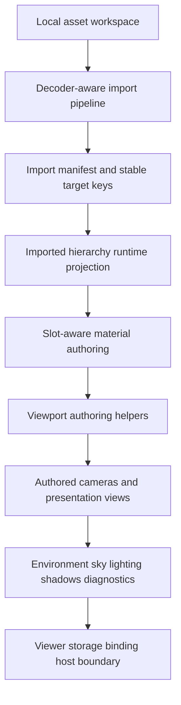
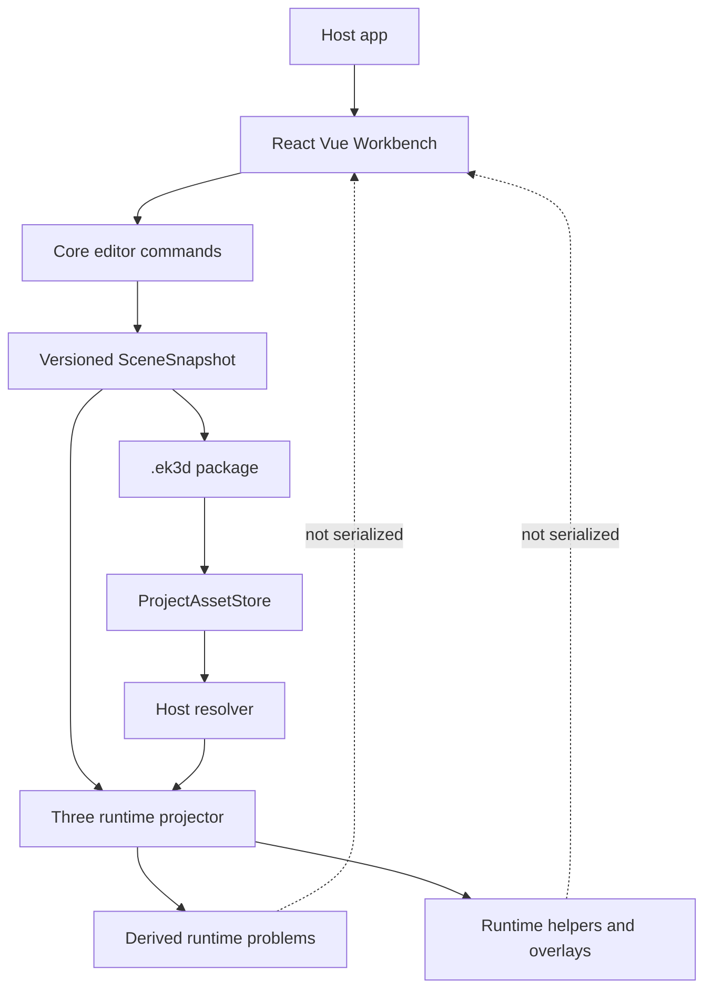

# feat: Build real-user 3D editor delivery roadmap

## Summary

把当前已经成型的 snapshot-first 3D editor 推进到真实用户可交付前的下一阶段：先解决本地资产工作区、decoder-aware GLB 导入、GLB 内部 target 和 material slot；再补齐 viewport authoring helper、authored camera、environment/sky、lighting/shadow 质量；最后定义 viewer、storage adapter 和 AIoT binding target 的宿主交付边界。

这是一份 roadmap + executable plan。它比单功能计划更宽，但每个阶段仍给出明确的 durable contract、runtime projection、React/Vue Workbench、测试场景和验收口径。

---

## Problem Frame

现有实现已经不是空白 MVP：`SceneSnapshot.version = 4`、`SceneNode` / `NodeId` hierarchy、GLB asset reference import、`.ek3d` project package、missing asset replacement、OrbitControls、selection visuals、TransformControls、object-level material override、environment/background/HDR projection、lights、React/Vue default `EditorWorkbench` 都已经落地。

真实用户的阻断点集中在复杂资产和交付质量上。用户不是只导入一个简单 GLB object 后整体移动；他们会拖入带压缩、贴图、多个 mesh 和多个 material slot 的模型，需要知道导入状态、选择局部结构、只改一个材质槽、重新导入后保留编辑、用网格和框选高效摆放、定义打开场景时的相机和视觉质量，并最终把结果嵌入业务应用。

这个计划坚持当前项目身份：版本化 snapshot 是 durable truth，Three.js 对象、`File`、`Blob`、object URL、loaded texture、PMREM output、resolver result、runtime problem 都不能进入 durable JSON。后续能力必须扩展这个 contract，而不是绕过它。

---

## Requirements

### Asset and Import

- R1. Workbench 必须提供本地资产工作区视图，覆盖 GLB/HDR/image/texture 的批量导入、导入状态、搜索/过滤、引用位置、缺失/失败诊断和 project package 完整性。
- R2. GLB 导入管线必须支持 host 配置 Draco、KTX2、Meshopt 等 decoder，并把 loader warning、unsupported extension、embedded material/texture/animation/camera 摘要暴露为 import manifest/problem。
- R3. `.ek3d` project package 仍必须只保存 JSON snapshot 和资产 payload，不保存 resolver 输出、object URL、loaded GLB scene 或 runtime loader result。
- R4. 导入/导出/替换资产必须保持 stable asset ID，不因为 payload 更新而破坏对象、材质、environment 或未来 binding target。

### GLB Targets and Materials

- R5. 用户必须能选择把 GLB 作为单个 object 导入，或展开为可编辑的 imported hierarchy；简单模式保持兼容。
- R6. 展开的 imported node、mesh 和 material slot 必须有 durable stable target key，可用于 selection、transform、inspector、material assignment、problem reporting、reimport remap 和未来 binding target。
- R7. 重新导入或替换 GLB payload 时，系统必须尽量 remap 用户编辑；无法匹配的 target 不得静默删除，必须以 recoverable problem 暴露。
- R8. Material authoring 必须支持 object-level broad override 和 material-slot-level assignment；slot 失效时 durable assignment 保留并显示 unresolved slot problem。
- R9. 第一版 material slot editing 只覆盖当前 `MeshStandardMaterialOverride` 和 texture slots，不实现完整 glTF material graph、shader editor 或 node material。

### Viewport Authoring

- R10. Viewport 必须支持 grid/floor/axes、selection bounds、hover/primary feedback、snap feedback 和 snap controls；这些 helper 是 runtime/UI state，不能自动进入 snapshot。
- R11. Viewport 必须支持 marquee selection 和多选更新，选择结果写入 durable `selection.nodeIds`，矩形/lasso overlay 本身不序列化。
- R12. TransformControls、snap、selection visuals、grid、helper 和 marquee 行为必须在 React/Vue default Workbench 中可触达，且不会和 toolbar/panel/layout 发生文本或控件重叠。

### Cameras and Visual Quality

- R13. OrbitControls editor camera 继续是 transient；只有显式 captured authored camera 或 saved view 才进入 durable state。
- R14. 用户必须能创建 authored camera/view，设置名称、projection/FOV/near/far、target、default viewer view，并支持 align editor view to camera 和 align camera to current view。
- R15. Environment/background/sky authoring 必须清楚区分 lighting source、background source 和 true skybox/cubemap intent，加载失败仍以 runtime problem 暴露。
- R16. Lighting 必须支持基础 presets、light helper gizmos、directional/spot target helper、shadow enablement、shadow camera/mapSize/bias/range controls 和性能/质量 diagnostics。
- R17. Shadows 必须默认保守，尤其对 PointLight shadow 给出成本诊断；不能只加一个 `castShadow` checkbox。

### Host Delivery

- R18. 必须定义 read-only/viewer-only runtime recipe，让宿主能加载 snapshot 或 `.ek3d`、解析资产、使用 default authored camera/view、订阅 runtime problems，并关闭编辑交互。
- R19. 必须定义 storage adapter recipe，说明 host 如何保存 snapshot、保存 `.ek3d` bytes、恢复 ProjectAssetStore、处理缺失资产和 partial package。
- R20. 必须定义最小 AIoT binding target 边界：durable target metadata、host-provided value preview、problem diagnostics 和 command-safe proposal；不实现 MQTT/WebSocket、事件编排或 dashboard runtime。
- R21. Public package surface 必须保持 React/Vue adapters thin：framework packages 订阅、渲染、派发 core command/operation，不拥有 editor semantics。

### Compatibility and Verification

- R22. 任何 durable schema 变更必须包含 migration、validation、serialization tests 和 docs/schema.md 更新。
- R23. Runtime-only helper、loader result、problems 和 browser objects 必须通过 serialization/project package tests 证明不会写入 snapshot 或 `.ek3d` durable JSON。
- R24. React、Vue、vanilla demo/fixture 必须持续覆盖 import asset、select target、transform、undo/redo、material edit、environment/light/camera edit、export、restore 和 missing asset recovery。

---

## Scope Boundaries

### Included in This Roadmap

- Local/session/project-package-first asset workspace，不做云同步账号体系。
- GLB imported hierarchy 的 durable overlay 和 stable target key，不做完整 ECS、prefab/template 或 full glTF editor。
- Material slot-level `MeshStandardMaterialOverride`，不做 shader graph。
- Runtime/UI helper、marquee selection、grid、snap feedback 和 authored camera/view。
- Environment/sky、lighting helper、shadow authoring 和 diagnostics 的基础质量 pass。
- Viewer/storage/binding recipes 和最小 core types，用于宿主集成边界。

### Deferred for Later

- Cloud asset library、model marketplace、权限、多人协作、hosted publishing。
- Animation timeline、clip editor、NLE-style playback authoring。
- Full material graph、variant system、procedural texture/shader editor。
- System clipboard/external paste formats、persisted dockable layout、command palette。
- Full plugin ecosystem、schema-driven inspector plugins、agent editing API。

### Outside This Product Identity for This Stage

- 低代码 runtime platform、MQTT/WebSocket runtime、事件编排、dashboard 发布系统。
- Stable 1.0 API guarantee。该 roadmap 会收敛 public contract，但 GLB target、camera、binding 和 visual quality contract 仍需要实现后验证。

---

## Key Technical Decisions

- KTD1. Asset workspace is local-first. 第一版资产工作区复用 `AssetRegistry`、`ProjectAssetStore`、snapshot asset references 和 Workbench model，不引入云资产库或账号模型。
- KTD2. GLB import returns a manifest, not runtime state. GLB loader 可以解析出 hierarchy/material/texture/camera/animation 摘要和 diagnostics，但 durable snapshot 只保存 JSON-compatible import metadata、asset refs 和 target keys。
- KTD3. Imported GLB internals are durable overlay targets. 不把整个 glTF scene 复制进 snapshot；只保存可编辑 target overlay、stable key、可选 transform/material/binding override 和 remap metadata。
- KTD4. Stable target keys precede material slots and binding. Material slot editing、reimport preservation、problem targeting 和 AIoT binding 都依赖同一 target identity，不能各自发明 ID 体系。
- KTD5. Broad object material override remains a fast path. 现有 object-level assignment 继续可用，但 UI 必须标明它会作用于整个 GLB object；slot assignment 是复杂模型的默认精细路径。
- KTD6. Editor camera remains transient until explicitly captured. Orbit/pan/zoom 不自动写入 snapshot；authored camera/view 是命令创建的 durable target。
- KTD7. Visual helpers are runtime projections. Grid、floor、axes、bounds、hover、marquee rectangle、light helpers、camera helpers 和 shadow helpers 默认不序列化；只有明确的 authored settings 才进入 snapshot。
- KTD8. Host delivery is recipes plus thin contracts first. Viewer mode、storage adapter 和 AIoT binding 先定义 API 边界、docs 和 demo，不实现业务协议或 hosted runtime。
- KTD9. Schema changes are release-sized. 每次 durable contract 扩展都要通过 migration/validation/docs/tests 形成闭环；实现时可以把 imported targets、authored cameras、shadow settings 分阶段 bump，而不是在一个大版本里一次吞下所有 schema work。

---

## High-Level Technical Design





---

## Roadmap Phases

| Phase | Focus | Units | Exit Criteria |
|---|---|---:|---|
| P1 | Asset workspace and decoder import | U1-U3 | 用户能批量导入/查看/过滤资产，GLB import manifest 暴露 decoder/extension/embedded resource diagnostics，project export 明确完整性。 |
| P2 | GLB target identity and reimport | U4-U6 | 展开的 GLB 内部 hierarchy 可选中/变换，stable target key 可 remap，reimport 不静默丢编辑。 |
| P3 | Slot-aware material editing | U7-U8 | 用户能查看 material slots，对单个 slot 设置 `MeshStandardMaterialOverride` 和 texture slot，slot 失效有 recoverable problem。 |
| P4 | Viewport authoring ergonomics | U9-U10 | Grid/floor/axes/bounds/snap/marquee 可用，helper state 不进入 snapshot。 |
| P5 | Cameras and visual quality | U11-U13 | authored camera/view、environment/sky cleanup、light helper/shadow controls/diagnostics 可用。 |
| P6 | Host delivery boundary | U14 | viewer/storage/binding recipes 和最小 types 成型，React/Vue/vanilla 验证可嵌入。 |
| P7 | Acceptance hardening | U15 | release/browser/consumer fixture 覆盖完整真实用户路径。 |

---

## Output Structure

```text
packages/core/src/
  assets/
    workspace.ts
    import-pipeline.ts
    import-remap.ts
  bindings/
    types.ts
    validation.ts
  cameras/
    types.ts
    defaults.ts
    validation.ts
  runtime/
    viewport-helpers.ts
    marquee-selection.ts
    lighting-diagnostics.ts
  viewer/
    viewer-runtime.ts
```

The tree shows the planned new module shape. Existing modules and tests remain listed in each implementation unit because they are the authoritative touch surface for execution.

---

## Implementation Units

### U1. Local asset workspace model

- **Goal:** 在 core 中建立本地资产工作区 view model，把 `AssetRegistry`、`ProjectAssetStore`、snapshot references、runtime/project problems 组合成 Workbench 可渲染的资产视图。
- **Requirements:** R1, R3, R4, R21, R23.
- **Dependencies:** Existing asset registry and project package surface.
- **Files:** `packages/core/src/assets/workspace.ts`, `packages/core/src/assets/workspace.test.ts`, `packages/core/src/assets/registry.ts`, `packages/core/src/project/asset-store.ts`, `packages/core/src/workbench/workbench-model.ts`, `packages/core/src/workbench/workbench-model.test.ts`, `packages/core/src/public-api.ts`, `packages/core/src/index.ts`, `docs/project-package.md`, `docs/schema.md`.
- **Approach:** Add a pure asset workspace model with asset items, import status, reference locations, dependency hints, missing payload status, and searchable/filterable fields. Keep actual bytes/blob/object URLs in `ProjectAssetStore`; the model only carries serializable metadata and problem IDs.
- **Execution note:** Add characterization tests around existing `buildWorkbenchModel()` asset behavior before replacing or extending it.
- **Patterns to follow:** `packages/core/src/workbench/workbench-model.ts`, `packages/core/src/project/asset-store.ts`, `packages/core/src/project/export-project.ts`.
- **Test scenarios:**
  - Given snapshot assets referenced by objects, materials, and environment, when the workspace model is built, then each asset reports reference locations and referenced/unreferenced status.
  - Given ProjectAssetStore has payload for one asset and lacks payload for another, when export completeness is computed, then missing payload status is visible without reading runtime resolver output.
  - Given runtime/project problems target assets, when the workspace model is built, then asset rows include problem IDs, severity, and recoverability.
  - Given a search query and kind filter, when filtering runs, then it matches label, ID, kind, and missing/problem status deterministically.
  - Given workspace model output is serialized with the snapshot, then no `Blob`, `File`, object URL, or byte payload appears in `SceneSnapshot`.
- **Verification:** Asset workspace model is framework-neutral, deterministic, and supports the current Workbench left panel without weakening `.ek3d` durability rules.

### U2. Decoder-aware GLB import pipeline

- **Goal:** Replace "plain GLTFLoader load only" with an import pipeline that can be configured with decoders and can return a structured GLB import manifest.
- **Requirements:** R2, R3, R5, R6, R22, R23.
- **Dependencies:** U1.
- **Files:** `packages/core/src/assets/import-pipeline.ts`, `packages/core/src/assets/import-pipeline.test.ts`, `packages/core/src/runtime/gltf-loader-adapter.ts`, `packages/core/src/runtime/gltf-loader-adapter.test.ts`, `packages/core/src/commands/import-glb.ts`, `packages/core/src/commands/import-glb.test.ts`, `packages/core/src/assets/types.ts`, `packages/core/src/public-api.ts`, `docs/schema.md`, `docs/integration-vanilla.md`, `docs/integration-react.md`, `docs/integration-vue.md`.
- **Approach:** Extend loader options so hosts can provide Draco/KTX2/Meshopt decoder configuration or loader factories. Add an import manifest abstraction that records detected scenes/nodes/meshes/materials/textures/cameras/animations/extensions and loader diagnostics. The manifest feeds later imported target generation, but runtime `Object3D` remains transient.
- **Patterns to follow:** `packages/core/src/runtime/gltf-loader-adapter.ts`, `packages/core/src/assets/resolver.ts`, `packages/core/src/problems/types.ts`.
- **Test scenarios:**
  - Given a host supplies decoder factories, when `ThreeGltfLoaderAdapter` is created, then the underlying GLTFLoader receives the configured Draco/KTX2/Meshopt integrations.
  - Given a GLB with embedded materials/textures/cameras/animations, when import manifest extraction runs, then the manifest reports counts and stable source descriptors without storing Three.js objects.
  - Given unsupported extensions or loader warnings are detected, when import completes, then structured import problems are returned and can be shown in Workbench.
  - Given a non-GLB asset is passed to import, when the command runs, then it rejects before registering invalid asset input.
  - Given an import result is serialized, then no loaded scene, parser, texture, image bitmap, or decoder object appears in durable JSON.
- **Verification:** Hosts can configure decoders through public core options, and import diagnostics are visible before GLB internals become editable.

### U3. Workbench asset workspace UI

- **Goal:** Expose the asset workspace in React/Vue default Workbench with batch import controls, status, search/filter, reference display, missing asset recovery, and project package completeness.
- **Requirements:** R1, R3, R4, R12, R21, R24.
- **Dependencies:** U1, U2.
- **Files:** `packages/react/src/components/WorkbenchLeftPanel.tsx`, `packages/react/src/components/workbench.css`, `packages/react/test/workbench.test.tsx`, `packages/react/test/default-workbench.browser.test.tsx`, `packages/vue/src/components/WorkbenchLeftPanel.vue`, `packages/vue/src/components/workbench.css`, `packages/vue/test/workbench.test.ts`, `packages/vue/test/default-workbench.browser.test.ts`, `docs/integration-react.md`, `docs/integration-vue.md`.
- **Approach:** Keep React/Vue as renderers over the core workspace model. File input/drop handling can create transient `File`/`Blob` values only long enough to call core project/asset APIs. Asset thumbnails/previews are runtime UI concerns; durable state stores only asset reference metadata and payloads in project package paths.
- **Patterns to follow:** Existing `WorkbenchLeftPanel`, `ProblemsPanel`, `replaceAsset()` flow in React/Vue tests.
- **Test scenarios:**
  - Given multiple GLB/HDR/image files are selected, when batch import starts, then Workbench shows queued/importing/succeeded/failed states and creates asset references through core APIs.
  - Given a search/filter is entered, when asset rows render, then React and Vue show equivalent filtered results.
  - Given a missing GLB payload problem, when the user chooses a replacement file, then the stable asset ID is preserved and runtime problem clears after projection.
  - Given an unreferenced asset, when the asset panel renders, then it is visible but marked unreferenced rather than removed from the project.
  - Given `.ek3d` export is partial, when the status area renders, then completeness and project problems are visible.
- **Verification:** A no-customization Workbench can handle realistic asset import/recovery without host-written panels.

### U4. Imported GLB target schema

- **Goal:** Add durable imported target identity so GLB internals can participate in hierarchy, selection, transform, material assignment, problems, and future binding.
- **Requirements:** R5, R6, R7, R20, R22.
- **Dependencies:** U2.
- **Files:** `packages/core/src/snapshot/types.ts`, `packages/core/src/snapshot/defaults.ts`, `packages/core/src/snapshot/migrations.ts`, `packages/core/src/snapshot/validation.ts`, `packages/core/src/snapshot/nodes.ts`, `packages/core/src/snapshot/snapshot.test.ts`, `packages/core/src/commands/node-state.ts`, `packages/core/src/commands/node-mutation-commands.test.ts`, `docs/schema.md`, `docs/architecture.md`.
- **Approach:** Introduce a schema extension for imported GLB overlay nodes/targets owned by a parent GLB object. A target stores owner object ID, stable import key, source kind, display name, parent/child relationship, optional transform override, and metadata needed for remap. Preserve object-level import as the default/simple path.
- **Execution note:** Start with failing migration/validation tests. This unit changes durable contract and must not be implemented only through runtime `userData`.
- **Patterns to follow:** v4 `SceneNode` migration, `syncPayloadsFromNodes()`, `validateSceneSnapshot()`.
- **Test scenarios:**
  - Given a v4 snapshot, when migration runs, then existing GLB object/group/light nodes remain valid and no imported targets are invented.
  - Given an expanded GLB import manifest, when imported targets are created, then stable keys are deterministic across repeated imports of the same file.
  - Given imported target metadata is invalid or non-JSON-compatible, when validation runs, then the snapshot is rejected.
  - Given an imported child has transform override, when node-state sync runs, then compatibility object/light payloads are not polluted with imported child data.
  - Given object-level import mode is selected, when snapshot is serialized, then it remains compatible with existing object node behavior.
- **Verification:** Durable snapshot has a clear place for imported GLB internals without copying runtime scene graphs.

### U5. Runtime projection and picking for imported targets

- **Goal:** Project expanded imported targets into runtime target maps so pointer selection, hierarchy selection, selection visuals, TransformControls, and inspector targeting work on GLB internals.
- **Requirements:** R5, R6, R10, R11, R21, R23.
- **Dependencies:** U4.
- **Files:** `packages/core/src/runtime/scene-projector.ts`, `packages/core/src/runtime/three-object-map.ts`, `packages/core/src/runtime/picking.ts`, `packages/core/src/runtime/selection-visuals.ts`, `packages/core/src/runtime/transform/transform-controller.ts`, `packages/core/src/runtime/scene-projector.test.ts`, `packages/core/src/runtime/picking.browser.test.ts`, `packages/core/src/runtime/editor-runtime.test.ts`, `packages/core/src/runtime/disposal.test.ts`.
- **Approach:** During GLB runtime projection, link matching loaded `Object3D`/mesh instances to imported target node IDs using the stable keys from the manifest. Apply transform overrides to the matching imported runtime object, not the whole owner object. If a target is missing, keep the durable node and emit a runtime problem.
- **Patterns to follow:** Current `SceneProjector` object/light node projection, `ThreeObjectMap.link()`, `ObjectPicker.pickNodeFromClientPoint()`.
- **Test scenarios:**
  - Given an expanded GLB with imported mesh targets, when runtime projects, then `getNodeTarget()` returns the imported runtime target for each matched node.
  - Given pointer selection hits a GLB child mesh, when picking runs, then the imported target node becomes selected instead of the parent object.
  - Given a transform is committed on an imported target, when projection reruns, then only that target's runtime transform changes.
  - Given a GLB target no longer exists in the loaded scene, when projection runs, then a runtime problem targets the imported node and the durable node remains.
  - Given an imported target is removed from snapshot, when projection reruns, then linked runtime resources and projection records are released.
- **Verification:** Imported GLB internals behave like first-class editor targets while runtime-only links remain transient.

### U6. GLB reimport and target remap

- **Goal:** Provide a safe reimport/replace flow that remaps existing imported targets, material assignments, camera references, and future binding metadata when a GLB payload changes.
- **Requirements:** R4, R6, R7, R8, R20, R22.
- **Dependencies:** U4, U5.
- **Files:** `packages/core/src/assets/import-remap.ts`, `packages/core/src/assets/import-remap.test.ts`, `packages/core/src/commands/reimport-glb.ts`, `packages/core/src/commands/reimport-glb.test.ts`, `packages/core/src/commands/types.ts`, `packages/core/src/commands/dispatcher.ts`, `packages/core/src/project/replace-asset.ts`, `packages/core/src/project/replace-asset.test.ts`, `packages/core/src/problems/types.ts`, `docs/interactions.md`.
- **Approach:** Add a reimport command that compares previous import manifest/target keys with the new manifest. Prefer exact stable key matches, then fallback to source path/name/mesh/material relationship. Preserve unresolved edits as recoverable problems instead of deleting them.
- **Patterns to follow:** `replaceAsset()` stable asset ID behavior, problem recoverability conventions, material assignment ID creation.
- **Test scenarios:**
  - Given a GLB is reimported with unchanged hierarchy, when remap runs, then imported target node IDs and material assignments remain stable.
  - Given a mesh is renamed but parent/path relationship is unchanged, when remap fallback succeeds, then edits move to the new target key and a warning records the remap.
  - Given a target cannot be matched, when reimport completes, then transform/material/binding edits remain durable and an unresolved target problem is shown.
  - Given asset payload is replaced but object asset ID is stable, when project export runs, then the package contains the new payload and the same snapshot references.
  - Given reimport fails loader validation, when command returns, then previous durable state remains unchanged.
- **Verification:** Reimport is non-destructive and recoverable enough for real model iteration.

### U7. Slot-aware material assignment in core and runtime

- **Goal:** Implement material slot discovery and projection so assignments can target a specific imported material slot instead of the whole GLB object.
- **Requirements:** R6, R8, R9, R22, R23.
- **Dependencies:** U4, U5, U6.
- **Files:** `packages/core/src/materials/types.ts`, `packages/core/src/materials/defaults.ts`, `packages/core/src/materials/validation.ts`, `packages/core/src/materials/materials.test.ts`, `packages/core/src/commands/set-material.ts`, `packages/core/src/commands/set-material.test.ts`, `packages/core/src/runtime/material-projector.ts`, `packages/core/src/runtime/material-projector.test.ts`, `packages/core/src/runtime/material-resource-manager.ts`, `docs/schema.md`, `docs/interactions.md`.
- **Approach:** Use the existing `MaterialAssignmentTarget` shape as the public direction, but validate slot existence against imported target metadata when available. Runtime projection should clone and override only matched `MeshStandardMaterial` slots, release old clones, and keep texture loading failures as runtime problems.
- **Execution note:** Preserve object-level material tests before adding slot tests, because broad override remains valid behavior.
- **Patterns to follow:** `createMaterialAssignmentId()`, current object-level `MaterialProjector.project()`, texture resource manager disposal.
- **Test scenarios:**
  - Given a GLB object has three material slots, when a slot assignment is applied, then only meshes/material indices mapped to that slot receive the override.
  - Given an object-level assignment and a slot-level assignment both exist, when projection runs, then slot-level assignment overrides the broad assignment for that slot only.
  - Given a slot references a texture asset that cannot resolve, when projection runs, then the material assignment remains durable and a texture-slot runtime problem appears.
  - Given a slot no longer exists after reimport, when validation/projection runs, then the assignment is retained and flagged unresolved.
  - Given a material clone is replaced or unassigned, when projection reruns/disposes, then cloned materials and textures are released.
- **Verification:** Users can edit one material slot on a complex model without recoloring the entire object.

### U8. Material slot inspector in React and Vue

- **Goal:** Make slot-aware material editing understandable and reachable in the default inspector.
- **Requirements:** R8, R9, R12, R21, R24.
- **Dependencies:** U7.
- **Files:** `packages/core/src/inspector/material.ts`, `packages/core/src/inspector/material.test.ts`, `packages/core/src/inspector/types.ts`, `packages/react/src/components/MaterialInspector.tsx`, `packages/react/test/inspector.test.tsx`, `packages/react/test/default-workbench.browser.test.tsx`, `packages/vue/src/components/MaterialInspector.vue`, `packages/vue/test/inspector.test.ts`, `packages/vue/test/default-workbench.browser.test.ts`, `docs/integration-react.md`, `docs/integration-vue.md`.
- **Approach:** Extend inspector model with selected target material context, slot list, unresolved slot state, and broad-vs-slot assignment affordance. React/Vue render slot controls from the same core model and dispatch `set-material` commands only.
- **Patterns to follow:** Existing transform/material/environment/light inspector command builders.
- **Test scenarios:**
  - Given an object target is selected, when material inspector renders, then it exposes broad object override and available slot targets.
  - Given an imported mesh/slot target is selected, when material fields are edited, then the dispatched command targets the material slot.
  - Given a slot is unresolved after reimport, when inspector renders, then the user sees the unresolved state and existing durable override values.
  - Given React and Vue render the same snapshot, when slot list is inspected, then ordering, active state, and disabled state are equivalent.
  - Given invalid numeric/color/texture input is entered, when command builder runs, then controlled inspector problems are returned without snapshot mutation.
- **Verification:** Slot editing is not hidden behind low-level IDs and stays framework-equivalent.

### U9. Runtime viewport helpers and snap feedback

- **Goal:** Add grid/floor/axes, selection bounds, hover/primary feedback, and visible snap feedback as runtime/UI helpers.
- **Requirements:** R10, R12, R13, R21, R23.
- **Dependencies:** U5.
- **Files:** `packages/core/src/runtime/viewport-helpers.ts`, `packages/core/src/runtime/viewport-helpers.test.ts`, `packages/core/src/runtime/editor-runtime.ts`, `packages/core/src/runtime/viewport-controls.ts`, `packages/core/src/runtime/selection-visuals.ts`, `packages/core/src/runtime/viewport-controls.test.ts`, `packages/react/src/components/EditorViewport.tsx`, `packages/react/src/components/WorkbenchToolbar.tsx`, `packages/react/test/editor-viewport.test.tsx`, `packages/vue/src/components/EditorViewport.vue`, `packages/vue/src/components/WorkbenchToolbar.vue`, `packages/vue/test/editor-viewport.test.ts`, `docs/interactions.md`.
- **Approach:** Add helper lifecycle management beside selection visuals, not inside snapshot. Workbench controls toggle helper visibility and snap increments through editor/runtime interaction state. Serialize only committed transforms and existing snap settings if those already belong to editor state.
- **Patterns to follow:** `RuntimeSelectionVisuals`, interaction options normalization, Workbench toolbar snap controls.
- **Test scenarios:**
  - Given helpers are enabled, when runtime mounts, then grid/floor/axes and selection bounds are added and later disposed.
  - Given helpers are toggled off, when snapshot serializes, then helper visibility does not appear in `SceneSnapshot`.
  - Given snap is enabled, when TransformControls moves a target, then snap feedback is visible and committed transform uses snapped values.
  - Given an imported target is selected, when bounds helper syncs, then bounds reflect that target rather than the full parent object.
  - Given React/Vue Workbench toolbar toggles helpers, when DOM state updates, then controls remain stable in desktop and narrow viewport layouts.
- **Verification:** Spatial authoring improves without contaminating durable scene JSON.

### U10. Marquee selection

- **Goal:** Support box/marquee selection for node and imported target multi-select while keeping overlay state transient.
- **Requirements:** R10, R11, R12, R23, R24.
- **Dependencies:** U5, U9.
- **Files:** `packages/core/src/runtime/marquee-selection.ts`, `packages/core/src/runtime/marquee-selection.test.ts`, `packages/core/src/runtime/editor-runtime.ts`, `packages/core/src/runtime/picking.ts`, `packages/core/src/runtime/picking.browser.test.ts`, `packages/core/src/commands/select-node.test.ts`, `packages/react/src/components/EditorViewport.tsx`, `packages/react/test/default-workbench.browser.test.tsx`, `packages/vue/src/components/EditorViewport.vue`, `packages/vue/test/default-workbench.browser.test.ts`, `docs/interactions.md`.
- **Approach:** Add a runtime selection box path that projects visible pickable targets into a screen-space/frustum selection and dispatches existing `select-nodes` modes. React/Vue own only the visual rectangle overlay and pointer lifecycle around runtime APIs.
- **Patterns to follow:** `ObjectPicker`, `resolvePointerSelectionMode()`, existing multi-select commands.
- **Test scenarios:**
  - Given multiple visible nodes are inside the marquee rectangle, when selection completes, then `selection.nodeIds` contains those targets with the expected primary node.
  - Given shift/ctrl/meta/alt modifiers are held, when marquee selection completes, then add/toggle/remove modes match click selection semantics.
  - Given helper/grid objects are visible, when marquee selection runs, then runtime-only helpers are not selected.
  - Given an imported target and parent object overlap, when the target is inside the marquee, then selection uses the most specific mapped target.
  - Given snapshot/project export runs after marquee selection, then the transient rectangle overlay is absent from durable JSON.
- **Verification:** Users can select real scenes efficiently without a new selection state model.

### U11. Authored cameras and presentation views

- **Goal:** Add durable authored camera/view model while preserving transient editor navigation.
- **Requirements:** R13, R14, R18, R22, R23.
- **Dependencies:** U4, U9.
- **Files:** `packages/core/src/cameras/types.ts`, `packages/core/src/cameras/defaults.ts`, `packages/core/src/cameras/validation.ts`, `packages/core/src/cameras/cameras.test.ts`, `packages/core/src/commands/camera-commands.ts`, `packages/core/src/commands/camera-commands.test.ts`, `packages/core/src/snapshot/types.ts`, `packages/core/src/snapshot/migrations.ts`, `packages/core/src/runtime/editor-runtime.ts`, `packages/core/src/runtime/viewport-controls.ts`, `packages/core/src/inspector/cameras.ts`, `packages/core/src/inspector/cameras.test.ts`, `docs/schema.md`, `docs/interactions.md`.
- **Approach:** Add authored camera/view definitions with transform/target/projection/FOV/near/far/name/default marker. Runtime exposes capture/apply helpers: align camera to current editor view and align editor view to authored camera. Regular OrbitControls changes remain transient.
- **Execution note:** Tests must distinguish "editor camera moved" from "authored camera captured"; this boundary is easy to blur.
- **Patterns to follow:** Light node command/inspector pattern, current `resetCameraView()` and `frameCameraToObjects()`.
- **Test scenarios:**
  - Given the editor camera is orbited, when snapshot serializes without capture, then camera/control state is unchanged.
  - Given current editor view is captured, when snapshot serializes, then an authored camera/view definition is durable and JSON-compatible.
  - Given align editor view to authored camera is invoked, when runtime updates, then the transient editor camera matches the authored view without mutating snapshot.
  - Given align authored camera to editor view is invoked, when command dispatches, then only the authored camera definition changes.
  - Given default viewer camera is set, when viewer recipe loads the scene, then it uses that authored view if present.
- **Verification:** Scene presentation becomes durable only through explicit authored camera commands.

### U12. Environment skybox and background cleanup

- **Goal:** Clarify environment lighting source, background source, skybox/cubemap intent, presets, and diagnostics on top of the existing environment projector.
- **Requirements:** R15, R16, R22, R23.
- **Dependencies:** U1, U11.
- **Files:** `packages/core/src/environment/types.ts`, `packages/core/src/environment/defaults.ts`, `packages/core/src/environment/validation.ts`, `packages/core/src/commands/set-environment.ts`, `packages/core/src/commands/set-environment.test.ts`, `packages/core/src/runtime/environment-projector.ts`, `packages/core/src/runtime/environment-projector.test.ts`, `packages/core/src/runtime/environment-resource-manager.ts`, `packages/core/src/inspector/environment.ts`, `packages/core/src/inspector/environment.test.ts`, `packages/react/src/components/EnvironmentInspector.tsx`, `packages/vue/src/components/EnvironmentInspector.vue`, `docs/schema.md`, `docs/interactions.md`.
- **Approach:** Preserve existing HDR/image background behavior, but make the durable model clearer about lighting environment versus visible background versus skybox/cubemap. Add small presets that set environment/background/light defaults through commands, not renderer side effects.
- **Patterns to follow:** Current `SceneEnvironment`, `EnvironmentProjector`, PMREM problem handling.
- **Test scenarios:**
  - Given a lighting HDR and separate background image, when projection runs, then environment lighting and visible background resolve independently.
  - Given a cubemap/skybox intent is authored, when validation runs, then required asset kinds and face/source metadata are checked.
  - Given PMREM or background texture loading fails, when runtime problems publish, then durable environment fields remain unchanged.
  - Given a preset is applied, when command history is inspected, then it creates durable environment/light settings through normal commands.
  - Given snapshot serializes after projection, then texture, PMREM output, image bitmap, and object URL are absent.
- **Verification:** Users can reason about "what lights the model" versus "what is visible behind it" without runtime leakage.

### U13. Lighting helpers shadows and diagnostics

- **Goal:** Make lighting practical for real scenes by adding helper gizmos, shadow settings, and quality/performance diagnostics.
- **Requirements:** R16, R17, R22, R23, R24.
- **Dependencies:** U5, U9, U12.
- **Files:** `packages/core/src/lights/types.ts`, `packages/core/src/lights/defaults.ts`, `packages/core/src/lights/validation.ts`, `packages/core/src/lights/lights.test.ts`, `packages/core/src/commands/update-light.ts`, `packages/core/src/commands/light-commands.test.ts`, `packages/core/src/runtime/light-projector.ts`, `packages/core/src/runtime/light-projector.test.ts`, `packages/core/src/runtime/lighting-diagnostics.ts`, `packages/core/src/runtime/lighting-diagnostics.test.ts`, `packages/core/src/inspector/lights.ts`, `packages/core/src/inspector/lights.test.ts`, `packages/react/src/components/LightInspector.tsx`, `packages/vue/src/components/LightInspector.vue`, `docs/schema.md`, `docs/interactions.md`.
- **Approach:** Extend light definitions with conservative shadow authoring fields for shadow-capable lights, plus runtime helper visibility. Runtime configures renderer shadow map only when needed, projects light/camera helpers as transient objects, and emits diagnostics for expensive or low-quality shadow settings.
- **Patterns to follow:** Current light definitions and `LightProjector`, problem model, runtime helper disposal.
- **Test scenarios:**
  - Given a directional light shadow is enabled, when projection runs, then runtime light casts shadow and helper/diagnostic state is available without helper serialization.
  - Given a PointLight shadow is enabled, when diagnostics run, then a performance warning explains the higher render cost.
  - Given shadow map size is too large or shadow camera range is too broad, when diagnostics run, then quality/performance problems target the light.
  - Given a light helper is toggled, when snapshot serializes, then helper object state is absent.
  - Given React/Vue light inspector edits shadow fields, when commands dispatch, then validation clamps/rejects invalid values before runtime projection.
- **Verification:** Shadows and helpers are useful but bounded, with explicit diagnostics for cost and quality.

### U14. Host viewer storage and AIoT binding boundary

- **Goal:** Define the host delivery boundary so applications can save, restore, embed, and begin associating business data with scene targets.
- **Requirements:** R18, R19, R20, R21, R23, R24.
- **Dependencies:** U4, U6, U11, U13.
- **Files:** `packages/core/src/viewer/viewer-runtime.ts`, `packages/core/src/viewer/viewer-runtime.test.ts`, `packages/core/src/bindings/types.ts`, `packages/core/src/bindings/validation.ts`, `packages/core/src/bindings/bindings.test.ts`, `packages/core/src/problems/types.ts`, `packages/core/src/public-api.ts`, `examples/vanilla-proof-loop/src/main.ts`, `docs/integration-vanilla.md`, `docs/integration-react.md`, `docs/integration-vue.md`, `docs/project-package.md`, `docs/architecture.md`, `README.md`.
- **Approach:** Add a read-only/viewer recipe or thin runtime option that disables editor interaction while preserving projection, default authored camera/view, asset resolution, and runtime problem subscription. Add binding target metadata types that reference node/imported/material/camera/light targets and allow host-provided preview values and diagnostics. Do not implement data protocol clients.
- **Patterns to follow:** Current runtime interaction options, project import/export APIs, problem recoverability, public API export tests.
- **Test scenarios:**
  - Given a `.ek3d` package with assets and a default authored camera, when viewer recipe loads it, then assets resolve and the initial view uses the default camera.
  - Given viewer mode is active, when pointer/transform interactions are attempted, then durable selection/transform commands are not dispatched.
  - Given a host storage adapter saves package bytes and later restores them, when import runs, then ProjectAssetStore and snapshot references rehydrate without object URLs in JSON.
  - Given a binding targets an imported node and host preview value is supplied, when validation runs, then target identity and value metadata are JSON-compatible.
  - Given a binding target is unresolved after reimport, when diagnostics run, then a binding problem is surfaced without deleting binding metadata.
- **Verification:** Host apps get a documented embed/save/restore/binding boundary without prematurely becoming an IoT runtime platform.

### U15. Real-user acceptance hardening

- **Goal:** Add cross-package verification that exercises the full user path across core, React, Vue, vanilla, project package, and browser runtime.
- **Requirements:** R1-R24.
- **Dependencies:** U1-U14.
- **Files:** `packages/core/src/public-api.test.ts`, `packages/react/src/public-api.test.ts`, `packages/vue/src/public-api.test.ts`, `packages/react/test/react-proof-loop.integration.test.tsx`, `packages/vue/test/vue-proof-loop.integration.test.ts`, `packages/react/test/default-workbench.browser.test.tsx`, `packages/vue/test/default-workbench.browser.test.ts`, `packages/react/test/proof-loop-demo.browser.test.tsx`, `packages/core/src/runtime/picking.browser.test.ts`, `vitest.browser.config.ts`, `scripts/verify-release.mjs`, `docs/release.md`, `README.md`.
- **Approach:** Convert the roadmap into an acceptance matrix: local asset import, decoder manifest, expanded GLB hierarchy, slot material edit, grid/marquee/snap, authored camera, environment/sky, shadow diagnostics, viewer restore, storage recipe, and binding target validation. Browser tests should assert behavior and layout geometry rather than fragile pixel-perfect WebGL output.
- **Execution note:** Browser coverage should use small deterministic fixtures and avoid network-loaded assets.
- **Patterns to follow:** Existing `test:browser`, `release:verify`, React/Vue proof-loop parity tests.
- **Test scenarios:**
  - Given a packed React/Vue consumer fixture imports package root and CSS subpath, when Vite builds, then `EditorWorkbench` renders the full default editor.
  - Given a complex GLB fixture is imported expanded, when the user selects a child mesh, transforms it, edits a material slot, exports and restores, then all durable edits survive.
  - Given the model payload is reimported with a changed hierarchy, when remap runs, then matched edits survive and unmatched targets show recoverable problems.
  - Given helper/grid/marquee/camera navigation occurs before export, when `.ek3d` is inspected, then transient helper and editor camera state are absent.
  - Given viewer mode loads the exported project, when interaction attempts run, then scene displays with default camera but editing commands are blocked.
- **Verification:** A realistic end-to-end flow can be run before claiming readiness for external beta users.

---

## Acceptance Examples

- AE1. Given a user drags a compressed GLB with embedded textures into the Workbench, when import completes, then the asset workspace shows the GLB, derived import manifest, decoder/extension diagnostics, and project package completeness without serializing loader runtime objects.
- AE2. Given a user imports a GLB as expanded hierarchy, when they select a child mesh from viewport or hierarchy and transform it, then only that imported target changes and the edit survives serialize/restore.
- AE3. Given a user changes one material slot on a model, when runtime projection updates, then only that slot changes; when the GLB is reimported with the slot removed, the assignment remains durable and an unresolved slot problem appears.
- AE4. Given a user enables grid, axes, snap feedback, marquee selection, and camera orbiting, when they export `.ek3d`, then helper overlays and editor camera navigation are not present in durable JSON.
- AE5. Given a user captures an authored camera and sets it as default viewer view, when a host viewer loads the project, then the scene opens from that camera without enabling editor interactions.
- AE6. Given a user enables shadows on several lights, when diagnostics run, then expensive PointLight shadows and overly broad shadow cameras are surfaced as runtime/quality problems.
- AE7. Given a host attaches AIoT preview metadata to an imported target, when the GLB is reimported and the target remaps, then binding metadata follows the remapped target; if it cannot remap, a binding problem is shown and metadata is not deleted.

---

## System-Wide Impact

- **Snapshot compatibility:** Imported targets, authored cameras, environment cleanup, shadow settings, and binding targets are durable schema work. Each landed slice needs explicit migrations and validation.
- **Public API:** Core public exports will grow around asset workspace, import pipeline, cameras, viewer, and binding metadata. React/Vue should expose behavior through existing Workbench/headless surfaces, not new editor semantics.
- **Runtime disposal:** Import manifests, material clones, helper objects, shadow resources, object URLs, PMREM outputs, and texture loaders create more lifecycle risk. Disposal and projection-generation tests must stay part of every runtime unit.
- **Performance:** Expanded GLB target mapping, marquee selection, material slot projection, and shadows can become expensive on complex scenes. Diagnostics and conservative defaults are part of the product, not optional polish.
- **Docs and examples:** Integration docs must keep warning hosts not to persist runtime-only values, especially once asset workspace and viewer recipes make persistence workflows more visible.

---

## Risks and Dependencies

| Risk | Impact | Mitigation |
|---|---|---|
| Stable imported target keys are too fragile | Reimport loses user edits or binding metadata | Generate deterministic keys from manifest data, keep fallback remap, and surface unresolved problems instead of deleting edits. |
| Decoder setup leaks into public adapter internals | Host integration becomes brittle | Expose loader/decoder configuration at core boundary and keep Three.js-specific objects transient. |
| Asset workspace expands into cloud library | Scope and API sprawl | Keep first version local/session/project-package only; defer accounts, CDN, marketplace and permissions. |
| Slot material projection mishandles shared materials | Visual bugs and disposal leaks | Clone only owned projected materials, track source material, and add release/disposal tests. |
| Shadows degrade performance | User scenes become slow or misleading | Conservative defaults, helper visualization, map/range controls, and runtime diagnostics before advanced shadow features. |
| Authored camera blurs with editor camera | Snapshot fills with navigation noise | Require explicit capture/update commands and test that orbiting alone does not mutate snapshot. |
| Binding target model overreaches into IoT runtime | Product drifts into low-code platform | Limit binding to metadata, preview values, validation and diagnostics; leave protocols to host apps. |

---

## Documentation and Operational Notes

- Update `README.md` to describe the new beta-readiness path only after U15 acceptance coverage is green.
- Keep `docs/schema.md` as the authoritative durable contract for every schema extension.
- Keep `docs/project-package.md` explicit that `.ek3d` packages contain JSON and payload entries, not runtime resolver output.
- Update `docs/integration-react.md`, `docs/integration-vue.md`, and `docs/integration-vanilla.md` with Workbench, headless, viewer, storage, and binding recipes.
- Update `docs/release.md` so release verification includes packed package consumption, CSS subpath import, browser smoke, and full project restore evidence.

---

## Sources and Research

- Origin ideation: `docs/ideation/2026-06-05-real-user-3d-editor-delivery-readiness-ideation.md`.
- Existing contracts: `README.md`, `docs/schema.md`, `docs/architecture.md`, `docs/interactions.md`, `docs/project-package.md`, `docs/release.md`.
- Core code references: `packages/core/src/snapshot/types.ts`, `packages/core/src/commands/import-glb.ts`, `packages/core/src/runtime/gltf-loader-adapter.ts`, `packages/core/src/runtime/scene-projector.ts`, `packages/core/src/runtime/material-projector.ts`, `packages/core/src/workbench/workbench-model.ts`, `packages/core/src/project/asset-store.ts`.
- Three.js GLTFLoader docs: https://threejs.org/docs/pages/GLTFLoader.html.
- Three.js GridHelper docs: https://threejs.org/docs/pages/GridHelper.html.
- Three.js SelectionBox docs: https://threejs.org/docs/pages/SelectionBox.html.
- Three.js SelectionHelper docs: https://threejs.org/docs/pages/SelectionHelper.html.
- Three.js BoxHelper docs: https://threejs.org/docs/pages/BoxHelper.html.
- Three.js DirectionalLightHelper docs: https://threejs.org/docs/pages/DirectionalLightHelper.html.
- Three.js shadows manual: https://threejs.org/manual/en/shadows.html.
- PlayCanvas Assets Panel: https://developer.playcanvas.com/user-manual/editor/assets/asset-panel/.
- PlayCanvas Import Hierarchy: https://developer.playcanvas.com/user-manual/editor/assets/import-pipeline/import-hierarchy/.
- Unity Cameras manual: https://docs.unity3d.com/ru/2021.1/Manual/CamerasOverview.html.
