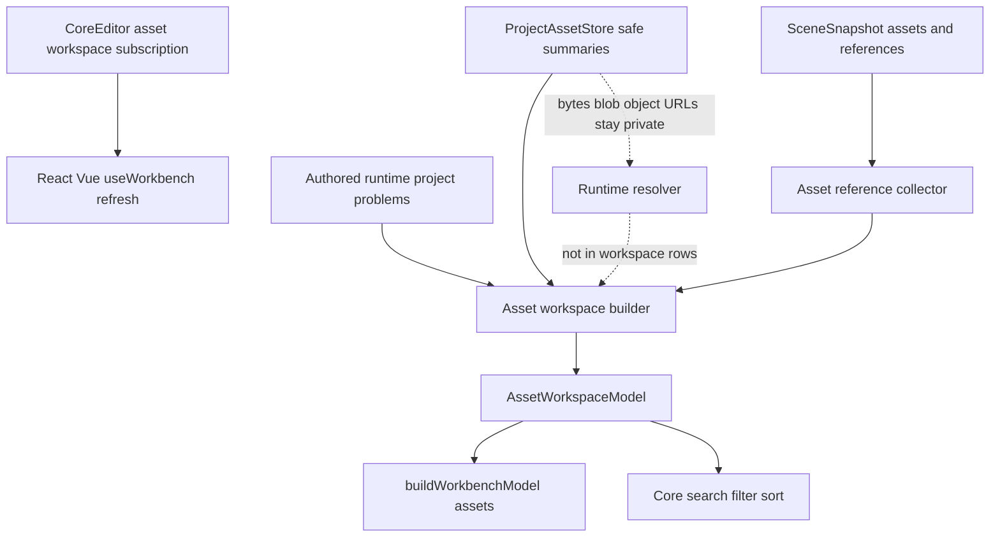

# feat: Add local asset workspace model

## Summary

Detail roadmap U1 into an implementation-ready core plan: add a framework-neutral local asset workspace model that combines durable `SceneSnapshot.assets`, project package payload availability, reference locations, workspace status, and asset-targeted problems into a deterministic view for the default Workbench.

The plan intentionally stops at the model and core integration layer. React/Vue asset panel controls, batch file input UX, thumbnails, and visual layout are consumer constraints here and remain follow-up UI work in the roadmap's asset workspace UI slice.

---

## Problem Frame

The current Workbench already derives a thin `model.assets` list from `snapshot.assets` plus authored/runtime/project problems. That is enough to show registered assets and missing-asset recovery, but it is not yet a real asset workspace surface. It cannot tell a user which scene fields reference an asset, whether a payload is present in `ProjectAssetStore`, whether a `.ek3d` export would be complete, which assets are unreferenced, or how to filter by asset kind/problem/payload status without each framework shell inventing its own logic.

This work must keep the existing snapshot-first contract intact. The workspace model is a serializable projection over durable asset references and transient project-store summaries; it must not turn `ProjectAssetStore` bytes, `Blob`, object URLs, host resolver output, loaded Three.js resources, or runtime problems into durable scene JSON.

---

## Requirements

**Workspace Model**

- R1. Core must expose a pure local asset workspace model with one item per known asset, deterministic ordering, user-facing labels, asset kind, durable metadata summary, reference summary, payload summary, problem summary, and workspace status.
- R2. The model must distinguish asset registry/snapshot presence, referenced/unreferenced status, available/missing payload status, package completeness impact, and recoverability without requiring React/Vue to inspect raw snapshot internals.
- R3. Reference locations must identify where each asset is used across GLB objects, material texture slots, environment background, and environment lighting source using stable JSON-compatible descriptors.
- R4. Search, filtering, and sorting must live in core so React/Vue/vanilla consumers get equivalent asset workspace behavior.

**Project Asset and Problem Boundaries**

- R5. The workspace may read `ProjectAssetStore` summaries such as payload presence, byte size, MIME type, checksum, and metadata, but it must not expose `bytes`, `Blob`, object URLs, or resolver output through the model.
- R6. Runtime, authored, and project problems that target assets must be attached to asset rows with problem IDs, severity, recoverability, display text, and replacement affordance metadata.
- R7. Replacing or importing project assets must be observable by Workbench model consumers even when the durable snapshot does not change.
- R8. Export completeness and partial package state must be computable from the same workspace data rather than a second asset graph.

**Integration, Compatibility, and Documentation**

- R9. `buildWorkbenchModel()` must use the workspace model as its asset source while preserving existing `WorkbenchAssetModel` compatibility where practical.
- R10. The public package root must export the new asset workspace types and builders without exporting internal runtime projectors, archive adapters, or raw store internals.
- R11. Documentation must describe local asset workspace semantics, reference locations, payload availability, and the durable/transient boundary for `.ek3d`.
- R12. Tests must prove that workspace output is deterministic, framework-neutral, and serialization-safe.

---

## Scope Boundaries

### Included

- Core asset workspace types, builders, filters, sorters, and reference collectors.
- Read-only project asset payload summaries needed by the workspace model.
- Asset/workspace change notification at the editor boundary so payload-only changes can refresh framework hooks.
- `buildWorkbenchModel()` integration and compatibility mapping for existing Workbench asset fields.
- Public API exports, docs, and focused unit tests.

### Deferred to Follow-Up Work

- React/Vue visual asset workspace panel, batch import controls, drag/drop, thumbnails, and responsive panel layout.
- Decoder-aware GLB import manifests, import queues, loader warnings, unsupported extension diagnostics, and Draco/KTX2/Meshopt configuration.
- Imported GLB hierarchy targets, material slot editing, and GLB reimport/remap.
- Persisted workspace layout, cloud asset libraries, accounts, permissions, CDN upload, marketplace, or hosted publishing.

### Outside This Product Identity for This Stage

- Serializing project asset payloads, `File`, `Blob`, object URLs, resolver outputs, loaded textures, PMREM outputs, or Three.js objects into `SceneSnapshot`.
- Treating the asset workspace as an external DAM or cloud library. It is a local/session/project-package authoring projection.

---

## Key Technical Decisions

- KTD1. Workspace is a selector, not a second asset graph: The durable source of truth remains `SceneSnapshot.assets` plus asset references in object/material/environment state. The workspace model derives rows and reference locations from that state instead of duplicating relationships.
- KTD2. Project payload data is summarized at the store boundary: `ProjectAssetStore` should expose or support a safe summary path for payload presence, size, MIME type, checksum, labels, and JSON-compatible metadata. It must not leak `bytes`, `Blob`, generated object URLs, or resolved URIs into workspace rows.
- KTD3. Core owns search/filter/sort semantics: React, Vue, and vanilla demos should render a prepared asset workspace model rather than reimplementing query matching or missing/problem status logic in framework code.
- KTD4. Payload-only changes need their own notification path: Asset replacement and project import can change workspace completeness without changing `SceneSnapshot`. The editor needs an asset/workspace subscription or equivalent version signal so hooks can rebuild the model predictably.
- KTD5. Keep `WorkbenchAssetModel` compatible but richer: Existing fields such as `items`, `missing`, `referencedCount`, and `missingCount` should continue to work, while new fields can expose `workspace`, reference locations, payload status, and filter metadata for richer panels.
- KTD6. Project completeness remains package-aware: The workspace can summarize export readiness, but `.ek3d` package validation/export rules remain in the project package modules. Workspace code should call or mirror narrow collectors, not bypass archive/package validation.

---

## High-Level Technical Design

The intended data flow is directional: durable snapshot references and safe project-store summaries feed a serializable workspace projection; runtime resolver results and generated object URLs stay private to runtime loading.

---

## Implementation Units

### U1. Asset workspace contract and reference collector

- **Goal:** Define the asset workspace data contract and collect stable reference locations from existing snapshot state.
- **Requirements:** R1, R2, R3, R12.
- **Dependencies:** Existing `AssetReference`, `SceneSnapshot`, material texture, and environment schema.
- **Files:** `packages/core/src/assets/workspace.ts`, `packages/core/src/assets/workspace.test.ts`, `packages/core/src/assets/types.ts`, `packages/core/src/snapshot/types.ts`, `docs/schema.md`.
- **Approach:** Add framework-neutral workspace types such as asset item, reference location, reference kind, payload status placeholder, workspace status, and problem summary. Implement collectors for object GLB references, material texture slot references, environment background asset references, and environment lighting asset references. Keep descriptors JSON-compatible and stable enough for UI labels and future problem targeting.
- **Patterns to follow:** `collectSnapshotAssetReferences()` in `packages/core/src/project/package-validation.ts`, `collectReferencedAssetIds()` and `problemMatchesAsset()` in `packages/core/src/workbench/workbench-model.ts`, existing material/environment schema docs.
- **Test scenarios:**
  - Given a snapshot with a GLB object, a material texture slot, a texture background, and an HDR environment source, when reference collection runs, then each asset receives the expected reference location kind and target ID.
  - Given an asset exists in `snapshot.assets` but has no object/material/environment reference, when the workspace model is built, then the item is marked unreferenced but remains visible.
  - Given an object references an asset ID missing from `snapshot.assets`, when reference collection runs, then the missing referenced ID is represented for diagnostics without inventing an asset reference.
  - Given reference locations are serialized to JSON, then they contain only strings, numbers, booleans, arrays, plain objects, or null.
  - Given the same snapshot is collected repeatedly, then reference order is deterministic.
- **Verification:** Core has a reusable asset reference collector that covers current asset-bearing schema without reading runtime or framework state.

### U2. Safe project asset payload summaries

- **Goal:** Expose payload availability and package-readiness facts needed by the workspace model without exposing transient payload objects.
- **Requirements:** R2, R5, R8, R12.
- **Dependencies:** U1 and current `ProjectAssetStore` / project package export behavior.
- **Files:** `packages/core/src/project/asset-store.ts`, `packages/core/src/project/asset-store.test.ts`, `packages/core/src/project/export-project.ts`, `packages/core/src/project/package-validation.ts`, `packages/core/src/assets/workspace.ts`, `packages/core/src/assets/workspace.test.ts`, `docs/project-package.md`.
- **Approach:** Add a safe read path over `ProjectAssetStore` entries, or a small adapter consumed by the workspace builder, that returns asset ID, kind, label, MIME type, byte size, checksum, JSON-compatible metadata, and whether a payload is exportable. Workspace completeness should align with `exportProjectPackage()` behavior: referenced assets without payloads block complete export unless partial export is explicitly allowed.
- **Patterns to follow:** `ProjectAssetStore.exportRecord()`, `exportProjectPackage()`, `createProjectProblem()`, and `.ek3d` manifest fields in `packages/core/src/project/package-types.ts`.
- **Test scenarios:**
  - Given `ProjectAssetStore` has bytes for one referenced asset and no payload for another, when workspace payload summaries are built, then the first asset is available/exportable and the second is missing/blocking.
  - Given a stored asset was registered from a `Blob`, when the summary is read, then byte size and MIME type are exposed but the `Blob` and object URL are not.
  - Given store metadata and snapshot asset metadata overlap, when the summary is built, then the merge behavior matches `ProjectAssetStore.register()` / package manifest behavior.
  - Given complete package export would fail because a referenced payload is missing, when workspace package readiness is computed, then the asset row and aggregate readiness identify the blocking asset.
  - Given a partial export is allowed elsewhere, when workspace state is inspected, then missing payloads are still visible as partial-package risk rather than hidden.
- **Verification:** Workspace rows can explain asset payload completeness using the same facts as project package export, while transient payload data remains private.

### U3. Problem and workspace status projection

- **Goal:** Attach asset-targeted authored/runtime/project problems and import/workspace status to asset rows in a way Workbench UI can render directly.
- **Requirements:** R1, R2, R6, R8, R12.
- **Dependencies:** U1, U2.
- **Files:** `packages/core/src/assets/workspace.ts`, `packages/core/src/assets/workspace.test.ts`, `packages/core/src/problems/types.ts`, `packages/core/src/assets/problems.ts`, `packages/core/src/workbench/workbench-model.test.ts`.
- **Approach:** Normalize problem summaries from `Problem` / `ProjectProblem` into asset row fields: problem IDs, highest severity, recoverability, display title/detail/action label, and missing/replacement state. Add workspace status values that combine reference, payload, and problem state without storing problem objects in durable snapshot. Leave actual import queue/decoder manifest statuses as later extensions, but reserve a model shape that can carry queued/importing/succeeded/failed statuses from future import pipeline work.
- **Patterns to follow:** `toProjectProblemItem()`, `isMissingAssetProblem()`, `createMissingAssetProblem()`, and problem display conventions in inspector/workbench models.
- **Test scenarios:**
  - Given an `asset-unresolved` runtime problem targets a GLB object asset, when the workspace is built, then the asset row is marked missing, recoverable, and includes the replacement action label.
  - Given a project export missing-payload problem targets an asset, when the workspace is built, then the asset row includes a project problem summary and package readiness remains partial/blocking.
  - Given a texture-slot problem contains `assetId`, when the workspace is built, then the texture asset row receives the problem even if no object ID is present.
  - Given an environment problem targets an asset, when the workspace is built, then the HDR/image asset row receives the problem and the reference location remains environment-specific.
  - Given authored/runtime/project problems have different severities, when the asset row is built, then `highestProblemSeverity` is deterministic and counts match Workbench problem totals.
- **Verification:** Asset rows carry enough problem information for missing/failed asset recovery without framework-specific problem matching.

### U4. Core filtering sorting and Workbench model integration

- **Goal:** Make `buildWorkbenchModel()` consume the new workspace model and expose core-owned query/filter/sort behavior while preserving existing Workbench compatibility.
- **Requirements:** R4, R7, R9, R12.
- **Dependencies:** U1, U2, U3.
- **Files:** `packages/core/src/assets/workspace.ts`, `packages/core/src/assets/workspace.test.ts`, `packages/core/src/workbench/workbench-model.ts`, `packages/core/src/workbench/workbench-model.test.ts`, `packages/react/src/hooks/use-workbench.ts`, `packages/vue/src/composables/use-workbench.ts`.
- **Approach:** Extend `BuildWorkbenchModelOptions` to accept asset workspace inputs or a prebuilt workspace model, then have `buildWorkbenchModel()` map it into `WorkbenchAssetModel`. Add query/filter/sort helpers that match asset ID, label, kind, reference labels, missing status, problem status, and payload status. Update React/Vue hooks only as needed to pass refreshed workspace/project asset state through the existing core builder; keep visual UI changes for the follow-up UI plan.
- **Execution note:** Add characterization coverage for current `model.assets.items` and `model.assets.missing` before changing the builder internals.
- **Patterns to follow:** Existing `buildWorkbenchModel()` purity tests, `useSyncExternalStore` in `packages/react/src/hooks/use-workbench.ts`, `shallowRef` / `markRaw` boundaries in `packages/vue/src/composables/use-workbench.ts`.
- **Test scenarios:**
  - Given the current missing asset recovery fixture, when `buildWorkbenchModel()` runs after the refactor, then existing `WorkbenchAssetModel.items` and `missing` expectations still pass.
  - Given a query matches an asset label, ID, kind, reference label, and missing status, when filtering runs, then the same filtered item set is returned regardless of React or Vue.
  - Given sorting by label, kind, referenced status, missing status, and severity is requested, when assets have mixed states, then order is stable and deterministic.
  - Given `ProjectAssetStore` changes because `replaceAsset()` succeeds but snapshot IDs remain unchanged, when Workbench subscribers refresh, then the asset row moves from missing payload to available payload.
  - Given `buildWorkbenchModel()` output is stringified, then it contains no `blob:`, generated `uri`, `bytes`, `Blob`, `File`, or resolver output fields.
- **Verification:** Existing Workbench consumers keep working, and richer asset workspace consumers can use core query/filter/sort semantics directly.

### U5. Editor/public API and documentation hardening

- **Goal:** Publish the workspace model through the package root and document how hosts should use it without violating durability rules.
- **Requirements:** R7, R10, R11, R12.
- **Dependencies:** U1-U4.
- **Files:** `packages/core/src/editor/editor-api.ts`, `packages/core/src/editor/lifecycle.ts`, `packages/core/src/editor/lifecycle.test.ts`, `packages/core/src/public-api.ts`, `packages/core/src/index.ts`, `packages/core/src/public-api.test.ts`, `docs/project-package.md`, `docs/schema.md`, `docs/integration-react.md`, `docs/integration-vue.md`, `docs/integration-vanilla.md`, `docs/plans/2026-06-05-001-feat-real-user-editor-roadmap-plan.md`.
- **Approach:** Export asset workspace builders/types and add a narrow editor-level asset workspace subscription or version getter if U4 confirms payload-only updates need it. Document that hosts may mirror workspace rows in UI state but must persist only snapshots or `.ek3d` package bytes. Update the roadmap U1 link/status only if this sub-plan is later executed; plan creation alone should not mark roadmap progress.
- **Patterns to follow:** `packages/core/src/public-api.test.ts` export coverage, `Editor.subscribeRuntime()` shape, project package docs, React/Vue integration warnings against storing runtime objects.
- **Test scenarios:**
  - Given a consumer imports the package root, when TypeScript checks asset workspace types/builders, then they are available without importing internal modules.
  - Given public API exports are inspected, then internal archive adapters, runtime projectors, raw `ProjectAssetStore`, object URL factories, and resource managers remain private.
  - Given `replaceAsset()` succeeds with the same asset ID, when asset workspace subscribers are notified, then consumers can rebuild model state without a snapshot mutation.
  - Given `importProject()` replaces project payloads or `restore()` clears them, when asset workspace subscribers are notified, then consumers can rebuild payload availability and package readiness.
  - Given docs describe asset workspace persistence, when compared with implementation, then they state that workspace rows are projections and `.ek3d` contains only `scene.json` plus `assets/*` payloads.
  - Given a host mirrors workspace rows in app state, when examples/docs show persistence, then only JSON snapshot or `.ek3d` bytes are described as durable storage surfaces.
- **Verification:** The new model is discoverable from public packages, documented for host use, and guarded against accidental runtime/internal API leakage.

---

## Acceptance Examples

- AE1. Given a scene with a GLB object, a material texture, a background image, and an HDR environment source, when the asset workspace model is built, then each asset row shows its reference locations and referenced status.
- AE2. Given a `.ek3d` import restored payloads for one asset but another referenced asset is missing, when the workspace model is built, then available and missing payload states are visible and complete export readiness is blocked by the missing asset.
- AE3. Given runtime and project problems target the same asset, when the workspace model is built, then the row reports both problem IDs, the highest severity, and a recoverable replacement affordance when available.
- AE4. Given the user filters for missing texture assets, when core filtering runs, then React, Vue, and vanilla consumers receive the same deterministic item set from the workspace model.
- AE5. Given `replaceAsset()` updates only transient project payload data, when Workbench consumers refresh through the editor asset workspace notification path, then the asset row updates without mutating `SceneSnapshot`.
- AE6. Given the workspace model or `buildWorkbenchModel()` output is serialized for inspection, when searched for runtime-only values, then it contains no `File`, `Blob`, bytes, object URL, resolved URI, loaded texture, PMREM output, GLB scene, or resolver result.

---

## System-Wide Impact

- **Core model boundary:** Asset workspace becomes the canonical UI projection for asset state. Future GLB import manifest, material slot, and binding work should extend this model rather than adding parallel framework-only asset state.
- **Editor subscriptions:** Payload-only project asset updates need explicit observability. This is a small editor API expansion and should be kept narrower than general store subscriptions.
- **Public API:** New exported types/builders increase the package root surface. Tests must keep internal project/runtime implementation details private.
- **Project package semantics:** Workspace readiness must align with `.ek3d` export/import rules so users are not shown a "complete" workspace while export would fail.
- **Framework adapters:** React/Vue should remain thin consumers. Any hook changes should pass model inputs and refresh signals, not own asset semantics.

---

## Risks and Dependencies

| Risk | Impact | Mitigation |
|---|---|---|
| Workspace model duplicates package validation logic | UI and export readiness drift | Reuse existing collectors where possible and add tests comparing workspace missing-payload state with export behavior. |
| Safe payload summaries leak runtime values | Snapshot/store durability rule is weakened | Keep summary types explicit and test stringified output for bytes, `Blob`, object URLs, and URIs. |
| Asset replacement does not refresh Workbench UI | User replaces a missing file but still sees stale missing status | Add an editor asset/workspace subscription or version signal for payload-only changes. |
| Reference locations become too generic | UI cannot explain why an asset is referenced | Use typed descriptors for object, material texture slot, environment background, and environment lighting source. |
| Public API surface grows too broad | Internal runtime/project seams become accidental contracts | Export builders/types only; keep `ProjectAssetStore`, archive adapters, and runtime projectors private. |
| Future import queue needs a different model | U1 becomes throwaway | Reserve a small workspace status extension point but defer decoder/import manifest specifics to the roadmap U2 plan. |

---

## Documentation Notes

- `docs/project-package.md` should describe how the workspace reports payload availability and package completeness while `.ek3d` remains `scene.json` plus `assets/*`.
- `docs/schema.md` should clarify that asset workspace rows and reference locations are projections, not new durable snapshot fields.
- React/Vue/vanilla integration docs should recommend deriving UI from core workspace builders or `useWorkbench()` context rather than mirroring raw project store objects.
- The source roadmap can later link this sub-plan under U1 once implementation starts or completes; this planning task should not mark U1 complete by itself.

---

## Sources and Research

- Roadmap source: `docs/plans/2026-06-05-001-feat-real-user-editor-roadmap-plan.md`.
- Origin ideation: `docs/ideation/2026-06-05-real-user-3d-editor-delivery-readiness-ideation.md`.
- Prior asset system plan: `docs/plans/2026-05-29-005-feat-asset-system-plan.md`.
- Default Workbench plan: `docs/plans/2026-06-04-001-feat-default-editor-workbench-plan.md`.
- Core patterns: `packages/core/src/assets/registry.ts`, `packages/core/src/project/asset-store.ts`, `packages/core/src/project/export-project.ts`, `packages/core/src/project/package-validation.ts`, `packages/core/src/workbench/workbench-model.ts`, `packages/core/src/editor/lifecycle.ts`.
- Existing tests to preserve: `packages/core/src/workbench/workbench-model.test.ts`, `packages/core/src/project/asset-store.test.ts`, `packages/core/src/assets/registry.test.ts`, `packages/core/src/public-api.test.ts`.
