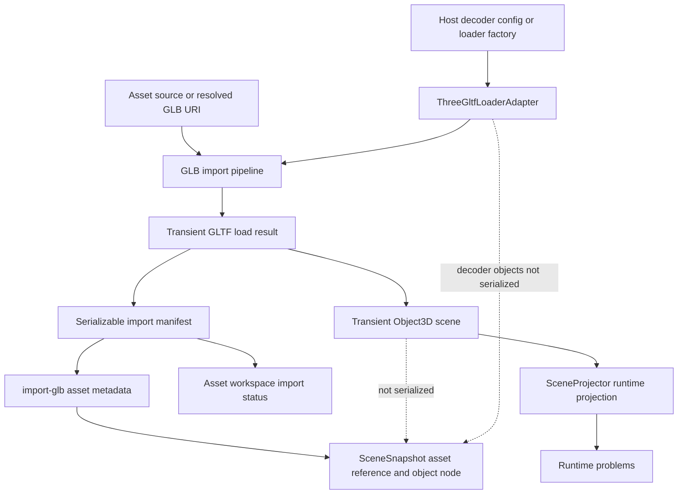
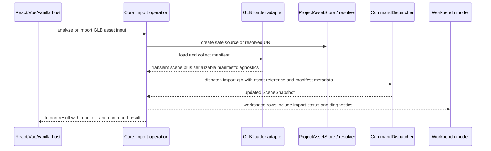

# feat: Add decoder-aware GLB import pipeline

## Summary

Detail roadmap U2 into an implementation-ready plan: add a decoder-aware GLB import pipeline that lets hosts configure Draco, KTX2, and Meshopt support, produces a JSON-compatible import manifest with embedded scene/resource diagnostics, and keeps the existing snapshot-first durability boundary intact.

This plan stops at import analysis, loader configuration, manifest diagnostics, public adapter configuration, and documentation. It does not implement imported GLB hierarchy targets, material-slot authoring, reimport remap, or a visual import queue; those remain downstream roadmap work.

---

## Problem Frame

The current GLB path has two separate halves: `applyImportGlb()` registers a durable GLB object and asset reference synchronously, while `SceneProjector` later asks `ThreeGltfLoaderAdapter` to create a fresh default `GLTFLoader` and load the resolved URI. That is sufficient for simple uncompressed proof-loop assets, but it breaks down for real user GLBs that rely on Draco mesh compression, KTX2/Basis textures, Meshopt buffer compression, embedded cameras, animations, multiple scenes, and extension-dependent fallback behavior.

The editor needs an import-time view of what a GLB contains and what may fail before later roadmap units make internals selectable. That view must be serializable and stable enough to feed asset workspace rows and future imported target generation, while never storing `GLTFLoader`, parser objects, Three.js scenes, textures, image bitmaps, decoder objects, object URLs, or resolver outputs in durable snapshots or `.ek3d` JSON.

---

## Requirements

**Decoder Configuration**

- R1. Core must expose a public, host-configurable GLB loader setup surface for Draco, KTX2, and Meshopt without requiring React/Vue adapters to own loader semantics.
- R2. Hosts must be able to provide decoder instances, decoder factories, or a loader factory suitable for their deployment path; core must not hardcode decoder asset URLs.
- R3. Missing decoder support for required GLB extensions must surface as structured import/runtime diagnostics rather than opaque thrown errors where possible.

**Import Manifest and Diagnostics**

- R4. The import pipeline must return a JSON-compatible manifest summarizing scenes, nodes, meshes, materials, textures/images, cameras, animations, extensions used, extensions required, and asset metadata.
- R5. The manifest must expose loader warnings, unsupported/unknown extensions, missing decoder prerequisites, parse/load failures, and source validation failures as structured diagnostics with severity, code, target, and user-facing display text.
- R6. Manifest source descriptors must be deterministic for the same GLB payload so later GLB target identity work can derive stable target keys without re-inventing import traversal.
- R7. The pipeline must distinguish import analysis output from runtime loader state. The manifest may be stored as JSON-compatible asset metadata or returned from an operation; loaded Three.js objects and parser handles must remain transient.

**Command, Runtime, and Workspace Integration**

- R8. The existing `import-glb` command must remain a durable snapshot mutation path for GLB asset references and object nodes, while async import analysis is owned by an operation/pipeline layer.
- R9. Non-GLB asset inputs must continue to be rejected before asset registration.
- R10. Runtime projection must keep working with an injected loader adapter and must aggregate decoder/load diagnostics into existing runtime problem flows.
- R11. Asset workspace consumers must be able to show import manifest status and diagnostics without reading raw loader results or project asset payloads.

**Compatibility and Documentation**

- R12. Public package exports must include only stable loader/import configuration types and helpers; internal projectors, resource managers, archive adapters, resolver outputs, and raw `ProjectAssetStore` objects must stay private.
- R13. Documentation must show React, Vue, and vanilla hosts how to configure decoders and how import manifest data relates to snapshot and `.ek3d` persistence.
- R14. Tests must prove that import manifests, diagnostics, Workbench projections, snapshots, and project packages do not serialize runtime-only values.

---

## Scope Boundaries

### Included

- Core import manifest, diagnostics, and source descriptor contracts.
- Host-configurable Three.js GLTF loader adapter support for Draco, KTX2, Meshopt, and custom loader factories.
- Async GLB import analysis operation that can run before or alongside the durable `import-glb` command.
- Runtime projection integration for richer load/decoder diagnostics.
- Asset workspace model extension points for manifest status and diagnostics.
- Public API exports, docs, and focused core/runtime/framework adapter tests.

### Deferred to Follow-Up Work

- Imported GLB internal `SceneNode` targets, expanded hierarchy mode, picking, transform, and remap.
- Material slot discovery and slot-level material editing.
- Reimport diff/remap and unresolved target preservation.
- React/Vue visual import queue, drag/drop batch UI, thumbnails, or progress bars beyond surfacing model fields.
- Large-model streaming, worker-pool tuning, cancellation UX, progressive rendering, or remote asset upload.

### Outside This Product Identity for This Stage

- Cloud asset library, model marketplace, CDN publishing, accounts, permissions, or collaboration.
- Full glTF editor, shader graph, material variant authoring, animation timeline, or hosted runtime.
- Persisting `GLTFLoader` parser data, `Object3D`, `Texture`, `ImageBitmap`, decoder instances, object URLs, `File`, `Blob`, resolver output, or PMREM output into `SceneSnapshot` or `.ek3d` JSON.

---

## Assumptions

- The local asset workspace model from `docs/plans/2026-06-05-002-feat-local-asset-workspace-model-plan.md` is available or lands first, including safe payload summaries and workspace problem projection.
- The project continues using Three.js `0.184.x`, where `GLTFLoader` exposes `setDRACOLoader()`, `setKTX2Loader()`, and `setMeshoptDecoder()`.
- Context7 documentation lookup was unavailable because `CONTEXT7_API_KEY` is not configured. Planning uses installed Three.js `0.184.0` source plus official Three.js and Khronos glTF docs.
- First implementation may support GLB binary payloads only for import analysis, while keeping current `kind: "glb"` asset naming. External `.gltf` plus sidecar resources can remain deferred unless implementation finds it is already naturally supported by the resolved URI path.

---

## Key Technical Decisions

- KTD1. Import manifest is JSON-compatible authoring metadata, not loader state: The manifest may be returned from core APIs and optionally stored in `AssetReference.metadata`, but it must contain only strings, numbers, booleans, nulls, arrays, and plain objects.
- KTD2. Keep `import-glb` synchronous and pure: `applyImportGlb()` should continue to validate and mutate durable snapshot state only. Async parse/load work belongs in a new import pipeline or editor operation that can dispatch `import-glb` after analysis or attach manifest metadata to the asset input.
- KTD3. Host owns decoder deployment: Core should expose config/factory hooks for Draco, KTX2, Meshopt, and full GLTF loader customization. Decoder file paths, CDN choices, renderer-specific KTX2 support detection, and worker tuning stay with the host.
- KTD4. Loader adapter can be richer without forcing runtime persistence: `GltfLoaderAdapter` should support a load result shape that includes the transient scene and serializable diagnostics/manifest. `SceneProjector` may consume the scene and problems, but only the manifest projection crosses into durable/import UI surfaces.
- KTD5. Diagnostics should normalize Three.js and glTF signals: Missing decoder errors, unknown extension warnings, required extension gaps, unsupported asset/version errors, and parse/load failures should map into stable import diagnostic codes instead of leaking raw console text as the primary contract.
- KTD6. Deterministic source descriptors precede target keys: U2 should record enough stable source paths for scenes, nodes, meshes, primitives/material slots, images/textures, cameras, and animations for U4 to derive imported target keys. U2 should not create `SceneNode` children yet.
- KTD7. React/Vue remain thin: Framework adapters can pass `loader` / `importPipeline` options and render workspace fields, but decoder semantics, manifest extraction, diagnostics, and serialization safety live in core.

---

## High-Level Technical Design

---

## Implementation Units

### U1. Import manifest and diagnostic contract

- **Goal:** Define the serializable GLB import manifest, diagnostics, source descriptors, and pipeline result types that downstream runtime/workspace code can consume.
- **Requirements:** R4, R5, R6, R7, R11, R14.
- **Dependencies:** Local asset workspace model plan, current `Problem` and asset reference types.
- **Files:** `packages/core/src/assets/import-pipeline.ts`, `packages/core/src/assets/import-pipeline.test.ts`, `packages/core/src/assets/types.ts`, `packages/core/src/problems/types.ts`, `packages/core/src/assets/workspace.ts`, `packages/core/src/assets/workspace.test.ts`, `docs/schema.md`, `docs/project-package.md`.
- **Approach:** Add core-owned types for `GlbImportManifest`, manifest source descriptors, resource counts, extension summary, decoder requirements, and `GlbImportDiagnostic`. Keep this separate from Three.js classes. Include target fields that can point at asset, scene, node, mesh, primitive/material slot, texture/image, camera, or animation descriptors using JSON-compatible IDs/path segments. Extend workspace problem/status projection so rows can include import diagnostics without needing raw `Problem` objects or loader state.
- **Patterns to follow:** `packages/core/src/assets/workspace.ts` projection style, `packages/core/src/problems/types.ts` display/recoverability shape, `packages/core/src/snapshot/validation.ts` JSON-compatible checks.
- **Test scenarios:**
  - Given a manifest containing scene/node/mesh/material/texture/camera/animation descriptors, when `JSON.stringify()` runs, then the result contains only JSON-compatible values.
  - Given manifest diagnostics with asset, extension, and node targets, when workspace rows are built, then the GLB asset row receives diagnostic IDs, highest severity, display text, and recoverability.
  - Given a manifest contains repeated resources in different traversal orders, when normalized, then descriptor ordering is deterministic.
  - Given a diagnostic uses an unknown severity/code shape, when validation runs, then it fails before reaching workspace output.
  - Given a manifest is attached to asset metadata, when `validateSceneSnapshot()` runs, then it accepts only JSON-compatible metadata and rejects runtime objects.
- **Verification:** Core has a stable, serializable import contract that can be used by future imported target and material-slot units without storing loader internals.

### U2. Three.js loader adapter decoder configuration

- **Goal:** Extend the GLB loader adapter so hosts can configure Draco, KTX2, Meshopt, or a full loader factory while preserving runtime projection compatibility.
- **Requirements:** R1, R2, R3, R10, R12.
- **Dependencies:** U1 and current `SceneProjector` loader injection.
- **Files:** `packages/core/src/runtime/gltf-loader-adapter.ts`, `packages/core/src/runtime/gltf-loader-adapter.test.ts`, `packages/core/src/runtime/scene-projector.ts`, `packages/core/src/runtime/scene-projector.test.ts`, `packages/core/src/runtime/editor-runtime.ts`, `packages/core/src/public-api.ts`, `packages/core/src/index.ts`, `packages/core/src/public-api.test.ts`.
- **Approach:** Introduce public config types such as decoder providers/factories and a loader factory hook. `ThreeGltfLoaderAdapter` should configure the underlying `GLTFLoader` with host-provided Draco, KTX2, and Meshopt integrations before loading. Keep compatibility for existing injected adapters that only implement `load(resolved)`. If the richer result shape is introduced, `SceneProjector` should consume either plain `Object3D` or structured load result through a normalization helper.
- **Patterns to follow:** Existing `GltfLoaderAdapter` injection in `SceneProjector`, public API export tests, runtime adapter style used by texture/HDR/PMREM seams.
- **Test scenarios:**
  - Given host-supplied Draco/KTX2/Meshopt providers, when `ThreeGltfLoaderAdapter` creates a loader, then the loader receives each configured integration before load starts.
  - Given a full GLTF loader factory is supplied, when load runs, then core uses that factory rather than constructing a default loader.
  - Given no decoder config is supplied, when a simple GLB loads, then existing placeholder/simple loader behavior remains compatible.
  - Given a legacy test adapter returns a plain `Object3D`, when `SceneProjector` projects, then object projection still succeeds.
  - Given a richer adapter result includes diagnostics, when projection completes, then diagnostics are converted to runtime problems without storing the transient scene in snapshot.
  - Given public API exports are inspected, then stable adapter/config types are exported and internal projectors/resource managers remain private.
- **Verification:** Hosts can configure decoder support through public core surfaces, and existing runtime loader injection remains source-compatible.

### U3. Manifest extraction from loaded GLB

- **Goal:** Extract deterministic manifest summaries from a loaded GLB result without retaining Three.js runtime objects in durable state.
- **Requirements:** R4, R5, R6, R7, R14.
- **Dependencies:** U1, U2.
- **Files:** `packages/core/src/assets/import-pipeline.ts`, `packages/core/src/assets/import-pipeline.test.ts`, `packages/core/src/runtime/gltf-loader-adapter.ts`, `packages/core/src/runtime/gltf-loader-adapter.test.ts`, `packages/core/src/snapshot/validation.ts`, `docs/schema.md`.
- **Approach:** Traverse the GLTF load object and any available JSON/userData metadata to count scenes, nodes, meshes, primitives, material slots, textures/images, cameras, animations, skins, and extensions. Prefer glTF JSON indices/paths when available; fall back to deterministic traversal paths and names only as secondary descriptors. Copy only plain metadata such as names, indices, counts, extension names, MIME hints, and source paths. Do not keep parser, scene, material, texture, geometry, camera, animation clip instances, or image bitmap references in the manifest.
- **Patterns to follow:** Snapshot JSON compatibility checks, deterministic sorting in asset workspace builders, `disposeObjectTree()` lifecycle expectations for transient load results.
- **Test scenarios:**
  - Given a GLB load object with multiple scenes, nodes, meshes, materials, textures, cameras, and animations, when manifest extraction runs, then counts and descriptors match the load input.
  - Given a mesh has multiple material slots/primitives, when manifest extraction runs, then each primitive/slot descriptor receives a deterministic source path.
  - Given a GLB declares `extensionsUsed` and `extensionsRequired`, when manifest extraction runs, then the manifest preserves both lists and flags required extensions without configured support.
  - Given Three.js objects contain `userData.gltfExtensions` or extras, when manifest extraction runs, then only JSON-compatible extension/extras summaries are copied.
  - Given extraction output is deep-inspected, then no `Object3D`, `BufferGeometry`, `Material`, `Texture`, `Camera`, `AnimationClip`, parser, image bitmap, function, or class instance is present.
- **Verification:** Import analysis can explain complex GLB structure and extension requirements while producing data safe enough for snapshot metadata, project package export, and workspace display.

### U4. Async import analysis and command integration

- **Goal:** Add a core import operation/pipeline entry that analyzes a GLB, returns manifest diagnostics, and commits durable object/asset state through the existing command path.
- **Requirements:** R7, R8, R9, R11, R14.
- **Dependencies:** U1-U3.
- **Files:** `packages/core/src/assets/import-pipeline.ts`, `packages/core/src/assets/import-pipeline.test.ts`, `packages/core/src/editor/editor-api.ts`, `packages/core/src/editor/lifecycle.ts`, `packages/core/src/editor/lifecycle.test.ts`, `packages/core/src/editor/operations.ts`, `packages/core/src/commands/types.ts`, `packages/core/src/commands/import-glb.ts`, `packages/core/src/commands/import-glb.test.ts`, `packages/core/src/workbench/workbench-model.ts`, `packages/core/src/workbench/workbench-model.test.ts`, `packages/core/src/public-api.ts`, `packages/core/src/index.ts`.
- **Approach:** Keep `applyImportGlb()` as the low-level durable command. Add an async operation such as a GLB import/analyze helper that can resolve a project asset source, run the loader adapter, normalize manifest diagnostics, and dispatch `import-glb` with JSON-compatible manifest metadata when commit is requested. The operation result should include command result, manifest, diagnostics, and whether the durable snapshot changed. Failed analysis should return diagnostics and avoid registering invalid input by default; an explicit force/commit option can be considered only if implementation finds a strong need for placeholder assets.
- **Execution note:** Characterize current `import-glb` rollback tests before adding async operation behavior.
- **Patterns to follow:** `CoreEditor.replaceAsset()` async boundary, `CoreEditor.importProject()` result shape, `CommandDispatcher` rollback behavior, `AssetRegistry.register()` metadata validation.
- **Test scenarios:**
  - Given a valid GLB project asset source and decoder config, when the import operation runs with commit enabled, then it dispatches `import-glb`, registers the project payload, returns a manifest, and stores only JSON-compatible manifest metadata.
  - Given source validation identifies a non-GLB asset kind, when the operation runs, then no asset or object is registered and diagnostics explain the rejection.
  - Given loader analysis fails before commit, when default import operation returns, then snapshot and asset registry remain unchanged.
  - Given `applyImportGlb()` is called directly without manifest metadata, when dispatch succeeds, then existing GLB object import behavior is unchanged.
  - Given undo/redo runs after an analyzed import commit, then durable asset/object state follows existing history semantics while transient manifest operation results are not replayed as runtime objects.
  - Given `buildWorkbenchModel()` receives manifest diagnostics from operation/runtime state, when the asset workspace is built, then the GLB row shows import status without reading loader results.
- **Verification:** The editor gains a real import pipeline entry without turning async loader state into command-owned durable state.

### U5. Runtime projection diagnostics and disposal safety

- **Goal:** Make runtime projection use the decoder-aware adapter and surface structured load/import diagnostics while preserving cleanup and stale-projection protections.
- **Requirements:** R3, R5, R10, R14.
- **Dependencies:** U1-U3.
- **Files:** `packages/core/src/runtime/scene-projector.ts`, `packages/core/src/runtime/scene-projector.test.ts`, `packages/core/src/runtime/gltf-loader-adapter.ts`, `packages/core/src/runtime/gltf-loader-adapter.test.ts`, `packages/core/src/runtime/disposal.test.ts`, `packages/core/src/runtime/missing-asset.integration.test.ts`, `packages/core/src/runtime/editor-runtime.test.ts`, `packages/core/src/problems/types.ts`, `packages/core/src/assets/problems.ts`.
- **Approach:** Normalize adapter diagnostics into runtime problems beside existing missing/resolve/load failures. Preserve `#loadTokens` / projection-generation guards so an older slow decoder load cannot restore stale objects. Ensure partially loaded transient object trees are disposed when projection loses the race, load fails after creating resources, or a problem placeholder replaces a previous runtime object.
- **Patterns to follow:** Current `asset-load-failed`, `asset-resolve-failed`, `asset-unresolved` problem behavior in `SceneProjector`, `disposeObjectTree()` tests, environment/material runtime problem aggregation.
- **Test scenarios:**
  - Given a GLB requires KTX2 and no KTX2 loader is configured, when projection runs, then runtime problems include a decoder-missing diagnostic targeting the asset/object.
  - Given a GLB requires Meshopt and no supported decoder is configured, when projection runs, then the problem code is stable and recoverability is user-action or not-recoverable according to the diagnostic contract.
  - Given `GLTFLoader` emits unknown extension warnings captured by the adapter, when projection completes, then warnings appear in runtime problems without failing the whole object if load succeeds.
  - Given a slow decoded load resolves after a newer snapshot removes the object, when the old load finishes, then its transient scene is disposed and not reattached.
  - Given a failed decoded load creates partial resources before throwing, when projection handles the error, then partial resources are disposed and a problem placeholder remains mapped to the object.
  - Given runtime problems are read from the editor, then they are derived state and `editor.serialize()` still contains no runtime problem objects.
- **Verification:** Decoder-aware runtime loading improves diagnostics without weakening existing projection safety or disposal guarantees.

### U6. Public adapter usage in React, Vue, vanilla, and docs

- **Goal:** Document and verify how hosts configure the decoder-aware pipeline through package surfaces while framework adapters remain render/subscribe/dispatch layers.
- **Requirements:** R1, R2, R11, R12, R13, R14.
- **Dependencies:** U1-U5.
- **Files:** `packages/react/src/components/EditorViewport.tsx`, `packages/react/src/components/EditorWorkbench.tsx`, `packages/react/test/editor-viewport.test.tsx`, `packages/react/test/workbench.test.tsx`, `packages/vue/src/components/EditorViewport.vue`, `packages/vue/src/components/EditorWorkbench.vue`, `packages/vue/test/editor-viewport.test.ts`, `packages/vue/test/workbench.test.ts`, `examples/vanilla-proof-loop/src/main.ts`, `docs/integration-react.md`, `docs/integration-vue.md`, `docs/integration-vanilla.md`, `docs/project-package.md`, `docs/schema.md`, `docs/plans/2026-06-05-001-feat-real-user-editor-roadmap-plan.md`.
- **Approach:** Keep existing `loader` prop compatibility, but update types/docs so hosts can pass the new decoder-aware adapter or import pipeline. Add examples that show host-owned decoder paths/factories for React, Vue, and vanilla without embedding decoder URLs in core. Document that import manifest rows are projections and that `.ek3d` persists only snapshot JSON plus asset payloads.
- **Patterns to follow:** Current `EditorViewport` loader prop, `EditorWorkbench` default interaction forwarding, integration docs' runtime-only warnings, public API privacy tests.
- **Test scenarios:**
  - Given React `EditorWorkbench` receives a decoder-aware loader adapter, when it mounts the runtime, then the same adapter reaches core `mountRuntime()` without React inspecting decoder config.
  - Given Vue `EditorWorkbench` receives the adapter, when props update, then runtime remount passes the raw adapter through without wrapping it in deep reactive state.
  - Given vanilla example configures a loader adapter, when runtime mounts, then it can use the same public core surface as React/Vue.
  - Given docs examples are inspected, then decoder paths/factories are host-owned and no internal runtime projector imports are required.
  - Given public package root is imported, then consumers can type the decoder adapter/config and import result without importing private module paths.
  - Given docs describe manifest persistence, then they explicitly forbid persisting loader parser, `Object3D`, `Texture`, `File`, `Blob`, object URL, image bitmap, resolver output, or decoder object.
- **Verification:** Framework and vanilla consumers can opt into real-world GLB decoder support through the package contract without duplicating editor semantics.

---

## Acceptance Examples

- AE1. Given a host configures Draco, KTX2, and Meshopt support, when a compressed GLB is imported, then the import result includes a manifest and no missing-decoder diagnostics.
- AE2. Given a GLB declares a required KTX2 texture extension and the host does not configure KTX2, when analysis or projection runs, then the asset workspace/runtime problems show a stable missing-decoder diagnostic instead of an opaque loader failure.
- AE3. Given a GLB contains multiple scenes, meshes, material slots, embedded textures, cameras, and animations, when manifest extraction runs, then the returned manifest reports deterministic counts and descriptors for each category.
- AE4. Given import analysis fails before commit, when the operation returns, then no asset reference or scene object is added to the snapshot by default.
- AE5. Given a successful analyzed import is serialized and exported as `.ek3d`, when the JSON is inspected, then it contains only snapshot asset references and JSON-compatible manifest metadata, not loader/parser/runtime objects.
- AE6. Given React, Vue, and vanilla hosts pass the same decoder-aware adapter, when their runtimes mount, then core receives equivalent loader behavior and framework adapters do not own decoder logic.

---

## System-Wide Impact

- **Public API:** New loader/import types become part of the package root surface. Export only stable configuration and result contracts, not internal projectors or raw Three.js resource managers.
- **Runtime:** `SceneProjector` gets richer loader diagnostics but must preserve existing load-token, stale projection, placeholder, and disposal behavior.
- **Asset workspace:** Import manifest/diagnostics become part of asset row projection. This should extend the U1 workspace model rather than create a second import-status model.
- **Snapshot schema:** No mandatory schema version bump is expected if manifest metadata is stored under existing JSON-compatible asset metadata. If implementation introduces dedicated top-level fields, it must include migration, validation, serialization tests, and `docs/schema.md` updates.
- **Framework adapters:** React/Vue prop types may widen for loader/import pipeline configuration, but they remain thin pass-through layers.

---

## Risks and Dependencies

| Risk | Impact | Mitigation |
|---|---|---|
| Decoder config leaks Three.js internals into durable metadata | Snapshot/package portability breaks | Keep decoder objects only on adapter instances; add serialization tests for snapshot, manifest, workspace, and `.ek3d` JSON. |
| Public API exposes too much runtime implementation | Consumers depend on internals that should remain experimental | Export config/result types and adapter factory only; keep `SceneProjector`, maps, resource managers, and archive adapters private. |
| Import analysis and `import-glb` command diverge | Users see manifest for a different object than the committed snapshot | Route commits through `import-glb` and pass only validated JSON-compatible manifest metadata into the command asset input. |
| KTX2 support requires renderer-specific detection | Core cannot know host renderer capabilities in non-browser contexts | Let hosts provide a ready KTX2 loader/factory; document that detection belongs to host/runtime setup. |
| Warning capture becomes brittle across Three.js versions | Diagnostics tests overfit exact warning strings | Normalize stable codes from known error categories and keep raw messages as detail only. |
| Manifest descriptors are not stable enough for U4 | Future target keys need another traversal model | Prefer glTF JSON indices/paths and source relationships over generated runtime UUIDs or object names alone. |
| Async import operation changes existing proof-loop behavior | Simple import tests or demos regress | Preserve direct `import-glb` command behavior and add operation tests separately. |

---

## Documentation Notes

- `docs/schema.md` should add an import manifest subsection under asset metadata, emphasizing that the manifest is JSON-compatible import metadata and not a loader result.
- `docs/project-package.md` should state that `.ek3d` may carry manifest metadata inside `scene.json`, but asset payloads remain under `assets/*` and no resolver/object URL/loaded scene is stored.
- `docs/integration-react.md`, `docs/integration-vue.md`, and `docs/integration-vanilla.md` should show host-owned decoder setup and explain that adapters are passed into core/runtime rather than configured by framework components.
- The roadmap source can later link this sub-plan under U2 after execution starts. Creating this plan should not mark roadmap progress complete.

---

## Sources and Research

- Roadmap source: `docs/plans/2026-06-05-001-feat-real-user-editor-roadmap-plan.md`.
- Local asset workspace dependency: `docs/plans/2026-06-05-002-feat-local-asset-workspace-model-plan.md`.
- Origin ideation: `docs/ideation/2026-06-05-real-user-3d-editor-delivery-readiness-ideation.md`.
- Current loader/runtime patterns: `packages/core/src/runtime/gltf-loader-adapter.ts`, `packages/core/src/runtime/scene-projector.ts`, `packages/core/src/runtime/editor-runtime.ts`.
- Current import/asset patterns: `packages/core/src/commands/import-glb.ts`, `packages/core/src/assets/registry.ts`, `packages/core/src/project/asset-store.ts`, `packages/core/src/workbench/workbench-model.ts`.
- Existing tests to preserve: `packages/core/src/commands/import-glb.test.ts`, `packages/core/src/runtime/scene-projector.test.ts`, `packages/core/src/runtime/disposal.test.ts`, `packages/core/src/public-api.test.ts`.
- Installed dependency reference: `node_modules/three/package.json` reports Three.js `0.184.0`; `node_modules/three/examples/jsm/loaders/GLTFLoader.js` documents `setDRACOLoader()`, `setKTX2Loader()`, `setMeshoptDecoder()`, supported extensions, and loader result fields.
- Official Three.js GLTFLoader docs: https://threejs.org/docs/pages/GLTFLoader.html.
- Khronos glTF 2.0 specification: https://registry.khronos.org/glTF/specs/2.0/glTF-2.0.html.
