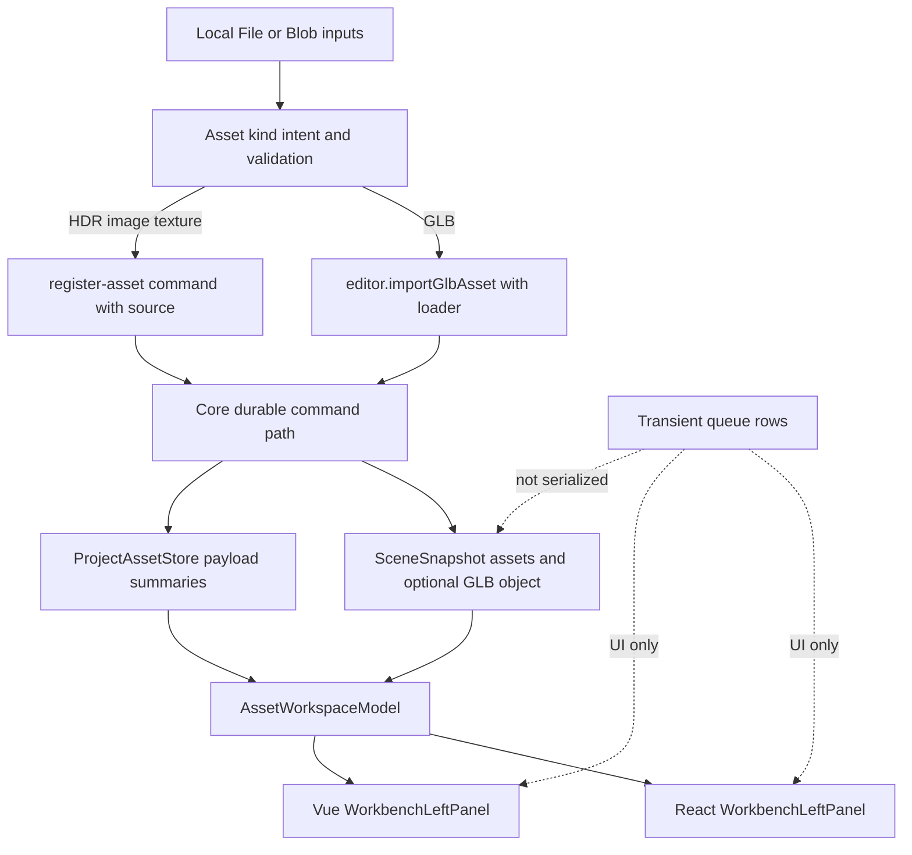
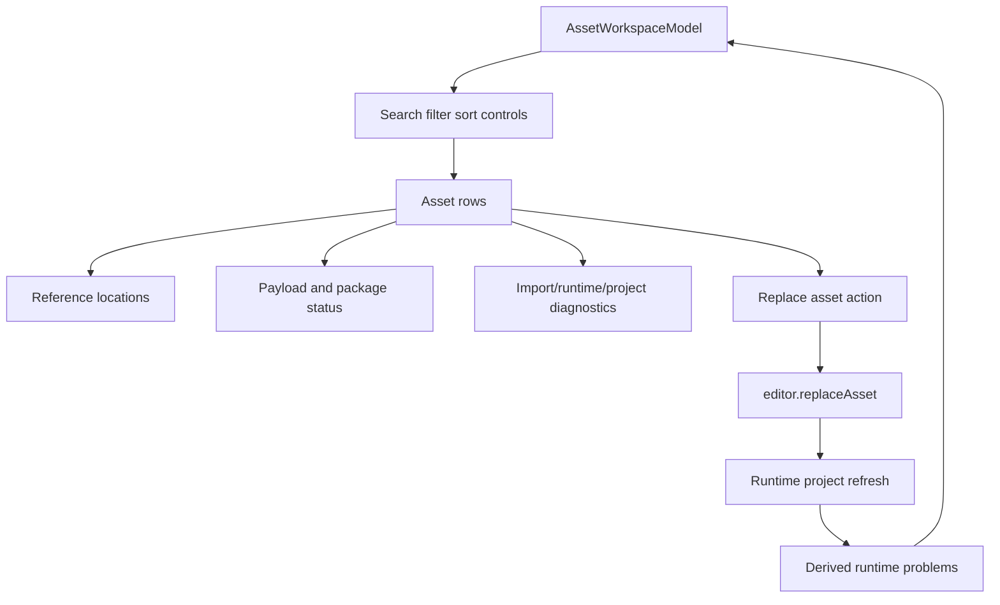

# feat: Add Workbench asset workspace UI

## Summary

Detail roadmap U3 into an implementation-ready plan: make the default React and Vue Workbench asset panel a real local asset workspace for batch import, import diagnostics, search/filter/sort, reference display, missing-payload recovery, and `.ek3d` package completeness feedback.

The plan uses the core `AssetWorkspaceModel` and decoder-aware `importGlbAsset()` path as the source of truth. Framework packages remain thin renderers over core commands and operations; `File`, `Blob`, object URLs, loader results, runtime problems, and resolver outputs stay transient.

---

## Problem Frame

The current default Workbench already renders hierarchy, a basic asset list, missing asset recovery, project summary, viewport, inspector, toolbar, and status bar. Core has also started exposing richer asset workspace state through `buildAssetWorkspaceModel()`, `WorkbenchAssetModel.workspace`, payload summaries, import manifest metadata, and asset workspace subscriptions.

That is still short of roadmap U3. A real user needs to drag or select multiple local GLB/HDR/image/texture files, see which imports are queued/running/done/failed, understand what references each asset, filter a busy asset list, recover missing payloads without changing stable asset IDs, and know whether the exported `.ek3d` package is complete. React and Vue must expose the same behavior without duplicating import semantics or reading private project store/runtime internals.

---

## Requirements

**Import and Queue**

- R1. The default Workbench must support selecting or dropping multiple local assets, covering GLB, HDR, image, and texture kinds. (origin R1, R4, R24)
- R2. GLB imports must use the decoder-aware core import operation so import manifests and diagnostics flow into asset workspace rows. (origin R2, R3)
- R3. Non-GLB asset imports must register durable asset references and project payloads through core APIs, not framework-owned stores. (origin R1, R3, R21)
- R4. Import queue state may show queued/importing/succeeded/failed UI, but that queue state must remain transient and absent from `SceneSnapshot` and `.ek3d` JSON. (origin R3, R23)
- R5. Raster asset kind must be explicit at import edge because `image` and `texture` are authoring intents that cannot be inferred safely from MIME type alone. (origin R1, R4)

**Workspace Display**

- R6. The asset panel must render core workspace rows with label, kind, referenced/unreferenced state, reference locations, payload status, package status, import status, diagnostics, and highest severity. (origin R1, R24)
- R7. Search, filtering, and sorting must use core workspace semantics so React, Vue, and custom Workbench regions see equivalent asset sets. (origin R1, R21)
- R8. Missing or failed asset recovery must preserve stable asset IDs when replacing payloads and refresh runtime problems after projection. (origin R4, R24)
- R9. Project completeness feedback must distinguish complete, partial, blocked, unreferenced, missing-reference, and missing-payload states without reading raw payload bytes. (origin R1, R3)

**Framework and Layout**

- R10. React and Vue default Workbench UIs must stay behaviorally equivalent and keep framework adapters limited to rendering, transient UI state, and dispatching core operations. (origin R12, R21)
- R11. The asset workspace must remain usable in the existing left panel layout on mobile and desktop without overlapping toolbar, viewport, inspector, or status text. (origin R12, R24)
- R12. Public package surfaces and docs must show hosts how to use the asset workspace without persisting runtime-only values. (origin R3, R21, R23)

---

## Scope Boundaries

### Included

- Default React and Vue Workbench asset workspace controls.
- Batch local file selection and drag/drop within the Workbench asset panel.
- Core-owned asset kind classification, import result shape, and Workbench import action bridge.
- GLB import through `editor.importGlbAsset()` with decoder-aware loader passthrough from Workbench props.
- Non-GLB registration through durable core asset/project APIs.
- Search, filter, sort, reference summary, package readiness, import diagnostics, and replacement UI.
- React/Vue parity tests, focused browser layout tests, and integration docs.

### Deferred to Follow-Up Work

- Imported GLB internal hierarchy targets, picking, transform, and reimport remap.
- Material slot discovery or slot-level material editing.
- Asset thumbnails, image previews, progressive preview rendering, upload progress from remote storage, and worker-pool import cancellation.
- Cloud asset library, CDN upload, model marketplace, accounts, permissions, or collaboration.
- Persisted dockable layout, command palette, and full plugin asset browser.

### Outside This Product Identity for This Stage

- Persisting `File`, `Blob`, bytes, object URLs, loaded GLB scenes, Three.js textures/materials, loader/parser state, decoder objects, resolver output, runtime problems, PMREM output, or import queue rows into durable JSON.
- Treating the asset workspace as a cloud DAM. It is a local/session/project-package authoring surface.

---

## Assumptions

- The local asset workspace model plan has landed or lands first, including `AssetWorkspaceModel`, payload summaries, search/filter/sort helpers, package readiness, and payload-only workspace refresh.
- The decoder-aware GLB import pipeline plan has landed or lands first, including `EditorWithGlbImport.importGlbAsset()`, serializable `GlbImportManifest`, diagnostics, and public loader configuration.
- Current `AssetKind` remains `glb`, `texture`, `hdr`, and `image` for this UI slice.
- The first UI version can show textual status summaries and badges. Thumbnail rendering is deferred because it would introduce additional runtime resource lifecycle work.

---

## Key Technical Decisions

- KTD1. Core owns import semantics; frameworks own transient presentation: React/Vue may hold queue row UI state, but file classification, durable import/registration, manifest attachment, replacement, and package readiness come from core APIs.
- KTD2. Workbench context exposes asset import actions: `WorkbenchAssetContext` should provide a framework-neutral import entry so default panels and custom left panels can call the same operation instead of reaching into private editor internals.
- KTD3. GLB import creates scene content by default: Batch-imported GLB files should follow the current durable `import-glb` behavior through `importGlbAsset({ commit: true })`, producing an object plus asset reference. Asset-only GLB library behavior is deferred.
- KTD4. Raster import intent is visible: `.png`, `.jpg`, `.webp`, and similar raster files need an explicit import mode or per-file kind override for `texture` versus `image`; `.glb` and `.hdr` can be inferred safely.
- KTD5. Import queue is not workspace state: Queue progress, drag-hover state, input focus, and per-file transient messages live in component state. After commit, durable rows are rebuilt from the core workspace model.
- KTD6. Missing replacement remains stable-ID replacement: The existing `replaceAsset()` flow stays the path for missing payload recovery. It updates project payloads and runtime projection without changing the asset reference ID.
- KTD7. Layout stays dense and operational: The default Workbench is a working editor surface, not a landing page. The asset workspace should use compact controls, stable row dimensions, badges, and wrapping text that does not resize the left panel unexpectedly.

---

## High-Level Technical Design

---

## Implementation Units

### U1. Core Workbench asset import action bridge

- **Goal:** Add a reusable core/Workbench import bridge that classifies local asset inputs, dispatches durable asset operations, returns per-file import results, and exposes it through Workbench context.
- **Requirements:** R1, R2, R3, R4, R5, R7, R10, R12.
- **Dependencies:** Local asset workspace model plan, decoder-aware GLB import pipeline plan.
- **Files:** `packages/core/src/assets/workspace-import.ts`, `packages/core/src/assets/workspace-import.test.ts`, `packages/core/src/editor/editor-api.ts`, `packages/core/src/editor/lifecycle.ts`, `packages/core/src/editor/lifecycle.test.ts`, `packages/core/src/public-api.ts`, `packages/core/src/index.ts`, `packages/core/src/public-api.test.ts`, `packages/react/src/hooks/use-workbench.ts`, `packages/vue/src/composables/use-workbench.ts`.
- **Approach:** Introduce a narrow import result contract for Workbench asset imports: file label, intended kind, status, asset ID, optional object ID for GLB imports, diagnostics, and whether a durable command committed. The bridge should infer `.glb` and `.hdr`, require visible intent for ambiguous raster files, call `editor.importGlbAsset()` for GLB, and dispatch `register-asset` for non-GLB sources. React/Vue hooks should expose this as `context.assets.importFiles()` or an equivalent Workbench asset action and pass the Workbench `loader` through for GLB analysis.
- **Execution note:** Add characterization coverage for current `replaceAsset()` and asset workspace refresh behavior before extending the hook context.
- **Patterns to follow:** `CoreEditor.importGlbAsset()`, `CoreEditor.registerAsset()`, `CommandDispatcher` rollback behavior, `ProjectAssetStore.summaries()`, React `useSyncExternalStore`, Vue `subscribeAssetWorkspace` handling.
- **Test scenarios:**
  - Given a GLB `File` and a decoder-aware loader, when the Workbench import bridge runs, then it calls `importGlbAsset()` with `commit: true`, returns the manifest diagnostics, and exposes the committed asset/object IDs.
  - Given an HDR file, when the bridge runs, then it dispatches `register-asset` with `kind: "hdr"` and a project source that can be summarized by `ProjectAssetStore`.
  - Given a raster file imported with `kind: "texture"`, when the bridge runs, then it registers a texture asset and does not invent material assignments.
  - Given a raster file without explicit `image` or `texture` intent, when validation runs, then the bridge returns a user-action diagnostic and does not register an ambiguous asset.
  - Given one valid GLB and one invalid file in the same batch, when import completes, then the valid file commits and the invalid file returns a failed result without rolling back the successful file.
  - Given import results and `buildWorkbenchModel()` output are serialized, then no `File`, `Blob`, object URL, bytes, loader result, parser, `Object3D`, decoder object, or runtime problem object is present.
- **Verification:** Default and custom Workbench asset panels can import files through one core-owned route, and adapter code does not duplicate durable import rules.

### U2. React Workbench asset workspace panel

- **Goal:** Upgrade `WorkbenchLeftPanel` in React so the default asset section exposes import controls, search/filter/sort, workspace rows, diagnostics, references, package status, and replacement actions.
- **Requirements:** R1, R2, R4, R5, R6, R7, R8, R9, R10, R11.
- **Dependencies:** U1.
- **Files:** `packages/react/src/components/EditorWorkbench.tsx`, `packages/react/src/hooks/use-workbench.ts`, `packages/react/src/components/WorkbenchLeftPanel.tsx`, `packages/react/src/components/workbench.css`, `packages/react/test/workbench.test.tsx`, `packages/react/test/default-workbench.browser.test.tsx`.
- **Approach:** Keep the component rendering `context.model.assets.workspace` rather than inspecting snapshot/project stores directly. Add compact import controls with multiple-file input and drop target, a visible raster import intent control, search input, kind/status filters, sort control, and rows that show workspace status badges, reference summaries, import status, diagnostics, and package completeness. Queue rows stay in React state and collapse into workspace rows after core import commits.
- **Patterns to follow:** Existing `WorkbenchLeftPanel` missing asset recovery flow, `EditorWorkbench` loader prop passthrough, current workbench CSS density and responsive grid, Testing Library workbench tests.
- **Test scenarios:**
  - Given the default React Workbench receives a GLB file through the asset import control, when import resolves, then the UI shows transient importing state, then a workspace row with GLB kind, import status, and referenced state.
  - Given multiple files are selected, when the bridge returns mixed succeeded and failed results, then succeeded files appear in workspace rows and failed files remain visible as transient queue failures with diagnostic text.
  - Given the user sets raster import intent to texture and imports a PNG, when the row renders, then the asset kind is `texture` and no environment/material assignment is created.
  - Given a search query matches asset label, ID, reference label, status, or diagnostic title, when the user types it, then React renders the same filtered item IDs as `filterAssetWorkspaceItems()`.
  - Given kind/status/sort controls are changed, when asset rows render, then ordering and counts match core filter/sort output.
  - Given a missing GLB payload row exposes replacement, when the user selects a replacement file, then `replaceAsset()` is called with the existing asset ID and the row refreshes after runtime projection.
  - Given a partial `.ek3d` package state, when the panel renders, then package readiness and blocking asset rows are visible without reading payload bytes.
  - Given long file names, asset IDs, and diagnostic details, when the panel renders in a narrow viewport, then text wraps within rows and does not overlap the hierarchy, viewport, inspector, or status areas.
- **Verification:** React consumers get a usable asset workspace out of the box, and extension regions still receive the same context for custom panels.

### U3. Vue Workbench asset workspace panel

- **Goal:** Upgrade `WorkbenchLeftPanel.vue` with behavior and UI parity with the React asset workspace panel.
- **Requirements:** R1, R2, R4, R5, R6, R7, R8, R9, R10, R11.
- **Dependencies:** U1, U2 design decisions.
- **Files:** `packages/vue/src/components/EditorWorkbench.vue`, `packages/vue/src/composables/use-workbench.ts`, `packages/vue/src/components/WorkbenchLeftPanel.vue`, `packages/vue/src/components/workbench.css`, `packages/vue/test/workbench.test.ts`, `packages/vue/test/default-workbench.browser.test.ts`.
- **Approach:** Mirror the React panel's information architecture and core action usage while respecting Vue patterns: reactive transient queue state, computed filtered rows from `context.model.assets.workspace`, raw loader passthrough, and `subscribeAssetWorkspace` refresh. Avoid deep-reactivizing `File`, loader, editor, runtime, or project payload objects.
- **Patterns to follow:** Current Vue `useWorkbench()` `markRaw` and `shallowRef` boundaries, scoped slot compatibility, existing missing asset recovery flow, Vue Test Utils workbench tests.
- **Test scenarios:**
  - Given the Vue default Workbench imports a GLB file, when import resolves, then the queue state clears into a workspace row with the same status text and asset fields as React.
  - Given the user drops GLB/HDR/texture files onto the asset section, when import runs, then each file routes through the Workbench asset action and Vue does not store file sources in snapshot or component props beyond transient state.
  - Given raster intent is changed before importing a JPG, when the asset is registered, then the durable asset kind matches the selected intent.
  - Given search/filter/sort controls are changed, when rows render, then Vue produces the same item IDs and counts as core filter/sort helpers.
  - Given `replaceAsset()` updates only project payload data, when the asset workspace subscription fires, then Vue refreshes payload status without requiring a snapshot mutation.
  - Given a loader prop is replaced, when subsequent GLB import runs, then the latest loader is passed through without wrapping it in deep reactive state.
  - Given long diagnostic text and narrow panel width, when Vue renders the asset rows, then row content wraps and remains accessible without layout overlap.
- **Verification:** Vue keeps parity with React while preserving its raw editor/runtime boundaries.

### U4. Workspace status, diagnostics, and package readiness presentation

- **Goal:** Make asset status understandable across both framework panels and align the visible state with core workspace/package semantics.
- **Requirements:** R6, R7, R8, R9, R10, R11.
- **Dependencies:** U2, U3.
- **Files:** `packages/react/src/components/WorkbenchLeftPanel.tsx`, `packages/react/src/components/WorkbenchStatusBar.tsx`, `packages/react/src/components/workbench.css`, `packages/react/test/workbench.test.tsx`, `packages/vue/src/components/WorkbenchLeftPanel.vue`, `packages/vue/src/components/WorkbenchStatusBar.vue`, `packages/vue/src/components/workbench.css`, `packages/vue/test/workbench.test.ts`, `packages/core/src/workbench/workbench-model.ts`, `packages/core/src/workbench/workbench-model.test.ts`.
- **Approach:** Use a shared status vocabulary from core workspace fields: `ready`, `unreferenced`, `missing-payload`, `missing-reference`, `has-problems`, import status, package status, and highest severity. Status bars can summarize aggregate readiness, while asset rows show row-level reasons and recovery actions. Do not add a second status model in framework code; if a label or count is needed in both adapters, add it to core Workbench model first.
- **Patterns to follow:** `WorkbenchStatusBar` summary style, `WorkbenchAssetModel.workspace`, `AssetWorkspaceReadiness`, existing problem severity badges and recovery list.
- **Test scenarios:**
  - Given workspace readiness is complete and no problems exist, when status renders, then project status remains ready and asset rows do not show false warnings.
  - Given one referenced asset has no payload, when Workbench renders, then status shows partial/blocked readiness and the corresponding row is marked missing payload.
  - Given an asset is registered but unreferenced, when rows render, then it remains visible as unreferenced and does not block package completeness.
  - Given a GLB import manifest contains warnings, when rows render, then import status is `has-diagnostics` and the row shows warning severity without treating the asset as missing.
  - Given a GLB import manifest contains error diagnostics but no committed asset, when the queue row renders, then the failure is visible without adding a durable asset row.
  - Given the same workspace model is rendered by React and Vue, when visible labels and counts are compared in tests, then they match for ready, unreferenced, missing, warning, and error cases.
- **Verification:** Users can tell whether an asset is imported, referenced, recoverable, package-blocking, or diagnostic-only without learning internal problem codes.

### U5. Browser interaction and responsive layout hardening

- **Goal:** Prove the asset workspace is usable in the real default Workbench layout across desktop and mobile-sized browser viewports.
- **Requirements:** R1, R4, R6, R8, R10, R11.
- **Dependencies:** U2, U3, U4.
- **Files:** `packages/react/test/default-workbench.browser.test.tsx`, `packages/vue/test/default-workbench.browser.test.ts`, `packages/react/test/proof-loop-demo.browser.test.tsx`, `packages/react/src/components/workbench.css`, `packages/vue/src/components/workbench.css`, `vitest.browser.config.ts`.
- **Approach:** Extend browser tests to exercise the visible asset workspace controls using deterministic tiny file fixtures and mocked loader behavior. Assert interaction outcomes and layout geometry rather than WebGL pixels. The left panel should scroll internally, controls should keep stable dimensions, and text should wrap instead of overlapping adjacent areas.
- **Patterns to follow:** Existing `test:browser` setup, proof-loop browser smoke tests, current Workbench responsive CSS media query.
- **Test scenarios:**
  - Given a desktop viewport, when the asset workspace contains many rows and diagnostics, then the left panel scrolls while viewport, inspector, toolbar, and status remain reachable.
  - Given a mobile-width viewport, when import controls, filters, rows, and recovery actions render, then no control text overlaps and touch targets remain usable.
  - Given files are dragged over the asset section, when drag enters/leaves/drops, then drag-highlight state appears and clears without changing snapshot state.
  - Given an import is in progress, when the component rerenders, then queue row dimensions remain stable and the panel does not jump enough to obscure active controls.
  - Given a failed import and a missing replacement action coexist, when keyboard focus moves through the panel, then each file input/button remains focusable and labelled.
  - Given browser tests inspect serialized project output after import UI interaction, then transient queue, drag state, file input values, and UI status messages are absent from durable JSON.
- **Verification:** The default Workbench asset workspace is not just unit-tested; it behaves in the actual browser shell users install.

### U6. Docs, examples, and roadmap traceability

- **Goal:** Document the asset workspace UI workflow and keep the source roadmap traceable without claiming downstream roadmap work.
- **Requirements:** R1, R2, R3, R5, R8, R9, R10, R12.
- **Dependencies:** U1-U5.
- **Files:** `docs/integration-react.md`, `docs/integration-vue.md`, `docs/integration-vanilla.md`, `docs/project-package.md`, `docs/schema.md`, `docs/interactions.md`, `examples/react-proof-loop/src/App.tsx`, `examples/vue-proof-loop/src/App.vue`, `examples/vanilla-proof-loop/src/proof-loop.ts`, `docs/plans/2026-06-05-001-feat-real-user-editor-roadmap-plan.md`, `README.md`.
- **Approach:** Update React/Vue docs with default Workbench asset import, decoder loader passthrough, raster kind intent, missing asset recovery, and package completeness. Vanilla docs should point to the same core import bridge without promising the full default UI. Schema/package docs should reinforce that workspace rows and import queues are projections. The roadmap can link this sub-plan under U3 after implementation starts or completes; plan creation alone should not mark U3 complete.
- **Patterns to follow:** Existing integration docs' runtime-only warnings, `docs/project-package.md` `.ek3d` explanations, source roadmap phase table.
- **Test scenarios:**
  - Given docs examples are copied into a host app, when imports are inspected, then they use public package exports only.
  - Given React docs configure a decoder-aware loader, when compared with `EditorWorkbench` props, then the same loader is used by runtime projection and GLB import analysis.
  - Given Vue docs describe file import, when compared with implementation, then they do not tell users to persist `File`, `Blob`, object URLs, loader results, or runtime problems.
  - Given project package docs describe completeness, when compared with Workbench rows, then missing payload and partial package terminology match.
  - Given examples render the default Workbench, when a user imports/replaces assets, then examples need no custom asset panel code.
  - Given the roadmap is updated, then it links this plan as the U3 detail plan without changing unrelated roadmap unit status.
- **Verification:** Hosts can understand and adopt the default asset workspace without crossing private runtime/project boundaries.

---

## Acceptance Examples

- AE1. Given a user selects a compressed GLB and the host passes a decoder-aware loader, when React or Vue Workbench imports it, then the core GLB import operation commits the object/asset and the asset row shows import manifest status and diagnostics.
- AE2. Given a user imports one HDR and two raster textures, when the batch finishes, then each file appears as a registered asset with payload availability and no scene object is created for non-GLB assets.
- AE3. Given a user chooses `image` intent for a PNG, when import completes, then the durable asset kind is `image`; given the user chooses `texture`, the durable asset kind is `texture`.
- AE4. Given a project package is partial because a referenced GLB payload is missing, when the asset workspace renders, then the missing row is marked recoverable and package readiness is not shown as complete.
- AE5. Given the user replaces a missing asset from the Workbench panel, when runtime projection refreshes, then the same asset ID is preserved and missing-asset problems clear if the replacement resolves.
- AE6. Given the user filters for missing texture assets, when React, Vue, or a custom region uses core workspace filtering, then the same item IDs are returned.
- AE7. Given imports fail for one invalid file in a multi-file batch, when the UI updates, then failed queue state is visible but no invalid asset reference is added to `SceneSnapshot`.
- AE8. Given the project is serialized after import, filter, drag/drop, and recovery interactions, when JSON is inspected, then it contains only durable snapshot/project package data and none of the transient UI/runtime values.

---

## System-Wide Impact

- **Core API surface:** The Workbench asset context and import bridge become public enough for custom panels. Keep the surface narrow and typed around asset import results, not raw project store objects.
- **Framework parity:** React and Vue will both grow non-trivial panel state. Tests must compare behavior through core results rather than snapshotting unrelated markup.
- **Runtime integration:** GLB import analysis needs loader access from the Workbench prop layer. The same loader can be used by runtime and import analysis, but it remains a host-provided transient dependency.
- **Project package semantics:** The UI will make package completeness prominent. It must match `exportProjectPackage()` and asset workspace readiness rather than invent a friendlier but false state.
- **Durability boundary:** This UI handles `File`/`Blob` frequently, increasing the chance of accidental leakage. Serialization tests are required for import results, workbench model output, and project export.

---

## Risks and Dependencies

| Risk                                                  | Impact                                                                 | Mitigation                                                                                                                       |
| ----------------------------------------------------- | ---------------------------------------------------------------------- | -------------------------------------------------------------------------------------------------------------------------------- |
| React and Vue duplicate import rules                  | Parity drift and bugs around GLB diagnostics or raster kinds           | Put classification/import result semantics in core and expose one Workbench action.                                              |
| Raster image/texture inference is wrong               | Assets get registered with the wrong durable kind                      | Require visible import intent or per-file override for ambiguous raster formats.                                                 |
| Import queue state leaks into durable model           | Snapshot-first contract is weakened                                    | Keep queue rows in component state and add serialization tests after UI interactions.                                            |
| GLB import loader differs from runtime loader         | Import analysis succeeds while runtime projection fails, or vice versa | Pass the same host loader prop to the Workbench import action and document separate configuration only when the host chooses it. |
| Asset workspace panel becomes too dense               | Real users cannot operate it in the existing left panel                | Use compact rows, scrollable sections, stable control dimensions, and browser geometry tests.                                    |
| Package readiness labels drift from export behavior   | Users trust a project that later fails export                          | Drive readiness from `AssetWorkspaceReadiness` and project package completeness tests.                                           |
| Replacement appears successful before runtime refresh | Missing problems linger or clear unpredictably                         | After `replaceAsset()`, trigger runtime projection/problem refresh through existing Workbench problem refresh flow.              |

---

## Documentation and Operational Notes

- `docs/integration-react.md` and `docs/integration-vue.md` should document default Workbench import controls, decoder-aware loader passthrough, and custom left panel access through Workbench context.
- `docs/integration-vanilla.md` should document the core import bridge and workspace model for non-framework hosts without implying the vanilla example has the same default UI.
- `docs/project-package.md` should align Workbench package readiness language with `.ek3d` export behavior.
- `docs/schema.md` should state that workspace rows, filters, queue rows, and import status UI are projections, not new durable snapshot fields.
- Browser evidence from U5 should be added to release verification notes only after implementation, not during this planning task.

---

## Sources and Research

- Roadmap source: `docs/plans/2026-06-05-001-feat-real-user-editor-roadmap-plan.md`.
- Origin ideation: `docs/ideation/2026-06-05-real-user-3d-editor-delivery-readiness-ideation.md`.
- Dependency plan: `docs/plans/2026-06-05-002-feat-local-asset-workspace-model-plan.md`.
- Dependency plan: `docs/plans/2026-06-05-003-feat-decoder-aware-glb-import-pipeline-plan.md`.
- Default Workbench plan: `docs/plans/2026-06-04-001-feat-default-editor-workbench-plan.md`.
- Core patterns: `packages/core/src/assets/workspace.ts`, `packages/core/src/assets/import-pipeline.ts`, `packages/core/src/editor/lifecycle.ts`, `packages/core/src/editor/editor-api.ts`, `packages/core/src/project/asset-store.ts`, `packages/core/src/workbench/workbench-model.ts`, `packages/core/src/public-api.ts`.
- React patterns: `packages/react/src/components/EditorWorkbench.tsx`, `packages/react/src/components/WorkbenchLeftPanel.tsx`, `packages/react/src/hooks/use-workbench.ts`, `packages/react/src/components/workbench.css`, `packages/react/test/workbench.test.tsx`.
- Vue patterns: `packages/vue/src/components/EditorWorkbench.vue`, `packages/vue/src/components/WorkbenchLeftPanel.vue`, `packages/vue/src/composables/use-workbench.ts`, `packages/vue/src/components/workbench.css`, `packages/vue/test/workbench.test.ts`.
