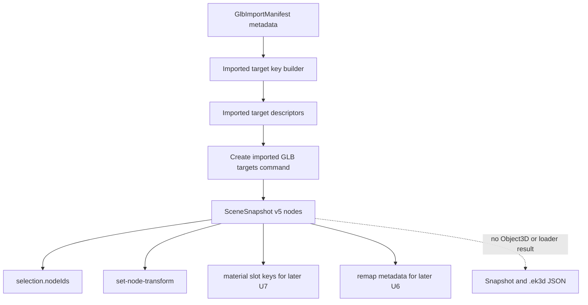
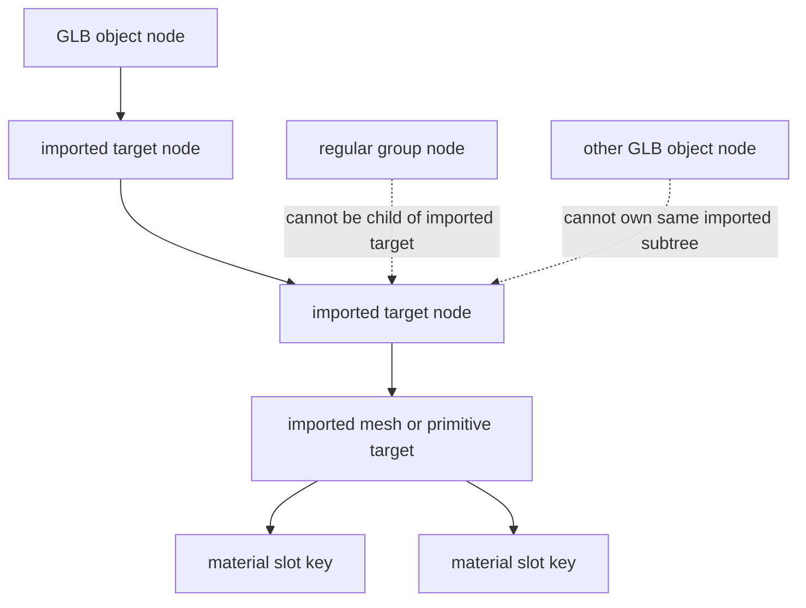

# feat: Add imported GLB target schema

## Summary

Detail roadmap U4 into an implementation-ready schema plan: add durable imported GLB target identity on top of the existing `SceneNode` / `NodeId` contract so GLB internals can become selectable, transformable, problem-addressable, material-slot-addressable, and remap-ready without copying runtime glTF scene graphs into `SceneSnapshot`.

This plan stops at durable schema, target-key generation, command integration, validation, selection/transform compatibility, public exports, and documentation. Runtime projection/picking, reimport remap, slot-aware material projection, and Workbench hierarchy UI are downstream roadmap units.

---

## Problem Frame

The editor can already import GLB assets as object nodes, store JSON-compatible `glbImportManifest` metadata, show import diagnostics in the asset workspace, and use `SceneNode` as the canonical hierarchy and selection target. That supports simple object-level authoring, but real GLB files contain internal nodes, meshes, primitives, and material slots that users need to address independently.

The missing contract is not runtime traversal. The missing contract is durable target identity: a stable way to represent imported GLB internals in snapshot JSON, tie those targets to an owning GLB object, preserve object-level import as the simple path, and give later runtime/remap/material/binding work one shared ID system. This must remain snapshot-first: no `Object3D`, `Material`, `Texture`, parser, resolver result, object URL, `File`, `Blob`, image bitmap, decoder object, or loader output may enter durable state.

---

## Requirements

**Durable Imported Targets**

- R1. Core must represent imported GLB internals as durable `SceneNode` targets owned by a parent GLB object, not as copied Three.js or glTF runtime objects. (origin R5, R6, R22)
- R2. Object-level GLB import must remain the default/simple path and existing v4 snapshots must migrate without invented imported targets. (origin R5, R22)
- R3. Each imported target must carry a stable import key, source kind, source descriptor, display name, owner object ID, parent/child relationship, optional transform override, and JSON-compatible remap metadata. (origin R6, R7)
- R4. Imported material slot descriptors must receive stable slot keys that later material assignment, problem reporting, remap, and binding work can reference. (origin R6, R8, R20)

**Hierarchy, Selection, and Commands**

- R5. Imported target nodes must participate in `selection.nodeId/nodeIds`, hierarchy traversal, delete cleanup, and transform commands while keeping `selection.objectId/objectIds` as object-only compatibility mirrors. (origin R5, R6, R21)
- R6. Imported target hierarchy must remain owned by one GLB object: imported nodes cannot become roots, cannot move under unrelated scene nodes, and cannot contain regular group/object/light nodes. (origin R6, R7)
- R7. A command or operation must be able to create/update imported targets from a `GlbImportManifest` deterministically and undoably. (origin R5, R6, R22)
- R8. Deleting an owner GLB object must remove its imported target subtree and any imported-target material-slot assignments that are already present, without deleting unrelated material definitions. (origin R6, R8)

**Validation, Public Contract, and Documentation**

- R9. Snapshot validation must reject malformed imported target metadata, duplicate target keys within one owner, invalid owner references, non-JSON-compatible metadata, invalid target hierarchy, and runtime-only values. (origin R6, R22, R23)
- R10. Core public exports must expose stable imported-target types/builders and keep runtime projectors, loader/parser objects, resource managers, and project-store internals private. (origin R21, R22)
- R11. Documentation must describe imported target schema, stable key semantics, selection compatibility mirrors, material slot key boundaries, and deferred runtime/remap behavior. (origin R6, R7, R8, R20)
- R12. Tests must prove migration, validation, serialization, target key determinism, command rollback, selection mirroring, transform persistence, and cleanup behavior. (origin R22, R23)

---

## Scope Boundaries

### Included

- Snapshot schema version bump for imported GLB target nodes.
- Imported target node contract, owner constraints, stable target keys, source descriptors, optional transform override, and remap metadata.
- Imported material slot descriptor/key contract, without material runtime projection.
- Deterministic target creation from `GlbImportManifest`.
- Command/operation integration for opt-in expanded import.
- Validation, migration, serialization, node selection, transform, delete cleanup, public exports, and docs.

### Deferred to Follow-Up Work

- Runtime projection and picking for imported targets.
- GLB reimport diff/remap command and recoverable unresolved target problems.
- Slot-aware material projection and material slot inspector UI.
- Workbench hierarchy/tree rendering for imported internals.
- Marquee selection, viewport helpers, authored cameras, environment/sky, shadows, viewer mode, storage recipes, and AIoT binding implementation.

### Outside This Product Identity for This Stage

- Full ECS, prefab/template system, or glTF scene authoring engine.
- Editing glTF topology, mesh geometry, animation clips, skins, variants, full glTF material graphs, node materials, or shader graphs.
- Persisting `GLTFLoader`, parser, Three.js `Object3D`, `BufferGeometry`, `Material`, `Texture`, `Camera`, `AnimationClip`, decoder instances, `File`, `Blob`, object URLs, resolver output, loaded scene resources, image bitmaps, or runtime problems into snapshot or `.ek3d` JSON.

---

## Assumptions

- The current `SceneSnapshot.version = 4` and `SceneNode` hierarchy from `docs/plans/2026-06-03-001-feat-scene-node-contract-plan.md` remain the foundation.
- The decoder-aware GLB import pipeline is available or lands first, including `GlbImportManifest`, deterministic descriptor paths, and `glbImportManifest` asset metadata.
- The first imported target schema can be core-only. React/Vue UI exposure can follow after runtime projection and hierarchy model work.
- External research is not load-bearing for this plan because the local roadmap, schema docs, and implemented manifest contract already define the needed architecture.

---

## Key Technical Decisions

- KTD1. Imported GLB internals become a new `SceneNode` kind: The target layer already owns hierarchy, selection, transform, and future binding semantics. Adding imported targets to `SceneNode` avoids a parallel `importedTargets` map and keeps object/group/light/imported targets addressable by `NodeId`.
- KTD2. Bump the snapshot schema version: A new node kind and validation rules are durable contract changes. v4 snapshots should migrate to the new version unchanged except for version shape; migration must not synthesize imported targets from existing object metadata.
- KTD3. Separate editor `NodeId` from source `importKey`: `node.id` is the durable editor identity used by selection, history, and commands. `importKey` is the GLB source identity used for runtime matching and future reimport remap. First creation may derive node IDs from keys, but reimport can later preserve node IDs while updating source metadata.
- KTD4. Owner boundaries are strict: Every imported target references one `ownerObjectId`; its parent must be the owner object node or another imported target with the same owner. This keeps GLB internals as an overlay under their asset-backed object instead of becoming arbitrary scene topology.
- KTD5. Transform overrides live on imported target nodes only when authored: Imported targets may carry a transform because selection and TransformControls need a durable commit target. `syncPayloadsFromNodes()` must ignore imported nodes so object/light compatibility payloads are not polluted.
- KTD6. Material slot identity is defined before material behavior: The schema should generate stable slot keys and descriptors now, but `set-material` projection and inspector UI stay deferred. Existing `MaterialAssignmentTarget` can keep using `objectId + slotId`, with U7 validating/projecting slot existence later.
- KTD7. Expanded import is opt-in and undoable: Default GLB import stays object-level. Creating imported targets from a manifest should happen through a command or command-backed operation so undo/redo, validation, and rollback remain consistent with the rest of core.
- KTD8. Unresolved future remap state is durable but not destructive: U4 should store enough JSON-compatible source/remap hints for U6, but it should not delete imported nodes because runtime matching is unavailable or because a future payload differs. Runtime/reimport problems are derived later.

---

## High-Level Technical Design





The schema shape should preserve these fields, while exact TypeScript names can follow implementation constraints:

```ts
type SceneNode =
  | SceneObjectNode
  | SceneGroupNode
  | SceneLightNode
  | SceneImportedGlbNode;

interface SceneImportedGlbNode {
  id: NodeId;
  kind: "imported";
  name: string;
  ownerObjectId: string;
  importKey: string;
  source: ImportedGlbSourceDescriptor;
  parentId: NodeId | null;
  children: NodeId[];
  transform?: Transform;
  materialSlots?: ImportedGlbMaterialSlotDescriptor[];
  remap?: ImportedGlbRemapMetadata;
  metadata?: Record<string, JsonValue>;
}
```

---

## Implementation Units

### U1. Snapshot version and imported node contract

- **Goal:** Define the durable imported GLB node schema and migrate existing snapshots into the new version without changing existing scene behavior.
- **Requirements:** R1, R2, R3, R4, R9, R12.
- **Dependencies:** Scene node contract plan and decoder-aware import manifest plan.
- **Files:** `packages/core/src/snapshot/types.ts`, `packages/core/src/snapshot/defaults.ts`, `packages/core/src/snapshot/migrations.ts`, `packages/core/src/snapshot/validation.ts`, `packages/core/src/snapshot/nodes.ts`, `packages/core/src/snapshot/snapshot.test.ts`, `docs/schema.md`.
- **Approach:** Add a current snapshot version that includes `SceneImportedGlbNode` in the `SceneNode` union. Preserve the existing v4 shape as a migrated previous version. Imported node fields should include owner object ID, stable import key, source descriptor, optional transform, material slot descriptors, remap metadata, and JSON-compatible metadata. Migration from v4 should copy object/group/light nodes unchanged and leave imported targets empty.
- **Execution note:** Start with failing migration and validation tests because this is durable contract work.
- **Patterns to follow:** v3-to-v4 migration in `packages/core/src/snapshot/migrations.ts`, `createObjectNode()` / `createLightNode()` in `packages/core/src/snapshot/defaults.ts`, JSON-compatible validation in `packages/core/src/snapshot/validation.ts`.
- **Test scenarios:**
  - Given a valid v4 snapshot with object, group, light, materials, environment, and asset metadata, when migration runs, then the new snapshot version preserves every existing node and does not create imported targets.
  - Given an imported node references an existing GLB object owner, uses a unique import key, and stores JSON-compatible source/remap metadata, when validation runs, then the snapshot is valid.
  - Given an imported node references a missing owner object, when validation runs, then the snapshot is rejected with an owner-specific error.
  - Given two imported nodes under the same owner use the same import key, when validation runs, then the snapshot is rejected for duplicate owner-local target identity.
  - Given imported node metadata contains `Object3D`, `File`, `Blob`, object URL, function, class instance, parser, or texture-like runtime data, when validation runs, then the snapshot is rejected as non-JSON-compatible.
  - Given object-level GLB import is used with no expanded targets, when serialization/restoration runs, then behavior matches current object-node snapshots.
- **Verification:** The schema has a durable place for imported GLB internals while v4 scenes remain backward-compatible and runtime-only values remain excluded.

### U2. Stable target and material slot key generation

- **Goal:** Build deterministic imported target keys and material slot keys from `GlbImportManifest` descriptors.
- **Requirements:** R3, R4, R7, R9, R12.
- **Dependencies:** U1 and `GlbImportManifest` descriptor paths from the decoder-aware import pipeline.
- **Files:** `packages/core/src/imported-targets/keys.ts`, `packages/core/src/imported-targets/keys.test.ts`, `packages/core/src/imported-targets/types.ts`, `packages/core/src/assets/import-pipeline.ts`, `packages/core/src/assets/import-pipeline.test.ts`, `docs/schema.md`.
- **Approach:** Add a pure key builder that consumes manifest scenes/nodes/meshes/primitives/materials and emits JSON-compatible imported target descriptors. Prefer manifest descriptor paths such as `nodes/1` and `meshes/0/primitives/1`; include source kind, index/path, mesh/material relationships, parent relationships, display names, and fingerprint hints. Material slot keys should be stable strings derived from owner object, primitive/source path, and material relationship, but they should not require runtime `Material` instances.
- **Patterns to follow:** Deterministic manifest sorting in `packages/core/src/assets/import-pipeline.ts`, asset workspace deterministic ordering in `packages/core/src/assets/workspace.ts`, material assignment ID conventions in `packages/core/src/materials/defaults.ts`.
- **Test scenarios:**
  - Given the same manifest is processed twice, when target descriptors are generated, then imported target keys, slot keys, and ordering are identical.
  - Given manifest traversal order changes but descriptor paths and indices are equivalent, when key generation runs, then output order and keys remain deterministic.
  - Given a mesh has multiple primitives with distinct material indices, when slot descriptors are generated, then each primitive/material relationship receives a distinct stable slot key.
  - Given a manifest lacks glTF JSON and uses runtime fallback descriptor paths, when key generation runs, then keys are still deterministic for that fallback manifest.
  - Given two target descriptors would collide after sanitization, when key generation runs, then collision-safe keys are produced without changing the source descriptor metadata.
  - Given generated descriptors are stringified, then no runtime objects, resolver URIs, loader parser data, materials, textures, or object URLs appear.
- **Verification:** U5, U6, U7, and future binding work can all use one stable key source instead of inventing separate target IDs.

### U3. Expanded imported target command integration

- **Goal:** Add an undoable command or command-backed operation that creates imported GLB target nodes from a GLB object's manifest metadata.
- **Requirements:** R2, R3, R4, R7, R9, R12.
- **Dependencies:** U1, U2.
- **Files:** `packages/core/src/commands/types.ts`, `packages/core/src/commands/dispatcher.ts`, `packages/core/src/commands/import-glb.ts`, `packages/core/src/commands/import-glb.test.ts`, `packages/core/src/commands/create-imported-glb-targets.ts`, `packages/core/src/commands/create-imported-glb-targets.test.ts`, `packages/core/src/editor/editor-api.ts`, `packages/core/src/editor/lifecycle.ts`, `packages/core/src/editor/lifecycle.test.ts`, `packages/core/src/imported-targets/create.ts`, `packages/core/src/imported-targets/create.test.ts`.
- **Approach:** Keep `import-glb` object-level behavior intact. Add an opt-in expanded target path that can run after a successful analyzed import, or as a separate command against an existing GLB object with `glbImportManifest` metadata. The command should generate imported nodes, attach them under the owner object node, preserve manifest parent/child order, create material slot descriptors, and fail without mutation when manifest metadata is missing or invalid.
- **Execution note:** Characterize current `import-glb` command behavior before extending command types, especially parent validation and rollback.
- **Patterns to follow:** `applyImportGlb()` rollback through `CommandDispatcher`, hierarchy updates through `reparentNode()` / `syncPayloadsFromNodes()`, command tests in `packages/core/src/commands/import-glb.test.ts`.
- **Test scenarios:**
  - Given `import-glb` is dispatched without expanded import options, when it succeeds, then it creates only the GLB object node and keeps current default behavior.
  - Given a GLB asset has valid `glbImportManifest` metadata, when the expanded target command runs, then imported nodes are created under the owner object node with deterministic IDs, import keys, source descriptors, and material slot keys.
  - Given the owner object does not exist or is not GLB-backed, when the command runs, then it fails without mutating snapshot or asset registry state.
  - Given the manifest is malformed or missing required descriptors, when the command runs, then it fails with a command error and leaves the object-level import intact.
  - Given undo runs after expanded target creation, then imported nodes disappear and the owner object remains exactly as it was before expansion.
  - Given redo runs after undo, then imported node IDs, import keys, children order, and material slot descriptors are restored.
  - Given expanded target creation is batched with analyzed GLB import, when later command in the batch fails, then the whole durable mutation rolls back through existing dispatcher semantics.
- **Verification:** Expanded import becomes an explicit durable authoring choice without making simple GLB import more complex or less stable.

### U4. Hierarchy, selection, transform, and cleanup semantics

- **Goal:** Make imported target nodes work with existing node selection and transform flows while preserving object-only compatibility mirrors and owner subtree invariants.
- **Requirements:** R5, R6, R8, R9, R12.
- **Dependencies:** U1, U3.
- **Files:** `packages/core/src/commands/node-state.ts`, `packages/core/src/commands/set-node-transform.ts`, `packages/core/src/commands/set-node-transform.test.ts`, `packages/core/src/commands/select-node.ts`, `packages/core/src/commands/select-node.test.ts`, `packages/core/src/commands/delete-nodes.ts`, `packages/core/src/commands/node-mutation-commands.test.ts`, `packages/core/src/commands/reparent-node.ts`, `packages/core/src/commands/reparent-node.test.ts`, `packages/core/src/selection/selection.ts`, `packages/core/src/selection/selection.test.ts`, `packages/core/src/snapshot/hierarchy.ts`, `packages/core/src/snapshot/validation.ts`.
- **Approach:** Treat imported nodes as node-level targets for selection and transform. `selection.nodeIds` may include imported nodes; `selection.objectIds` remains derived only from selected object nodes. `syncPayloadsFromNodes()` should ignore imported node transforms except for preserving them on the node itself. Delete cleanup should remove imported target subtrees under deleted owners and remove assignments whose target slot key belongs to removed imported material slots. Reparent/group/ungroup should reject moves that would put imported targets outside their owner object subtree or put regular nodes under imported targets.
- **Patterns to follow:** `normalizeNodeSelection()` object mirror behavior, `nodeSupportsTransform()` in `packages/core/src/commands/node-state.ts`, mixed node cleanup in `packages/core/src/commands/delete-nodes.ts`, hierarchy validation in `packages/core/src/snapshot/validation.ts`.
- **Test scenarios:**
  - Given an imported target node is selected, when selection normalizes, then `selection.nodeId` points to the imported node and `selection.objectId` is `null` unless an object node is also selected through the compatibility mirror rules.
  - Given an imported node and object node are both selected with the imported node primary, when validation runs, then `selection.objectIds` mirrors only the selected object nodes in stable order.
  - Given `set-node-transform` targets an imported node with transform support, when dispatch succeeds, then only the imported node transform changes and no `objects` or `lights` payload is modified.
  - Given `set-transform` targets the owner object, when dispatch succeeds, then object-level compatibility behavior remains unchanged and imported child transforms are not overwritten.
  - Given a user tries to reparent an imported node under a different GLB object, group, light, or root, when the command runs, then it fails without mutation.
  - Given a user tries to reparent a regular group/object/light node under an imported node, when the command runs, then it fails without mutation.
  - Given an owner GLB object is deleted, when cleanup runs, then its imported descendants and imported material-slot assignments are removed while unrelated material definitions and assignments remain.
  - Given an imported node is deleted directly, when cleanup runs, then its subtree and slot assignments are removed while the owner object remains.
- **Verification:** Imported GLB internals behave as first-class node targets where intended, but they do not corrupt object compatibility payloads or scene topology.

### U5. Material slot and future binding target boundary

- **Goal:** Define the schema boundary that later material-slot editing and AIoT binding can consume without implementing those behaviors in this slice.
- **Requirements:** R4, R8, R10, R11, R12.
- **Dependencies:** U1, U2, U4.
- **Files:** `packages/core/src/imported-targets/types.ts`, `packages/core/src/imported-targets/slots.ts`, `packages/core/src/imported-targets/slots.test.ts`, `packages/core/src/materials/types.ts`, `packages/core/src/materials/validation.ts`, `packages/core/src/materials/materials.test.ts`, `packages/core/src/problems/types.ts`, `packages/core/src/public-api.ts`, `packages/core/src/index.ts`, `packages/core/src/public-api.test.ts`, `docs/schema.md`.
- **Approach:** Keep `MaterialAssignmentTarget` source-compatible, but document and validate the imported slot key format enough for downstream U7. Validation should continue to allow durable material-slot assignments even when a slot cannot be resolved, because slot disappearance after reimport must become a recoverable problem rather than a validation failure. Add target descriptor helpers that future binding metadata can reference by `nodeId`, owner object ID, import key, and slot key without importing runtime modules.
- **Patterns to follow:** `MaterialAssignmentTarget` and `createMaterialAssignmentId()` in `packages/core/src/materials`, problem target shape in `packages/core/src/problems/types.ts`, public API export tests.
- **Test scenarios:**
  - Given an imported target has two material slot descriptors, when slot lookup runs by slot key, then it returns the expected owner object, imported node, source descriptor, and display label.
  - Given a material assignment references an existing imported slot key, when material validation runs, then it remains valid and JSON-compatible.
  - Given a material assignment references a slot key that no imported target currently exposes, when validation runs, then the assignment remains durable and is not deleted by schema validation.
  - Given a slot descriptor contains non-JSON-compatible metadata, when snapshot validation runs, then the snapshot is rejected.
  - Given public package exports are inspected, then imported target and slot descriptor types/helpers are exported while runtime projectors, loader adapters, resource managers, and project store internals remain private.
  - Given a future binding target descriptor is stringified, then it contains only stable IDs/keys and no host preview values, protocol clients, runtime objects, or resolver data.
- **Verification:** U4 gives material and binding work a stable target identity without prematurely implementing material projection or IoT runtime behavior.

### U6. Documentation and acceptance coverage

- **Goal:** Update durable contract documentation and focused acceptance tests so implementers and downstream plans can rely on the imported target schema.
- **Requirements:** R10, R11, R12.
- **Dependencies:** U1-U5.
- **Files:** `docs/schema.md`, `docs/architecture.md`, `docs/interactions.md`, `docs/project-package.md`, `docs/plans/2026-06-05-001-feat-real-user-editor-roadmap-plan.md`, `packages/core/src/public-api.test.ts`, `packages/core/src/editor/proof-loop.integration.test.ts`, `packages/core/src/project/export-project.test.ts`, `packages/core/src/project/import-project.test.ts`.
- **Approach:** Document the new snapshot version, imported node fields, owner hierarchy constraints, imported material slot descriptors, selection mirror rules, and non-goals. Add integration coverage proving expanded imported targets survive serialize/restore and `.ek3d` export/import without runtime leakage. The roadmap can link this sub-plan under U4 after implementation starts or completes; plan creation alone should not mark roadmap progress complete.
- **Patterns to follow:** `docs/schema.md` v4 node documentation, `.ek3d` durability language in `docs/project-package.md`, existing proof-loop serialization tests.
- **Test scenarios:**
  - Given a snapshot with imported GLB targets and slot descriptors, when it is serialized and restored, then imported node IDs, import keys, owner references, transforms, material slot descriptors, and selection state survive.
  - Given the same scene is exported to `.ek3d` and imported into a fresh editor, when project import completes, then `scene.json` contains imported target metadata and asset payloads remain under `assets/*`.
  - Given exported project JSON is inspected, then it contains no `Object3D`, `Material`, `Texture`, `Camera`, `AnimationClip`, parser, resolver URI, object URL, `File`, `Blob`, image bitmap, decoder object, PMREM output, or runtime problem object.
  - Given docs describe imported target selection, when compared with implementation, then `selection.nodeIds` is canonical and `selection.objectIds` is documented as an object-only compatibility mirror.
  - Given docs describe material slot keys, when compared with implementation, then they state slot identity is durable while runtime slot projection and unresolved slot problems are deferred.
  - Given the roadmap is updated, then U4 links this plan without changing unrelated roadmap unit status.
- **Verification:** The schema change is understandable, portable, and covered by durable serialization/project package tests before runtime projection builds on it.

---

## Acceptance Examples

- AE1. Given a v4 scene with one imported GLB object, when migration runs, then the new snapshot version preserves the object and creates no imported target nodes.
- AE2. Given a GLB object with `glbImportManifest` metadata containing nodes, meshes, primitives, and materials, when expanded target creation runs, then the snapshot contains imported nodes with deterministic import keys and material slot keys under the owner object node.
- AE3. Given an imported mesh target is selected and transformed, when the snapshot is serialized and restored, then `selection.nodeId` and the imported node transform survive while `selection.objectId` remains an object-only compatibility mirror.
- AE4. Given an imported target contains invalid owner references, duplicate import keys, or runtime-only metadata, when validation runs, then the snapshot is rejected before it reaches command history.
- AE5. Given an owner GLB object with imported descendants is deleted, when cleanup completes, then imported target nodes and their imported slot assignments are removed while unrelated material definitions and assets remain.
- AE6. Given a material assignment references an imported slot key that later has no matching slot descriptor, when validation runs, then the durable assignment remains available for future unresolved-slot problem reporting.
- AE7. Given an expanded imported target scene is exported as `.ek3d`, when `scene.json` is inspected, then it contains only JSON-compatible target keys/descriptors and no runtime loader, resolver, or Three.js values.

---

## System-Wide Impact

- **Snapshot compatibility:** This is a schema-versioned change. Migration, validation, docs, serialization tests, project package tests, and public API tests must land with the schema.
- **Command semantics:** Node commands gain a fourth node kind. Selection, transform, delete, reparent, group, and ungroup paths must either support imported nodes or reject them with clear errors.
- **Material future path:** Slot keys become the shared target identity for U7 material projection. Current object-level material override remains valid and should not be rewritten in this slice.
- **Runtime future path:** U5 runtime projection will map loaded `Object3D` / mesh instances to imported node IDs using `importKey`. U4 must not assume runtime objects exist.
- **Public API:** Imported target types/builders become package-root exports while runtime internals stay private.
- **Performance posture:** Large GLBs can produce many imported targets. U4 should keep schema/builders deterministic and pure; runtime virtualization or hierarchy UI filtering belongs to downstream UI/runtime work.

---

## Risks and Dependencies

| Risk | Impact | Mitigation |
|---|---|---|
| Imported targets are modeled outside `SceneNode` | Selection, transform, binding, and material targets split into competing ID systems | Add a new node kind and keep `NodeId` canonical. |
| Target keys overfit object names | Reimport/remap loses edits when names change | Prefer manifest descriptor paths and mesh/primitive/material relationships; keep names as display/fallback metadata only. |
| Node ID and import key are conflated | Future reimport cannot preserve editor identity while updating source identity | Store both `node.id` and `importKey`; document their different responsibilities. |
| Imported hierarchy becomes arbitrary scene topology | Users can create states runtime projection cannot map back to GLB internals | Enforce owner subtree constraints in validation and reparent/group commands. |
| Validation deletes unresolved material slots | Reimport failure would lose user edits | Keep unresolved slot assignments durable; downstream runtime/remap emits recoverable problems. |
| Schema change skips migration rigor | Existing snapshots or `.ek3d` projects break | Treat v4 as previous schema and test migration, export, import, and validation together. |
| Public exports expose runtime internals | Experimental internals harden into accidental API | Export only imported target descriptors/builders and keep projector/loader/resource manager modules private. |

---

## Documentation Notes

- `docs/schema.md` should describe the new snapshot version, `SceneImportedGlbNode`, owner constraints, target keys, material slot descriptors, and selection compatibility mirrors.
- `docs/architecture.md` should update the Snapshot-to-runtime diagram to show imported target nodes as durable targets and runtime GLB internals as projections.
- `docs/interactions.md` should document that expanded GLB import is opt-in and that imported target transforms are durable command commits.
- `docs/project-package.md` should state that `.ek3d` stores imported target JSON in `scene.json` and asset payloads under `assets/*`, with no loader/runtime output.
- Integration docs can defer UI instructions until runtime projection and Workbench hierarchy rendering land.

---

## Sources and Research

- Roadmap source: `docs/plans/2026-06-05-001-feat-real-user-editor-roadmap-plan.md`.
- Imported target origin ideation: `docs/ideation/2026-06-05-real-user-3d-editor-delivery-readiness-ideation.md`.
- Scene node contract dependency: `docs/plans/2026-06-03-001-feat-scene-node-contract-plan.md`.
- Decoder-aware import manifest dependency: `docs/plans/2026-06-05-003-feat-decoder-aware-glb-import-pipeline-plan.md`.
- Asset workspace dependency: `docs/plans/2026-06-05-002-feat-local-asset-workspace-model-plan.md`.
- Current schema and docs: `docs/schema.md`, `docs/architecture.md`, `docs/project-package.md`, `docs/interactions.md`.
- Core code references: `packages/core/src/snapshot/types.ts`, `packages/core/src/snapshot/validation.ts`, `packages/core/src/snapshot/migrations.ts`, `packages/core/src/snapshot/defaults.ts`, `packages/core/src/commands/import-glb.ts`, `packages/core/src/commands/node-state.ts`, `packages/core/src/commands/delete-nodes.ts`, `packages/core/src/selection/selection.ts`, `packages/core/src/materials/types.ts`, `packages/core/src/assets/import-pipeline.ts`.
- Existing tests to preserve: `packages/core/src/snapshot/snapshot.test.ts`, `packages/core/src/commands/import-glb.test.ts`, `packages/core/src/commands/node-mutation-commands.test.ts`, `packages/core/src/commands/set-node-transform.test.ts`, `packages/core/src/assets/import-pipeline.test.ts`, `packages/core/src/public-api.test.ts`, `packages/core/src/project/export-project.test.ts`, `packages/core/src/project/import-project.test.ts`.
