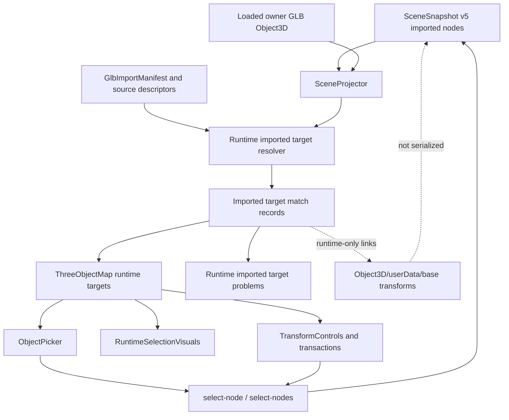
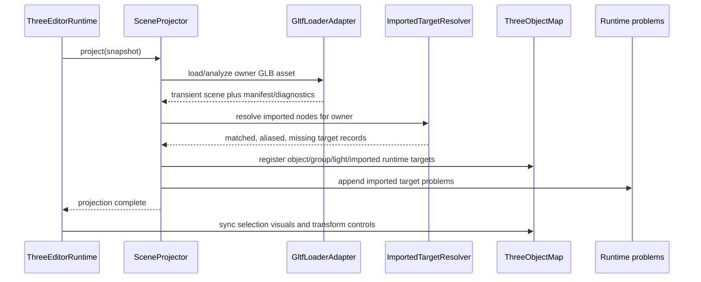
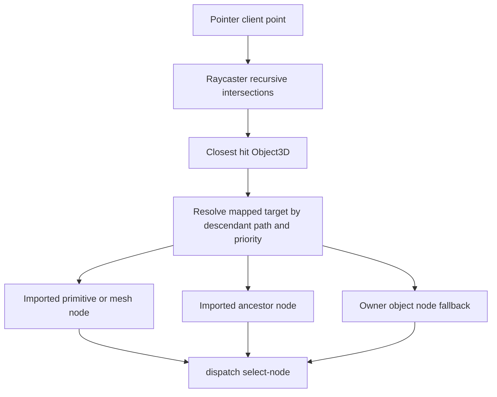

# feat: Project and pick imported GLB targets at runtime

## Summary

Detail roadmap U5 into an implementation-ready runtime plan: map durable imported GLB target nodes onto loaded Three.js GLB descendants, make pointer picking select the most specific imported target, and let selection visuals, framing, and TransformControls operate on those targets without serializing runtime-only links.

This plan assumes the imported target schema exists. It does not design new durable target fields, reimport remap, slot-aware material projection, React/Vue hierarchy UI, marquee selection, or viewport helper controls.

---

## Problem Frame

The current schema can represent GLB internals as `SceneImportedGlbNode` records with `ownerObjectId`, `importKey`, source descriptors, optional transform overrides, and material slot descriptors. The runtime projector also recognizes `node.kind === "imported"`, but today it projects imported nodes as standalone `Group` placeholders with `pickable: false`. That keeps snapshots valid, but it does not connect imported nodes to the actual GLB scene loaded by `GLTFLoader`.

Real users need the runtime half of the contract: when the loaded GLB contains a child mesh or primitive that matches an imported target key, viewport selection should hit that target, hierarchy selection should reveal that target, selection bounds should frame that target, and transform commits should update only that imported node's durable transform. If a target cannot be found in the loaded scene, the durable node must remain and a runtime problem must explain the mismatch.

The invariant from the roadmap still controls this work: loaded `Object3D`, `Material`, `Texture`, parser associations, resolver output, object URLs, runtime selection helpers, and runtime problems stay transient. Durable state remains `SceneSnapshot` JSON plus asset payloads in `.ek3d`.

---

## Requirements

**Runtime Target Mapping**

- R1. Runtime projection must map expanded imported GLB nodes to loaded `Object3D` descendants using `ownerObjectId`, `importKey`, and `source` descriptors from the imported target schema. (origin R5, R6)
- R2. Imported target projection must link to objects already inside the loaded owner GLB scene instead of reparenting or duplicating GLB descendants under placeholder groups. (origin R6, R23)
- R3. `ThreeObjectMap` must expose imported targets through `getNodeTarget()` / `getTarget()` with metadata for kind, owner object ID, import key, source, pickability, transformability, and match status. (origin R6, R10, R21)
- R4. If an imported node has no authored transform, runtime projection must preserve the loaded GLB local transform; if it has an authored transform, projection must apply that override only to the matched imported runtime object. (origin R6, R23)
- R5. Missing, ambiguous, or non-transformable imported target matches must surface as runtime problems targeting the imported node, while preserving the durable imported node and any authored transform. (origin R7, R23)

**Picking, Selection, and Authoring Controls**

- R6. Pointer picking that hits a GLB child mesh must select the most specific mapped imported target instead of falling back to the parent object node. (origin R5, R6)
- R7. Pointer picking must ignore runtime-only helpers, selection boxes, light pick proxies not intended for imported targets, and problem placeholders when choosing imported target hits. (origin R10, R23)
- R8. Programmatic selection, selection visuals, `frameSelected()`, and `frameAll()` must work for resolved imported targets through the same node-target runtime map used by objects, groups, and lights. (origin R10, R11)
- R9. TransformControls must attach to transformable imported runtime targets and commit durable changes through `set-node-transform`, not through object-level `set-transform`. (origin R6, R21)
- R10. Transform preview/cancel/commit must restore loaded GLB base transforms correctly when selection changes, projection reruns, or an imported target disappears during a drag. (origin R6, R23)
- R11. Core inspector and Workbench models must expose selected imported target context and imported-target runtime problems so framework adapters can render them without owning editor semantics. (origin R6, R21)

**Compatibility and Durability**

- R12. Object-level GLB import remains pickable and transformable when no expanded imported targets exist, and existing object/group/light runtime behavior must not regress. (origin R5, R21)
- R13. Serialization, project export, and runtime problem tests must prove imported target runtime links, base transform caches, parser associations, loaded scenes, helper objects, and resolver outputs do not enter `SceneSnapshot` or `.ek3d` JSON. (origin R23, R24)

---

## Scope Boundaries

### Included

- Core runtime mapping from `SceneImportedGlbNode` to loaded GLB descendants.
- Runtime-only imported target resolver and match status model.
- `ThreeObjectMap` support for imported target metadata, descendant links, alias targets, and picking specificity.
- Scene projector integration that replaces current imported placeholder `Group` behavior.
- Imported-target pointer picking, selection userData, selection bounds, camera framing, and TransformControls commits.
- Runtime problems for missing, ambiguous, stale, or non-transformable imported targets.
- Disposal, stale projection, serialization, browser picking, and editor runtime tests.
- Documentation updates for runtime projection boundaries.

### Deferred to Follow-Up Work

- GLB reimport diff/remap and preservation of unresolved target edits.
- Slot-aware material runtime projection and material slot inspector UI.
- React/Vue hierarchy tree rendering for imported internals.
- Marquee selection, grid/floor/axes helpers, snap feedback UI, authored cameras, environment/sky cleanup, shadows, viewer mode, storage recipes, and AIoT binding implementation.
- Full glTF animation, skin, morph target, variant, or material graph authoring.

### Outside This Product Identity for This Stage

- Editing glTF topology, geometry, primitive splitting, skeletons, animations, shaders, or node material graphs.
- Persisting `GLTFLoader`, parser associations, `Object3D`, `BufferGeometry`, `Material`, `Texture`, `Camera`, `AnimationClip`, object URLs, resolver outputs, image bitmaps, runtime helpers, or runtime problems into snapshot or `.ek3d` JSON.
- Depending on React/Vue components for editor semantics. Framework adapters remain thin render/dispatch layers.

---

## Assumptions

- The imported target schema from `docs/plans/2026-06-08-002-feat-imported-glb-target-schema-plan.md` is available or lands first, including `SceneImportedGlbNode`, imported material slot descriptors, validation, command integration, and project package serialization.
- The decoder-aware import pipeline from `docs/plans/2026-06-05-003-feat-decoder-aware-glb-import-pipeline-plan.md` is available or lands first, including `GlbImportManifest` and structured loader diagnostics.
- Runtime matching can use loaded GLB result metadata when available and fall back to deterministic traversal descriptors when loader associations are unavailable.
- Some imported targets may alias the same `Object3D` when the loader collapses mesh/primitive granularity. The runtime should still allow picking and inspection, but TransformControls should attach only when a target has an independent transformable object.
- External research was narrow and implementation-guidance only. Official Three.js docs confirm that `Raycaster.intersectObjects()` returns closest recursive intersections, `Box3.setFromObject()` computes world-space descendant bounds, and `GLTFLoader` returns transient scene/scenes/cameras/animations/parser data that must be handled as runtime state.

---

## Key Technical Decisions

- KTD1. Imported targets are runtime links into the loaded GLB scene: The projector should not create durable-looking placeholder groups for matched imported nodes. It should register a runtime target entry pointing at the loaded descendant that corresponds to the imported node.
- KTD2. Matching is resolver-owned, not scattered across picking and transform code: Add a focused runtime imported target resolver that converts owner object, loaded GLB scene, manifest/source descriptors, and imported nodes into match records. Scene projection, picking, transform, and diagnostics consume that resolver output.
- KTD3. Exact source matches beat name matches: Prefer `importKey`, descriptor path, mesh/primitive/material indices, and runtime loader associations. Names are display/fallback metadata only because users and exporters can rename GLB nodes.
- KTD4. Picking chooses the most specific mapped target: When a ray hits a mesh descendant, the object map should resolve the nearest and most specific imported target for that hit object before falling back to imported ancestors or the owner object node.
- KTD5. Authored transform overrides are applied relative to runtime base transforms: The runtime must capture a base transform for each matched imported target, restore it when no override exists, and apply durable `node.transform` only when authored.
- KTD6. Missing imported targets are problems, not mutations: If a durable imported node cannot be matched, runtime emits a recoverable problem and keeps the snapshot untouched. Reimport/remap owns any future durable resolution.
- KTD7. Runtime aliases are explicit and bounded: If multiple imported nodes map to one `Object3D`, the map should record alias status and pick priority. Transformability should be disabled or problem-reported when applying a distinct transform would mutate a shared runtime object ambiguously.
- KTD8. Material slot and binding consumers reuse the same target identity later: U5 should expose enough runtime metadata for future slot projection and binding diagnostics, but it should not implement material slot overrides or AIoT behavior.

---

## High-Level Technical Design

---

## Implementation Units

### U1. Runtime imported target resolver

- **Goal:** Add a pure runtime resolver that matches durable imported GLB nodes to loaded GLB descendants and produces explicit match records.
- **Requirements:** R1, R2, R3, R4, R5, R12, R13.
- **Dependencies:** Imported target schema and decoder-aware GLB import manifest.
- **Files:** `packages/core/src/runtime/imported-target-resolver.ts`, `packages/core/src/runtime/imported-target-resolver.test.ts`, `packages/core/src/runtime/gltf-loader-adapter.ts`, `packages/core/src/assets/import-pipeline.ts`, `packages/core/src/imported-targets/types.ts`, `packages/core/src/snapshot/types.ts`.
- **Approach:** Create a runtime-only resolver that receives the owner object ID, owner runtime root, loaded manifest, asset-stored manifest, and the owner's imported nodes. It should prefer exact loader/manifest associations when available, then deterministic traversal paths from the loaded scene, then safe fallback descriptors. Each result should state whether the node is matched, aliased, missing, ambiguous, pickable, transformable, and what runtime object should be registered. Capture base transforms as runtime-only data.
- **Execution note:** Add focused resolver tests before integrating with `SceneProjector`; the current `#projectImportedNode()` placeholder behavior should be characterized as a temporary fallback that this unit replaces.
- **Patterns to follow:** `packages/core/src/assets/import-pipeline.ts` descriptor path conventions, `packages/core/src/imported-targets/keys.ts` source/key semantics, `packages/core/src/runtime/gltf-loader-adapter.ts` structured load result normalization.
- **Test scenarios:**
  - Given an owner GLB runtime scene and imported nodes with matching node source paths, when the resolver runs, then each imported node receives a matched `Object3D` and runtime source metadata.
  - Given an imported primitive target maps to a mesh descendant with a matching primitive descriptor, when the resolver runs, then the primitive target is pickable and records the primitive source path.
  - Given multiple imported targets map to the same runtime object, when the resolver runs, then match records mark aliases and assign deterministic pick priority.
  - Given a durable imported node has no corresponding loaded descendant, when the resolver runs, then it returns a missing match without mutating the imported node.
  - Given the loaded GLB result has no manifest associations, when fallback traversal runs twice, then match ordering and statuses are deterministic.
  - Given resolver output is inspected or serialized in a test harness, then it contains runtime references only in runtime fields and never enters `SceneSnapshot`.
- **Verification:** Runtime matching is deterministic, isolated, and expressive enough for projection, picking, transform, and future material/binding diagnostics.

### U2. Imported target metadata in `ThreeObjectMap`

- **Goal:** Extend the runtime object map so imported targets can be registered as first-class node targets, including descendant links, alias status, and picking specificity.
- **Requirements:** R3, R6, R7, R8, R12, R13.
- **Dependencies:** U1.
- **Files:** `packages/core/src/runtime/three-object-map.ts`, `packages/core/src/runtime/three-object-map.test.ts`, `packages/core/src/runtime/picking.ts`, `packages/core/src/runtime/picking.browser.test.ts`, `packages/core/src/problems/types.ts`.
- **Approach:** Extend `RuntimeNodeTarget` with imported metadata such as owner object ID, import key, source, match status, and pick priority. Add a way to link descendants or aliases to node IDs without assuming one `Object3D` can only represent one target. `ObjectPicker` should ask the map for the best pick target for the intersected object rather than directly reading a single weak-map ID.
- **Patterns to follow:** Current `ThreeObjectMap.set()`, `link()`, `getId()` ancestor lookup, and light pick proxy mapping.
- **Test scenarios:**
  - Given an imported target is registered against a loaded child mesh, when `getTarget()` and `get()` are called, then they return the imported metadata and runtime object.
  - Given a child mesh has both owner object and imported target mappings in its ancestor chain, when picking asks for the best target, then it returns the imported node ID.
  - Given two imported targets alias one runtime object, when picking resolves the hit, then the highest-priority specific target wins deterministically.
  - Given a runtime-only helper object is linked to the scene but marked `runtimeOnly`, when picking resolves a hit, then no imported target is selected through that helper.
  - Given an imported target is deleted from the map, when the same `Object3D` still has owner mappings, then stale imported links are removed without breaking the owner object target.
  - Given the map is cleared or disposed, then imported aliases, object ID maps, light maps, and weak references are all released.
- **Verification:** Picking and runtime target consumers can distinguish owner objects, imported descendants, aliases, lights, groups, and helpers without duplicating lookup logic.

### U3. Scene projector integration for imported GLB targets

- **Goal:** Replace placeholder imported `Group` projection with links into the loaded owner GLB scene and emit runtime problems for unresolved targets.
- **Requirements:** R1, R2, R3, R4, R5, R12, R13.
- **Dependencies:** U1, U2.
- **Files:** `packages/core/src/runtime/scene-projector.ts`, `packages/core/src/runtime/scene-projector.test.ts`, `packages/core/src/runtime/problems.ts`, `packages/core/src/problems/types.ts`, `packages/core/src/runtime/disposal.test.ts`, `packages/core/src/runtime/missing-asset.integration.test.ts`.
- **Approach:** During object node projection, load or reuse the owner GLB runtime root, preserve object-level mapping, then resolve imported child nodes for that owner. Imported node projection should register links to matched descendants and should not call `parent.add()` for objects already inside the loaded GLB scene. Apply authored imported transforms to matched targets while restoring captured base transforms when no override exists. Missing and ambiguous matches should append runtime problems targeting `{ kind: "imported-target" }`.
- **Execution note:** Guard against the existing recursive projector assumption that every node target is a child to add to its snapshot parent; imported runtime links are references into the owner GLB tree, not new Three.js hierarchy nodes.
- **Patterns to follow:** Current object/light projection in `packages/core/src/runtime/scene-projector.ts`, projection-generation guards, `mergeGlbDiagnostics()`, `disposeObjectTree()`, and material/environment problem aggregation.
- **Test scenarios:**
  - Given an expanded GLB object with imported mesh targets, when projection runs, then `projector.objects.get(importedNodeId)` returns the loaded GLB descendant rather than a new placeholder `Group`.
  - Given a matched imported target is nested inside a loaded owner scene, when projection finishes, then its Three.js parent remains the GLB-loaded parent and is not reparented under a duplicate imported group.
  - Given an imported target has an authored transform override, when projection runs, then only the matched imported runtime object receives that local transform.
  - Given an imported target transform override is later removed, when projection reruns, then the runtime object returns to its loaded GLB base transform.
  - Given a target cannot be matched, when projection runs, then a runtime problem targets the imported node and the durable imported node remains in the snapshot.
  - Given the owner GLB object fails to resolve or load, when projection runs, then owner-level missing/load problems remain and imported target matching does not invent child runtime targets.
  - Given a slow GLB load resolves after a newer projection removed the owner object or imported node, when the old projection finishes, then transient loaded resources are disposed and stale imported links are not restored.
- **Verification:** Imported runtime targets are real links into the loaded asset scene, and unresolved runtime state is represented as problems rather than snapshot mutation.

### U4. Pointer picking, selection visuals, and camera framing

- **Goal:** Make viewport selection and derived selection affordances work on resolved imported GLB targets.
- **Requirements:** R6, R7, R8, R11, R12, R13.
- **Dependencies:** U2, U3.
- **Files:** `packages/core/src/runtime/picking.ts`, `packages/core/src/runtime/picking.browser.test.ts`, `packages/core/src/runtime/editor-runtime.ts`, `packages/core/src/runtime/editor-runtime.test.ts`, `packages/core/src/runtime/selection-visuals.ts`, `packages/core/src/runtime/viewport-controls.ts`, `packages/core/src/commands/select-node.test.ts`, `packages/core/src/inspector/node-targets.ts`, `packages/core/src/inspector/inspector.test.ts`, `packages/core/src/workbench/workbench-model.ts`, `packages/core/src/workbench/workbench-model.test.ts`.
- **Approach:** Update `ObjectPicker` and `ThreeEditorRuntime.selectFromPointer()` to use pickable imported runtime targets and the map's specificity resolver. Keep command dispatch as the only selection mutation path. Selection visuals and `frameSelected()` / `frameAll()` should rely on `RuntimeNodeTarget` entries so imported targets get bounds and camera framing without new selection state. Bounds should use the matched runtime object and existing empty-bounds fallback behavior.
- **Patterns to follow:** Current `ObjectPicker.pickNodeFromClientPoint()`, `resolvePointerSelectionMode()`, `RuntimeSelectionVisuals.sync()`, `frameCameraToObjects()`, `getSelectedNodeTarget()`, and `buildWorkbenchHierarchy()`.
- **Test scenarios:**
  - Given pointer selection hits a child mesh mapped to an imported node, when picking runs, then the dispatched command is `select-node` with the imported node ID.
  - Given pointer selection hits a GLB child that has no imported mapping, when picking runs, then selection falls back to the owner object node.
  - Given imported target and owner object targets overlap in the raycast result, when intersections are resolved, then the closest specific imported target wins.
  - Given shift/ctrl/meta/alt modifiers are used on an imported target hit, when picking runs, then `select-nodes` add/toggle/remove behavior matches existing node selection semantics.
  - Given an imported node is selected, when selection visuals sync, then the bounds helper encloses the matched imported runtime object rather than the full owner GLB object.
  - Given an imported node is selected, when `frameSelected()` runs, then camera controls frame that imported target and snapshot JSON remains unchanged.
  - Given runtime-only helpers are visible, when picking runs, then helpers are ignored and cannot become durable selection.
  - Given an imported target is selected and runtime problems target its import key, when inspector and Workbench models are built, then selection context and hierarchy row problem counts identify the imported node without React/Vue-specific logic.
- **Verification:** Imported GLB internals can be selected from the viewport and behave like node targets for derived visual feedback.

### U5. TransformControls and imported target transform commits

- **Goal:** Let TransformControls preview, cancel, and commit transforms for transformable imported runtime targets through durable node commands.
- **Requirements:** R4, R8, R9, R10, R12, R13.
- **Dependencies:** U2, U3, U4.
- **Files:** `packages/core/src/runtime/transform/transform-controller.ts`, `packages/core/src/runtime/transform/transform-transaction.ts`, `packages/core/src/runtime/transform/transform-controls-adapter.ts`, `packages/core/src/runtime/transform/transform-controls-adapter.test.ts`, `packages/core/src/runtime/transform/transform-controller.browser.test.ts`, `packages/core/src/commands/set-node-transform.ts`, `packages/core/src/commands/set-node-transform.test.ts`, `packages/core/src/runtime/editor-runtime.test.ts`.
- **Approach:** TransformControls should attach to imported targets only when the runtime map marks them transformable. Commit should dispatch `set-node-transform` for the imported node ID and leave owner object transforms unchanged. Preview/cancel should restore the runtime base or pre-drag transform if selection changes, projection reruns, or the target disappears. Aliased/non-transformable primitive targets should detach cleanly and may surface a runtime problem if the user selected a target that cannot be transformed independently.
- **Patterns to follow:** Existing spatial light node transform tests, `TransformTransaction` node command batching, snap handling, camera-control disable/restore logic, and cancellation on selection change.
- **Test scenarios:**
  - Given a selected imported target maps to an independent `Object3D`, when TransformControls syncs, then controls attach to that imported runtime object.
  - Given a translate preview and mouse-up commit on an imported target, when the command dispatches, then it uses `set-node-transform` with the imported node ID and updates only `snapshot.nodes[importedNodeId].transform`.
  - Given an imported target transform is committed, when projection reruns, then the owner GLB object transform is unchanged and only the imported runtime target uses the override.
  - Given a drag is active and selection changes to another node, when adapter syncs, then preview state is canceled and no stale imported transform command is dispatched.
  - Given an imported target disappears from runtime during drag, when mouse-up fires, then TransformControls detach and no stale command is dispatched.
  - Given a selected imported target aliases a shared `Object3D` that cannot be transformed independently, when TransformControls syncs, then it does not attach and a runtime problem or non-transformable target state is visible.
  - Given snap settings are active, when an imported target transform is committed, then snapped finite values are written to the imported node and `NaN` never enters snapshot JSON.
- **Verification:** Imported targets can be authored with the same node command infrastructure as groups and spatial lights while preserving owner object compatibility.

### U6. Documentation, serialization, and acceptance hardening

- **Goal:** Document the runtime projection boundary and add acceptance coverage proving imported target links stay transient.
- **Requirements:** R11, R12, R13.
- **Dependencies:** U1-U5.
- **Files:** `docs/schema.md`, `docs/architecture.md`, `docs/interactions.md`, `docs/project-package.md`, `packages/core/src/runtime/scene-projector.test.ts`, `packages/core/src/runtime/picking.browser.test.ts`, `packages/core/src/runtime/editor-runtime.test.ts`, `packages/core/src/runtime/disposal.test.ts`, `packages/core/src/workbench/workbench-model.test.ts`, `packages/core/src/inspector/inspector.test.ts`, `packages/core/src/project/export-project.test.ts`, `packages/core/src/project/import-project.test.ts`, `packages/core/src/editor/proof-loop.integration.test.ts`, `packages/core/src/public-api.test.ts`.
- **Approach:** Update docs to explain that imported target schema is durable while runtime target matches are derived links into the loaded GLB scene. Add acceptance tests that combine expanded import, projection, viewport picking, transform commit, serialize/restore, project export/import, and unresolved target problems. Keep public API tests focused on exported stable types/helpers and avoid exporting runtime resolver internals unless implementation finds a stable public need.
- **Patterns to follow:** Current `.ek3d` durability tests, `docs/schema.md` imported target section, `docs/project-package.md` runtime-only warning language, and proof-loop serialization tests.
- **Test scenarios:**
  - Given an expanded imported GLB scene is projected, selected by pointer, transformed, serialized, and restored, then imported node ID, selection, and transform survive while runtime links are rebuilt from projection.
  - Given the same scene is exported to `.ek3d` and imported into a fresh editor, then `scene.json` contains imported target JSON and asset payload references but no runtime object data.
  - Given runtime problems exist for a missing imported target, when snapshot/project export is inspected, then runtime problem objects are absent from durable JSON.
  - Given docs describe imported target runtime projection, when compared with implementation, then docs distinguish durable `importKey` and transient runtime `Object3D` links.
  - Given public package exports are inspected, then stable imported target types remain exported and runtime-only resolver internals stay private unless intentionally promoted.
  - Given object-level GLB scenes with no imported targets run through the same tests, then existing object picking, transform, serialization, and project package behavior remain compatible.
- **Verification:** U5 has enough cross-path evidence for downstream slot material, reimport, viewport helper, and viewer plans to build on it safely.

---

## Acceptance Examples

- AE1. Given a GLB object has expanded imported mesh targets and the loaded scene contains matching descendants, when runtime projection runs, then `getNodeTarget(importedNodeId)` returns the matched GLB descendant and reports imported target metadata.
- AE2. Given pointer selection hits a GLB child mesh that maps to an imported target, when picking runs, then `selection.nodeId` becomes the imported node ID and `selection.objectId` remains the object-only compatibility mirror.
- AE3. Given an imported target is selected and transformed with TransformControls, when the edit is committed and projection reruns, then only that imported node's transform changes and the owner object transform is preserved.
- AE4. Given an imported target no longer exists in the loaded GLB scene, when projection runs, then a runtime problem targets the imported node and the durable node is not deleted.
- AE5. Given selection visuals and camera framing are enabled, when an imported target is selected, then bounds and framing use the matched target instead of the whole GLB object.
- AE6. Given an expanded imported target scene is exported as `.ek3d`, when `scene.json` is inspected, then no `Object3D`, parser association, texture, material, resolver output, object URL, helper, base transform cache, or runtime problem object appears.

---

## System-Wide Impact

- **Runtime projection:** `SceneProjector` must stop treating imported nodes as independent Three.js children to add to the scene. Imported nodes are links into the owner GLB tree.
- **Target identity:** `ThreeObjectMap` becomes the shared place for object/group/light/imported runtime target metadata. Picking, visuals, framing, and TransformControls should not each invent their own imported target lookup.
- **Selection compatibility:** `selection.nodeIds` remains canonical. Imported targets should not enter `selection.objectIds` except through existing object-node compatibility behavior when object nodes are selected separately.
- **Performance:** Large GLBs can produce many imported targets. Matching should be owner-local, deterministic, and cacheable per projection generation; picking should resolve from hit object ancestors rather than scanning every imported node on every click.
- **Disposal:** Loaded GLB scene resources are still owned by the owner object projection. Imported target links must be cleared without disposing shared descendants multiple times.
- **Future plans:** Reimport remap, slot material projection, binding diagnostics, marquee selection, and viewer mode should consume the same runtime target map rather than adding parallel mapping systems.

---

## Risks and Dependencies

| Risk | Impact | Mitigation |
|---|---|---|
| Runtime resolver relies on unstable Three.js parser internals | Imported targets fail across Three.js updates | Prefer manifest/source descriptors and use parser associations only as transient optional hints. |
| Imported projection reparents loaded GLB descendants | GLB hierarchy, material projection, animation, and disposal break | Treat imported targets as links; never add matched descendants under imported placeholder groups. |
| One `Object3D` maps to several imported targets | Picking or transform commits become ambiguous | Record alias status and pick priority; disable transformability when an independent transform cannot be guaranteed. |
| Missing target projection deletes durable nodes | Reimport/remap and user edits are lost | Emit recoverable runtime problems and leave snapshot unchanged. |
| Transform override loses loaded base transform | Removing an override cannot restore the original GLB pose | Capture base transforms per matched target as runtime-only projection data. |
| Object-level GLB behavior regresses | Simple import path becomes less reliable | Keep owner object mapping/picking tests and no-expanded-target tests in every runtime unit. |
| Runtime links leak into project JSON | `.ek3d` stops being portable and safe | Add serialization/export/import tests that inspect for Three.js/runtime-only markers. |

---

## Documentation Notes

- `docs/schema.md` should keep imported target fields as durable schema and add a short note that runtime matches are derived links, not saved fields.
- `docs/architecture.md` should show imported target projection as `SceneSnapshot imported node -> loaded GLB descendant -> runtime target map`.
- `docs/interactions.md` should document pointer picking and TransformControls behavior for imported targets, including non-transformable alias fallback.
- `docs/project-package.md` should repeat that `.ek3d` stores imported target JSON and asset payloads only, never runtime target links or loaded GLB results.

---

## Sources and Research

- Roadmap source: `docs/plans/2026-06-05-001-feat-real-user-editor-roadmap-plan.md`.
- Imported target schema dependency: `docs/plans/2026-06-08-002-feat-imported-glb-target-schema-plan.md`.
- Decoder-aware import dependency: `docs/plans/2026-06-05-003-feat-decoder-aware-glb-import-pipeline-plan.md`.
- Scene node dependency: `docs/plans/2026-06-03-001-feat-scene-node-contract-plan.md`.
- Current schema and docs: `docs/schema.md`, `docs/architecture.md`, `docs/interactions.md`, `docs/project-package.md`.
- Core code references: `packages/core/src/runtime/scene-projector.ts`, `packages/core/src/runtime/three-object-map.ts`, `packages/core/src/runtime/picking.ts`, `packages/core/src/runtime/selection-visuals.ts`, `packages/core/src/runtime/editor-runtime.ts`, `packages/core/src/runtime/transform/transform-controller.ts`, `packages/core/src/runtime/transform/transform-controls-adapter.ts`, `packages/core/src/imported-targets/types.ts`, `packages/core/src/imported-targets/keys.ts`, `packages/core/src/imported-targets/create.ts`, `packages/core/src/problems/types.ts`.
- Existing tests to preserve and extend: `packages/core/src/runtime/scene-projector.test.ts`, `packages/core/src/runtime/picking.browser.test.ts`, `packages/core/src/runtime/editor-runtime.test.ts`, `packages/core/src/runtime/disposal.test.ts`, `packages/core/src/runtime/transform/transform-controls-adapter.test.ts`, `packages/core/src/runtime/transform/transform-controller.browser.test.ts`, `packages/core/src/project/export-project.test.ts`, `packages/core/src/project/import-project.test.ts`, `packages/core/src/editor/proof-loop.integration.test.ts`.
- Three.js `GLTFLoader` docs: https://threejs.org/docs/pages/GLTFLoader.html.
- Three.js `Raycaster` docs: https://threejs.org/docs/pages/Raycaster.html.
- Three.js `Box3` docs: https://threejs.org/docs/pages/Box3.html.
- Three.js `Box3Helper` docs: https://threejs.org/docs/pages/Box3Helper.html.
