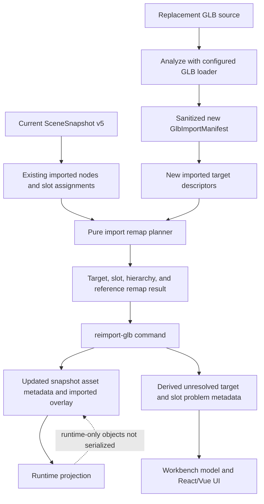
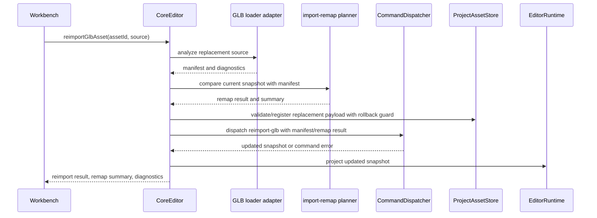
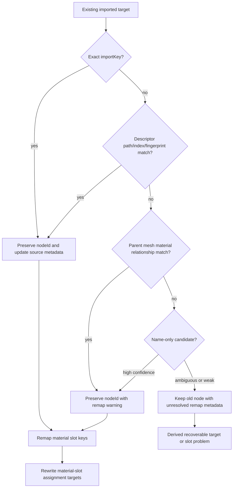

# feat: Add GLB reimport target remap

## Summary

Detail roadmap U6 into an implementation-ready plan for reimporting a GLB asset while preserving existing imported target edits, material-slot assignments, imported camera targets, and future binding references. The work adds a pure remap planner, an undoable `reimport-glb` command, an async editor lifecycle API that analyzes the replacement payload before mutation, and Workbench surfacing for matched, remapped, new, and unresolved targets.

This plan assumes the v5 imported target schema and runtime projection work are present. It does not implement slot-aware material runtime projection, authored camera editing, AIoT binding storage, or full glTF topology editing.

---

## Problem Frame

The editor can already store GLB internals as durable `SceneImportedGlbNode` records and project resolved imported targets into the Three.js runtime. The remaining real-user gap is iteration: artists and engineers will replace a model payload after renaming nodes, changing mesh structure, adding material slots, or removing parts of the GLB. Today `replaceAsset()` preserves the stable asset ID and transient payload, but it does not analyze a new GLB manifest, update snapshot asset metadata, reconcile imported target keys, or preserve target-level edits through a controlled remap.

The failure mode must be conservative. Reimport must not silently delete authored transforms, material-slot assignments, imported camera targets, or future binding metadata when a source target disappears. It should preserve durable editor identities where possible, update source keys only when the match is defensible, create recoverable unresolved states when it cannot match, and keep loaded `Object3D`, parser state, object URLs, and runtime problems out of snapshot and `.ek3d` JSON.

---

## Requirements

**Reimport Flow**

- R1. Core must provide a GLB-specific reimport path that analyzes the replacement payload before mutating snapshot state or replacing project payload bytes. (origin R4, R7, R22)
- R2. Reimport must preserve the existing asset ID so object, material, environment, project package, and resolver references continue to point at the same asset. (origin R4)
- R3. If replacement GLB analysis or validation fails with error diagnostics, the previous snapshot, project payload, and import manifest metadata must remain unchanged. (origin R7, R22)

**Target Remap**

- R4. Imported target remap must preserve existing `SceneNode.id` values for exact matches and high-confidence fallback matches while updating `importKey`, source descriptor, display name, material slots, and hierarchy metadata to the new manifest. (origin R6, R7)
- R5. Matching must prefer exact import keys, then source descriptor paths/indices/fingerprints, then parent-child/mesh/material relationships, then names only as a low-confidence fallback. (origin R6, R7)
- R6. Unmatched existing imported targets must remain durable with authored transforms and remap metadata, and must surface as recoverable unresolved target problems instead of being deleted. (origin R7)
- R7. Newly discovered manifest targets should be created under the owner object when they do not conflict with preserved editor identities. (origin R5, R6)

**Dependent References**

- R8. Material-slot assignments must remap when their slot key can be matched, including assignment ID updates through the existing `createMaterialAssignmentId()` convention. (origin R8)
- R9. If a material slot cannot be matched, its assignment must remain durable and must surface as an unresolved imported-material-slot problem. (origin R7, R8)
- R10. Imported camera targets and future binding descriptors must be covered by the same target/slot remap table so later authored-camera and AIoT work can consume one mapping contract. (origin R6, R20)

**Durability and Surface**

- R11. Remap metadata, diagnostics summaries, and command inputs that enter snapshot or command history must be JSON-compatible and must not include `File`, `Blob`, object URL, loader result, parser, `Object3D`, `Material`, `Texture`, resolver output, base transform cache, or runtime problem objects. (origin R22, R23)
- R12. React and Vue Workbench surfaces must remain thin render/dispatch layers over core reimport APIs and core-derived Workbench state. (origin R21)
- R13. Tests must cover exact remap, fallback remap, unresolved preservation, material slot remap, failed reimport rollback, project package round-trip, and runtime/workbench problem surfacing. (origin R22, R24)

---

## Scope Boundaries

### Included

- Pure GLB import remap planner for targets, material slots, hierarchy, and reference maps.
- Undoable `reimport-glb` command that updates snapshot asset metadata, imported target nodes, remap metadata, selection safety, and material-slot assignments.
- Async `editor.reimportGlbAsset()` lifecycle that analyzes replacement GLB sources with the configured loader, applies the command only after successful analysis, replaces transient project payloads, and reprojects runtime.
- Recoverable runtime/workbench problems for unresolved imported targets and material slots after reimport.
- Core Workbench model and React/Vue default Workbench actions for reimport preview/result state.
- Serialization, `.ek3d` export/import, public API, and documentation updates.

### Deferred to Follow-Up Work

- Slot-aware material runtime projection and material slot inspector UI.
- Authored camera/view commands that reference imported GLB camera targets.
- Durable AIoT binding state, host value preview, MQTT/WebSocket, event orchestration, or dashboard runtime.
- Manual remap UI where a user chooses a different candidate target after automatic remap.
- Full glTF node, mesh, primitive, skeleton, animation, material graph, or shader editing.

### Outside This Product Identity for This Stage

- Treating reimport as a destructive "replace hierarchy from source" operation.
- Persisting GLTFLoader, parser associations, Three.js scene graphs, object URLs, runtime resolver outputs, loaded textures, runtime target maps, or runtime problems into durable state.
- Making React/Vue own reimport semantics. Framework adapters render core state and call core APIs only.

---

## Assumptions

- The current v5 schema from `docs/schema.md` is available, including `SceneImportedGlbNode`, `importKey`, `source`, `materialSlots`, and optional `remap` metadata.
- Runtime projection from `docs/plans/2026-06-08-003-feat-imported-glb-runtime-projection-plan.md` remains the consumer of imported target match state and is allowed to derive runtime problems from unresolved durable remap metadata.
- The decoder-aware import pipeline can produce a sanitized `GlbImportManifest` from a replacement GLB source before any durable mutation.
- The first automatic remap does not need a user-driven match chooser. Low-confidence matches can be left unresolved with candidate keys instead of guessed.
- External research is not load-bearing for this plan because the local imported target, manifest, project package, and Workbench contracts already define the architecture.

---

## Key Technical Decisions

- KTD1. Reimport is a two-stage lifecycle: `editor.reimportGlbAsset()` performs async source normalization and loader analysis, then dispatches a synchronous JSON-compatible `reimport-glb` command. This keeps browser objects and loader results outside durable command logic.
- KTD2. The remap planner is pure and command-independent: `packages/core/src/assets/import-remap.ts` should compare previous imported nodes with descriptors generated from the new manifest and return a deterministic remap result. Commands, Workbench summaries, tests, and future binding work consume the same result.
- KTD3. Editor `NodeId` stability beats source key stability: matched targets keep their existing `node.id` so selection, history, transform overrides, material assignments, and future bindings remain attached to the editor target while `importKey/source` update to the replacement GLB.
- KTD4. Unresolved targets remain in the snapshot: missing source targets become `remap.status = "unresolved"` with previous key and candidate metadata. Runtime and Workbench derive recoverable problems from that state, but the command does not delete authored edits.
- KTD5. Slot remap follows target remap: material slot keys are remapped through the matched imported node and slot descriptor relationship. If an assignment ID changes, the command rewrites the assignment record using `createMaterialAssignmentId()` while preserving the material definition and assignment metadata.
- KTD6. New manifest targets are additive: reimport should add new imported targets for newly discovered manifest descriptors when expanded targets already exist. It should not collapse an expanded import back to object-level behavior.
- KTD7. Payload replacement rolls back with command failure: the editor lifecycle should preserve the previous transient project payload and previous snapshot if either payload registration or command dispatch fails. A failed reimport leaves the editor in the pre-reimport state.
- KTD8. Remap warnings are derived problems, not durable problem rows: snapshot stores JSON-compatible remap metadata and manifest diagnostics; runtime/workbench projections expose user-facing recoverable problems without persisting runtime problem objects.

---

## High-Level Technical Design

---

## Implementation Units

### U1. Pure GLB import remap planner

- **Goal:** Add a deterministic planner that compares existing imported GLB targets with a replacement manifest and returns target, slot, hierarchy, and reference remap instructions without mutating snapshot.
- **Requirements:** R4, R5, R6, R7, R8, R9, R10, R11.
- **Dependencies:** Imported target schema, decoder-aware `GlbImportManifest`, and existing target key generation.
- **Files:** `packages/core/src/assets/import-remap.ts`, `packages/core/src/assets/import-remap.test.ts`, `packages/core/src/imported-targets/keys.ts`, `packages/core/src/imported-targets/create.ts`, `packages/core/src/imported-targets/types.ts`, `packages/core/src/imported-targets/slots.ts`.
- **Approach:** Build `planGlbImportRemap()` around old imported nodes, old slot descriptors, new descriptors from `createImportedGlbTargetDescriptors()`, and owner object ID. The result should include exact matches, fallback matches with confidence/reason, unresolved old targets, new targets, slot key remaps, stale slot assignments, candidate import keys, and a compact summary for UI. Matching should be deterministic and should leave ambiguous cases unresolved instead of guessing.
- **Execution note:** Start test-first with exact, renamed, reordered, ambiguous, and removed target fixtures before wiring the planner into commands.
- **Patterns to follow:** `packages/core/src/imported-targets/keys.ts` for key semantics, `packages/core/src/imported-targets/create.ts` for descriptor-to-node conversion, `packages/core/src/imported-targets/slots.ts` for slot lookup.
- **Test scenarios:**
  - Given old and new manifests produce identical import keys, when remap planning runs, then every existing imported node is an exact match and keeps its current `node.id`.
  - Given a node name changes but descriptor path and index remain stable, when planning runs, then the target is matched by descriptor identity and the result marks no unresolved target.
  - Given descriptor paths change but a mesh/primitive/material relationship remains unique under the same parent relationship, when planning runs, then the target is fallback-matched with a warning reason.
  - Given two new targets are equally plausible for one old target, when planning runs, then the old target is unresolved and candidate import keys are recorded in deterministic order.
  - Given a target is removed from the replacement GLB, when planning runs, then the old target appears in unresolved targets with its authored transform and old import key preserved by reference.
  - Given the replacement GLB adds a new mesh and primitive, when planning runs, then new target descriptors are returned for additive creation.
  - Given a material slot key changes because the primitive path changes, when planning runs, then `slotKeyRemaps` maps the old slot key to the new slot key.
  - Given planner output is stringified, then it contains no `File`, `Blob`, object URL, loader result, parser, `Object3D`, `Material`, `Texture`, or resolver output.
- **Verification:** The planner is deterministic, pure, JSON-compatible, and expressive enough for command mutation, Workbench preview, and future binding reference remap.

### U2. Undoable `reimport-glb` command

- **Goal:** Apply a remap plan to snapshot state by updating GLB asset metadata, imported target nodes, hierarchy, remap metadata, selection, and material-slot assignments in one undoable command.
- **Requirements:** R2, R4, R6, R7, R8, R9, R10, R11, R13.
- **Dependencies:** U1.
- **Files:** `packages/core/src/commands/reimport-glb.ts`, `packages/core/src/commands/reimport-glb.test.ts`, `packages/core/src/commands/types.ts`, `packages/core/src/commands/dispatcher.ts`, `packages/core/src/commands/create-imported-glb-targets.ts`, `packages/core/src/commands/delete-nodes.ts`, `packages/core/src/materials/defaults.ts`, `packages/core/src/materials/validation.ts`, `packages/core/src/snapshot/validation.ts`, `packages/core/src/snapshot/types.ts`.
- **Approach:** Add `ReimportGlbCommand` with owner object ID, asset ID, sanitized replacement manifest metadata, and planner output. The command should preserve the owner object and asset ID, update `snapshot.assets[assetId].metadata.glbImportManifest`, rewrite matched imported nodes in place, add new nodes, keep unresolved old nodes with `remap.status = "unresolved"`, and rebuild owner imported children order. Material-slot assignments should be rewritten through the slot remap table; unresolved assignments stay valid and receive metadata only when needed for diagnostics.
- **Execution note:** This is durable contract work; include rollback and undo/redo tests before exposing the editor API.
- **Patterns to follow:** `applyCreateImportedGlbTargets()` for imported node insertion, `CommandDispatcher` validation/rollback, `createMaterialAssignmentId()` for assignment keys, `syncPayloadsFromNodes()` for object compatibility mirrors.
- **Test scenarios:**
  - Given unchanged replacement hierarchy, when `reimport-glb` dispatches, then imported node IDs, selection, transforms, and material-slot assignments remain stable.
  - Given a target fallback-maps to a new import key, when the command applies, then the existing node ID is preserved, `importKey/source/name/materialSlots` update, and `remap.status` records a resolved fallback reason.
  - Given a target cannot be matched, when the command applies, then the node remains under the owner subtree with its transform and `remap.status = "unresolved"`.
  - Given the replacement manifest has a new target, when the command applies, then a new imported node is added without changing preserved matched node IDs.
  - Given a material-slot assignment remaps to a new slot key, when the command applies, then the old assignment ID is removed, the new assignment ID exists, and the material definition is unchanged.
  - Given two material assignments would collide after remap, when the command applies, then the conflict resolves deterministically or fails without mutation, with the chosen policy covered by tests.
  - Given selection points at an unresolved imported node, when the command applies, then selection remains valid and Workbench can still show the unresolved row.
  - Given the owner object is missing, not GLB-backed, or asset ID does not match the owner asset, when dispatch runs, then it fails without snapshot mutation.
  - Given undo and redo run after a successful reimport, then snapshot asset metadata, imported nodes, material assignments, and selection restore exactly.
- **Verification:** Reimport is an atomic durable mutation and is safe to undo, redo, serialize, and validate.

### U3. Editor lifecycle API and payload transaction

- **Goal:** Expose `editor.reimportGlbAsset()` as the real user entry point that analyzes replacement sources, validates diagnostics, coordinates project payload replacement, dispatches the command, and rolls back on failure.
- **Requirements:** R1, R2, R3, R11, R12, R13.
- **Dependencies:** U1, U2.
- **Files:** `packages/core/src/editor/editor-api.ts`, `packages/core/src/editor/lifecycle.ts`, `packages/core/src/editor/lifecycle.test.ts`, `packages/core/src/project/replace-asset.ts`, `packages/core/src/project/replace-asset.test.ts`, `packages/core/src/project/project-api.ts`, `packages/core/src/project/asset-store.ts`, `packages/core/src/runtime/gltf-loader-adapter.ts`, `packages/core/src/assets/import-pipeline.ts`, `packages/core/src/public-api.ts`, `packages/core/src/public-api.test.ts`.
- **Approach:** Add async options and result types mirroring `importGlbAsset()`: source asset, loader override, commit flag, optional remap strictness, diagnostics, manifest, remap summary, command result, and committed flag. The lifecycle should normalize the source, analyze with the configured loader, reject error diagnostics before mutation, prepare the remap plan, validate replacement payload registration, dispatch `reimport-glb`, notify asset workspace subscribers, and reproject runtime. If payload registration or command dispatch fails, restore the previous transient payload and snapshot.
- **Patterns to follow:** `CoreEditor.importGlbAsset()` async analysis boundary, `CoreEditor.replaceAsset()` payload-only replacement, `#registerCommandProjectAsset()` asset payload registration, `ProjectAssetStore.replaceAll()` rollback in `importProject()`.
- **Test scenarios:**
  - Given a valid replacement GLB source and unchanged hierarchy, when `reimportGlbAsset()` commits, then the returned result includes manifest, diagnostics, remap summary, command result, and `committed: true`.
  - Given `commit: false`, when replacement analysis succeeds, then the method returns diagnostics and remap preview while snapshot and project payload remain unchanged.
  - Given loader analysis returns an error diagnostic, when reimport is requested, then no command dispatches and previous snapshot/payload/manifest remain unchanged.
  - Given payload registration fails after analysis, when reimport is requested, then no durable command applies and the previous project asset payload remains available.
  - Given command dispatch fails after payload validation, when reimport is requested, then the previous project payload is restored and runtime is not projected with stale replacement state.
  - Given replacement succeeds, when asset workspace subscribers are attached, then they receive a version update even if the stable asset ID did not change.
  - Given a runtime is mounted, when replacement succeeds, then runtime projection is triggered with the updated snapshot.
  - Given the source is a `File` or `Blob`, when lifecycle returns, then object URLs are revoked and none of those browser values appear in serialized snapshot JSON.
- **Verification:** Hosts and Workbench get one safe GLB reimport API instead of manually combining `replaceAsset()`, manifest analysis, and imported target commands.

### U4. Unresolved remap diagnostics in runtime and Workbench models

- **Goal:** Surface unresolved targets and slots as recoverable problems derived from remap metadata without storing runtime problem objects in snapshot.
- **Requirements:** R6, R8, R9, R10, R11, R12, R13.
- **Dependencies:** U2, U3.
- **Files:** `packages/core/src/runtime/problems.ts`, `packages/core/src/runtime/scene-projector.ts`, `packages/core/src/runtime/scene-projector.test.ts`, `packages/core/src/problems/types.ts`, `packages/core/src/problems/validation.ts`, `packages/core/src/workbench/workbench-model.ts`, `packages/core/src/workbench/workbench-model.test.ts`, `packages/core/src/inspector/problems.ts`, `packages/core/src/inspector/problems.test.ts`, `packages/core/src/inspector/node-targets.ts`.
- **Approach:** Extend runtime problem derivation so unresolved imported nodes and unresolved material-slot assignments produce `imported-target` and `imported-material-slot` problems with recoverability `user-action`. Workbench hierarchy rows, asset workspace rows, inspector target summaries, and problem panels should attribute those problems to the owner asset and imported node. Existing runtime missing-target problems should merge with remap-unresolved state rather than duplicate confusing rows.
- **Patterns to follow:** Existing imported target runtime problems in `scene-projector.ts`, Workbench hierarchy problem attribution in `workbench-model.ts`, asset problem attribution in `assets/workspace.ts`.
- **Test scenarios:**
  - Given an imported node has unresolved remap metadata, when runtime problems are derived, then a recoverable `imported-target` problem targets that node and owner object.
  - Given a material-slot assignment references an unresolved old slot, when Workbench model builds, then the problem targets `imported-material-slot` and the assignment remains visible.
  - Given runtime projection also cannot find the unresolved target, when problems are merged, then the user sees one coherent unresolved target problem rather than duplicate missing and stale messages.
  - Given an unresolved imported node is selected, when inspector model builds, then it reports selected target context, previous import key, candidate keys, and disabled transformability where appropriate.
  - Given a reimport later resolves the target, when runtime/workbench models rebuild, then the unresolved problem disappears without mutating authored problem acknowledgements.
  - Given project export serializes the scene after unresolved remap, then serialized JSON contains only remap metadata and not runtime problem objects.
- **Verification:** Users can see what did not remap, while durable state remains snapshot-first and runtime-problem-free.

### U5. Workbench reimport action in React and Vue

- **Goal:** Make GLB reimport reachable from the default Workbench asset workspace while keeping React/Vue behavior as thin render/dispatch over core.
- **Requirements:** R1, R2, R3, R6, R8, R12, R13.
- **Dependencies:** U3, U4.
- **Files:** `packages/react/src/components/WorkbenchLeftPanel.tsx`, `packages/react/src/components/workbench.css`, `packages/react/test/workbench.test.tsx`, `packages/react/test/default-workbench.browser.test.tsx`, `packages/vue/src/components/WorkbenchLeftPanel.vue`, `packages/vue/src/components/workbench.css`, `packages/vue/test/workbench.test.ts`, `packages/vue/test/default-workbench.browser.test.ts`, `packages/core/src/assets/workspace.ts`, `packages/core/src/assets/workspace.test.ts`.
- **Approach:** Extend core asset workspace rows with GLB reimport affordance metadata and recent reimport summary state when available. React/Vue should show a reimport action for GLB assets, use a transient file input/drag source, call `editor.reimportGlbAsset()`, and render the returned summary and diagnostics. The UI should distinguish exact matches, fallback remaps, new targets, unresolved targets, and failed analysis without placing queue rows or selected `File` objects in snapshot.
- **Patterns to follow:** Existing missing asset replacement flow in React/Vue Workbench, asset workspace import queue, `replaceAsset()` UI wiring, problem badge rendering.
- **Test scenarios:**
  - Given a GLB asset row is visible, when the user chooses a replacement GLB, then React calls core `reimportGlbAsset()` with the stable asset ID.
  - Given reimport succeeds with fallback matches and unresolved targets, when the result renders, then the asset row shows a concise summary and linked problem badges.
  - Given reimport analysis fails, when the result renders, then the previous asset row remains and diagnostics are visible without changing selection or hierarchy.
  - Given React and Vue receive the same core model and reimport result, when rendered, then exact/remapped/new/unresolved counts and disabled states match.
  - Given a narrow viewport, when the reimport action and diagnostics render, then buttons and text do not overlap existing asset workspace controls.
  - Given `.ek3d` export runs after a Workbench reimport attempt, then transient file input values, queue state, and local result UI state are absent from durable JSON.
- **Verification:** Default Workbench users can iterate on a GLB model without custom host UI and without framework-owned editor semantics.

### U6. Project package, serialization, and public contract hardening

- **Goal:** Ensure reimported snapshots and packages round-trip with stable asset IDs, replacement manifest metadata, remap metadata, and material assignments while excluding runtime-only values.
- **Requirements:** R2, R3, R6, R8, R9, R10, R11, R13.
- **Dependencies:** U2, U3, U4.
- **Files:** `packages/core/src/project/export-project.test.ts`, `packages/core/src/project/import-project.test.ts`, `packages/core/src/editor/proof-loop.integration.test.ts`, `packages/core/src/editor/serialization.test.ts`, `packages/core/src/snapshot/snapshot.test.ts`, `packages/core/src/snapshot/validation.ts`, `packages/core/src/assets/import-pipeline.test.ts`, `packages/core/src/public-api.ts`, `packages/core/src/index.ts`, `packages/core/src/public-api.test.ts`.
- **Approach:** Add acceptance-level tests that serialize, export, import, and restore reimported scenes. Public exports should include reimport API types, remap result types, and JSON-compatible diagnostic summary types, while private runtime adapters and project store internals stay private. Validation should allow unresolved remap metadata and stale material-slot assignments, but reject non-JSON metadata and invalid owner relationships.
- **Patterns to follow:** Existing imported target project package tests in `export-project.test.ts` and `import-project.test.ts`, public API export tests, snapshot JSON compatibility tests.
- **Test scenarios:**
  - Given a GLB is reimported with matched and unresolved imported targets, when `editor.serialize()` runs and a new editor restores it, then node IDs, import keys, remap metadata, transforms, selection, and material assignments survive.
  - Given the same scene exports to `.ek3d`, when imported into a fresh editor, then `scene.json` contains replacement `glbImportManifest` metadata and `assets/*` contains the replacement payload under the stable asset ID.
  - Given reimport created unresolved targets, when package export runs, then runtime problems are not serialized and remap metadata remains JSON-compatible.
  - Given a material-slot assignment was remapped to a new slot key, when project import restores it, then the assignment ID and target slot key match the post-remap snapshot.
  - Given a public package consumer imports from the package root, then reimport API and remap result types are available without importing private module paths.
  - Given validation sees non-JSON-compatible remap metadata, when snapshot validation runs, then the snapshot is rejected.
- **Verification:** Reimport is durable across snapshot and `.ek3d` lifecycles without widening the public surface to runtime internals.

### U7. Documentation and end-to-end acceptance coverage

- **Goal:** Document the reimport/remap contract and add cross-surface acceptance coverage for the real model iteration path.
- **Requirements:** R1-R13.
- **Dependencies:** U1-U6.
- **Files:** `docs/schema.md`, `docs/interactions.md`, `docs/project-package.md`, `docs/integration-react.md`, `docs/integration-vue.md`, `docs/integration-vanilla.md`, `docs/architecture.md`, `docs/plans/2026-06-05-001-feat-real-user-editor-roadmap-plan.md`, `packages/react/test/react-proof-loop.integration.test.tsx`, `packages/vue/test/vue-proof-loop.integration.test.ts`, `packages/react/test/default-workbench.browser.test.tsx`, `packages/vue/test/default-workbench.browser.test.ts`, `packages/core/src/runtime/picking.browser.test.ts`.
- **Approach:** Update docs to explain exact match, fallback remap, unresolved preservation, material slot remap, asset ID stability, failed reimport rollback, and runtime-only exclusions. Add deterministic GLB fixtures or manifest fixtures that exercise unchanged hierarchy, renamed/rekeyed targets, removed targets, new targets, and slot changes. Browser tests should verify user-visible Workbench behavior and problem badges rather than pixel-perfect WebGL output.
- **Patterns to follow:** `docs/interactions.md` current "GLB reimport diff/remap command" non-implemented note, `docs/project-package.md` durability language, existing React/Vue proof-loop parity tests.
- **Test scenarios:**
  - Given a user imports an expanded GLB, transforms a child target, assigns a material slot, then reimports an unchanged GLB, when they export and restore, then all edits remain attached to the same node IDs.
  - Given a user reimports a GLB where one mesh/primitive moved to a new key but has a unique fallback match, when Workbench renders, then the edit follows the remapped target and a warning summary is visible.
  - Given a user reimports a GLB where one edited target is removed, when Workbench renders, then the unresolved target remains selectable and the problem panel offers a recoverable explanation.
  - Given a user reimports a GLB where a material slot key changes, when the scene restores, then the slot assignment follows the new slot key.
  - Given a failed replacement GLB is chosen, when the user returns to the viewport, then the previous model payload, manifest, imported targets, material assignments, and runtime projection are still active.
  - Given React and Vue proof-loop demos run the same reimport fixture, then hierarchy state, asset row summary, problem badges, and export/restore results match.
- **Verification:** The U6 roadmap path can be demonstrated as a real model iteration workflow across core, React, Vue, project packages, and browser runtime.

---

## Acceptance Examples

- AE1. Given an expanded GLB object with transformed imported child targets, when the same GLB is reimported with unchanged manifest keys, then node IDs, transforms, selection, and material-slot assignments remain unchanged.
- AE2. Given a GLB replacement changes a mesh import key but preserves a unique source relationship, when reimport completes, then the existing imported node ID is preserved, its new import key is stored, and Workbench shows a fallback remap warning.
- AE3. Given a GLB replacement removes an edited target, when reimport completes, then the imported node and its authored transform remain durable with unresolved remap metadata and a recoverable problem.
- AE4. Given a material-slot assignment targets a slot whose key changes after reimport, when remap succeeds, then the assignment points at the new slot key and the material definition is not duplicated.
- AE5. Given replacement GLB analysis fails because the source is invalid or decoder support is missing, when reimport returns, then snapshot, project payload, asset metadata, imported nodes, and runtime projection remain in the previous state.
- AE6. Given the scene is exported to `.ek3d` after a partial remap, when it is imported into a fresh editor, then replacement manifest metadata, remap metadata, unresolved targets, and replacement payload are restored without runtime objects or runtime problems in JSON.

---

## System-Wide Impact

- **Snapshot contract:** Reimport uses existing v5 imported target fields and `remap` metadata. It should not require a schema version bump unless implementation discovers that current metadata cannot represent resolved/unresolved/candidate states safely.
- **Command history:** Reimport becomes an undoable command. Payload replacement is coordinated by editor lifecycle and must be rolled back consistently with command failure.
- **Asset workspace:** Reimport can change asset metadata and payload availability without changing asset ID. Workspace subscribers must refresh on successful reimport and should surface remap summaries.
- **Runtime projection:** Runtime target matching consumes updated import keys and unresolved metadata. Missing/unresolved problems remain derived runtime/workbench state, not durable problem rows.
- **Public API:** Core exports grow around reimport options/results and remap summaries. React/Vue should expose this through existing Workbench/headless APIs rather than new framework-specific semantics.
- **Future binding:** The remap result is the bridge for later AIoT binding target metadata. This plan only creates the reusable mapping contract and does not implement binding storage.

---

## Risks and Dependencies

| Risk | Impact | Mitigation |
|---|---|---|
| Fallback matching guesses wrong | User edits attach to the wrong model part | Prefer exact keys and deterministic source descriptors; leave ambiguous matches unresolved with candidate keys. |
| Payload replacement and command mutation drift | Snapshot references a manifest for bytes that were not registered, or payload changes without remap | Treat `reimportGlbAsset()` as a transaction with previous payload/snapshot rollback. |
| Material assignment ID rewrite loses metadata | Slot edits appear deleted after reimport | Rewrite through `createMaterialAssignmentId()` and preserve material definition plus assignment metadata. |
| Unresolved target hierarchy becomes confusing | Users cannot tell stale targets from current GLB targets | Store remap status and expose clear Workbench problem badges and inspector context. |
| Runtime problems leak into durable JSON | `.ek3d` package becomes non-portable or polluted with transient state | Persist only remap metadata and manifest diagnostics; cover serialization and package tests. |
| React/Vue reimport UI duplicates core semantics | Framework parity drifts | Keep reimport summary and problem attribution in core Workbench model; adapters render and dispatch only. |
| Future binding references need a different mapping shape | Later AIoT work reinvents target identity | Include target and slot remap tables in the core result contract now, even though binding storage is deferred. |

---

## Documentation and Operational Notes

- Update `docs/interactions.md` to move GLB reimport diff/remap from "not implemented" into the documented editing workflow only after U1-U7 acceptance coverage lands.
- Update `docs/schema.md` with the exact meaning of `remap.status`, `previousImportKey`, `candidateImportKeys`, and any resolved fallback metadata.
- Update `docs/project-package.md` to clarify that replacement manifest metadata and remap metadata live in `scene.json`, while replacement bytes remain under `assets/*` by stable asset ID.
- Update React, Vue, and vanilla integration docs with the safe host path: call `editor.reimportGlbAsset()` instead of combining `replaceAsset()` with manual snapshot mutation.
- Keep docs explicit that loader adapters, decoder instances, `File`, `Blob`, object URLs, loaded scenes, and runtime problems are transient.

---

## Sources and Research

- Origin roadmap: `docs/plans/2026-06-05-001-feat-real-user-editor-roadmap-plan.md`.
- Upstream schema plan: `docs/plans/2026-06-08-002-feat-imported-glb-target-schema-plan.md`.
- Upstream runtime plan: `docs/plans/2026-06-08-003-feat-imported-glb-runtime-projection-plan.md`.
- GLB import pipeline plan: `docs/plans/2026-06-05-003-feat-decoder-aware-glb-import-pipeline-plan.md`.
- Current durable contract: `docs/schema.md`, `docs/interactions.md`, `docs/project-package.md`, `docs/architecture.md`.
- Core code references: `packages/core/src/assets/import-pipeline.ts`, `packages/core/src/imported-targets/keys.ts`, `packages/core/src/imported-targets/create.ts`, `packages/core/src/imported-targets/slots.ts`, `packages/core/src/commands/create-imported-glb-targets.ts`, `packages/core/src/project/replace-asset.ts`, `packages/core/src/editor/lifecycle.ts`, `packages/core/src/runtime/scene-projector.ts`, `packages/core/src/workbench/workbench-model.ts`.
