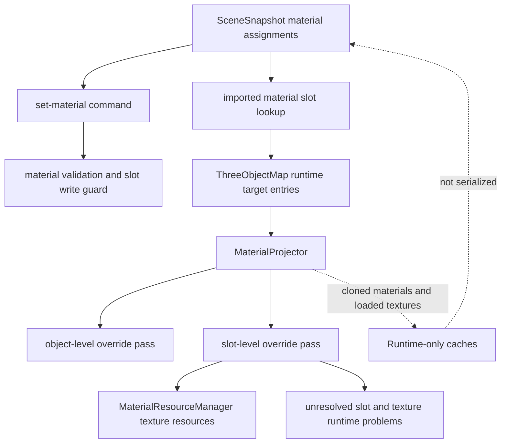
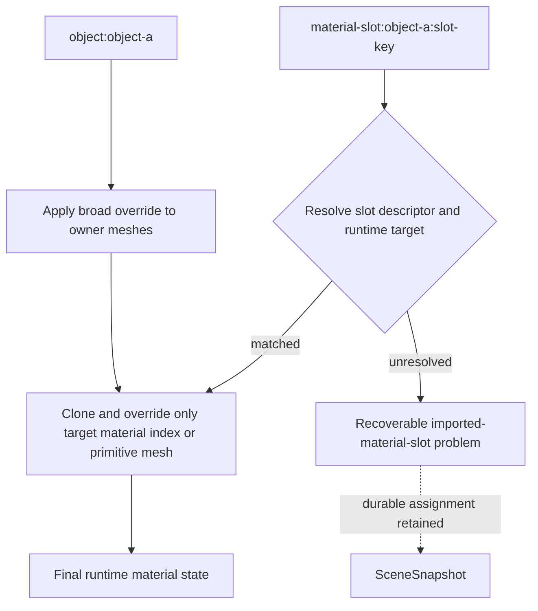

# feat: Add slot-aware material assignment

## Summary

Detail roadmap U7 into an implementation-ready core/runtime plan: make material assignments address imported GLB material slots, project those overrides onto only the matched runtime material slot, preserve broad object-level overrides as the compatibility path, and surface missing slot or texture failures as recoverable runtime problems without mutating durable JSON.

This plan assumes imported target schema, runtime target projection, and GLB reimport remap are available. It does not implement the React/Vue material slot inspector UI from roadmap U8, full glTF material graph editing, shader editing, node materials, or glTF material variant authoring.

---

## Problem Frame

The editor already stores a small `MeshStandardMaterialOverride` subset, supports object-level material assignment, projects broad overrides onto GLB meshes, and keeps texture resolver/loader failures as runtime problems. The imported GLB target work has also established durable material slot descriptors and `MaterialAssignmentTarget` can already reference `{ kind: "material-slot"; objectId; slotId }`.

The remaining gap is projection semantics. A complex GLB often has several mesh primitives and material slots, so object-level override changes too much. Users need a slot assignment to override one imported material slot while the rest of the model keeps either the source GLB material or the object-level broad override. If a slot disappears after reimport, the assignment must remain durable and visible as unresolved authoring state instead of being deleted by validation or silently ignored.

The invariant remains snapshot-first: `SceneSnapshot` stores only JSON-compatible material definitions, assignments, slot keys, and asset references. Three.js `Material`, `Texture`, loaded GLB scene data, resolver outputs, object URLs, runtime target maps, cloned materials, and runtime problems stay transient.

---

## Requirements

**Core Material Targeting**

- R1. `set-material` must accept object-level assignments and imported material-slot assignments while preserving deterministic assignment IDs from `createMaterialAssignmentId()`. (origin R6, R8)
- R2. New material-slot writes must validate that the target object exists and, for new assignments, that the slot key is currently discoverable from imported target metadata. Existing or restored stale slot assignments must remain schema-valid for reimport recovery. (origin R7, R8, R22)
- R3. Material state validation must keep every persisted material definition, assignment target, texture asset reference, and metadata JSON-compatible. (origin R22, R23)
- R4. Object-level broad override must remain valid and must continue to cover the whole GLB object when no slot-level assignment overrides a slot. (origin R8)

**Runtime Projection**

- R5. Runtime projection must apply slot-level `MeshStandardMaterialOverride` only to the matched imported material slot, not to the entire owner GLB object. (origin R8, R9)
- R6. When an object-level assignment and a slot-level assignment both target the same owner GLB, projection must apply the object-level override first and then let the slot-level assignment win only for that slot. (origin R8)
- R7. Slot projection must clone only the source materials it owns, preserve non-target material slots, and restore source materials when an assignment is removed, object unloads, or projection is disposed. (origin R23)
- R8. Texture slots inside slot-level material overrides must use the existing resolver/loader/resource lifecycle and must report texture failures as runtime problems without deleting durable assignments. (origin R8, R23)
- R9. If a material slot cannot be resolved from imported metadata or runtime target links, runtime must preserve the durable assignment and expose a recoverable unresolved slot problem. (origin R7, R8)

**Compatibility and Verification**

- R10. Runtime-only values including cloned materials, loaded textures, resolver results, object URLs, runtime slot lookup records, and problems must not appear in `SceneSnapshot` or `.ek3d` `scene.json`. (origin R23)
- R11. Core public exports should expose stable material-slot helper types only when they are part of durable authoring; runtime material projector internals should remain private. (origin R21, R22)
- R12. Tests must cover object-level compatibility, slot-only projection, object-plus-slot precedence, missing slot recovery, texture failures, clone disposal, serialization, project package round-trip, and reimported slot remap behavior. (origin R22, R24)

---

## Scope Boundaries

### Included

- Core command and validation behavior for `MaterialAssignmentTarget.kind === "material-slot"`.
- Pure imported material slot lookup helpers that bridge durable slot descriptors to material assignment targets.
- Runtime material slot projection on top of imported target runtime links.
- Object-level versus slot-level precedence rules.
- Texture resource lifecycle for slot-level assignments.
- Runtime problem attribution for unresolved imported material slots and texture failures.
- Serialization, `.ek3d` project package, public API, and documentation hardening for slot-aware material assignment.

### Deferred to Follow-Up Work

- React/Vue material slot inspector UI, slot list controls, broad-vs-slot affordances, and browser layout tests from roadmap U8.
- Manual remap UI for unresolved slots.
- Full glTF material graph editing, shader graph editing, node materials, variants, animation-driven material changes, or authoring glTF topology.
- Persisted material libraries, reusable material presets, or cloud asset/material libraries.

### Outside This Product Identity for This Stage

- Rewriting imported GLB source materials into a new glTF file.
- Persisting Three.js `Material`, `Texture`, `Object3D`, loader parser output, resolver results, object URLs, runtime target links, material clone caches, or runtime problems into snapshot or project package JSON.
- Making React/Vue own material semantics. Framework adapters render core-derived models and dispatch core commands only.

---

## Assumptions

- `SceneSnapshot.version = 5` and imported GLB target nodes are already present, including `materialSlots?: ImportedGlbMaterialSlotDescriptor[]`.
- Runtime imported target projection already registers imported target metadata in `ThreeObjectMap.targetEntries()`.
- GLB reimport remap can rewrite material-slot assignment IDs when a slot is matched, and can leave unresolved slot metadata when a slot cannot be matched.
- The first slot-aware material projection only targets the existing `MeshStandardMaterialOverride` subset and existing texture slot names.
- External research is not load-bearing for this plan. Local schema, runtime, material projector, and project package contracts already define the architecture.

---

## Key Technical Decisions

- KTD1. Material-slot assignments stay durable even when unresolved: Snapshot validation should accept stale slot keys because reimport can remove a slot after the user authored an override. Runtime/workbench problems, not schema deletion, explain unresolved slots.
- KTD2. New slot edits require a discoverable slot: `set-material` should reject creating a brand-new slot assignment for an unknown slot unless the assignment already exists or is being restored through project import/reimport state. This prevents typo-driven durable targets while preserving recovery semantics.
- KTD3. Slot-level override has narrower precedence than object-level override: Projection applies object-level override across the owner first, then applies slot-level assignments to matched material slots. This keeps the simple path intact and makes slot edits act as refinements.
- KTD4. Slot matching uses imported target descriptors before runtime material identity: Durable `slotId` and `ImportedGlbMaterialSlotDescriptor.source` are the source of truth. Runtime material indices, material arrays, and mesh descendants are projection details derived from those descriptors.
- KTD5. Material projection should consume runtime target metadata, not re-traverse the whole editor state independently: `SceneProjector` already owns owner object and imported target runtime links. Slot projection should receive enough target entries to locate imported slots without inventing a second mapping system.
- KTD6. Clones are owned per projection target, not per source material: Shared GLB source materials must remain untouched. Projection-owned clones and loaded textures must be tracked by assignment target so clearing one slot does not dispose resources still used by another target.
- KTD7. Non-`MeshStandardMaterial` targets are skipped with diagnostics for slot assignments: Object-level broad overrides may continue current skip behavior, but a user-authored slot target that cannot be projected should produce a recoverable problem because it is a precise edit that appears ineffective.
- KTD8. U7 stops at core/runtime behavior: Slot inspector UI belongs to U8. U7 may expose core lookup/problem data needed by U8, but it should not add framework-specific controls.

---

## High-Level Technical Design

---

## Implementation Units

### U1. Core material-slot command guard and validation

- **Goal:** Make `set-material` safely create and update imported material-slot assignments while preserving restored stale assignments.
- **Requirements:** R1, R2, R3, R4, R12.
- **Dependencies:** Imported GLB target schema and GLB reimport target remap.
- **Files:** `packages/core/src/commands/set-material.ts`, `packages/core/src/commands/set-material.test.ts`, `packages/core/src/materials/types.ts`, `packages/core/src/materials/defaults.ts`, `packages/core/src/materials/validation.ts`, `packages/core/src/materials/materials.test.ts`, `packages/core/src/imported-targets/slots.ts`, `packages/core/src/imported-targets/slots.test.ts`, `packages/core/src/snapshot/validation.ts`, `docs/schema.md`.
- **Approach:** Keep the existing `MaterialAssignmentTarget` union and assignment ID format. Add a command-time guard for `target.kind === "material-slot"`: the owner object must exist, the slot must be discoverable through imported target slot descriptors for new writes, and an existing stale assignment can still be patched so users can clear or adjust it after reimport. Schema validation should continue allowing unresolved slot IDs but must reject non-string IDs, missing owner objects, bad material references, invalid texture assets, and non-JSON metadata.
- **Execution note:** Add command tests before runtime tests so U7 does not rely on projector behavior to define durable command rules.
- **Patterns to follow:** `createMaterialAssignmentId()` in `packages/core/src/materials/defaults.ts`, `findImportedGlbMaterialSlot()` in `packages/core/src/imported-targets/slots.ts`, current texture validation in `packages/core/src/materials/validation.ts`, rollback assertions in `packages/core/src/commands/set-material.test.ts`.
- **Test scenarios:**
  - Covers AE1. Given an imported GLB node exposes a material slot descriptor, when `set-material` targets `{ kind: "material-slot"; objectId; slotId }`, then the snapshot stores `material-slot:<objectId>:<slotId>` and a `mesh-standard` material definition.
  - Given the same slot assignment is patched again, when `set-material` runs, then it preserves the existing material ID unless a matching explicit material ID is supplied.
  - Given a slot assignment targets a missing owner object, when the command runs, then it fails without mutating snapshot or history.
  - Given a new slot assignment targets an object that exists but no imported slot exposes the slot key, when the command runs, then it fails without mutation.
  - Given a stale slot assignment already exists after reimport, when the user clears a texture slot or changes color on that assignment, then the command can update the durable assignment without requiring the slot to currently resolve.
  - Given validation sees a material-slot assignment with a stale slot key and valid owner object, when snapshot validation runs, then the snapshot remains valid.
  - Given validation sees non-JSON-compatible assignment metadata, material metadata, texture metadata, or imported slot metadata, when validation runs, then the snapshot is rejected.
- **Verification:** Durable material-slot authoring is strict for new edits but safe for recovery and project round-trip.

### U2. Runtime material slot resolution and problem attribution

- **Goal:** Add a focused runtime lookup that connects a durable material-slot assignment to the imported node, slot descriptor, runtime target object, and material index or primitive mesh needed for projection.
- **Requirements:** R5, R8, R9, R10, R12.
- **Dependencies:** U1 and imported target runtime projection.
- **Files:** `packages/core/src/runtime/material-slot-resolver.ts`, `packages/core/src/runtime/material-slot-resolver.test.ts`, `packages/core/src/imported-targets/slots.ts`, `packages/core/src/runtime/three-object-map.ts`, `packages/core/src/runtime/problems.ts`, `packages/core/src/problems/types.ts`, `packages/core/src/workbench/workbench-model.ts`, `packages/core/src/workbench/workbench-model.test.ts`.
- **Approach:** Create a pure helper that receives `SceneSnapshot`, a material-slot assignment target, and runtime target entries. It should return a matched slot projection target, an unresolved durable slot state, or a non-projectable state. It should search current slot descriptors first, then remap metadata such as `unresolvedMaterialSlots` for problem attribution. The helper should not load textures or clone materials; it only identifies what runtime material area a later projector pass may edit.
- **Patterns to follow:** `resolveImportedGlbTargets()` status modeling in `packages/core/src/runtime/imported-target-resolver.ts`, `ThreeObjectMap.targetEntries()` imported target metadata, `createImportedMaterialSlotUnresolvedProblem()` in `packages/core/src/runtime/problems.ts`, problem attribution in `packages/core/src/workbench/workbench-model.ts`.
- **Test scenarios:**
  - Covers AE2. Given a material-slot assignment references an imported node's `materialSlots[0].slotKey`, when resolution runs with a matched runtime imported target, then it returns the imported node ID, owner object ID, slot descriptor, runtime object, and projection source.
  - Given a slot descriptor points at a primitive source and the runtime target maps to a mesh-like object, when resolution runs, then it identifies the primitive mesh as the projection target.
  - Given a slot descriptor points at a mesh material index and the runtime mesh uses a material array, when resolution runs, then it returns the material array index to override.
  - Given the slot key is absent but appears in `remap.metadata.unresolvedMaterialSlots`, when resolution runs, then it returns an unresolved state with enough node context to create an `imported-material-slot` problem.
  - Given the slot key is absent from descriptors and remap metadata, when resolution runs, then it returns an unresolved assignment-level state without throwing or mutating snapshot.
  - Given the runtime imported target exists but is marked missing, ambiguous, or non-projectable, when resolution runs, then it returns a recoverable non-projectable state.
  - Given Workbench model receives unresolved slot problems, when it builds hierarchy/problem summaries, then the imported node and owner asset receive problem badges without storing problem rows in snapshot.
- **Verification:** Runtime material projection can make a precise decision for each slot assignment and can explain unresolved assignments through existing problem surfaces.

### U3. Slot-aware `MaterialProjector` precedence and projection

- **Goal:** Extend runtime material projection so object-level assignments and slot-level assignments compose predictably on GLB runtime materials.
- **Requirements:** R4, R5, R6, R7, R8, R9, R12.
- **Dependencies:** U1, U2.
- **Files:** `packages/core/src/runtime/material-projector.ts`, `packages/core/src/runtime/material-projector.test.ts`, `packages/core/src/runtime/material-slot-resolver.ts`, `packages/core/src/runtime/material-resource-manager.ts`, `packages/core/src/runtime/problems.ts`, `packages/core/src/runtime/scene-projector.ts`, `packages/core/src/runtime/scene-projector.test.ts`.
- **Approach:** Change `MaterialProjector.project()` to consume runtime target entries or an equivalent projection input that includes object owner entries and imported target entries. First apply object-level assignments to owner GLB meshes using existing behavior. Then resolve and apply material-slot assignments in deterministic assignment ID order. For a material array, clone and replace only the resolved index. For a primitive represented by a separate mesh, clone and replace that mesh's material. If the resolved target uses non-`MeshStandardMaterial`, emit a slot projection problem and leave the source material unchanged.
- **Execution note:** Preserve current object-level tests before adding slot tests; broad override remains supported behavior.
- **Patterns to follow:** Current clone/restore behavior in `packages/core/src/runtime/material-projector.ts`, current stale texture projection token in `packages/core/src/runtime/material-resource-manager.ts`, `ThreeObjectMap.targetEntries()` in `packages/core/src/runtime/three-object-map.ts`, object-level material tests in `packages/core/src/runtime/material-projector.test.ts`.
- **Test scenarios:**
  - Covers AE1. Given a GLB owner has two meshes and a slot assignment targets only one imported primitive, when projection runs, then only that primitive's material receives the override.
  - Covers AE3. Given an object-level assignment colors the owner red and a slot-level assignment colors one slot blue, when projection runs, then non-target slots are red and the target slot is blue.
  - Given a mesh has a material array with two `MeshStandardMaterial` entries and the slot targets index `1`, when projection runs, then only index `1` is cloned and overridden.
  - Given a slot target resolves to a non-`MeshStandardMaterial`, when projection runs, then the material is not replaced and a recoverable slot projection problem is returned.
  - Given two slot assignments target different slots on the same owner object, when projection runs, then both slots are projected without disposing each other's clones or textures.
  - Given a slot assignment is removed while the object-level assignment remains, when projection reruns, then that slot returns to the object-level projected state.
  - Given all assignments for an owner are removed, when projection reruns, then source materials are restored and projection-owned clones are disposed.
  - Given an imported target is unresolved after reimport, when projection runs, then the durable slot assignment remains and an unresolved slot problem is returned.
- **Verification:** Users can edit one material slot on a complex GLB without recoloring the whole model, and object-level compatibility remains intact.

### U4. Texture resource ownership and disposal for slot targets

- **Goal:** Make texture loading, stale async protection, clone disposal, and resource release work for both object-level and slot-level material assignments.
- **Requirements:** R7, R8, R10, R12.
- **Dependencies:** U3.
- **Files:** `packages/core/src/runtime/material-resource-manager.ts`, `packages/core/src/runtime/material-resource-manager.test.ts`, `packages/core/src/runtime/material-projector.ts`, `packages/core/src/runtime/material-projector.test.ts`, `packages/core/src/runtime/disposal.test.ts`, `packages/core/src/runtime/problems.ts`.
- **Approach:** Generalize resource owner tracking from owner object ID to assignment target identity, while still keeping object ID and asset ID on problems for Workbench attribution. Texture resource keys should include asset identity, resolved URI, texture slot name, color space, UV channel, wrapping, filtering, and transform. Stale texture loads must not overwrite newer slot projections. Disposal must restore original source material arrays and dispose only projection-owned clones and textures.
- **Patterns to follow:** `MaterialResourceManager.beginProjection()`, `releaseUnused()`, `releaseObjects()`, current stale load test in `packages/core/src/runtime/material-projector.test.ts`, disposal assertions in `packages/core/src/runtime/disposal.test.ts`.
- **Test scenarios:**
  - Covers AE4. Given a slot-level material override references `textures.map.assetId`, when texture loading succeeds, then only the target slot clone receives the loaded texture.
  - Given texture resolver throws for a slot assignment, when projection runs, then a `material-texture-asset-resolve-failed` problem includes material ID, texture slot name, owner object ID, assignment target metadata, and asset ID.
  - Given texture loader rejects for a slot assignment, when projection runs, then the durable material assignment remains and the runtime problem is not serialized.
  - Given a slow texture load from an older projection resolves after a newer slot assignment projection, then the stale texture is disposed and the current projected material remains authoritative.
  - Given two slot assignments use the same texture asset and texture options, when projection runs, then the resource may be reused safely and is disposed only after both assignment owners release it.
  - Given one slot assignment changes `uvSet` or texture transform while another keeps the original options, when projection runs, then resource keys keep the two runtime textures distinct.
  - Given an owner object unloads, when `releaseObjects()` runs, then object-level and slot-level clones/textures for that owner are released while other owners remain projected.
  - Given `SceneProjector.dispose()` runs, then all material projection-owned clones and loaded textures are disposed once and source GLB materials are not disposed by the material projector.
- **Verification:** Slot-aware projection does not leak textures, dispose shared source materials, or let stale async loads corrupt the current runtime state.

### U5. Serialization, project package, and reimport acceptance

- **Goal:** Prove slot-aware material assignments survive normal durable lifecycles and remain recoverable across GLB reimport.
- **Requirements:** R2, R3, R9, R10, R12.
- **Dependencies:** U1-U4 and GLB reimport target remap.
- **Files:** `packages/core/src/editor/serialization.test.ts`, `packages/core/src/project/export-project.test.ts`, `packages/core/src/project/import-project.test.ts`, `packages/core/src/editor/proof-loop.integration.test.ts`, `packages/core/src/runtime/scene-projector.test.ts`, `packages/core/src/runtime/editor-runtime.test.ts`, `packages/core/src/public-api.test.ts`, `packages/core/src/assets/workspace.test.ts`.
- **Approach:** Add acceptance tests that combine expanded imported targets, material-slot assignment, runtime projection, serialize/restore, `.ek3d` export/import, and reimport slot remap. Ensure unresolved slots remain durable and visible as problems. Public API tests should export durable material assignment and imported slot helpers if needed by hosts, but should not expose `MaterialProjector`, resource managers, or runtime slot resolver internals.
- **Patterns to follow:** Existing project import test for imported GLB targets and slot assignments in `packages/core/src/project/import-project.test.ts`, existing reimport remap tests in `packages/core/src/assets/import-remap.test.ts`, serialization runtime-only checks in `packages/core/src/editor/serialization.test.ts`.
- **Test scenarios:**
  - Covers AE5. Given an expanded GLB target has a material-slot assignment, when `editor.serialize()` restores into a fresh editor, then assignment ID, material definition, slot target, texture asset references, and imported slot descriptors survive.
  - Given the same scene exports to `.ek3d` and imports into a fresh editor, then `scene.json` contains the slot assignment and asset payload references but no cloned material, loaded texture, resolver URI, object URL, runtime target link, or runtime problem object.
  - Given reimport remaps a slot key, when project import restores the reimported scene, then the assignment ID and target slot key match the remapped slot.
  - Given reimport cannot remap a slot, when runtime projection runs after restore, then the durable assignment remains and an unresolved imported-material-slot problem is produced.
  - Given a missing texture asset is referenced by a slot-level material override, when package export runs, then project readiness reports missing payload/asset status without deleting the assignment.
  - Given public package exports are inspected, then stable material target and imported slot lookup helpers are available only through intended public paths.
  - Given object-level GLB material override scenes without imported slots run through the same serialization and package tests, then existing behavior remains compatible.
- **Verification:** Slot-aware material assignment is portable across snapshot, project package, restore, and reimport workflows.

### U6. Documentation and U8 handoff boundary

- **Goal:** Update contract docs so implementers and downstream U8 UI work know what is core/runtime-complete and what remains UI-specific.
- **Requirements:** R10, R11, R12.
- **Dependencies:** U1-U5.
- **Files:** `docs/schema.md`, `docs/interactions.md`, `docs/architecture.md`, `docs/project-package.md`, `docs/integration-react.md`, `docs/integration-vue.md`, `docs/plans/2026-06-05-001-feat-real-user-editor-roadmap-plan.md`.
- **Approach:** Move docs from "runtime slot-aware material projection is not implemented" to a precise core/runtime capability statement only after implementation lands. Document object-level and slot-level assignment precedence, stale slot validation behavior, texture failure handling, non-`MeshStandardMaterial` limitations, project package exclusions, and the U8 UI handoff. The roadmap should link this plan under U7 without marking U8 complete.
- **Patterns to follow:** Current material section in `docs/interactions.md`, current material schema section in `docs/schema.md`, runtime-only warnings in `docs/project-package.md`, architecture boundary language in `docs/architecture.md`.
- **Test scenarios:**
  - Given docs describe material-slot assignment, when compared with schema, then they state `MaterialAssignmentTarget` uses `{ kind: "material-slot"; objectId; slotId }` and `slotId` is an imported slot key.
  - Given docs describe precedence, when compared with runtime behavior, then object-level broad assignment is documented as the base pass and slot-level assignment as the narrower override.
  - Given docs describe unresolved slots, when compared with validation/projection behavior, then stale durable assignments remain valid and runtime problems explain unresolved state.
  - Given docs describe texture slots, when compared with implementation, then texture assets are `texture` or `image` references and loaded textures stay runtime-only.
  - Given docs describe UI scope, then React/Vue slot inspector controls are clearly deferred to U8 and not claimed as complete by U7.
  - Given roadmap references are updated, then U7 links this plan and U8 remains the separate material slot inspector plan.
- **Verification:** The durable and runtime contract is clear enough for U8 and later viewer/storage/binding plans to consume without guessing.

---

## Acceptance Examples

- AE1. Given an expanded GLB object exposes slot `glb:object-a/slot:meshes/0/primitives/0:material-0`, when `set-material` targets that slot with `{ color: "#ff0000" }`, then snapshot stores a material-slot assignment with only JSON-compatible override data.
- AE2. Given runtime projection resolves that imported slot to one mesh primitive, when projection runs, then only that primitive's `MeshStandardMaterial` clone turns red and sibling slots keep their source or object-level projected materials.
- AE3. Given an object-level assignment sets the whole object roughness and a slot-level assignment sets one slot color, when projection runs, then roughness applies broadly and the slot color applies only to the targeted slot.
- AE4. Given a slot-level override references a texture asset that cannot resolve, when projection runs, then the assignment remains durable and a runtime texture-slot problem is emitted.
- AE5. Given a GLB is reimported and the edited slot is removed, when validation and projection run, then the material-slot assignment remains in snapshot and an unresolved imported-material-slot problem appears.
- AE6. Given a scene with slot-level material overrides is exported as `.ek3d`, when `scene.json` is inspected after import into a fresh editor, then it contains slot keys and asset references but no Three.js materials, loaded textures, resolver outputs, object URLs, or runtime problems.

---

## System-Wide Impact

- **Command contract:** `set-material` becomes responsible for both broad and slot-level material writes. Existing object-level command consumers remain compatible.
- **Snapshot validation:** Validation keeps stale material-slot assignments durable while command-time creation rejects unknown slots. This split is intentional and must be documented.
- **Runtime projection:** `MaterialProjector` needs access to imported target runtime metadata, so the projection input widens beyond object ID to `Object3D` maps.
- **Problem model:** Texture problems and unresolved slot problems need enough metadata for Workbench, inspector, and asset workspace attribution without becoming durable authored problems.
- **Resource lifecycle:** Slot clones and textures increase disposal risk, especially with shared source materials and asynchronous texture loads.
- **Future U8 UI:** React/Vue slot inspector can build on durable slot lookup, runtime problem attribution, and command guards rather than defining material semantics in framework code.

---

## Risks and Dependencies

| Risk | Impact | Mitigation |
|---|---|---|
| Slot assignment validation rejects stale slots too aggressively | Reimport can erase or block recovery of user edits | Keep schema validation permissive for existing stale slot IDs and enforce discoverability only for new command writes. |
| Slot projection applies after object-level restore incorrectly | Removing a slot override leaves stale cloned material or loses broad override | Define projection as broad pass followed by slot pass, and test clearing slot assignments with object-level assignment still present. |
| Shared GLB source materials are mutated or disposed | Sibling objects or slots visually change unexpectedly | Clone projection-owned materials and never dispose source GLB materials from `MaterialProjector`. |
| Material arrays and primitive meshes are handled inconsistently | The wrong submesh changes color or texture | Centralize slot resolution and cover material-array index plus split-primitive mesh fixtures. |
| Texture resources are keyed only by asset ID | Different UV/color/transform settings leak across assignments | Include texture slot settings in resource keys and track owners by assignment target identity. |
| Non-`MeshStandardMaterial` slots fail silently | User sees no visual change and no explanation | Emit recoverable runtime problems for precise slot assignments that cannot be projected. |
| Runtime slot records leak into project JSON | `.ek3d` portability and snapshot safety are broken | Add serialize/export/import assertions that inspect for runtime-only markers. |

---

## Documentation Notes

- `docs/schema.md` should describe material-slot assignment as durable authoring state and explain why stale slot keys remain valid.
- `docs/interactions.md` should document object-level versus slot-level precedence and keep React/Vue slot UI marked as U8 until implemented.
- `docs/architecture.md` should show slot-aware projection as a runtime projection over imported target links, not a second durable target model.
- `docs/project-package.md` should state that `.ek3d` stores material definitions, assignments, slot keys, and asset payloads only.
- `docs/integration-react.md` and `docs/integration-vue.md` should avoid claiming default slot UI until U8 lands, but can mention that hosts may dispatch material-slot commands through core APIs.

---

## Sources and Research

- Origin roadmap: `docs/plans/2026-06-05-001-feat-real-user-editor-roadmap-plan.md`.
- Upstream imported target schema plan: `docs/plans/2026-06-08-002-feat-imported-glb-target-schema-plan.md`.
- Upstream imported runtime projection plan: `docs/plans/2026-06-08-003-feat-imported-glb-runtime-projection-plan.md`.
- Upstream GLB reimport remap plan: `docs/plans/2026-06-10-001-feat-glb-reimport-target-remap-plan.md`.
- Current durable/runtime docs: `docs/schema.md`, `docs/interactions.md`, `docs/architecture.md`, `docs/project-package.md`.
- Core material code references: `packages/core/src/materials/types.ts`, `packages/core/src/materials/defaults.ts`, `packages/core/src/materials/validation.ts`, `packages/core/src/commands/set-material.ts`, `packages/core/src/runtime/material-projector.ts`, `packages/core/src/runtime/material-resource-manager.ts`.
- Imported target and runtime mapping references: `packages/core/src/imported-targets/slots.ts`, `packages/core/src/imported-targets/types.ts`, `packages/core/src/runtime/imported-target-resolver.ts`, `packages/core/src/runtime/three-object-map.ts`, `packages/core/src/runtime/scene-projector.ts`.
- Existing tests to extend: `packages/core/src/commands/set-material.test.ts`, `packages/core/src/runtime/material-projector.test.ts`, `packages/core/src/runtime/material-resource-manager.test.ts`, `packages/core/src/runtime/disposal.test.ts`, `packages/core/src/project/import-project.test.ts`, `packages/core/src/assets/workspace.test.ts`.
