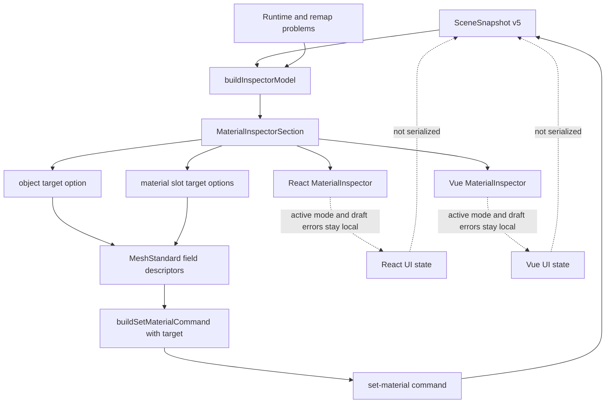
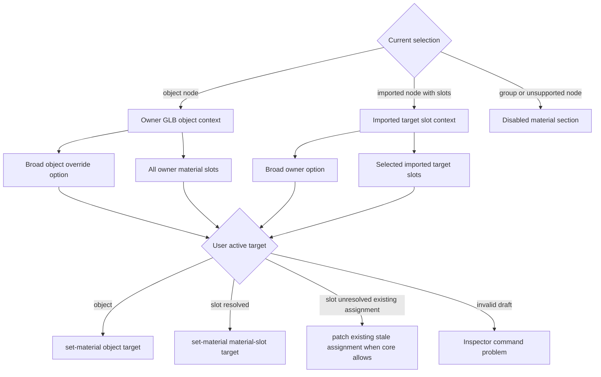

# feat: Add material slot inspector

## Summary

Detail roadmap U8 into an implementation-ready React/Vue inspector plan: expose imported GLB material slots through the framework-neutral core inspector model, default imported-target selection to the selected slot target, let object selection choose between broad and slot-level overrides, show unresolved slot state after reimport, and keep React/Vue as thin render/dispatch adapters over core `set-material` command builders.

This plan assumes U7 slot-aware material assignment is complete. It does not add runtime slot projection, manual remap UI, full glTF material graph editing, shader/node material editing, material variants, or persisted material libraries.

---

## Problem Frame

The core/runtime layer can now store `MaterialAssignmentTarget.kind === "material-slot"`, validate new slot writes against imported GLB slot metadata, preserve stale assignments after reimport, and project slot overrides onto matching runtime material slots. The default React/Vue `MaterialInspector` still behaves like an object-only form: it reads the selected object, renders a flat field grid, and always builds an object-level `set-material` command.

That creates a product mismatch. Real GLB models often have several mesh primitives and material slots, and users need to see what will be affected before editing. A user selecting an imported mesh or primitive should not have to know durable slot IDs. A user selecting the parent object should be able to distinguish "override the whole object" from "override this specific slot." If reimport removes a slot, the default inspector should preserve and explain the existing durable assignment instead of hiding it behind the general problems panel.

The invariant remains unchanged: inspector state is a pure projection over `SceneSnapshot` plus runtime problems. React/Vue render that projection and dispatch core commands; they do not own material semantics, store selected slot state in durable scene JSON, or serialize runtime-only values.

---

## Requirements

**Core Inspector Model**

- R1. `buildMaterialSection()` must derive object-level and material-slot-level material contexts from the current node selection, imported slot descriptors, material assignments, and runtime/remap problems. (origin R8, R9, R21)
- R2. The material section must expose one canonical `targets` list with object and material-slot target items, each carrying label, owner object ID, imported node ID when applicable, slot ID when applicable, assignment ID, material ID, selection-derived focus state, override presence, unresolved/problem state, editability flags, disabled reason, and command target. (origin R6, R8, R9)
- R3. The selected material editing target must be a UI/runtime view choice passed to the command builder, not a new durable snapshot field. Durable state changes only when `set-material` commits a material assignment. (origin R3, R8, R23)
- R4. Core material command builders must support object and material-slot targets, validate field drafts before dispatch, and return controlled inspector problems without mutating snapshot. (origin R8, R9, R21)
- R5. Multi-selection or non-material-capable selection must produce clear disabled/empty reasons without inventing mixed-value material editing. (origin R12, R21)

**React and Vue Default Inspector**

- R6. React and Vue `MaterialInspector` must render the same core material section: broad object override control, target list, active target state, unresolved slot status, existing override values, and supported `MeshStandardMaterialOverride` fields. (origin R8, R9, R12)
- R7. Editing a field while a slot target is active must dispatch `set-material` to `{ kind: "material-slot"; objectId; slotId }`; editing broad mode must dispatch to `{ kind: "object"; objectId }`. (origin R8, R21)
- R8. React/Vue may keep the currently active target key as component-local or hook/composable-local UI state, but must follow the shared target fallback and reset matrix so drafts cannot leak across targets. (origin R12, R21)
- R9. Invalid numeric, enum, color, or texture input must be visible in the default inspector and must not create a command or mutate snapshot. (origin R9, R21)
- R10. The material inspector UI must remain compact, accessible, and responsive inside the existing Workbench side panel without text/control overlap at narrow and desktop widths. (origin R12, R24)

**Compatibility and Verification**

- R11. Existing object-level material inspector behavior, undo/redo, texture asset filtering, React StrictMode behavior, and Vue raw editor handling must keep working. (origin R8, R21, R24)
- R12. Inspector model, React tests, Vue tests, browser tests, proof-loop integration, docs, and public API checks must prove parity and runtime-only exclusion. (origin R21, R23, R24)

---

## Scope Boundaries

### Included

- Framework-neutral material inspector model for broad object context and imported material-slot contexts.
- Core command-builder targeting for object assignments and material-slot assignments.
- Material target ordering, labels, active/disabled/unresolved state, editability flags, assignment presence, and problem linking.
- React and Vue default `MaterialInspector` UI updates.
- Component-local active material target state in React/Vue hooks or components.
- Visible controlled inspector command problems for invalid field drafts.
- React/Vue/unit/browser/integration tests and integration documentation updates.

### Deferred to Follow-Up Work

- Manual remap UI for unresolved imported targets or material slots.
- Mixed-value material editing for multi-selection.
- Material library, reusable presets, copy/paste material style, or cloud material assets.
- Full glTF material graph, shader graph, node material, material variants, animation-driven material edits, or authoring glTF topology.
- Slot thumbnails, source-material preview swatches, or runtime material sampling beyond metadata already in snapshot/runtime problems.

### Outside This Product Identity for This Stage

- Persisting selected inspector mode, active slot, validation draft state, React/Vue component state, runtime problems, runtime slot lookup results, Three.js `Material`, `Texture`, `Object3D`, object URLs, or resolver outputs into `SceneSnapshot` or `.ek3d`.
- Making React/Vue own material assignment rules. Framework packages render core models and dispatch core-built commands only.
- Rewriting source GLB materials or exporting authored overrides back into a modified GLB asset.

---

## Assumptions

- `SceneSnapshot.version = 5` with imported GLB nodes and `materialSlots` descriptors is available.
- U7 provides durable material-slot assignment command behavior, runtime projection, unresolved slot problems, and texture failure problems.
- `buildInspectorModel()` can receive runtime problems through existing React/Vue hooks and Vue composables.
- The first default UI can use textual slot labels and status badges from imported slot descriptors. It does not need rendered thumbnails or source material previews.
- External research is not load-bearing. Current local inspector, Workbench, material assignment, and slot descriptor contracts define the implementation path.

---

## Key Technical Decisions

- KTD1. Core owns material target derivation: `packages/core/src/inspector/material.ts` should decide which material targets exist for the current selection and how fields map to commands. React/Vue should not independently inspect imported nodes or assemble material-slot command targets.
- KTD2. Active target state is UI state, not authoring state: the selected inspector target can live in React/Vue component or hook/composable state because it only chooses which command target a future edit uses. Snapshot changes only when a material assignment command succeeds.
- KTD3. Active target fallback is deterministic: object selection defaults to the broad object target, imported node selection defaults to the first editable slot target on that imported node, and the previous active target is preserved only while it remains available for the same selection context. If the active target is removed, the adapter falls back through selected imported slot, owner broad target, then disabled state.
- KTD4. Parent object selection exposes all owner slots: selecting the GLB object should show broad override first, then all imported material slots owned by that object. Users can start coarse and then refine one slot without switching hierarchy selection.
- KTD5. Unresolved assignments have explicit capability flags: a slot item should distinguish `unresolved`, `canSelect`, `canEditExistingAssignment`, `canCreateAssignment`, `canClear`, and `disabledReason`. Existing stale assignments remain selectable and patchable only for command-safe edits; unresolved slots with no assignment are visible but cannot create a new assignment.
- KTD6. Field descriptors stay target-relative: the same supported `MeshStandardMaterialOverride` fields and texture asset filters apply to object and slot targets. Core should expose target descriptors plus target-aware field/command helpers; adapters may hold the active target key but must not duplicate field semantics.
- KTD7. UI error state is local and controlled: invalid field drafts should be shown near the control that produced them. These problems are not durable authored problems and should disappear when the field, target, or selection changes.
- KTD8. Parity is a release condition: React and Vue should share labels, ordering, active target fallback, disabled reasons, command targets, problem rendering, ARIA state, and error copy. Differences in component syntax are acceptable; differences in material semantics are not.

---

## High-Level Technical Design

---

## Interaction State Matrix

| Situation | Active target policy | Field/error policy |
|---|---|---|
| Object node selected | Default to object broad target. Preserve active target only while selection and target list are unchanged. | Reset drafts and field problems when target, assignment ID, or material ID changes. |
| Imported node with editable slots selected | Default to the first selectable slot on the selected imported node. Keep owner broad target visible as an explicit option. | Commit field edits to the active slot unless the user chooses broad target. |
| Imported node has no selectable slots | Fall back to owner broad target if available; otherwise disable material section. | Show a material-specific disabled reason. |
| Previous active target removed by reimport or selection change | Fall back to selected imported slot, owner broad target, then disabled state. | Clear draft values and controlled field problems. |
| Unresolved slot with existing assignment | Keep target selectable when `canEditExistingAssignment` or `canClear` is true. | Show unresolved status and existing override values; enable only command-safe edit/clear operations. |
| Unresolved slot without assignment | Show target as visible but disabled when it explains a problem. | Do not allow new assignment creation; show `disabledReason`. |
| Undo/redo restores a material assignment | Preserve active target when still available; refresh field values from snapshot. | Clear stale field problems tied to the previous material ID. |

React and Vue must use the same matrix. Active target state resets only when selection changes, the target list changes, or the active target becomes unavailable. Field drafts and command problems reset when field ID, active target, selection, assignment ID, or material ID changes.

---

## Implementation Units

### U1. Core material inspector target model

- **Goal:** Extend the framework-neutral material inspector section so it can describe broad object and material-slot editing targets for current selection.
- **Requirements:** R1, R2, R3, R5, R12.
- **Dependencies:** `docs/plans/2026-06-11-001-feat-slot-aware-material-assignment-plan.md`.
- **Files:** `packages/core/src/inspector/material.ts`, `packages/core/src/inspector/types.ts`, `packages/core/src/inspector/selection.ts`, `packages/core/src/inspector/node-targets.ts`, `packages/core/src/imported-targets/slots.ts`, `packages/core/src/inspector/material.test.ts`, `packages/core/src/inspector/inspector.test.ts`, `packages/core/src/public-api.ts`, `packages/core/src/public-api.test.ts`.
- **Approach:** Add `MaterialInspectorTarget` and expose a single `section.targets` array containing object and material-slot targets. Derive owner context from selected object node or selected imported node. Collect imported material slots from `SceneImportedGlbNode.materialSlots`, attach assignment/material IDs through `createMaterialAssignmentId()`, attach capability flags, and attach runtime/remap problem IDs by matching `Problem.target.kind === "imported-material-slot"` or assignment metadata. Keep the model JSON-compatible and free of runtime slot resolver results.
- **Execution note:** Implement core selector tests before changing React/Vue components so adapter work consumes a stable model.
- **Patterns to follow:** `buildInspectorModel()` in `packages/core/src/inspector/selection.ts`, current `MaterialInspectorSection` field descriptors in `packages/core/src/inspector/material.ts`, `findImportedGlbMaterialSlot()` in `packages/core/src/imported-targets/slots.ts`, problem normalization in `packages/core/src/inspector/problems.ts`.
- **Test scenarios:**
  - Given no selection, when `buildInspectorModel()` runs, then material section is empty with the existing disabled reason and has no active target or targets list.
  - Given a selected GLB object with no imported slots, when material section builds, then it exposes only the broad object target and current object-level override fields.
  - Given a selected GLB object with three imported material slots across child imported nodes, when material section builds, then it lists broad target first and slots in deterministic hierarchy/source order with labels, slot IDs, assignment IDs, material IDs, and override presence.
  - Given a selected imported node with two material slots, when material section builds, then it exposes the owner broad target plus only the selected imported node's slots and marks the first selectable slot as the preferred initial target.
  - Given a selected group node or unsupported node, when material section builds, then it is disabled with a material-specific reason and does not expose stale object compatibility IDs.
  - Given runtime problems include `imported-material-slot-unresolved`, when material section builds, then the matching slot item carries problem IDs, severity, unresolved state, capability flags, and disabled reason.
  - Given an unresolved slot has an existing assignment, when material section builds, then it reports `canSelect` and `canEditExistingAssignment` only if the command layer can patch that stale assignment.
  - Given an unresolved slot has no existing assignment, when material section builds, then it reports `canCreateAssignment: false` and a disabled reason.
  - Given the material section model is stringified, then it contains no `Object3D`, `Material`, `Texture`, resolver result, object URL, or component state.
- **Verification:** Core can explain every material editing target the default inspector needs without framework-specific slot discovery.

### U2. Target-aware material command builder

- **Goal:** Make core inspector command building target object or material-slot edits from the active material target while preserving validation and controlled error behavior.
- **Requirements:** R3, R4, R7, R9, R11, R12.
- **Dependencies:** U1.
- **Files:** `packages/core/src/inspector/material.ts`, `packages/core/src/inspector/types.ts`, `packages/core/src/inspector/fields.ts`, `packages/core/src/inspector/material.test.ts`, `packages/core/src/commands/set-material.test.ts`, `packages/core/src/public-api.test.ts`.
- **Approach:** Change `buildSetMaterialCommand()` to accept an explicit material inspector target descriptor or target key in addition to the current snapshot, field ID, and draft value. Keep a compatibility overload or default path that targets the selected object when no target is supplied. Reuse the existing patch builder for all supported fields. Return `InspectorCommandProblem` when the target is missing, unsupported, unresolved in a way the command cannot patch, or when draft values fail range/asset-kind validation.
- **Patterns to follow:** Current `buildSetMaterialCommand()` validation flow, `assetField()` and `validateAssetKind()` in `packages/core/src/inspector/fields.ts`, command rollback tests in `packages/core/src/commands/set-material.test.ts`.
- **Test scenarios:**
  - Given broad target is active, when opacity is committed, then the command targets `{ kind: "object"; objectId }` and matches current object-level behavior.
  - Given slot target is active and discoverable, when color is committed, then the command targets `{ kind: "material-slot"; objectId; slotId }` and uses the stable material-slot assignment ID convention.
  - Given an existing stale slot assignment is active and capability flags allow editing, when roughness changes or a texture slot is cleared, then the command builder returns a command that the core command layer can patch without requiring current slot discovery.
  - Given a slot target has no existing assignment and is currently unresolved, when a field edit is attempted, then the builder returns a controlled inspector problem and no command.
  - Given a texture asset draft references a GLB asset, unknown asset, or unsupported kind, when either broad or slot target is active, then the builder returns the same asset-kind problem and does not dispatch.
  - Given a numeric draft is outside range, when either target kind is active, then the builder returns the same range problem and does not dispatch.
  - Given callers omit the target parameter, when a selected object exists, then existing object-level tests still pass.
- **Verification:** Framework components can commit material edits by passing the active target to one core helper and never constructing target-specific command logic themselves.

### U3. React material slot inspector UI

- **Goal:** Update React default `MaterialInspector` to render target mode/slot controls, field errors, and slot unresolved state from the core material section.
- **Requirements:** R6, R7, R8, R9, R10, R11, R12.
- **Dependencies:** U1, U2.
- **Files:** `packages/react/src/components/MaterialInspector.tsx`, `packages/react/src/components/InspectorView.tsx`, `packages/react/src/components/inspector.css`, `packages/react/src/hooks/use-inspector.ts`, `packages/react/test/inspector.test.tsx`, `packages/react/test/workbench.test.tsx`, `packages/react/test/strict-mode.test.tsx`, `packages/react/src/public-api.test.ts`.
- **Approach:** Render a compact labeled radio group above the existing field grid: broad object override as a clear option, followed by slot options from `section.targets`. Store the active target key and current field problem locally, applying the shared interaction state matrix for fallback and resets. Call the target-aware `buildSetMaterialCommand()` and show returned problems inline near the field or target area with `aria-invalid`/`aria-describedby`. Preserve current uncontrolled input refresh behavior for undo/redo.
- **Patterns to follow:** Current uncontrolled input keying in `packages/react/src/components/MaterialInspector.tsx`, React external-store usage in `packages/react/src/hooks/use-inspector.ts`, existing inspector tests for transform/material commits and StrictMode.
- **Test scenarios:**
  - Given a selected object with imported slots, when React inspector renders, then the broad override option and all slot options appear in deterministic order.
  - Given a user selects a slot option and changes base color, when commit fires, then `editor.dispatch` receives `set-material` with `{ kind: "material-slot"; objectId; slotId }`.
  - Given a user leaves broad mode active and changes side, when commit fires, then `editor.dispatch` receives the existing object target.
  - Given a slot is marked unresolved with an existing assignment, when React inspector renders, then the slot row shows unresolved status and current override values remain visible.
  - Given an unresolved slot has no assignment, when React inspector renders, then the target option is disabled with the core-provided disabled reason and field edits cannot dispatch.
  - Given an invalid opacity draft is committed, when `buildSetMaterialCommand()` returns a problem, then the React inspector displays the warning and does not dispatch.
  - Given selection changes from one object/slot to another with the same field values, when React re-renders, then active target, uncontrolled drafts, and field problems reset according to the shared matrix.
  - Given a keyboard user tabs through target options and fields, when focus moves through the inspector, then the target radio group, disabled/unresolved labels, and field error descriptions are announced through accessible labels.
  - Given React StrictMode remounts the inspector, when subscriptions and active target state are inspected, then no duplicate runtime problem subscriptions or stale active slot commits occur.
- **Verification:** React default Workbench can perform slot-level material edits while preserving object-level compatibility and local UI error handling.

### U4. Vue material slot inspector UI

- **Goal:** Update Vue default `MaterialInspector` to match React behavior while respecting raw editor handling and Vue reactivity patterns.
- **Requirements:** R6, R7, R8, R9, R10, R11, R12.
- **Dependencies:** U1, U2, U3.
- **Files:** `packages/vue/src/components/MaterialInspector.vue`, `packages/vue/src/components/InspectorView.vue`, `packages/vue/src/components/inspector.css`, `packages/vue/src/composables/use-inspector.ts`, `packages/vue/test/inspector.test.ts`, `packages/vue/test/workbench.test.ts`, `packages/vue/src/public-api.test.ts`.
- **Approach:** Render the same labeled radio group and field grid shape using Vue templates. Keep `activeTargetKey` and `fieldProblem` as component-local refs, resetting them through watchers or computed keys according to the shared interaction state matrix. Use `toRaw` editor handling already present in the inspector stack. Pass the active target into the shared core command builder and display controlled command problems with matching `aria-invalid`/`aria-describedby` behavior without converting the editor or snapshot into deep reactive durable state.
- **Patterns to follow:** Current `MaterialInspector.vue` commit boundaries, `useInspector()` raw editor/computed model handling, Vue inspector tests for material color, runtime problem subscription, and unmount cleanup.
- **Test scenarios:**
  - Given a selected object with imported slots, when Vue inspector renders, then broad and slot target options match the React/core model labels and order.
  - Given a slot target is active and color changes, when Vue commits the field, then the dispatched command targets `{ kind: "material-slot"; objectId; slotId }`.
  - Given broad target remains active and roughness changes, when Vue commits the field, then object-level material behavior remains unchanged from current tests.
  - Given an unresolved slot with an existing assignment renders, then Vue shows unresolved state and keeps existing override fields visible.
  - Given an unresolved slot has no assignment, when Vue inspector renders, then the target option is disabled with the same disabled reason as React and field edits cannot dispatch.
  - Given invalid numeric or texture input is committed, then Vue displays the controlled inspector warning and does not dispatch.
  - Given the editor prop changes or selection changes, when Vue recomputes inspector state, then active target, field drafts, and field problems reset according to the shared matrix and no stale slot target is committed to the new editor.
  - Given a keyboard user tabs through target options and fields, when focus moves through the inspector, then the target radio group, disabled/unresolved labels, and field error descriptions are announced through accessible labels.
  - Given the Vue inspector unmounts, when subscriptions are inspected through fakes, then snapshot/runtime problem subscriptions are still released once.
- **Verification:** Vue default Workbench reaches the same material slot editing behavior as React without duplicating core semantics.

### U5. Workbench, browser parity, docs, and roadmap handoff

- **Goal:** Prove the default Workbench and documentation expose material slot editing as a complete U8 surface without claiming adjacent material editor features.
- **Requirements:** R10, R11, R12.
- **Dependencies:** U1-U4.
- **Files:** `packages/react/test/workbench.test.tsx`, `packages/vue/test/workbench.test.ts`, `packages/react/test/default-workbench.browser.test.tsx`, `packages/vue/test/default-workbench.browser.test.ts`, `packages/react/test/proof-loop-demo.browser.test.tsx`, `packages/vue/test/vue-proof-loop.integration.test.ts`, `packages/react/test/react-proof-loop.integration.test.tsx`, `examples/react-proof-loop/src/App.tsx`, `examples/vue-proof-loop/src/App.vue`, `docs/integration-react.md`, `docs/integration-vue.md`, `docs/interactions.md`, `docs/schema.md`, `docs/project-package.md`, `docs/plans/2026-06-05-001-feat-real-user-editor-roadmap-plan.md`.
- **Approach:** Add a shared parity fixture and expected UI contract that imports or constructs an expanded GLB fixture with at least two material slots. Use it in React and Vue tests to verify target order/labels, active target fallback, disabled reasons, problem text, ARIA state, command targets, undo/redo, and serialization exclusions. Update docs from "default inspector deferred" to "default inspector supports object and material-slot editing," while preserving explicit non-goals for remap UI and full material graph work. Update the roadmap U8 reference to this plan after implementation lands.
- **Patterns to follow:** Existing Workbench hierarchy selection tests, React/Vue proof-loop integration material checks, browser proof-loop smoke tests for inspector controls, docs boundary language in `docs/integration-react.md` and `docs/integration-vue.md`.
- **Test scenarios:**
  - Given React Workbench renders an expanded GLB fixture, when the user selects the object row, then material inspector shows broad override plus all slot options and no layout overlap in the side panel.
  - Given React Workbench selects an imported child row and edits one slot color, when snapshot is inspected, then only the material-slot assignment is created and object-level assignment is unchanged.
  - Given Vue Workbench performs the same slot edit, when snapshot is inspected, then command target, assignment ID, and override values match React.
  - Given undo/redo runs after a slot inspector edit, then both React and Vue observe material assignment removal/restoration through core history.
  - Given an unresolved material slot problem is present after reimport, when Workbench renders, then hierarchy/problem surfaces and material inspector show the unresolved state without deleting the assignment.
  - Given browser tests run at narrow and desktop viewport sizes, then the material target controls, field labels, selects, and error messages fit within the inspector panel without overlapping adjacent sections.
  - Given a slot label is long, when the inspector renders at narrow and desktop widths, then the label wraps or truncates within the target row, the row keeps at least a 40px interactive height, and error text wraps without horizontal overflow.
  - Given target controls render at narrow widths, then they remain a radio group with scrollable target-list behavior rather than switching to a different semantic control in only one framework.
  - Given `.ek3d` export or `editor.serialize()` is inspected after slot edits and UI target switching, then durable JSON contains assignment targets and asset references but no active target UI state, field error, runtime problem, cloned material, loaded texture, resolver output, object URL, `File`, or `Blob`.
  - Given docs are reviewed, then they describe default React/Vue slot inspector support and still defer manual remap UI, source GLB rewrite, shader graph, and material variants.
- **Verification:** U8 is visible in both default Workbenches, documented honestly, and covered by unit, adapter, browser, integration, and serialization checks.

---

## Acceptance Examples

- AE1. Given an expanded GLB object has slots `Body`, `Screen`, and `Buttons`, when the GLB object node is selected, then the default React/Vue material inspector shows broad object override plus those three slot targets in a deterministic order.
- AE2. Given the user activates `Screen` and changes base color to `#336699`, when the edit commits, then the dispatched command targets `{ kind: "material-slot"; objectId; slotId }` and snapshot stores a material-slot assignment.
- AE3. Given the user keeps broad mode active and changes roughness, when the edit commits, then the dispatched command targets `{ kind: "object"; objectId }` and existing object-level material behavior remains compatible.
- AE4. Given a GLB is reimported and the edited slot cannot be matched, when the inspector renders, then the stale assignment remains visible with unresolved status and current override values.
- AE5. Given a user enters invalid opacity or selects a GLB asset as a texture, when the field commits, then the inspector shows a controlled warning and no command mutates snapshot/history.
- AE6. Given the same expanded GLB fixture is edited through React and Vue default Workbenches, when snapshots are compared, then assignment IDs, targets, override values, undo/redo behavior, and serialization exclusions are equivalent.

---

## System-Wide Impact

- **Public API:** `MaterialInspectorSection` and `buildSetMaterialCommand()` likely need additive type changes. Preserve current object-level call path or update public API tests and docs in the same unit that changes the signature.
- **Workbench UX:** The right inspector panel becomes denser. Slot target controls need stable dimensions, a scrollable list when many slots exist, long-label wrapping or truncation, and at least 40px interactive row height so existing transform/environment/light sections remain usable.
- **Runtime problems:** Existing runtime/remap problem projection becomes part of material inspector targeting, not only the Problems panel. This is a read-only projection and must not introduce authored problem writes.
- **Framework parity:** React/Vue adapter tests become the guardrail against two different material editors emerging from the same core model.

---

## Risks & Dependencies

| Risk | Impact | Mitigation |
|---|---|---|
| Active target UI state leaks across selection changes. | A user may edit the wrong slot after selecting another object or imported target. | Reset active target when selection changes, target list changes, or the active target becomes unavailable; reset field drafts/problems on assignment and material ID changes. |
| React/Vue duplicate slot discovery logic. | Framework adapters may drift from core material semantics. | Keep slot derivation in core `MaterialInspectorSection`; adapters render target descriptors only. |
| Unresolved slots are hidden or over-disabled. | Users cannot understand or repair stale durable assignments after reimport. | Carry problem IDs and existing override values into slot items; allow only command-layer-safe edits. |
| Inspector density harms Workbench layout. | Side panel controls may overlap or become unusable on narrow widths. | Add CSS constraints and browser tests for narrow and desktop viewports, long labels, scrollable target lists, and wrapped error text. |
| Public helper signature breaks existing consumers. | Current object-level inspector users may need unnecessary rewrites. | Keep a compatibility default for selected object or provide a small migration documented in integration guides. |

---

## Documentation Notes

- Update `docs/integration-react.md` and `docs/integration-vue.md` to state that default inspectors now support material-slot editing for expanded imported GLB targets.
- Update `docs/interactions.md` to describe broad versus slot target selection, unresolved slot display, invalid draft handling, and undo/redo expectations.
- Keep `docs/schema.md` focused on durable material assignment shape and runtime-only exclusions; do not describe active inspector mode as schema.
- Keep `docs/project-package.md` clear that `.ek3d` stores material-slot assignments but not UI target state, command draft errors, runtime problems, or Three.js resources.

---

## Sources & Research

- Roadmap origin and U8 scope: `docs/plans/2026-06-05-001-feat-real-user-editor-roadmap-plan.md`.
- U7 core/runtime prerequisite: `docs/plans/2026-06-11-001-feat-slot-aware-material-assignment-plan.md`.
- Inspector architecture precedent: `docs/plans/2026-05-29-003-feat-inspector-ux-plan.md`.
- Current core inspector model: `packages/core/src/inspector/material.ts`, `packages/core/src/inspector/types.ts`, `packages/core/src/inspector/selection.ts`.
- Current React/Vue adapters: `packages/react/src/components/MaterialInspector.tsx`, `packages/vue/src/components/MaterialInspector.vue`.
- Slot and assignment contracts: `packages/core/src/imported-targets/slots.ts`, `packages/core/src/materials/types.ts`, `packages/core/src/commands/set-material.ts`.
