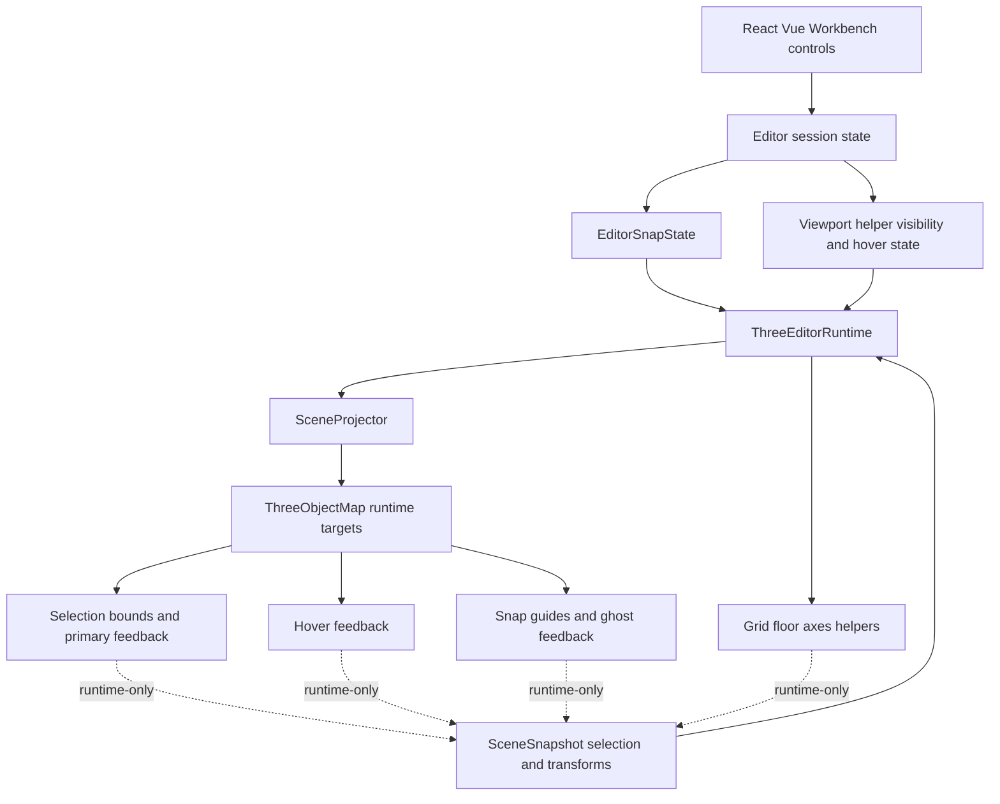
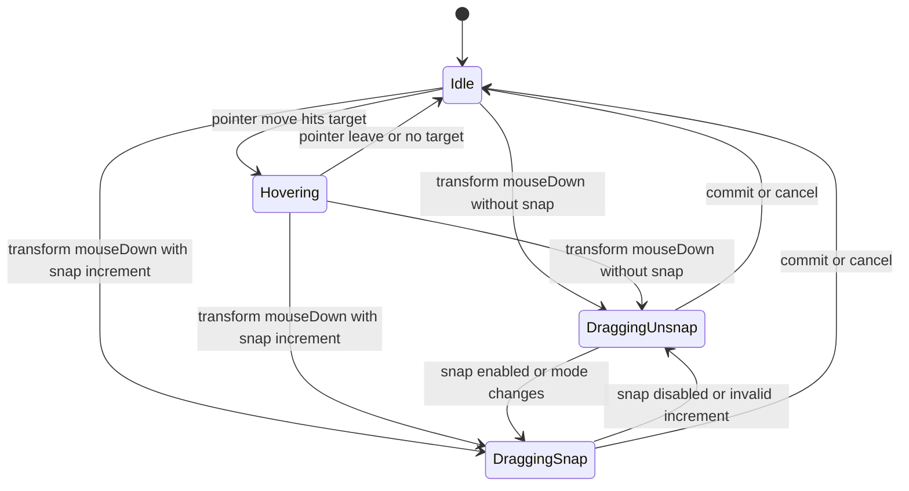

# feat: Add runtime viewport helpers and snap feedback

## Summary

Detail roadmap U9 into an implementation-ready plan: add runtime grid, floor, axes, selection bounds, hover and primary feedback, visible snap feedback, and default React/Vue controls while keeping all helper visibility, hover state, guide geometry, and transform preview state outside durable scene JSON.

This plan assumes imported GLB runtime targets, pointer picking, TransformControls, snap session state, and default Workbench controls already exist. It does not implement marquee selection, lasso selection, authored cameras, light helpers, shadow helpers, persistent layout, or a measurement toolkit.

---

## Problem Frame

The editor can already project snapshot state into Three.js, pick node targets, show selection bounds, mount TransformControls, frame selected targets, and route snap increments through session state. That proves the command/runtime contract, but the viewport still lacks the spatial context and movement feedback users expect when arranging real scenes: a grid/floor reference, axes, clear selected versus primary affordances, hover feedback, and a visible indication that snap is active during direct manipulation.

The key boundary is product-critical. Helpers are runtime/UI projections over the editor session and Three.js scene; they are not authored scene state. Durable output should contain only selection and committed transform values, never helper visibility, helper objects, hover target, snap preview mesh, guide lines, `Object3D`, object URLs, browser events, or framework component state.

---

## Requirements

**Runtime Helper Projection**

- R1. Runtime interaction options must support grid, floor, axes, selection bounds, hover feedback, primary selection feedback, and snap feedback as opt-in helper features. (origin R10, R12)
- R2. Helper objects must be lifecycle-managed by core runtime, marked runtime-only, excluded from picking, disposed on option changes, target changes, projection replacement, and runtime disposal. (origin R10, R23)
- R3. Selection bounds must continue using the runtime target map so imported targets are bounded by their matched target object, not by the whole owner GLB object. (origin R6, R10)
- R4. Hover feedback must use the same node-aware picking and target priority rules as click selection, without mutating durable selection. (origin R10, R21)

**Snap Feedback and Session State**

- R5. Snap visibility must derive from `EditorSnapState`, active transform mode, and transform drag lifecycle; the committed transform remains the snapped durable value. (origin R10, R12, R23)
- R6. Snap feedback must distinguish disabled snap, active snap increments, and invalid/non-finite snap inputs without serializing any of those visual helpers. (origin R10, R23)
- R7. TransformControls drag preview must publish enough session-only status for runtime helpers, Workbench status, and adapter tests to show what was snapped. (origin R10, R12)

**React and Vue Workbench**

- R8. React and Vue default Workbench toolbar must expose helper visibility and snap controls through shared core/session APIs, not framework-owned editor semantics. (origin R12, R21)
- R9. React and Vue viewport overlays/status surfaces must show equivalent helper/snap state and remain responsive without overlapping toolbar, viewport, inspector, or status text. (origin R12, R24)

**Compatibility and Verification**

- R10. Existing camera controls, pointer selection, TransformControls, selection visuals, imported target picking, material inspector, and project export/import behavior must keep working. (origin R12, R21, R24)
- R11. Serialization and `.ek3d` package tests must prove helper state, hover state, snap feedback, and guide objects are absent from durable JSON. (origin R23)

---

## Scope Boundaries

### Included

- Runtime grid helper, optional floor plane helper, and axes helper.
- Selection bounds refresh for selected and primary targets, including imported target aliases.
- Hover target feedback as transient runtime state.
- Visible snap feedback during TransformControls drag and session status outside drag.
- Core interaction option normalization and session-only viewport helper state.
- React and Vue default toolbar controls for helper visibility and snap increments.
- React/Vue viewport overlay or status summary for active helper/snap feedback.
- Unit, adapter, browser, serialization, and documentation updates.

### Deferred to Follow-Up Work

- Marquee, lasso, and screen-space selection rectangle; these belong to roadmap U10.
- Authored camera/view capture, camera helper objects, and saved view UI; these belong to roadmap U11.
- Light helper gizmos, shadow camera helpers, and lighting diagnostics; these belong to roadmap U13.
- Alignment guides that infer edge/center relationships between objects beyond numeric snap increments.
- Persisted per-user viewport preferences, dockable layout, command palette, configurable shortcuts, measurement tools, CAD-like rulers, or unit systems.

### Outside This Product Identity for This Stage

- Persisting helper visibility, hover target, snap preview target, helper geometry, guide lines, framework component state, pointer events, Three.js helpers, `Object3D`, material/texture resources, object URLs, `File`, `Blob`, resolver output, or runtime problems into `SceneSnapshot` or `.ek3d`.
- Making React/Vue own selection, transform, snap, or helper semantics. Framework adapters render controls and pass user intent to core/session APIs.

---

## Assumptions

- Imported GLB runtime projection from `docs/plans/2026-06-08-003-feat-imported-glb-runtime-projection-plan.md` is available, including `ThreeObjectMap` target metadata for imported targets.
- Current `RuntimeSelectionVisuals`, `TransformControlsAdapter`, `EditorSnapState`, `ObjectPicker`, and Workbench snap toolbar controls are the local patterns to extend.
- Helper options can default to disabled in headless runtime and enabled in the default Workbench interaction preset, preserving current explicit opt-in behavior for low-level runtime consumers.
- Context7 documentation lookup was unavailable because `CONTEXT7_API_KEY` is not configured. Planning uses installed Three.js `0.184.0`, local source, and official Three.js helper/control docs as non-load-bearing external context.

---

## Key Technical Decisions

- KTD1. Core runtime owns helper lifecycle: grid, floor, axes, hover, bounds, and snap guides should be created beside `RuntimeSelectionVisuals`, registered as runtime-only in `ThreeObjectMap`, and disposed by the runtime rather than by React/Vue.
- KTD2. Keep helper state session-only: helper visibility and hover target can live in editor runtime/session state or normalized interaction options. They must not be added to `SceneSnapshot`, command history, asset metadata, or project package manifests.
- KTD3. Split persistent selection from transient hover: selected and primary targets continue to come from `snapshot.selection`; hover is a runtime result of pointer movement and should clear on pointer leave, target removal, disabled hover, or runtime disposal.
- KTD4. Snap feedback consumes transform lifecycle events: `TransformControlsAdapter` should expose session-only drag/snap feedback events or state from `mouseDown`, `objectChange`, `mouseUp`, cancel, and mode/snap changes instead of requiring the Workbench to infer drag state from DOM events.
- KTD5. Use target map, not raw scene traversal: bounds, hover, snap guides, framing, and picking should resolve through `ThreeObjectMap.targetEntries()` so imported targets, lights, groups, aliases, and runtime-only helpers share one targeting rule.
- KTD6. Workbench controls are intents over shared state: React/Vue buttons can toggle helper visibility and snap increments, but labels, enabled state, and status summaries should come from core Workbench/session projections so the two adapters stay equivalent.
- KTD7. Browser tests assert observable contracts, not pixels: viewport helper tests should check helper presence, runtime-only markers, selection/snap state, layout geometry, and nonblank canvas behavior rather than pixel-perfect WebGL output.

---

## High-Level Technical Design

---

## Implementation Units

### U1. Viewport helper option and session model

- **Goal:** Define the core option/session model for runtime helpers, hover, and snap feedback without adding durable schema fields.
- **Requirements:** R1, R5, R6, R8, R11.
- **Dependencies:** Existing runtime interaction normalization and snap state.
- **Files:** `packages/core/src/runtime/viewport-controls.ts`, `packages/core/src/runtime/viewport-controls.test.ts`, `packages/core/src/editor/editor-api.ts`, `packages/core/src/editor/lifecycle.ts`, `packages/core/src/editor/create-editor.test.ts`, `packages/core/src/workbench/workbench-model.ts`, `packages/core/src/workbench/workbench-model.test.ts`, `packages/core/src/public-api.ts`, `packages/core/src/public-api.test.ts`.
- **Approach:** Add normalized `viewportHelpers` and `snapFeedback` interaction options with defaults for grid, floor, axes, hover, bounds, and snap guide visibility. If mutable helper visibility is needed after mount, add an editor session state object patterned after `EditorSnapState` and `EditorTransformModeState`; otherwise keep static runtime options and Workbench-local toggle state that remounts runtime. Prefer a core session object if toolbar toggles need to update helpers without remounting.
- **Execution note:** Start with tests around `normalizeRuntimeInteractionOptions()` and `buildWorkbenchModel()` so the rest of the work consumes a stable option shape.
- **Patterns to follow:** `EditorSnapState`, `EditorTransformModeState`, `normalizeRuntimeInteractionOptions()`, `WorkbenchToolbarModel.snapEnabled`.
- **Test scenarios:**
  - Given `interactions` is omitted, when options normalize, then viewport helpers, hover, and snap feedback are disabled like other interactions.
  - Given `interactions: true`, when options normalize for default Workbench usage, then camera, pointer selection, selection visuals, transform, grid, axes, hover, and snap feedback receive predictable defaults.
  - Given helper options are set to disabled, when options normalize, then no disabled option payload leaks into the resolved enabled shape.
  - Given helper visibility changes through a session state object, when subscribers are notified, then Workbench model reflects enabled grid/floor/axes/snap feedback without changing `SceneSnapshot`.
  - Given `editor.restore()` is called, when session state resets, then helper visibility returns to defaults and snap state clears without writing durable fields.
  - Given `editor.serialize()` is called after helper toggles and hover updates, then serialized JSON does not contain helper option keys, hover target IDs, snap feedback state, or Three.js helper markers.
- **Verification:** Core has a typed helper/snap feedback contract that remains session-only and public-API-safe.

### U2. Runtime grid, floor, axes, and helper lifecycle

- **Goal:** Add a runtime helper manager that creates, syncs, and disposes grid, floor, and axes helpers.
- **Requirements:** R1, R2, R10, R11.
- **Dependencies:** U1.
- **Files:** `packages/core/src/runtime/viewport-helpers.ts`, `packages/core/src/runtime/viewport-helpers.test.ts`, `packages/core/src/runtime/editor-runtime.ts`, `packages/core/src/runtime/editor-runtime.test.ts`, `packages/core/src/runtime/three-object-map.ts`, `packages/core/src/runtime/disposal.test.ts`.
- **Approach:** Add a `RuntimeViewportHelpers` manager mounted from `ThreeEditorRuntime.#mountInteractions()`. Use Three.js helper primitives where they fit and a lightweight transparent floor mesh only as a runtime visual. Every helper object should receive `userData.runtimeOnly = true` and a helper-specific marker, be registered through `ThreeObjectMap.markRuntimeOnly()`, be excluded from pointer candidates, and be disposed on option changes and runtime disposal.
- **Patterns to follow:** `RuntimeSelectionVisuals`, transform controls helper marking, `ThreeObjectMap.markRuntimeOnly()`, runtime disposal tests.
- **Test scenarios:**
  - Given grid and axes are enabled, when runtime mounts, then helper objects are added to the scene with runtime-only markers and are not present in `targetEntries()`.
  - Given floor helper is enabled with a configured size/color/opacity, when runtime mounts, then the floor is visible, non-pickable, named as a runtime helper, and disposed on runtime disposal.
  - Given helper options are toggled off, when helper sync runs, then existing helper objects are removed from the scene and disposed.
  - Given pointer selection runs while helpers are visible, when the ray intersects a helper before a scene target, then the helper is ignored and selection resolves to the real target or null.
  - Given runtime projection reloads a GLB or removes all nodes, when helper sync runs, then grid/floor/axes remain stable while stale target-bound helpers are released.
  - Given `editor.serialize()` and project export run while helpers are visible, then helper names, userData markers, geometries, materials, and option state are absent from durable JSON.
- **Verification:** Spatial reference helpers improve orientation without becoming selectable or durable scene content.

### U3. Hover, selected, and primary target feedback

- **Goal:** Extend runtime feedback so hover, selected, and primary targets are visually distinct and update from the shared target map.
- **Requirements:** R2, R3, R4, R10, R11.
- **Dependencies:** U1, U2 and imported target runtime projection.
- **Files:** `packages/core/src/runtime/selection-visuals.ts`, `packages/core/src/runtime/selection-visuals.test.ts`, `packages/core/src/runtime/viewport-helpers.ts`, `packages/core/src/runtime/viewport-helpers.test.ts`, `packages/core/src/runtime/editor-runtime.ts`, `packages/core/src/runtime/editor-runtime.test.ts`, `packages/core/src/runtime/picking.ts`, `packages/core/src/runtime/picking.browser.test.ts`, `docs/interactions.md`.
- **Approach:** Keep `RuntimeSelectionVisuals` focused on selected/primary bounds and add hover support either in the same manager or in `RuntimeViewportHelpers` if it needs pointer lifecycle. Pointer move should resolve a candidate through `ObjectPicker`/`ThreeObjectMap.getTargetForObject()` without dispatching a selection command. Bounds should prefer the selected imported target's matched object over the owner object and should safely handle empty bounds with the existing fallback.
- **Patterns to follow:** `RuntimeSelectionVisuals.sync()`, `ObjectPicker.pickNodeFromClientPoint()`, `ThreeObjectMap.defaultPickPriority()`, imported target alias tests.
- **Test scenarios:**
  - Given a selected object and a primary selected imported target, when visuals sync, then selected and primary helpers use distinct colors and each helper targets the mapped runtime object.
  - Given two imported node IDs alias the same runtime `Object3D`, when only one is primary selected, then helper metadata and color identify the primary imported node rather than the owner object.
  - Given pointer move hits a pickable target, when hover feedback is enabled, then a hover helper appears and no `select-node` command is dispatched.
  - Given pointer move hits a runtime-only helper, when hover feedback resolves, then hover clears or stays on the underlying real target according to ray hit order and never chooses the helper.
  - Given a selected target is removed by projection or reimport, when visuals sync, then its selected/hover helper is disposed and no stale helper remains in the scene.
  - Given hover is disabled or the pointer leaves the viewport, when sync runs, then hover state clears without mutating `snapshot.selection`.
- **Verification:** Users can tell hover, selected, and primary targets apart while durable selection remains command-owned.

### U4. Snap feedback lifecycle and transform integration

- **Goal:** Make snap visible during direct manipulation and expose session-only snap feedback for status surfaces.
- **Requirements:** R5, R6, R7, R10, R11.
- **Dependencies:** U1, U2 and current TransformControls snap integration.
- **Files:** `packages/core/src/runtime/transform/transform-controls-adapter.ts`, `packages/core/src/runtime/transform/transform-controls-adapter.test.ts`, `packages/core/src/runtime/transform/transform-transaction.ts`, `packages/core/src/runtime/transform/transform-transaction.test.ts`, `packages/core/src/runtime/viewport-helpers.ts`, `packages/core/src/runtime/viewport-helpers.test.ts`, `packages/core/src/runtime/editor-runtime.ts`, `packages/core/src/runtime/editor-runtime.test.ts`, `packages/core/src/workbench/workbench-model.ts`, `packages/core/src/workbench/workbench-model.test.ts`.
- **Approach:** Extend the TransformControls bridge with a session-only feedback callback or state snapshot carrying active node ID, mode, enabled increment, before transform, current preview transform, snapped transform, and whether the current channel was snapped. The helper manager can render a target ghost, axis/grid guide, or compact in-scene marker from that state. Keep exact geometry choices lightweight and disposable; the contract is feedback lifecycle and durability exclusion, not a specific visual art direction.
- **Technical design:** Directional guidance only: model snap feedback as `idle`, `dragging-unsnapped`, and `dragging-snapped` states emitted by the transform adapter. Runtime helpers subscribe or receive updates from `ThreeEditorRuntime`, and Workbench status reads only the session projection. Do not dispatch commands from feedback updates.
- **Patterns to follow:** `TransformControlsAdapter#setSnap()`, `TransformTransaction.preview()`, `snapTransform()`, existing single-history-entry drag tests.
- **Test scenarios:**
  - Given translate snap is enabled and a drag previews `[1.24, -0.26, 0]` with increment `0.5`, when objectChange fires, then feedback reports snapped `[1, -0.5, 0]` and the eventual committed transform matches that value.
  - Given rotate or scale mode is active, when corresponding snap increments are enabled, then feedback reports the matching channel and does not claim other channels were snapped.
  - Given snap is disabled, null, non-finite, or non-positive, when drag previews, then feedback reports unsnapped state and helper visuals either hide or show a disabled status.
  - Given snap settings change during an active drag, when the adapter applies new settings, then feedback updates and the drag either continues with new snap or cancels according to the existing transform safety policy.
  - Given selection changes, target deletion, cancel, mouseUp, or runtime disposal occurs during drag, then snap feedback clears, preview state is canceled or committed as existing transform rules require, and no helper object remains.
  - Given `editor.serialize()` runs after snapped and unsnapped drags, then only committed transform values appear in durable JSON and no snap feedback state appears.
- **Verification:** Snap feels observable during transform editing while command/history and serialization remain unchanged.

### U5. React and Vue helper controls and viewport status

- **Goal:** Expose helper toggles and snap feedback in both default Workbenches with equivalent behavior and responsive layout.
- **Requirements:** R8, R9, R10, R11.
- **Dependencies:** U1-U4.
- **Files:** `packages/react/src/hooks/use-workbench.ts`, `packages/react/src/components/EditorWorkbench.tsx`, `packages/react/src/components/EditorViewport.tsx`, `packages/react/src/components/WorkbenchToolbar.tsx`, `packages/react/src/components/WorkbenchStatusBar.tsx`, `packages/react/src/components/workbench.css`, `packages/react/test/workbench.test.tsx`, `packages/react/test/editor-viewport.test.tsx`, `packages/vue/src/composables/use-workbench.ts`, `packages/vue/src/components/EditorWorkbench.vue`, `packages/vue/src/components/EditorViewport.vue`, `packages/vue/src/components/WorkbenchToolbar.vue`, `packages/vue/src/components/WorkbenchStatusBar.vue`, `packages/vue/src/components/workbench.css`, `packages/vue/test/workbench.test.ts`, `packages/vue/test/editor-viewport.test.ts`.
- **Approach:** Extend Workbench context with helper state and snap feedback summary from core/session projections. Add compact toolbar controls for grid, floor, axes, hover, bounds, and snap feedback. Keep controls as icon/text or compact button groups consistent with current toolbar, with stable titles and `aria-pressed`. If the runtime must update without remounting, context calls should update core session state and runtime subscriptions; otherwise the plan should explicitly constrain option identity changes and remount behavior.
- **Patterns to follow:** Current Workbench snap buttons, `useSyncExternalStore()` snap subscription, Vue `shallowRef` session subscriptions, toolbar `aria-pressed` tests.
- **Test scenarios:**
  - Given React Workbench renders with default interactions, when helper controls are visible, then grid, axes, hover, bounds, and snap feedback buttons show the core-projected pressed state.
  - Given a React user toggles grid off and axes on, when the runtime state updates, then the core helper state changes and no snapshot command is dispatched.
  - Given Vue Workbench performs the same toggles, then pressed state, runtime state, and snapshot exclusion match React.
  - Given snap is enabled and a transform drag reports snapped feedback, when status renders, then React and Vue show the active mode/increment without storing that text in durable state.
  - Given helper controls wrap at narrow widths, then buttons maintain at least 40px interaction height, text wraps within the button, and toolbar/status text does not overlap the viewport or inspector.
  - Given host overrides `toolbar` or `viewportOverlay`, when default helpers are disabled or replaced, then core runtime behavior remains available through context without requiring framework-owned semantics.
  - Given Vue receives raw editor/runtime objects, when helper session state updates, then it does not deep-proxy runtime objects or leak stale subscriptions on unmount.
- **Verification:** Both adapters expose U9 affordances as thin controls over shared core/session behavior and remain usable in mobile and desktop workbench layouts.

### U6. Browser parity, docs, and serialization acceptance

- **Goal:** Prove U9 across core, React, Vue, browser runtime, project package, and documentation without overclaiming U10/U11/U13 work.
- **Requirements:** R9, R10, R11.
- **Dependencies:** U1-U5.
- **Files:** `packages/core/src/editor/serialization.test.ts`, `packages/core/src/project/export-project.test.ts`, `packages/core/src/runtime/picking.browser.test.ts`, `packages/react/test/default-workbench.browser.test.tsx`, `packages/react/test/proof-loop-demo.browser.test.tsx`, `packages/vue/test/default-workbench.browser.test.ts`, `packages/vue/test/vue-proof-loop.integration.test.ts`, `examples/react-proof-loop/src/App.tsx`, `examples/vue-proof-loop/src/App.vue`, `docs/interactions.md`, `docs/integration-react.md`, `docs/integration-vue.md`, `docs/project-package.md`, `docs/schema.md`, `docs/plans/2026-06-05-001-feat-real-user-editor-roadmap-plan.md`.
- **Approach:** Add acceptance fixtures that turn on helpers, hover a target, drag with snap, export, restore, and compare durable JSON. Browser tests should check canvas is nonblank, helpers do not block picking, toolbar geometry is stable at narrow and desktop sizes, and React/Vue parity holds. Docs should move grid/helpers/snap feedback out of "not implemented" only after implementation lands, while leaving marquee/lasso and authored camera work deferred.
- **Patterns to follow:** Existing `test:browser` proof-loop checks, project export runtime-only assertions, React/Vue Workbench parity tests.
- **Test scenarios:**
  - Given React browser Workbench enables grid, floor, axes, bounds, hover, and snap feedback, when the scene renders, then the canvas is nonblank and helper controls report enabled state.
  - Given Vue browser Workbench enables the same helpers, then visible control state and status summaries match React for the same snapshot and session state.
  - Given pointer hover and click selection occur with grid/floor helpers visible, when selection resolves, then runtime-only helpers are not selected and the real node target is selected.
  - Given an imported target is selected and framed, when bounds and snap feedback are active, then helper metadata targets the imported node and not the owner object.
  - Given helper toggles, hover, camera orbit, snapped drag, and status updates occur before export, when `editor.serialize()` and `.ek3d` `scene.json` are inspected, then helper visibility, hover target, snap feedback, guide geometry, runtime problems, object URLs, `File`, `Blob`, and Three.js helper objects are absent.
  - Given browser tests run at narrow and desktop viewport sizes, then toolbar helper groups, snap status, viewport overlay, inspector, and status bar do not overlap and remain readable.
  - Given docs are reviewed, then U9 is described as runtime/session authoring assistance and marquee, authored camera, light helpers, shadows, persistent layout, and measurement tools remain deferred.
- **Verification:** U9 can be demonstrated as a real authoring ergonomic improvement across frameworks without contaminating durable contracts.

---

## Acceptance Examples

- AE1. Given the user enables grid, floor, and axes in the default Workbench, when runtime mounts and the project is exported, then helpers are visible in the viewport and absent from `SceneSnapshot` and `.ek3d` JSON.
- AE2. Given an imported GLB primitive target is selected, when selection bounds sync, then the bounds helper encloses the matched imported target rather than the full owner GLB object.
- AE3. Given hover feedback is enabled, when the pointer moves over a pickable object or imported target, then hover feedback appears without changing `selection.nodeId` until the user clicks.
- AE4. Given translate snap is enabled at `0.5`, when the user drags a selected target through TransformControls, then visible snap feedback reports the snapped movement and the committed transform stores snapped values.
- AE5. Given helpers and snap feedback are active, when undo/redo runs after a transform, then durable transform history changes while helper visibility and hover/snap feedback remain session-only.
- AE6. Given the same scene is opened in React and Vue Workbench, when helper toggles and snap controls are used, then control state, status summaries, selection behavior, and serialization exclusions are equivalent.

---

## System-Wide Impact

- **Runtime lifecycle:** `ThreeEditorRuntime` gains another helper manager and possibly session-state subscriptions. Disposal and option-change tests must cover every helper object and listener.
- **Picking and target identity:** Helper objects must remain invisible to picking while bounds/hover/snap feedback must use the same `ThreeObjectMap` target identity as imported target selection and TransformControls.
- **Public API:** Runtime interaction option types and Workbench context types will grow additively. Keep low-level runtime consumers able to leave helpers disabled.
- **Framework parity:** React/Vue toolbar and status components become denser. The shared Workbench model should carry as much state as practical to prevent adapter drift.
- **Serialization boundary:** More runtime visuals increase the chance of accidental `userData` or helper object leakage; serialization and project package tests are mandatory acceptance gates.

---

## Risks and Dependencies

| Risk | Impact | Mitigation |
|---|---|---|
| Helper state becomes durable by accident. | `.ek3d` packages include UI/session noise and break snapshot-first identity. | Keep helper state in runtime/session objects, add serialization and project export assertions for helper markers and option names. |
| Helpers intercept picking. | Users cannot select objects behind the grid/floor/axes or hover selects helpers. | Mark helper objects runtime-only, exclude them from `targetEntries()`, and keep pointer candidates derived from pickable target map entries only. |
| Imported target bounds fall back to owner object. | Users cannot tell which GLB sub-target is selected. | Use `ThreeObjectMap.getTarget(nodeId)` for selected, primary, hover, and snap feedback rather than traversing owner GLB roots. |
| Snap feedback disagrees with committed transform. | Users lose trust in direct manipulation. | Derive feedback from the same transform transaction and `snapTransform()` path that commits snapped values. |
| Toolbar density causes layout overlap. | Default Workbench becomes harder to use on narrow screens. | Add compact grouped controls, stable button dimensions, wrapping/overflow CSS, and browser geometry tests. |
| Runtime subscriptions leak on remount or Vue reactivity wraps runtime objects. | Helpers keep rendering after disposal or stale state updates another editor. | Follow existing `subscribeRuntime`, snap, transform mode, and Vue `markRaw` patterns; add unmount/remount tests. |

---

## Documentation Notes

- Update `docs/interactions.md` to describe runtime grid/floor/axes, hover, selection bounds, primary feedback, and snap feedback as session/runtime helpers.
- Keep `docs/schema.md` focused on durable selection and transform fields; do not add helper visibility or hover state to schema.
- Update `docs/project-package.md` to state that helper toggles, hover state, snap guide state, and helper objects are excluded from `.ek3d` JSON.
- Update `docs/integration-react.md` and `docs/integration-vue.md` to show default Workbench helper controls and to explain how host-provided toolbar/overlay regions can replace the visuals without owning core semantics.
- Update the roadmap U9 entry to reference this plan after implementation starts or lands.

---

## Sources and Research

- Roadmap source and U9 scope: `docs/plans/2026-06-05-001-feat-real-user-editor-roadmap-plan.md`.
- Imported target runtime prerequisite: `docs/plans/2026-06-08-003-feat-imported-glb-runtime-projection-plan.md`.
- Default Workbench prerequisite: `docs/plans/2026-06-04-001-feat-default-editor-workbench-plan.md`.
- Current interaction docs: `docs/interactions.md`.
- Current runtime patterns: `packages/core/src/runtime/editor-runtime.ts`, `packages/core/src/runtime/viewport-controls.ts`, `packages/core/src/runtime/selection-visuals.ts`, `packages/core/src/runtime/transform/transform-controls-adapter.ts`, `packages/core/src/runtime/three-object-map.ts`, `packages/core/src/runtime/picking.ts`.
- Current Workbench patterns: `packages/core/src/workbench/workbench-model.ts`, `packages/react/src/hooks/use-workbench.ts`, `packages/vue/src/composables/use-workbench.ts`, `packages/react/src/components/WorkbenchToolbar.tsx`, `packages/vue/src/components/WorkbenchToolbar.vue`.
- Installed dependency reference: `node_modules/three/package.json` reports Three.js `0.184.0`.
- Official Three.js helper/control references: https://threejs.org/docs/pages/GridHelper.html, https://threejs.org/docs/pages/AxesHelper.html, https://threejs.org/docs/pages/Box3Helper.html, https://threejs.org/docs/pages/BoxHelper.html, https://threejs.org/docs/pages/TransformControls.html.
