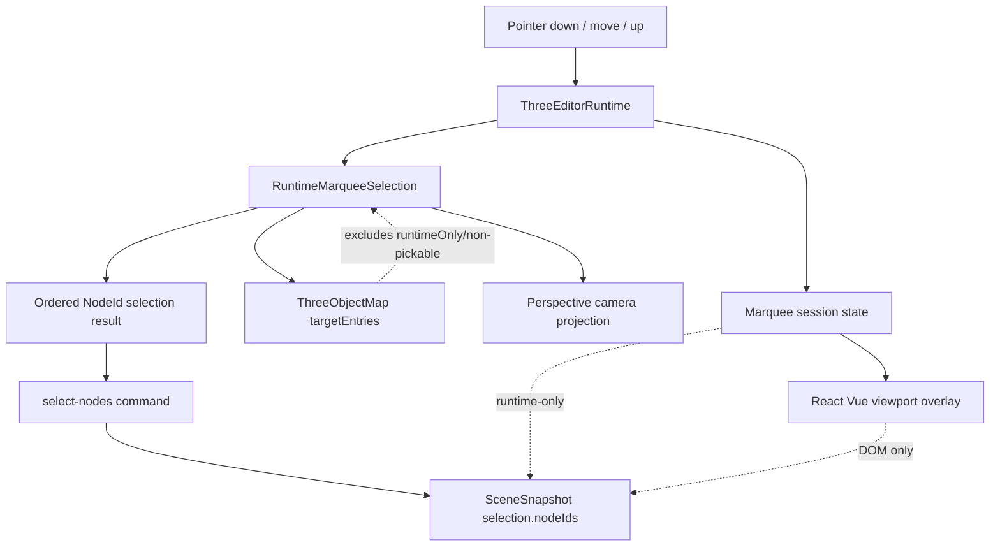
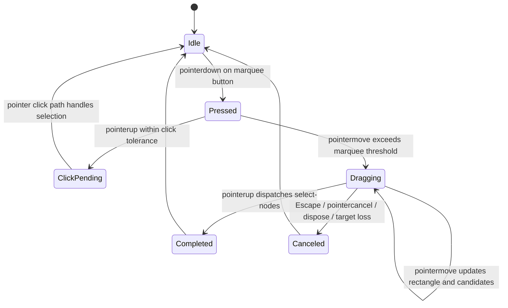
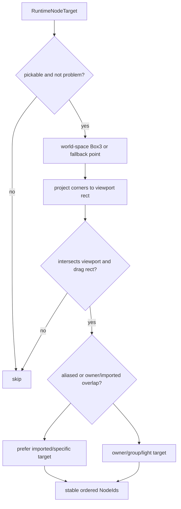

# feat: Add marquee selection

## Summary

Detail roadmap U10 into an implementation-ready plan: add drag-rectangle marquee selection for visible node targets and imported GLB targets, route the result through existing `select-nodes` modes, and keep rectangle overlay, drag state, hover candidates, DOM events, camera suppression, and Three.js helper data outside durable scene JSON.

This plan assumes node-native multi-selection, imported target runtime projection, `ThreeObjectMap` pick specificity, runtime viewport helpers, and React/Vue default Workbench controls are already available. It does not implement lasso selection, persisted viewport preferences, new durable selection schema, or advanced occlusion/paint-selection tools.

---

## Problem Frame

The editor can already select objects, groups, lights, and imported GLB targets through commands, hierarchy rows, and pointer picking. It can also show runtime-only grid, hover, bounds, and snap feedback. The remaining workflow gap is efficiency: real scenes quickly contain many selectable targets, and users need to drag a rectangle over the viewport to select several visible targets without clicking each one.

The core boundary is the same as the rest of the editor contract. The durable outcome is only `selection.nodeId` and ordered `selection.nodeIds`. The marquee rectangle, pointer capture state, projected screen-space bounds, candidate previews, DOM overlay, Three.js `Object3D` references, camera-control suppression, and runtime problems are transient runtime/UI state.

---

## Requirements

**Selection Semantics**

- R1. Runtime must support box/marquee selection over visible pickable node targets, including object, group, spatial light, and imported GLB targets. (origin R10, R11)
- R2. Marquee completion must dispatch existing `select-nodes` commands with `replace`, `add`, `toggle`, and `remove` modes matching pointer-click modifier semantics. (origin R11, R21)
- R3. Selection ordering must be deterministic, with primary selection set to the first selected target according to a documented runtime ordering rule. (origin R11, R24)
- R4. Runtime-only helpers, grid/floor/axes, hover helpers, snap feedback, selection bounds, problem placeholders, non-pickable targets, and disabled transform aliases must not become marquee-selected targets. (origin R10, R23)

**Runtime Geometry and Interaction**

- R5. Marquee selection must derive candidates from `ThreeObjectMap` runtime targets rather than raw scene traversal so imported target specificity and owner fallback rules stay consistent with pointer picking. (origin R6, R10, R11)
- R6. Screen-space selection must handle drag direction, small-drag click tolerance, off-viewport clamping, camera resize, empty bounds, invisible/frustum-out targets, and overlapping imported target/owner object mappings. (origin R10, R11)
- R7. Marquee drag state must suppress conflicting camera orbit, pointer click selection, hover updates, and TransformControls drag while the rectangle is active. (origin R10, R12)
- R8. The algorithm must avoid depending on Three.js `SelectionBox` raw `Object3D` collection as the source of truth; it may borrow projection/frustum ideas but must return `NodeId` targets. (origin R11, R21)

**React and Vue Workbench**

- R9. React and Vue default `EditorViewport` / `EditorWorkbench` must expose equivalent marquee enablement and rectangle overlay behavior without owning selection semantics. (origin R12, R21)
- R10. The overlay must be pointer-transparent, responsive, and constrained to the viewport so it does not overlap toolbar, inspector, status bar, or asset panels incoherently. (origin R12, R24)

**Durability and Verification**

- R11. `SceneSnapshot`, `editor.serialize()`, and `.ek3d` `scene.json` must contain only durable selection results after marquee selection, never overlay state or runtime objects. (origin R23)
- R12. Browser and integration coverage must prove marquee works across React/Vue proof loops, imported targets, helper visibility, selection modifiers, undo/redo-adjacent workflows, export, and restore. (origin R24)

---

## Scope Boundaries

### Included

- Runtime marquee option and drag state for primary-button rectangle selection.
- Core screen-space selection helper that converts pickable runtime targets into ordered selected `NodeId` results.
- Modifier mapping shared with pointer click selection: shift add, ctrl/meta toggle, alt remove, default replace.
- Suppression of click selection, hover feedback, camera controls, and transform controls while a marquee drag is active.
- React and Vue viewport overlay that visualizes the drag rectangle from core/runtime session state.
- Tests for geometry, event lifecycle, imported targets, helpers, serialization, React/Vue parity, and browser proof loops.
- Documentation updates to move marquee out of "not implemented" and explain runtime-only overlay semantics.

### Deferred to Follow-Up Work

- Freeform lasso selection, paint selection, crossing/window selection modes, selection filters, and selection sets.
- Persisted user preferences for marquee enablement, modifier remapping, or overlay styling.
- Camera-space depth policies beyond the first conservative visible-target pass.
- Dedicated hierarchy tree polish for large marquee result sets.
- Touch-specific multi-finger marquee gestures and stylus pressure behavior.

### Outside This Product Identity for This Stage

- Persisting marquee rectangle, drag start/end points, candidate previews, overlay DOM, pointer events, camera-control state, helper geometry, Three.js `Object3D`, `File`, `Blob`, object URLs, resolver output, loaded textures, PMREM output, or runtime problems into `SceneSnapshot` or `.ek3d`.
- Making React/Vue own selection state. Framework adapters render overlay and pass events/state to core runtime; core commands remain the only durable selection mutation path.

---

## Assumptions

- Current `selection.nodeId` / `selection.nodeIds` and `select-nodes` command behavior are the durable selection model for this work.
- `ThreeObjectMap.getTargetForObject()` already resolves imported targets more specifically than owner objects for pointer hits; marquee should reuse target entries and the same priority model.
- Runtime viewport helper state is session-only and can be extended or paralleled for marquee drag state without a snapshot migration.
- Three.js `0.184.0` is installed. Its `SelectionBox` and `SelectionHelper` examples are useful references, but direct adoption would return raw `Object3D` collections and bypass project target identity.
- Context7 lookup could not run because `CONTEXT7_API_KEY` is not configured; local Three.js source and official docs are non-load-bearing external context.

---

## Key Technical Decisions

- KTD1. Core runtime owns marquee semantics: the runtime computes candidate node IDs and dispatches `select-nodes`; React/Vue only render the overlay and subscribe to session state.
- KTD2. Use screen-space target bounds, not raw scene recursion: each pickable `RuntimeNodeTarget` is projected through the active camera into viewport coordinates, then tested against the drag rectangle. This preserves imported target and helper exclusion rules from `ThreeObjectMap`.
- KTD3. Keep `SelectionBox` out of the authoritative path: Three.js addon selection returns `Object3D` and scene traversal results. The project needs `NodeId`, alias priority, helper exclusion, and command dispatch, so a focused `marquee-selection.ts` helper is safer.
- KTD4. Completion is command-owned: preview/candidate state must never mutate `SceneSnapshot`; only pointer-up completion dispatches `select-nodes` with ordered node IDs and a primary node ID.
- KTD5. Marquee drag suppresses competing interactions: once movement exceeds the marquee threshold, camera controls, click selection, hover feedback, and transform attachment must pause until completion or cancel.
- KTD6. Deterministic ordering beats raycast hit order: selected node IDs should be sorted by screen-space top/left, then pick priority, then stable node ID. This makes tests and primary selection predictable.
- KTD7. Default Workbench enables rectangle selection conservatively: expose marquee as part of default authoring interactions, but keep low-level runtime consumers opt-in through interaction options.

---

## High-Level Technical Design

---

## Implementation Units

### U1. Marquee interaction options and session state

- **Goal:** Add a typed runtime/session contract for marquee enablement, drag rectangle, active modifiers, candidate IDs, and status without adding durable schema fields.
- **Requirements:** R1, R2, R7, R9, R11.
- **Dependencies:** Existing `RuntimeInteractionOptions`, `EditorViewportHelperState`, and pointer selection options.
- **Files:** `packages/core/src/runtime/viewport-controls.ts`, `packages/core/src/runtime/viewport-controls.test.ts`, `packages/core/src/editor/marquee-selection-state.ts`, `packages/core/src/editor/marquee-selection-state.test.ts`, `packages/core/src/editor/editor-api.ts`, `packages/core/src/editor/lifecycle.ts`, `packages/core/src/editor/create-editor.test.ts`, `packages/core/src/public-api.ts`, `packages/core/src/public-api.test.ts`.
- **Approach:** Introduce `RuntimeMarqueeSelectionOptions` under `RuntimeInteractionOptions` with enabled flag, button, drag threshold, default mode, minimum rectangle size, and optional candidate preview toggle. Add an `EditorMarqueeSelectionState` session store if overlay state must be observed outside runtime; otherwise keep the observable store runtime-owned and expose it through `EditorRuntime.subscribeMarqueeSelection()`. Prefer a core session store so React/Vue can render overlay without DOM event duplication.
- **Execution note:** Start with option-normalization and session-store tests before event integration.
- **Patterns to follow:** `RuntimePointerSelectionOptions`, `resolvePointerSelectionMode()`, `EditorViewportHelperState`, `EditorSnapState`, `CoreEditor.restore()` session reset behavior.
- **Test scenarios:**
  - Given interactions are omitted, when runtime options normalize, then marquee selection is disabled.
  - Given `interactions: true`, when default authoring interactions normalize, then marquee selection is enabled with the same primary button and modifier defaults as pointer selection.
  - Given marquee options set `enabled: false`, when normalization runs, then the resolved interaction disables marquee without retaining partial option payload.
  - Given session state receives pointer start, move, candidate IDs, and completion, when subscribers are notified, then snapshots are frozen, deterministic, and contain only rectangle coordinates, modifiers, status, and node IDs.
  - Given `editor.restore()` or runtime disposal occurs during an active marquee drag, when session resets, then drag state and candidate IDs clear without changing `SceneSnapshot.selection`.
  - Given `editor.serialize()` runs after marquee session updates, then serialized JSON does not contain `marquee`, rectangle coordinates, candidate IDs, DOM event fields, or helper markers.
- **Verification:** Core exposes a stable, session-only marquee contract that downstream runtime and framework code can consume.

### U2. Runtime marquee target selection algorithm

- **Goal:** Implement a framework-neutral runtime selector that converts a viewport rectangle into deterministic selected `NodeId` results.
- **Requirements:** R1, R3, R4, R5, R6, R8, R11.
- **Dependencies:** U1, imported target runtime projection, runtime viewport helpers.
- **Files:** `packages/core/src/runtime/marquee-selection.ts`, `packages/core/src/runtime/marquee-selection.test.ts`, `packages/core/src/runtime/three-object-map.ts`, `packages/core/src/runtime/three-object-map.test.ts`, `packages/core/src/runtime/picking.ts`, `packages/core/src/runtime/picking.browser.test.ts`.
- **Approach:** Add `RuntimeMarqueeSelection` that accepts camera, container rect, `ThreeObjectMap`, and rectangle coordinates. It should iterate `targetEntries()`, filter pickable/problem/runtime-only targets, compute each target's world bounds with empty-bounds fallback, project representative corners or center into normalized viewport coordinates, and produce ordered `nodeIds` plus metadata for preview. For aliases and owner/imported overlap, use existing target `pickPriority` and node specificity so one runtime object does not yield duplicate broad and specific targets unless both are independently pickable targets with distinct screen bounds.
- **Technical design:** Directional guidance only: prefer a screen-space rectangle pass first because it is easier to test and respects target identity. A future frustum pass can replace the geometry internals if dense-scene accuracy demands it, but the public output should remain `MarqueeSelectionResult { nodeIds, primaryNodeId, candidates }`.
- **Patterns to follow:** `ObjectPicker.#hitNodeId()`, `ThreeObjectMap.getTargetForObject()`, `RuntimeSelectionVisuals` bounds fallback, `frameCameraToObjects()`.
- **Test scenarios:**
  - Given three pickable targets with projected bounds and two intersect the marquee rectangle, when selection computes, then only those two node IDs are returned.
  - Given the drag rectangle is drawn right-to-left or bottom-to-top, when normalized, then the selected IDs match the same rectangle drawn in the opposite direction.
  - Given a target has empty geometry bounds such as a light/group proxy, when marquee computes, then fallback world-position bounds make it selectable if its point is inside the rectangle.
  - Given grid/floor/axes, hover helper, selection helper, and snap helper objects are present, when marquee computes candidates, then runtime-only helpers are ignored.
  - Given an imported primitive target and owner object overlap on screen, when both are mapped to related runtime objects, then the imported/specific target wins according to pick priority and deterministic ordering.
  - Given a target is behind the camera, outside the viewport, non-pickable, or marked with `userData.problem`, when marquee computes, then it is excluded.
  - Given selected targets have equal top/left screen coordinates, when ordering resolves, then higher pick priority wins before stable node ID tie-break.
  - Given the selection helper is asked to serialize its result, then no camera, Object3D, Vector3, Box3, DOMRect, or mutable Three.js object appears in JSON-compatible preview output.
- **Verification:** Marquee candidate calculation is deterministic, target-aware, and independent of React/Vue.

### U3. Runtime event lifecycle and command dispatch

- **Goal:** Wire marquee pointer lifecycle into `ThreeEditorRuntime` so drag completion dispatches existing selection commands and cancels competing interactions safely.
- **Requirements:** R2, R4, R6, R7, R11.
- **Dependencies:** U1, U2.
- **Files:** `packages/core/src/runtime/editor-runtime.ts`, `packages/core/src/runtime/editor-runtime.test.ts`, `packages/core/src/runtime/picking.ts`, `packages/core/src/runtime/viewport-controls.ts`, `packages/core/src/runtime/transform/transform-controls-adapter.ts`, `packages/core/src/commands/select-node.test.ts`, `packages/core/src/project/export-project.test.ts`.
- **Approach:** Extend runtime pointer handlers with a small state machine: pressed, dragging, completed, canceled. Below click tolerance, preserve existing click selection. Above marquee threshold, set pointer capture if available, pause hover updates, prevent the pointer-up click-selection path, disable camera controls during active drag, and avoid starting marquee when TransformControls is dragging. On pointer-up, dispatch `select-nodes` with `mode` from `resolvePointerSelectionMode()` and selected `nodeIds`; on empty replace, dispatch clear/replace with no nodes according to existing selection semantics.
- **Patterns to follow:** Current pointer click path in `ThreeEditorRuntime`, `resolvePointerSelectionMode()`, `TransformControlsAdapter` camera disable/restore behavior, viewport helper stale-target cleanup.
- **Test scenarios:**
  - Given pointer movement remains within click tolerance, when pointer-up fires, then existing `select-node` click behavior runs and no marquee state is committed.
  - Given pointer movement exceeds marquee threshold, when pointer-up fires over a rectangle containing two targets, then runtime dispatches `select-nodes` with `mode: "replace"`, ordered `nodeIds`, and the primary node ID.
  - Given shift, ctrl/meta, or alt is held during completion, when dispatch runs, then mode is `add`, `toggle`, or `remove` exactly like pointer click selection.
  - Given marquee replace completes over an empty rectangle, when dispatch runs, then selection clears through existing command semantics.
  - Given hover feedback is enabled, when marquee drag is active, then hover does not update to intermediate targets and resumes after completion or cancel.
  - Given camera controls are enabled, when marquee drag starts, then camera controls are disabled until completion/cancel and restored to their previous enabled state.
  - Given TransformControls is dragging, pointercancel fires, Escape is pressed, runtime projects a newer scene, or runtime disposes, then marquee state clears and no stale selection command dispatches.
  - Given helpers are visible while marquee completes, when project export runs, then `.ek3d` scene JSON contains durable `selection.nodeIds` but no marquee state, overlay state, helper object data, or pointer event data.
- **Verification:** Runtime marquee behaves like a first-class selection gesture while preserving existing click selection, camera, hover, transform, history, and serialization boundaries.

### U4. React and Vue viewport overlay integration

- **Goal:** Render the marquee rectangle in default React and Vue viewports while keeping framework adapters thin.
- **Requirements:** R9, R10, R11.
- **Dependencies:** U1, U3.
- **Files:** `packages/react/src/components/EditorViewport.tsx`, `packages/react/src/hooks/use-workbench.ts`, `packages/react/src/components/EditorWorkbench.tsx`, `packages/react/src/components/workbench.css`, `packages/react/test/editor-viewport.test.tsx`, `packages/react/test/workbench.test.tsx`, `packages/vue/src/components/EditorViewport.vue`, `packages/vue/src/composables/use-workbench.ts`, `packages/vue/src/components/EditorWorkbench.vue`, `packages/vue/src/components/workbench.css`, `packages/vue/test/editor-viewport.test.ts`, `packages/vue/test/workbench.test.ts`.
- **Approach:** Subscribe to core marquee session state from the runtime/editor and render an absolutely positioned overlay inside the viewport container. The overlay should use `pointer-events: none`, stable CSS custom properties or inline coordinates, `aria-hidden`, and no durable command logic. Workbench defaults should pass marquee-enabled interactions alongside existing pointer selection, selection visuals, transform, and viewport helpers.
- **Patterns to follow:** Current `EditorViewport` runtime lifecycle, `useWorkbench()` session subscriptions, Vue `markRaw` / `toRaw` runtime option handling, existing workbench helper toolbar/state tests.
- **Test scenarios:**
  - Given React `EditorViewport` mounts with marquee interactions, when runtime enters dragging state, then a pointer-transparent rectangle renders within the viewport bounds and disappears on completion.
  - Given Vue `EditorViewport` receives the same session state, then overlay coordinates, class names, and disappearance behavior match React.
  - Given the viewport is narrow or embedded in the default Workbench, when the rectangle renders, then it is clipped to the viewport and does not overlap toolbar, inspector, status bar, or asset panel content.
  - Given host code provides custom `interactions` with marquee disabled, when React/Vue mount runtime, then no overlay renders and pointer click selection still works if enabled.
  - Given React unmounts during an active marquee drag, then runtime disposes, overlay clears, and `onRuntimeReady(null)` fires once.
  - Given Vue remounts because runtime option identities change, then old overlay subscriptions are released and no stale rectangle remains.
  - Given the overlay is rendered, when `editor.serialize()` runs, then no overlay class name, coordinates, CSS state, or framework component state appears in durable JSON.
- **Verification:** Framework overlays are visual shells over shared core state, with equivalent behavior and responsive layout.

### U5. Browser, proof-loop, and serialization acceptance

- **Goal:** Prove marquee selection across core runtime, React/Vue adapters, browser viewport behavior, project export, and documentation.
- **Requirements:** R1-R12.
- **Dependencies:** U1-U4.
- **Files:** `packages/core/src/runtime/marquee-selection.test.ts`, `packages/core/src/runtime/picking.browser.test.ts`, `packages/core/src/runtime/editor-runtime.test.ts`, `packages/core/src/project/export-project.test.ts`, `packages/react/test/proof-loop-demo.browser.test.tsx`, `packages/react/test/react-proof-loop.integration.test.tsx`, `packages/vue/test/vue-proof-loop.integration.test.ts`, `examples/react-proof-loop/src/App.tsx`, `examples/react-proof-loop/src/styles.css`, `examples/vue-proof-loop/src/App.vue`, `examples/vue-proof-loop/src/styles.css`, `docs/interactions.md`, `docs/integration-react.md`, `docs/integration-vue.md`, `docs/project-package.md`, `docs/schema.md`.
- **Approach:** Extend acceptance fixtures with at least three visible targets and one helper-enabled viewport. Browser tests should simulate drag gestures over the canvas, assert selection/status/hierarchy updates, verify helper objects are not selected, and inspect exported package JSON. Proof-loop docs should describe marquee as runtime interaction that writes only selection results. Do not add a schema section for marquee; update schema docs only to clarify no new durable fields were introduced.
- **Execution note:** Browser coverage should assert geometry and durable state, not pixel-perfect overlay styling.
- **Patterns to follow:** Existing `packages/react/test/proof-loop-demo.browser.test.tsx`, React/Vue proof-loop parity tests, project export runtime-only assertions.
- **Test scenarios:**
  - Given React proof-loop has multiple visible selectable nodes, when the user drags a marquee rectangle over two of them, then hierarchy/status shows selection count `2` and `selection.nodeIds` contains the expected ordered node IDs.
  - Given Vue proof-loop runs the same gesture, then selection count, primary selection label, and serialized selection match React for the same scene.
  - Given shift marquee starts with one existing selected node, when the rectangle covers two more targets, then selection adds them without losing the original primary unless the command mode changes it by existing semantics.
  - Given ctrl/meta marquee covers one selected and one unselected target, when toggle completes, then selected targets are toggled according to `select-nodes` behavior.
  - Given alt marquee covers one selected target, when remove completes, then that target is removed and primary selection normalizes to the next selected node.
  - Given grid, floor, axes, hover, selection bounds, and snap feedback are visible, when marquee covers the helper geometry, then no helper node is selected and real targets behind helpers remain selectable.
  - Given an imported GLB target and its owner object overlap, when the marquee includes that screen region, then the imported target is selected when it is the more specific pickable runtime target.
  - Given export and restore run after marquee selection, when `.ek3d` `scene.json` and restored snapshot are inspected, then durable selection survives and rectangle/overlay/session state is absent.
  - Given docs are updated, then `docs/interactions.md` no longer lists box selection as unimplemented and still lists lasso/advanced selection as deferred.
- **Verification:** Marquee selection is demonstrable in browser-level proof loops and remains a pure runtime gesture with durable selection output only.

---

## Acceptance Examples

- AE1. Given three visible scene targets and default Workbench interactions, when the user drags a rectangle around two targets, then `selection.nodeIds` contains exactly those two nodes in deterministic order and `selection.nodeId` is the primary node.
- AE2. Given an imported GLB primitive target and the owner object overlap on screen, when the rectangle includes both, then the imported target is selected according to runtime target specificity rather than the broad owner object.
- AE3. Given grid, axes, hover, selection bounds, and snap feedback are visible, when the rectangle crosses those helpers, then no runtime-only helper is selected.
- AE4. Given shift, ctrl/meta, or alt is held while completing a marquee drag, then the selection mode matches pointer-click add, toggle, or remove behavior.
- AE5. Given a marquee drag is active, when the pointer moves, then camera orbit and hover feedback pause until the drag completes or cancels.
- AE6. Given marquee selection completes and the user exports `.ek3d`, when `scene.json` is inspected and restored, then only durable selection fields remain and the marquee overlay/session state is absent.
- AE7. Given the same scene is opened in React and Vue Workbench, when equivalent marquee gestures run, then selection count, primary selection, hierarchy/status feedback, and serialization exclusions are equivalent.

---

## System-Wide Impact

- **Runtime interaction routing:** `ThreeEditorRuntime` will coordinate click selection, marquee drag, hover updates, camera controls, and TransformControls. Ordering and cancellation tests are required because these handlers share pointer events.
- **Target identity:** The selection algorithm must preserve `ThreeObjectMap` semantics for imported targets, aliases, helpers, lights, groups, and owner object fallback. Raw scene traversal would regress the imported-target contract.
- **Public API:** Runtime interaction option types and possibly `EditorRuntime` subscription types grow additively. Low-level consumers should be able to leave marquee disabled.
- **Framework parity:** React/Vue viewports need an overlay subscription without framework-local selection state. Vue must avoid deep-proxying runtime/session objects.
- **Serialization boundary:** Marquee adds more transient state around selection. Export/serialization tests must assert that only final `selection` fields are durable.
- **Performance:** Dense scenes can make per-move candidate projection expensive. The first version should compute previews only while dragging and may defer expensive candidate previews until pointer-up if performance becomes a problem.

---

## Risks and Dependencies

| Risk | Impact | Mitigation |
|---|---|---|
| Marquee uses raw `Object3D` results and bypasses target identity. | Imported targets, aliases, lights, and helper exclusion behave differently from click selection. | Build a focused selector over `ThreeObjectMap.targetEntries()` and return `NodeId` results only. |
| Drag conflicts with click selection or camera orbit. | Users accidentally select or orbit while trying to marquee. | Use clear threshold state, pointer capture when available, and temporary camera/hover suppression during active drag. |
| Helper geometry becomes selectable. | Grid, bounds, hover, or snap helpers pollute durable selection. | Filter runtime-only and non-pickable targets; add helper-visible marquee tests. |
| Primary selection is unstable. | Inspector and transform target jump unpredictably after marquee. | Document and test deterministic ordering by screen position, pick priority, and node ID. |
| Dense scenes make pointermove previews slow. | Viewport feels laggy during large drags. | Keep projection logic allocation-light, throttle preview updates if needed, and allow final selection to compute on pointer-up. |
| Overlay escapes the viewport on responsive layouts. | Workbench controls and inspector become visually incoherent. | Clip overlay inside `EditorViewport`, use pointer-transparent absolute positioning, and add browser geometry checks. |
| Session state leaks into project packages. | `.ek3d` contains UI noise and violates snapshot-first contract. | Keep marquee state in runtime/session stores and extend existing serialization/export assertions. |

---

## Documentation Notes

- Update `docs/interactions.md` to describe marquee selection under node selection and remove box selection from the unimplemented list.
- Update `docs/integration-react.md` and `docs/integration-vue.md` to document default Workbench marquee behavior and host opt-out through runtime interaction options.
- Update `docs/project-package.md` to state that marquee overlay and drag state are excluded from `.ek3d` JSON.
- Update `docs/schema.md` only to clarify that marquee introduces no new durable schema fields; durable output remains `selection.nodeId` and `selection.nodeIds`.

---

## Sources and Research

- Roadmap source and U10 scope: `docs/plans/2026-06-05-001-feat-real-user-editor-roadmap-plan.md`.
- Runtime helper prerequisite: `docs/plans/2026-06-14-001-feat-runtime-viewport-helpers-plan.md`.
- Imported target runtime prerequisite: `docs/plans/2026-06-08-003-feat-imported-glb-runtime-projection-plan.md`.
- Current interaction docs: `docs/interactions.md`.
- Current runtime patterns: `packages/core/src/runtime/editor-runtime.ts`, `packages/core/src/runtime/picking.ts`, `packages/core/src/runtime/three-object-map.ts`, `packages/core/src/runtime/viewport-controls.ts`, `packages/core/src/runtime/viewport-helpers.ts`, `packages/core/src/runtime/selection-visuals.ts`.
- Current selection patterns: `packages/core/src/selection/selection.ts`, `packages/core/src/commands/select-node.ts`, `packages/core/src/commands/select-node.test.ts`.
- Current framework patterns: `packages/react/src/components/EditorViewport.tsx`, `packages/vue/src/components/EditorViewport.vue`, `packages/react/src/hooks/use-workbench.ts`, `packages/vue/src/composables/use-workbench.ts`.
- Browser proof-loop references: `packages/react/test/proof-loop-demo.browser.test.tsx`, `packages/react/test/react-proof-loop.integration.test.tsx`, `packages/vue/test/vue-proof-loop.integration.test.ts`.
- Installed dependency reference: `node_modules/three/package.json` reports Three.js `0.184.0`.
- Three.js local references: `node_modules/three/examples/jsm/interactive/SelectionBox.js`, `node_modules/three/examples/jsm/interactive/SelectionHelper.js`, `node_modules/three/src/math/Frustum.js`, `node_modules/three/src/math/Vector3.js`.
- Context7 gap: the local Context7 skill could not fetch docs because `CONTEXT7_API_KEY` is not configured.
