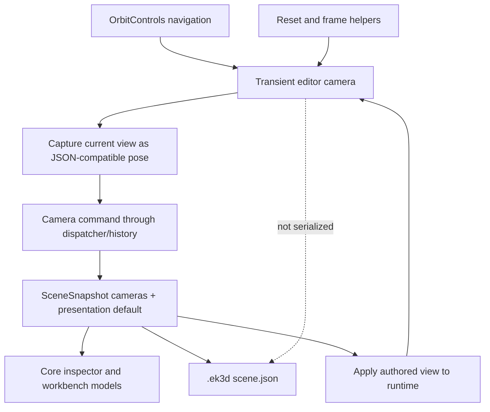
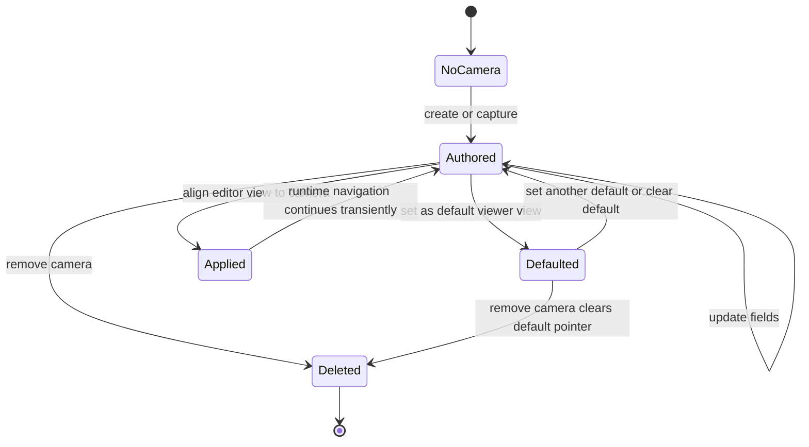

# feat: Add authored camera views

## Summary

实现 roadmap U11 的 authored camera / presentation view 能力：用户可以把当前编辑器视角显式捕获为 durable camera view，编辑名称、FOV、near/far、target 和默认 viewer view，并在运行时把 editor camera 对齐到某个 authored view。普通 OrbitControls 导航、frame/reset 和 viewport helper 继续是 transient runtime state，只有显式 camera command 才会写入 `SceneSnapshot`。

---

## Problem Frame

当前 runtime 已有 `PerspectiveCamera`、OrbitControls、reset/frame helpers、selection target map 和 runtime-only viewport helpers，但相机仍只是编辑会话的导航工具。真实交付场景需要作者定义“打开这个场景时从哪里看”，并把这个视角随 snapshot / `.ek3d` 持久化给 host viewer 使用。

这个计划把 camera authoring 加到 snapshot-first contract 内，而不是把 Three.js camera、controls target、loader camera 或 object URL 类 runtime 值写进 durable JSON。它承接 roadmap R13/R14/R18/R22/R23，并保持 React/Vue adapters thin：framework UI 渲染 core model，所有 durable camera 变更走 core command/history。

---

## Requirements

- R1. Snapshot 必须新增 durable authored camera view contract，并通过 migration、validation、serialization tests 和 `docs/schema.md` 记录版本变化。
- R2. 普通 editor camera orbit/pan/zoom、reset、frame selected、frame all 和 controls target 仍必须是 transient runtime state，不能自动写入 `SceneSnapshot` 或 `.ek3d` `scene.json`。
- R3. 用户必须能创建、重命名、更新和删除 authored camera view，并能设置一个 default viewer view。
- R4. Authored camera view 必须保存 JSON-compatible 的 name、pose、target、projection kind、FOV、near、far 和 metadata。
- R5. 第一版必须支持 perspective authored camera；orthographic projection 只保留 schema/UX 命名空间，不在本计划实现 runtime projection。
- R6. Runtime 必须支持 align editor view to authored camera，且该动作只改变 transient editor camera / controls target，不产生 history entry。
- R7. Runtime 必须支持 align authored camera to current editor view，通过 core command 更新 durable camera view 并进入 undo/redo history。
- R8. Authored camera 必须能进入 hierarchy/inspector/workbench model，React/Vue 默认 Workbench 必须能触达 camera 列表、字段编辑、capture/update/apply/default 操作。
- R9. GLB import manifest 中的 camera descriptor 和 imported camera target 不能被混同为 authored camera；从 imported GLB camera 直接生成 authored camera 是后续能力。
- R10. Public API 必须暴露稳定 camera/view 类型、commands、inspector/workbench model 类型和 runtime alignment entry points，但不暴露 internal projector/resource manager。
- R11. Project package import/export 必须保留 authored cameras 和 default viewer view，并证明 runtime-only camera state、Three.js camera、OrbitControls 和 resolver output 不会被保存。
- R12. Docs 和 React/Vue/vanilla examples 必须说明 editor camera transient 与 authored camera durable 的区别，以及 host viewer 如何读取 default viewer view。

---

## Scope Boundaries

### Included

- Durable authored camera view schema、migration、validation 和 docs。
- Perspective camera view：name、pose、target、FOV、near、far、default viewer view。
- Camera node/hierarchy/inspector/workbench projection，让 camera 能像 light 一样由 core 持有语义。
- Runtime capture/apply helpers：current editor view -> authored camera command payload；authored camera -> transient editor camera。
- React/Vue default Workbench camera controls 和 parity tests。
- Project package、public API 和 integration docs 覆盖 camera authoring round trip。

### Deferred to Follow-Up Work

- Orthographic authored camera projection和 inspector controls。
- Camera frustum gizmo、viewport-pickable camera helper、camera preview thumbnail。
- 从 GLB imported camera target 一键创建 authored camera。
- Camera animation、shot sequencing、timeline、transition/easing。
- Viewer-only runtime 的完整交互禁用和 storage adapter recipe；本计划只提供 default view resolver / docs hook。

### Outside This Product Identity for This Stage

- Hosted presentation publishing、multi-shot player、dashboard runtime。
- 物理镜头模型、depth of field、post-processing pipeline。
- 把 editor camera navigation 自动保存为用户偏好或 workspace layout。

---

## Dependencies / Prerequisites

- `SceneSnapshot.version = 5` 已包含 node hierarchy、imported target、material slot、environment、lights 和 runtime-only viewport helpers。
- Imported GLB target schema/runtime projection 已让 camera descriptor 成为可寻址 imported target，但它不是 authored camera。
- Runtime camera helpers 已有 `resetCameraView()`、`frameCameraToObjects()` 和 OrbitControls factory，可作为 transient navigation 边界。
- React/Vue Workbench 已有 toolbar camera group、inspector composition、runtime subscription 和 browser tests。

---

## Key Technical Decisions

- KTD1. Authored camera 是 durable scene target，不是 OrbitControls 状态。普通导航只改变 runtime camera；capture/update command 才把 view 写入 snapshot。
- KTD2. Camera payload 采用 `cameras` map + camera node mirror。`AuthoredCameraDefinition` 保存 view 参数，`SceneCameraNode` 让 hierarchy、selection、transform 和 inspector 复用现有 node-first editor semantics。
- KTD3. Default viewer view 是 presentation pointer。Snapshot 用单独 presentation/default field 指向 camera ID；camera 自身不保存全局默认布尔值，避免多个 default 的校验歧义。
- KTD4. 第一版只投影 perspective authored camera。当前 runtime 使用 `PerspectiveCamera`，所以先把 FOV/near/far 做扎实；orthographic 作为后续 schema/runtime 扩展。
- KTD5. Runtime alignment 分成 read 和 apply 两条边界。读取 current editor view 返回 JSON-compatible pose；应用 authored view 只复制数据到 editor camera 和 controls target。
- KTD6. Framework adapters 不拥有 camera semantics。React/Vue 只渲染 camera inspector/workbench model，并派发 core command 或调用 runtime alignment helper。
- KTD7. Imported GLB camera target 保持 source reference。它可以在后续作为 conversion source，但本计划不把 loaded glTF camera 或 Three.js camera instance 持久化。
- KTD8. Camera public API 暴露 contract，不暴露 projector internals。Host 需要 default view resolver 和 command/types；不需要访问 `SceneProjector` 或 OrbitControls factory。

---

## High-Level Technical Design

### Durable vs Runtime Boundary



### Authored Camera Lifecycle



### Planned Durable Shape

| Area | Durable meaning | Runtime-only exclusions |
|---|---|---|
| `cameras` | Authored camera definitions keyed by stable camera ID. | Three.js `Camera`, helper mesh, controls target object. |
| `SceneCameraNode` | Hierarchy/selectable node mirror for the camera payload. | CameraHelper, frustum gizmo, viewport pick helper. |
| `presentation.defaultCameraId` | Default authored camera for viewer/open presentation. | Last editor orbit state or browser/session preference. |
| runtime capture pose | JSON-compatible bridge from editor camera to command payload. | OrbitControls instance, DOM element, renderer, resolver output. |

---

## Output Structure

```text
packages/core/src/cameras/
  types.ts
  defaults.ts
  validation.ts
  camera-view.ts
  cameras.test.ts
  camera-view.test.ts
```

This directory is the new camera contract home. Per-unit file lists below remain authoritative for implementation.

---

## Implementation Units

### U1. Durable camera schema and migration

- **Goal:** Add the versioned snapshot contract for authored camera views, camera nodes, and default presentation view.
- **Requirements:** R1, R2, R4, R5, R9, R11.
- **Dependencies:** Existing v5 snapshot node graph and light node mirror pattern.
- **Files:** `packages/core/src/cameras/types.ts`, `packages/core/src/cameras/defaults.ts`, `packages/core/src/cameras/validation.ts`, `packages/core/src/cameras/cameras.test.ts`, `packages/core/src/snapshot/types.ts`, `packages/core/src/snapshot/defaults.ts`, `packages/core/src/snapshot/migrations.ts`, `packages/core/src/snapshot/validation.ts`, `packages/core/src/snapshot/nodes.ts`, `packages/core/src/snapshot/snapshot.test.ts`, `docs/schema.md`.
- **Approach:** Bump snapshot to the next version and migrate v5 snapshots by adding empty `cameras` and `presentation` state. Add `SceneCameraNode` to the `SceneNode` union with a `cameraId` payload reference, mirroring the light pattern. Store camera payload in `cameras`, with perspective projection fields, transform, target, name, and JSON-compatible metadata.
- **Execution note:** Start with migration/validation tests because this is durable contract work.
- **Patterns to follow:** `SceneLightNode` / `LightDefinition` payload mirror, `createLightNode()`, `validateLights()`, v4-to-v5 migration style.
- **Test scenarios:**
  - Given a v5 snapshot, when migration runs, then `cameras` is empty, `presentation.defaultCameraId` is null, and existing nodes/selection/assets remain unchanged.
  - Given a camera payload without a matching camera node, when validation runs, then the snapshot is rejected with a camera payload coverage error.
  - Given a camera node that references a missing camera ID, when validation runs, then the snapshot is rejected.
  - Given `presentation.defaultCameraId` references a missing camera, when validation runs, then the snapshot is rejected.
  - Given FOV, near, or far is non-finite or out of range, when validation runs, then the camera is rejected before runtime projection.
  - Given camera metadata contains a class instance, function, Three.js camera, or DOM object, when validation runs, then JSON-compatible validation fails.
  - Given a valid camera snapshot is serialized and migrated again, then no OrbitControls state, renderer, object URL, or Three.js camera data appears.
- **Verification:** Camera authoring has a portable durable contract and older snapshots restore without inventing camera views.

### U2. Camera commands and history semantics

- **Goal:** Add command-level authoring for create/capture/update/delete/default camera view operations.
- **Requirements:** R3, R4, R5, R7, R10.
- **Dependencies:** U1.
- **Files:** `packages/core/src/commands/types.ts`, `packages/core/src/commands/dispatcher.ts`, `packages/core/src/commands/add-camera.ts`, `packages/core/src/commands/update-camera.ts`, `packages/core/src/commands/remove-camera.ts`, `packages/core/src/commands/set-default-camera.ts`, `packages/core/src/commands/camera-commands.test.ts`, `packages/core/src/history/history.test.ts`, `packages/core/src/editor/operations.ts`, `packages/core/src/editor/operations.test.ts`, `packages/core/src/public-api.ts`, `packages/core/src/index.ts`, `packages/core/src/public-api.test.ts`.
- **Approach:** Add small command handlers that normalize camera definitions, keep camera payload/node mirror in sync, update default presentation pointer, and participate in existing undo/redo history. Capture is represented as a normal camera creation/update command whose payload was derived from runtime.
- **Patterns to follow:** `add-light`, `update-light`, `remove-light`, `set-environment`, dispatcher rollback behavior, public API export tests.
- **Test scenarios:**
  - Given an empty scene, when add camera command runs, then a camera payload and camera node are created with stable IDs and default perspective values.
  - Given a camera exists, when update command changes name/FOV/near/far/target/transform, then camera payload and node mirror stay consistent.
  - Given update command tries to change an unsupported projection kind, when dispatch runs, then it fails without mutating snapshot.
  - Given set default camera command runs, when the target camera exists, then `presentation.defaultCameraId` updates and undo restores the previous default.
  - Given the default camera is removed, when remove command completes, then the default pointer is cleared and no dangling camera node remains.
  - Given a batch creates a camera and sets it as default, when undo/redo runs, then camera payload, node, selection mirror, and default pointer remain coherent.
  - Given dispatch fails validation after a camera command, when dispatcher returns, then asset registry and snapshot rollback behavior matches existing command failures.
- **Verification:** Camera authoring is undoable, command-owned, and exported from the package root without exposing internal runtime seams.

### U3. Runtime camera capture, apply, and authored target projection

- **Goal:** Connect durable camera views to runtime without letting runtime state become durable by accident.
- **Requirements:** R2, R5, R6, R7, R9, R11.
- **Dependencies:** U1, U2.
- **Files:** `packages/core/src/cameras/camera-view.ts`, `packages/core/src/cameras/camera-view.test.ts`, `packages/core/src/runtime/viewport-controls.ts`, `packages/core/src/runtime/viewport-controls.test.ts`, `packages/core/src/runtime/editor-runtime.ts`, `packages/core/src/runtime/editor-runtime.test.ts`, `packages/core/src/runtime/scene-projector.ts`, `packages/core/src/runtime/scene-projector.test.ts`, `packages/core/src/runtime/three-object-map.ts`, `packages/core/src/runtime/disposal.test.ts`.
- **Approach:** Add pure conversion helpers for runtime camera pose capture and authored view application. `ThreeEditorRuntime` should expose methods to capture the current editor camera as JSON-compatible data and apply an authored camera by ID or payload. `SceneProjector` should project camera nodes into runtime target map for hierarchy selection/framing/transform, while keeping the active editor camera separate.
- **Patterns to follow:** `resetCameraView()`, `frameCameraToObjects()`, `RuntimeViewportHelpers`, `SceneProjector` light projection, `ThreeObjectMap.link()`.
- **Test scenarios:**
  - Given OrbitControls changes the editor camera, when no capture command runs, then snapshot serialization is byte-for-byte unchanged for camera state.
  - Given current runtime camera is captured, when the capture helper returns, then the payload contains only arrays, strings, numbers, booleans, nulls, and plain objects.
  - Given an authored camera is applied, when runtime renders next frame, then editor camera position/projection and controls target match the authored view without dispatching a command.
  - Given align authored camera to current view is requested through Workbench/core command flow, when dispatch completes, then only the authored camera payload changes and undo restores it.
  - Given a camera node is selected from hierarchy, when runtime projects, then `getNodeTarget(cameraNodeId)` returns a camera target distinct from the active editor camera.
  - Given a camera is removed, when projection reruns/disposes, then projected camera target records are released and stale transform controls detach.
  - Given an imported GLB camera target exists, when runtime capture/apply operates, then it does not serialize or alias the loaded glTF camera as an authored camera.
- **Verification:** Runtime can move between transient editor view and durable authored view through explicit bridges only.

### U4. Core inspector and workbench camera model

- **Goal:** Make camera views discoverable and editable through framework-neutral core models.
- **Requirements:** R3, R4, R6, R7, R8, R10.
- **Dependencies:** U1, U2, U3.
- **Files:** `packages/core/src/inspector/types.ts`, `packages/core/src/inspector/selection.ts`, `packages/core/src/inspector/commands.ts`, `packages/core/src/inspector/cameras.ts`, `packages/core/src/inspector/cameras.test.ts`, `packages/core/src/inspector/inspector.test.ts`, `packages/core/src/workbench/workbench-model.ts`, `packages/core/src/workbench/workbench-model.test.ts`, `packages/core/src/shortcuts/actions.ts`, `packages/core/src/shortcuts/actions.test.ts`, `docs/interactions.md`.
- **Approach:** Add a camera inspector section with camera list, active camera resolution, editable fields, default marker, and command builders. Workbench model should expose toolbar capabilities for capture/apply/update/default actions based on runtime readiness and active camera selection, without storing transient runtime camera details in the model.
- **Patterns to follow:** `buildLightSection()`, `buildUpdateLightCommand()`, `buildEnvironmentSection()`, `WorkbenchToolbarModel`, existing transform/material command builder problem shape.
- **Test scenarios:**
  - Given no cameras exist, when inspector model builds, then camera section is enabled with an empty reason and create/capture affordance state.
  - Given a camera node is selected, when inspector model builds, then active camera ID, fields, default status, and transform availability are derived from snapshot.
  - Given a non-camera node is selected, when inspector model builds, then camera list remains available but no camera-specific fields are active.
  - Given invalid FOV/near/far input is passed to a command builder, when validation runs, then an inspector warning is returned without snapshot mutation.
  - Given a camera is default, when workbench model builds, then toolbar/status can identify the default without duplicating camera state into session state.
  - Given runtime is not mounted, when workbench model builds, then apply/capture actions that require runtime are disabled while durable field editing remains available.
  - Given the model is JSON serialized, then no runtime camera, controls, DOM node, or renderer object appears.
- **Verification:** Any framework can render and operate camera authoring from core-derived models.

### U5. React and Vue default Workbench UI

- **Goal:** Add first-class camera authoring controls to the default React/Vue Workbench while preserving adapter thinness.
- **Requirements:** R3, R6, R7, R8, R10, R12.
- **Dependencies:** U4.
- **Files:** `packages/react/src/components/CameraInspector.tsx`, `packages/react/src/components/InspectorView.tsx`, `packages/react/src/components/WorkbenchToolbar.tsx`, `packages/react/src/components/inspector.css`, `packages/react/src/components/workbench.css`, `packages/react/test/inspector.test.tsx`, `packages/react/test/workbench.test.tsx`, `packages/react/test/default-workbench.browser.test.tsx`, `packages/vue/src/components/CameraInspector.vue`, `packages/vue/src/components/InspectorView.vue`, `packages/vue/src/components/WorkbenchToolbar.vue`, `packages/vue/src/components/inspector.css`, `packages/vue/src/components/workbench.css`, `packages/vue/test/inspector.test.ts`, `packages/vue/test/workbench.test.ts`, `packages/vue/test/default-workbench.browser.test.ts`.
- **Approach:** Render camera section beside transform/material/environment/lights/problems. Add toolbar actions for capture current view, apply selected/default view, update selected camera from current view, and set default. UI actions should call core command builders or runtime helpers through existing Workbench context; no React/Vue state should become source of truth for camera definitions.
- **Patterns to follow:** `LightInspector`, `EnvironmentInspector`, existing toolbar camera reset/frame controls, `use-workbench` / `use-inspector` parity, Vue scoped slot context.
- **Test scenarios:**
  - Given a camera is created, when React inspector renders, then name/FOV/near/far/target/default controls are visible and dispatch camera commands.
  - Given the same snapshot renders in Vue, when camera fields are edited, then dispatched command shape and resulting snapshot match React behavior.
  - Given runtime is mounted, when capture current view is clicked, then a camera command is dispatched with a JSON-compatible pose from runtime.
  - Given a camera is selected, when apply view is clicked, then runtime camera moves and snapshot/history do not change.
  - Given runtime is missing, when camera toolbar renders, then apply/capture/update-from-view controls are disabled and field editing still works.
  - Given toolbar wraps on narrow width, when camera controls render with existing transform/snap/helper controls, then labels/buttons do not overlap or resize the viewport incoherently.
  - Given `.ek3d` export/reopen happens after camera UI edits, then React/Vue show the restored camera list and default marker.
- **Verification:** Default Workbench users can author and reuse camera views without custom host UI.

### U6. Default presentation resolver, package round trip, and docs

- **Goal:** Provide the host-facing contract for reading default viewer view and prove camera state survives package workflows.
- **Requirements:** R1, R2, R10, R11, R12.
- **Dependencies:** U1-U5.
- **Files:** `packages/core/src/cameras/camera-view.ts`, `packages/core/src/cameras/camera-view.test.ts`, `packages/core/src/project/export-project.test.ts`, `packages/core/src/project/import-project.test.ts`, `packages/core/src/editor/serialization.test.ts`, `packages/core/src/public-api.test.ts`, `packages/react/test/react-proof-loop.integration.test.tsx`, `packages/vue/test/vue-proof-loop.integration.test.ts`, `examples/vanilla-proof-loop/src/main.ts`, `docs/schema.md`, `docs/interactions.md`, `docs/integration-react.md`, `docs/integration-vue.md`, `docs/integration-vanilla.md`, `docs/project-package.md`, `README.md`.
- **Approach:** Add a pure resolver that returns the default authored camera view or null from a snapshot, so U14 viewer work can consume the same contract. Update package tests and docs to show that `.ek3d` persists camera views while runtime editor navigation remains excluded.
- **Patterns to follow:** Project package scene/payload separation, `editor.serialize()` / `editor.restore()` tests, integration docs language around viewport helpers and runtime-only values.
- **Test scenarios:**
  - Given a snapshot has a default camera, when default resolver runs, then it returns that camera view with normalized projection values.
  - Given no default camera is set, when resolver runs, then it returns null without inventing a view from editor camera defaults.
  - Given a project package with authored cameras is exported and imported, when restored snapshot is inspected, then camera IDs, node IDs, default pointer, and projection fields survive.
  - Given runtime editor camera is moved after default camera is saved, when `.ek3d` is exported, then only the authored camera view is present in `scene.json`.
  - Given React/Vue proof loop edits a camera and reopens the project, when inspector renders, then the camera section shows restored durable state.
  - Given vanilla integration applies the default view resolver to runtime, when scene loads, then runtime uses authored view only if one exists.
  - Given package public API is imported by a consumer fixture, when types are checked, then camera types/commands/helpers are available from package root only.
- **Verification:** Host apps get a stable default-view bridge now, without forcing this plan to implement the full read-only viewer runtime.

---

## Acceptance Examples

- AE1. Given a user orbits and frames the editor camera, when they export `.ek3d` without capture, then `scene.json` contains no camera navigation state.
- AE2. Given a user captures the current editor view as "Front overview", when they export and restore the project, then the authored camera name, pose, target, FOV, near/far, and camera node survive.
- AE3. Given a user applies an authored camera view, when runtime renders, then the editor camera moves to that view and undo history does not change.
- AE4. Given a user updates an authored camera from the current view, when undo is invoked, then the camera returns to its previous durable pose.
- AE5. Given a user sets an authored camera as the default viewer view, when a host resolves the default presentation view, then that camera is returned; deleting it clears the pointer.
- AE6. Given React and Vue Workbench load the same snapshot, when the camera inspector edits FOV and target, then both adapters dispatch equivalent core commands and produce equivalent snapshots.
- AE7. Given an imported GLB contains a camera target, when the scene serializes, then that imported target remains source metadata and no loaded glTF camera instance is persisted as an authored camera.

---

## System-Wide Impact

- **Snapshot versioning:** This is a durable schema bump. Migration, validation, docs, package round trip, public types, and serialization tests must land together.
- **Hierarchy semantics:** Adding `SceneCameraNode` extends every `SceneNode` switch that currently handles object/group/light/imported. Exhaustive tests should catch missing cases.
- **Runtime separation:** `ThreeEditorRuntime.camera` remains the active editor camera. Authored camera targets are projected scene targets and must not be confused with the renderer camera.
- **Workbench surface:** Toolbar and inspector gain camera controls. React/Vue parity matters because adapter drift would break the "core owns semantics" contract.
- **Future viewer work:** U14 can consume `presentation.defaultCameraId` and default resolver without redefining camera identity.

---

## Risks and Mitigations

| Risk | Impact | Mitigation |
|---|---|---|
| Editor camera state leaks into snapshot | Project files become session-specific and violate repo rules | Keep capture as explicit command payload; add serialization tests after orbit/reset/frame/apply. |
| Camera node and camera payload drift | Hierarchy/inspector/runtime disagree about name or transform | Mirror light node patterns and centralize normalization in camera defaults/commands. |
| Default view is stored redundantly | Multiple defaults or dangling pointers become possible | Store one `presentation.defaultCameraId` pointer and validate it references an existing camera. |
| Runtime active camera is confused with authored camera target | Applying or transforming cameras mutates the wrong object | Keep active editor camera outside `SceneProjector`; project authored camera targets separately. |
| Orthographic support expands scope | Runtime and UI complexity grows before perspective flow is stable | Limit validation/runtime to perspective in this plan and defer orthographic. |
| React/Vue toolbar becomes crowded | Camera controls overlap existing transform/snap/helper controls | Use compact grouped controls and browser layout tests on desktop/narrow widths. |
| Imported GLB cameras blur identity | Loaded glTF camera gets serialized or replaces authored camera ID | Treat imported camera as source descriptor only; direct conversion is deferred. |

---

## Documentation Plan

- Update `docs/schema.md` with snapshot version, camera payload, camera node, presentation default pointer, migration rules, and JSON-compatible exclusions.
- Update `docs/interactions.md` with the authored camera lifecycle: orbit transient, capture durable, apply transient, update durable.
- Update `docs/integration-react.md` and `docs/integration-vue.md` with Workbench camera inspector/toolbar behavior.
- Update `docs/integration-vanilla.md` with default view resolver usage for host runtime setup.
- Update `docs/project-package.md` to state that `.ek3d` persists authored cameras but not editor camera/session controls.
- Update `README.md` only after camera acceptance tests are present, describing authored camera views as a beta-readiness capability.

---

## Sources and Research

- Origin roadmap U11: `docs/plans/2026-06-05-001-feat-real-user-editor-roadmap-plan.md`.
- Snapshot contract: `packages/core/src/snapshot/types.ts`, `packages/core/src/snapshot/migrations.ts`, `packages/core/src/snapshot/validation.ts`, `docs/schema.md`.
- Command/history patterns: `packages/core/src/commands/dispatcher.ts`, `packages/core/src/commands/types.ts`, `packages/core/src/commands/add-light.ts`, `packages/core/src/commands/update-light.ts`.
- Runtime camera patterns: `packages/core/src/runtime/editor-runtime.ts`, `packages/core/src/runtime/viewport-controls.ts`, `packages/core/src/runtime/viewport-controls.test.ts`, `packages/core/src/runtime/editor-runtime.test.ts`.
- Runtime target projection patterns: `packages/core/src/runtime/scene-projector.ts`, `packages/core/src/runtime/three-object-map.ts`, `packages/core/src/runtime/imported-target-resolver.ts`.
- Inspector/workbench patterns: `packages/core/src/inspector/lights.ts`, `packages/core/src/inspector/types.ts`, `packages/core/src/workbench/workbench-model.ts`, `packages/react/src/components/WorkbenchToolbar.tsx`, `packages/vue/src/components/WorkbenchToolbar.vue`.
- Public API contract tests: `packages/core/src/public-api.ts`, `packages/core/src/index.ts`, `packages/core/src/public-api.test.ts`.
