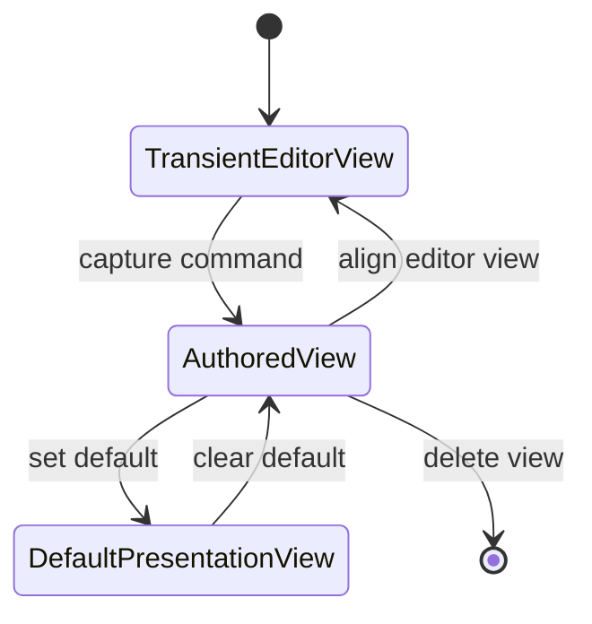

# feat: Add authored camera views

## Summary

把 roadmap U11 拆成一个可执行实现计划：新增 durable authored camera view contract、camera view commands、runtime capture/apply helpers、camera inspector 和 React/Vue 默认 Workbench 入口。编辑器 OrbitControls 相机继续是 transient；只有用户显式 capture/update 的 authored view 会进入 `SceneSnapshot` 和 `.ek3d`。

---

## Problem Frame

当前 runtime 已支持 transient camera navigation、reset、frame selected 和 frame all，但这些状态不会进入 snapshot。真实项目交付需要一个明确的 presentation entry point：用户能保存一个命名视图，把它设为默认 viewer view，并在编辑器里把当前视角与该 view 双向对齐。

本计划延续项目的 snapshot-first 身份。Three.js `Camera`、`OrbitControls`、controls target、helper object 和 renderer state 不进入 durable JSON；durable state 只保存 JSON-compatible authored view data，runtime helper 负责在编辑器相机和 authored view 之间转换。

---

## Requirements

### Durable Camera View Contract

- R1. OrbitControls editor camera movement remains transient and must not mutate snapshot, history, clipboard payload, or `.ek3d` unless an explicit camera command is dispatched (origin R13, AE4).
- R2. Users can create, rename, update, delete, and serialize authored camera views with name, perspective projection settings, position, target, near, far, and metadata (origin R14).
- R3. Camera view validation rejects non-finite vectors, invalid projection ranges, missing references, and non-JSON-compatible metadata (origin R22, R23).
- R4. The first implementation exposes perspective authored views as the editable path; the type boundary remains discriminated so orthographic can be added later without replacing commands or docs.

### Commands and Presentation Defaults

- R5. Camera commands are undoable and cover create, update, delete, capture/update from runtime data, and set/clear default presentation view (origin R14).
- R6. The default viewer view is a scene-level presentation reference, not a self-owned marker on a camera view; deleting that view clears the default reference (origin R14, R18, AE5).
- R7. Core exposes a pure resolver for the default presentation view so future viewer runtime work can consume the same contract without enabling editor interactions (origin R18).

### Runtime and Workbench

- R8. Runtime can capture the current editor camera into a JSON-compatible authored view patch and can apply an authored view back to the transient editor camera without dispatching a durable command.
- R9. React and Vue default Workbench expose authored view creation, selection, defaulting, edit fields, align editor view to authored view, and align authored view to current editor view without owning editor semantics (origin R21, R24).
- R10. Documentation and examples describe authored views as durable presentation state and keep editor camera controls, helper overlays, runtime problems, and resolver outputs out of persistence guidance (origin R23, R24).

---

## Scope Boundaries

### Included

- Durable authored camera view schema, migration, defaults, validation, serialization, and project package round-trip.
- Perspective camera view authoring with position, target, FOV, near, far, name, metadata, and scene-level default view reference.
- Undoable camera commands and inspector command builders.
- Runtime helpers for capture current editor view and apply authored view to the editor camera.
- Camera inspector/workbench model plus React/Vue default UI and browser coverage for the default Workbench path.
- Docs for schema, interactions, and React/Vue/vanilla integration recipes.

### Deferred to Follow-Up Work

- Full viewer-only runtime recipe and read-only interaction locking; this remains roadmap U14.
- Camera helper gizmos, frustum helpers, and selectable camera scene nodes.
- Full orthographic authoring UI/runtime switching.
- Imported glTF camera adoption as authored views.
- Presentation playlists, slides, transitions, thumbnails, and animation/timeline integration.

### Outside This Product Identity for This Stage

- Persisting raw Three.js camera instances, `OrbitControls`, controls target objects, renderer state, object URLs, or resolver outputs.
- Turning authored views into a hosted publishing or dashboard runtime.

---

## Key Technical Decisions

- KTD1. Authored camera views are scene-level presentation resources. They live under snapshot `presentation.cameraViews` and outside `nodes`, which avoids mixing presentation authoring with object/imported target identity.
- KTD2. Default presentation view is a single scene-level pointer. A `defaultViewId` under presentation state gives validation one place to enforce referential integrity and lets delete commands clear stale defaults deterministically.
- KTD3. Runtime capture/apply is a conversion layer, not persistence. Runtime reads `PerspectiveCamera` and controls target into plain data, or applies plain data back to the transient camera and controls, while commands own durable changes.
- KTD4. Perspective is the first editable projection. The durable model uses a discriminated projection field, but the first UI and runtime apply path only need to create and fully support perspective authored views.
- KTD5. Camera UI follows existing inspector/workbench patterns. Core derives a camera inspector model and command builders; React/Vue render that projection and dispatch core commands rather than duplicating authoring rules.
- KTD6. Viewer readiness is a pure resolver, not a viewer implementation. This plan adds the contract future viewer mode needs, but does not implement viewer-only runtime behavior from roadmap U14.

---

## High-Level Technical Design

```mermaid
flowchart TB
  RuntimeCamera[Transient editor camera and controls] --> Capture[Capture current view helper]
  Capture --> Patch[JSON-compatible camera view patch]
  Patch --> Command[Camera view command]
  Command --> Snapshot[SceneSnapshot presentation state]
  Snapshot --> Serialize[Snapshot and .ek3d round-trip]
  Snapshot --> Resolver[Default presentation view resolver]
  Snapshot --> Inspector[Core camera inspector model]
  Inspector --> Workbench[React Vue Workbench]
  Resolver --> FutureViewer[Future viewer recipe]
  Snapshot --> Apply[Apply authored view helper]
  Apply --> RuntimeCamera
```

---

## Implementation Units

### U1. Camera view durable schema

- **Goal:** Add the durable authored camera view and presentation default contract to the scene snapshot.
- **Requirements:** R1, R2, R3, R4, R6, R10.
- **Dependencies:** Existing v5 snapshot contract, imported target schema, environment/light/material validation patterns.
- **Files:** `packages/core/src/cameras/types.ts`, `packages/core/src/cameras/defaults.ts`, `packages/core/src/cameras/validation.ts`, `packages/core/src/cameras/cameras.test.ts`, `packages/core/src/snapshot/types.ts`, `packages/core/src/snapshot/defaults.ts`, `packages/core/src/snapshot/migrations.ts`, `packages/core/src/snapshot/validation.ts`, `packages/core/src/snapshot/snapshot.test.ts`, `packages/core/src/editor/serialization.test.ts`, `packages/core/src/public-api.ts`, `docs/schema.md`.
- **Approach:** Introduce `presentation` as a first-class snapshot field with `cameraViews` and `defaultViewId` rather than storing camera views in `metadata`. A camera view stores stable ID, name, perspective projection fields, position, target, optional metadata, and no Three.js objects. The schema bump migrates current v5 snapshots by creating an empty presentation state and preserving all existing nodes, assets, materials, environment, lights, imported targets, and selection.
- **Execution note:** Start with migration and validation tests because this unit changes the durable contract.
- **Patterns to follow:** `packages/core/src/environment/types.ts`, `packages/core/src/environment/validation.ts`, `packages/core/src/lights/types.ts`, `packages/core/src/lights/validation.ts`, `packages/core/src/snapshot/migrations.ts`.
- **Test scenarios:**
  - Given a v5 snapshot, when migration runs, then the migrated snapshot includes empty camera/presentation state and preserves existing object, imported target, light, material, environment, and selection state.
  - Given a valid authored perspective view with finite position and target, when validation runs, then the snapshot is accepted and serialization returns JSON-compatible data.
  - Given a camera view whose position or target contains `NaN`, `Infinity`, or the wrong vector length, when validation runs, then it reports the camera view field as invalid.
  - Given a perspective projection with `fov <= 0`, `fov >= 180`, `near <= 0`, or `far <= near`, when validation runs, then it rejects the snapshot.
  - Given camera metadata contains a `File`, `Blob`, Three.js object, function, or cyclic object, when validation runs, then snapshot JSON compatibility fails.
  - Given an empty camera list, when snapshot serializes and restores, then no default view is invented.
- **Verification:** Authored camera view data is durable, versioned, JSON-compatible, and absent from legacy snapshots until migration adds the empty contract.

### U2. Camera view commands and default resolver

- **Goal:** Add undoable camera commands and a pure default presentation view resolver.
- **Requirements:** R2, R3, R5, R6, R7.
- **Dependencies:** U1.
- **Files:** `packages/core/src/commands/types.ts`, `packages/core/src/commands/dispatcher.ts`, `packages/core/src/commands/camera-commands.ts`, `packages/core/src/commands/camera-commands.test.ts`, `packages/core/src/cameras/resolve.ts`, `packages/core/src/cameras/resolve.test.ts`, `packages/core/src/public-api.ts`, `packages/core/src/editor/operations.ts`, `packages/core/src/editor/operations.test.ts`.
- **Approach:** Add commands for create/update/delete camera view and set default presentation view. Commands validate camera payloads through the same camera validation helpers as snapshot validation. Delete clears `defaultViewId` when needed and leaves node selection untouched. The resolver returns the default view when present and valid, or a deterministic fallback result that future viewer code can inspect.
- **Patterns to follow:** `packages/core/src/commands/set-environment.ts`, `packages/core/src/commands/add-light.ts`, `packages/core/src/commands/update-light.ts`, `packages/core/src/commands/remove-light.ts`, `packages/core/src/commands/dispatcher.ts`, `packages/core/src/editor/operations.ts`.
- **Test scenarios:**
  - Given a create camera view command with no ID, when it dispatches, then a stable ID is generated, the view is added, and undo/redo restores the prior and next snapshots.
  - Given an update command changes name, target, FOV, near, and far, when it dispatches, then only that camera view changes and default view selection is preserved.
  - Given a set default command references an existing camera view, when it dispatches, then `defaultViewId` points to that view and the resolver returns it.
  - Given a delete command removes the default view, when it dispatches, then the camera view is removed and `defaultViewId` becomes null.
  - Given a command references a missing camera view, invalid projection, or non-finite vector, when it dispatches, then it fails without changing snapshot or history.
  - Given a batch creates a camera view and sets it as default, when it dispatches, then validation sees the final state and undo reverts both changes together.
  - Covers AE5. Given a default authored view exists, when the resolver runs, then it returns that view as the default presentation entry point for future viewer loading.
- **Verification:** Camera authoring mutations are pure command changes, undoable, validated, and expose a viewer-ready default resolver without adding viewer mode.

### U3. Runtime capture and apply helpers

- **Goal:** Bridge transient editor camera state and durable camera view data without making navigation persistent by accident.
- **Requirements:** R1, R4, R8.
- **Dependencies:** U1, U2.
- **Files:** `packages/core/src/runtime/viewport-controls.ts`, `packages/core/src/runtime/viewport-controls.test.ts`, `packages/core/src/runtime/editor-runtime.ts`, `packages/core/src/runtime/editor-runtime.test.ts`, `packages/core/src/runtime/authored-camera-view.ts`, `packages/core/src/runtime/authored-camera-view.test.ts`, `packages/core/src/public-api.ts`.
- **Approach:** Add runtime helpers that read a `PerspectiveCamera` plus optional `ViewportCameraControls.target` into a plain authored view patch, and apply a validated authored view back to the runtime camera. Applying a view updates position, FOV, near/far, look target, projection matrix, controls target, controls update, and render invalidation. Orbiting, panning, zooming, reset, frame selected, and frame all remain transient unless the caller dispatches a camera command with captured data.
- **Patterns to follow:** `resetCameraView()`, `frameCameraToObjects()`, `ThreeEditorRuntime.resetCamera()`, `ThreeEditorRuntime.frameSelected()`, `packages/core/src/runtime/editor-runtime.test.ts` fake controls.
- **Test scenarios:**
  - Given OrbitControls changes the editor view, when the editor serializes without a camera command, then snapshot camera/presentation state is unchanged.
  - Given runtime captures the current editor camera with controls target `[1, 2, 3]`, when the helper returns a patch, then the patch contains only JSON-compatible position, target, FOV, near, and far data.
  - Given a valid authored view is applied, when runtime updates, then the transient camera position/projection and controls target match the authored view and no snapshot mutation occurs.
  - Given applying an authored view changes FOV, near, or far, when render invalidates, then the camera projection matrix has been refreshed before rendering.
  - Given runtime has no mounted camera controls, when capture runs, then it still returns a deterministic perspective view or a typed failure that Workbench can surface without mutating durable state.
  - Given reset/frame operations run after an authored view is applied, when snapshot serializes, then neither operation creates or updates authored camera views.
- **Verification:** Runtime can align editor view to authored view and capture editor view into command-ready data while keeping raw camera/control objects transient.

### U4. Core camera inspector and workbench model

- **Goal:** Expose authored camera views through core inspector and workbench projections.
- **Requirements:** R2, R5, R6, R8, R9.
- **Dependencies:** U1, U2, U3.
- **Files:** `packages/core/src/inspector/types.ts`, `packages/core/src/inspector/cameras.ts`, `packages/core/src/inspector/cameras.test.ts`, `packages/core/src/inspector/selection.ts`, `packages/core/src/inspector/commands.ts`, `packages/core/src/inspector/inspector.test.ts`, `packages/core/src/workbench/workbench-model.ts`, `packages/core/src/workbench/workbench-model.test.ts`, `packages/core/src/public-api.ts`.
- **Approach:** Add a camera inspector section with view list items, active view ID, default marker, editable fields, and command builders. Keep active inspector view as UI/session state in adapters, similar to active light selection, while default view remains durable. Extend workbench model with camera toolbar capability flags and presentation counts so framework adapters can render without inspecting snapshot internals.
- **Patterns to follow:** `packages/core/src/inspector/lights.ts`, `packages/core/src/inspector/environment.ts`, `packages/core/src/inspector/commands.ts`, `packages/core/src/workbench/workbench-model.ts`.
- **Test scenarios:**
  - Given no authored camera views exist, when the inspector model builds, then the camera section is enabled with an empty state and create/capture affordance data.
  - Given multiple camera views exist and one is default, when the camera section builds, then rows include labels, active/default state, projection summary, and command-ready IDs.
  - Given a field edit changes name, FOV, near, far, position, or target, when the inspector command builder runs, then it returns the correct update command or a field-level validation problem.
  - Given active camera view UI state points to a deleted view, when the model rebuilds, then active view falls back deterministically without changing durable default state.
  - Given workbench model builds with runtime ready, when camera views exist, then toolbar/context flags allow capture/apply/default operations according to runtime availability and selected active view.
  - Given runtime is unavailable, when workbench model builds, then durable edit commands remain available but align/capture actions are disabled.
- **Verification:** Core provides a framework-neutral camera authoring projection and command surface that React/Vue can render thinly.

### U5. React and Vue default Workbench camera UI

- **Goal:** Add visible camera authoring controls to the default React and Vue Workbench.
- **Requirements:** R8, R9, R10.
- **Dependencies:** U1, U2, U3, U4.
- **Files:** `packages/react/src/hooks/use-workbench.ts`, `packages/react/src/hooks/use-inspector.ts`, `packages/react/src/components/CameraInspector.tsx`, `packages/react/src/components/InspectorView.tsx`, `packages/react/src/components/WorkbenchToolbar.tsx`, `packages/react/src/components/inspector.css`, `packages/react/src/components/workbench.css`, `packages/react/test/workbench.test.tsx`, `packages/react/test/default-workbench.browser.test.tsx`, `packages/vue/src/composables/use-workbench.ts`, `packages/vue/src/composables/use-inspector.ts`, `packages/vue/src/components/CameraInspector.vue`, `packages/vue/src/components/InspectorView.vue`, `packages/vue/src/components/WorkbenchToolbar.vue`, `packages/vue/src/components/inspector.css`, `packages/vue/src/components/workbench.css`, `packages/vue/test/workbench.test.ts`, `packages/vue/test/default-workbench.browser.test.ts`.
- **Approach:** Render a camera inspector section with a compact list of authored views, editable fields, set default, delete, align editor view, and update authored view from current editor view. Add Workbench context methods that call runtime capture/apply helpers and dispatch core camera commands. Keep local draft/active view state inside framework adapters; only command dispatches mutate snapshot.
- **Patterns to follow:** React/Vue `LightInspector`, `EnvironmentInspector`, `MaterialInspector`, `WorkbenchToolbar`, and existing `camera` context in `use-workbench`.
- **Test scenarios:**
  - Given a user captures the current view, when the React Workbench action runs, then it dispatches a camera command with JSON-compatible captured data and the new view appears in the inspector.
  - Given a user sets an authored view as default, when React and Vue render, then the default marker appears on the same view and survives re-render.
  - Given a user clicks align editor view to authored view, when runtime is mounted, then runtime apply is called and no snapshot change is recorded unless a command is dispatched separately.
  - Given a user edits FOV or near/far with invalid text, when the field commits, then the UI surfaces the core validation problem and does not dispatch an invalid command.
  - Given runtime is not ready, when the Workbench renders, then capture/apply controls are disabled while durable rename/delete/default controls remain accurate.
  - Given narrow viewport layout, when camera inspector and toolbar controls render, then text and controls do not overlap or resize fixed tool groups.
- **Verification:** Default React and Vue Workbench can author camera views without host custom panels and without persisting transient runtime state.

### U6. Documentation, package round-trip, and acceptance hardening

- **Goal:** Document and verify authored camera views as a durable presentation feature across core, package, and demo flows.
- **Requirements:** R1, R6, R7, R9, R10.
- **Dependencies:** U1, U2, U3, U4, U5.
- **Files:** `packages/core/src/project/export-project.test.ts`, `packages/core/src/project/import-project.test.ts`, `packages/core/src/editor/proof-loop.integration.test.ts`, `packages/react/test/react-proof-loop.integration.test.tsx`, `packages/vue/test/vue-proof-loop.integration.test.ts`, `examples/react-proof-loop/src/App.tsx`, `examples/vue-proof-loop/src/App.vue`, `examples/vanilla-proof-loop/src/main.ts`, `docs/schema.md`, `docs/interactions.md`, `docs/integration-react.md`, `docs/integration-vue.md`, `docs/integration-vanilla.md`, `docs/project-package.md`, `README.md`.
- **Approach:** Add package and proof-loop coverage for capture, set default, export, restore, and reapply default view. Update docs to explain authored view durability, transient editor camera navigation, default viewer view resolution, and host integration boundaries. Examples should expose the default Workbench path rather than custom camera semantics.
- **Patterns to follow:** `packages/core/src/project/import-project.test.ts`, `packages/core/src/editor/proof-loop.integration.test.ts`, `packages/react/test/react-proof-loop.integration.test.tsx`, `packages/vue/test/vue-proof-loop.integration.test.ts`, existing docs language around viewport helpers and material slot authoring.
- **Test scenarios:**
  - Covers AE4. Given helper/grid/marquee/camera navigation occurs before export, when `.ek3d` scene JSON is inspected after round-trip, then helper state and editor camera navigation are absent.
  - Covers AE5. Given a user captures an authored view and sets it as default, when project package export/import completes, then the restored snapshot still resolves the same default view.
  - Given a package contains an authored view and missing GLB asset payload, when import succeeds partially, then camera view state remains durable and missing asset recovery problems are separate.
  - Given the React proof loop captures and defaults a camera view, when undo/redo and export/restore run, then camera view state follows command history and package round-trip.
  - Given the Vue proof loop applies a default authored view after restore, when runtime is mounted, then the editor camera aligns without enabling viewer-only interaction semantics.
  - Given integration docs mention persistence, when reviewed, then they warn hosts not to persist `Camera`, `OrbitControls`, controls target objects, object URLs, resolver outputs, or runtime problems.
- **Verification:** Authored camera views survive real project workflows and docs give host apps the correct persistence boundary.

---

## Acceptance Examples

- AE1. Given the editor camera is orbited, panned, reset, and frame-all is used, when snapshot serializes without an authored camera command, then camera/control state is absent from durable JSON.
- AE2. Given the current editor view is captured as a named authored view, when snapshot serializes and restores, then the view is present as JSON-compatible durable presentation data.
- AE3. Given an authored view is applied to the editor runtime, when render updates, then the transient editor camera and controls target match the authored view without changing snapshot history.
- AE4. Given an authored view is set as the default presentation view, when the default resolver runs after project package restore, then it returns that view for future viewer startup.
- AE5. Given the default authored view is deleted, when validation and resolver run, then no stale default reference remains.

---

## System-Wide Impact

- **Snapshot compatibility:** This is a schema version bump from the current v5 snapshot contract. Migration, validation, docs, serialization, package import/export, and public types must land together.
- **Runtime boundary:** Runtime gains conversion helpers but still treats editor navigation as session state. This protects the existing rule that helper and control state do not persist.
- **Public API:** Core exports grow around camera view types, commands, inspector section types, runtime capture/apply helpers, and default presentation resolver.
- **Framework parity:** React and Vue need equivalent default Workbench affordances and tests because camera authoring is user-facing.
- **Viewer roadmap:** U14 can consume `resolveDefaultPresentationView()` later without redefining default camera semantics.

---

## Risks & Mitigations

| Risk | Impact | Mitigation |
|---|---|---|
| Editor camera state leaks into snapshot | Durable JSON fills with navigation noise and breaks roadmap R13 | Require explicit commands for every durable change and test orbit/reset/frame serialization boundaries. |
| Default view stored as self marker | Multiple defaults or stale references become easy to create | Store a single scene-level `defaultViewId` and clear it in delete commands. |
| Orthographic support overexpands the slice | Runtime and UI work grows beyond U11 | Keep perspective as the editable path and document orthographic as deferred. |
| Runtime helper mutates snapshot | Align editor view becomes unexpectedly undoable or dirty | Keep apply helper runtime-only and route durable updates through commands. |
| React/Vue duplicate camera semantics | Adapter parity drifts | Derive models and command builders from core, matching existing light/material inspector patterns. |

---

## Documentation Plan

- Update `docs/schema.md` with snapshot version, camera view fields, default presentation reference, validation rules, and runtime-only exclusions.
- Update `docs/interactions.md` with capture/apply/default flows and the distinction between transient editor navigation and durable authored views.
- Update `docs/integration-react.md`, `docs/integration-vue.md`, and `docs/integration-vanilla.md` with host recipes for reading default view state and avoiding runtime object persistence.
- Update `docs/project-package.md` to show that camera views live in `scene.json` and do not require extra asset payloads.
- Update `README.md` only if the default Workbench feature list changes.

---

## Sources & Research

- Origin roadmap: `docs/plans/2026-06-05-001-feat-real-user-editor-roadmap-plan.md`, especially U11 plus origin R13, R14, R18, R21, R22, R23, R24, AE4, and AE5.
- Current runtime patterns: `packages/core/src/runtime/editor-runtime.ts`, `packages/core/src/runtime/viewport-controls.ts`, `packages/core/src/runtime/editor-runtime.test.ts`.
- Current durable schema patterns: `packages/core/src/snapshot/types.ts`, `packages/core/src/snapshot/migrations.ts`, `packages/core/src/snapshot/validation.ts`.
- Current inspector/workbench patterns: `packages/core/src/inspector/lights.ts`, `packages/core/src/inspector/environment.ts`, `packages/core/src/workbench/workbench-model.ts`, `packages/react/src/hooks/use-workbench.ts`, `packages/vue/src/composables/use-workbench.ts`.
- Three.js documentation background: `https://threejs.org/docs/#PerspectiveCamera`, `https://threejs.org/docs/#OrthographicCamera`, `https://threejs.org/docs/#OrbitControls`. The load-bearing takeaway is that projection changes require camera projection refresh and OrbitControls target/update/reset are runtime control state.
- Context7 was requested by local skill policy for library docs, but the installed script path was unavailable in this environment; official Three.js docs were used as the fallback source.
