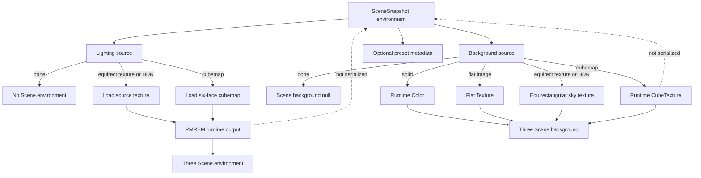
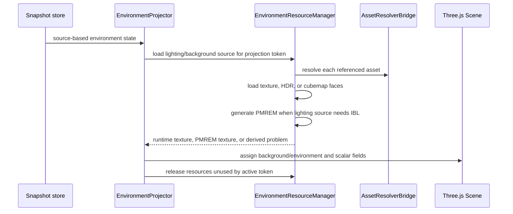

# feat: Clean up environment skybox and background authoring

## Summary

实现 roadmap U12：把现有 environment/background/HDR authoring 从重叠的 `mode` 字段清理为清晰的 lighting source、visible background source 和 true skybox/cubemap intent。计划覆盖 durable schema bump、兼容迁移、command/preset 边界、Three.js runtime projection、PMREM/cubemap 资源生命周期、React/Vue inspector parity、文档和 project package round trip。

---

## Problem Frame

当前 `SceneEnvironment` 已能表达 solid background、texture/HDR background、texture/HDR environment lighting、intensity、blur、rotation，并且 runtime 已通过 `EnvironmentProjector`、`EnvironmentResourceManager` 和 PMREM adapter 投影到 Three.js `Scene`。但 durable model 仍有两个结构性问题：顶层 `environment.mode` 和 `background.mode` 语义重叠；texture asset 被同时用来表达 flat image、equirectangular background 和 lighting source，导致用户很难判断“什么在照亮模型”和“什么在背后可见”。

真实用户会把 HDR 用作 lighting、把图片用作普通背景、把六面图用作 skybox，也会期望失败时看到可恢复问题，而不是让 runtime 偷偷改 durable JSON。本计划把这些意图拆开，同时保留 snapshot-first 规则：Three.js `Texture`、`CubeTexture`、PMREM render target、loader result、resolver output、object URL、`File`、`Blob` 和 runtime problem 都不能进入 `SceneSnapshot` 或 `.ek3d` 的 `scene.json`。

---

## Requirements

### Durable Environment Contract

- R1. Snapshot 必须把 environment lighting source、visible background source 和 skybox/cubemap intent 表达为不同 durable concepts，不能继续依赖顶层 `mode` 的含混含义。
- R2. Snapshot migration 必须把 v6 `SceneEnvironment` 无损升级到新版本：旧 `environment.mode` 映射为 lighting source，旧 `background.mode` 映射为 background source。
- R3. Lighting source 必须支持 `none`、equirectangular texture/image、HDR equirectangular，并预留 cubemap lighting 的 source identity；第一版只在可验证资源路径上启用 cubemap PMREM。
- R4. Background source 必须支持 `none`、solid color、flat image/texture、equirectangular image/HDR sky background、six-face cubemap skybox。
- R5. Cubemap skybox 必须保存六个 face 的 asset references 和 face roles，而不是保存 loader URL array、`CubeTexture` 或 resolved asset outputs。
- R6. Validation 必须校验 source kind、asset kind、six-face completeness、duplicate/missing face、rotation/intensity/blur ranges 和 JSON-compatible metadata。

### Commands, Presets, and UI Semantics

- R7. Environment edits 必须通过 command/history 进入 snapshot，并使用 command-layer DTO；不要继续把 durable `SceneEnvironment` type 直接当作 command patch contract 扩散。
- R8. Existing `set-environment` callers 必须有明确兼容路径：v6-style patch 可以被 normalize，新的 public docs 和 inspector model 只输出 source-based patch。
- R9. Presets 必须生成 normal core commands，例如 set environment/background source、clear environment、use HDR for lighting/background、apply conservative light defaults；preset 不能通过 renderer side effect 改 scene。
- R10. React/Vue environment inspector 必须能区分 Lighting、Background、Skybox、Presets 和 Diagnostics，并保持 adapters thin：框架只渲染 core model 和派发 core command。

### Runtime Projection and Diagnostics

- R11. Runtime 必须按 source intent 设置 Three.js `Scene.background` 和 `Scene.environment`，区分 flat background texture、equirectangular sky background、cubemap skybox 和 PMREM lighting texture。
- R12. PMREM output、raw textures、cube textures、late async load results 和 render targets 必须由 runtime resource manager 持有和释放，不能进入 snapshot。
- R13. Runtime 必须对 missing asset、wrong kind、resolve failure、load failure、cubemap face failure、PMREM failure 和 unsupported projection state 发布 derived problems。
- R14. Background blur/intensity/rotation 只能在 Three.js 支持的 source shape 上生效；flat image background 的 unsupported blur 等情况必须在 inspector/runtime diagnostics 中解释。
- R15. Environment/background projection 失败不能删除 durable fields，也不能写入 `snapshot.problems.acknowledged`。

### Compatibility and Verification

- R16. Project package import/export 必须保留新 environment contract，并证明 `.ek3d` 中没有 resolver output、loaded texture、PMREM output、object URL 或 runtime problem。
- R17. Asset workspace reference locations 必须继续指出 environment lighting 和 background references，并能覆盖 cubemap face references。
- R18. Public API exports、`docs/schema.md`、`docs/interactions.md`、integration docs、README 示例和 React/Vue/vanilla proof loops 必须更新到新的 source vocabulary。
- R19. Browser and unit coverage 必须验证 React/Vue default Workbench 不会因为新增 environment controls、preset controls 和 diagnostics 造成控件/文本重叠。

---

## Scope Boundaries

### Included

- `SceneSnapshot` schema bump for source-based environment/background/skybox state.
- v6 environment migration and source validation.
- Command-layer environment patch DTO, compatibility normalization, and preset command builders.
- Runtime resource loading for flat texture, equirectangular texture/HDR, and six-face cubemap skybox.
- PMREM adapter extension for cubemap where the active Three.js runtime can support it.
- Derived runtime diagnostics for source-specific failures and unsupported combinations.
- Core inspector/workbench environment model plus React/Vue EnvironmentInspector updates.
- Asset workspace reference-location updates for background, lighting, and cubemap faces.
- Project package, public API, docs, and proof-loop updates.

### Deferred to Follow-Up Work

- Advanced lighting/shadow authoring from roadmap U13: shadow maps, shadow camera controls, light helper gizmos, PointLight cost diagnostics.
- HDR cubemap loader support if it requires a separate six-HDR asset pipeline beyond current image/texture resolver behavior.
- Cross/vertical-strip/latlong cubemap layout parsing; first version uses explicit six-face assets.
- Built-in bundled HDR/skybox asset library, marketplace, cloud asset sync, or CDN-backed presets.
- Post-processing, tone mapping UI, exposure pipeline, fog, physical sky model, weather/time-of-day, IES, RectAreaLight, light cookies.
- Hand-authored remap UI for cubemap face replacement; asset replacement still preserves stable asset IDs through existing asset workflows.

### Outside This Product Identity for This Stage

- Low-code runtime platform, MQTT/WebSocket data binding, dashboard publishing, or hosted viewer service.
- Full render suite or physically accurate lighting product.
- Persisted workspace layout, user preference sync, or global editor theme presets.

---

## Dependencies / Prerequisites

- Current snapshot version is 6 and already contains node hierarchy, imported targets, material slots, authored camera views, environment, lights, and presentation state.
- Existing runtime environment projection already owns texture/HDR loading, PMREM from equirectangular texture, stale-load tokens, runtime problem surfacing, and disposal tests.
- Asset workspace already derives environment lighting/background reference locations from snapshot fields.
- React/Vue Workbench already renders EnvironmentInspector through core inspector fields and dispatches `set-environment`.
- Authored camera views are complete enough that visual presets can reference default presentation intent in docs without implementing viewer mode here.

---

## Key Technical Decisions

- KTD1. Replace overlapping modes with source objects. The new durable model should make `lighting.source` and `background.source` independent, with skybox represented as a background source kind rather than an overloaded texture mode.
- KTD2. Keep v6 compatibility at the boundary. Migration converts old snapshots, and command normalization accepts old patch shape for one transition window; new inspector models and docs emit only source-based fields.
- KTD3. Treat cubemap as six durable asset references. Runtime may need URL arrays, face order, and `CubeTexture`, but snapshot stores only stable asset IDs, face roles, intensity/rotation/blur authoring data, and JSON-compatible metadata.
- KTD4. Source intent controls texture mapping. Flat backgrounds should not be forced through equirectangular mapping; equirectangular/HDR sky backgrounds and lighting sources should set mapping appropriate to Three.js scene environment behavior.
- KTD5. PMREM remains runtime-only and source-aware. `PMREMGenerator.fromEquirectangular()` and `fromCubemap()` are runtime operations owned by the PMREM adapter; snapshot stores no PMREM result or render target.
- KTD6. Presets are command builders, not renderer presets. A preset produces normal `set-environment` and optional light commands, so undo/redo, validation, React/Vue parity, and serialization rules remain intact.
- KTD7. Diagnostics are derived unless authored by explicit command. Missing cubemap face, PMREM failure, unsupported blur on flat background, or stale load failure appears through runtime/inspector problems and does not mutate durable scene state.
- KTD8. React/Vue stay render adapters. Environment source selection, preset availability, validation text, and command construction live in core inspector/workbench helpers; framework packages render fields and call core APIs.

---

## High-Level Technical Design

### Source Separation



### Runtime Resource Lifecycle



### Source Capability Matrix

| Source intent | Durable asset shape | Runtime assignment | Blur support | Lighting support |
|---|---|---|---|---|
| `none` | No asset references | `null` | No | No |
| `solid` background | Color string | `Color` background | No | No |
| `flat-image` background | One image/texture asset ID | Texture background without equirectangular sky intent | No | No |
| `equirectangular` background | One image/texture/HDR asset ID | Texture/HDR background with sky intent | Yes, where Three.js supports environment-map background blur | Optional only when separately selected as lighting source |
| `cubemap` background | Six image/texture asset IDs with face roles | Runtime `CubeTexture` background | Yes, where Three.js supports cubemap background blur | Optional only when selected as lighting source and PMREM succeeds |
| `environment-lighting` | One equirectangular asset or six-face cubemap | PMREM texture assigned to `Scene.environment` | Not applicable | Yes |

---

## Output Structure

```text
packages/core/src/environment/
  types.ts
  defaults.ts
  validation.ts
  migration.ts
  presets.ts
  environment.test.ts
  presets.test.ts
```

This is the expected home for the cleaned-up environment contract. Per-unit file lists below remain authoritative for implementation.

---

## Implementation Units

### U1. Source-based environment schema and migration

- **Goal:** Replace the v6 overlapping environment/background mode contract with a source-based durable contract and migrate older snapshots.
- **Requirements:** R1-R6, R16, R18.
- **Dependencies:** Existing v6 snapshot, `SceneEnvironment`, and environment validation.
- **Files:** `packages/core/src/environment/types.ts`, `packages/core/src/environment/defaults.ts`, `packages/core/src/environment/validation.ts`, `packages/core/src/environment/migration.ts`, `packages/core/src/environment/environment.test.ts`, `packages/core/src/snapshot/types.ts`, `packages/core/src/snapshot/defaults.ts`, `packages/core/src/snapshot/migrations.ts`, `packages/core/src/snapshot/validation.ts`, `packages/core/src/snapshot/snapshot.test.ts`, `packages/core/src/editor/serialization.test.ts`, `docs/schema.md`.
- **Approach:** Bump snapshot to the next version and introduce explicit source records for lighting and background. Migration should map old `mode: none/solid/texture/hdr` and `background.mode` into new source kinds without resolving assets or inventing cubemap data. Validation should reject incomplete cubemaps, wrong asset kinds, non-finite rotations, invalid color strings, unsupported source kinds, and non-JSON metadata.
- **Execution note:** Start with migration and validation tests because this unit changes durable contract.
- **Patterns to follow:** `migrateV5Snapshot()`, authored camera v6 migration, existing `validateSceneEnvironment()`, JSON-compatible validation helpers.
- **Test scenarios:**
  - Given a v6 snapshot with `environment.mode: "hdr"` and `background.mode: "hdr"` pointing at the same asset, when migration runs, then lighting source and background source both reference the asset with independent source records.
  - Given a v6 snapshot with solid background and no lighting asset, when migration runs, then background source is solid and lighting source is none.
  - Given a valid six-face cubemap background, when validation runs, then all required face roles are accepted and asset references remain stable IDs.
  - Given a cubemap omits `positive-z` or repeats a face role, when validation runs, then the snapshot is rejected.
  - Given a flat background source contains blur, when validation runs, then durable validation either rejects it or normalizes it according to the chosen source rules; the behavior must be documented in `docs/schema.md`.
  - Given environment metadata contains `Texture`, `File`, `Blob`, object URL, resolver output, or a function, when validation runs, then JSON-compatible validation fails.
  - Given a v1-v6 snapshot is restored and serialized, then the result contains the new environment contract and no runtime texture/PMREM fields.
- **Verification:** Saved scenes migrate to an unambiguous environment contract without losing existing background/HDR authoring intent.

### U2. Environment command DTOs and preset command builders

- **Goal:** Move environment edits onto a command-layer input contract and add deterministic presets that dispatch normal core commands.
- **Requirements:** R7-R10, R16, R18.
- **Dependencies:** U1.
- **Files:** `packages/core/src/commands/types.ts`, `packages/core/src/commands/set-environment.ts`, `packages/core/src/commands/set-environment.test.ts`, `packages/core/src/commands/dispatcher.ts`, `packages/core/src/environment/presets.ts`, `packages/core/src/environment/presets.test.ts`, `packages/core/src/inspector/environment.ts`, `packages/core/src/inspector/environment.test.ts`, `packages/core/src/public-api.ts`, `packages/core/src/index.ts`, `packages/core/src/public-api.test.ts`, `docs/interactions.md`.
- **Approach:** Define source-based environment patch input separately from durable `SceneEnvironment`. Add a normalization layer that can accept legacy v6-style patches where needed, then emits current durable environment state after validation. Add preset helpers for clear environment, solid background, use selected HDR/equirectangular asset for lighting, use selected asset for background, use same source for lighting and sky background, and optional conservative light setup through existing light commands.
- **Patterns to follow:** Current `applySetEnvironment()`, `buildSetEnvironmentCommand()`, camera command input types, light command builders, dispatcher validation rollback tests.
- **Test scenarios:**
  - Given a source-based patch changes only background from equirectangular to solid, when dispatch completes, then lighting source is preserved and stale background asset fields are removed.
  - Given a legacy v6 patch sets `mode: "hdr"`, when normalization runs, then it produces the equivalent current lighting source patch.
  - Given a patch references a missing cubemap face asset, when dispatch runs, then it fails without recording history.
  - Given a preset uses one HDR asset for both lighting and background, when its commands dispatch, then undo removes the full preset change in the expected history shape.
  - Given a preset wants to add/update conservative lights, when it runs, then it uses existing `add-light` or `update-light` commands and does not mutate runtime lights directly.
  - Given invalid preset input is supplied, when the command builder runs, then it returns an inspector-style warning rather than a partial command list.
  - Given command output is serialized, then no renderer state, loader result, `Texture`, `CubeTexture`, PMREM output, or object URL appears.
- **Verification:** Environment authoring changes are command-owned, undoable, and decoupled from durable schema internals.

### U3. Environment resource manager cubemap and source loading

- **Goal:** Extend runtime resource loading so each environment source intent loads with the correct texture adapter, mapping, cache key, stale-load behavior, and disposal path.
- **Requirements:** R11-R15, R16.
- **Dependencies:** U1.
- **Files:** `packages/core/src/runtime/environment-resource-manager.ts`, `packages/core/src/runtime/environment-resource-manager.test.ts`, `packages/core/src/runtime/texture-loader-adapter.ts`, `packages/core/src/runtime/pmrem-adapter.ts`, `packages/core/src/runtime/problems.ts`, `packages/core/src/runtime/disposal.test.ts`.
- **Approach:** Add source-aware load requests for flat texture, equirectangular texture/HDR, and six-face cubemap. Resolve each referenced asset through `AssetResolverBridge`, build resource keys from asset IDs plus resolved URIs, and make late results obey the existing projection token. Extend PMREM adapter with a cubemap path where supported. Keep loader adapters internal unless a host-facing option already requires public exposure.
- **Patterns to follow:** Existing `EnvironmentResourceManager.load()`, stale projection token tests, `ThreeTextureLoaderAdapter`, `ThreeHdrTextureLoaderAdapter`, `ThreePmremAdapter`, material texture resource problem shape.
- **Test scenarios:**
  - Given a flat background image source, when the manager loads it, then the returned texture is not configured as equirectangular lighting intent.
  - Given an equirectangular image background source, when the manager loads it, then the texture is configured for equirectangular sky/background projection.
  - Given an HDR lighting source, when the manager loads it with PMREM enabled, then raw HDR texture and PMREM result are tracked separately and disposed correctly.
  - Given a six-face cubemap source, when all faces resolve, then one runtime cubemap resource is returned and all face URIs participate in the cache key.
  - Given one cubemap face fails to resolve or load, when loading completes, then a problem targets that face and no partial cubemap is assigned.
  - Given projection token A loads a cubemap and token B supersedes it, when A resolves late, then every late texture/cubemap/PMREM resource is disposed or ignored.
  - Given a cubemap source is used for both background and lighting in the same projection, when loading runs, then raw cubemap is reused and PMREM is generated once.
- **Verification:** Runtime can load each source shape deterministically without leaking resources or depending on durable runtime values.

### U4. Environment projector source semantics and diagnostics

- **Goal:** Project the new environment contract into Three.js scene fields and publish source-specific runtime diagnostics.
- **Requirements:** R11-R15, R16.
- **Dependencies:** U1, U3.
- **Files:** `packages/core/src/runtime/environment-projector.ts`, `packages/core/src/runtime/environment-projector.test.ts`, `packages/core/src/runtime/scene-projector.ts`, `packages/core/src/runtime/editor-runtime.ts`, `packages/core/src/runtime/problems.ts`, `packages/core/src/runtime/missing-asset.integration.test.ts`, `packages/core/src/project/replace-asset.test.ts`, `packages/core/src/editor/serialization.test.ts`.
- **Approach:** Replace mode checks with source dispatch. Apply `Scene.background`, `Scene.environment`, `backgroundIntensity`, `backgroundBlurriness`, `backgroundRotation`, `environmentIntensity`, and `environmentRotation` only where source capability allows. Emit runtime problems for load/PMREM failures and diagnostics for authored settings that cannot affect the chosen source. Preserve snapshot byte-for-byte during projection.
- **Patterns to follow:** Current `EnvironmentProjector.project()`, `resetSceneEnvironment()`, PMREM problem handling, `SceneProjector` problem aggregation, missing asset replacement integration tests.
- **Test scenarios:**
  - Given a lighting HDR and separate solid background, when projection runs, then `Scene.environment` uses PMREM output and `Scene.background` uses runtime color.
  - Given a lighting HDR and separate flat image background, when projection runs, then lighting and visible background resolve independently and use source-appropriate texture mapping.
  - Given a cubemap background with no lighting source, when projection runs, then `Scene.background` uses cubemap and `Scene.environment` remains null.
  - Given a cubemap source is also selected for lighting, when PMREM succeeds, then `Scene.environment` uses runtime PMREM output while background uses the raw cubemap.
  - Given flat image background has blur authored through a legacy or invalid path, when projection runs, then a diagnostic explains that blur does not apply to flat backgrounds and durable state remains unchanged.
  - Given PMREM generation fails, when runtime problems publish, then the lighting source remains durable and `snapshot.problems.acknowledged` is untouched.
  - Given asset replacement updates a stable HDR or cubemap face asset ID, when runtime reprojects, then stale environment problems clear without retargeting snapshot fields.
- **Verification:** Users can reason about lighting versus visible background because runtime behavior follows durable source intent and diagnostics explain unsupported cases.

### U5. Asset workspace and core inspector environment model

- **Goal:** Update framework-neutral models so assets, fields, diagnostics, and presets use the new environment vocabulary.
- **Requirements:** R9, R10, R14, R17, R18.
- **Dependencies:** U1, U2, U4.
- **Files:** `packages/core/src/assets/workspace.ts`, `packages/core/src/assets/workspace.test.ts`, `packages/core/src/inspector/types.ts`, `packages/core/src/inspector/environment.ts`, `packages/core/src/inspector/environment.test.ts`, `packages/core/src/inspector/inspector.test.ts`, `packages/core/src/workbench/workbench-model.ts`, `packages/core/src/workbench/workbench-model.test.ts`, `docs/interactions.md`.
- **Approach:** Split the inspector section into Lighting source, Background source, Skybox faces, Presets, and Diagnostics while still returning pure JSON-compatible model data. Asset workspace reference locations should include environment lighting source, background source, and cubemap face references with labels that explain face role and source usage.
- **Patterns to follow:** Existing `buildEnvironmentSection()`, `assetField()` helpers, `buildAssetWorkspaceModel()`, problem summary normalization, camera inspector model.
- **Test scenarios:**
  - Given a snapshot with one HDR lighting source and one flat background image, when asset workspace builds, then each asset reports the correct reference location and label.
  - Given a cubemap source references six assets, when workspace builds, then each face asset appears as referenced with face-specific metadata.
  - Given runtime problems include a cubemap face load failure and PMREM failure, when inspector model builds, then diagnostics appear in the environment section without being serialized into snapshot.
  - Given no compatible HDR/image assets exist, when inspector model builds, then source asset selectors are disabled with a clear problem or empty-state message.
  - Given a preset is available for the selected HDR asset, when workbench model builds, then preset actions expose command payloads or disabled reasons through core data only.
  - Given the inspector model is JSON serialized, then it contains no `Texture`, `CubeTexture`, DOM, renderer, resolver output, object URL, or `File`/`Blob`.
- **Verification:** Core exposes enough structured data for React/Vue to render environment authoring without owning semantics.

### U6. React and Vue EnvironmentInspector parity

- **Goal:** Render the cleaned-up environment authoring controls in React and Vue default Workbench without duplicating editor semantics.
- **Requirements:** R9, R10, R14, R19.
- **Dependencies:** U5.
- **Files:** `packages/react/src/components/EnvironmentInspector.tsx`, `packages/react/src/components/InspectorView.tsx`, `packages/react/src/components/inspector.css`, `packages/react/src/components/workbench.css`, `packages/react/test/inspector.test.tsx`, `packages/react/test/workbench.test.tsx`, `packages/react/test/default-workbench.browser.test.tsx`, `packages/vue/src/components/EnvironmentInspector.vue`, `packages/vue/src/components/InspectorView.vue`, `packages/vue/src/components/inspector.css`, `packages/vue/src/components/workbench.css`, `packages/vue/test/inspector.test.ts`, `packages/vue/test/workbench.test.ts`, `packages/vue/test/default-workbench.browser.test.ts`.
- **Approach:** Render core-provided groups and field metadata using compact controls: source selects, asset selects, cubemap face selectors, numeric sliders/inputs, color input, preset buttons, and problem badges. UI actions call core command builders. Layout must remain usable in the right inspector panel and narrow workbench viewports.
- **Patterns to follow:** Current `EnvironmentInspector`, `LightInspector`, `CameraInspector`, inspector CSS grid, default Workbench browser layout tests.
- **Test scenarios:**
  - Given a user selects an HDR lighting source in React, when the field commits, then React dispatches the same source-based command that core inspector produced.
  - Given the same scene renders in Vue, when background source changes to solid color, then Vue dispatches an equivalent command and snapshot matches React behavior.
  - Given a user fills six cubemap face selects, when the last face is selected, then validation passes and the inspector shows skybox source summary.
  - Given one cubemap face is missing, when the inspector renders, then the missing face is visible and no partial runtime object is represented in component state.
  - Given a preset button is clicked, when commands dispatch, then history and snapshot update through core command flow.
  - Given runtime diagnostics are present, when React/Vue render, then diagnostics appear in the environment section and do not become form draft state.
  - Given desktop and narrow browser viewports, when environment controls render with camera/material/light sections, then controls and text stay inside their containers without overlap.
- **Verification:** Default Workbench users can author lighting/background/skybox intent in both adapters with equivalent behavior and stable layout.

### U7. Project package, public API, docs, and acceptance hardening

- **Goal:** Prove the new environment contract survives package workflows and document the host-facing boundary.
- **Requirements:** R16-R19.
- **Dependencies:** U1-U6.
- **Files:** `packages/core/src/project/export-project.test.ts`, `packages/core/src/project/import-project.test.ts`, `packages/core/src/project/package-validation.test.ts`, `packages/core/src/public-api.ts`, `packages/core/src/index.ts`, `packages/core/src/public-api.test.ts`, `packages/react/test/react-proof-loop.integration.test.tsx`, `packages/vue/test/vue-proof-loop.integration.test.ts`, `examples/react-proof-loop/src/App.tsx`, `examples/vue-proof-loop/src/App.vue`, `examples/vanilla-proof-loop/src/main.ts`, `docs/schema.md`, `docs/interactions.md`, `docs/project-package.md`, `docs/integration-react.md`, `docs/integration-vue.md`, `docs/integration-vanilla.md`, `README.md`.
- **Approach:** Update round-trip tests and docs to use source-based vocabulary. Public exports should expose durable types, command input types, preset helpers, and inspector/workbench model types, while keeping internal resource managers and loader adapters private unless already required by runtime mount options.
- **Patterns to follow:** Existing project package round-trip tests, public API export tests, React/Vue proof-loop integration tests, README runtime-only value rule.
- **Test scenarios:**
  - Given a project with HDR lighting, flat background image, and cubemap skybox asset references, when exported and imported, then all stable asset IDs and source fields survive.
  - Given `.ek3d` `scene.json` is inspected after runtime projection, then it contains no resolver URI, loaded texture, cube texture, PMREM render target, object URL, `File`, `Blob`, or runtime problem.
  - Given a package is restored with a missing cubemap face payload, when runtime mounts, then a recoverable problem appears and durable environment source remains intact.
  - Given a public consumer imports environment types and preset helpers, when type tests run, then only intended public contracts are available.
  - Given React/Vue proof loops edit environment source, material, camera, export and restore, then restored inspectors show the source-based environment state.
  - Given vanilla integration loads a snapshot with no authored environment source, when runtime starts, then it uses defaults without inventing lighting/background state.
  - Given docs mention skybox/cubemap, when reviewed against schema, then they describe six durable asset references and runtime-only `CubeTexture`/PMREM outputs.
- **Verification:** Host apps can save, restore, inspect, and document environment/skybox state without relying on runtime-only objects.

---

## Acceptance Examples

- AE1. Given a scene has one HDR asset assigned as lighting and a separate image assigned as flat background, when runtime projection runs, then model lighting and visible background resolve independently and serialization remains JSON-only.
- AE2. Given a user authors a six-face cubemap skybox, when validation runs, then all six face references are required; when projection runs, then the runtime uses a `CubeTexture` without persisting it.
- AE3. Given a user uses the same cubemap as skybox and lighting source, when PMREM generation succeeds, then `Scene.background` uses the cubemap and `Scene.environment` uses runtime PMREM output.
- AE4. Given one cubemap face payload is missing after `.ek3d` restore, when runtime mounts, then a recoverable runtime problem identifies the face and durable source fields remain unchanged.
- AE5. Given a preset applies HDR lighting and a neutral solid background, when undo runs, then all preset-authored environment/light changes revert through core history.
- AE6. Given React and Vue Workbench load the same scene, when the user edits lighting source, background source, cubemap faces, intensity, blur, and rotation, then both adapters dispatch equivalent core commands.
- AE7. Given a flat image background has blur authored through a migrated or invalid legacy path, when inspector/runtime diagnostics run, then the user sees that blur does not affect flat backgrounds and no renderer state is serialized.

---

## System-Wide Impact

- **Snapshot compatibility:** This is a durable schema bump after v6 camera views. Migration and validation must land with docs and package round-trip tests.
- **Public API pressure:** `SceneEnvironment` and `SetEnvironmentCommand` are exported today. The plan should keep a compatibility normalization path while moving public examples to source-based input.
- **Runtime resources:** Cubemap loading adds multiple async asset resolutions per source. Resource keys, stale-token handling, and disposal tests become more important.
- **Asset workspace:** Environment references are no longer just two asset IDs. Cubemap faces and source labels must appear in asset reference summaries so users can diagnose package completeness.
- **Framework parity:** React/Vue inspectors become denser. Core-owned field groups and browser layout tests are required to avoid adapter drift and visual overlap.
- **Future U13 lighting/shadow work:** Presets may touch existing lights, but shadow helpers and diagnostics remain in the later lighting plan.

---

## Risks and Mitigations

| Risk | Impact | Mitigation |
|---|---|---|
| Schema cleanup breaks existing scenes | Users lose HDR/background settings on restore | Add v6 migration fixtures for every old mode combination and project package round trips. |
| Command compatibility becomes ambiguous | Old callers and new inspector emit different patch shapes | Normalize legacy patch input at command boundary and document source-based fields as the current contract. |
| Cubemap face ordering is wrong | Skybox appears mirrored or rotated unexpectedly | Store explicit face roles, follow Three.js six-face order, and document face convention in `docs/schema.md`. |
| Flat and equirectangular textures share the wrong mapping | Backgrounds render incorrectly or lighting uses non-IBL images | Make source intent select loader mapping and test flat vs equirectangular projection separately. |
| Cubemap/PMREM resources leak | Long-lived editors accumulate GPU resources | Extend resource manager disposal tests for raw cubemap, face textures, PMREM output, stale late loads, and runtime dispose. |
| Presets overreach into lighting/shadow plan | U12 grows into U13 and blocks delivery | Limit presets to environment/background and conservative existing light commands; defer shadows/helpers. |
| React/Vue inspector becomes too crowded | Default Workbench becomes hard to use on narrow screens | Use grouped controls, compact rows, stable dimensions, and browser layout assertions. |
| External docs lookup is incomplete | Plan misses Three.js version-specific constraints | Implementation must verify against installed `three@0.184.0` types and official Three.js docs; Context7 was unavailable locally. |

---

## Documentation Plan

- Update `docs/schema.md` with the new environment source contract, v6 migration rules, cubemap face roles, validation rules, and runtime-only exclusions.
- Update `docs/interactions.md` with Lighting source, Background source, Skybox, Presets, and Diagnostics workflow.
- Update `docs/project-package.md` to show `.ek3d` stores source asset references and payloads, not resolved URLs, textures, cube textures, or PMREM results.
- Update `docs/integration-react.md`, `docs/integration-vue.md`, and `docs/integration-vanilla.md` with source-based environment editing and host resolver responsibilities.
- Update `README.md` after acceptance coverage exists, describing environment/background/skybox authoring as beta-readiness capability.

---

## Sources and Research

- Origin roadmap U12: `docs/plans/2026-06-05-001-feat-real-user-editor-roadmap-plan.md`.
- Origin ideation visual quality section: `docs/ideation/2026-06-05-real-user-3d-editor-delivery-readiness-ideation.md`.
- Historical residual finding for environment/source cleanup: `docs/residual-review-findings/feat-core-schema-extension.md`.
- Existing runtime environment plan: `docs/plans/2026-05-29-002-feat-runtime-capability-plan.md`.
- Current durable schema and docs: `docs/schema.md`, `docs/interactions.md`, `docs/project-package.md`.
- Current code references: `packages/core/src/environment/types.ts`, `packages/core/src/environment/validation.ts`, `packages/core/src/commands/set-environment.ts`, `packages/core/src/runtime/environment-projector.ts`, `packages/core/src/runtime/environment-resource-manager.ts`, `packages/core/src/runtime/pmrem-adapter.ts`, `packages/core/src/inspector/environment.ts`, `packages/core/src/assets/workspace.ts`, `packages/react/src/components/EnvironmentInspector.tsx`, `packages/vue/src/components/EnvironmentInspector.vue`.
- Official Three.js Scene docs for `background`, `environment`, intensity, blur, and rotation fields: https://threejs.org/docs/pages/Scene.html.
- Official Three.js CubeTextureLoader docs for six separate cube-map images and face order: https://threejs.org/docs/pages/CubeTextureLoader.html.
- Official Three.js PMREMGenerator docs for equirectangular and cubemap PMREM generation: https://threejs.org/docs/pages/PMREMGenerator.html.
- Installed dependency context: `package.json` uses `three@0.184.0`; local type/source checks confirm `CubeTextureLoader`, `Scene.backgroundBlurriness`, `Scene.environmentIntensity`, and `PMREMGenerator.fromCubemap()` are present.
- Context7 note: Context7 lookup was attempted through the local skill, but `CONTEXT7_API_KEY` was not configured; official Three.js docs and installed package sources were used instead.
