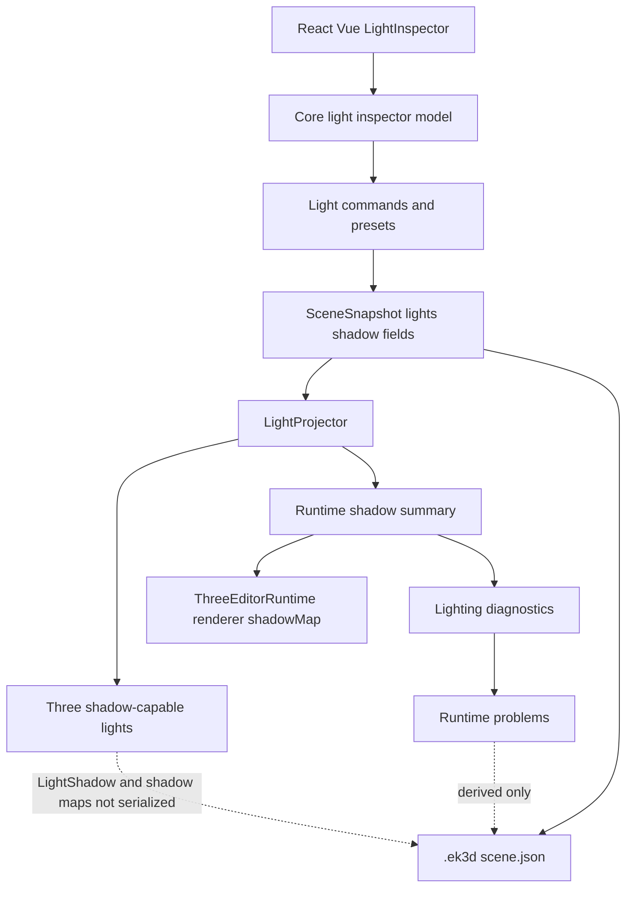
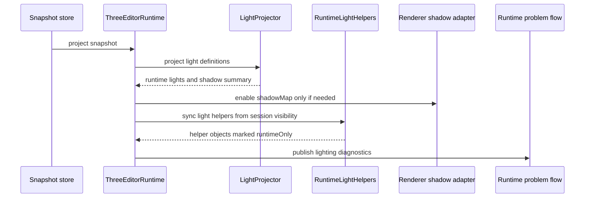

# feat: Add lighting helpers shadows and diagnostics

## Summary

实现 roadmap U13：在现有 ambient / directional / hemisphere / point / spot light authoring 之上补齐 shadow authoring、light helper gizmos、directional/spot target helper、shadow camera helper 和 lighting quality/performance diagnostics。计划保持 snapshot-first：只有 light/shadow authoring fields 进入 `SceneSnapshot`；Three.js helper objects、shadow maps、renderer shadow state、runtime diagnostics 和 computed cost summaries 都保持 runtime/session-only。

---

## Problem Frame

当前仓库已经有 `LightDefinition`、light node mirror、`add-light` / `update-light` / `remove-light` command、`LightProjector`、runtime pick proxy、React/Vue `LightInspector` 和 environment preset 能力。用户可以创建和编辑基础灯光，但还不能让真实场景产生可调阴影，也看不到 light direction、target、shadow camera frustum 或 shadow cost 的可视反馈。

Three.js shadow map 的行为决定这不能只是一个 `castShadow` checkbox：renderer 必须启用 `shadowMap`，shadow-capable lights 需要配置 `castShadow` 和 shadow camera，参与渲染的 meshes 还要设置 cast/receive policy。PointLight shadow 会按六个方向渲染，mapSize、range、bias 和 frustum 过大都会直接影响性能或质量。本计划把这些约束变成 conservative defaults、可见 helper 和 derived problems，而不是让用户凭空猜测为什么阴影模糊、昂贵或没有效果。

---

## Requirements

### Durable Shadow Contract

- R1. Snapshot 必须为 directional、spot、point lights 增加 shadow authoring contract，包含 enablement、map size、bias、normal bias、radius 和 light-kind-specific shadow camera range/bounds。
- R2. Ambient 和 hemisphere lights 必须明确不支持 shadow settings；validation 和 inspector command builder 都不能让 shadow fields 写入这些 light kind。
- R3. Snapshot migration 必须把当前 v7 lights 升级到下一版本时保持现有灯光视觉语义，不自动开启 shadows。
- R4. Shadow metadata 必须保持 JSON-compatible，不能保存 Three.js `LightShadow`、`Camera`、`WebGLRenderTarget`、shadow map texture、helper object、renderer state 或 computed diagnostics。

### Commands, Presets, and Inspector Semantics

- R5. Shadow edits 必须通过 normal light commands/history 进入 snapshot，并保持 light payload 与 light node mirror 同步。
- R6. Inspector model 必须暴露 shadow-capable controls：enable/disable、mapSize、bias、normalBias、radius、near/far，以及 directional shadow bounds。
- R7. Lighting presets 必须产生命令列表，例如 conservative key light、soft spotlight、disable all shadows；preset 不能直接改 renderer 或 runtime light object。
- R8. React/Vue `LightInspector` 必须渲染同一份 core light model，显示 shadow fields、helper toggles、diagnostics 和 controlled command problems，adapter 不拥有 lighting semantics。

### Runtime Projection and Helpers

- R9. Runtime 必须只在至少一个 shadow-capable light 启用 shadow 时配置 renderer shadow map，并在没有 shadow lights 时关闭或恢复到 no-shadow state。
- R10. `LightProjector` 必须把 durable shadow fields 投影到 Three.js shadow-capable lights，包括 `castShadow`、shadow map size、bias/normalBias/radius 和 shadow camera near/far/bounds。
- R11. Runtime 必须提供 conservative mesh shadow participation policy：shadow-enabled scenes 中 projection-owned meshes 默认可 cast/receive，runtime helper/problem placeholder 不参与；per-object cast/receive authoring 留到后续。
- R12. Light helper gizmos、target markers、target lines 和 shadow camera helpers 必须是 runtime-only helper objects，标记为 non-pickable helper，且 dispose/update 生命周期和现有 viewport helpers 一致。
- R13. Helper visibility 必须是 editor/session state，默认 Workbench 可切换 light gizmos、target helpers 和 shadow camera helpers，但这些 toggles 不进入 `SceneSnapshot` 或 `.ek3d`。

### Diagnostics and Verification

- R14. Runtime diagnostics 必须为 expensive PointLight shadow、高 mapSize、scene-level shadow budget、过宽 directional frustum、过大 near/far range 和无效 runtime shadow projection状态产生 target 到 light 的 derived problems。
- R15. Lighting diagnostics 必须进入 existing runtime problem flow、inspector problem section、Workbench hierarchy/status badges；不能写入 `snapshot.problems.acknowledged`。
- R16. Serialization、project package、React/Vue/vanilla proof-loop 和 browser coverage 必须证明 shadow settings durable、helper/runtime diagnostics 非 durable，并且默认 Workbench layout 不因新增 lighting controls 重叠。

---

## Scope Boundaries

### Included

- Durable light shadow schema、defaults、validation、migration 和 docs。
- Directional、spot、point shadow enablement、mapSize、bias、normalBias、radius、near/far；directional shadow orthographic bounds。
- Conservative runtime mesh cast/receive policy derived from enabled light shadows。
- Runtime renderer shadow map enablement through an adapter-safe boundary。
- Runtime-only light gizmos、target helpers 和 shadow camera helpers。
- Lighting diagnostics as derived runtime problems with light targets。
- Core inspector/workbench light model updates plus React/Vue UI parity。
- Public API exports、project package/serialization tests、docs and proof-loop updates。

### Deferred to Follow-Up Work

- Per-object or per-imported-target castShadow/receiveShadow durable controls。
- RectAreaLight、IES lights、light cookies、volumetric lights、physical sky/sun model、tone mapping/exposure UI 和 post-processing。
- Advanced shadow algorithms beyond Three.js default shadow map path, cascaded shadow maps, baked lightmaps, ambient occlusion pipeline or fake shadow authoring。
- Direct viewport dragging of directional/spot target helper; first version edits target through inspector fields and command builders。
- Persisted helper visibility, workspace layout preferences, global renderer presets, or user preference sync。
- Shadow quality auto-tuning from real GPU timing; diagnostics are static heuristics in this plan。

### Outside This Product Identity for This Stage

- Full renderer suite or physically accurate lighting product。
- Hosted viewer publishing, low-code runtime platform, MQTT/WebSocket binding runtime, dashboard event orchestration。
- Stable 1.0 rendering API guarantee; this remains an experimental `0.x` contract extension。

---

## Dependencies / Prerequisites

- Current snapshot version is 7 and already contains node hierarchy, imported GLB targets, material slots, authored camera views, source-based environment/background state, lights and presentation state。
- `LightProjector` already creates Three.js ambient/directional/hemisphere/point/spot lights and owns runtime target objects for directional/spot lights。
- `ThreeObjectMap.markRuntimeOnly()` and `EditorViewportHelperState` already provide the pattern for runtime-only helpers that must not become pick/marquee targets。
- Runtime problem subscription already publishes derived resolver/loader/material/environment/remap problems without mutating `snapshot.problems`。
- React/Vue Workbench already renders the core `LightInspectorSection` and routes light edits through core command builders。

---

## Key Technical Decisions

- KTD1. Shadows are durable light authoring fields, not renderer state. Snapshot stores the user's shadow intent and numeric controls; renderer `shadowMap`, `LightShadow`, helper objects and render targets remain runtime-only。
- KTD2. Shadow-capable schema is opt-in and conservative. Directional/spot default to moderate map sizes, point defaults lower because it has six shadow faces, and migration never enables shadows for existing scenes。
- KTD3. Renderer shadow map configuration belongs to runtime, not the snapshot. `ThreeEditorRuntime` should enable/disable renderer shadow support based on projected shadow summary while `LightProjector` stays focused on light objects and helper ownership。
- KTD4. Helper visibility reuses the viewport helper/session pattern. Light gizmos, target helpers and shadow camera helpers are editor aids like grid/axes/snap feedback; they are not durable scene authoring data。
- KTD5. First-version mesh participation is runtime policy. When any shadow is enabled, projection-owned meshes cast and receive shadows by default so the feature works without adding object-level schema; fine-grained cast/receive controls are deferred。
- KTD6. Diagnostics are derived problems with light targets. Expensive or low-quality shadow settings should appear in the same runtime problem flow as asset/material/environment issues, using `ProblemTarget.kind === "light"` and never writing authored problem acknowledgements automatically。
- KTD7. Presets produce commands. Lighting presets compose `add-light`, `update-light` and optional environment preset commands; they do not mutate Three.js scenes or renderer settings directly。
- KTD8. React/Vue remain render adapters. Field grouping, validation text, preset availability, diagnostic summaries and command payload construction live in core; framework components only render and dispatch。

---

## High-Level Technical Design

### Shadow Authoring Boundary

### Helper and Diagnostic Lifecycle

### Shadow Cost Heuristic

| Light kind | Shadow support | Effective map faces | Default map size | Mandatory diagnostic |
|---|---:|---:|---:|---|
| Directional | Yes | 1 | 1024 x 1024 | Warn when orthographic bounds or near/far range are broad. |
| Spot | Yes | 1 | 1024 x 1024 | Warn when far range is broad relative to scene defaults. |
| Point | Yes | 6 | 512 x 512 | Always warn that point shadows render six faces. |
| Ambient | No | 0 | None | Inspector/validation reject shadow fields. |
| Hemisphere | No | 0 | None | Inspector/validation reject shadow fields. |

---

## Implementation Units

### U1. Durable light shadow schema and migration

- **Goal:** Add versioned shadow authoring fields to shadow-capable lights while preserving existing light behavior.
- **Requirements:** R1-R4, R16.
- **Dependencies:** Current v7 snapshot and existing `LightDefinition` validation.
- **Files:** `packages/core/src/lights/types.ts`, `packages/core/src/lights/defaults.ts`, `packages/core/src/lights/validation.ts`, `packages/core/src/lights/lights.test.ts`, `packages/core/src/snapshot/types.ts`, `packages/core/src/snapshot/defaults.ts`, `packages/core/src/snapshot/migrations.ts`, `packages/core/src/snapshot/validation.ts`, `packages/core/src/snapshot/snapshot.test.ts`, `packages/core/src/editor/serialization.test.ts`, `docs/schema.md`.
- **Approach:** Bump the snapshot to the next version and introduce a `shadow` object only for directional, spot and point lights. Use per-kind defaults: directional/spot moderate map size and point lower map size; every migrated existing light has shadows disabled or no shadow object so scenes do not change visually. Validation should reject shadow fields on ambient/hemisphere lights, non-power-of-two map sizes, unsafe max sizes, non-finite bias/radius/range values, inverted near/far, invalid directional bounds and non-JSON metadata.
- **Execution note:** Start with migration, validation and serialization tests because this unit changes durable contract.
- **Patterns to follow:** Existing `validateLightDefinition()`, v6-to-v7 environment migration, authored camera schema migration, JSON-compatible metadata validation helpers.
- **Test scenarios:**
  - Given a v7 snapshot with ambient, hemisphere, directional, point and spot lights, when migration runs, then all lights remain valid and no light has shadows enabled by default.
  - Given a directional light with enabled shadow, valid map size, bias, normalBias, radius and orthographic bounds, when validation runs, then the snapshot is accepted.
  - Given an ambient or hemisphere light includes a shadow object, when validation runs, then the snapshot is rejected before runtime projection.
  - Given a shadow map size is non-power-of-two, zero, non-finite or above the accepted maximum, when validation runs, then the snapshot is rejected with a light-targeted error.
  - Given shadow camera near is greater than or equal to far, or directional bounds collapse, when validation runs, then the light is rejected.
  - Given shadow metadata contains a Three.js object, function, `File`, `Blob`, object URL, renderer output, shadow map or class instance, when validation runs, then JSON-compatible validation fails.
  - Given a valid shadow-enabled snapshot is serialized and restored, then durable JSON contains only plain shadow fields and no `LightShadow`, `Camera`, helper object, render target or runtime problem.
- **Verification:** The durable scene contract can express bounded shadow intent without importing Three.js runtime state into snapshot JSON.

### U2. Light command DTOs and lighting presets

- **Goal:** Make shadow edits and basic lighting presets command-owned, undoable and validated before dispatch.
- **Requirements:** R5-R7, R16.
- **Dependencies:** U1.
- **Files:** `packages/core/src/commands/types.ts`, `packages/core/src/commands/add-light.ts`, `packages/core/src/commands/update-light.ts`, `packages/core/src/commands/light-commands.test.ts`, `packages/core/src/commands/dispatcher.ts`, `packages/core/src/lights/presets.ts`, `packages/core/src/lights/presets.test.ts`, `packages/core/src/inspector/lights.ts`, `packages/core/src/inspector/lights.test.ts`, `packages/core/src/public-api.ts`, `packages/core/src/index.ts`, `packages/core/src/public-api.test.ts`, `docs/interactions.md`.
- **Approach:** Extend `AddLightCommand` and `UpdateLightCommand` patch normalization to accept shadow-capable fields while stripping unsupported shadow fields from ambient/hemisphere paths through validation failure, not silent mutation. Add preset command builders for conservative directional key light, soft spotlight, point-light-with-warning preview and disable-all-shadows. Presets should return normal command lists and optional inspector warnings when inputs are not available.
- **Patterns to follow:** Current `buildUpdateLightCommand()`, environment preset command builders, dispatcher rollback tests, camera command input normalization.
- **Test scenarios:**
  - Given a directional light exists, when an update command enables shadow and sets map size/bias/bounds, then snapshot lights update and undo restores the previous shadow state.
  - Given an update command attempts to add shadow settings to an ambient light, when dispatch runs, then it fails without mutating snapshot or history.
  - Given a patch changes only shadow settings on a light node, when command applies, then the light node name/transform mirror remains unchanged.
  - Given a preset creates a conservative key light, when the command list dispatches, then it creates or updates a directional light with shadows enabled and command history can undo the full preset.
  - Given disable-all-shadows preset runs on mixed lights, when dispatch completes, then shadow-capable lights are disabled and ambient/hemisphere lights remain untouched.
  - Given preset input would produce invalid bounds or map size, when the builder runs, then it returns a controlled inspector problem and no partial command list.
  - Given command output is serialized after preset use, then no renderer state, helper visibility, shadow map, `LightShadow`, runtime diagnostic or object URL appears.
- **Verification:** Users can author shadows and apply conservative lighting setups through the same command/history boundary as every other durable scene edit.

### U3. Runtime shadow projection and renderer shadow map control

- **Goal:** Project durable shadow settings into Three.js lights, renderer shadow support and projection-owned mesh participation.
- **Requirements:** R9-R11, R16.
- **Dependencies:** U1, U2.
- **Files:** `packages/core/src/runtime/light-projector.ts`, `packages/core/src/runtime/light-projector.test.ts`, `packages/core/src/runtime/scene-projector.ts`, `packages/core/src/runtime/scene-projector.test.ts`, `packages/core/src/runtime/editor-runtime.ts`, `packages/core/src/runtime/editor-runtime.test.ts`, `packages/core/src/runtime/disposal.ts`, `packages/core/src/runtime/disposal.test.ts`, `packages/core/src/runtime/material-projector.ts`, `packages/core/src/runtime/material-projector.test.ts`.
- **Approach:** Extend `LightProjector` to return a runtime shadow summary while applying per-light shadow settings to `DirectionalLight`, `SpotLight` and `PointLight`. Add a renderer-facing adapter in `ThreeEditorRuntime` that enables `shadowMap` only when the projected summary says shadows are active, preserving fake/test renderers that do not expose WebGL shadow internals. During scene projection, set cast/receive shadow on projection-owned meshes when any shadow is enabled, skipping runtime-only helpers, pick proxies and problem placeholders.
- **Patterns to follow:** Current light target projection and release lifecycle, material projector mesh traversal/disposal tests, `RendererLike` fake patterns in `editor-runtime.test.ts`, viewport helper runtime-only filtering.
- **Test scenarios:**
  - Given a directional light shadow is enabled, when projection runs, then the runtime `DirectionalLight.castShadow` is true and its shadow camera/map settings match durable fields.
  - Given all shadow-capable lights have shadows disabled, when projection runs after a previous enabled projection, then renderer shadow map is disabled or reset and runtime lights no longer cast shadows.
  - Given a point light shadow is enabled, when projection runs, then `PointLight.castShadow` is true, map size is the conservative point default unless authored, and renderer shadow map is enabled once.
  - Given a spot light shadow near/far changes, when projection reruns, then the existing runtime light is reused and its shadow camera updates without leaking a stale helper or target.
  - Given projection-owned GLB meshes are loaded and at least one shadow is enabled, when projection completes, then real meshes have cast/receive shadow according to the runtime policy while helper and problem placeholder objects do not.
  - Given an older async GLB load resolves after shadows were disabled or runtime disposed, when stale projection handling runs, then no late object re-enables shadow participation or leaks resources.
  - Given a fake renderer has no `shadowMap` capability, when shadow-enabled projection runs in unit tests, then projection still succeeds and emits capability diagnostics through U5 rather than throwing.
- **Verification:** Enabling shadows changes runtime rendering behavior through explicit projection without making renderer state durable or breaking fake runtime tests.

### U4. Runtime light helpers and helper session state

- **Goal:** Add light, target and shadow camera helpers as transient viewport aids controlled by session state.
- **Requirements:** R12, R13, R16.
- **Dependencies:** U3 and existing viewport helper state.
- **Files:** `packages/core/src/editor/viewport-helper-state.ts`, `packages/core/src/runtime/light-helpers.ts`, `packages/core/src/runtime/light-helpers.test.ts`, `packages/core/src/runtime/light-projector.ts`, `packages/core/src/runtime/scene-projector.ts`, `packages/core/src/runtime/editor-runtime.ts`, `packages/core/src/runtime/editor-runtime.test.ts`, `packages/core/src/runtime/three-object-map.ts`, `packages/core/src/runtime/three-object-map.test.ts`, `packages/core/src/workbench/workbench-model.ts`, `packages/core/src/workbench/workbench-model.test.ts`, `docs/interactions.md`.
- **Approach:** Extend the existing helper visibility/session model with light gizmo, light target and shadow camera helper toggles. Add a `RuntimeLightHelpers` owner that consumes the projected light registry, creates built-in Three helpers where available, creates small target markers/lines for directional and spot targets when needed, and creates `CameraHelper` for active shadow cameras. Every helper object should be marked `runtimeOnly`, excluded from direct picking/marquee, updated when its light/target/projection changes and disposed when hidden, stale or runtime is disposed.
- **Patterns to follow:** `RuntimeViewportHelpers`, `ThreeObjectMap.markRuntimeOnly()`, `TransformControlsAdapter.getHelper()` lifecycle, `SelectionVisuals` sync/dispose pattern.
- **Test scenarios:**
  - Given helper visibility enables light gizmos, when directional, spot, point and hemisphere lights project, then runtime helper objects are added, marked `runtimeOnly` and excluded from target entries.
  - Given a directional or spot target changes, when helpers sync, then target helper position and helper `update()` are called without recreating unrelated helpers.
  - Given shadow camera helper visibility is enabled for a shadow-enabled directional light, when projection runs, then a runtime `CameraHelper` is attached to the scene and targets that light's shadow camera.
  - Given shadow camera helper visibility is enabled for a light without shadows, when helpers sync, then no shadow camera helper is created and no durable state changes.
  - Given helper visibility toggles off, when runtime syncs, then all helper geometries/materials are disposed and removed from the scene.
  - Given pointer picking or marquee selection intersects a helper object, when target lookup runs, then selection resolves to the owning light only through the existing pick proxy or returns no helper target.
  - Given `editor.serialize()` or `.ek3d` export runs after toggling helpers, then helper visibility and helper object state are absent from durable JSON.
- **Verification:** Users can see light direction, target and shadow frustum without helper state polluting snapshot, selection or package output.

### U5. Lighting diagnostics and runtime problem integration

- **Goal:** Derive actionable lighting performance/quality problems from shadow settings and runtime capabilities.
- **Requirements:** R14, R15, R16.
- **Dependencies:** U1, U3, U4.
- **Files:** `packages/core/src/runtime/lighting-diagnostics.ts`, `packages/core/src/runtime/lighting-diagnostics.test.ts`, `packages/core/src/runtime/problems.ts`, `packages/core/src/runtime/scene-projector.ts`, `packages/core/src/runtime/scene-projector.test.ts`, `packages/core/src/runtime/editor-runtime.test.ts`, `packages/core/src/problems/types.ts`, `packages/core/src/inspector/problems.ts`, `packages/core/src/inspector/problems.test.ts`, `packages/core/src/workbench/workbench-model.ts`, `packages/core/src/workbench/workbench-model.test.ts`.
- **Approach:** Add a pure diagnostics module that evaluates snapshot light settings plus runtime shadow summary. Use effective shadow texel cost `width * height * faceCount`, where point lights count as six faces. Emit derived `Problem` records targeted at lights for point-light cost, high map size, high scene shadow budget, broad directional bounds, excessive near/far range and missing renderer shadow capability. Diagnostics should dedupe by problem ID, flow through existing runtime problem publication and never mutate authored acknowledgements.
- **Patterns to follow:** Environment unsupported-setting problem, material texture runtime problems, imported remap problem derivation, Workbench hierarchy problem badge attribution.
- **Test scenarios:**
  - Given a point light shadow is enabled, when diagnostics run, then a warning explains that point shadows render six faces and targets the point light.
  - Given one light has map size above the warning threshold, when diagnostics run, then a performance warning includes the light ID and effective texel cost.
  - Given several shadow-enabled lights exceed the scene shadow budget, when diagnostics run, then one scene-level or light-targeted budget warning appears without duplicating lower-level warnings unnecessarily.
  - Given a directional shadow camera has very broad orthographic bounds, when diagnostics run, then a quality warning tells the user to tighten the shadow camera range.
  - Given spot or point shadow far range is very broad relative to near range, when diagnostics run, then a range warning targets that light.
  - Given renderer shadow capability is unavailable in a fake or host renderer, when projection runs, then a runtime problem explains that shadows are authored but not active in this runtime.
  - Given runtime diagnostics publish, when the inspector and Workbench model build, then light hierarchy rows and problem panels include the diagnostic IDs while `snapshot.problems.acknowledged` remains unchanged.
- **Verification:** Users get clear feedback for expensive or low-quality shadow settings before they mistake poor output for a broken editor.

### U6. Core light inspector model and React/Vue UI parity

- **Goal:** Make shadow controls, helper toggles, presets and diagnostics available in the default Workbench without duplicating logic in adapters.
- **Requirements:** R6-R8, R13-R16.
- **Dependencies:** U2, U4, U5.
- **Files:** `packages/core/src/inspector/types.ts`, `packages/core/src/inspector/lights.ts`, `packages/core/src/inspector/lights.test.ts`, `packages/core/src/inspector/selection.ts`, `packages/core/src/workbench/workbench-model.ts`, `packages/core/src/workbench/workbench-model.test.ts`, `packages/react/src/components/LightInspector.tsx`, `packages/react/src/components/WorkbenchToolbar.tsx`, `packages/react/src/components/inspector.css`, `packages/react/src/components/workbench.css`, `packages/react/test/inspector.test.tsx`, `packages/react/test/workbench.test.tsx`, `packages/react/test/default-workbench.browser.test.tsx`, `packages/vue/src/components/LightInspector.vue`, `packages/vue/src/components/WorkbenchToolbar.vue`, `packages/vue/src/components/inspector.css`, `packages/vue/src/components/workbench.css`, `packages/vue/test/inspector.test.ts`, `packages/vue/test/workbench.test.ts`, `packages/vue/test/default-workbench.browser.test.ts`.
- **Approach:** Extend `LightInspectorSection` with grouped field descriptors for basic fields, target fields, shadow fields, helper visibility controls, preset actions and diagnostic summaries. React/Vue should render controls from those descriptors, show inline command problems for invalid drafts, expose helper toggles through existing Workbench context and keep local component state limited to draft/error display. Use compact field grouping so shadow controls do not crowd existing transform/material/environment panels.
- **Patterns to follow:** Current `LightInspector`, `EnvironmentInspector` preset actions, `CameraInspector` runtime-dependent action enablement, material inspector controlled field problems and browser layout tests.
- **Test scenarios:**
  - Given a directional light is selected, when core light section builds, then it exposes target fields, shadow enablement, map size, bias, normalBias, radius and directional shadow bounds.
  - Given an ambient light is selected, when core light section builds, then shadow fields are absent or disabled with a clear unsupported reason.
  - Given invalid map size, bias or near/far draft is committed in React, when the core command builder returns a problem, then React displays the warning and does not dispatch.
  - Given the same invalid draft is committed in Vue, when the core command builder returns a problem, then Vue displays equivalent warning text and dispatch shape remains identical to React.
  - Given runtime diagnostics target the active light, when LightInspector renders, then the diagnostic summary appears in the light section and the general Problems panel still shows the same runtime problem.
  - Given helper toggles change in the toolbar or light inspector, when React/Vue rerender, then helper session state updates without changing snapshot/history.
  - Given a narrow viewport, when shadow controls, presets and diagnostics render with existing inspector sections, then controls wrap or scroll without text/button overlap.
- **Verification:** Default React and Vue users can author useful lighting and understand diagnostics without writing custom light UI.

### U7. Serialization, project package, docs and proof-loop hardening

- **Goal:** Prove U13 across durable schema, package workflows, public API, docs and visible default Workbench behavior.
- **Requirements:** R1-R16.
- **Dependencies:** U1-U6.
- **Files:** `packages/core/src/editor/serialization.test.ts`, `packages/core/src/project/export-project.test.ts`, `packages/core/src/project/import-project.test.ts`, `packages/core/src/public-api.test.ts`, `packages/react/src/public-api.test.ts`, `packages/vue/src/public-api.test.ts`, `packages/react/test/react-proof-loop.integration.test.tsx`, `packages/vue/test/vue-proof-loop.integration.test.ts`, `packages/react/test/default-workbench.browser.test.tsx`, `packages/vue/test/default-workbench.browser.test.ts`, `packages/react/test/proof-loop-demo.browser.test.tsx`, `packages/core/src/runtime/picking.browser.test.ts`, `examples/vanilla-proof-loop/src/main.ts`, `docs/schema.md`, `docs/interactions.md`, `docs/integration-react.md`, `docs/integration-vue.md`, `docs/integration-vanilla.md`, `docs/project-package.md`, `docs/architecture.md`, `README.md`.
- **Approach:** Add round-trip tests and docs that explicitly separate durable shadow settings from runtime helpers, renderer state and diagnostics. Update public exports for shadow types, preset builders, inspector types and diagnostic helpers that consumers need. Extend proof-loop fixtures with one conservative directional shadow and one intentionally expensive point shadow so diagnostics and helper visibility can be verified without pixel-perfect WebGL assertions.
- **Patterns to follow:** Existing project package runtime-only exclusion language, public API export tests, React/Vue proof-loop parity tests, browser tests that assert stable UI/canvas state rather than fragile shadow pixels.
- **Test scenarios:**
  - Given a shadow-enabled scene is exported as `.ek3d` and imported, when the restored snapshot is inspected, then light shadow fields survive and helper/session/renderer fields are absent.
  - Given light helpers and shadow camera helpers are visible before export, when `scene.json` is inspected, then no helper visibility, helper geometry, helper material, `CameraHelper`, `DirectionalLightHelper`, `SpotLightHelper`, `LightShadow` or shadow map appears.
  - Given runtime publishes point-shadow and broad-frustum diagnostics, when project package export runs, then diagnostics are not written into `scene.json` or `snapshot.problems.acknowledged`.
  - Given public package root exports are imported by React, Vue and vanilla consumers, when type/API tests run, then shadow types, preset builders and inspector fields are available without exposing runtime internals.
  - Given default React/Vue Workbench loads the proof-loop scene, when the user selects the shadow-enabled light, toggles helpers and edits map size, then UI state, command history, diagnostics and canvas render remain coherent.
  - Given browser tests run at mobile and desktop widths, when light inspector shadow controls render, then toolbar, viewport, inspector and status text do not overlap.
  - Given documentation is reviewed, then it describes shadows/helpers/diagnostics as available while keeping per-object cast/receive, RectAreaLight, IES, post-processing and physical rendering deferred.
- **Verification:** U13 can be claimed as shipped only when durable round trip, runtime-only exclusions, framework parity and visible diagnostics all pass.

---

## Acceptance Examples

- AE1. Given a user enables shadows on a directional light and sets a bounded shadow camera, when runtime projection runs, then the light casts shadows, renderer shadow support is active, helper visibility can show the light and shadow frustum, and serialization contains only durable shadow fields.
- AE2. Given a user enables a PointLight shadow, when diagnostics run, then a warning explains the six-face rendering cost and targets that point light.
- AE3. Given a shadow map size is too large or several shadow lights exceed the scene budget, when diagnostics publish, then Workbench problems and light inspector diagnostics show performance warnings without mutating `snapshot.problems.acknowledged`.
- AE4. Given a directional shadow camera range is very broad, when diagnostics run, then a quality warning tells the user to tighten bounds/range and the shadow camera helper can visualize the authored frustum.
- AE5. Given React and Vue load the same shadow-enabled scene, when the user edits shadow fields and toggles helpers, then both adapters dispatch equivalent core commands and helper state remains session-only.
- AE6. Given a `.ek3d` package is exported after helper toggles, runtime diagnostics and renderer projection, when `scene.json` is inspected, then it contains light shadow authoring fields but no Three.js helper, shadow map, renderer, object URL, runtime problem or computed diagnostic summary.

---

## System-Wide Impact

- **Snapshot compatibility:** This is durable schema work. The implementation must bump snapshot version, migrate older snapshots, update validation and keep shadow settings backward-compatible for existing lights.
- **Runtime renderer boundary:** `RendererLike` and `ThreeEditorRuntime` need an optional shadow-capability path while preserving current fake renderer tests and host-provided renderers.
- **Runtime disposal and picking:** Helper objects, shadow camera helpers and target markers add object lifecycle risk. They must be marked runtime-only, excluded from picking/marquee and disposed on visibility/projection/runtime changes.
- **Performance posture:** Shadows can multiply render cost. Diagnostics, conservative defaults and point-light warnings are part of the feature contract, not polish.
- **Public API and docs:** Core exports grow around shadow types, presets, inspector fields and diagnostics. React/Vue should expose these through existing Workbench/headless surfaces, not new lighting semantics in adapters.

---

## Risks and Dependencies

| Risk | Impact | Mitigation |
|---|---|---|
| Shadow settings make old scenes slower after migration | Existing users see unexpected performance regression | Migration keeps shadows disabled and presets require explicit commands. |
| PointLight shadows are treated as ordinary shadows | Users create expensive scenes without understanding cost | Always emit point-shadow cost diagnostics and use smaller point defaults. |
| Renderer shadow map state leaks into snapshot or docs | Durable contract becomes host/runtime-specific | Keep renderer config in `ThreeEditorRuntime`; serialization/package tests assert runtime-only exclusions. |
| Helper objects become pickable scene targets | Users select helpers instead of authored nodes or helpers enter marquee results | Mark helpers runtime-only and test `ThreeObjectMap` / browser picking behavior. |
| Conservative mesh cast/receive default surprises advanced users | Some scenes may cast more shadows than desired | Document it as first-version runtime policy and defer per-object controls. |
| Diagnostic thresholds feel arbitrary across scene scales | Warnings may be noisy or too quiet | Keep thresholds centralized in `lighting-diagnostics.ts`, cover them with tests and document they are heuristics. |
| React/Vue light inspectors become crowded | Default Workbench usability regresses on narrow layouts | Group controls, keep cards out of cards, rely on browser layout tests for desktop/mobile widths. |

---

## Documentation and Operational Notes

- Update `docs/schema.md` with the next snapshot version, shadow-capable light fields, unsupported light kinds and runtime-only exclusions.
- Update `docs/interactions.md` with shadow authoring flow, helper visibility toggles, target helper behavior, diagnostics and the deferred per-object cast/receive boundary.
- Update `docs/project-package.md` to state that `.ek3d` persists shadow fields but not helper visibility, Three.js helpers, renderer shadowMap, shadow maps or diagnostics.
- Update `docs/integration-react.md`, `docs/integration-vue.md` and `docs/integration-vanilla.md` with default Workbench lighting controls and host renderer shadow capability notes.
- Update `README.md` only after U7 coverage is green, moving shadows and light helpers out of deferred follow-up while keeping advanced rendering features deferred.

---

## Sources and Research

- Origin roadmap: `docs/plans/2026-06-05-001-feat-real-user-editor-roadmap-plan.md`.
- Upstream ideation: `docs/ideation/2026-06-05-real-user-3d-editor-delivery-readiness-ideation.md`, `docs/ideation/2026-06-03-post-mvp-3d-editor-next-stage-ideation.md`.
- Existing light/runtime code: `packages/core/src/lights/types.ts`, `packages/core/src/lights/defaults.ts`, `packages/core/src/lights/validation.ts`, `packages/core/src/commands/update-light.ts`, `packages/core/src/runtime/light-projector.ts`, `packages/core/src/runtime/scene-projector.ts`, `packages/core/src/runtime/editor-runtime.ts`, `packages/core/src/inspector/lights.ts`.
- Existing helper/problem patterns: `packages/core/src/editor/viewport-helper-state.ts`, `packages/core/src/runtime/viewport-helpers.ts`, `packages/core/src/runtime/three-object-map.ts`, `packages/core/src/runtime/problems.ts`, `packages/core/src/workbench/workbench-model.ts`.
- Existing docs: `docs/schema.md`, `docs/interactions.md`, `docs/project-package.md`, `docs/architecture.md`, `README.md`.
- Three.js DirectionalLightHelper docs: https://threejs.org/docs/pages/DirectionalLightHelper.html.
- Three.js SpotLightHelper docs: https://threejs.org/docs/pages/SpotLightHelper.html.
- Three.js CameraHelper docs: https://threejs.org/docs/pages/CameraHelper.html.
- Three.js LightShadow docs: https://threejs.org/docs/pages/LightShadow.html.
- Three.js shadows manual: https://threejs.org/manual/en/shadows.html.
