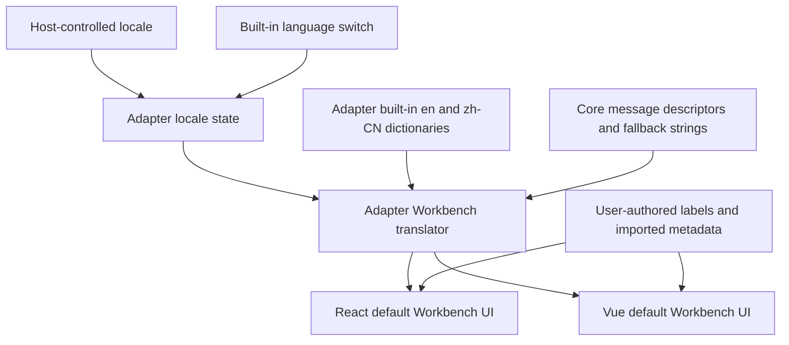
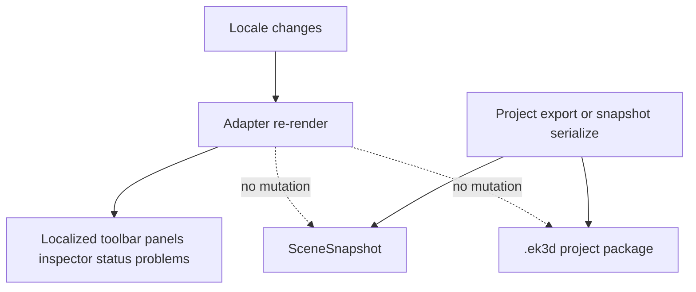

# feat: Add bilingual Workbench i18n

## Summary

Add built-in English and Simplified Chinese support to the default React and Vue Workbench surfaces. The plan keeps language as adapter/UI state, introduces a framework-neutral message contract for core-produced display text, and verifies that locale changes never alter durable scene or project data.

---

## Problem Frame

The default Workbench is now the install-ready npm package surface. It renders a complete editor, but its visible text is still hardcoded English across toolbar actions, project and asset panels, status summaries, inspectors, problem displays, titles, placeholders, and accessibility labels.

The codebase already draws a hard boundary between durable editor state and runtime/UI state. That same boundary must apply to i18n: locale selection can change what users see, but it must not enter `SceneSnapshot`, `.ek3d` manifests, command history, asset records, runtime problems, or project payloads.

Core currently produces some display-oriented text through inspector models, workbench models, asset workspace diagnostics, and runtime/project problems. React and Vue then add more default UI text around those models. The implementation therefore needs a shared message contract, not a React-only or Vue-only translation layer.

---

## Requirements

**Language Contract**

- R1. The default React Workbench must support `en` and `zh-CN` without requiring host code or third-party i18n packages. (origin R1, R3, R10)
- R2. The default Vue Workbench must support `en` and `zh-CN` without requiring host code or third-party i18n packages. (origin R2, R3, R10)
- R3. English must remain the default package locale when no host locale is configured. (origin R1, R2)
- R4. Host applications must be able to set the Workbench locale and hide or externally control the built-in switch. (origin R3, R4, R5, F4)
- R5. Locale changes must update visible Workbench text without editor recreation, scene reload, asset re-import, or snapshot mutation. (origin R6, F2)

**Message Coverage**

- R6. Core-produced display models must expose stable message identity, fallback text, and interpolation values for labels, reasons, action labels, summaries, and known problems. (origin R11, R15, F3)
- R7. Built-in `en` and `zh-CN` dictionaries must cover the default toolbar, left panel, status bar, inspector sections, inspector fields, problem surfaces, placeholders, `title` attributes, and accessibility labels. (origin R7-R12, F1)
- R8. Raw loader, browser, decoder, and host error strings may remain fallback detail, but the surrounding problem surface must be localized. (origin R12, F3)
- R9. User-authored scene, node, asset, material, file, and imported metadata labels must render as authored across locale changes. (origin R13, AE4)

**State and API Boundaries**

- R10. Locale state and built-in switch state must remain session/host UI state and must not serialize into `SceneSnapshot`, `.ek3d`, command history, asset workspace records, project manifests, or runtime metadata. (origin R14, AE2)
- R11. Core must remain framework-neutral and must not depend on React, Vue, `i18next`, Vue I18n, or another i18n runtime. (origin R16)
- R12. React and Vue adapters must use the same message keys and dictionary values for shared Workbench concepts. (origin R17, AE5)
- R13. Public adapter APIs must leave room for host-owned translation integration without replacing the whole Workbench. (origin R18)

**Verification and Documentation**

- R14. React tests must verify representative English and Chinese Workbench rendering, built-in switch behavior, host-controlled locale behavior, and snapshot invariance. (origin R19, R21)
- R15. Vue tests must verify representative English and Chinese Workbench rendering, built-in switch behavior, host-controlled locale behavior, and snapshot invariance. (origin R20, R21)
- R16. Browser or DOM-level checks must verify that Chinese text does not visibly overlap, clip critical content, or make controls unusable at narrow and desktop sizes. (origin R22, AE6)
- R17. A maintainable hardcoded-string audit path must catch new default Workbench strings while allowing technical constants and user-authored content. (origin R23)
- R18. npm-facing docs must show default locale, controlled locale, built-in switch visibility, host translation extension, and the durable-state boundary. (origin R24)

---

## Key Technical Decisions

- KTD1. **Use `en` as the default locale:** Package behavior stays deterministic and avoids browser-language surprises in embedded editors, tests, SSR-like renders, and host applications that already own account-level language preference.
- KTD2. **Use a framework-neutral message contract in core:** Core-owned inspector, workbench, asset, and problem models should add message descriptors while retaining current fallback strings for backward compatibility and debugging.
- KTD3. **Keep dictionaries lightweight and adapter-owned:** The first version uses static `en` and `zh-CN` dictionaries in the default Workbench adapter layer plus a small interpolation helper instead of adding `i18next`, `react-i18next`, Vue I18n, or FormatJS.
- KTD4. **Translate at the adapter rendering boundary:** Core provides identity, fallback data, and interpolation values; React and Vue own dictionary lookup when rendering default Workbench UI and can pass translator access into custom regions.
- KTD5. **Use controlled/uncontrolled locale semantics:** A host-controlled locale wins when present; otherwise the built-in switch owns local Workbench UI state. Exact prop names can follow adapter conventions during implementation.
- KTD6. **Treat user-authored labels as values, not messages:** Scene names, object names, asset labels, material names, file names, imported GLB metadata, IDs, and technical extension names bypass translation.
- KTD7. **Make string-audit targeted, not global:** The guard should focus on default Workbench/inspector UI and core display builders, with an allowlist for tests, technical constants, user-authored fixture data, and raw fallback errors.
- KTD8. **Expose a host translation bridge without requiring one:** Built-in dictionaries handle `en` and `zh-CN` by default, while adapter APIs should allow a host callback or message override map to resolve the same descriptors through an application-owned i18n system.

---

## High-Level Technical Design

---

## Implementation Units

### U1. Add the framework-neutral i18n descriptor contract

- **Goal:** Establish the shared message identity, locale type, fallback, and interpolation-value contract that core, React, and Vue can all use without putting dictionaries or rendering logic in core.
- **Requirements:** R6, R11, R12, R13.
- **Dependencies:** None.
- **Files:** `packages/core/src/i18n/messages.ts`, `packages/core/src/i18n/messages.test.ts`, `packages/core/src/public-api.ts`, `packages/core/src/index.ts`, `packages/core/src/public-api.test.ts`.
- **Approach:** Add `en` and `zh-CN` as the initial supported locale type, a small message descriptor shape, fallback text, and interpolation-value conventions for counts/names/status values. Export public types for adapters and hosts that want to bridge their own translation layer. Keep core free of dictionaries, formatter state, React/Vue APIs, and runtime-only values.
- **Patterns to follow:** Core public API export tests, `packages/core/src/workbench/workbench-model.ts` type-export style, and existing `0.x` package contract tests.
- **Test scenarios:**
  - Given a message descriptor is created for a core display value, when it is inspected, then it carries a stable key, fallback text, and serializable interpolation values.
  - Given interpolation values include counts, names, modes, or status values, when descriptor helpers are used, then the values remain primitive JSON-safe data and do not bake locale-specific sentence structure into core.
  - Given a descriptor has no adapter dictionary entry yet, when adapters read the contract, then the fallback text remains available for readable rendering.
  - Given the package root is imported, when TypeScript/public API tests run, then locale/message types are exported without exposing internal runtime projectors or new framework dependencies.
- **Verification:** Core exposes a stable, framework-neutral i18n contract that adapter dictionaries can consume without making localization part of durable editor state.

### U2. Add message descriptors to core display models and known problems

- **Goal:** Preserve current core display strings as fallbacks while adding stable message descriptors for localized rendering.
- **Requirements:** R6, R8, R9, R10, R11.
- **Dependencies:** U1.
- **Files:** `packages/core/src/inspector/types.ts`, `packages/core/src/inspector/transform.ts`, `packages/core/src/inspector/material.ts`, `packages/core/src/inspector/environment.ts`, `packages/core/src/inspector/lights.ts`, `packages/core/src/inspector/cameras.ts`, `packages/core/src/inspector/problems.ts`, `packages/core/src/workbench/workbench-model.ts`, `packages/core/src/assets/workspace.ts`, `packages/core/src/assets/import-pipeline.ts`, `packages/core/src/runtime/problems.ts`, `packages/core/src/runtime/lighting-diagnostics.ts`, `packages/core/src/project/package-validation.ts`, `packages/core/src/inspector/inspector.test.ts`, `packages/core/src/workbench/workbench-model.test.ts`, `packages/core/src/assets/workspace.test.ts`, `packages/core/src/runtime/lighting-diagnostics.test.ts`.
- **Approach:** Add optional message descriptors beside existing `label`, `title`, `reason`, `message`, `detail`, `summary`, and `actionLabel` strings. Do not remove current strings. Localize stable categories such as inspector section titles, field labels, select options, Workbench status summaries, asset/problem action labels, import diagnostics, and known runtime/project problems. Leave raw loader/browser/host error details as fallback values.
- **Patterns to follow:** Existing inspector descriptor builders, `ProblemDisplay` fallback behavior, asset workspace problem summaries, and tests that already assert no runtime-only values enter serialized models.
- **Test scenarios:**
  - Given transform, material, environment, light, camera, and problem inspector sections are built, when descriptors are inspected, then each shipped label/title/reason has a stable message descriptor and fallback.
  - Covers AE3. Given a known asset-resolution or lighting diagnostic, when converted to inspector/workbench problem items, then localized title/action identity exists and raw technical detail remains available as fallback detail.
  - Covers AE4. Given user-authored scene, node, asset, light, camera, and material names, when core models are built, then those values are not treated as message keys.
  - Given `buildWorkbenchModel()` derives status labels and snap feedback labels, when locale descriptors are inspected, then count/mode/status values are represented as interpolation values rather than baked into one English-only string.
  - Given workbench and inspector models are JSON stringified, then they contain no `File`, `Blob`, object URL, Three.js object, resolver output, PMREM output, or runtime-only object.
- **Verification:** Core display producers become localizable without changing durable state or breaking consumers that still read fallback strings.

### U3. Wire React Workbench locale state and default UI translation

- **Goal:** Make the default React Workbench render in English or Chinese, support a host-controlled locale, and expose a built-in language switch that stays out of durable editor state.
- **Requirements:** R1, R3, R4, R5, R7, R9, R10, R12, R13, R14.
- **Dependencies:** U1, U2.
- **Files:** `packages/react/src/i18n/workbench-i18n.tsx`, `packages/react/src/components/EditorWorkbench.tsx`, `packages/react/src/hooks/use-workbench.ts`, `packages/react/src/components/WorkbenchToolbar.tsx`, `packages/react/src/components/WorkbenchLeftPanel.tsx`, `packages/react/src/components/WorkbenchStatusBar.tsx`, `packages/react/src/components/workbench.css`, `packages/react/src/index.ts`, `packages/react/src/public-api.test.ts`, `packages/react/test/workbench.test.tsx`, `packages/react/test/strict-mode.test.tsx`.
- **Approach:** Add React-side locale state, built-in dictionaries, lightweight fallback/interpolation resolution, optional host translation bridge support, and translator access for default components and render-prop regions. Translate toolbar groups/actions, project actions, asset controls, queue text, recovery text, project summaries, status summaries, `aria-label`, `title`, and placeholders. Add the language switch to default Workbench UI with host visibility/control options. Keep any switch state in React state.
- **Patterns to follow:** `EditorWorkbench` controlled prop style, `useWorkbench()` external-store semantics, existing render-prop region contract, and React StrictMode cleanup tests.
- **Test scenarios:**
  - Covers AE1. Given `locale` is configured as `zh-CN`, when React Workbench renders, then toolbar, project panel, asset controls, status text, titles, placeholders, and accessibility labels use Chinese text.
  - Covers AE2. Given a scene has been edited, when the built-in switch changes locale and a snapshot/project export is serialized, then durable output does not contain locale, language switch state, or translated UI strings.
  - Given host-controlled locale changes from `en` to `zh-CN`, when the component re-renders, then visible default Workbench text changes without recreating the editor or remounting runtime.
  - Given a host hides the built-in switch, when React Workbench renders, then host-controlled locale still applies and no duplicate switch is visible.
  - Given a render-prop region receives Workbench context, when locale is `zh-CN`, then the context exposes translator access without requiring the host to import a third-party i18n runtime.
  - Given a host supplies a translation bridge for a known message key, when React Workbench renders, then the host-provided copy wins and built-in fallback still covers untranslated keys.
  - Given React built-in dictionaries are inspected, when key coverage is checked, then `en` and `zh-CN` contain the same shared Workbench key set.
  - Given React StrictMode mounts/unmounts the Workbench, when locale state changes during the lifecycle, then subscriptions and host-owned editor disposal behavior remain unchanged.
- **Verification:** React package users can choose Chinese through props or the built-in switch, and current editor/runtime lifecycle behavior remains intact.

### U4. Wire Vue Workbench locale state and default UI translation

- **Goal:** Deliver Vue parity for host-controlled locale, built-in switch behavior, and localized default Workbench UI.
- **Requirements:** R2, R3, R4, R5, R7, R9, R10, R12, R13, R15.
- **Dependencies:** U1, U2, U3 interface decisions.
- **Files:** `packages/vue/src/i18n/workbench-i18n.ts`, `packages/vue/src/components/EditorWorkbench.types.ts`, `packages/vue/src/components/EditorWorkbench.vue`, `packages/vue/src/composables/use-workbench.ts`, `packages/vue/src/components/WorkbenchToolbar.vue`, `packages/vue/src/components/WorkbenchLeftPanel.vue`, `packages/vue/src/components/WorkbenchStatusBar.vue`, `packages/vue/src/components/workbench.css`, `packages/vue/src/index.ts`, `packages/vue/src/public-api.test.ts`, `packages/vue/test/workbench.test.ts`.
- **Approach:** Mirror the React language contract with Vue-native props, computed locale state, built-in dictionaries, lightweight fallback/interpolation resolution, optional host translation bridge support, and scoped-slot access. Translate the same default Workbench concepts using the shared keys and equivalent dictionaries. Keep editor/runtime instances `markRaw`/`shallowRef` as they are today, and keep locale/switch state as UI reactivity only.
- **Patterns to follow:** Vue `useWorkbench()` raw editor boundary, `EditorWorkbench.types.ts` prop/slot export style, current scoped-slot context, and Vue Test Utils workbench tests.
- **Test scenarios:**
  - Covers AE1. Given `locale` is configured as `zh-CN`, when Vue Workbench renders, then toolbar, project panel, asset controls, status text, titles, placeholders, and accessibility labels use Chinese text.
  - Covers AE2. Given a scene has been edited, when the built-in switch changes locale and a snapshot/project export is serialized, then durable output does not contain locale, language switch state, or translated UI strings.
  - Given host-controlled locale changes through Vue props, when reactivity flushes, then visible default Workbench text changes without replacing the raw editor or runtime.
  - Given a host hides the built-in switch, when Vue Workbench renders, then host-controlled locale still applies and no duplicate switch is visible.
  - Given a scoped slot receives Workbench context, when locale is `zh-CN`, then the context exposes translator access without deep-proxying translator, editor, or runtime objects.
  - Given a host supplies a translation bridge for a known message key, when Vue Workbench renders, then the host-provided copy wins and built-in fallback still covers untranslated keys.
  - Given Vue built-in dictionaries are inspected, when key coverage is checked, then `en` and `zh-CN` contain the same shared Workbench key set.
  - Given the component unmounts after locale changes, when cleanup is inspected, then subscriptions and host-owned editor behavior match the existing Workbench contract.
- **Verification:** Vue and React expose equivalent language behavior while staying idiomatic to their adapter lifecycles.

### U5. Localize inspector and problem UI across adapters

- **Goal:** Cover default inspector sections, field controls, inline validation, diagnostics, and problem panels in both adapters.
- **Requirements:** R6, R7, R8, R9, R12, R14, R15.
- **Dependencies:** U1, U2, U3, U4.
- **Files:** `packages/react/src/components/InspectorView.tsx`, `packages/react/src/components/TransformInspector.tsx`, `packages/react/src/components/MaterialInspector.tsx`, `packages/react/src/components/EnvironmentInspector.tsx`, `packages/react/src/components/LightInspector.tsx`, `packages/react/src/components/CameraInspector.tsx`, `packages/react/src/components/ProblemsPanel.tsx`, `packages/react/test/inspector.test.tsx`, `packages/react/test/workbench.test.tsx`, `packages/vue/src/components/InspectorView.vue`, `packages/vue/src/components/TransformInspector.vue`, `packages/vue/src/components/MaterialInspector.vue`, `packages/vue/src/components/EnvironmentInspector.vue`, `packages/vue/src/components/LightInspector.vue`, `packages/vue/src/components/CameraInspector.vue`, `packages/vue/src/components/ProblemsPanel.vue`, `packages/vue/test/inspector.test.ts`, `packages/vue/test/workbench.test.ts`.
- **Approach:** Thread translator access into inspector components, render core descriptor messages through the translator, and replace component-local English strings with shared message keys. Localize stable validation and action text while preserving dynamic raw details. Keep field values, names, IDs, file labels, asset labels, and GLB metadata untouched.
- **Patterns to follow:** Existing React/Vue inspector parity, core builder fallback strings, and component-local `fieldProblem` handling.
- **Test scenarios:**
  - Given each inspector section renders in `zh-CN`, when field labels, section titles, select options, inline empty states, and action buttons are queried, then stable UI copy is Chinese.
  - Covers AE3. Given a known problem appears in the Problems panel, when locale is `zh-CN`, then title and action copy are Chinese while raw technical detail remains visible when present.
  - Given a material slot target is user-authored or imported metadata, when locale changes, then target labels remain unchanged while surrounding metadata labels are localized.
  - Given camera view names, light names, object names, asset labels, and file names contain English text, when locale changes, then those values remain as authored.
  - Given React and Vue render the same inspector scenario in Chinese, when representative strings are compared, then equivalent message keys resolve to equivalent copy.
- **Verification:** Default Workbench coverage includes inspectors and problem surfaces, not only toolbar and navigation chrome.

### U6. Add serialization, parity, and layout verification

- **Goal:** Prove locale is UI-only, React/Vue behavior is equivalent, and Chinese text fits the current responsive Workbench layout.
- **Requirements:** R5, R9, R10, R12, R14, R15, R16, R17.
- **Dependencies:** U1-U5.
- **Files:** `packages/core/src/i18n/messages.test.ts`, `packages/core/src/editor/serialization.test.ts`, `packages/core/src/project/export-project.test.ts`, `packages/react/test/workbench.test.tsx`, `packages/react/test/i18n-string-audit.test.ts`, `packages/react/test/proof-loop-demo.browser.test.tsx`, `packages/vue/test/workbench.test.ts`, `packages/vue/test/i18n-string-audit.test.ts`, `packages/vue/test/vue-proof-loop.integration.test.ts`, `packages/react/src/components/workbench.css`, `packages/react/src/components/inspector.css`, `packages/vue/src/components/workbench.css`, `packages/vue/src/components/inspector.css`, `vitest.browser.config.ts`.
- **Approach:** Add focused serialization assertions for locale state, parity tests for shared keys and representative UI, and browser/DOM tests that render Chinese at narrow and desktop widths. Reuse the existing browser proof-loop harness for real layout/canvas checks where possible. Adjust CSS only where Chinese copy exposes real wrapping or spacing issues.
- **Patterns to follow:** Existing tests that assert viewport helper, marquee, runtime problems, `File`, `Blob`, and Three.js objects stay out of serialized output; existing proof-loop browser checks; current CSS `min-width: 0`, `flex-wrap`, and `overflow-wrap` patterns.
- **Test scenarios:**
  - Covers AE2. Given locale changes multiple times, when `editor.serialize()` and project export run, then locale, language switch state, and localized UI copy are absent from durable JSON.
  - Covers AE5. Given React and Vue render the same default Workbench state in both locales, when representative strings are collected, then shared concepts resolve from the same key set.
  - Covers AE6. Given Chinese locale at narrow and desktop viewport sizes, when toolbar, left panel, inspector, and status bar render, then text wraps or scrolls inside its region without visible overlap.
  - Given a long user-authored asset label and Chinese UI chrome, when asset rows render, then the user-authored label remains readable and is not translated.
  - Given the hardcoded-string audit runs, when a new default Workbench English string is introduced without a message key, then the audit fails unless the string is allowlisted as technical or user-authored fixture data.
- **Verification:** The implementation is safe against persistence regressions, adapter drift, and obvious Chinese layout regressions.

### U7. Update npm-facing docs and package contract tests

- **Goal:** Document the bilingual Workbench contract for package consumers and protect dependency/public API boundaries.
- **Requirements:** R1, R2, R3, R4, R10, R11, R13, R18.
- **Dependencies:** U1-U6.
- **Files:** `packages/react/README.md`, `packages/vue/README.md`, `docs/integration-react.md`, `docs/integration-vue.md`, `docs/README.md`, `README.md`, `packages/react/package.json`, `packages/vue/package.json`, `packages/react/src/public-api.test.ts`, `packages/vue/src/public-api.test.ts`, `packages/react/test/build-config.test.ts`, `packages/vue/test/build-config.test.ts`.
- **Approach:** Add compact examples for default English, host-controlled Chinese, built-in switch visibility/control, and host translation bridge usage. State that locale is UI/session state and must not be persisted into scene/project data. Add package tests that confirm no new required i18n runtime dependency appears in React/Vue package manifests.
- **Patterns to follow:** Existing React/Vue README install-ready examples, public API tests for root exports and peer dependencies, and build-config tests for CSS/export boundaries.
- **Test scenarios:**
  - Given package manifests are inspected, when dependencies are read, then `i18next`, `react-i18next`, Vue I18n, and FormatJS are not required dependencies.
  - Given React and Vue public API tests compile, when locale/i18n types are imported from package roots, then documented types are available without deep imports.
  - Given docs examples are copied into a host app, when read by a package user, then they show both controlled locale and built-in switch usage without suggesting snapshot persistence.
  - Given package README text is searched for durable-state guidance, then it warns against storing locale inside `SceneSnapshot` or `.ek3d`.
- **Verification:** npm users understand how to enable Chinese and package boundaries remain compatible with the current `0.x` adapter strategy.

---

## Acceptance Examples

- AE1. Given the React or Vue default Workbench is configured with `zh-CN`, when it renders a normal scene, then toolbar, left panel, status, inspector, titles, placeholders, and accessibility labels show Chinese copy.
- AE2. Given a scene has been edited, when the user toggles locale and exports snapshot or project data, then the durable output contains scene/user data but no locale, switch state, or translated UI strings.
- AE3. Given a known runtime or project problem appears under Chinese locale, when it renders in Workbench or Inspector problem UI, then stable title/action text is Chinese and raw technical detail remains available as fallback detail.
- AE4. Given user-authored labels such as `motor-control-panel.glb`, `Pump A`, or `Hero view`, when locale changes, then those labels remain unchanged.
- AE5. Given equivalent React and Vue Workbench states, when both render in English and Chinese, then shared default concepts resolve from the same message key set.
- AE6. Given Chinese locale on narrow and desktop viewport sizes, when toolbar, panels, inspector, and status render, then controls remain usable and localized text does not visibly overlap adjacent UI.

---

## Scope Boundaries

### In Scope

- Built-in `en` and `zh-CN` support for default React and Vue Workbench.
- Host-controlled locale configuration and an optional built-in language switch.
- Framework-neutral message descriptors for core-produced display strings.
- Adapter-owned static dictionaries and lightweight translation helpers with interpolation.
- Localization of default toolbar, left panel, status bar, inspector, problem surfaces, placeholders, titles, and accessibility labels.
- Tests for React/Vue parity, dynamic locale changes, durable-state invariance, and Chinese layout fit.
- npm-facing documentation for locale usage and persistence boundaries.

### Deferred to Follow-Up Work

- Languages beyond `en` and `zh-CN`.
- Async locale pack loading, remote dictionaries, plugin-provided translations, or translation management tooling.
- Host-level persistence for language preferences.
- Full localization of arbitrary raw loader, browser, decoder, or host callback error strings.
- A general-purpose app settings system beyond language selection.
- A new shared package only for i18n.

### Outside This Feature

- Persisting locale or language preference into `SceneSnapshot`, `.ek3d`, asset manifests, command history, or runtime metadata.
- Introducing a required i18n runtime dependency.
- Translating user-authored scene, object, asset, material, camera, light, file, or imported metadata names.
- Adding a core plugin API or replacing Workbench extension regions.
- Reworking the Workbench layout beyond localization fit fixes.

---

## System-Wide Impact

- **Core public API:** New message/locale types and optional descriptor fields affect public type exports. Existing fallback string fields should remain for compatibility.
- **Adapter public API:** React and Vue gain locale-related props/context/slot data. These are package-facing contracts and need public API tests.
- **Durable state:** No scene schema or project package schema change is expected. Serialization tests must guard this explicitly.
- **Package dependencies:** No required i18n runtime dependency should be added to React, Vue, or core packages.
- **Testing posture:** Existing English tests will need either localized queries or locale-default assumptions so they stay stable after UI text moves through dictionaries.

---

## Risks & Dependencies

- **String coverage drift:** Default UI can regress back to hardcoded English as new Workbench controls are added. Mitigate with a targeted audit and dictionary key coverage tests.
- **Descriptor churn:** Adding descriptors across core display builders can create noisy type changes. Mitigate by keeping fallback string fields and adding descriptors incrementally within the planned units.
- **Raw error ambiguity:** Some runtime and loader errors cannot be classified reliably. Mitigate by localizing surrounding problem chrome and preserving raw details as fallback.
- **Chinese layout pressure:** Chinese copy can expose toolbar/status wrapping issues. Mitigate with browser/DOM checks and scoped CSS adjustments only where real overflow appears.
- **Adapter divergence:** React and Vue can drift in key names or copy. Mitigate by sharing core message identity types and adding dictionary parity tests for representative states.
- **Context7 unavailable during planning:** Current external library documentation was not load-bearing because `CONTEXT7_API_KEY` was not configured. The plan is grounded in local React/Vue adapter patterns and the existing package versions in `package.json`.

---

## Documentation and Operational Notes

- React and Vue README examples should show both `en` default usage and host-controlled `zh-CN` usage.
- Integration docs should show how hosts can hide the built-in switch and drive locale from application state.
- Docs should state that language preference belongs in host/session state, not scene/project state.
- Release verification should continue to use package root imports and CSS subpath imports; i18n should not require additional package installation.
- Existing browser proof-loop tests can remain English-default unless a test explicitly validates Chinese behavior.

---

## Sources & Research

- Origin requirements: `docs/brainstorms/2026-06-17-bilingual-workbench-i18n-requirements.md`
- Prior ideation: `docs/ideation/2026-06-17-bilingual-i18n-support-ideation.html`
- Default Workbench plan: `docs/plans/2026-06-04-001-feat-default-editor-workbench-plan.md`
- Asset Workbench UI plan: `docs/plans/2026-06-08-001-feat-workbench-asset-workspace-ui-plan.md`
- Durable state guidance: `README.md`, `docs/README.md`
- Core display surfaces: `packages/core/src/inspector/types.ts`, `packages/core/src/inspector/material.ts`, `packages/core/src/inspector/environment.ts`, `packages/core/src/inspector/lights.ts`, `packages/core/src/inspector/cameras.ts`, `packages/core/src/inspector/problems.ts`, `packages/core/src/workbench/workbench-model.ts`
- React Workbench surfaces: `packages/react/src/components/EditorWorkbench.tsx`, `packages/react/src/components/WorkbenchToolbar.tsx`, `packages/react/src/components/WorkbenchLeftPanel.tsx`, `packages/react/src/components/WorkbenchStatusBar.tsx`, `packages/react/src/components/InspectorView.tsx`
- Vue Workbench surfaces: `packages/vue/src/components/EditorWorkbench.vue`, `packages/vue/src/components/EditorWorkbench.types.ts`, `packages/vue/src/components/WorkbenchToolbar.vue`, `packages/vue/src/components/WorkbenchLeftPanel.vue`, `packages/vue/src/components/WorkbenchStatusBar.vue`
- Current test patterns: `packages/core/src/workbench/workbench-model.test.ts`, `packages/react/test/workbench.test.tsx`, `packages/vue/test/workbench.test.ts`, `packages/react/test/proof-loop-demo.browser.test.tsx`, `packages/vue/test/vue-proof-loop.integration.test.ts`
- Package dependency boundaries: `package.json`, `packages/core/package.json`, `packages/react/package.json`, `packages/vue/package.json`
