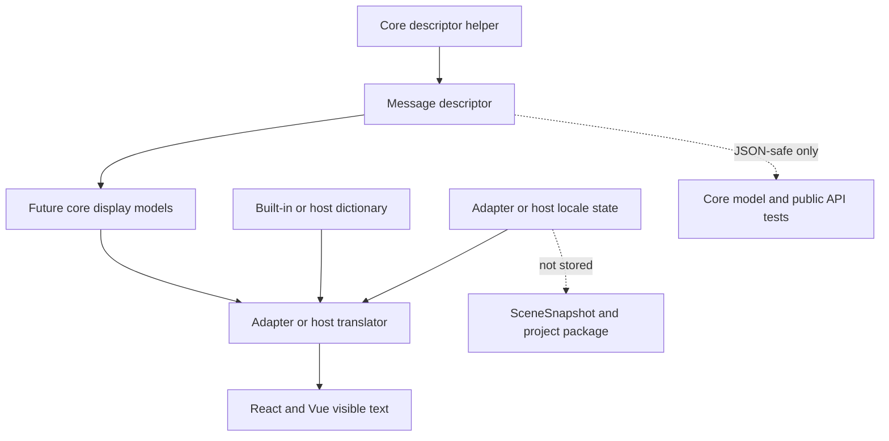

# feat: Add framework-neutral i18n descriptor contract

## Summary

Define the core i18n descriptor contract that later bilingual Workbench units can consume from React, Vue, or host-owned translation systems. This plan covers the shared locale/message type surface, JSON-safe interpolation rules, descriptor helper behavior, and public API tests; it does not attach descriptors to every existing display model yet.

---

## Problem Frame

The bilingual Workbench plan needs stable message identity before core display models and adapter dictionaries can move away from hardcoded English. Core already owns display-oriented strings through inspector descriptors, Workbench summaries, asset workspace problems, runtime problems, and project package validation, but core must stay framework-neutral and must not own dictionaries or rendering state.

This first slice establishes the contract for message identity and fallback data. It gives later implementation units a single shape to add beside existing `label`, `title`, `message`, `summary`, `reason`, and `actionLabel` strings while preserving the durable-state boundary from the origin requirements.

---

## Requirements

**Descriptor Contract**

- R1. Core must expose a framework-neutral message descriptor shape with stable message identity, required fallback text, and optional interpolation values. (origin R15, R16; parent U1)
- R2. Core must expose the initial built-in Workbench locale identifiers for `en` and `zh-CN` without making locale a property of each descriptor. (origin R1, R2, R15; parent U1)
- R3. Interpolation values must be JSON-safe and must not carry runtime-only objects such as Three.js objects, `File`, `Blob`, object URLs, resolver outputs, or formatter instances. (origin R14, R15; parent U1)
- R4. Descriptor helpers must preserve readable fallback behavior when an adapter dictionary has no entry for a key. (origin R12, R15; parent U1)
- R5. The contract must support names, counts, modes, severities, statuses, and asset/problem identifiers as values without baking English sentence structure into core. (origin R11, R15; parent U1)

**API Boundaries**

- R6. Core must not add React, Vue, `i18next`, Vue I18n, FormatJS, or adapter-owned dictionary logic. (origin R16; parent U1)
- R7. The descriptor contract must be exported from both core entrypoints used by package consumers and package-internal public API tests. (origin R18; parent U1)
- R8. Adding the contract must not change `SceneSnapshot`, `.ek3d` project manifests, command history, asset records, runtime metadata, or existing display string fields. (origin R14, AE2; parent U1)
- R9. The contract must leave room for React, Vue, and host applications to resolve the same descriptor through built-in dictionaries or a host translation bridge. (origin R17, R18; parent U1)

**Verification**

- R10. Tests must prove descriptors are serializable, fallback-readable, publicly exported, and free of framework/runtime dependencies. (origin R19-R21; parent U1)
- R11. Tests must show user-authored values can appear only as interpolation values or existing authored labels, not as translation keys. (origin R13, AE4; parent U1)

---

## Key Technical Decisions

- KTD1. **Separate message identity from locale selection:** A descriptor carries key, fallback, and values; the current locale belongs to adapter or host UI state. This keeps locale out of durable state and avoids making core responsible for rendering language.
- KTD2. **Use namespaced string keys instead of an exhaustive key union in this slice:** Later units will add many inspector, Workbench, asset, and problem keys. A namespaced string convention avoids large type churn while still allowing key coverage tests in adapter dictionaries.
- KTD3. **Require fallback text on every descriptor:** Fallback preserves current readable behavior, supports missing dictionary entries, and lets downstream units add descriptors beside existing strings without breaking consumers.
- KTD4. **Constrain interpolation values to existing JSON-compatible primitives and records:** The repository already uses `JsonValue` and `isJsonCompatible` to protect serialized contracts. Reusing that boundary keeps descriptors safe for model snapshots and test assertions.
- KTD5. **Keep formatting and dictionaries out of core:** Core may describe values such as counts, modes, severities, and names, but pluralization, word order, and locale-specific rendering stay in React, Vue, or host translation bridges.
- KTD6. **Do not migrate display producers in this plan:** Existing inspector/workbench/problem fields remain unchanged. Later parent-plan units will add descriptor fields to those models using the contract from this plan.

---

## High-Level Technical Design

The descriptor contract is intentionally small. Conceptually it contains:

- `key`: stable namespaced identity for dictionary lookup.
- `fallback`: readable English fallback used when no dictionary entry resolves.
- `values`: optional JSON-safe interpolation data such as counts, names, modes, statuses, severities, asset IDs, or problem codes.

The contract does not contain the current locale, translated text, dictionary references, framework objects, or formatter callbacks.

---

## Implementation Units

### U1. Create the core i18n descriptor module

- **Goal:** Add the framework-neutral type surface for supported locales, message keys, descriptors, fallback text, and interpolation values.
- **Requirements:** R1, R2, R3, R5, R6, R8.
- **Dependencies:** None.
- **Files:** `packages/core/src/i18n/messages.ts`, `packages/core/src/i18n/messages.test.ts`.
- **Approach:** Create a new core i18n module that exports the initial built-in locale identifiers, descriptor/value types, and a small construction path for descriptors. Reuse the repository's JSON-compatible value concepts rather than inventing a separate runtime object model. Keep descriptor data plain and cloneable so future display models can safely include descriptors beside existing fallback strings.
- **Execution note:** Implement this test-first because the descriptor contract is a public foundation for later units.
- **Patterns to follow:** `packages/core/src/snapshot/json.ts` for JSON-safe value boundaries, `packages/core/src/problems/types.ts` for display metadata shape, and `packages/core/src/inspector/types.ts` for plain data descriptors.
- **Test scenarios:**
  - Given the built-in locale identifiers are inspected, when the i18n module is imported, then `en` and `zh-CN` are represented as the initial supported package locales.
  - Given a descriptor is created with a key and fallback, when it is inspected, then both values are present and no locale or translated text is stored on the descriptor.
  - Given values include count, mode, severity, status, asset ID, problem code, and user-authored name strings, when a descriptor is created, then those values remain JSON-safe interpolation data.
  - Given runtime-only values such as functions, class instances, `File`, `Blob`, object URLs, or circular records are provided through an unsafe call path, when the helper validates values, then the contract rejects or omits them according to the helper behavior chosen during implementation.
  - Given a descriptor is stringified, when JSON serialization runs, then the output contains only key, fallback, and JSON-safe values.
- **Verification:** The new module can describe future localized core display text without adding dictionaries, framework dependencies, locale state, or durable schema changes.

### U2. Define helper behavior for fallback and interpolation readiness

- **Goal:** Give downstream display-model migrations a consistent way to create descriptor data that adapters can resolve with built-in dictionaries or host translation bridges.
- **Requirements:** R1, R3, R4, R5, R9, R10, R11.
- **Dependencies:** U1.
- **Files:** `packages/core/src/i18n/messages.ts`, `packages/core/src/i18n/messages.test.ts`.
- **Approach:** Add helper behavior that normalizes optional values, preserves fallback readability, and makes missing-dictionary behavior unambiguous for adapters. Treat user-authored names as interpolation values, not as keys. Do not add pluralization, dictionary lookup, or formatter callbacks in core.
- **Patterns to follow:** `packages/core/src/project/package-validation.ts` for validating JSON-compatible metadata before attaching it, and `packages/core/src/workbench/workbench-model.ts` for fallback English strings that later units will wrap with descriptors.
- **Test scenarios:**
  - Given a descriptor has no values, when the helper creates it, then consumers can still render the fallback string directly.
  - Given a descriptor has values with `0`, empty string, `false`, `null`, arrays, or nested plain records, when the helper creates it, then valid JSON-safe values are preserved without truthiness filtering.
  - Given a value contains a user-authored label such as `Pump A` or `motor-control-panel.glb`, when the helper creates the descriptor, then that label appears only under values and is not interpreted as a message key.
  - Given a descriptor key follows the namespaced convention for a future Workbench or inspector concept, when it is passed through the helper, then the helper preserves the key rather than trying to infer dictionary coverage.
  - Given a missing dictionary scenario is simulated in tests, when a descriptor is resolved by fallback-only test logic, then the fallback remains readable and interpolation values remain available for adapter-level formatting.
- **Verification:** Later U2-U7 implementation work can add descriptors consistently without inventing per-module fallback/value rules.

### U3. Export the contract through the core package surface

- **Goal:** Make descriptor and locale types available to React, Vue, and package consumers without deep imports.
- **Requirements:** R6, R7, R9, R10.
- **Dependencies:** U1, U2.
- **Files:** `packages/core/src/index.ts`, `packages/core/src/public-api.ts`, `packages/core/src/public-api.test.ts`.
- **Approach:** Export the new i18n contract types and any stable helper functions through the same core entrypoints used by existing public API tests. Keep the export list explicit and avoid exposing internal helper-only details if the implementation creates them.
- **Patterns to follow:** Existing root export style in `packages/core/src/index.ts`, curated public API surface in `packages/core/src/public-api.ts`, and package root contract assertions in `packages/core/src/public-api.test.ts`.
- **Test scenarios:**
  - Given the package root is imported, when public i18n types/helpers are referenced, then consumers can use the descriptor contract without deep imports.
  - Given the public API test imports the descriptor contract, when TypeScript compiles the representative usage, then the exported surface supports adapter and host translation bridge use cases.
  - Given the runtime package exports are inspected, when public API tests run, then React, Vue, dictionary modules, and third-party i18n runtimes are not introduced by the core package.
  - Given existing runtime projector and resource internals remain private, when the public API test checks the package root, then adding i18n exports does not accidentally expose unrelated internals.
- **Verification:** Core package consumers can build adapter-level translation logic from stable exports while the package boundary remains thin and framework-neutral.

### U4. Add contract-level persistence and compatibility coverage

- **Goal:** Prove that introducing the descriptor contract does not change durable editor data or existing fallback display contracts.
- **Requirements:** R3, R4, R8, R10, R11.
- **Dependencies:** U1, U2, U3.
- **Files:** `packages/core/src/i18n/messages.test.ts`, `packages/core/src/editor/serialization.test.ts`, `packages/core/src/project/export-project.test.ts`, `packages/core/src/workbench/workbench-model.test.ts`.
- **Approach:** Add focused assertions that descriptors are plain data and that no locale state or translated copy enters editor serialization or project export as part of this slice. Keep existing display fields intact; this unit should not require migrating inspector or Workbench models to descriptor-bearing shapes.
- **Patterns to follow:** Existing serialization tests that assert runtime-only values stay out of snapshots, project export tests for `.ek3d` manifests, and Workbench model tests that assert resolver/runtime details are not serialized into models.
- **Test scenarios:**
  - Covers AE2. Given an editor snapshot is serialized after the i18n contract exists, when the snapshot JSON is inspected, then no locale, language switch state, dictionary data, or translated UI string is present.
  - Given a project package is exported after the i18n contract exists, when the manifest and scene payload are inspected, then they do not contain locale or descriptor-only UI data.
  - Given existing Workbench model fallback strings are built before downstream migration units run, when tests inspect representative labels and problem titles, then current readable fallback behavior remains unchanged.
  - Given descriptor values include user-authored strings, when serialization-focused tests inspect durable scene data, then authored strings remain only where they already belong as scene or asset data.
- **Verification:** The contract is available for future display models without silently expanding the durable editor schema or changing current fallback UI behavior.

---

## Acceptance Examples

- AE1. Given a future core display value such as a status summary or problem action creates a descriptor, when an adapter reads it, then the adapter receives a stable key, fallback text, and JSON-safe values but no locale state.
- AE2. Given an adapter lacks a dictionary entry for a descriptor key, when it renders through fallback-only logic, then the fallback text remains readable and values are still available for interpolation.
- AE3. Given a user-authored label such as `Pump A` is included in a future descriptor, when the descriptor is inspected, then the label is an interpolation value rather than a translation key.
- AE4. Given the core package root is imported by React or Vue, when adapter code references i18n descriptor types, then it can do so without deep imports or third-party i18n dependencies.
- AE5. Given editor serialization and project export run after this contract exists, when durable JSON is inspected, then no locale, dictionary, translated UI copy, or runtime-only value appears.

---

## Scope Boundaries

### In Scope

- A new core i18n descriptor module.
- Initial locale identifier contract for `en` and `zh-CN`.
- Stable descriptor identity, fallback text, and JSON-safe interpolation value conventions.
- Helper behavior for creating or validating plain descriptor data.
- Core root/public API exports for downstream adapters and host translation bridges.
- Contract-level tests for serialization safety, fallback readability, and framework neutrality.

### Deferred to Follow-Up Work

- Adding descriptors to inspector, Workbench, asset workspace, runtime problem, project problem, or import diagnostic models.
- Adding React or Vue dictionaries, locale props, context providers, language switches, or translator hooks.
- Localizing toolbar, left panel, status bar, inspector, problem panels, placeholders, titles, or accessibility labels.
- Hardcoded string audits for default Workbench UI.
- npm-facing documentation for bilingual Workbench usage.
- Browser layout checks for Chinese copy.

### Outside This Feature

- Persisting locale or language preference into `SceneSnapshot`, `.ek3d`, command history, asset manifests, runtime metadata, or project manifests.
- Adding required `i18next`, `react-i18next`, Vue I18n, FormatJS, or similar dependencies.
- Translating user-authored scene, node, asset, material, camera, light, file, or imported metadata names.
- Creating a separate shared i18n package.
- Designing full async locale-pack loading or plugin-provided translations.

---

## System-Wide Impact

This plan creates a public core contract that later React and Vue work will import. It should therefore be treated as a package boundary change even though it does not modify rendering behavior yet.

The durable editor model is intentionally unaffected. Any descriptor data introduced by this plan is for display-model contracts and tests only; it does not change snapshot versioning, project package versioning, asset registry records, command history, or runtime resource ownership.

---

## Risks & Dependencies

- **Risk: key typing becomes either too loose or too rigid.** Namespaced strings keep the first slice flexible; later dictionary coverage tests can provide stricter key parity once actual Workbench keys exist.
- **Risk: core starts formatting language accidentally.** Keep helper behavior limited to descriptor construction and value validation; locale-specific word order and pluralization stay in adapters.
- **Risk: runtime objects slip into descriptor values.** Reuse JSON-safe value checks and add tests with invalid objects so future display-model migrations have a clear guardrail.
- **Risk: public exports drift between entrypoints.** Update both core export surfaces and extend `public-api.test.ts` in the same unit.
- **Dependency: parent U2 and adapter units depend on this contract.** Do not start broad display-model migration until this plan's exported descriptor shape is stable.

---

## Sources & Research

- Origin requirements: `docs/brainstorms/2026-06-17-bilingual-workbench-i18n-requirements.md`
- Parent plan and U1 boundary: `docs/plans/2026-06-17-001-feat-bilingual-workbench-i18n-plan.md`
- Core public exports: `packages/core/src/index.ts`, `packages/core/src/public-api.ts`, `packages/core/src/public-api.test.ts`
- Existing display-oriented model types: `packages/core/src/inspector/types.ts`, `packages/core/src/workbench/workbench-model.ts`, `packages/core/src/problems/types.ts`
- Existing JSON-safe boundary: `packages/core/src/snapshot/json.ts`, `packages/core/src/snapshot/types.ts`, `packages/core/src/project/package-validation.ts`
- Existing serialization and Workbench model tests: `packages/core/src/editor/serialization.test.ts`, `packages/core/src/project/export-project.test.ts`, `packages/core/src/workbench/workbench-model.test.ts`
