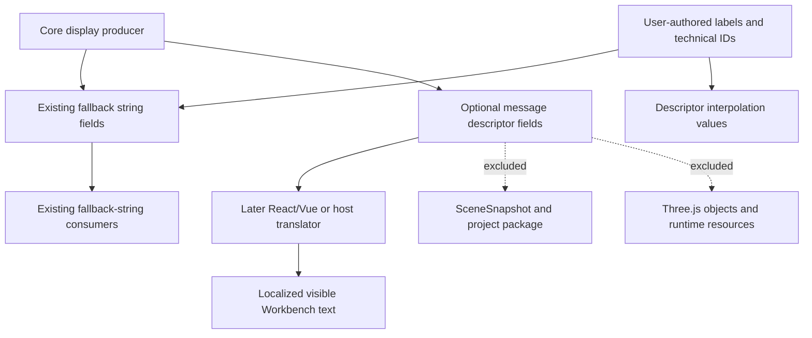
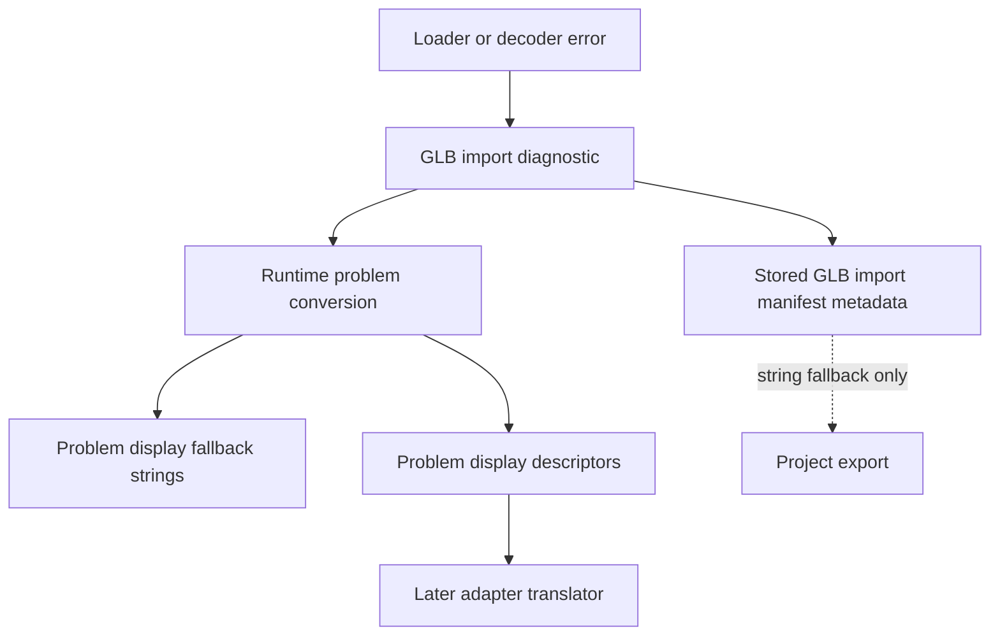

# feat: Add core display message descriptors

## Summary

Add message descriptors to core-owned display models and known problem surfaces while preserving existing fallback strings. This plan covers inspector, Workbench, asset workspace/import, runtime problem, and project validation display data; React/Vue dictionaries, locale state, and rendered translation behavior stay in later adapter plans.

---

## Problem Frame

The bilingual Workbench plan needs adapters to translate core-produced labels, summaries, and problems without duplicating English strings or binding core to React, Vue, or an i18n runtime. The descriptor contract already exists in `packages/core/src/i18n/messages.ts`; this slice applies that contract to the display producers named by the parent U2.

Core currently emits fallback English through inspector section titles, field labels, action labels, command validation messages, Workbench summaries, asset workspace reference/problem summaries, runtime problems, GLB import diagnostics, and project package validation problems. Some of those structures are transient display models, but GLB import manifests and scene/project data can become durable. The implementation must add descriptors where adapters can consume them and avoid storing locale, dictionaries, translated copy, or descriptor-only display data in durable snapshots or project packages.

---

## Requirements

**Descriptor Coverage**

- R1. Core display models must expose optional message descriptors beside existing `label`, `title`, `detail`, `summary`, `reason`, `message`, and `actionLabel` fallback strings. (origin R15; parent U2)
- R2. Inspector sections, fields, select options, action descriptors, inline command problems, and problem items must carry descriptors for stable UI chrome while preserving fallback strings. (origin R10, R15; parent U2)
- R3. Workbench status, selection, project readiness, snap feedback, missing-asset display, and problem models must carry descriptors for stable summaries and actions. (origin R9, R11, R15; parent U2)
- R4. Asset workspace references, workspace problem summaries, and Workbench asset-import diagnostics must carry descriptors for stable labels and recoverable actions. (origin R8, R11, R15; parent U2)
- R5. Known runtime, asset, lighting, imported-target/material-slot, scene projection, and project validation problems must expose descriptors for stable titles, details, and suggested actions. (origin R11, R12, R15; parent U2)

**State and Content Boundaries**

- R6. Existing fallback string fields must remain readable and backward-compatible for consumers that do not use descriptors yet. (origin R12, R15; parent U2)
- R7. User-authored scene, node, object, asset, material, light, camera, file, GLB metadata, import key, and extension names must remain authored values, not message keys. (origin R13, AE4; parent U2)
- R8. Raw loader, decoder, browser, resolver, and host error strings may remain fallback detail values, but stable surrounding problem titles and actions must have descriptors. (origin R12, AE3; parent U2)
- R9. Descriptors must use only JSON-safe values and must not include Three.js objects, `File`, `Blob`, object URLs, resolver outputs, PMREM outputs, functions, formatter instances, or locale state. (origin R14, R15; parent U2)
- R10. Descriptors must not be written to `SceneSnapshot`, `.ek3d` manifests, command history, asset registry records, GLB import manifest metadata, or runtime resource metadata. (origin R14, AE2; parent U2)

**Core and API Boundaries**

- R11. Core must remain framework-neutral and must not add React, Vue, `i18next`, Vue I18n, FormatJS, dictionaries, or translation rendering logic. (origin R16; parent U2)
- R12. Descriptor keys must be stable and namespaced so React and Vue can later share dictionary coverage for equivalent Workbench concepts. (origin R17; parent U2)
- R13. Public core types must remain compatible for existing fallback-string consumers while exposing descriptor fields to adapters and host translation bridges. (origin R18; parent U2)

**Verification**

- R14. Core tests must verify representative descriptor coverage for inspector, Workbench, asset workspace/import, runtime problem, lighting diagnostic, GLB diagnostic conversion, and project validation producers. (origin R19-R21; parent U2)
- R15. Serialization and project export tests must prove locale, dictionaries, translated copy, and descriptor-only display data remain absent from durable outputs. (origin R14, R21, AE2; parent U2)
- R16. Tests must verify user-authored labels remain fallback/authored values or interpolation values and never become message keys. (origin R13, AE4; parent U2)

---

## Key Technical Decisions

- KTD1. **Add descriptors beside fallback fields:** Do not replace current string fields. Adapters can opt into descriptor rendering while current consumers continue reading `label`, `title`, `detail`, `reason`, `message`, and `actionLabel`.
- KTD2. **Use field-specific descriptor properties:** Prefer explicit companion fields such as label, title, detail, reason, summary, message, and action-label descriptors over an untyped descriptor bag. This keeps adapter rendering direct and makes tests able to assert coverage per display field.
- KTD3. **Centralize stable core display keys:** Add a small core helper/registry module for descriptor factories and key conventions instead of scattering raw keys through every builder. The module is not a dictionary and must not translate text.
- KTD4. **Treat durable GLB import manifests as fallback-only:** `GlbImportDiagnostic` data stored in asset metadata stays string-only. Descriptor data should be attached when diagnostics are converted into runtime problems, asset workspace summaries, or Workbench import results.
- KTD5. **Represent authored or technical values as interpolation data:** Names, file labels, asset IDs, import keys, slot IDs, extension names, problem codes, counts, modes, severities, and statuses belong in descriptor values or existing authored fields, not in descriptor keys.
- KTD6. **Keep raw failure detail available:** Stable titles and actions get descriptors; raw loader, resolver, PMREM, browser, and host callback messages remain fallback detail so debugging information is not hidden or mistranslated.
- KTD7. **Validate by producer, not by global string scan in this slice:** This plan adds targeted coverage for core display builders. The broader hardcoded-string audit for React/Vue Workbench UI remains a later parent-plan unit.

---

## High-Level Technical Design

The first diagram describes normal transient display models: builders emit existing strings plus optional descriptors. The second diagram calls out the GLB diagnostic exception: manifest diagnostics may be durable, so descriptors attach only after conversion into transient runtime/workbench display data.

---

## Implementation Units

### U1. Extend core display descriptor types and helper factories

- **Goal:** Add reusable type fields and helper factories so later units can attach descriptors consistently without re-defining the descriptor contract.
- **Requirements:** R1, R6, R9, R11, R12, R13.
- **Dependencies:** Descriptor contract plan U1-U4.
- **Files:** `packages/core/src/i18n/display-messages.ts`, `packages/core/src/i18n/display-messages.test.ts`, `packages/core/src/problems/types.ts`, `packages/core/src/inspector/types.ts`, `packages/core/src/assets/workspace.ts`, `packages/core/src/assets/workspace-import.ts`, `packages/core/src/workbench/workbench-model.ts`, `packages/core/src/public-api.test.ts`.
- **Approach:** Introduce companion descriptor fields on display-facing public interfaces and central descriptor factory helpers for stable key creation. Keep the generic `MessageDescriptor` contract unchanged. Do not add dictionaries, locale parameters, or render helpers. Use helper tests to pin namespaced key conventions and JSON-safe values for counts, modes, status values, problem codes, technical IDs, and user-authored names.
- **Execution note:** Start with type/helper tests so each later producer can add descriptor coverage against a known shape.
- **Patterns to follow:** `packages/core/src/i18n/messages.ts` validation behavior, `packages/core/src/problems/types.ts` plain display metadata, and `packages/core/src/inspector/types.ts` public data interfaces.
- **Test scenarios:**
  - Given a display helper creates a descriptor for an inspector field label, when the descriptor is inspected, then it has a stable namespaced key, fallback text, and no locale or translated text.
  - Given descriptor values include `0`, empty string, `false`, `null`, nested records, counts, modes, status values, asset IDs, and problem codes, when helper factories create descriptors, then values are preserved as JSON-safe data.
  - Given descriptor values include `Pump A`, `motor-control-panel.glb`, an import key, or a GLB extension name, when the descriptor is inspected, then those authored/technical strings appear only as values and not as keys.
  - Given unsafe runtime-only values are attempted through helper factories, when the helpers call the generic descriptor contract, then validation rejects them with the existing descriptor-value guardrail.
  - Given public API tests compile representative display interfaces, when descriptor fields are read, then they use the exported `MessageDescriptor` type without deep imports.
- **Verification:** Core has a reusable, framework-neutral way to attach descriptors to display data while preserving existing string consumers.

### U2. Add descriptors to inspector sections, fields, actions, and command problems

- **Goal:** Make inspector-owned display chrome localizable across transform, material, environment, lights, camera views, and problem sections.
- **Requirements:** R1, R2, R6, R7, R9, R11, R12, R14, R16.
- **Dependencies:** U1.
- **Files:** `packages/core/src/inspector/types.ts`, `packages/core/src/inspector/fields.ts`, `packages/core/src/inspector/transform.ts`, `packages/core/src/inspector/material.ts`, `packages/core/src/inspector/environment.ts`, `packages/core/src/inspector/lights.ts`, `packages/core/src/inspector/cameras.ts`, `packages/core/src/inspector/problems.ts`, `packages/core/src/inspector/inspector.test.ts`, `packages/core/src/inspector/transform.test.ts`, `packages/core/src/inspector/material.test.ts`, `packages/core/src/inspector/environment.test.ts`, `packages/core/src/inspector/lights.test.ts`, `packages/core/src/inspector/cameras.test.ts`, `packages/core/src/inspector/problems.test.ts`.
- **Approach:** Thread descriptor creation through common field builders first, then cover section titles, empty reasons, select option labels, action labels, disabled-action problems, and command validation messages. Preserve asset option labels, object/material/light/camera names, imported slot labels, and authored view names as authored strings. Use descriptor values for axis, vector, slot, source kind, face role, light kind, numeric range, and field IDs where needed.
- **Patterns to follow:** Common builders in `packages/core/src/inspector/fields.ts`, section builders that already centralize field creation, and existing inspector command problem test patterns.
- **Test scenarios:**
  - Given transform, material, environment, light, camera, and problem sections are built, when representative sections are inspected, then section titles and empty reasons have descriptors with fallbacks matching existing strings.
  - Given inspector fields are created through `numberField`, `colorField`, `textField`, `checkboxField`, `selectField`, and `assetField`, when fields are inspected, then stable labels have descriptors and asset option labels remain authored values without descriptors.
  - Given material side, environment source kind, light kind, cubemap face, and axis labels are generated, when options or fields are inspected, then descriptors contain stable keys and interpolation values instead of ad hoc English-only generated labels.
  - Given an inspector command rejects invalid input such as an unsupported light field, invalid material color, invalid environment asset, or invalid camera near/far range, when the command problem is inspected, then the fallback message is unchanged and a message descriptor is present.
  - Covers AE4. Given selected scene nodes, imported material slots, light names, camera view names, material names, and asset labels contain English text, when inspector models are built, then those authored values are not used as descriptor keys.
  - Given an inspector model is stringified, when the serialized text is inspected, then it contains no Three.js object names, object URLs, locale values, dictionaries, or translated copy beyond existing fallback strings and descriptor keys.
- **Verification:** Inspector display data is ready for adapter translation while current fallback rendering and command behavior stay unchanged.

### U3. Add descriptors to known problem factories and problem display conversion

- **Goal:** Make stable runtime, asset, lighting, imported-target/material-slot, scene projection, and project validation problem surfaces localizable.
- **Requirements:** R1, R5, R6, R7, R8, R9, R10, R11, R12, R14, R16.
- **Dependencies:** U1.
- **Files:** `packages/core/src/problems/types.ts`, `packages/core/src/assets/problems.ts`, `packages/core/src/runtime/problems.ts`, `packages/core/src/runtime/lighting-diagnostics.ts`, `packages/core/src/runtime/scene-projector.ts`, `packages/core/src/runtime/environment-projector.ts`, `packages/core/src/runtime/material-projector.ts`, `packages/core/src/assets/import-pipeline.ts`, `packages/core/src/project/package-validation.ts`, `packages/core/src/project/replace-asset.ts`, `packages/core/src/assets/import-pipeline.test.ts`, `packages/core/src/runtime/lighting-diagnostics.test.ts`, `packages/core/src/runtime/scene-projector.test.ts`, `packages/core/src/runtime/environment-resource-manager.test.ts`, `packages/core/src/runtime/material-projector.test.ts`, `packages/core/src/project/package-validation.test.ts`, `packages/core/src/project/replace-asset.test.ts`.
- **Approach:** Extend `ProblemDisplay` with optional descriptors for stable title/detail/action fields, then update known problem factories. For raw error paths, attach descriptors to stable titles and actions while keeping raw messages as fallback detail. For project validation, use problem codes and metadata values as descriptor values. For GLB diagnostics, keep manifest diagnostic validation string-only and add descriptors in `glbImportDiagnosticToProblem` or transient display conversion paths.
- **Patterns to follow:** Existing problem factory functions in `packages/core/src/runtime/problems.ts`, project problem creation in `packages/core/src/project/package-validation.ts`, and tests that assert runtime problems do not mutate snapshots.
- **Test scenarios:**
  - Covers AE3. Given `createMissingAssetProblem`, environment asset failures, material texture failures, imported target failures, imported material slot failures, lighting diagnostics, and scene projector load/resolve failures are created, when their display data is inspected, then stable titles and recoverable actions have descriptors.
  - Given loader, resolver, PMREM, browser, or host callback failures provide raw error messages, when problem display data is inspected, then raw messages remain available as fallback detail and are not used as descriptor keys.
  - Given project package validation emits archive, manifest, scene, asset-record, payload, path, and size problems, when project problems are inspected, then stable title/detail descriptors exist and metadata values remain JSON-safe.
  - Given GLB decoder-missing, required-extension, unknown-extension, and load-failed diagnostics are converted to runtime problems, when converted problems are inspected, then transient problem display includes descriptors.
  - Given a GLB import manifest is attached to asset metadata, when manifest JSON is stringified, then it does not contain descriptor keys, locale values, dictionaries, translated copy, or non-JSON runtime values.
  - Covers AE4. Given problem details include asset IDs, slot IDs, import keys, extension names, light names, or scene names, when descriptors are inspected, then those values are interpolation values or raw fallback detail rather than message keys.
- **Verification:** Known problems become localizable for adapter problem panels without changing durable manifests or losing diagnostic detail.

### U4. Add descriptors to asset workspace and Workbench import display models

- **Goal:** Make core asset workspace rows, references, problem summaries, readiness affordances, and asset import diagnostics consumable by adapter translation.
- **Requirements:** R1, R3, R4, R6, R7, R8, R9, R10, R11, R12, R14, R16.
- **Dependencies:** U1, U3.
- **Files:** `packages/core/src/assets/workspace.ts`, `packages/core/src/assets/workspace-import.ts`, `packages/core/src/assets/workspace.test.ts`, `packages/core/src/assets/workspace-import.test.ts`, `packages/core/src/assets/import-pipeline.test.ts`.
- **Approach:** Add descriptors to workspace reference labels generated by core, normalized problem summaries, row-level recoverable action labels, and import diagnostics produced by Workbench import helpers. Keep asset labels, payload labels, file names, material names, object names, and stored GLB manifest diagnostics as authored/durable fallback data. When workspace summaries are derived from problems, copy problem display descriptors through the transient summary model.
- **Patterns to follow:** `collectAssetReferenceLocations()` for generated reference labels, `normalizeProblemSummary()` for problem conversion, and `classifyWorkbenchAssetImportFile()` for import diagnostic creation.
- **Test scenarios:**
  - Given asset reference locations are collected for object GLBs, material textures, environment background/lighting, and cubemap faces, when locations are inspected, then generated labels have descriptors and authored object/material names remain values.
  - Given runtime and project problems are normalized into asset workspace summaries, when summaries are inspected, then title/action descriptors are preserved or synthesized from problem display data.
  - Given an asset item has a recoverable problem, when row-level `actionLabel` is derived, then the fallback remains unchanged and the action descriptor matches the selected recoverable problem.
  - Given a Workbench import file is unsupported, ambiguous raster input, GLB import failure, or asset registration failure, when diagnostics are inspected, then stable titles and actions have descriptors while file names and command errors stay values or fallback detail.
  - Given GLB manifest diagnostics are surfaced through asset workspace import diagnostics, when summaries are inspected, then transient summaries have descriptors but the source manifest metadata remains descriptor-free.
  - Given workspace search text is generated, when descriptors exist on rows and problems, then search behavior still includes fallback labels/details and does not depend on translated text.
- **Verification:** Asset-related core display data can be translated by adapters without mutating asset records, payload summaries, or GLB manifest metadata.

### U5. Add descriptors to Workbench model summaries and problem projections

- **Goal:** Make the core Workbench model's stable summaries and problem projections localizable without changing editor/runtime lifecycle.
- **Requirements:** R1, R3, R5, R6, R7, R8, R9, R10, R11, R12, R14, R16.
- **Dependencies:** U1, U3, U4.
- **Files:** `packages/core/src/workbench/workbench-model.ts`, `packages/core/src/workbench/workbench-model.test.ts`.
- **Approach:** Add descriptors to selection labels, snap feedback labels, project status labels, missing asset item titles/actions, and `WorkbenchProblemItem` display fields. Copy descriptors from inspector/project problems where they already exist and synthesize descriptors for Workbench-owned summaries such as no selection, multi-selection counts, readiness, partial package state, and problem counts.
- **Patterns to follow:** `buildWorkbenchSelection()`, `buildWorkbenchStatus()`, `buildWorkbenchProject()`, `toProjectProblemItem()`, and existing Workbench tests that assert model derivation does not mutate snapshots.
- **Test scenarios:**
  - Given no selection, one authored node, and multi-selection states, when the Workbench model is built, then selection fallback labels stay the same and descriptor values represent count or authored node name correctly.
  - Given snap feedback is idle, invalid, or active for translate/rotate/scale, when status is built, then `snapFeedbackLabel` fallback remains readable and a descriptor carries mode/status values.
  - Given project status is ready, partial, or has one/many problems, when project model is built, then status fallback strings stay stable and descriptors carry completeness and problem-count values.
  - Covers AE3. Given runtime, authored, and project problems flow into `WorkbenchProblemItem`, when the Workbench model is inspected, then title/action descriptors are preserved for stable problem chrome.
  - Covers AE4. Given hierarchy rows, asset rows, scene name, object names, light names, camera view names, and asset labels contain user-authored English, when the Workbench model is built, then those labels remain authored and are not converted into descriptor keys.
  - Given the Workbench model is JSON stringified, when descriptor fields are present, then no `File`, `Blob`, object URL, Three.js object, resolver output, PMREM output, locale, dictionary, or translated copy appears.
- **Verification:** Core Workbench models can feed React/Vue translation later while preserving current fallback and lifecycle behavior.

### U6. Add durable-state, public API, and coverage guard tests

- **Goal:** Prove the core descriptor migration is complete enough for adapter work and does not leak display-only data into durable outputs.
- **Requirements:** R9, R10, R11, R13, R14, R15, R16.
- **Dependencies:** U1-U5.
- **Files:** `packages/core/src/i18n/display-messages.test.ts`, `packages/core/src/inspector/inspector.test.ts`, `packages/core/src/workbench/workbench-model.test.ts`, `packages/core/src/assets/workspace.test.ts`, `packages/core/src/assets/workspace-import.test.ts`, `packages/core/src/runtime/lighting-diagnostics.test.ts`, `packages/core/src/project/package-validation.test.ts`, `packages/core/src/editor/serialization.test.ts`, `packages/core/src/project/export-project.test.ts`, `packages/core/src/public-api.test.ts`.
- **Approach:** Add targeted producer coverage rather than a broad repository string audit. Verify representative display surfaces have descriptors, all descriptor values are JSON-safe, public package boundaries expose the necessary types, and durable snapshot/project outputs remain free of locale and descriptor-only display data.
- **Patterns to follow:** Existing i18n contract tests, serialization tests for runtime-only values, project export tests for `.ek3d` payloads, and package dependency boundary assertions in `packages/core/src/public-api.test.ts`.
- **Test scenarios:**
  - Given representative inspector, Workbench, asset workspace/import, runtime problem, lighting diagnostic, GLB diagnostic conversion, and project validation producers run, when tests inspect their output, then every stable fallback display field in scope has a companion descriptor.
  - Given descriptors are present in transient display models, when descriptor values are walked recursively, then all values are JSON-compatible and contain no runtime-only values.
  - Covers AE2. Given an editor snapshot and project package are serialized after display descriptors exist, when durable JSON is inspected, then locale, dictionaries, translated copy, descriptor keys, and descriptor fallback templates are absent.
  - Given stored GLB import manifest metadata contains diagnostics, when asset metadata and exported project JSON are inspected, then manifest diagnostics remain fallback string data without descriptor fields.
  - Given package manifests and public API tests run, when dependencies and exports are inspected, then core still has no React/Vue/i18n-runtime dependency and descriptor fields are typed through public core exports.
  - Covers AE4. Given user-authored labels are present across scene, object, asset, material, light, camera, file, slot, and GLB metadata surfaces, when output descriptors are inspected, then those labels are values or fallback authored fields and not keys.
- **Verification:** The core migration is ready for adapter dictionary and rendering work, with durable-state and package-boundary regressions covered.

---

## Acceptance Examples

- AE1. Given transform, material, environment, light, camera, and problem inspector models are built, when a later adapter reads them, then stable titles, field labels, option labels, reasons, command problem messages, and actions have descriptor identity plus existing fallback strings.
- AE2. Given a known asset, runtime, lighting, imported-target, imported-material-slot, GLB diagnostic, or project validation problem appears, when it is converted to inspector/workbench/asset workspace display data, then stable title/action text has descriptors and raw technical detail remains available as fallback detail.
- AE3. Given a GLB import manifest with diagnostics is stored in asset metadata and later exported in a project package, when the stored manifest is inspected, then it contains no locale, dictionary, translated copy, or descriptor fields.
- AE4. Given user-authored labels such as `motor-control-panel.glb`, `Pump A`, `Hero view`, `Key light`, or imported slot names are present, when core display models are built, then those values remain authored fallback data or interpolation values and are not treated as message keys.
- AE5. Given locale support is added later in React or Vue, when adapters resolve core descriptors, then they can use shared namespaced keys without requiring core to own dictionaries or locale state.
- AE6. Given editor serialization or project export runs after descriptors are added to transient display models, when durable JSON is inspected, then scene/project output contains authored scene data but no descriptor-only display data.

---

## Scope Boundaries

### In Scope

- Optional message descriptor fields on core display-facing models.
- Core helper factories for stable descriptor keys and JSON-safe values.
- Inspector section, field, option, action, command problem, and problem-item descriptor coverage.
- Workbench selection, status, project readiness, snap feedback, missing asset, and problem descriptor coverage.
- Asset workspace reference/problem/action and Workbench asset-import diagnostic descriptor coverage.
- Runtime, asset, lighting, imported target/material-slot, scene projector, GLB diagnostic conversion, and project validation problem descriptor coverage.
- Tests proving descriptor coverage, fallback preservation, authored-value handling, public API compatibility, and durable-state exclusion.

### Deferred to Follow-Up Work

- React and Vue dictionaries for `en` and `zh-CN`.
- React and Vue locale props, language switch UI, translator contexts/hooks, and host translation bridges.
- Rendering core descriptors in default Workbench components.
- Browser layout checks for Chinese copy.
- Repository-wide hardcoded-string audit for adapter UI.
- npm-facing documentation for enabling bilingual Workbench usage.

### Outside This Feature

- Persisting locale, language preference, descriptors, dictionaries, or translated UI text into `SceneSnapshot`, `.ek3d`, GLB import manifest metadata, command history, asset records, or runtime resource metadata.
- Adding `i18next`, `react-i18next`, Vue I18n, FormatJS, or any required i18n runtime dependency.
- Translating user-authored scene, node, object, asset, material, light, camera, file, imported target, imported metadata, import key, or extension names.
- Changing scene snapshot version, project package version, or GLB import manifest version just for display descriptors.
- Reworking React/Vue UI composition or layout beyond later adapter translation needs.

---

## System-Wide Impact

- **Core public API:** Several exported interfaces gain optional descriptor fields. This is additive, but public API tests should pin the shape and avoid accidental unrelated exports.
- **Adapter readiness:** React and Vue can later translate core display models through shared descriptor keys without deep imports or per-framework duplicate classification logic.
- **Durable state:** Snapshot, project package, and GLB import manifest formats should remain unchanged. This boundary needs explicit regression tests because GLB diagnostics are easy to confuse with transient problem display data.
- **Problem handling:** Known problem factories become more structured for display, but raw error details remain visible for debugging and host support.
- **Testing posture:** Existing fallback-string assertions should remain valid. New descriptor assertions should be targeted to core display producers rather than enforcing adapter UI copy coverage.

---

## Risks & Dependencies

- **Descriptor field churn:** Adding companion fields across public display interfaces can create noisy type changes. Mitigate with a small shared field convention and focused public API tests.
- **Durable GLB manifest leakage:** Import diagnostics can be stored in asset metadata. Mitigate by keeping manifest diagnostic types string-only and adding descriptors only during transient conversion.
- **Key drift before dictionaries exist:** Core descriptor keys may diverge from later adapter dictionaries. Mitigate with centralized helper factories and later adapter dictionary parity tests.
- **Raw error ambiguity:** Loader and host errors are not always classifiable. Mitigate by descriptorizing stable wrapper titles/actions while preserving raw detail fallback.
- **User-authored label confusion:** Names and imported metadata can look like English UI. Mitigate by testing authored labels as values and by avoiding descriptor keys derived from user data.
- **Dependency:** This plan depends on the framework-neutral descriptor contract from `docs/plans/2026-06-17-002-feat-framework-neutral-i18n-descriptor-contract-plan.md`.

---

## Documentation and Operational Notes

- No npm-facing docs are required in this slice because users cannot select a locale until adapter work lands.
- Implementation notes for later adapter plans should mention that core descriptors are transient display metadata and not durable scene/project data.
- Any release note for this slice should describe it as an internal core contract extension, not as user-visible bilingual Workbench support.

---

## Sources & Research

- Origin requirements: `docs/brainstorms/2026-06-17-bilingual-workbench-i18n-requirements.md`
- Parent plan and U2 boundary: `docs/plans/2026-06-17-001-feat-bilingual-workbench-i18n-plan.md`
- Descriptor contract plan: `docs/plans/2026-06-17-002-feat-framework-neutral-i18n-descriptor-contract-plan.md`
- Descriptor contract implementation: `packages/core/src/i18n/messages.ts`, `packages/core/src/i18n/messages.test.ts`
- Core display model types: `packages/core/src/inspector/types.ts`, `packages/core/src/workbench/workbench-model.ts`, `packages/core/src/assets/workspace.ts`, `packages/core/src/assets/workspace-import.ts`, `packages/core/src/problems/types.ts`
- Inspector display builders: `packages/core/src/inspector/fields.ts`, `packages/core/src/inspector/transform.ts`, `packages/core/src/inspector/material.ts`, `packages/core/src/inspector/environment.ts`, `packages/core/src/inspector/lights.ts`, `packages/core/src/inspector/cameras.ts`, `packages/core/src/inspector/problems.ts`
- Known problem producers: `packages/core/src/assets/problems.ts`, `packages/core/src/runtime/problems.ts`, `packages/core/src/runtime/lighting-diagnostics.ts`, `packages/core/src/runtime/scene-projector.ts`, `packages/core/src/project/package-validation.ts`
- Durable-state tests: `packages/core/src/editor/serialization.test.ts`, `packages/core/src/project/export-project.test.ts`, `packages/core/src/assets/import-pipeline.test.ts`
- Package boundary tests: `packages/core/src/public-api.test.ts`, `packages/core/package.json`
