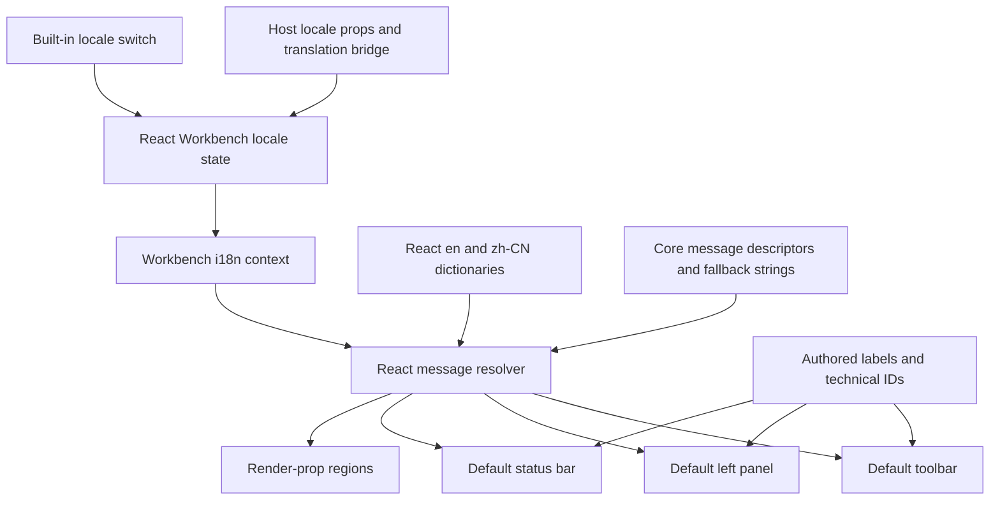
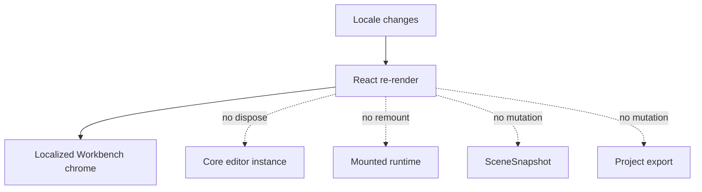

# feat: Wire React Workbench i18n

## Summary

Wire locale state, built-in English and Simplified Chinese dictionaries, and default UI translation through the React Workbench. This plan covers React-only locale APIs, translator context, default Workbench chrome, toolbar, left panel, status bar, render-prop access, and persistence/lifecycle tests; Vue parity and full inspector/problem-panel localization remain separate parent-plan work.

---

## Problem Frame

The parent bilingual Workbench plan defines React U3 as the first adapter-facing locale slice after the core descriptor contract and core display descriptor work. React already composes `useWorkbench()`, `EditorWorkbench`, `WorkbenchToolbar`, `WorkbenchLeftPanel`, and `WorkbenchStatusBar` into the install-ready package surface, but those components currently render English literals and local async status strings directly.

React locale state must stay in adapter UI state. It must update visible Workbench text without recreating the editor, remounting runtime resources, mutating snapshots, or translating user-authored labels such as scene names, object names, asset labels, file names, camera view names, and imported metadata.

---

## Requirements

**Locale API and Translation Contract**

- R1. React Workbench must default to `en` and support `zh-CN` without host code or required third-party i18n runtime dependencies. (origin R1, R3, R10; parent U3)
- R2. React package users must be able to control locale through props, seed an uncontrolled default locale, receive locale-change callbacks, and hide or disable the built-in switch. (origin R3-R5, F4; parent U3)
- R3. Locale changes must re-render default Workbench text without editor recreation, runtime remount, scene reload, asset re-import, or snapshot mutation. (origin R6, R14, AE2; parent U3)
- R4. Render-prop regions and direct `useWorkbench()` consumers must be able to resolve Workbench messages without importing a third-party i18n runtime. (origin R18; parent U3)
- R5. Host-provided translation resolution must be able to override built-in copy for known message descriptors while falling back to built-in dictionaries and descriptor fallback text. (origin R18; parent U3)

**Default React Workbench Coverage**

- R6. React dictionaries must cover default shell labels, toolbar group labels, button text, button titles, project action statuses, language-switch labels, and accessibility labels. (origin R7, R19; parent U3)
- R7. React dictionaries must cover the default left panel's hierarchy, asset workspace controls, queue states, recovery text, project summary labels, problem list chrome, placeholders, select options, and accessibility labels. (origin R8, R11, R19; parent U3)
- R8. React dictionaries must cover default status bar labels, selection/project/snap summaries exposed by core descriptors, runtime state labels, dirty/saved labels, and problem-count summaries. (origin R9, R11, R19; parent U3)
- R9. React rendering must resolve core message descriptor fields when present and preserve existing fallback string behavior when a descriptor or dictionary entry is missing. (origin R12, R15; parent U2, U3)
- R10. User-authored and durable generated values must render as values, not message keys, across locale changes. (origin R13, AE4; parent U3)

**State, Package, and Verification Boundaries**

- R11. Locale, built-in switch state, dictionaries, resolved translated copy, and host translation callbacks must not serialize into `SceneSnapshot`, `.ek3d` project data, command history, asset records, runtime metadata, or GLB import manifest metadata. (origin R14, R21, AE2; parent U3)
- R12. React public API tests must cover the new locale types, props, context shape, and package-boundary guarantees without exposing unrelated internals. (origin R18, R19; parent U3)
- R13. React package tests must prove representative English and Chinese rendering, controlled/uncontrolled locale behavior, switch behavior, fallback behavior, and React StrictMode lifecycle stability. (origin R19, R21; parent U3)
- R14. React package manifests and build-config tests must continue to prove `i18next`, `react-i18next`, Vue I18n, FormatJS, and similar runtimes are not required dependencies. (origin R10, R16; parent U3)

---

## Key Technical Decisions

- KTD1. **Keep locale on the React Workbench context, not core editor state:** `useWorkbench()` can expose React i18n helpers, but those helpers must be built from React options/state and never passed into core editor construction, runtime mounting, serialization, or project export.
- KTD2. **Use controlled/uncontrolled React prop semantics:** A controlled `locale` value wins; an uncontrolled default starts from `defaultLocale` or `en`; switch interactions call the locale-change callback and update internal state only when uncontrolled.
- KTD3. **Use a small React-owned translation resolver:** Resolve host translation override first, then React built-in dictionary, then descriptor fallback with interpolation. Do not add `i18next`, `react-i18next`, FormatJS, or browser-locale detection.
- KTD4. **Store local async UI statuses as message identity plus values:** Project open/export, asset import queue, asset replacement, and GLB reimport statuses should store keys/descriptors and values such as file names or counts, so changing locale re-renders old status rows in the current locale.
- KTD5. **Do not localize values that become durable authored data:** The toolbar's generated camera view name should remain an authored-value default rather than a translated UI string. Localize the action label and status chrome, not the value written into scene camera data.
- KTD6. **Use core descriptors where core owns the display concept:** Workbench selection, snap feedback, project status, problem titles/actions, and asset workspace summaries should render through descriptor resolution when the core descriptor fields are present.
- KTD7. **Keep full inspector localization out of this slice:** This plan localizes React Workbench shell labels and default Workbench regions. Deep inspector field labels and problem-panel internals are covered by the parent plan's later inspector/problem UI unit.
- KTD8. **Test by user-visible behavior and persistence boundaries:** Prefer focused React Testing Library assertions for visible copy, context behavior, and lifecycle stability; use serialization/project-export assertions to prove locale stays out of durable state.

---

## High-Level Technical Design

---

## Implementation Units

### U1. Add the React Workbench i18n resolver and dictionaries

- **Goal:** Create the React-owned message resolver, built-in `en` and `zh-CN` dictionaries, interpolation behavior, and dictionary coverage tests.
- **Requirements:** R1, R5, R6, R7, R8, R9, R10, R14.
- **Dependencies:** Descriptor contract plan U1-U4; core display descriptor plan U1-U6.
- **Files:** `packages/react/src/i18n/workbench-i18n.ts`, `packages/react/test/workbench-i18n.test.ts`, `packages/react/test/build-config.test.ts`.
- **Approach:** Add a plain TypeScript i18n module that imports core descriptor types from the public core package surface, defines React Workbench-local keys for adapter-owned chrome, and resolves descriptors through host override, built-in dictionary, then fallback interpolation. Keep dictionaries static and package-local. Treat file names, scene names, node labels, asset labels, technical IDs, problem codes, and camera view names as interpolation values or authored values.
- **Execution note:** Start with resolver and coverage tests so later component work has a stable translation contract.
- **Patterns to follow:** Core descriptor helpers in `packages/core/src/i18n/messages.ts`, package dependency assertions in `packages/react/test/build-config.test.ts`, and React public API tests that import only package roots.
- **Test scenarios:**
  - Given a React Workbench-local key exists in English, when dictionary coverage is checked, then the same key exists in Simplified Chinese.
  - Given a core message descriptor with values is resolved in `zh-CN`, when the dictionary contains the key, then placeholders are interpolated with the provided values.
  - Given a host translation bridge returns text for a descriptor, when the resolver runs, then host text wins over built-in dictionary text.
  - Given a descriptor has no dictionary entry, when the resolver runs, then the descriptor fallback is rendered with values and remains readable.
  - Given values include `Pump A`, `motor-control-panel.glb`, `asset-a`, `Camera view 1`, and `0`, when messages resolve, then those values are inserted as values and never converted into lookup keys.
  - Given React package manifests are inspected, when build-config tests run, then no required dependency is added for `i18next`, `react-i18next`, Vue I18n, FormatJS, or similar runtime packages.
- **Verification:** React has a deterministic, dependency-free i18n resolver that can serve both adapter-owned chrome and core descriptor fields.

### U2. Wire locale state through `useWorkbench()` and `EditorWorkbench`

- **Goal:** Expose locale state, locale switching, and translator access through React Workbench props and render-prop context without changing editor ownership or runtime lifecycle.
- **Requirements:** R2, R3, R4, R5, R11, R12, R13.
- **Dependencies:** U1.
- **Files:** `packages/react/src/hooks/use-workbench.ts`, `packages/react/src/components/EditorWorkbench.tsx`, `packages/react/src/index.ts`, `packages/react/src/public-api.test.ts`, `packages/react/test/workbench.test.tsx`, `packages/react/test/strict-mode.test.tsx`.
- **Approach:** Add React i18n options to the Workbench hook/component contract and return an `i18n` context object with current locale, supported locales, switch handler, and message resolution helpers. Destructure i18n options before creating or reusing the core editor so locale changes do not flow into `useEditor()` or editor options. Keep existing render-region names and compatibility `sidePanel` behavior.
- **Patterns to follow:** Existing `EditorWorkbenchProps extends UseWorkbenchOptions` shape, `useSyncExternalStore` subscription boundaries in `useWorkbench()`, root export patterns in `packages/react/src/index.ts`, and StrictMode cleanup tests for host-owned versus shell-created editors.
- **Test scenarios:**
  - Covers AE2. Given `EditorWorkbench` renders with no locale prop, when default text is queried, then English text appears and no locale state appears in `editor.serialize()`.
  - Given uncontrolled `defaultLocale` is `zh-CN`, when `EditorWorkbench` renders, then default Workbench chrome resolves Chinese without requiring host code.
  - Given controlled `locale` changes from `en` to `zh-CN`, when the component re-renders, then the same core editor instance and runtime are retained while visible copy changes.
  - Given a render-prop toolbar receives context, when it reads `context.i18n`, then it can resolve a known message and observe the current locale.
  - Given direct `useWorkbench({ locale: "zh-CN" })` is used in a test component, when the hook returns context, then i18n helpers are available without deep imports.
  - Given React StrictMode replays effects while locale changes, when the Workbench unmounts, then host-owned editors are not disposed and shell-created editors still dispose only at the established boundary.
- **Verification:** Locale becomes React session state and render context data, not an editor option or durable model field.

### U3. Add the built-in locale switch and localize the default toolbar

- **Goal:** Translate the default toolbar, project action status text, locale switch, toolbar accessibility labels, and button titles in both supported locales.
- **Requirements:** R2, R3, R6, R10, R11, R13.
- **Dependencies:** U1, U2.
- **Files:** `packages/react/src/components/WorkbenchToolbar.tsx`, `packages/react/src/components/workbench.css`, `packages/react/test/workbench.test.tsx`, `packages/react/test/strict-mode.test.tsx`.
- **Approach:** Replace toolbar literals with resolver calls for group labels, button labels, `title` attributes, project file action statuses, camera/action labels, node operation labels, and snap/helper labels. Add a locale switch group that uses the context switch handler and honors visibility/disabled options from `EditorWorkbench`. Store project open/export status as message identity plus values rather than pre-resolved strings.
- **Patterns to follow:** Existing toolbar action routing through `context.runAction()`, project open/export tests, and CSS patterns that use flex wrapping, `min-width: 0`, and `overflow-wrap: anywhere`.
- **Test scenarios:**
  - Covers AE1. Given `locale="zh-CN"`, when the default toolbar renders, then project, history, transform, snap, viewport helper, camera, node operation, and locale-switch labels/titles are Chinese.
  - Given the built-in switch changes an uncontrolled Workbench from English to Chinese, when toolbar buttons are queried again, then their visible labels and `title` attributes update without changing transform mode or viewport helper state.
  - Given `showLocaleSwitcher` is false, when the toolbar renders, then the locale switch is absent while host-controlled Chinese still applies to toolbar copy.
  - Given the switch is disabled, when the toolbar renders, then current locale copy appears and switch interaction does not call the locale-change handler.
  - Given a project package named `restored.ek3d` is opened in Chinese locale, when the status renders, then the surrounding status message is Chinese and the file name remains `restored.ek3d`.
  - Given the camera capture action creates a default view, when locale is Chinese, then the button label is Chinese but the durable generated camera view name remains the established authored fallback value.
  - Covers AE2. Given a user toggles locale after editing the scene, when `editor.serialize()` is inspected, then it contains no locale, switch state, dictionaries, or translated toolbar text.
- **Verification:** The default React toolbar becomes bilingual without changing action semantics, durable scene data, or runtime helper state.

### U4. Localize the default left panel and asset workspace chrome

- **Goal:** Translate hierarchy, asset workspace, import queue, recovery controls, project summary, and problem-list chrome while preserving authored and technical values.
- **Requirements:** R3, R7, R9, R10, R11, R13.
- **Dependencies:** U1, U2.
- **Files:** `packages/react/src/components/WorkbenchLeftPanel.tsx`, `packages/react/src/components/workbench.css`, `packages/react/test/workbench.test.tsx`, `packages/react/test/react-proof-loop.integration.test.tsx`.
- **Approach:** Resolve section labels, empty states, import controls, raster intent options, search labels/placeholders, filter/sort labels, queue status labels, recovery progress labels, asset status badges, reference/problem summaries, project summary terms, and problem-list accessibility labels through the React resolver. Use core descriptors when asset workspace or problem items provide them. Keep `filterAssetWorkspaceItems()` inputs and user-authored labels unchanged.
- **Patterns to follow:** Existing asset import/reimport tests, `filterAssetWorkspaceItems()` search semantics, asset workspace model data from core, and proof-loop integration coverage for import/select/transform/export/restore.
- **Test scenarios:**
  - Covers AE1. Given `locale="zh-CN"`, when the left panel renders a normal scene, then hierarchy, assets, project, import controls, filters, placeholders, and summary labels use Chinese copy.
  - Covers AE4. Given assets named `robot.glb`, `Panel paint`, and `Manual label`, when locale changes, then those labels remain unchanged while surrounding asset chrome changes language.
  - Given a failed import queue row contains a raw diagnostic, when locale is Chinese, then queue status chrome is Chinese and raw diagnostic detail remains available as fallback detail.
  - Given asset replacement succeeds with a file named `recovered.glb`, when locale changes after success, then the success message re-renders in the current locale and the file name remains authored.
  - Given asset filters are changed under Chinese locale, when core search/filter semantics run, then filtering still matches authored labels, IDs, statuses, and diagnostics rather than translated UI labels.
  - Given a missing asset recovery control appears, when Chinese locale is active, then the action chrome is Chinese and the selected `File` is still passed to `editor.replaceAsset()` without entering serialized state.
- **Verification:** The left panel is bilingual while asset search, recovery, import, and authored-value semantics remain core-owned and durable-state safe.

### U5. Localize the status bar, shell labels, and core Workbench descriptors

- **Goal:** Translate status bar summaries, Workbench shell accessibility labels, and core descriptor-backed summaries for selection, snap feedback, project readiness, and problem counts.
- **Requirements:** R3, R4, R8, R9, R10, R11, R13.
- **Dependencies:** U1, U2.
- **Files:** `packages/react/src/components/EditorWorkbench.tsx`, `packages/react/src/components/WorkbenchStatusBar.tsx`, `packages/react/test/workbench.test.tsx`, `packages/react/test/react-proof-loop.integration.test.tsx`.
- **Approach:** Replace shell `aria-label` strings and status bar literals with resolver calls. Resolve `context.model.selection.labelDescriptor`, `context.model.status.snapFeedbackLabelDescriptor`, `context.model.project.statusLabelDescriptor`, and problem descriptors when present, falling back to existing strings when missing. Keep selection labels containing authored node names as values.
- **Patterns to follow:** Existing status assertions in `packages/react/test/workbench.test.tsx`, runtime problem tests that assert problems do not serialize, and proof-loop status flows for undo/redo, dirty/saved, runtime readiness, and project completeness.
- **Test scenarios:**
  - Given `locale="zh-CN"`, when the Workbench shell renders, then viewport, project panel, inspector panel, editor status, and toolbar accessibility labels use Chinese copy.
  - Given no selection, one selected node named `Robot arm`, and multi-selection states, when locale changes, then the status bar translates surrounding selection chrome while preserving authored node names.
  - Given snap feedback, runtime readiness, dirty/saved state, project readiness, and problem counts change, when Chinese locale is active, then status bar summaries resolve through dictionaries or core descriptors.
  - Given a runtime problem from a missing asset appears, when status and problem summary text render in Chinese, then problem IDs and raw technical details remain fallback values.
  - Given a host render-prop status region uses `context.i18n`, when locale changes, then the custom region can resolve current-locale copy without remounting the Workbench.
  - Covers AE2. Given locale changes after runtime problems are refreshed, when `editor.serialize()` and project export run, then runtime problem text, locale, dictionaries, and translated status copy are absent from durable JSON.
- **Verification:** React Workbench status and shell accessibility are bilingual and descriptor-aware without broadening durable state.

### U6. Protect public API, persistence, and React package behavior

- **Goal:** Add regression coverage that proves the React i18n surface is package-safe, lifecycle-safe, and persistence-safe.
- **Requirements:** R1, R2, R3, R11, R12, R13, R14.
- **Dependencies:** U1-U5.
- **Files:** `packages/react/src/index.ts`, `packages/react/src/public-api.test.ts`, `packages/react/test/workbench.test.tsx`, `packages/react/test/strict-mode.test.tsx`, `packages/react/test/build-config.test.ts`, `packages/react/test/react-proof-loop.integration.test.tsx`, `packages/react/package.json`.
- **Approach:** Export only stable locale/i18n types and any documented helpers from the React package root. Extend package tests to cover controlled/uncontrolled locale contracts, switch visibility/disabled behavior, render-prop i18n access, absence of required third-party i18n dependencies, and snapshot/project export invariance after locale changes.
- **Patterns to follow:** Existing public API root import test, package manifest dependency checks, StrictMode lifecycle tests, and proof-loop integration tests that already drive import, select, transform, undo/redo, export, restore, and asset recovery.
- **Test scenarios:**
  - Given package-root imports are compiled, when locale prop types, i18n context types, and documented resolver helpers are referenced, then consumers can use them without deep imports.
  - Given package manifest tests run, when dependencies and peer dependencies are inspected, then React still only requires core plus React peer dependencies and no required i18n runtime.
  - Covers AE2. Given a user edits a scene, switches locale, imports assets, exports a project, and restores it, when durable payloads are inspected, then they contain scene/user data but no locale, switch state, dictionary keys, or translated UI copy.
  - Given `EditorWorkbench` is controlled by host locale and rerendered repeatedly, when spies inspect editor/runtime construction, then locale changes do not recreate the editor or remount runtime.
  - Given a shell-created editor is used under StrictMode, when locale changes before unmount, then the editor stays alive during effect replay and disposes at the established delayed boundary.
  - Given public API tests inspect package exports, when i18n exports are added, then unrelated component internals and CSS-private paths remain unexported.
- **Verification:** React i18n behavior is stable enough for npm consumers and remains inside the existing package boundary.

---

## Acceptance Examples

- AE1. Given `EditorWorkbench` renders with `locale="zh-CN"`, when the default toolbar, left panel, shell labels, and status bar are queried, then representative visible text, `title` attributes, placeholders, and accessibility labels are Chinese.
- AE2. Given a user changes locale through the built-in switch after editing a scene, when snapshot serialization or project export runs, then durable output contains scene/user data but no locale, switch state, dictionaries, translated UI copy, or host translation callbacks.
- AE3. Given a host controls locale externally and hides the built-in switch, when the host changes locale from `en` to `zh-CN`, then React Workbench copy updates without duplicating controls or recreating the editor/runtime.
- AE4. Given user-authored labels such as `Robot arm`, `robot.glb`, `Panel paint`, `Hero view`, and `recovered.glb`, when locale changes, then those labels remain as authored while surrounding UI chrome changes language.
- AE5. Given a host translation bridge returns custom copy for a known message, when React Workbench renders, then custom host copy wins and built-in dictionary/fallback behavior still covers missing keys.
- AE6. Given project open/export, import queue, replacement, and reimport statuses were created before a locale change, when locale changes, then those statuses re-render in the new locale while file names and raw errors remain values.

---

## Scope Boundaries

### In Scope

- React-only locale props, uncontrolled locale state, locale-change callbacks, and switch visibility/disabled behavior.
- React-owned `en` and `zh-CN` dictionaries for default Workbench chrome.
- A lightweight React message resolver for core descriptors, React-local keys, host translation overrides, fallback text, and interpolation.
- Default React Workbench toolbar, left panel, status bar, shell accessibility labels, titles, placeholders, select options, and local async status text.
- Render-prop and direct `useWorkbench()` access to the current locale and resolver helpers.
- React package public API, dependency, lifecycle, and durable-state regression tests.

### Deferred to Follow-Up Work

- Vue locale state, dictionaries, switch behavior, and scoped-slot translator access.
- Full React/Vue inspector field and problem-panel localization from the parent inspector/problem UI unit.
- Cross-adapter dictionary parity tests between React and Vue.
- Browser-level Chinese layout fit checks across narrow and desktop viewports.
- npm-facing README and integration documentation for bilingual Workbench usage.
- Repository-wide hardcoded-string audit for future default Workbench strings.

### Outside This Feature

- Persisting locale or language preference into `SceneSnapshot`, `.ek3d`, command history, asset records, runtime metadata, or GLB import manifest metadata.
- Translating user-authored scene, node, object, asset, material, light, camera, file, import key, or imported metadata names.
- Adding a required `i18next`, `react-i18next`, Vue I18n, FormatJS, or similar runtime dependency.
- Adding browser-language auto-detection or host preference persistence.
- Changing core descriptor key conventions beyond what the dependency plans provide.
- Reworking Workbench layout beyond small switch/wrapping adjustments needed by this React slice.

---

## System-Wide Impact

- **React public API:** `EditorWorkbenchProps`, `UseWorkbenchOptions`, `WorkbenchContext`, and package-root type exports gain locale/i18n surface area. Public API tests should keep this additive and explicit.
- **React lifecycle:** Locale changes add React state and memoized resolver data, but must not affect editor ownership, runtime mounting, external-store subscriptions, or StrictMode disposal behavior.
- **Core integration:** React rendering now consumes optional core descriptor fields. Missing descriptors or dictionary entries must fall back to existing strings so partial core migrations remain readable.
- **Durable state:** No scene schema or project package schema change is expected. Locale and translated copy stay outside editor serialization and export.
- **Package dependencies:** The React package remains dependency-light and should not require an i18n runtime for default bilingual support.

---

## Risks & Dependencies

- **Dependency on core descriptor completeness:** React can only resolve core-owned summaries where descriptor fields exist. Mitigate by falling back to existing strings and keeping this plan dependent on `docs/plans/2026-06-17-003-feat-core-display-message-descriptors-plan.md`.
- **Local status strings can stale in the old locale:** Project and asset async statuses currently store rendered English strings. Mitigate by storing message identity and values, then resolving during render.
- **Durable generated-name leakage:** Translating default names written into snapshots would make locale affect durable data. Mitigate by preserving current generated authored-name values and localizing only action/status chrome.
- **API surface creep:** Locale props, switch controls, and host translation bridges can overgrow quickly. Mitigate with a small controlled/uncontrolled API and one resolver bridge.
- **Adapter drift risk:** React dictionaries will precede Vue dictionaries. Mitigate later with parent-plan Vue and parity units; this plan keeps keys namespaced and core descriptor-based.
- **External docs unavailable:** Context7 React documentation research could not run because `CONTEXT7_API_KEY` is not configured. This plan is grounded in local React 19 package patterns and existing Workbench tests rather than external React documentation.

---

## Sources & Research

- Origin requirements: `docs/brainstorms/2026-06-17-bilingual-workbench-i18n-requirements.md`
- Parent plan and U3 boundary: `docs/plans/2026-06-17-001-feat-bilingual-workbench-i18n-plan.md`
- Descriptor contract dependency: `docs/plans/2026-06-17-002-feat-framework-neutral-i18n-descriptor-contract-plan.md`
- Core descriptor dependency: `docs/plans/2026-06-17-003-feat-core-display-message-descriptors-plan.md`
- React Workbench composition: `packages/react/src/components/EditorWorkbench.tsx`, `packages/react/src/hooks/use-workbench.ts`
- Default React Workbench regions: `packages/react/src/components/WorkbenchToolbar.tsx`, `packages/react/src/components/WorkbenchLeftPanel.tsx`, `packages/react/src/components/WorkbenchStatusBar.tsx`
- React package exports and package boundary tests: `packages/react/src/index.ts`, `packages/react/src/public-api.test.ts`, `packages/react/test/build-config.test.ts`, `packages/react/package.json`
- React lifecycle and behavior tests: `packages/react/test/workbench.test.tsx`, `packages/react/test/strict-mode.test.tsx`, `packages/react/test/react-proof-loop.integration.test.tsx`
- Existing Workbench styles: `packages/react/src/components/workbench.css`
- Core i18n implementation shape: `packages/core/src/i18n/messages.ts`, `packages/core/src/i18n/display-messages.ts`, `packages/core/src/workbench/workbench-model.ts`
