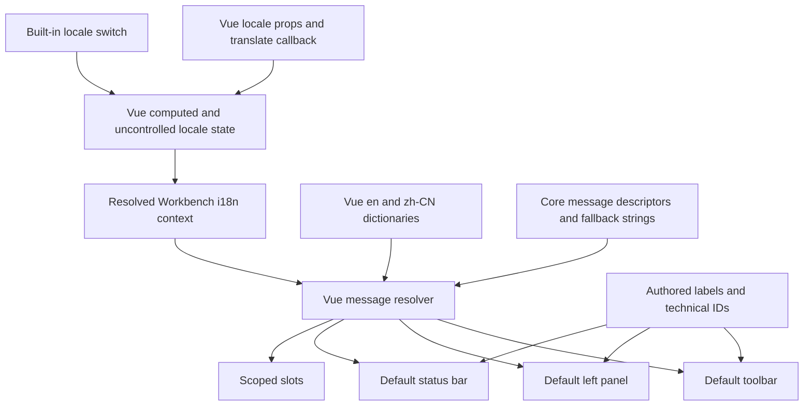
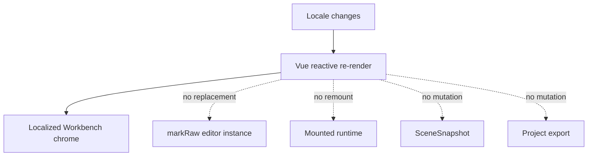

# feat: Wire Vue Workbench i18n

## Summary

Wire locale state, built-in English and Simplified Chinese dictionaries, and default UI translation through the Vue Workbench. This plan covers Vue-native locale props/emits, composable context, scoped-slot translator access, toolbar, left panel, status bar, shell labels, and package/persistence tests; full inspector/problem-panel localization and cross-adapter layout checks remain later parent-plan work.

---

## Problem Frame

The parent bilingual Workbench plan defines Vue U4 as the Vue adapter parity slice after the core descriptor work and React interface decisions. Vue currently composes `useWorkbench()`, `EditorWorkbench.vue`, `WorkbenchToolbar.vue`, `WorkbenchLeftPanel.vue`, and `WorkbenchStatusBar.vue` into the install-ready package surface, but these components still render hardcoded English text and store some async UI statuses as already-rendered strings.

Vue locale state must remain adapter UI reactivity. It should update visible Workbench text without replacing the raw editor, remounting runtime resources, re-importing assets, mutating snapshots, or translating user-authored labels such as scene names, node names, asset labels, file names, camera view names, GLB import metadata, and technical IDs.

---

## Requirements

**Locale API and Translation Contract**

- R1. Vue Workbench must default to `en` and support `zh-CN` without host code or required third-party i18n runtime dependencies. (origin R2, R3, R10; parent U4)
- R2. Vue package users must be able to control locale through props, seed an uncontrolled default locale, observe switch changes through Vue emits, and hide or disable the built-in switch. (origin R3-R5, F4; parent U4)
- R3. Locale changes must re-render default Vue Workbench text without editor replacement, runtime remount, scene reload, asset re-import, or snapshot mutation. (origin R6, R14, AE2; parent U4)
- R4. Scoped slots and direct `useWorkbench()` consumers must be able to resolve Workbench messages without importing a third-party i18n runtime. (origin R18; parent U4)
- R5. Host-provided translation resolution must be able to override built-in copy for known descriptors while falling back to built-in dictionaries and descriptor fallback text. (origin R18; parent U4)

**Default Vue Workbench Coverage**

- R6. Vue dictionaries must cover default shell labels, toolbar group labels, button text, button titles, project action statuses, language-switch labels, and accessibility labels. (origin R7, R20; parent U4)
- R7. Vue dictionaries must cover the default left panel's hierarchy, asset workspace controls, queue states, recovery text, project summary labels, problem list chrome, placeholders, select options, and accessibility labels. (origin R8, R11, R20; parent U4)
- R8. Vue dictionaries must cover default status bar labels, selection/project/snap summaries exposed by core descriptors, runtime state labels, dirty/saved labels, and problem-count summaries. (origin R9, R11, R20; parent U4)
- R9. Vue rendering must resolve core message descriptor fields when present and preserve existing fallback strings when a descriptor or dictionary entry is missing. (origin R12, R15; parent U2, U4)
- R10. User-authored and durable generated values must render as values, not message keys, across locale changes. (origin R13, AE4; parent U4)

**State, Package, and Verification Boundaries**

- R11. Locale, switch state, dictionaries, resolved translated copy, and host translation callbacks must not serialize into `SceneSnapshot`, `.ek3d` project data, command history, asset records, runtime metadata, or GLB import manifest metadata. (origin R14, R21, AE2; parent U4)
- R12. Vue public API tests must cover new locale types, props, emits, context shape, and package-boundary guarantees without exposing unrelated internals. (origin R18, R20; parent U4)
- R13. Vue package tests must prove representative English and Chinese rendering, controlled/uncontrolled locale behavior, switch behavior, fallback behavior, scoped-slot access, and raw-editor lifecycle stability. (origin R20, R21; parent U4)
- R14. Vue package manifests and build-config tests must continue to prove `i18next`, `react-i18next`, Vue I18n, FormatJS, and similar runtimes are not required dependencies. (origin R10, R16; parent U4)

---

## Key Technical Decisions

- KTD1. **Keep locale on Vue adapter reactivity, not editor state:** `useWorkbench()` should expose Vue i18n helpers through computed context, but locale must not be passed into `createEditor()`, runtime mounting, serialization, project export, or asset import data.
- KTD2. **Use Vue-native controlled/uncontrolled semantics:** A controlled `locale` prop wins; `defaultLocale` seeds uncontrolled state; switch interactions emit `update:locale` and update internal state only when uncontrolled.
- KTD3. **Mirror the React resolver contract without importing React:** Vue gets its own package-local resolver and dictionaries so package boundaries stay independent, but shared Workbench concepts use the same message keys and equivalent dictionary copy as the React slice.
- KTD4. **Accept the current shared-key prefix for this slice:** Existing React work uses `reactWorkbench.*` keys. Vue should reuse those keys for shared concepts to satisfy parity now; a later cross-adapter rename can be a separate refactor if the project wants neutral key prefixes.
- KTD5. **Use a small Vue-owned translation resolver:** Resolve host translation override first, then Vue built-in dictionary, then descriptor fallback with interpolation. Do not add Vue I18n, `i18next`, FormatJS, browser-language detection, or locale persistence.
- KTD6. **Store async Vue UI statuses as message identity plus values:** Project open/export, asset import queue, asset replacement, and GLB reimport states should re-resolve during render so locale changes update completed statuses.
- KTD7. **Do not localize values that become durable authored data:** The toolbar's generated camera view name remains the established authored fallback value. Localize action/status chrome, not data written into scene cameras.
- KTD8. **Keep full inspector/problem-panel localization out of this slice:** This plan localizes Vue Workbench shell, toolbar, left panel, status bar, and descriptor-backed summaries. Deep inspector fields and problem-panel internals are covered by the parent plan's later inspector/problem unit.

---

## High-Level Technical Design

The i18n context should be plain enough for scoped slots and tests but should not make the editor, runtime, resolver, or translator callback deeply reactive. Existing `markRaw`, `shallowRef`, and computed context boundaries stay in place.

---

## Implementation Units

### U1. Add the Vue Workbench i18n resolver and dictionaries

- **Goal:** Create the Vue-owned message resolver, built-in `en` and `zh-CN` dictionaries, interpolation behavior, host override hook, and dictionary coverage tests.
- **Requirements:** R1, R5, R6, R7, R8, R9, R10, R14.
- **Dependencies:** Descriptor contract plan U1-U4; core display descriptor plan U1-U6; React Workbench i18n plan U1.
- **Files:** `packages/vue/src/i18n/workbench-i18n.ts`, `packages/vue/test/workbench-i18n.test.ts`, `packages/vue/test/build-config.test.ts`.
- **Approach:** Add a plain TypeScript i18n module that imports core descriptor types from the public core package surface, defines Vue package exports for locale, message input, message values, translator, and resolver helpers, and mirrors the React dictionary key set for shared Workbench concepts. Keep dictionaries static and package-local. Treat file names, scene names, node labels, asset labels, technical IDs, problem codes, and camera view names as interpolation values or authored values.
- **Execution note:** Start with resolver and coverage tests so component work has a stable translation contract.
- **Patterns to follow:** `packages/react/src/i18n/workbench-i18n.ts`, core descriptor helpers in `packages/core/src/i18n/messages.ts`, and Vue package dependency assertions in `packages/vue/test/build-config.test.ts`.
- **Test scenarios:**
  - Given a Vue Workbench-local key exists in English, when dictionary coverage is checked, then the same key exists in Simplified Chinese.
  - Given the React dictionary key file is treated as the parity source, when the Vue dictionary key set is checked, then shared `reactWorkbench.*`, `workbench.*`, `assetWorkspace.*`, `problem.*`, and `workbenchImport.*` keys are present in Vue.
  - Given a core message descriptor with values is resolved in `zh-CN`, when the dictionary contains the key, then placeholders are interpolated with the provided values.
  - Given a host translation bridge returns text for a descriptor, when the resolver runs, then host text wins over built-in dictionary text.
  - Given a descriptor has no dictionary entry, when the resolver runs, then descriptor fallback is rendered with values and remains readable.
  - Given values include `Pump A`, `motor-control-panel.glb`, `asset-a`, `Camera view 1`, and `0`, when messages resolve, then those values are inserted as values and never converted into lookup keys.
  - Given Vue package manifests are inspected, when build-config tests run, then no required dependency is added for `i18next`, `react-i18next`, Vue I18n, FormatJS, or similar runtime packages.
- **Verification:** Vue has a deterministic, dependency-free i18n resolver that can serve adapter-owned chrome and core descriptor fields without coupling to React.

### U2. Wire locale state through `useWorkbench()` and `EditorWorkbench.vue`

- **Goal:** Expose locale state, locale switching, and translator access through Vue props, emits, composable options, and scoped-slot context without changing editor ownership or runtime lifecycle.
- **Requirements:** R2, R3, R4, R5, R11, R12, R13.
- **Dependencies:** U1.
- **Files:** `packages/vue/src/composables/use-workbench.ts`, `packages/vue/src/components/EditorWorkbench.types.ts`, `packages/vue/src/components/EditorWorkbench.vue`, `packages/vue/src/index.ts`, `packages/vue/src/public-api.test.ts`, `packages/vue/test/workbench.test.ts`.
- **Approach:** Add Vue i18n options to `UseWorkbenchOptions`, `EditorWorkbenchProps`, and `EditorWorkbenchEmits`. Support `locale`, `defaultLocale`, `translate`, `showLocaleSwitcher`, and `localeSwitcherDisabled` on the component. Emit `update:locale` when the built-in switch requests a change. Keep `WorkbenchContext.i18n` optional for old mocks, add `ResolvedWorkbenchContext` with required `i18n`, and make `UseWorkbenchResult.context` and default scoped slots use the resolved context. Destructure locale options before editor creation so locale changes do not enter `createEditor()` or runtime mounting.
- **Patterns to follow:** React `useWorkbench()` locale handling, Vue `toRef(props, "editor")` and `toRef(props, "loader")` option forwarding, current `markRaw`/`shallowRef` editor boundary, and existing slot compatibility for `sidePanel`.
- **Test scenarios:**
  - Covers AE2. Given `EditorWorkbench` renders with no locale prop, when default text is queried, then English text appears and no locale state appears in `editor.serialize()`.
  - Given uncontrolled `defaultLocale` is `zh-CN`, when `EditorWorkbench` renders, then default Workbench chrome resolves Chinese without host translation code.
  - Given controlled `locale` changes from `en` to `zh-CN`, when Vue props update and reactivity flushes, then the same raw editor instance and runtime are retained while visible copy changes.
  - Given the built-in switch changes an uncontrolled locale, when it emits, then `update:locale` carries the normalized locale and internal state changes only for uncontrolled usage.
  - Given a scoped toolbar slot receives context, when it reads `context.i18n`, then it can resolve a known message and observe the current locale.
  - Given direct `useWorkbench({ editor, locale: "zh-CN" })` is used in a test component, when the composable returns context, then i18n helpers are available without deep imports.
  - Given the editor prop changes while locale props are present, when Vue swaps from the old raw editor to the new raw editor, then ownership/disposal behavior remains the existing one and locale state does not affect editor disposal.
- **Verification:** Locale becomes Vue session state and scoped-slot context data, not an editor option or durable model field.

### U3. Add the built-in locale switch and localize the default toolbar

- **Goal:** Translate the default toolbar, project action status text, locale switch, toolbar accessibility labels, and button titles in both supported locales.
- **Requirements:** R2, R3, R6, R10, R11, R13.
- **Dependencies:** U1, U2.
- **Files:** `packages/vue/src/components/WorkbenchToolbar.vue`, `packages/vue/src/components/workbench.css`, `packages/vue/test/workbench.test.ts`.
- **Approach:** Replace toolbar literals with `context.i18n.t()` calls for group labels, button labels, `title` attributes, project file action statuses, camera/action labels, node operation labels, and snap/helper labels. Add a locale switch group that uses `context.i18n.setLocale()` and honors switch visibility/disabled props forwarded from `EditorWorkbench.vue`. Store `projectStatus` as message identity plus values or raw fallback detail, not as one rendered string. Keep generated camera view names as authored values.
- **Patterns to follow:** `packages/react/src/components/WorkbenchToolbar.tsx`, current toolbar action routing through `context.runAction()`, Vue test selectors that query `title` attributes, and existing CSS flex wrapping/min-width patterns.
- **Test scenarios:**
  - Covers AE1. Given `locale="zh-CN"`, when the default toolbar renders, then project, history, transform, snap, marquee, viewport helper, camera, node operation, and locale-switch labels/titles are Chinese.
  - Given the built-in switch changes an uncontrolled Workbench from English to Chinese, when toolbar buttons are queried again, then visible labels and `title` attributes update without changing transform mode or viewport helper state.
  - Given `showLocaleSwitcher` is false, when the toolbar renders, then the locale switch is absent while host-controlled Chinese still applies to toolbar copy.
  - Given `localeSwitcherDisabled` is true, when the toolbar renders, then current-locale copy appears and switch interaction does not mutate uncontrolled locale.
  - Given a project package named `restored.ek3d` is opened in Chinese locale, when the status renders, then the surrounding status message is Chinese and the file name remains `restored.ek3d`.
  - Given a partial export has two problems, when locale is Chinese, then the warning status uses Chinese copy with the problem count as an interpolation value.
  - Given the camera capture action creates a default view, when locale is Chinese, then the button label is Chinese but the durable generated camera view name remains the established authored fallback value.
  - Covers AE2. Given a user toggles locale after editing the scene, when `editor.serialize()` is inspected, then it contains no locale, switch state, dictionaries, or translated toolbar text.
- **Verification:** The default Vue toolbar becomes bilingual without changing action semantics, durable scene data, or runtime helper state.

### U4. Localize the default left panel and asset workspace chrome

- **Goal:** Translate hierarchy, asset workspace, import queue, recovery controls, project summary, and problem-list chrome while preserving authored and technical values.
- **Requirements:** R3, R7, R9, R10, R11, R13.
- **Dependencies:** U1, U2.
- **Files:** `packages/vue/src/components/WorkbenchLeftPanel.vue`, `packages/vue/src/components/workbench.css`, `packages/vue/test/workbench.test.ts`, `packages/vue/test/vue-proof-loop.integration.test.ts`.
- **Approach:** Resolve section labels, empty states, import controls, raster intent options, search labels/placeholders, filter/sort labels, queue status labels, recovery progress labels, asset status badges, reference/problem summaries, project summary terms, and problem-list accessibility labels through the Vue resolver. Use descriptor-backed fields from core when asset workspace or problem items provide them. Store queue and recovery state as message identity plus values where possible; keep raw error strings as fallback details. Keep `filterAssetWorkspaceItems()` inputs and authored labels unchanged.
- **Patterns to follow:** `packages/react/src/components/WorkbenchLeftPanel.tsx`, existing asset import/reimport tests, `filterAssetWorkspaceItems()` search semantics, asset workspace model data from core, and Vue proof-loop integration coverage for import/select/transform/export/restore/recovery.
- **Test scenarios:**
  - Covers AE1. Given `locale="zh-CN"`, when the left panel renders a normal scene, then hierarchy, assets, project, import controls, filters, placeholders, and summary labels use Chinese copy.
  - Covers AE4. Given assets named `robot.glb`, `Panel paint`, and `Manual label`, when locale changes, then those labels remain unchanged while surrounding asset chrome changes language.
  - Given a failed import queue row contains an unsupported asset diagnostic, when locale is Chinese, then queue status chrome and stable diagnostic title are Chinese while the file name remains authored.
  - Given asset replacement succeeds with a file named `recovered.glb`, when locale changes after success, then the success message re-renders in the current locale and the file name remains authored.
  - Given GLB reimport succeeds with exact, remapped, new, and unresolved target counts, when locale is Chinese, then the summary uses Chinese terms with numeric interpolation values.
  - Given asset filters are changed under Chinese locale, when core search/filter semantics run, then filtering still matches authored labels, IDs, statuses, and diagnostics rather than translated UI labels.
  - Given a missing asset recovery control appears, when Chinese locale is active, then the action chrome is Chinese and the selected `File` is still passed to `editor.replaceAsset()` without entering serialized state.
- **Verification:** The left panel is bilingual while asset search, recovery, import, and authored-value semantics remain core-owned and durable-state safe.

### U5. Localize the status bar, shell labels, and core Workbench descriptors

- **Goal:** Translate shell accessibility labels, status bar summaries, and core descriptor-backed summaries for selection, snap feedback, project readiness, and problem counts.
- **Requirements:** R3, R4, R8, R9, R10, R11, R13.
- **Dependencies:** U1, U2.
- **Files:** `packages/vue/src/components/EditorWorkbench.vue`, `packages/vue/src/components/WorkbenchStatusBar.vue`, `packages/vue/test/workbench.test.ts`, `packages/vue/test/vue-proof-loop.integration.test.ts`.
- **Approach:** Replace shell `aria-label` strings and status bar literals with resolver calls. Resolve `context.model.selection.labelDescriptor`, `context.model.status.snapFeedbackLabelDescriptor`, `context.model.project.statusLabelDescriptor`, and problem descriptors when present, falling back to existing strings when missing. Keep selection labels containing authored node names as values.
- **Patterns to follow:** `packages/react/src/components/EditorWorkbench.tsx`, `packages/react/src/components/WorkbenchStatusBar.tsx`, existing Vue status assertions, runtime problem tests that assert problems do not serialize, and proof-loop status flows for undo/redo, dirty/saved, runtime readiness, and project completeness.
- **Test scenarios:**
  - Given `locale="zh-CN"`, when the Workbench shell renders, then main Workbench, viewport, project panel, inspector panel, editor status, and toolbar accessibility labels use Chinese copy.
  - Given no selection, one selected node named `Robot arm`, and multi-selection states, when locale changes, then the status bar translates surrounding selection chrome while preserving authored node names.
  - Given snap feedback, runtime readiness, dirty/saved state, project readiness, and problem counts change, when Chinese locale is active, then status bar summaries resolve through dictionaries or core descriptors.
  - Given a runtime problem from a missing asset appears, when status and problem summary text render in Chinese, then problem IDs and raw technical details remain fallback values.
  - Given a host scoped status slot uses `context.i18n`, when locale changes, then the custom slot can resolve current-locale copy without remounting the Workbench.
  - Covers AE2. Given locale changes after runtime problems are refreshed, when `editor.serialize()` and project export run, then runtime problem text, locale, dictionaries, and translated status copy are absent from durable JSON.
- **Verification:** Vue Workbench status and shell accessibility are bilingual and descriptor-aware without broadening durable state.

### U6. Protect public API, persistence, lifecycle, and Vue package behavior

- **Goal:** Add regression coverage that proves the Vue i18n surface is package-safe, lifecycle-safe, scoped-slot-safe, and persistence-safe.
- **Requirements:** R1, R2, R3, R11, R12, R13, R14.
- **Dependencies:** U1-U5.
- **Files:** `packages/vue/src/index.ts`, `packages/vue/src/public-api.test.ts`, `packages/vue/test/workbench.test.ts`, `packages/vue/test/build-config.test.ts`, `packages/vue/test/vue-proof-loop.integration.test.ts`, `packages/vue/package.json`.
- **Approach:** Export only stable locale/i18n types and documented helpers from the Vue package root. Extend package tests to cover controlled/uncontrolled locale contracts, switch visibility/disabled behavior, scoped-slot i18n access, absence of required third-party i18n dependencies, raw editor stability, and snapshot/project export invariance after locale changes.
- **Patterns to follow:** Existing Vue public API root import test, package manifest dependency checks, Vue raw-editor ownership tests, and proof-loop integration tests that already drive import, select, transform, undo/redo, export, restore, and asset recovery.
- **Test scenarios:**
  - Given package-root imports are compiled, when locale prop types, emit types, i18n context types, and documented resolver helpers are referenced, then consumers can use them without deep imports.
  - Given package manifest tests run, when dependencies and peer dependencies are inspected, then Vue still only requires core plus Vue peer dependency and no required i18n runtime.
  - Covers AE2. Given a user edits a scene, switches locale, imports assets, exports a project, and restores it, when durable payloads are inspected, then they contain scene/user data but no locale, switch state, dictionary keys, or translated UI copy.
  - Given `EditorWorkbench` is controlled by host locale and rerendered repeatedly, when spies inspect editor/runtime construction, then locale changes do not replace the raw editor or remount runtime.
  - Given a shell-created editor is used and locale changes before unmount, when the component unmounts, then the editor disposes at the established boundary and host-owned editors remain undisposed.
  - Given public API tests inspect package exports, when i18n exports are added, then unrelated component internals and CSS-private paths remain unexported.
- **Verification:** Vue i18n behavior is stable enough for npm consumers and remains inside the existing package boundary.

---

## Acceptance Examples

- AE1. Given `EditorWorkbench` renders with `locale="zh-CN"`, when the default toolbar, left panel, shell labels, and status bar are queried, then representative visible text, `title` attributes, placeholders, and accessibility labels are Chinese.
- AE2. Given a user changes locale through the built-in switch after editing a scene, when snapshot serialization or project export runs, then durable output contains scene/user data but no locale, switch state, dictionaries, translated UI copy, or host translation callbacks.
- AE3. Given a host controls locale externally and hides the built-in switch, when the host changes locale from `en` to `zh-CN`, then Vue Workbench copy updates without duplicating controls or replacing the editor/runtime.
- AE4. Given user-authored labels such as `Robot arm`, `robot.glb`, `Panel paint`, `Hero view`, and `recovered.glb`, when locale changes, then those labels remain as authored while surrounding UI chrome changes language.
- AE5. Given a host translation bridge returns custom copy for a known message, when Vue Workbench renders, then custom host copy wins and built-in dictionary/fallback behavior still covers missing keys.
- AE6. Given project open/export, import queue, replacement, and reimport statuses were created before a locale change, when locale changes, then those statuses re-render in the new locale while file names and raw errors remain values.

---

## Scope Boundaries

### In Scope

- Vue-only locale props, uncontrolled locale state, `update:locale` emits, and switch visibility/disabled behavior.
- Vue-owned `en` and `zh-CN` dictionaries for default Workbench chrome.
- A lightweight Vue message resolver for core descriptors, shared Workbench keys, host translation overrides, fallback text, and interpolation.
- Default Vue Workbench toolbar, left panel, status bar, shell accessibility labels, titles, placeholders, select options, and local async status text.
- Scoped-slot and direct `useWorkbench()` access to current locale and resolver helpers.
- Vue package public API, dependency, lifecycle, and durable-state regression tests.

### Deferred to Follow-Up Work

- Full React/Vue inspector field and problem-panel localization from the parent inspector/problem UI unit.
- Cross-adapter dictionary parity tests that compare React and Vue packages as an integrated check.
- Browser-level Chinese layout fit checks across narrow and desktop viewports.
- npm-facing README and integration documentation for bilingual Workbench usage.
- Repository-wide hardcoded-string audit for future default Workbench strings.
- Renaming shared keys from `reactWorkbench.*` to neutral `workbench.*` prefixes.

### Outside This Feature

- Persisting locale or language preference into `SceneSnapshot`, `.ek3d`, command history, asset records, runtime metadata, or GLB import manifest metadata.
- Translating user-authored scene, node, object, asset, material, light, camera, file, import key, or imported metadata names.
- Adding a required `i18next`, `react-i18next`, Vue I18n, FormatJS, or similar runtime dependency.
- Adding browser-language auto-detection or host preference persistence.
- Changing core descriptor key conventions beyond what dependency plans provide.
- Reworking Workbench layout beyond small switch/wrapping adjustments needed by this Vue slice.

---

## System-Wide Impact

- **Vue public API:** `EditorWorkbenchProps`, `EditorWorkbenchEmits`, `EditorWorkbenchSlots`, `UseWorkbenchOptions`, `UseWorkbenchResult`, and package-root type exports gain locale/i18n surface area. Public API tests should keep this additive and explicit.
- **Vue lifecycle:** Locale changes add Vue state and computed resolver data, but must not affect editor ownership, runtime mounting, subscriptions, or disposal behavior.
- **Core integration:** Vue rendering now consumes optional core descriptor fields. Missing descriptors or dictionary entries must fall back to existing strings so partial core migrations remain readable.
- **Adapter parity:** Vue should mirror React's default Workbench key set and user-facing copy for shared concepts, while staying in its own package boundary.
- **Durable state:** No scene schema or project package schema change is expected. Locale and translated copy stay outside editor serialization and export.
- **Package dependencies:** The Vue package remains dependency-light and should not require an i18n runtime for default bilingual support.

---

## Risks & Dependencies

- **Dependency on React key decisions:** React currently uses `reactWorkbench.*` keys for shared Workbench concepts. Reusing those keys preserves parity but leaves a naming wart; a neutral prefix migration should be separate if needed.
- **Dependency on core descriptor completeness:** Vue can only resolve core-owned summaries where descriptor fields exist. Mitigate by falling back to existing strings and keeping this plan dependent on `docs/plans/2026-06-17-003-feat-core-display-message-descriptors-plan.md`.
- **Local status strings can stale in the old locale:** Project and asset async statuses currently store rendered English strings. Mitigate by storing message identity and values, then resolving during render.
- **Durable generated-name leakage:** Translating default names written into snapshots would make locale affect durable data. Mitigate by preserving current generated authored-name values and localizing only action/status chrome.
- **Vue reactivity proxy risk:** Translator functions, editor instances, and runtime objects should not be deep-proxied. Keep `markRaw`, `shallowRef`, and computed boundaries intact.
- **API surface creep:** Locale props, switch controls, emits, and host translation bridges can overgrow quickly. Mitigate with a small controlled/uncontrolled API and one resolver bridge.
- **External docs unavailable:** Context7 Vue documentation research could not run because `CONTEXT7_API_KEY` is not configured. This plan is grounded in local Vue 3.5 package versions, existing Vue adapter patterns, and the already-landed React i18n implementation rather than external Vue documentation.

---

## Sources & Research

- Origin requirements: `docs/brainstorms/2026-06-17-bilingual-workbench-i18n-requirements.md`
- Parent plan and U4 boundary: `docs/plans/2026-06-17-001-feat-bilingual-workbench-i18n-plan.md`
- Descriptor contract dependency: `docs/plans/2026-06-17-002-feat-framework-neutral-i18n-descriptor-contract-plan.md`
- Core descriptor dependency: `docs/plans/2026-06-17-003-feat-core-display-message-descriptors-plan.md`
- React i18n interface dependency: `docs/plans/2026-06-17-004-feat-react-workbench-i18n-plan.md`
- React resolver and component patterns: `packages/react/src/i18n/workbench-i18n.ts`, `packages/react/src/hooks/use-workbench.ts`, `packages/react/src/components/EditorWorkbench.tsx`, `packages/react/src/components/WorkbenchToolbar.tsx`, `packages/react/src/components/WorkbenchLeftPanel.tsx`, `packages/react/src/components/WorkbenchStatusBar.tsx`
- Vue Workbench composition: `packages/vue/src/components/EditorWorkbench.vue`, `packages/vue/src/composables/use-workbench.ts`, `packages/vue/src/components/EditorWorkbench.types.ts`
- Default Vue Workbench regions: `packages/vue/src/components/WorkbenchToolbar.vue`, `packages/vue/src/components/WorkbenchLeftPanel.vue`, `packages/vue/src/components/WorkbenchStatusBar.vue`
- Vue package exports and package boundary tests: `packages/vue/src/index.ts`, `packages/vue/src/public-api.test.ts`, `packages/vue/test/build-config.test.ts`, `packages/vue/package.json`
- Vue behavior and proof-loop tests: `packages/vue/test/workbench.test.ts`, `packages/vue/test/vue-proof-loop.integration.test.ts`
- Existing Workbench styles: `packages/vue/src/components/workbench.css`
- Core i18n implementation shape: `packages/core/src/i18n/messages.ts`, `packages/core/src/i18n/display-messages.ts`, `packages/core/src/workbench/workbench-model.ts`
