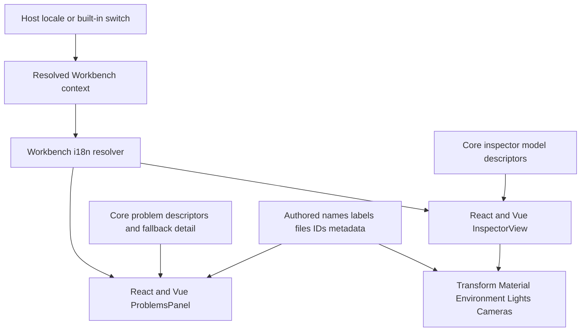
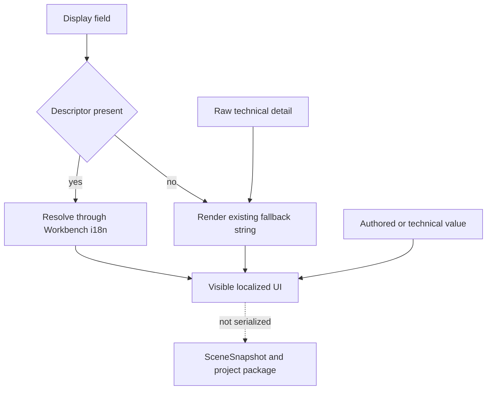

# feat: Localize inspector and problem UI

## Summary

Finish the parent bilingual Workbench U5 by localizing default inspector sections, field controls, inline validation, diagnostics, and problem panels in both React and Vue. The work consumes existing core message descriptors and adapter Workbench i18n resolvers; it does not add new durable state, required i18n dependencies, or a broader settings system.

---

## Problem Frame

The core descriptor contract and adapter Workbench i18n slices give React and Vue a way to resolve messages, but the inspector subtree still renders a mix of hardcoded English and raw fallback strings. `EditorWorkbench` already builds a resolved `i18n` context for the shell, toolbar, left panel, and status bar, while `InspectorView`, individual inspector sections, and `ProblemsPanel` do not receive or use that context.

The inspector is the highest-density default Workbench surface. It contains core-owned descriptors for section titles, field labels, option labels, action labels, command problems, and known problem display data, plus adapter-owned chrome such as "None", "Add", "Target", "Default", and camera/light action buttons. This plan localizes both categories while preserving user-authored values such as object names, material slot labels, asset labels, file names, camera view names, light names, IDs, and raw technical details.

---

## Requirements

**Inspector Text Coverage**

- R1. React and Vue default Workbench inspector trees must receive the active Workbench i18n context and update visible inspector copy when locale changes. (origin R1-R3, R6, R10; parent U5)
- R2. Inspector section titles, empty reasons, field labels, option labels, action labels, action disabled reasons, and inline command problems must resolve core descriptors when present and fall back to existing strings when missing. (origin R10, R12, R15; parent U2, U5)
- R3. Adapter-owned inspector chrome must be covered by built-in `en` and `zh-CN` dictionaries in both packages. This includes `aria-label` text, empty select options, material target metadata, unresolved-slot warnings, light controls, camera view controls, and destructive action labels. (origin R7, R10, R17; parent U5)
- R4. Localized rendering must preserve inspector editing behavior for transform, material, environment, light, and camera view commands. (origin R6, R19, R20; parent U5)

**Problem and Diagnostic Coverage**

- R5. React and Vue problem panels must localize stable problem titles, details, action labels, empty states, severity/source labels, and replacement file-action chrome. (origin R11, R12; parent U5)
- R6. Light diagnostics and other inspector-adjacent diagnostic summaries must resolve descriptor-backed titles and details while retaining raw technical fallback detail. (origin R11, R12, AE3; parent U5)
- R7. Raw loader, decoder, browser, resolver, dispatch, and host callback error strings may remain fallback detail, but the stable surrounding UI chrome must be localized. (origin R12; parent U5)

**State, Parity, and Safety**

- R8. User-authored scene, node, object, material, material slot, asset, file, light, camera view, GLB metadata, problem code, and technical ID values must render as values and must not become dictionary keys. (origin R13, AE4; parent U5)
- R9. Locale changes in the inspector must not recreate the editor/runtime, reload assets, mutate snapshots, or serialize locale, switch state, dictionaries, translated UI copy, or host translation callbacks. (origin R6, R14, R21, AE2; parent U5)
- R10. React and Vue must resolve equivalent inspector and problem concepts from the same shared key set and equivalent built-in copy. (origin R17, AE5; parent U5)
- R11. Tests must cover representative React and Vue Chinese inspector/problem rendering, fallback behavior, authored-value preservation, and locale-change persistence boundaries. (origin R19-R21; parent U5)

---

## Key Technical Decisions

- KTD1. **Reuse the existing Workbench i18n resolver:** Inspector components should consume `WorkbenchI18n.t()` from the resolved Workbench context. Do not introduce `i18next`, Vue I18n, FormatJS, or a second resolver path.
- KTD2. **Render descriptors before fallback strings:** For core-owned display fields, React and Vue should resolve `titleDescriptor`, `labelDescriptor`, `reasonDescriptor`, `messageDescriptor`, `detailDescriptor`, and `actionLabelDescriptor` when present, then fall back to the existing readable string.
- KTD3. **Keep adapter-owned chrome in adapter dictionaries:** Strings such as "Scene inspector", "None", "Add", "Target", "Default", "Remove light", "Delete view", and camera runtime warning chrome are UI concerns, so they belong in `packages/react/src/i18n/workbench-i18n.ts` and `packages/vue/src/i18n/workbench-i18n.ts`.
- KTD4. **Preserve current standalone inspector defaults:** Public standalone `InspectorPanel` usage can keep default English behavior through the same resolver defaults, while the default Workbench passes the active context for bilingual rendering.
- KTD5. **Do not translate authored or durable generated values:** Camera view names, material slot labels, asset labels, file names, light names, scene object names, import keys, and technical IDs remain rendered values. Only surrounding chrome and stable problem messages localize.
- KTD6. **Mirror React and Vue migration boundaries:** React and Vue should gain equivalent helper functions, dictionary keys, and tests. Framework-specific syntax differs, but message keys and visible outcomes should stay aligned.
- KTD7. **Keep full browser layout hardening in the later verification slice:** This plan may make scoped inspector CSS fixes when Chinese copy exposes a real issue, but broad narrow/desktop browser layout verification remains parent-plan U6.

---

## High-Level Technical Design

The second flow is the rendering rule for every inspector/problem text field. Descriptors are presentation metadata for transient display models; locale state and resolved copy remain adapter UI state.

---

## Implementation Units

### U1. Add inspector i18n dictionary coverage and rendering helpers

- **Goal:** Establish the adapter-local keys and helper functions needed to resolve inspector descriptors, fallback strings, problem details, and authored values consistently in React and Vue.
- **Requirements:** R2, R3, R5, R7, R8, R10.
- **Dependencies:** Descriptor contract plan, core display descriptor plan, React Workbench i18n plan, Vue Workbench i18n plan.
- **Files:** `packages/react/src/i18n/workbench-i18n.ts`, `packages/react/test/workbench-i18n.test.ts`, `packages/vue/src/i18n/workbench-i18n.ts`, `packages/vue/test/workbench-i18n.test.ts`.
- **Approach:** Extend both built-in dictionaries with shared inspector/problem keys for adapter-owned chrome and status labels. Add or document small resolver helpers for descriptor-or-fallback rendering so component code does not repeat ternaries around every `labelDescriptor`, `messageDescriptor`, or `actionLabelDescriptor`. Keep the existing `reactWorkbench.*` prefix for shared adapter keys to match prior React/Vue i18n plans unless a later dedicated refactor renames prefixes.
- **Execution note:** Start test-first with dictionary parity and descriptor fallback tests, because later component work depends on these keys.
- **Patterns to follow:** Existing `resolveWorkbenchMessage()` behavior, dictionary key parity tests in `packages/react/test/workbench-i18n.test.ts` and `packages/vue/test/workbench-i18n.test.ts`, and current descriptor-backed left panel rendering.
- **Test scenarios:**
  - Given an inspector adapter key exists in the React English dictionary, when dictionary parity tests inspect keys, then the same key exists in React Chinese, Vue English, and Vue Chinese dictionaries.
  - Given a core field label descriptor has a Chinese dictionary entry, when resolved through the adapter helper, then the Chinese copy is returned with interpolation values applied.
  - Given a descriptor key is missing from the dictionary, when resolved through the helper, then the fallback text remains readable and values such as `Robot arm` or `asset-a` are interpolated as values.
  - Given adapter-owned keys such as empty asset option, material target legend, camera default marker, problem empty state, and replacement action chrome are inspected, then both packages provide equivalent English and Chinese messages.
  - Given authored values include `Pump A`, `motor-control-panel.glb`, `Hero view`, `Key light`, and `slot:Body`, when helper tests resolve messages, then those values never become lookup keys.
- **Verification:** Both adapters have the same inspector/problem message vocabulary before component rendering changes begin.

### U2. Thread Workbench i18n context into the inspector subtree

- **Goal:** Make the default React and Vue Workbench pass active i18n context into `InspectorView`, child inspector components, and problem panels without changing editor ownership or durable state.
- **Requirements:** R1, R4, R9, R11.
- **Dependencies:** U1.
- **Files:** `packages/react/src/components/EditorWorkbench.tsx`, `packages/react/src/components/InspectorView.tsx`, `packages/react/src/components/InspectorPanel.tsx`, `packages/react/test/workbench.test.tsx`, `packages/react/test/inspector.test.tsx`, `packages/react/test/strict-mode.test.tsx`, `packages/vue/src/components/EditorWorkbench.vue`, `packages/vue/src/components/InspectorView.vue`, `packages/vue/src/components/InspectorPanel.vue`, `packages/vue/test/workbench.test.ts`, `packages/vue/test/inspector.test.ts`.
- **Approach:** Add an inspector-facing i18n prop or context object that carries the same `WorkbenchI18n` used by toolbar, left panel, and status bar. Default standalone inspector entrypoints to English resolver behavior so existing `InspectorPanel` tests and package users remain compatible. Ensure locale options are not forwarded into `createEditor()`, runtime mounting, asset import, or serialization paths.
- **Patterns to follow:** `EditorWorkbench` shell i18n usage, `WorkbenchLeftPanel` descriptor rendering, React `ResolvedWorkbenchContext`, Vue `ResolvedWorkbenchContext`, and existing StrictMode/raw-editor lifecycle tests.
- **Test scenarios:**
  - Given React `EditorWorkbench` renders with `locale="zh-CN"`, when the default right panel renders, then inspector subtree text can resolve through `workbench.i18n`.
  - Given Vue `EditorWorkbench` renders with `locale="zh-CN"`, when the default right panel renders, then inspector subtree text can resolve through `context.i18n`.
  - Given standalone React `InspectorPanel` renders without locale props, when current English assertions run, then existing default English behavior remains readable.
  - Given standalone Vue `InspectorPanel` renders without locale props, when current English assertions run, then existing default English behavior remains readable.
  - Given controlled locale changes from `en` to `zh-CN`, when React and Vue Workbench rerender, then the same editor/runtime instances remain in use and inspector text updates.
  - Covers AE2. Given locale changes while the inspector is open, when snapshots or project exports are serialized, then locale, dictionaries, translated copy, and host translation callbacks are absent.
- **Verification:** The inspector subtree becomes locale-aware through adapter UI state only.

### U3. Localize React inspector sections and field controls

- **Goal:** Replace React inspector hardcoded English and direct fallback rendering with descriptor-aware, dictionary-backed rendering for transform, material, environment, lights, and camera views.
- **Requirements:** R2, R3, R4, R7, R8, R9, R11.
- **Dependencies:** U1, U2.
- **Files:** `packages/react/src/components/TransformInspector.tsx`, `packages/react/src/components/MaterialInspector.tsx`, `packages/react/src/components/EnvironmentInspector.tsx`, `packages/react/src/components/LightInspector.tsx`, `packages/react/src/components/CameraInspector.tsx`, `packages/react/src/components/inspector.css`, `packages/react/test/inspector.test.tsx`, `packages/react/test/workbench.test.tsx`.
- **Approach:** Resolve section titles, field labels, select option labels, empty reasons, action labels, button text, action tooltips, inline field problems, and local warning chrome through i18n. Use descriptor-backed values for core-owned section/field/action/problem text. Add adapter keys for local UI chrome such as "None", "Add", "Target", "Broad override", "Slot override", "No override", "Unresolved", "Default", "Capture", "Apply", "Update", "Clear default", "Set default", "Delete view", "Remove light", "Environment presets", "Lighting presets", and "Lighting diagnostics". Preserve camera-generated view names as authored fallback values.
- **Patterns to follow:** Current React inspector command wiring, `WorkbenchLeftPanel` descriptor-or-fallback rendering, and existing uncontrolled input reset keys that keep drafts synchronized with snapshot changes.
- **Test scenarios:**
  - Covers AE1. Given React Workbench renders with `locale="zh-CN"`, when transform, material, environment, light, and camera inspector sections are visible, then representative section titles, field labels, select option labels, empty reasons, and buttons are Chinese.
  - Given transform fields are edited under Chinese locale, when `Position X` equivalent field commits, then the same `set-node-transform` command is dispatched and the snapshot transform changes as before.
  - Given material slot targets render under Chinese locale, when the user selects a slot target named `Body`, then `Body` remains authored text while target metadata and unresolved warning chrome are Chinese.
  - Given an environment asset select has no selected asset, when Chinese locale renders the select, then the empty option is localized while asset labels such as `Studio HDR` remain authored values.
  - Given light controls render under Chinese locale, when the user adds, selects, edits, and removes lights, then light names and kinds stay as values and action chrome is Chinese.
  - Given camera views render under Chinese locale, when the user captures a view and marks it default, then camera action buttons and default marker are Chinese while the generated durable view name remains the established authored fallback value.
  - Given inline material, environment, light, or camera validation problems include descriptors, when Chinese locale is active, then descriptor-backed problem copy is Chinese and raw dispatch/runtime fallback detail remains readable when no descriptor exists.
  - Covers AE2. Given the React inspector is open and locale changes after edits, when `editor.serialize()` is inspected, then no locale state, dictionary keys, translated text, or i18n callback appears.
- **Verification:** React inspector localization does not change existing command semantics, uncontrolled draft refresh behavior, or durable editor state.

### U4. Localize Vue inspector sections and field controls

- **Goal:** Deliver Vue parity for descriptor-aware inspector rendering across transform, material, environment, lights, and camera views.
- **Requirements:** R2, R3, R4, R7, R8, R9, R10, R11.
- **Dependencies:** U1, U2, U3 key decisions.
- **Files:** `packages/vue/src/components/TransformInspector.vue`, `packages/vue/src/components/MaterialInspector.vue`, `packages/vue/src/components/EnvironmentInspector.vue`, `packages/vue/src/components/LightInspector.vue`, `packages/vue/src/components/CameraInspector.vue`, `packages/vue/src/components/inspector.css`, `packages/vue/test/inspector.test.ts`, `packages/vue/test/workbench.test.ts`.
- **Approach:** Mirror React's message keys and rendering rules using Vue templates, computed values, and props. Resolve descriptor-backed fields through `context.i18n.t()` or the inspector i18n prop. Keep editor, runtime, camera context, and translator functions out of deep reactivity beyond existing `markRaw` and `shallowRef` boundaries.
- **Patterns to follow:** React U3 behavior, Vue `WorkbenchLeftPanel.vue` descriptor rendering, existing Vue inspector command tests, and current raw-editor lifecycle handling.
- **Test scenarios:**
  - Covers AE1. Given Vue Workbench renders with `locale="zh-CN"`, when transform, material, environment, light, and camera inspector sections are visible, then representative section titles, field labels, select option labels, empty reasons, and buttons are Chinese.
  - Given transform fields are edited under Chinese locale, when a numeric input commits, then the same core command is dispatched and undo/redo snapshot refresh behavior remains unchanged.
  - Given material slot targets render under Chinese locale, when a target named `Body` or `Screen` is selected, then that target label remains authored while target metadata and unresolved warning chrome are Chinese.
  - Given environment and light preset actions render under Chinese locale, when an action is unavailable or dispatch fails, then descriptor-backed problem copy localizes and raw fallback dispatch detail remains readable.
  - Given camera view controls render under Chinese locale, when the user captures, applies, updates, sets default, clears default, and deletes views, then action copy is Chinese and camera view names stay authored.
  - Given Vue locale changes after inspector field problems are visible, when reactivity flushes, then field problem text re-resolves without replacing the raw editor or runtime.
  - Covers AE5. Given React and Vue render the same representative inspector scenario in Chinese, when shared copy is compared in tests, then equivalent concepts resolve through the same keys or equivalent dictionary values.
  - Covers AE2. Given the Vue inspector is open and locale changes after edits, when snapshot/project data is serialized, then no locale state, dictionaries, translated copy, or translator callbacks are present.
- **Verification:** Vue inspector behavior matches React while preserving Vue-specific reactivity and editor ownership boundaries.

### U5. Localize problem panels and inspector diagnostics across adapters

- **Goal:** Make React and Vue `ProblemsPanel` and inspector diagnostic summaries resolve stable problem display descriptors while preserving raw technical detail and replacement actions.
- **Requirements:** R5, R6, R7, R8, R9, R10, R11.
- **Dependencies:** U1, U2.
- **Files:** `packages/react/src/components/ProblemsPanel.tsx`, `packages/react/src/components/LightInspector.tsx`, `packages/react/src/components/inspector.css`, `packages/react/test/inspector.test.tsx`, `packages/react/test/workbench.test.tsx`, `packages/vue/src/components/ProblemsPanel.vue`, `packages/vue/src/components/LightInspector.vue`, `packages/vue/src/components/inspector.css`, `packages/vue/test/inspector.test.ts`, `packages/vue/test/workbench.test.ts`.
- **Approach:** Resolve `ProblemInspectorSection.titleDescriptor`, problem `titleDescriptor`, `detailDescriptor`, and `actionLabelDescriptor` through adapter i18n. Add adapter keys for empty problem state, severity labels, source labels, asset replacement file-action chrome, diagnostics list labels, and fallback replacement action. Preserve raw `detail`, problem IDs, asset IDs, source codes, and host/runtime error strings as values or fallback text. Keep replacement file inputs wired to `replaceAsset` with the selected `File` remaining runtime-only.
- **Patterns to follow:** Existing left panel problem list descriptor rendering, `createReplacementProblem()` test fixtures with descriptors, and runtime problem tests that prove problems do not serialize into snapshots.
- **Test scenarios:**
  - Covers AE3. Given React renders a descriptor-backed missing asset problem in `zh-CN`, when the problem panel displays it, then title and replacement action are Chinese while `asset-a` remains visible as a value.
  - Covers AE3. Given Vue renders the same descriptor-backed missing asset problem in `zh-CN`, when the problem panel displays it, then title and replacement action are Chinese while `asset-a` remains visible as a value.
  - Given a problem has raw loader or host detail with no descriptor, when Chinese locale is active, then stable surrounding labels are Chinese and raw detail remains unchanged.
  - Given a problem has no action descriptor but has fallback `actionLabel`, when rendered in either adapter, then the fallback remains readable and replacement wiring still works.
  - Given no runtime problems exist, when React and Vue render Chinese locale, then the empty problem state is Chinese.
  - Given light diagnostics contain descriptor-backed titles and details, when Chinese locale is active, then diagnostic text localizes in both the dedicated light diagnostics area and the problem panel when the same problem is projected there.
  - Given severity/source metadata renders, when locale is Chinese, then stable labels are localized while raw problem codes and asset IDs remain technical values.
  - Covers AE2. Given the user chooses a replacement file from the problem panel after locale changes, when `replaceAsset` receives the file and durable output is inspected, then `File`, locale state, and translated problem text do not serialize.
- **Verification:** Problem and diagnostic surfaces become bilingual without weakening raw debugging detail or asset recovery behavior.

### U6. Add cross-adapter parity, persistence, and scoped fit coverage

- **Goal:** Prove the inspector/problem localization is complete enough for default Workbench users and remains safe across adapter parity, locale changes, and dense Chinese copy.
- **Requirements:** R1-R11.
- **Dependencies:** U1-U5.
- **Files:** `packages/react/test/workbench-i18n.test.ts`, `packages/vue/test/workbench-i18n.test.ts`, `packages/react/test/workbench.test.tsx`, `packages/vue/test/workbench.test.ts`, `packages/react/test/inspector.test.tsx`, `packages/vue/test/inspector.test.ts`, `packages/react/test/proof-loop-demo.browser.test.tsx`, `packages/vue/test/vue-proof-loop.integration.test.ts`, `packages/react/src/components/inspector.css`, `packages/vue/src/components/inspector.css`.
- **Approach:** Add parity assertions for shared inspector/problem keys and representative React/Vue scenarios. Extend Workbench tests to change locale while inspector state is active, then assert editor/runtime identity and durable serialization boundaries. Add scoped CSS fixes only where Chinese inspector/problem text exposes wrapping, min-width, or overflow issues. Leave broad browser matrix coverage for parent-plan U6, but add a focused smoke where the existing proof-loop exercises camera/problem inspector copy after localization.
- **Patterns to follow:** Existing dictionary parity tests, React/Vue Workbench locale-change tests, inspector behavior tests, proof-loop camera/problem flows, and current `inspector.css` `min-width: 0` and `overflow-wrap` patterns.
- **Test scenarios:**
  - Covers AE5. Given React and Vue dictionary key sets are inspected after inspector keys are added, when tests compare key sets, then shared inspector/problem keys are present in both packages and both locales.
  - Covers AE1. Given React and Vue render equivalent Chinese inspector scenarios, when representative section titles, field labels, action labels, problem titles, and empty states are queried, then both adapters show equivalent Simplified Chinese copy.
  - Covers AE4. Given authored labels such as `Robot arm`, `Body`, `Screen`, `Studio HDR`, `Hero view`, `Key light`, `motor-control-panel.glb`, and `asset-a`, when locale changes, then those values remain unchanged in both adapters.
  - Covers AE2. Given locale changes while inspector field state, camera state, and problem replacement state are active, when snapshot/project export output is inspected, then locale, translated copy, dictionary data, descriptor-only UI data, host translator callbacks, and selected `File` objects are absent.
  - Given Chinese inspector copy appears in compact sections such as material target cards, light buttons, camera buttons, and problem rows, when DOM/browser smoke checks inspect layout, then text wraps or scrolls inside existing regions without overlapping adjacent controls.
  - Given existing English-default inspector tests still run, when default locale is omitted, then English remains the default package behavior.
- **Verification:** The localized inspector/problem work is ready for the later parent verification and docs slices without known adapter drift or persistence regressions.

---

## Acceptance Examples

- AE1. Given React or Vue default Workbench renders with `locale="zh-CN"`, when the inspector is visible, then transform, material, environment, light, camera, and problem sections show Chinese section titles, field labels, action labels, empty states, and stable diagnostics.
- AE2. Given a scene has been edited and a problem is visible, when the user toggles locale and exports snapshot or project data, then durable output contains scene/user data but no locale, switch state, dictionaries, translated UI copy, descriptor-only UI data, or selected `File`.
- AE3. Given a known missing asset or GLB diagnostic appears in Chinese locale, when it renders in the problem panel or light diagnostics area, then stable title/action/detail chrome is Chinese and raw technical detail remains available when present.
- AE4. Given authored labels such as `motor-control-panel.glb`, `Pump A`, `Body`, `Studio HDR`, `Hero view`, or `Key light`, when locale changes, then those labels remain unchanged.
- AE5. Given equivalent React and Vue inspector/problem states, when both render in English and Chinese, then shared default concepts resolve from the same message key set and equivalent built-in copy.

---

## Scope Boundaries

### In Scope

- Passing existing Workbench i18n context into the default inspector subtree.
- Built-in English and Simplified Chinese dictionary keys for inspector and problem UI chrome.
- Descriptor-aware rendering for inspector sections, fields, options, actions, field problems, problem panels, and diagnostics.
- React and Vue parity for equivalent inspector/problem concepts.
- Tests for Chinese rendering, fallback behavior, authored-value preservation, locale-change lifecycle safety, and durable-state exclusion.
- Scoped inspector CSS fixes needed to keep localized text usable in existing layouts.

### Deferred to Follow-Up Work

- Broad narrow/desktop browser layout matrix across toolbar, left panel, inspector, and status bar from parent-plan U6.
- Repository-wide hardcoded-string audit for all future default Workbench strings from parent-plan U6.
- npm-facing documentation for the full bilingual Workbench contract from parent-plan U7.
- Renaming existing shared adapter keys from `reactWorkbench.*` to a neutral prefix.
- Localizing arbitrary raw loader, browser, decoder, or host callback error detail.

### Outside This Feature

- Persisting locale or language preference into `SceneSnapshot`, `.ek3d`, command history, asset records, runtime metadata, GLB import metadata, or project manifests.
- Adding required `i18next`, `react-i18next`, Vue I18n, FormatJS, or similar dependencies.
- Translating user-authored scene, node, object, asset, material, material slot, light, camera, file, imported metadata, import key, extension name, or problem ID values.
- Changing core descriptor key conventions beyond the dependency plans.
- Reworking inspector interaction models beyond localization and fit fixes.

---

## System-Wide Impact

- **Adapter component contracts:** `InspectorView` and child components gain i18n plumbing. Public standalone `InspectorPanel` should stay source-compatible and default to English.
- **Adapter parity:** React and Vue dictionaries already mirror Workbench shell keys. This plan extends that parity into inspector/problem keys and rendering behavior.
- **Core integration:** Components consume existing optional descriptor fields. Missing descriptors or dictionary entries must continue to render fallback strings.
- **Durable state:** Locale state, dictionaries, translated copy, host translators, and selected replacement files remain adapter/runtime data only.
- **Testing posture:** Some English text assertions in existing inspector and proof-loop tests may need to stay default-locale-specific or move to locale-aware queries when they now resolve through dictionaries.

---

## Risks & Dependencies

- **Risk: inspector components duplicate descriptor fallback logic.** Mitigate with small adapter helpers and tests in U1 before component migration.
- **Risk: standalone inspector usage loses English defaults.** Mitigate by defaulting standalone entrypoints to the existing English resolver behavior and keeping current tests green.
- **Risk: adapter drift in dense inspector chrome.** Mitigate with shared key parity tests and representative React/Vue scenario comparisons.
- **Risk: raw technical detail is accidentally translated or hidden.** Mitigate by resolving only stable descriptor-backed fields and preserving raw fallback detail as visible values.
- **Risk: locale leaks into durable camera/view data.** Camera capture flows generate authored view names. Mitigate by keeping generated names unchanged and localizing only action/status chrome.
- **Risk: Chinese copy causes compact inspector controls to clip.** Mitigate with scoped wrapping/min-width CSS fixes and focused DOM/browser smoke checks.
- **Dependency:** This plan assumes the descriptor contract, core display descriptors, and adapter Workbench i18n context from the four dependency plans are implemented or implemented alongside this slice.

---

## Documentation and Operational Notes

- No npm-facing docs are required in this slice because parent-plan U7 owns full bilingual Workbench documentation.
- Implementation notes should mention that inspector/problem localization is presentation-only and follows the same durable-state boundary as the rest of Workbench i18n.
- Any release note for this slice should describe it as completing inspector/problem coverage for the default bilingual Workbench, not as adding a new localization framework.

---

## Sources & Research

- Origin requirements: `docs/brainstorms/2026-06-17-bilingual-workbench-i18n-requirements.md`
- Parent plan and U5 boundary: `docs/plans/2026-06-17-001-feat-bilingual-workbench-i18n-plan.md`
- Descriptor contract dependency: `docs/plans/2026-06-17-002-feat-framework-neutral-i18n-descriptor-contract-plan.md`
- Core display descriptor dependency: `docs/plans/2026-06-17-003-feat-core-display-message-descriptors-plan.md`
- React Workbench i18n dependency: `docs/plans/2026-06-17-004-feat-react-workbench-i18n-plan.md`
- Vue Workbench i18n dependency: `docs/plans/2026-06-18-001-feat-vue-workbench-i18n-plan.md`
- Core descriptor fields: `packages/core/src/inspector/types.ts`, `packages/core/src/problems/types.ts`, `packages/core/src/i18n/display-messages.ts`
- React inspector surfaces: `packages/react/src/components/EditorWorkbench.tsx`, `packages/react/src/components/InspectorView.tsx`, `packages/react/src/components/InspectorPanel.tsx`, `packages/react/src/components/TransformInspector.tsx`, `packages/react/src/components/MaterialInspector.tsx`, `packages/react/src/components/EnvironmentInspector.tsx`, `packages/react/src/components/LightInspector.tsx`, `packages/react/src/components/CameraInspector.tsx`, `packages/react/src/components/ProblemsPanel.tsx`
- Vue inspector surfaces: `packages/vue/src/components/EditorWorkbench.vue`, `packages/vue/src/components/InspectorView.vue`, `packages/vue/src/components/InspectorPanel.vue`, `packages/vue/src/components/TransformInspector.vue`, `packages/vue/src/components/MaterialInspector.vue`, `packages/vue/src/components/EnvironmentInspector.vue`, `packages/vue/src/components/LightInspector.vue`, `packages/vue/src/components/CameraInspector.vue`, `packages/vue/src/components/ProblemsPanel.vue`
- Adapter i18n resolvers and tests: `packages/react/src/i18n/workbench-i18n.ts`, `packages/react/test/workbench-i18n.test.ts`, `packages/vue/src/i18n/workbench-i18n.ts`, `packages/vue/test/workbench-i18n.test.ts`
- Existing inspector and Workbench tests: `packages/react/test/inspector.test.tsx`, `packages/react/test/workbench.test.tsx`, `packages/vue/test/inspector.test.ts`, `packages/vue/test/workbench.test.ts`
- Existing browser/integration proof loops: `packages/react/test/proof-loop-demo.browser.test.tsx`, `packages/vue/test/vue-proof-loop.integration.test.ts`
