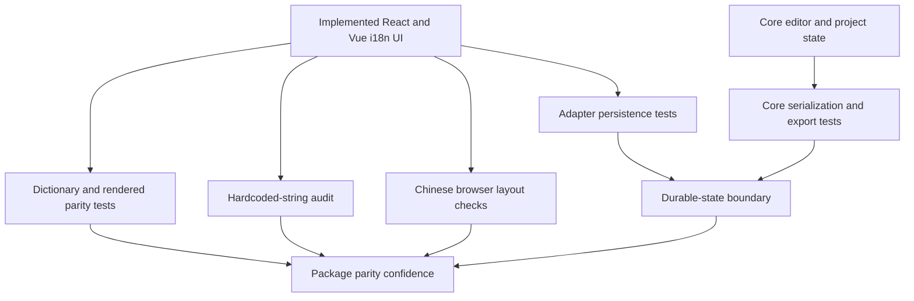

# feat: Add bilingual Workbench i18n verification

## Summary

Add the final verification slice for bilingual Workbench i18n: durable serialization invariance, React/Vue parity, targeted hardcoded-string audit coverage, and Chinese layout fit checks. This plan consumes the descriptor, React, Vue, and inspector/problem i18n work from the sibling plans; it does not add new localization features or persist locale state.

---

## Problem Frame

The parent bilingual Workbench plan makes English and Simplified Chinese available across the default React and Vue Workbench. The earlier slices establish message descriptors, adapter dictionaries, locale state, shell translation, and inspector/problem translation. What remains is the cross-cutting proof that those pieces are safe as a package contract.

The highest-risk regressions are not in a single component. Locale can accidentally leak into `SceneSnapshot` or `.ek3d` export data, React and Vue dictionaries can drift, hardcoded English can return in default Workbench components, and Chinese copy can expose wrapping or clipping problems in dense toolbar, left-panel, inspector, and status layouts. This plan builds that verification net around the implemented behavior.

---

## Requirements

**Durable-State Invariance**

- R1. Locale, built-in switch state, dictionaries, translated UI copy, host translation callbacks, and descriptor-only UI data must be absent from `editor.serialize()` output and project package exports. (origin R14, R21, AE2; parent U6)
- R2. User-authored scene, node, object, asset, material, material slot, light, camera view, file, GLB metadata, and technical ID values must remain as authored across locale changes. (origin R13, AE4; parent U6)
- R3. Runtime-only values such as `File`, `Blob`, object URLs, Three.js objects, resolver outputs, runtime problems, PMREM outputs, dictionaries, and translator functions must stay out of durable outputs. (origin R14, AE2; parent U6)

**Parity and Coverage**

- R4. React and Vue built-in dictionaries must keep shared Workbench, inspector, and problem message keys aligned for both `en` and `zh-CN`. (origin R17, R19, R20, AE5; parent U6)
- R5. Representative React and Vue Workbench states must resolve equivalent shared concepts from the same key set in both languages. (origin R17, R19, R20, AE5; parent U6)
- R6. Host translation overrides and fallback behavior must remain equivalent enough that missing keys, raw technical details, and authored values behave the same in both adapters. (origin R12, R18; parent U6)

**Audit and Layout Guardrails**

- R7. A targeted hardcoded-string audit must catch new default Workbench, inspector, and problem UI English literals outside dictionaries while allowing technical constants and authored fixture data. (origin R23; parent U6)
- R8. Browser or DOM-level checks must prove Chinese toolbar, left panel, inspector, problem, and status surfaces remain usable at narrow and desktop widths. (origin R22, AE6; parent U6)
- R9. CSS changes made for Chinese fit must be scoped to wrapping, min-width, overflow, and spacing fixes rather than a broader Workbench layout redesign. (origin R22; parent U6)
- R10. The verification path must use the existing Vitest and browser proof-loop infrastructure without adding a required i18n runtime dependency or a new visual regression service. (origin R10, R16, R19-R22; parent U6)

---

## Key Technical Decisions

- KTD1. **Treat this as a verification slice:** The plan assumes the descriptor, React, Vue, and inspector/problem localization plans have landed or will land first. This slice should strengthen tests and scoped CSS fit issues, not introduce a second i18n resolver or expand the language surface.
- KTD2. **Use negative durable-output sentinels plus positive authored-value assertions:** Tests should assert that known locale keys, translated Chinese copy, dictionary words, and UI-only labels are absent, while authored values such as `Pump A`, `motor-control-panel.glb`, `Hero view`, and `Key light` remain present when they are real scene/project data.
- KTD3. **Compare shared dictionary contracts directly:** React and Vue should either have matching shared key sets or an explicit adapter-private allowlist. Silent drift between package dictionaries is a test failure.
- KTD4. **Keep the hardcoded-string audit targeted:** Scan default Workbench, inspector, problem, and adapter i18n-adjacent source files. Do not run a naive repository-wide English scan that would flag tests, command constants, CSS class names, technical IDs, or demo-authored scene data.
- KTD5. **Prefer existing browser proof-loop checks for layout:** Extend the current browser proof loop and DOM measurement helpers for Chinese layout fit instead of adding screenshot-diff tooling. The existing canvas nonblank and bounding-rect checks are already close to the needed proof.
- KTD6. **Treat example host overlay copy as host-authored text:** The proof-loop example overlay may remain English unless the example itself opts into host localization later. U6 verifies the default Workbench package chrome, not every string in host demo code.
- KTD7. **Adjust CSS only where verification exposes a real fit issue:** Use current `min-width: 0`, wrapping, `overflow-wrap`, and scroll containment patterns in `workbench.css` and `inspector.css`; avoid visual rewrites unrelated to localized text fit.

---

## High-Level Technical Design

The verification shape has four independent gates. Core persistence tests protect durable data directly. Adapter persistence tests prove locale changes and UI interactions do not cross that boundary. Parity and audit tests prevent future drift. Browser fit checks catch dense Chinese copy issues that jsdom cannot see.

---

## Implementation Units

### U1. Strengthen core durable-state invariance tests

- **Goal:** Prove core serialization and project export outputs remain free of i18n UI data while preserving authored values.
- **Requirements:** R1, R2, R3.
- **Dependencies:** Descriptor contract plan, core display descriptor plan.
- **Files:** `packages/core/src/i18n/messages.test.ts`, `packages/core/src/i18n/display-messages.test.ts`, `packages/core/src/editor/serialization.test.ts`, `packages/core/src/project/export-project.test.ts`, `packages/core/src/project/import-project.test.ts`.
- **Approach:** Extend existing descriptor, snapshot, export, and import tests with i18n-specific sentinels. Assert that descriptor keys and fallback data stay transient unless they are part of a display-only model under test, and assert that serialized scene/project data contains authored labels but not locale, dictionaries, translated copy, UI descriptors, or runtime-only values.
- **Execution note:** Start with failing assertions around durable-output text because this unit defines the persistence boundary the adapter tests must honor.
- **Patterns to follow:** Existing `packages/core/src/editor/serialization.test.ts` i18n descriptor exclusion test, project export runtime-exclusion tests in `packages/core/src/project/export-project.test.ts`, and descriptor JSON-safety tests in `packages/core/src/i18n/messages.test.ts`.
- **Test scenarios:**
  - Covers AE2. Given a scene contains authored values such as `Pump A`, `motor-control-panel.glb`, `Hero view`, `Key light`, `Body`, and `Studio HDR`, when `serializeSnapshot()` and `editor.exportProject()` run, then those values remain present only as durable authored data.
  - Covers AE2. Given core display descriptors exist for Workbench, inspector, asset, runtime, and problem surfaces, when scene and package payloads are stringified, then `locale`, `zh-CN`, dictionary names, message-key prefixes, translated Chinese UI copy, and descriptor-only UI fields are absent.
  - Given a partial project export contains known project problems, when the package archive is decoded, then stable problem UI copy and translated action labels are absent while durable problem acknowledgement data remains in its existing schema location.
  - Given an exported project is imported back, when the restored snapshot is inspected, then locale and dictionary data do not appear through the round trip.
  - Given descriptor interpolation values include user-authored labels and counts, when descriptor helper tests stringify descriptors, then values remain JSON-safe and do not contain `File`, `Blob`, object URLs, Three.js object names, resolver outputs, PMREM outputs, or functions.
- **Verification:** Core durable outputs remain schema-compatible and do not persist i18n presentation data.

### U2. Add adapter persistence and authored-value invariance coverage

- **Goal:** Prove React and Vue locale changes, built-in switch usage, host-controlled locale changes, and default Workbench interactions do not mutate durable editor/project state.
- **Requirements:** R1, R2, R3, R6.
- **Dependencies:** U1, React Workbench i18n plan, Vue Workbench i18n plan, inspector/problem i18n plan.
- **Files:** `packages/react/test/workbench.test.tsx`, `packages/react/test/strict-mode.test.tsx`, `packages/vue/test/workbench.test.ts`, `packages/vue/test/vue-proof-loop.integration.test.ts`.
- **Approach:** Add representative React and Vue tests that edit the scene, use localized toolbar/left-panel/inspector/problem controls, switch locale, export or serialize, and compare durable output against i18n sentinels. Keep lifecycle assertions near existing StrictMode/raw-editor tests so locale changes are proven not to recreate editor/runtime instances.
- **Patterns to follow:** React controlled/uncontrolled locale tests in `packages/react/test/workbench.test.tsx`, Vue raw-editor stability tests in `packages/vue/test/workbench.test.ts`, and Vue proof-loop export/restore assertions in `packages/vue/test/vue-proof-loop.integration.test.ts`.
- **Test scenarios:**
  - Covers AE2. Given React Workbench edits a transform, creates a camera view, shows a recoverable problem, switches between `en` and `zh-CN`, and exports a project, then the exported scene contains edited data and authored names but no locale, switch state, dictionary keys, translated copy, host translator callbacks, or selected `File`.
  - Covers AE2. Given Vue Workbench follows the same edit/problem/export flow, when the project package is decoded, then the same durable-state exclusions hold.
  - Covers AE4. Given authored values such as `Robot arm`, `Body`, `Screen`, `Studio HDR`, `Hero view`, `Key light`, `motor-control-panel.glb`, and `asset-a` render under both locales, when locale changes, then those values remain unchanged in UI and durable output.
  - Given a host controls locale and hides the built-in switch, when the host changes locale repeatedly, then visible Workbench copy updates and the same editor/runtime ownership behavior from existing tests is preserved.
  - Given an uncontrolled built-in switch changes locale after runtime problems refresh, when `editor.serialize()` runs, then runtime problem display copy and switch state are absent from the snapshot.
- **Verification:** Adapter locale behavior remains UI-only across real Workbench interactions.

### U3. Add cross-adapter dictionary and rendered parity tests

- **Goal:** Catch React/Vue drift in shared message keys, built-in copy, resolver behavior, fallback behavior, and representative rendered Workbench states.
- **Requirements:** R4, R5, R6.
- **Dependencies:** React Workbench i18n plan, Vue Workbench i18n plan, inspector/problem i18n plan.
- **Files:** `packages/react/test/workbench-i18n.test.ts`, `packages/vue/test/workbench-i18n.test.ts`, `packages/react/test/workbench.test.tsx`, `packages/vue/test/workbench.test.ts`, `packages/react/test/workbench-i18n-parity.test.ts`.
- **Approach:** Keep package-local dictionary parity tests, then add one cross-adapter parity test that imports data-only dictionary/resolver exports from both adapters. Compare complete shared keys unless implementation needs a small explicit adapter-private allowlist. Add representative rendered-state assertions for toolbar, left panel, status, inspector, and problem surfaces in both adapters.
- **Patterns to follow:** Existing `WORKBENCH_DICTIONARIES` parity tests in both packages, descriptor resolution tests in `packages/react/test/workbench-i18n.test.ts` and `packages/vue/test/workbench-i18n.test.ts`, and representative Workbench render tests in each adapter.
- **Test scenarios:**
  - Covers AE5. Given React and Vue dictionary exports are inspected, when shared key sets are sorted, then both adapters expose the same shared keys for `en` and `zh-CN` or fail with any missing key outside an explicit adapter-private allowlist.
  - Covers AE5. Given representative shared keys for project actions, hierarchy, assets, status, inspector sections, field labels, problem titles, severities, and actions are resolved in both adapters, then equivalent concepts resolve to equivalent built-in copy in both locales.
  - Given a descriptor-backed problem with a raw technical detail is resolved through both adapters in `zh-CN`, then stable title/action copy localizes and the raw detail remains unchanged.
  - Given a missing key descriptor is resolved through both adapters, then both fall back to the descriptor fallback with interpolation values preserved.
  - Given a host translation override returns a value for one shared key and throws for another, when each adapter resolves the keys, then host copy wins for the first key and built-in/fallback behavior wins for the throwing key.
- **Verification:** React and Vue stay linguistically aligned for the default bilingual Workbench contract.

### U4. Add a targeted hardcoded-string audit guardrail

- **Goal:** Prevent new default Workbench, inspector, and problem UI English strings from bypassing dictionaries.
- **Requirements:** R7, R10.
- **Dependencies:** React Workbench i18n plan, Vue Workbench i18n plan, inspector/problem i18n plan.
- **Files:** `packages/react/test/i18n-string-audit.test.ts`, `packages/vue/test/i18n-string-audit.test.ts`, `packages/react/src/components/EditorWorkbench.tsx`, `packages/react/src/components/WorkbenchToolbar.tsx`, `packages/react/src/components/WorkbenchLeftPanel.tsx`, `packages/react/src/components/WorkbenchStatusBar.tsx`, `packages/react/src/components/InspectorView.tsx`, `packages/react/src/components/ProblemsPanel.tsx`, `packages/react/src/components/*Inspector.tsx`, `packages/vue/src/components/EditorWorkbench.vue`, `packages/vue/src/components/WorkbenchToolbar.vue`, `packages/vue/src/components/WorkbenchLeftPanel.vue`, `packages/vue/src/components/WorkbenchStatusBar.vue`, `packages/vue/src/components/InspectorView.vue`, `packages/vue/src/components/ProblemsPanel.vue`, `packages/vue/src/components/*Inspector.vue`.
- **Approach:** Add targeted tests that parse or scan only the default Workbench/inspector/problem source surface and ignore dictionary files, tests, examples, CSS, technical constants, command names, MIME types, CSS class names, data attributes, and authored fixture labels. Prefer TypeScript/Vue source parsing where practical; keep any fallback lexical scan narrow and allowlisted.
- **Patterns to follow:** Package-local tests that assert build/package constraints without adding runtime dependencies, and existing dictionary key tests that already define the intended source of UI copy.
- **Test scenarios:**
  - Given a new literal such as `Export partial`, `Scene inspector`, or `Replace asset` is introduced directly in a default React component, when the React audit runs, then the test fails unless the string is moved into the dictionary or allowlisted as non-user-facing technical data.
  - Given a new literal such as `Material target`, `No runtime problems`, or `Camera views` is introduced directly in a default Vue component, when the Vue audit runs, then the test fails unless the string is moved into the dictionary or allowlisted.
  - Given command constants such as `import-glb`, CSS class names, `data-testid` values, MIME types, file extensions, and test fixture authored labels appear in scanned files, when the audit runs, then those technical values do not produce false positives.
  - Given dictionary modules contain English fallback copy, when the audit runs, then dictionary files are excluded from the hardcoded-string source scan.
  - Given host demo overlay strings remain in proof-loop examples, when the audit runs, then example host-authored copy is outside the default Workbench scan.
- **Verification:** Future UI copy additions have a maintainable path into dictionaries without noisy repository-wide failures.

### U5. Add Chinese browser layout verification and scoped CSS fixes

- **Goal:** Prove Chinese localized Workbench UI fits at narrow and desktop widths without overlap, critical clipping, or unusable controls.
- **Requirements:** R8, R9, R10.
- **Dependencies:** U2, U3, inspector/problem i18n plan.
- **Files:** `packages/react/test/proof-loop-demo.browser.test.tsx`, `examples/react-proof-loop/src/App.tsx`, `examples/vue-proof-loop/src/App.vue`, `packages/react/src/components/workbench.css`, `packages/react/src/components/inspector.css`, `packages/vue/src/components/workbench.css`, `packages/vue/src/components/inspector.css`, `vitest.browser.config.ts`.
- **Approach:** Extend the current browser proof-loop test so it can mount React and Vue default Workbenches in `zh-CN`. Use the existing painted renderer, canvas nonblank check, and bounding-rect helpers. Add narrow and desktop host-width checks for toolbar groups, locale switch, asset controls, asset rows, inspector sections, problem rows, camera controls, and status bar. Apply matching React/Vue CSS fixes only when tests expose a real wrapping or containment issue.
- **Patterns to follow:** Existing `assertAssetWorkspaceLayout()`, `assertCameraLayout()`, `assertChildrenInside()`, and canvas-pixel checks in `packages/react/test/proof-loop-demo.browser.test.tsx`; current `min-width: 0`, `flex-wrap`, scroll containment, and `overflow-wrap` patterns in Workbench and inspector CSS.
- **Test scenarios:**
  - Covers AE6. Given React default Workbench renders in `zh-CN` at desktop width, when toolbar, left panel, inspector, problem area, status bar, and viewport are measured, then visible controls stay inside their containers and the canvas remains nonblank.
  - Covers AE6. Given React default Workbench renders in `zh-CN` at narrow width, when the same surfaces are measured, then text wraps, scrolls, or truncates within its own region without overlapping adjacent controls.
  - Covers AE6. Given Vue default Workbench renders in `zh-CN` at desktop and narrow widths, when the shared layout assertions run, then equivalent surfaces pass the same containment checks.
  - Given long authored labels appear beside Chinese UI chrome, when asset rows, material target cards, camera rows, and problem rows render, then authored values remain readable and are not translated.
  - Given proof-loop examples expose host overlay text, when Chinese layout tests run, then host-authored overlay copy is not used as evidence for default Workbench localization coverage.
  - Given CSS changes are needed for fit, when English-default proof-loop checks still run, then existing English layout, canvas sizing, marquee selection, and camera controls remain usable.
- **Verification:** Chinese copy is usable in the current Workbench layout across the package proof-loop surfaces without adding a separate visual testing stack.

### U6. Consolidate the verification matrix and release-facing test posture

- **Goal:** Make the final U6 verification suite understandable and maintainable for future package changes.
- **Requirements:** R1-R10.
- **Dependencies:** U1-U5.
- **Files:** `packages/react/test/workbench-i18n.test.ts`, `packages/vue/test/workbench-i18n.test.ts`, `packages/react/test/workbench-i18n-parity.test.ts`, `packages/react/test/i18n-string-audit.test.ts`, `packages/vue/test/i18n-string-audit.test.ts`, `packages/react/test/proof-loop-demo.browser.test.tsx`, `package.json`.
- **Approach:** Keep verification in the existing Vitest and browser test commands. Name tests so failures identify whether the regression is durable-state leakage, adapter parity drift, hardcoded UI copy, or Chinese layout fit. Avoid adding new package scripts unless the existing commands cannot make the matrix discoverable.
- **Patterns to follow:** Existing `pnpm test`, `pnpm test:browser`, release verification script coverage in `package.json`, and package-local test naming conventions.
- **Test scenarios:**
  - Given the normal test suite runs, when a locale leak is introduced into snapshot or project export code, then a core or adapter persistence test fails with a durable-state boundary message.
  - Given the normal test suite runs, when React and Vue dictionary keys drift, then a parity test identifies the missing or extra key.
  - Given the normal test suite runs, when new default UI text is hardcoded in React or Vue components, then the relevant audit test points to the source file and allowlist decision.
  - Given the browser suite runs, when Chinese text clips or escapes a Workbench region at the planned widths, then the browser test fails in the layout helper tied to that surface.
  - Given package release verification runs, when no i18n regression exists, then the final U6 additions require no extra third-party i18n runtime or visual service setup.
- **Verification:** The completed bilingual Workbench feature has a clear, repeatable regression matrix under the repository's existing test posture.

---

## Acceptance Examples

- AE1. Given a React or Vue Workbench user changes locale after editing a scene, when snapshot and project export output are inspected, then scene/user data remains and locale, switch state, dictionaries, translated copy, descriptor-only UI data, host callbacks, and selected `File` objects are absent.
- AE2. Given equivalent React and Vue default Workbench states render in English and Simplified Chinese, when shared concepts are resolved and representative UI is queried, then both adapters use the same shared key set and equivalent copy.
- AE3. Given a new English UI literal is added directly to a default Workbench or inspector component, when the targeted audit runs, then it fails unless the literal is moved into a dictionary or explicitly allowlisted as technical/non-user-facing data.
- AE4. Given Chinese locale at desktop and narrow widths, when toolbar, side panel, inspector, problem rows, status bar, and viewport are measured in the browser proof loop, then localized text stays within its region and controls remain usable.
- AE5. Given authored labels such as `motor-control-panel.glb`, `Pump A`, `Body`, `Studio HDR`, `Hero view`, or `Key light`, when locale changes and durable data is exported, then those labels remain unchanged as authored values.

---

## Scope Boundaries

### In Scope

- Durable-state invariance tests for core serialization, project export/import, and adapter Workbench interactions.
- Cross-adapter dictionary key and representative rendered-behavior parity checks.
- Targeted hardcoded-string audit guardrails for default Workbench, inspector, and problem UI source surfaces.
- Browser/DOM Chinese layout fit checks for toolbar, left panel, inspector, problem rows, status bar, and viewport across narrow and desktop widths.
- Scoped CSS fixes required by Chinese text fit verification.

### Deferred to Follow-Up Work

- Snapshot-diff visual regression infrastructure or screenshot approval tooling.
- Languages beyond `en` and `zh-CN`.
- A shared i18n package or generated dictionary artifact.
- Host demo overlay localization and host-owned settings persistence.
- Repository-wide prose linting for every English string in docs, tests, examples, and technical source files.

### Outside This Feature

- Persisting locale or language preference into `SceneSnapshot`, `.ek3d`, command history, asset records, runtime metadata, GLB import metadata, or project manifests.
- Adding required `i18next`, `react-i18next`, Vue I18n, FormatJS, or similar dependencies.
- Translating user-authored scene, object, asset, material, light, camera, file, imported metadata, problem code, or technical ID values.
- Reworking the Workbench layout beyond localization fit fixes.
- Replanning or reimplementing the descriptor, React, Vue, or inspector/problem i18n slices.

---

## System-Wide Impact

- **Core persistence contracts:** Tests reinforce the existing snapshot-first boundary without changing scene or project package schema.
- **React and Vue package contracts:** Dictionary parity and resolver behavior become package-level regression surfaces.
- **Default Workbench maintenance:** New UI copy must flow through dictionaries or an explicit audit allowlist decision.
- **Browser verification:** The proof-loop browser suite gains Chinese layout coverage and may need small example/test entrypoint hooks for `zh-CN`.
- **CSS parity:** React and Vue Workbench/inspector CSS should stay aligned when fit fixes are applied.

---

## Risks & Dependencies

- **Risk: hardcoded-string audit false positives.** Mitigate by scanning only default Workbench/inspector/problem source surfaces and keeping explicit allowlists for technical constants and authored fixtures.
- **Risk: parity tests over-constrain adapter-private behavior.** Mitigate with a small explicit allowlist for any genuinely adapter-private key while treating shared default concepts as strict.
- **Risk: browser layout tests become brittle.** Mitigate by asserting containment, overlap, scrollability, and nonblank canvas outcomes rather than exact pixel positions.
- **Risk: layout fixes hide content instead of making it usable.** Mitigate by requiring controls to remain measurable, readable enough, and inside their intended region at both planned widths.
- **Risk: example host text is mistaken for Workbench localization scope.** Mitigate by treating proof-loop overlay copy as host-authored text and querying default Workbench regions for localization assertions.
- **Dependency:** This plan assumes the descriptor, core display, React, Vue, and inspector/problem i18n plans are implemented first or completed alongside this verification slice.

---

## Sources & Research

- Origin requirements: `docs/brainstorms/2026-06-17-bilingual-workbench-i18n-requirements.md`
- Parent U6 scope: `docs/plans/2026-06-17-001-feat-bilingual-workbench-i18n-plan.md`
- Descriptor contract dependency: `docs/plans/2026-06-17-002-feat-framework-neutral-i18n-descriptor-contract-plan.md`
- Core display descriptor dependency: `docs/plans/2026-06-17-003-feat-core-display-message-descriptors-plan.md`
- React i18n dependency: `docs/plans/2026-06-17-004-feat-react-workbench-i18n-plan.md`
- Vue i18n dependency: `docs/plans/2026-06-18-001-feat-vue-workbench-i18n-plan.md`
- Inspector/problem i18n dependency: `docs/plans/2026-06-18-002-feat-inspector-problem-i18n-plan.md`
- Core persistence tests: `packages/core/src/editor/serialization.test.ts`, `packages/core/src/project/export-project.test.ts`, `packages/core/src/project/import-project.test.ts`
- Adapter i18n tests: `packages/react/test/workbench-i18n.test.ts`, `packages/vue/test/workbench-i18n.test.ts`
- Adapter Workbench tests: `packages/react/test/workbench.test.tsx`, `packages/vue/test/workbench.test.ts`, `packages/vue/test/vue-proof-loop.integration.test.ts`
- Browser proof-loop tests: `packages/react/test/proof-loop-demo.browser.test.tsx`, `vitest.browser.config.ts`
- Workbench CSS surfaces: `packages/react/src/components/workbench.css`, `packages/react/src/components/inspector.css`, `packages/vue/src/components/workbench.css`, `packages/vue/src/components/inspector.css`
- Proof-loop example entrypoints: `examples/react-proof-loop/src/App.tsx`, `examples/vue-proof-loop/src/App.vue`
