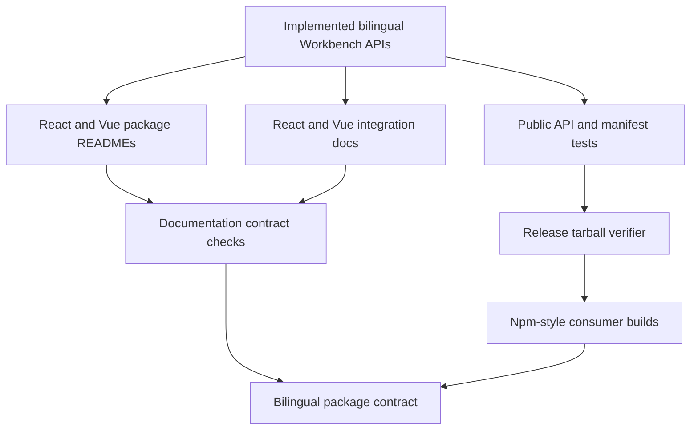

# feat: Document bilingual Workbench package contract

## Summary

Document the bilingual Workbench contract for npm consumers and harden the package-facing tests that protect it. This plan covers React/Vue package READMEs, integration docs, release docs, public root exports, package dependency boundaries, and packed-tarball consumer verification; it does not add new localized UI behavior.

---

## Problem Frame

The parent bilingual Workbench plan makes `en` and `zh-CN` part of the default React and Vue Workbench package surface. The final U7 slice needs to make that contract visible to npm users and enforce it at the same boundaries npm users actually consume: package roots, package manifests, published READMEs, CSS subpaths, packed tarballs, and release verification.

The current repository already has several i18n contract tests and package checks in place, including public API tests, build-config dependency checks, dictionary parity tests, and release tarball verification. This plan treats those as the implementation pattern to strengthen rather than replacing them with a new documentation or packaging system.

---

## Requirements

**npm-Facing Documentation**

- R1. React package documentation must show default English behavior, host-controlled `zh-CN`, uncontrolled default locale, built-in switch visibility/control, host translation override, and render-prop `i18n` access. (origin R3-R6, R18, R24; parent U7)
- R2. Vue package documentation must show default English behavior, host-controlled `zh-CN`, uncontrolled default locale, built-in switch visibility/control, host translation override, `update:locale`, and scoped-slot `i18n` access. (origin R3-R6, R18, R24; parent U7)
- R3. Integration docs must explain that locale, switch state, dictionaries, translated copy, and host translation callbacks are session/host UI state and must not be stored in `SceneSnapshot`, `.ek3d`, command history, asset records, or runtime metadata. (origin R14, R21, R24; parent U7)
- R4. Repository-level docs must point users to the bilingual Workbench package behavior without promising non-`0.x` API stability, additional languages, persistent language preference, or a general-purpose settings system. (origin R10, R14, R24; parent U7)
- R5. Docs must use package-root imports and the public `styles.css` subpath only; they must not teach deep imports into component or i18n internals. (origin R18, R24; parent U7)

**Package Contract Tests**

- R6. React and Vue public API tests must prove documented locale props, i18n context types, resolver helpers, and Vue emits are available from package roots without exposing private internals. (origin R18-R20; parent U7)
- R7. React and Vue build/package tests must prove no required third-party i18n runtime dependency is added through `dependencies`, `peerDependencies`, or `optionalDependencies`. (origin R10, R16; parent U7)
- R8. Release verification must prove packed npm tarballs support the documented i18n root-import surface, CSS subpath import, and consumer mounting path for React and Vue. (origin R1-R3, R18, R24; parent U7)
- R9. Release verification must keep private subpaths blocked and must continue proving workspace protocol ranges do not leak into packed React/Vue package manifests. (origin R18; parent U7)
- R10. Documentation contract checks must catch missing durable-state guidance and forbidden deep-import examples in npm-facing docs. (origin R14, R24; parent U7)

---

## Key Technical Decisions

- KTD1. **Keep docs centered on package-root APIs:** npm users should learn `EditorWorkbench`, locale props, i18n types/helpers, and `styles.css` from package roots. Internal dictionary modules remain an implementation detail even if tests import them locally.
- KTD2. **Put the durable-state warning next to locale examples:** The most likely misuse is treating language preference like scene data. React and Vue docs should mention the persistence boundary where they introduce controlled locale and host state.
- KTD3. **Use release verifier coverage for packed-package proof:** Source-level public API tests are necessary but not sufficient. `scripts/verify-release.mjs` should also compile and build a temporary consumer against packed tarballs using the documented i18n surface.
- KTD4. **Document host translation as a bridge, not a dependency:** The package supplies built-in `en` and `zh-CN` dictionaries. Host `translate` callbacks are optional integration points and must not imply `i18next`, Vue I18n, FormatJS, or browser-language detection is required.
- KTD5. **Keep package READMEs concise and integration docs deeper:** Package READMEs should stay npm-install friendly. Detailed host-store, durable-state, and extension-region guidance belongs in `docs/integration-react.md` and `docs/integration-vue.md`.
- KTD6. **Test documentation by contract, not prose snapshots:** Contract tests should assert required examples/guidance and forbidden claims, not freeze whole README paragraphs.

---

## High-Level Technical Design

The package contract is protected at two levels. Source tests guard the current workspace surface, and release verification proves the same documented surface survives packing, install, type-checking, and Vite consumer builds.

---

## Implementation Units

### U1. Update React npm-facing documentation

- **Goal:** Make the React package README and integration guide explain how npm users enable and control bilingual Workbench behavior.
- **Requirements:** R1, R3, R5, R10.
- **Dependencies:** React Workbench i18n plan; inspector/problem i18n plan; bilingual verification plan.
- **Files:** `packages/react/README.md`, `docs/integration-react.md`, `packages/react/test/package-docs.test.ts`, `packages/test/docs-contract.ts`.
- **Approach:** Add compact React examples for default English, `locale="zh-CN"`, `defaultLocale`, hidden/disabled built-in switch, `onLocaleChange`, `translate`, and render-prop `context.i18n`. Place durable-state guidance beside the host-controlled locale example and preserve the existing React README posture around `0.x`, root imports, CSS import, host-owned editor lifetime, and runtime-only values.
- **Patterns to follow:** Existing `packages/react/README.md` install-ready Workbench example, existing durable-state guidance in `docs/integration-react.md`, and root import examples in `docs/release.md`.
- **Test scenarios:**
  - Given `packages/react/README.md` is scanned, when required React i18n examples are checked, then it mentions default English, `zh-CN`, switch visibility/control, host translation override, and render-prop `i18n` access.
  - Given `docs/integration-react.md` is scanned, when persistence guidance is checked, then locale and switch state are described as host/session UI state rather than `SceneSnapshot` or `.ek3d` data.
  - Given React docs are scanned for imports, when examples are inspected, then they use `@ek-aiot/3d-editor-react` and `@ek-aiot/3d-editor-react/styles.css` rather than private component or i18n subpaths.
  - Given a docs example includes host-authored labels or file names, when guidance is checked, then those values are described as authored values that should not be translated by default.
- **Verification:** React npm users can learn the bilingual contract from package docs without deep imports or persistence mistakes.

### U2. Update Vue npm-facing documentation

- **Goal:** Make the Vue package README and integration guide explain Vue-native locale control, switch behavior, and scoped-slot i18n access.
- **Requirements:** R2, R3, R5, R10.
- **Dependencies:** Vue Workbench i18n plan; inspector/problem i18n plan; bilingual verification plan.
- **Files:** `packages/vue/README.md`, `docs/integration-vue.md`, `packages/vue/test/package-docs.test.ts`, `packages/test/docs-contract.ts`.
- **Approach:** Add concise Vue examples for default English, `:locale="'zh-CN'"`, `default-locale`, `show-locale-switcher`, `locale-switcher-disabled`, `@update:locale`, `translate`, and scoped-slot `context.i18n`. Keep Vue guidance aligned with raw/shallow editor ownership and existing Pinia/store boundaries.
- **Patterns to follow:** Existing `packages/vue/README.md` install-ready Workbench example, existing Vue raw-editor guidance in `docs/integration-vue.md`, and Vue public API tests for `EditorWorkbenchProps`, `EditorWorkbenchEmits`, and `EditorWorkbenchSlots`.
- **Test scenarios:**
  - Given `packages/vue/README.md` is scanned, when required Vue i18n examples are checked, then it mentions default English, `zh-CN`, built-in switch visibility/control, `update:locale`, host translation override, and scoped-slot `i18n` access.
  - Given `docs/integration-vue.md` is scanned, when persistence guidance is checked, then locale and switch state are described as Vue/session state rather than durable editor state.
  - Given Vue docs are scanned for imports, when examples are inspected, then they use `@ek-aiot/3d-editor-vue` and `@ek-aiot/3d-editor-vue/styles.css` rather than private component or i18n subpaths.
  - Given the docs describe host stores, when locale preference is mentioned, then it is placed in host application state and not inside snapshot/project package data.
- **Verification:** Vue npm users get the same bilingual package contract through Vue-native props, emits, and slots.

### U3. Update repository, integration, and release-facing docs

- **Goal:** Make the broader documentation map point to bilingual Workbench behavior and explain release responsibilities for package-facing i18n changes.
- **Requirements:** R3, R4, R5, R10.
- **Dependencies:** U1, U2.
- **Files:** `README.md`, `docs/README.md`, `docs/release.md`, `packages/react/test/package-docs.test.ts`, `packages/vue/test/package-docs.test.ts`.
- **Approach:** Add a short bilingual Workbench note to the root overview and docs index. Update release docs so package README changes, public i18n type changes, and package-facing locale behavior are treated as package-facing release work that may require a changeset. Keep non-goals intact: no persisted language preference, no languages beyond `en`/`zh-CN`, no required i18n runtime, and no stable non-`0.x` API guarantee.
- **Patterns to follow:** Existing release guide sections for package-facing changes, root README package overview, and docs index navigation style.
- **Test scenarios:**
  - Given `README.md` and `docs/README.md` are scanned, when bilingual Workbench guidance is checked, then both point users to React/Vue package docs or integration docs without duplicating long examples.
  - Given `docs/release.md` is scanned, when package-facing change guidance is checked, then public i18n types, package README changes, and bilingual Workbench behavior are included in the changeset/release verification criteria.
  - Given root docs are scanned for promises, when non-goals are checked, then they do not promise language persistence, additional locales, external locale packs, or 1.0 API stability.
  - Given release docs import examples are scanned, when package import paths are checked, then only root package imports and `styles.css` subpaths are documented.
- **Verification:** The documentation set consistently describes the bilingual Workbench as a package feature with clear release and scope boundaries.

### U4. Harden React and Vue public API and manifest contract tests

- **Goal:** Ensure documented i18n APIs are exported from package roots and no required i18n runtime dependency enters publishable packages.
- **Requirements:** R6, R7, R9.
- **Dependencies:** React Workbench i18n plan; Vue Workbench i18n plan.
- **Files:** `packages/react/src/public-api.test.ts`, `packages/vue/src/public-api.test.ts`, `packages/react/test/build-config.test.ts`, `packages/vue/test/build-config.test.ts`, `packages/react/package.json`, `packages/vue/package.json`.
- **Approach:** Extend existing public API tests to cover every documented root-exported locale type/helper and adapter-specific contract: React props/render-prop context, Vue props/emits/slots, `DEFAULT_WORKBENCH_LOCALE`, locale labels, locale normalization, and resolver helpers. Extend package dependency tests to inspect `dependencies`, `peerDependencies`, and `optionalDependencies` for forbidden i18n runtimes while preserving framework peer dependencies and core workspace dependency alignment.
- **Patterns to follow:** Current public API tests in `packages/react/src/public-api.test.ts` and `packages/vue/src/public-api.test.ts`, current dependency checks in `packages/react/test/build-config.test.ts` and `packages/vue/test/build-config.test.ts`, and package manifest assertions in `scripts/verify-release.mjs`.
- **Test scenarios:**
  - Given React root imports compile, when documented locale props, `WorkbenchI18n`, `WorkbenchLocale`, `WorkbenchTranslate`, `resolveWorkbenchMessage`, and `DEFAULT_WORKBENCH_LOCALE` are referenced, then no deep import is required.
  - Given Vue root imports compile, when documented locale props, `EditorWorkbenchEmits`, `EditorWorkbenchSlots`, `WorkbenchI18n`, resolver helpers, and `update:locale` contract are referenced, then no deep import is required.
  - Given React and Vue package manifests are inspected, when runtime, peer, and optional dependencies are checked, then `i18next`, `react-i18next`, Vue I18n packages, FormatJS packages, and `intl-messageformat` are absent from required package surfaces.
  - Given package exports are inspected, when i18n exports are added, then private component paths, dictionary internals, and CSS-private paths remain unexported.
- **Verification:** Public APIs match the docs and package manifests preserve the no-required-runtime decision.

### U5. Extend packed tarball and npm-style consumer verification

- **Goal:** Prove the documented bilingual package contract survives packing and temporary consumer installation.
- **Requirements:** R6, R8, R9.
- **Dependencies:** U4.
- **Files:** `scripts/verify-release.mjs`, `docs/release.md`.
- **Approach:** Extend the existing release verifier's runtime check, type-check fixture, and React/Vue Vite consumer fixtures to import documented i18n helpers and mount `EditorWorkbench` with locale options from packed tarballs. Keep the verifier focused on root imports, CSS subpaths, private subpath blocking, registry-consumable core dependency ranges, and successful consumer builds.
- **Patterns to follow:** Existing `runtimeCheckSource()`, `typeCheckSource()`, `writeViteConsumerFixtures()`, private subpath checks, and packed manifest checks in `scripts/verify-release.mjs`.
- **Test scenarios:**
  - Given packed React and Vue tarballs are installed into the temporary consumer, when runtime checks import package roots, then `DEFAULT_WORKBENCH_LOCALE` is `en` and resolving a documented `zh-CN` Workbench message returns Chinese copy.
  - Given the temporary consumer type-checks, when React i18n props/types and Vue i18n props/emits/slots are referenced from package roots, then TypeScript succeeds without deep imports.
  - Given React and Vue Vite consumer fixtures build, when `EditorWorkbench` is mounted with documented locale options and CSS subpath imports, then both builds succeed from packed package contents.
  - Given private subpath checks run, when a consumer tries to import private component or i18n internals, then the type check still fails through package `exports`.
  - Given packed React/Vue manifests are inspected, when core dependency ranges are checked, then workspace protocol ranges are replaced with registry-consumable semver ranges.
- **Verification:** The npm package artifact exposes exactly the documented bilingual Workbench contract.

### U6. Add focused documentation contract tests

- **Goal:** Keep package docs from drifting away from the public API and durable-state contract.
- **Requirements:** R1-R5, R10.
- **Dependencies:** U1-U5.
- **Files:** `packages/test/docs-contract.ts`, `packages/react/test/package-docs.test.ts`, `packages/vue/test/package-docs.test.ts`, `packages/react/README.md`, `packages/vue/README.md`, `docs/integration-react.md`, `docs/integration-vue.md`, `README.md`, `docs/README.md`, `docs/release.md`.
- **Approach:** Add a small shared helper that reads markdown files and checks for required package-contract phrases, import patterns, durable-state warnings, and forbidden deep import patterns. Keep tests tolerant of prose edits by matching concepts and code identifiers rather than entire paragraphs. Avoid scanning all docs for English text; U6 is a package contract guard, not a localization linter.
- **Patterns to follow:** Existing package-local test placement, shared helper style under `packages/test`, and targeted i18n audit posture from `packages/test/i18n-string-audit.ts`.
- **Test scenarios:**
  - Given React package docs omit controlled `zh-CN`, `showLocaleSwitcher`, `translate`, or durable-state guidance, when the React package docs test runs, then it fails with the missing contract item.
  - Given Vue package docs omit `update:locale`, scoped-slot `i18n`, switch control, or durable-state guidance, when the Vue package docs test runs, then it fails with the missing contract item.
  - Given any npm-facing doc introduces a private import such as a component subpath or internal i18n module, when docs contract tests run, then the test fails unless the import appears in a section that explicitly says it is forbidden.
  - Given docs mention `SceneSnapshot` or `.ek3d` near locale examples, when tests scan the surrounding text, then they require guidance that locale is not durable editor state.
  - Given package docs evolve through prose edits, when tests run, then they check identifiers and contract concepts without freezing full paragraphs.
- **Verification:** Documentation remains aligned with the package API, release verifier, and durable-state boundary after future edits.

---

## Acceptance Examples

- AE1. Given a React npm user reads `packages/react/README.md`, when they want Simplified Chinese, then they can find package-root import usage, `locale="zh-CN"`, switch visibility/control, host translation override, and a warning not to persist locale in scene/project data.
- AE2. Given a Vue npm user reads `packages/vue/README.md`, when they want host-owned language settings, then they can find Vue-native props, `update:locale`, scoped-slot `i18n`, and the same durable-state boundary.
- AE3. Given source public API tests run, when documented i18n types and helpers are imported from React and Vue package roots, then the tests compile without deep imports.
- AE4. Given package manifest tests run, when dependencies are inspected, then React and Vue packages do not require `i18next`, `react-i18next`, Vue I18n, FormatJS, or similar runtimes.
- AE5. Given `pnpm release:verify` packs and installs the packages into a temporary consumer, when the consumer imports the documented i18n surface and builds React/Vue Workbench fixtures, then packed package verification succeeds.
- AE6. Given npm-facing docs are edited later, when documentation contract tests run, then missing locale guidance, missing durable-state warnings, or forbidden private import examples are caught.

---

## Scope Boundaries

### In Scope

- React and Vue package README updates for bilingual Workbench usage.
- React and Vue integration guide updates for host-controlled locale, host translation bridge, and durable-state boundaries.
- Root README/docs index/release guide updates that point to the bilingual package contract.
- Public API tests for documented root exports and adapter-specific locale contracts.
- Package manifest/build-config tests for no required i18n runtime dependency.
- Release verifier updates for packed tarball i18n root-import and consumer build coverage.
- Focused docs contract tests for required guidance and forbidden deep imports.

### Deferred to Follow-Up Work

- A generated documentation site or API reference.
- Translating all repository docs into both English and Chinese.
- Host demo overlay localization beyond default package Workbench chrome.
- Async locale pack documentation, third-party plugin locale packs, or languages beyond `en` and `zh-CN`.
- Visual screenshot documentation for Chinese layout behavior.

### Outside This Feature

- Adding or changing localized UI behavior in React/Vue components.
- Adding new message keys, dictionaries, or core display descriptors except where a test reveals a documented export mismatch.
- Persisting locale, language preference, switch state, dictionaries, or translated copy into `SceneSnapshot`, `.ek3d`, command history, asset records, runtime metadata, or project manifests.
- Adding required `i18next`, `react-i18next`, Vue I18n, FormatJS, or similar runtime dependencies.
- Exposing private component, dictionary, or internal i18n module subpaths from published packages.

---

## System-Wide Impact

- **Public packages:** React and Vue package READMEs, public root exports, and package manifest tests are part of the npm-facing contract.
- **Release verification:** `scripts/verify-release.mjs` becomes the final proof that i18n docs and root imports survive packing and consumer builds.
- **Documentation maintenance:** Package docs gain tests that constrain required guidance while leaving prose editable.
- **Durable-state boundary:** This plan reinforces the existing rule that locale is UI/session state and never serialized editor data.

---

## Risks & Dependencies

- **Dependency on sibling i18n plans:** U7 should land after locale props, resolver helpers, dictionaries, inspector/problem localization, and verification gates exist. Mitigate by treating missing identifiers during implementation as dependency failures, not as prompts to invent new API shapes in docs.
- **Risk: docs overpromise stability:** The packages are still experimental `0.x`. Keep README and release language aligned with existing `0.x` warnings.
- **Risk: tests become brittle prose snapshots:** Use contract-based markdown checks around identifiers and required concepts rather than full-paragraph matching.
- **Risk: release verifier duplicates too much UI testing:** Keep packed consumer checks to import/type/build smoke coverage. Behavioral locale rendering belongs to adapter and browser tests from sibling plans.
- **Risk: host translation examples imply required runtime integration:** Show `translate` as an optional callback and state that built-in `en`/`zh-CN` works without third-party i18n packages.

---

## Documentation / Operational Notes

- Package README changes are package-facing and may require a changeset when they describe new public behavior.
- Integration docs should remain deeper than package READMEs and can keep the current Chinese prose style.
- Release verification should remain under the existing `release:verify` path rather than adding a new release-only command.
- Contract tests should not scan examples or host demo overlays for full localization coverage; that belongs to the verification plan's default Workbench audit.

---

## Sources & Research

- Origin requirements: `docs/brainstorms/2026-06-17-bilingual-workbench-i18n-requirements.md`
- Parent U7 scope: `docs/plans/2026-06-17-001-feat-bilingual-workbench-i18n-plan.md`
- Sibling descriptor plan: `docs/plans/2026-06-17-002-feat-framework-neutral-i18n-descriptor-contract-plan.md`
- Sibling React plan: `docs/plans/2026-06-17-004-feat-react-workbench-i18n-plan.md`
- Sibling Vue plan: `docs/plans/2026-06-18-001-feat-vue-workbench-i18n-plan.md`
- Sibling verification plan: `docs/plans/2026-06-18-003-feat-bilingual-i18n-verification-plan.md`
- Package docs: `packages/react/README.md`, `packages/vue/README.md`
- Integration docs: `docs/integration-react.md`, `docs/integration-vue.md`, `README.md`, `docs/README.md`, `docs/release.md`
- Package manifests and tests: `packages/react/package.json`, `packages/vue/package.json`, `packages/react/src/public-api.test.ts`, `packages/vue/src/public-api.test.ts`, `packages/react/test/build-config.test.ts`, `packages/vue/test/build-config.test.ts`
- Release verifier: `scripts/verify-release.mjs`
