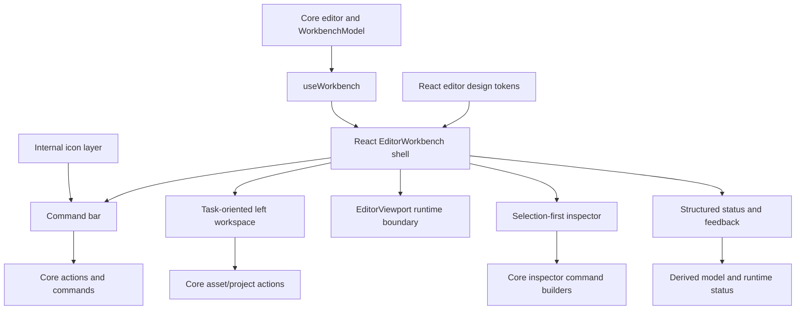
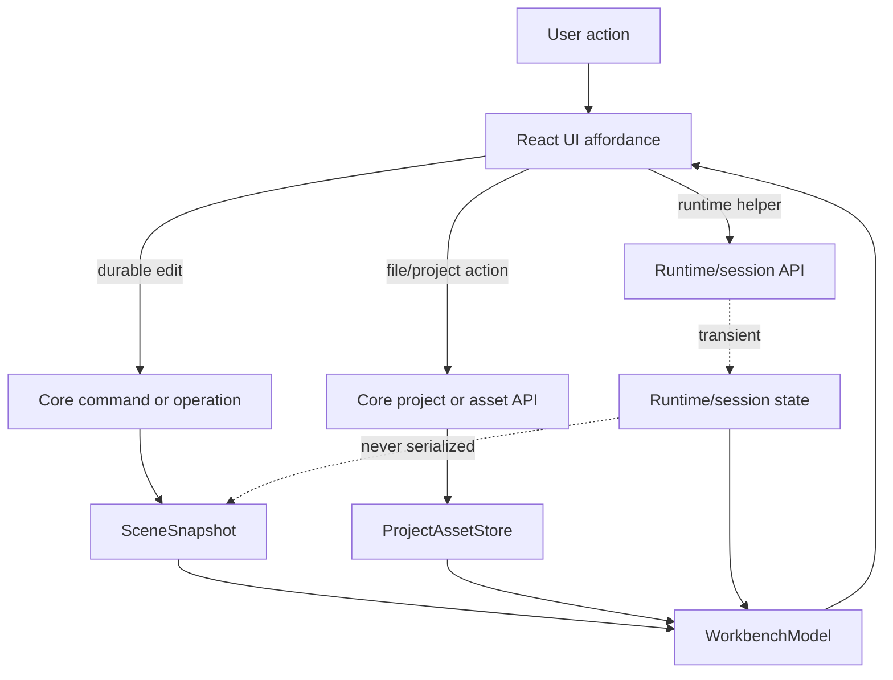
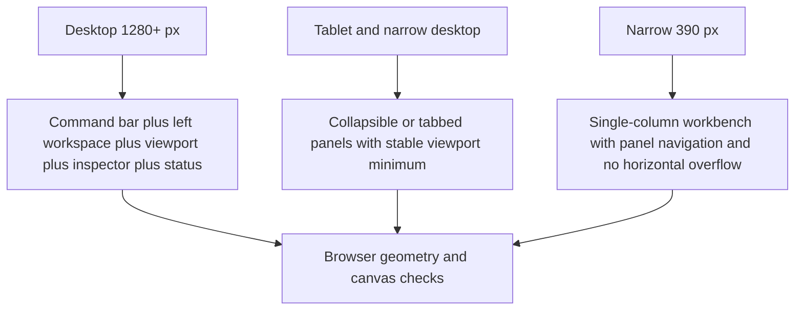

# refactor: Professionalize React editor workbench UI

## Summary

This plan turns the React default `EditorWorkbench` from a feature-complete proof loop shell into a professional B2B 3D editor surface. It keeps core editing semantics, package exports, durable snapshots, runtime projection, and existing React extension regions intact while redesigning the React workbench chrome, command bar, left workspace, inspector organization, status feedback, CSS token system, and browser verification.

---

## Problem Frame

The React package already ships an install-ready workbench: toolbar, hierarchy/assets/project panel, viewport, inspector, status bar, asset import/reimport, missing asset recovery, authored cameras, viewport helpers, bilingual copy, and browser proof-loop tests are in place. The remaining issue is quality of product experience, not absence of capability.

The current UI still reads as a dense collection of proof-loop controls. Tool groups wrap aggressively, many actions are equal weight, the left panel stacks several workflows at once, inspector sections compete vertically, and status text is a flat row of facts. For B2B users operating a 3D visualization editor, the interface should feel quiet, utilitarian, scannable, and repeatable under heavy use.

Reading this as: B2B 3D visual editor product UI for professional users, with a restrained enterprise tool language, leaning toward a package-owned editor design system plus a small internal icon layer rather than a marketing-page aesthetic.

Design dials for this work:

- `DESIGN_VARIANCE: 4` because the workbench should be predictable and spatially stable.
- `MOTION_INTENSITY: 2` because editing tools need clear feedback, not decorative motion.
- `VISUAL_DENSITY: 7` because this is daily production software, but not a cockpit that hides hierarchy.

The `design-taste-frontend` skill is applied selectively. Its redesign audit, anti-slop checks, contrast, state, responsive, and copy rules matter here. Its landing-page hero, logo-wall, testimonial, and image-section rules do not apply to this dense product surface.

---

## Requirements

### Product UX

- R1. The default React workbench must present as a professional B2B 3D editor, not as a proof-loop checklist or marketing surface.
- R2. Primary editing workflows must be visually prioritized: select scene content, inspect/edit properties, import/recover assets, run transform/history commands, and understand project/runtime state.
- R3. Existing render regions, root exports, CSS subpath export, and host-owned editor lifecycle behavior must remain backward-compatible.
- R4. The redesign must stay React-only for this plan. Vue parity is deferred unless shared core model or docs changes are required to protect package contracts.

### Visual System

- R5. React workbench and inspector CSS must share a semantic token system for surfaces, text, borders, accent, severity, focus rings, control sizes, radii, spacing, and density.
- R6. The default palette must use one restrained accent color, consistent severity colors, no AI-purple glow, no decorative status dots, no pure black or pure white as dominant surfaces, and no section theme flips.
- R7. The shape system must be consistent. Controls, panels, rows, badges, and file drop zones need a documented radius rule instead of ad hoc rounded rectangles.
- R8. Typography must be system-safe and legible inside a published package. Labels, headings, values, IDs, and status text need distinct scales without oversized display type.

### Command And Panel UX

- R9. Toolbar actions must become a scannable command bar with stable grouping, icon support, concise labels, keyboard-safe affordances, disabled states, pressed states, tooltips or titles, and no desktop text wrapping.
- R10. The left panel must become task-oriented instead of one long stack. Scene hierarchy, asset workspace, project status, and problems need clearer navigation and count/severity summaries.
- R11. The inspector must become selection-first and form-safe. Transform/material/environment/light/camera/problem sections need clearer grouping, empty states, validation states, and stable control dimensions.
- R12. Status and async feedback must distinguish durable editor state, transient runtime state, import/reimport progress, project open/export results, and recoverable problems without duplicating core state.

### Accessibility And Runtime Boundaries

- R13. Buttons, inputs, selects, badges, focus rings, placeholders, helper text, and problem text must meet readable contrast in the default theme.
- R14. Keyboard navigation must remain usable for command bar controls, panel tabs or segmented controls, hierarchy rows, asset rows, and inspector fields.
- R15. Loading, empty, success, warning, and error states must be explicit for import queue, project open/export, missing asset replacement, GLB reimport, and inspector sections.
- R16. No Three.js object, `File`, `Blob`, object URL, resolver output, runtime problem object, loaded texture, PMREM output, or UI-only state may enter `SceneSnapshot`, `.ek3d`, command history, or durable project JSON.

### Verification And Documentation

- R17. Browser tests must cover desktop and narrow workbench geometry, nonblank viewport canvas, no horizontal overflow, no control overlap, and representative English and Simplified Chinese layouts.
- R18. React Testing Library coverage must prove command routing, custom render region compatibility, status behavior, tab/section state, and no durable leakage after UI interactions.
- R19. Documentation must show the redesigned React default workbench as the recommended B2B editor path and distinguish visual theming from editor state.
- R20. If an external UI or icon package is added, package tests must prove it is internal to the React implementation and does not leak through public prop types or required host setup.

---

## Key Technical Decisions

- KTD1. Package-owned editor design system first: use CSS variables and package-owned components as the design system. Do not adopt Radix Themes or Fluent as a broad wrapper in this pass because both would change the package styling contract more than this React UI refactor needs.
- KTD2. Add an internal icon layer, not public icon props: the command bar should use icons for recognition, but any icon package such as `@phosphor-icons/react` must be hidden behind internal React components and must not appear in exported prop types.
- KTD3. Preserve adapter boundaries: React may reorganize presentation and transient UI state, but commands, history, selection, asset import/reimport, project import/export, inspector models, and runtime problems remain owned by core.
- KTD4. Redesign through structure before decoration: the implementation should prioritize command hierarchy, panel navigation, status comprehension, and form state clarity before color or shadow changes.
- KTD5. Use one default theme with token hooks: ship one cohesive professional theme for the default workbench and expose semantic CSS variables for host overrides. Full theme switching is deferred until the token system is stable.
- KTD6. Keep motion minimal and motivated: use hover, active, focus, loading, and section transition feedback only where it communicates state. Do not add scroll effects, decorative animation, or continuous pointer physics.
- KTD7. Verify with browser geometry and screenshots: proof of completion requires headless browser layout checks and captured visual evidence for desktop and narrow viewports, not only jsdom assertions.

---

## High-Level Technical Design

---

## Implementation Units

### U1. Establish the React workbench visual system

- **Goal:** Replace scattered workbench and inspector styling with a coherent React editor token system and base control primitives.
- **Requirements:** R1, R5, R6, R7, R8, R13, R20.
- **Dependencies:** None.
- **Files:** `packages/react/src/components/workbench.css`, `packages/react/src/components/inspector.css`, `packages/react/test/build-config.test.ts`, `docs/decisions.md`.
- **Approach:** Define semantic `--ek-workbench-*` tokens for background, elevated surface, inset surface, viewport surface, text, muted text, borders, accent, severity, focus, radius, spacing, control height, and z-index layers. Make inspector consume the same semantic family instead of maintaining a separate `--ek-panel-*` palette. Replace hard-coded white, near-black, and repeated border/radius values with tokens. Document the radius and density rule in `docs/decisions.md`.
- **Patterns to follow:** Existing package CSS export assertions in `packages/react/test/build-config.test.ts`, current `ek-` class prefix, and the durable-state guidance in `docs/architecture.md`.
- **Test scenarios:**
  - Given React package CSS is inspected, when build-config tests run, then the file still uses the `ek-` namespace and exposes styling only through the public CSS subpath.
  - Given workbench and inspector CSS are inspected, when token assertions run, then shared semantic tokens exist for surfaces, text, border, accent, focus, severity, radius, and control sizing.
  - Given the default CSS is inspected, when guard tests run, then no required host import from a third-party theme package is present.
  - Given the default theme renders buttons, selects, inputs, badges, and problem rows, when visual audit checks run in browser tests from later units, then text remains readable against its surface.
- **Verification:** React workbench and inspector have one consistent visual foundation, and package styling stays owned by `@ek-aiot/3d-editor-react`.

### U2. Refactor the default toolbar into a professional command bar

- **Goal:** Turn the toolbar into a scannable B2B command bar with clear command hierarchy, compact icon support, stable wrapping behavior, and preserved core action routing.
- **Requirements:** R2, R3, R9, R13, R14, R18, R20.
- **Dependencies:** U1.
- **Files:** `packages/react/src/components/WorkbenchToolbar.tsx`, `packages/react/src/components/workbench.css`, `packages/react/src/i18n/workbench-i18n.ts`, `packages/react/test/workbench.test.tsx`, `packages/react/test/build-config.test.ts`, `packages/react/package.json`.
- **Approach:** Introduce an internal command descriptor structure inside the React toolbar component or a package-private helper. Group commands by project, history, transform, snap, viewport helpers, camera, and node operations, but make primary editing commands visually stronger than secondary helpers. Add internal icon rendering for command buttons. If using `@phosphor-icons/react`, add it as a React package dependency, import only used icons, keep labels/titles from existing i18n keys, and keep all icon details private.
- **Patterns to follow:** Current `WorkbenchToolbar` action routing through `context.runAction()`, `context.toggleViewportHelper()`, `context.resetCamera()`, project open/export helpers, and existing bilingual toolbar tests.
- **Test scenarios:**
  - Given no custom toolbar region is provided, when the command bar renders, then project, history, transform, snap, camera, node, and helper groups remain present with the same accessible labels.
  - Given each command is clicked, when editor state is inspected, then transform mode, snap state, viewport helpers, camera calls, history actions, node operations, project open, and project export still route through the same core APIs.
  - Given a command is disabled by `context.model.toolbar`, when it renders, then disabled visual state and `disabled` attributes agree.
  - Given a command is active, when it renders, then `aria-pressed` and visual active state agree for transform, snap, helper, and marquee controls.
  - Given English and Simplified Chinese locales, when the command bar renders at desktop width, then command labels do not wrap to multiple lines and titles remain localized.
  - Given a custom `toolbar` render prop is provided, when the workbench renders, then the custom region still receives the unchanged workbench context and sits in a stable extension area.
  - Given package manifest tests inspect dependencies, when an icon dependency is added, then it appears only as an internal React implementation dependency and no public API type references it.
- **Verification:** The toolbar reads as an editor command bar while preserving all command semantics and extension compatibility.

### U3. Recompose the left workspace around user tasks

- **Goal:** Make hierarchy, assets, project status, and problems easier to scan and operate without overwhelming the viewport.
- **Requirements:** R2, R3, R10, R12, R13, R14, R15, R16, R18.
- **Dependencies:** U1.
- **Files:** `packages/react/src/components/WorkbenchLeftPanel.tsx`, `packages/react/src/components/workbench.css`, `packages/react/src/i18n/workbench-i18n.ts`, `packages/react/test/workbench.test.tsx`, `packages/react/test/react-proof-loop.integration.test.tsx`.
- **Approach:** Replace the always-stacked left panel with a task-oriented structure. A compact tab or segmented control should expose Scene, Assets, and Project/Problems views while preserving counts and severity summaries. Keep hierarchy row selection, asset import/drop, search/filter/sort, queue rows, reimport, replacement, project summary, and problem previews. Store active panel view as React UI state only.
- **Patterns to follow:** Current `WorkbenchLeftPanel` usage of `context.model.hierarchy`, `context.model.assets.workspace`, `filterAssetWorkspaceItems()`, `sortAssetWorkspaceItems()`, `context.assets.importFiles()`, `context.assets.reimportGlbAsset()`, and `context.assets.replaceAsset()`.
- **Test scenarios:**
  - Given the default left workspace renders, when each view is selected, then hierarchy, asset workspace, project summary, and problem content remain reachable by keyboard and pointer.
  - Given a hierarchy row is clicked in the Scene view, when selection changes, then status and inspector update through core state.
  - Given assets are imported in the Assets view, when import succeeds or fails, then queue and asset rows show explicit success/error states and no `File`, `Blob`, or object URL appears in serialized editor output.
  - Given search, kind filter, status filter, and sort controls are used, when rows render, then visible asset IDs match core filter/sort helpers.
  - Given missing asset replacement or GLB reimport runs, when the operation resolves, then the same asset ID is preserved and runtime problems are refreshed.
  - Given English and Simplified Chinese locales, when long asset labels, diagnostic text, and problem summaries render in narrow width, then rows wrap inside the panel without overlapping the viewport or inspector.
  - Given a custom `leftPanel` render prop is provided, when the workbench renders, then custom content still replaces the default left workspace without changing the rest of the layout.
- **Verification:** The left side becomes a workspace navigator instead of a long stack, while all asset and hierarchy behavior stays core-backed.

### U4. Make the inspector selection-first and form-safe

- **Goal:** Improve the right inspector's information architecture, empty states, validation visibility, and control density without changing core inspector semantics.
- **Requirements:** R2, R3, R11, R13, R14, R15, R16, R18.
- **Dependencies:** U1.
- **Files:** `packages/react/src/components/InspectorView.tsx`, `packages/react/src/components/TransformInspector.tsx`, `packages/react/src/components/MaterialInspector.tsx`, `packages/react/src/components/EnvironmentInspector.tsx`, `packages/react/src/components/LightInspector.tsx`, `packages/react/src/components/CameraInspector.tsx`, `packages/react/src/components/ProblemsPanel.tsx`, `packages/react/src/components/inspector.css`, `packages/react/test/inspector.test.tsx`, `packages/react/test/workbench.test.tsx`.
- **Approach:** Add an inspector header that reflects current selection and problem severity. Organize sections into a predictable selection-first flow, with disabled/empty sections visually quieter than active sections. Improve field grouping, helper/error text placement, vector input sizing, material target choices, camera view actions, and problem recovery affordances. Keep all edits routed through existing inspector components and core command builders.
- **Patterns to follow:** Current `InspectorView` composition, core `InspectorModel`, existing field tests in `packages/react/test/inspector.test.tsx`, and i18n descriptor resolution in `packages/react/src/i18n/workbench-i18n.ts`.
- **Test scenarios:**
  - Given no transformable selection exists, when the inspector renders, then empty guidance is visible, readable, and not confused with editable state.
  - Given an object is selected, when Transform and Material fields render, then active sections are prominent and edits still dispatch the same core commands.
  - Given invalid field input is blurred, when validation fails, then error text appears below the relevant field and focus/contrast remains readable.
  - Given material target radio choices include broad override and slot override options, when the user changes target, then the active target state remains UI-only and command output still comes from core builders.
  - Given camera view capture, apply, update, default, and delete controls are used, when editor state is inspected, then authored camera data remains JSON-compatible and runtime camera state is not serialized.
  - Given problem rows expose recoverable asset replacement, when a file is chosen, then `onReplaceAsset` is called with the same asset ID and no file object enters durable state.
  - Given a custom `rightPanel` render prop is provided, when the workbench renders, then the custom panel still receives unchanged workbench context.
- **Verification:** The inspector becomes clearer for professional use while remaining a renderer over core inspector models.

### U5. Redesign status, feedback, and transient operation states

- **Goal:** Replace flat status text and scattered async messages with structured, readable feedback for editor state, project state, runtime readiness, and transient operations.
- **Requirements:** R2, R3, R12, R13, R15, R16, R18.
- **Dependencies:** U1, U2, U3, U4.
- **Files:** `packages/react/src/components/WorkbenchStatusBar.tsx`, `packages/react/src/components/WorkbenchToolbar.tsx`, `packages/react/src/components/WorkbenchLeftPanel.tsx`, `packages/react/src/components/workbench.css`, `packages/react/src/i18n/workbench-i18n.ts`, `packages/react/test/workbench.test.tsx`, `packages/react/test/react-proof-loop.integration.test.tsx`.
- **Approach:** Present status as compact groups: selection, history, runtime, project readiness, assets, dirty/saved, and problems. Keep transient project open/export and asset import/reimport/replacement messages close to the action that produced them, but use consistent severity and success styling. Prefer inline contextual feedback over global toasts in this package-level default UI.
- **Patterns to follow:** Existing `WorkbenchStatusBar`, project action status handling in `WorkbenchToolbar`, queue/recovery state in `WorkbenchLeftPanel`, and model-derived fields in `packages/core/src/workbench/workbench-model.ts`.
- **Test scenarios:**
  - Given no selection, single selection, and multi-selection states, when status renders, then selection text and counts update from `context.model.selection`.
  - Given undo/redo availability changes, when status and command bar render, then counts and disabled states agree.
  - Given runtime is not mounted and then becomes ready, when status renders, then runtime state updates without changing snapshot serialization.
  - Given project export succeeds, exports partial, or fails, when action feedback renders, then success/warning/error tone is visible and localized.
  - Given asset import queue has importing, succeeded, and failed rows, when feedback renders, then each state has distinct styling and remains transient.
  - Given problem counts include authored, runtime, and project problems, when status renders, then aggregate and breakdown text agree with `context.model.problems`.
  - Given the editor is serialized after feedback-heavy interactions, when durable JSON is inspected, then UI messages, queues, files, locale state, and runtime problems are absent.
- **Verification:** Users can understand editor health and transient operation results without reading raw logs or losing durable-state boundaries.

### U6. Harden responsive browser proof and documentation

- **Goal:** Prove the redesigned React workbench is usable across desktop and narrow layouts, then document the new default UI contract.
- **Requirements:** R3, R14, R17, R18, R19, R20.
- **Dependencies:** U1-U5.
- **Files:** `packages/react/test/proof-loop-demo.browser.test.tsx`, `packages/react/test/workbench.test.tsx`, `examples/react-proof-loop/src/App.tsx`, `examples/react-proof-loop/src/styles.css`, `packages/react/README.md`, `docs/integration-react.md`, `docs/decisions.md`.
- **Approach:** Extend the browser proof loop to check the redesigned command bar, panel navigation, inspector, status bar, viewport canvas, and React starter overlay at desktop and 390px widths. Reuse the existing `assertChildrenInside()` pattern and add guards for root horizontal overflow, command label wrapping, focusable controls inside panel bounds, and nonblank canvas pixels. Update React docs to describe the professional default workbench, CSS variables, icon dependency if adopted, extension regions, and durable-state boundaries.
- **Patterns to follow:** Existing browser proof flow in `packages/react/test/proof-loop-demo.browser.test.tsx`, nonblank canvas checks, project export/open assertions, missing asset recovery assertions, and README package import examples.
- **Test scenarios:**
  - Given the React starter demo mounts at 1280px width, when browser checks run, then command bar, left workspace, viewport, inspector, and status have positive sizes and no important controls escape their containers.
  - Given the same demo is constrained to 390px width, when browser checks run, then navigation and controls remain reachable without root horizontal overflow.
  - Given English and Simplified Chinese locales, when command bar, left workspace, inspector, and status render, then representative labels remain inside their parent regions.
  - Given the viewport canvas renders, when pixel checks run, then canvas is nonblank and still large enough for interaction after layout changes.
  - Given the full proof-loop flow runs, when users select, transform, edit material, export/open, recover a missing asset, and reimport GLB, then behavior remains intact after the visual refactor.
  - Given documentation examples are checked, when package docs tests run, then React README and integration guide still show root API imports and public CSS subpath imports.
- **Verification:** The refactor has observable browser evidence and updated npm-facing documentation.

---

## Scope Boundaries

### In Scope

- React default `EditorWorkbench` visual and UX refactor.
- React workbench CSS and inspector CSS token consolidation.
- React command bar, left workspace, inspector, status bar, and starter demo polish.
- Internal icon layer for React command controls if dependency review accepts it.
- React jsdom tests, browser geometry tests, and React package docs.
- Preservation of root exports, CSS subpath export, render props, editor lifecycle, and durable-state boundaries.

### Deferred to Follow-Up Work

- Vue visual parity and shared cross-adapter UI documentation.
- Persisted dockable layout, resizable panels, command palette, toolbar customization API, and plugin system.
- Full theme switching API, user theme persistence, and brand theming beyond semantic CSS variables.
- Remote asset libraries, accounts, permissions, collaboration, hosted viewer publishing, or AIoT binding UI.
- Pixel-perfect design asset generation or formal design-system documentation outside package CSS decisions.

### Outside This Product Identity For This Stage

- Moving command semantics, history, asset import rules, runtime projection, problem derivation, or inspector model ownership into React.
- Serializing runtime-only values such as Three.js objects, `File`, `Blob`, object URLs, loaded textures, PMREM outputs, resolver outputs, import queues, or runtime problems.
- Replacing the React package with a third-party design system wrapper that consumers must configure to use the default workbench.

---

## System-Wide Impact

- **React package dependency posture:** An icon package may be added. A broad UI system package should not be added unless implementation discovers an accessibility blocker that cannot be solved with package-owned components.
- **Public API:** The plan should not require public prop changes. If optional display props become necessary, they must be additive and covered by public API tests.
- **CSS contract:** `@ek-aiot/3d-editor-react/styles.css` becomes more important because semantic variables and component geometry carry the default UI contract.
- **Core boundary:** Core should not change except where existing model fields are consumed more clearly. Any proposed core view-model addition must be pure and framework-neutral.
- **Docs:** React README and integration guide need to explain the new default workbench as the recommended B2B editor surface, not just a compact shell.

---

## Risks & Dependencies

- **Risk: visual refactor breaks proven workflows.** Mitigate by keeping existing command calls and proof-loop coverage, then extending tests around layout rather than replacing behavior tests.
- **Risk: adding icons increases bundle and dependency surface.** Mitigate with tree-shaken named imports, internal wrappers, package manifest tests, and no exported icon types.
- **Risk: panel navigation hides important information.** Mitigate with persistent counts, severity summaries, keyboard navigation, and status/problem summaries outside the hidden view.
- **Risk: CSS token work regresses host overrides.** Mitigate by keeping `ek-` class names, documenting new variables, and avoiding private global selectors.
- **Risk: narrow layouts become technically passing but poor to use.** Mitigate with browser geometry checks for root overflow, container containment, label wrapping, and canvas minimum size.

---

## Alternative Approaches Considered

- **Adopt Radix Themes broadly:** Rejected for this pass. Official Radix Themes expects global CSS and a Theme wrapper, which is a poor fit for a published adapter package that already exposes its own CSS contract.
- **Adopt Fluent UI React broadly:** Deferred. It could fit enterprise B2B software, but this package needs editor-specific chrome and must avoid leaking a third-party design system into host setup.
- **Only recolor existing CSS:** Rejected. The primary UX problem is hierarchy and task flow, not palette.
- **Refactor React and Vue together:** Deferred. The user asked for React, and React can validate the professional UI direction before investing in adapter parity.
- **Build dockable panels now:** Deferred. Docking would introduce layout persistence and a larger interaction contract before the default non-persisted UI is professional.

---

## Sources & Research

- `packages/react/src/components/EditorWorkbench.tsx` shows the existing shell regions and render-prop compatibility that must be preserved.
- `packages/react/src/components/WorkbenchToolbar.tsx` shows current command routing and project open/export state handling.
- `packages/react/src/components/WorkbenchLeftPanel.tsx` shows current hierarchy, asset workspace, queue, replacement, reimport, and project/problem presentation.
- `packages/react/src/components/workbench.css` and `packages/react/src/components/inspector.css` show the current token split, hard-coded surfaces, and desktop `100vh` layout.
- `packages/react/test/workbench.test.tsx` covers current React workbench behavior, i18n, project actions, asset import, reimport, and serialization boundaries.
- `packages/react/test/proof-loop-demo.browser.test.tsx` already contains browser proof-loop and layout containment helpers to extend.
- `docs/architecture.md` and `docs/interactions.md` define the durable snapshot, runtime-only, workbench, asset, helper, camera, and inspector boundaries.
- `docs/plans/2026-06-04-001-feat-default-editor-workbench-plan.md` and `docs/plans/2026-06-08-001-feat-workbench-asset-workspace-ui-plan.md` define the install-ready and asset workspace work that this refactor should not duplicate.
- Phosphor React docs: https://github.com/phosphor-icons/react. This supports named React icon imports and tree-shaking for an internal icon layer.
- Radix Themes docs: https://www.radix-ui.com/themes/docs/overview/getting-started. This shaped the decision not to wrap the package in Radix Themes during this pass.
- Radix Primitives docs: https://www.radix-ui.com/primitives/docs. This remains a possible future source for specific accessible primitives if native controls become insufficient.
- Fluent 2 React docs: https://fluent2.microsoft.design/get-started/develop. This shaped the decision to defer a broad Fluent adoption because it would require a wider provider and styling dependency decision.
