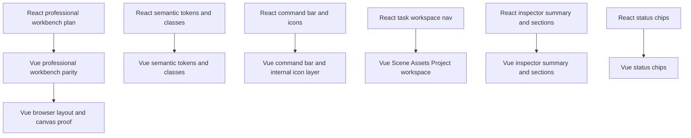
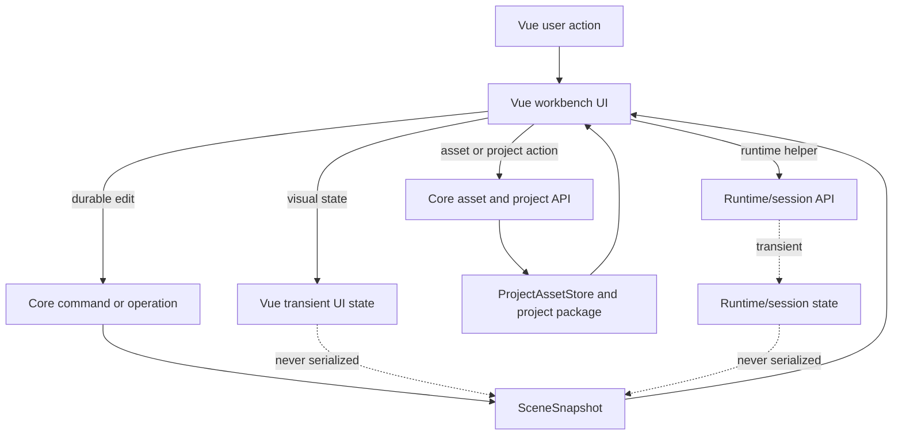
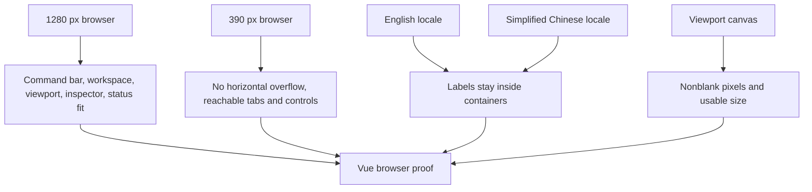

# refactor: Professionalize Vue editor workbench UI

## Summary

This plan brings the Vue default `EditorWorkbench` up to the same professional B2B editor standard as the React workbench. It preserves Vue-native slots, locale behavior, raw editor/runtime boundaries, package exports, and durable-state rules while refactoring the Vue command bar, left workspace, inspector, status feedback, CSS token system, browser proof, and documentation.

---

## Problem Frame

The Vue package already has the same install-ready shell shape as React: toolbar, left project panel, viewport, right inspector, status bar, i18n support, asset import/recovery, project import/export, authored cameras, and scoped slots. The gap is now parity of product experience. React has moved toward a professional command bar, task-oriented workspace navigation, inspector summary, semantic status chips, internal icons, and stronger browser geometry checks. Vue still reads closer to the original proof-loop UI: text-heavy toolbar groups, stacked left-panel sections, flat status text, separate inspector tokens, desktop `100vh` sizing, and no Vue browser layout proof.

Reading this as: B2B 3D visual editor product UI for professional users, with a restrained enterprise tool language, leaning toward package-owned Vue editor chrome that mirrors the React workbench design language.

Design dials for this work:

- `DESIGN_VARIANCE: 4` because the editor should be predictable and spatially stable.
- `MOTION_INTENSITY: 2` because Vue editing tools need state feedback, not decorative motion.
- `VISUAL_DENSITY: 8` because this is a daily B2B 3D editor surface with many repeated operations.

The `design-taste-frontend` skill is applied selectively. Its redesign audit, semantic tokens, contrast, shape consistency, state coverage, responsive containment, and copy checks apply. Its landing page, hero, logo wall, testimonial, and image asset rules do not apply to this dense product UI.

---

## Requirements

### Product UX Parity

- R1. The Vue default workbench must present as a professional B2B 3D editor, matching the current React workbench design direction rather than the older proof-loop control stack.
- R2. Vue must keep the same conceptual regions as React: command bar, task-oriented left workspace, viewport, selection-first inspector, and structured status feedback.
- R3. Vue scoped slots, root exports, CSS subpath export, locale props/emits, raw-editor lifecycle, and host-owned editor behavior must remain backward-compatible.
- R4. React and Vue may use framework-native implementations, but their default no-customization user experience must remain behaviorally equivalent.

### Visual System

- R5. Vue workbench and inspector CSS must share semantic editor tokens for surfaces, text, borders, accent, severity, focus, spacing, radius, control height, and status tone.
- R6. The default palette must keep one restrained accent color, consistent severity tones, no decorative glow, no decorative status dots, no pure black or pure white as dominant surfaces, and no theme flips inside the editor.
- R7. The Vue radius system must match the React professional UI rule: compact controls and panels use one consistent radius scale with no ad hoc rounded shapes.
- R8. Vue typography must stay package-safe and legible under English and Simplified Chinese copy, with stable sizes for labels, values, IDs, status groups, and inspector metadata.

### Command, Workspace, Inspector, And Status UX

- R9. The Vue toolbar must become a scannable command bar with stable groups, internal icon support, concise labels, localized titles, disabled states, pressed states, and no desktop label wrapping.
- R10. The Vue left panel must become task-oriented with Scene, Assets, and Project views plus count and severity summaries, rather than stacking hierarchy, assets, and project content at once.
- R11. The Vue inspector must become selection-first and form-safe, with a summary header, clearer section hierarchy, explicit empty/disabled states, readable validation, and stable vector/control sizing.
- R12. Vue status feedback must use structured groups for selection, history, runtime, snap, project, assets, saved state, and problems instead of a flat sequence of text spans.
- R13. Async operation feedback for project open/export, asset import, missing-asset replacement, and GLB reimport must remain contextual, localized, and transient.

### Accessibility, Responsiveness, And Durable Boundaries

- R14. Buttons, selects, inputs, badges, status chips, focus rings, placeholders, helper text, and problem text must remain readable in the default theme.
- R15. Keyboard navigation must remain usable for command buttons, workspace tabs, hierarchy rows, asset filters, recovery controls, status focus targets where present, and inspector fields.
- R16. Vue desktop and narrow layouts must avoid root horizontal overflow, overlapping controls, clipped labels, and unstable viewport sizing.
- R17. No Three.js object, `File`, `Blob`, object URL, resolver result, runtime problem, loaded texture, PMREM output, import queue state, active panel view, translated copy, or icon component may enter `SceneSnapshot`, `.ek3d`, command history, or durable project JSON.

### Verification And Documentation

- R18. Vue jsdom tests must prove command routing, workspace navigation, inspector grouping, status grouping, i18n behavior, slots, package dependencies, and durable-state boundaries.
- R19. Vue browser tests must cover desktop and 390px workbench geometry, nonblank viewport canvas, no horizontal overflow, no control overlap, command icons, workspace tabs, inspector summary, status chips, and representative English and Simplified Chinese layouts.
- R20. Vue README, integration docs, and decisions docs must explain the professional default workbench, semantic CSS variables, optional internal icon dependency, extension slots, i18n, and durable-state boundaries.

---

## Key Technical Decisions

- KTD1. Mirror React's professional UX, not React's implementation: Vue should reproduce the same command hierarchy, task navigation, inspector/status concepts, and visual tokens while staying Vue-native.
- KTD2. Keep UI package-owned: do not introduce Fluent, Radix, Carbon, or a broad Vue design system wrapper. The default editor remains package-owned CSS and components.
- KTD3. Add a Vue internal icon layer only if the package boundary stays clean: `@phosphor-icons/vue` is the preferred parity option because React already uses Phosphor, but it must stay a Vue package dependency and never appear in public exports, slot types, props, or host setup requirements.
- KTD4. Use semantic CSS parity: Vue should adopt the same `--ek-workbench-*` token family and class concepts as React where useful, while keeping Vue source files independent.
- KTD5. Keep panel navigation as Vue UI state: active left workspace view, drag state, queue rows, recovery status, locale switch state, and field drafts are transient UI state and never durable editor data.
- KTD6. Preserve adapter boundaries: commands, history, selection, asset/project APIs, inspector models, and runtime projection remain core-owned; Vue components render and route actions.
- KTD7. Verify the visual refactor in a real browser: jsdom proves routing and state, but desktop/narrow containment, canvas size, and text wrapping need browser tests.

---

## High-Level Technical Design

---

## Implementation Units

### U1. Align Vue workbench and inspector visual tokens

- **Goal:** Bring Vue workbench and inspector CSS onto a shared professional editor token system that matches React's current design language.
- **Requirements:** R1, R4-R8, R14, R16, R20.
- **Dependencies:** None.
- **Files:** `packages/vue/src/components/workbench.css`, `packages/vue/src/components/inspector.css`, `packages/vue/test/build-config.test.ts`, `docs/decisions.md`.
- **Approach:** Replace the smaller Vue token set and `--ek-panel-*` inspector split with the React-style semantic `--ek-workbench-*` family for surface, raised surface, inset surface, viewport, text, muted text, borders, accent, severity, focus, radius, spacing, control height, and subtle shadow. Replace desktop `100vh` with viewport-stable sizing that behaves correctly in browser tests. Keep the `ek-` namespace and package CSS subpath contract. Extend `docs/decisions.md` to record Vue's professional UI token contract alongside React's D12 decision, or add a Vue parity decision if clearer.
- **Patterns to follow:** `packages/react/src/components/workbench.css`, `packages/react/src/components/inspector.css`, `docs/decisions.md` D11 and D12, and existing Vue CSS package-boundary tests.
- **Test scenarios:**
  - Given Vue CSS is inspected, when build-config tests run, then `.ek-workbench` and `.ek-inspector` use shared `--ek-workbench-*` semantic tokens for surfaces, text, border, accent, focus, severity, radius, and control height.
  - Given Vue CSS is inspected, when package-boundary tests run, then CSS remains inside the package source boundary and does not introduce global `body` styling.
  - Given inspector CSS is inspected, when overflow tests run, then inspector scroll containment and paint containment remain present.
  - Given default button, select, input, badge, problem row, and status-chip styles are inspected, when contrast-oriented assertions run, then each uses semantic text and background variables rather than hard-coded white-on-white or low-contrast pairings.
  - Given desktop CSS is inspected, when viewport-stability tests run, then the workbench no longer relies on plain `100vh` for browser viewport height.
- **Verification:** Vue has the same package-owned visual foundation as React without requiring host theme providers or changing public APIs.

### U2. Refactor Vue toolbar into the professional command bar

- **Goal:** Convert the text-heavy Vue toolbar into a React-parity command bar with command descriptors, private icons, stable group geometry, and preserved action routing.
- **Requirements:** R1-R4, R9, R13-R15, R17-R19.
- **Dependencies:** U1.
- **Files:** `packages/vue/src/components/WorkbenchToolbar.vue`, `packages/vue/src/components/WorkbenchIcon.vue`, `packages/vue/src/components/workbench.css`, `packages/vue/src/i18n/workbench-i18n.ts`, `packages/vue/test/workbench.test.ts`, `packages/vue/test/build-config.test.ts`, `packages/vue/src/public-api.test.ts`, `packages/vue/package.json`.
- **Approach:** Introduce a Vue-local command descriptor structure that mirrors React's project, history, transform, snap, selection, helper, camera, and node groups. Render command buttons with `ek-workbench__command-button`, localized labels/titles, pressed and disabled state, and internal icon components. If `@phosphor-icons/vue` is adopted, add it as a Vue package dependency, import only used icons in `WorkbenchIcon.vue`, keep icons private, and assert the package does not expose icon paths or types. `npm view` currently reports `@phosphor-icons/vue` version `2.2.1` with Vue 3 peer support; implementation should confirm the final version before editing manifests.
- **Patterns to follow:** `packages/react/src/components/WorkbenchToolbar.tsx`, `packages/react/src/components/WorkbenchIcon.tsx`, React package icon dependency tests, and current Vue toolbar project open/export functions.
- **Test scenarios:**
  - Given Vue workbench renders with no custom toolbar slot, when the command bar is queried, then project, history, transform, snap, selection, helpers, camera, and node groups remain present with localized accessible labels.
  - Given each command is clicked, when editor state or runtime spies are inspected, then transform mode, snap state, viewport helpers, camera calls, history actions, node operations, project open, and project export still route through existing core APIs.
  - Given a command is disabled by `context.model.toolbar`, when the command bar renders, then disabled visual state and `disabled` attributes agree.
  - Given a command is active, when it renders, then `aria-pressed` and visual active state agree for transform, snap, helper, and marquee controls.
  - Given English and Simplified Chinese locales, when the command bar renders, then labels and titles remain localized and command labels do not wrap at desktop width in browser tests.
  - Given a custom `toolbar` slot is provided, when the workbench renders, then the slot still receives the unchanged Vue workbench context and can replace or augment the default region.
  - Given package manifest and public API tests inspect Vue exports, when an icon dependency is added, then it appears only as an internal Vue package dependency and no public API text contains `@phosphor-icons/vue` or `WorkbenchIcon`.
- **Verification:** Vue command controls match React's professional command bar without leaking icon or design-system dependencies to consumers.

### U3. Recompose the Vue left workspace around task views

- **Goal:** Replace the stacked Vue left panel with Scene, Assets, and Project views that match React's task-oriented workspace.
- **Requirements:** R1-R4, R10, R13-R17, R18, R19.
- **Dependencies:** U1.
- **Files:** `packages/vue/src/components/WorkbenchLeftPanel.vue`, `packages/vue/src/components/WorkbenchNodeRow.vue`, `packages/vue/src/components/workbench.css`, `packages/vue/src/i18n/workbench-i18n.ts`, `packages/vue/test/workbench.test.ts`, `packages/vue/test/vue-proof-loop.integration.test.ts`.
- **Approach:** Add Vue-local `activeView` state and a `ek-workbench__panel-nav` tab/segmented control with Scene, Assets, and Project views. Reuse existing i18n keys already present for `reactWorkbench.leftPanel.nav.*`. Move hierarchy, asset workspace, and project/problem content behind `hidden` sections that remain keyboard and pointer reachable when active. Preserve import queue, drag/drop, raster intent, search/filter/sort, replacement, GLB reimport, project summary, and problem preview behavior. Replace long middle-dot text chains with structured badges or stacked meta rows where they create wrapping risk.
- **Patterns to follow:** `packages/react/src/components/WorkbenchLeftPanel.tsx`, `packages/react/src/components/workbench-model-helpers.ts` for tone mapping, current Vue asset import/recovery logic, `filterAssetWorkspaceItems()`, and `sortAssetWorkspaceItems()`.
- **Test scenarios:**
  - Given the default Vue left workspace renders, when each workspace tab is selected, then Scene, Assets, and Project sections become visible one at a time and preserve accessible labels.
  - Given Scene view is active, when a hierarchy row is clicked, then core selection changes and inspector/status update.
  - Given Assets view is active, when assets are imported, filtered, sorted, reimported, or replaced, then existing core asset/project APIs are called and visible rows match core helper output.
  - Given replacement or GLB reimport succeeds after a problem existed, when Project view is opened, then counts and problem summaries update without stale recovery rows.
  - Given English and Simplified Chinese locales, when view labels, asset labels, diagnostics, and problem summaries render, then authored values remain unchanged while surrounding chrome is localized.
  - Given a custom `leftPanel` or legacy `sidePanel` slot is provided, when the workbench renders, then the custom slot still receives the unchanged context and the default workspace is not rendered.
  - Given the editor is serialized after import, replacement, reimport, tab switching, and filtering, when durable JSON is inspected, then active view, queue rows, files, object URLs, recovery state, and translated text are absent.
- **Verification:** Vue left-panel navigation matches React's professional task model while all asset and hierarchy behavior remains core-backed.

### U4. Make the Vue inspector selection-first and form-safe

- **Goal:** Add React-parity inspector summary and form hierarchy while preserving existing Vue inspector component ownership and command builders.
- **Requirements:** R1-R4, R11, R14-R18.
- **Dependencies:** U1.
- **Files:** `packages/vue/src/components/InspectorView.vue`, `packages/vue/src/components/TransformInspector.vue`, `packages/vue/src/components/MaterialInspector.vue`, `packages/vue/src/components/EnvironmentInspector.vue`, `packages/vue/src/components/LightInspector.vue`, `packages/vue/src/components/CameraInspector.vue`, `packages/vue/src/components/ProblemsPanel.vue`, `packages/vue/src/components/inspector.css`, `packages/vue/test/inspector.test.ts`, `packages/vue/test/workbench.test.ts`.
- **Approach:** Add an inspector summary header comparable to React's `ek-inspector-summary`, using current selection, selection kind, active camera/light context, and problem severity/count metadata from the existing inspector/workbench model. Keep transform, material, environment, lights, cameras, and problems as Vue components. Tighten field grouping, helper/error placement, vector sizing, active material target presentation, camera view controls, and problem recovery affordances through CSS and small markup changes.
- **Patterns to follow:** `packages/react/src/components/InspectorView.tsx`, React `inspector.css` summary styles, current Vue inspector components, `packages/vue/test/inspector.test.ts`, and core inspector model ownership in `docs/decisions.md` D8.
- **Test scenarios:**
  - Given no transformable selection exists, when the inspector renders, then a readable summary and empty guidance appear without exposing editable state.
  - Given an object is selected, when Transform and Material sections render, then the summary reflects the selection and field edits still dispatch the same core commands.
  - Given invalid numeric or material input is blurred, when validation fails, then helper/error text appears below the relevant field with readable contrast and without shifting neighboring vector controls unpredictably.
  - Given material targets include object override and material-slot choices, when the active target changes, then target state remains Vue UI state and command output still comes from core builders.
  - Given camera view capture, set default, apply, update, and delete controls are used, when editor state is inspected, then authored camera data remains JSON-compatible and runtime camera state is not serialized.
  - Given recoverable asset problems render in the problems panel, when a file is selected, then the same asset ID is passed to `replaceAsset()` and the `File` object does not enter durable state.
  - Given a custom `rightPanel` slot is provided, when the workbench renders, then default inspector markup is replaced and the slot receives unchanged context.
- **Verification:** Vue inspector hierarchy matches React's selection-first professional surface while remaining a renderer over core inspector models.

### U5. Structure Vue status and transient feedback

- **Goal:** Replace the flat Vue status bar with React-parity grouped status chips and align operation feedback tones across toolbar, workspace, and inspector.
- **Requirements:** R1-R4, R12-R18.
- **Dependencies:** U1, U2, U3, U4.
- **Files:** `packages/vue/src/components/WorkbenchStatusBar.vue`, `packages/vue/src/components/WorkbenchToolbar.vue`, `packages/vue/src/components/WorkbenchLeftPanel.vue`, `packages/vue/src/components/workbench.css`, `packages/vue/src/i18n/workbench-i18n.ts`, `packages/vue/test/workbench.test.ts`, `packages/vue/test/vue-proof-loop.integration.test.ts`.
- **Approach:** Render status as `ek-workbench__status-chip` groups for selection, history, runtime, snap, project, assets, saved state, and problems. Add Vue-local tone mapping equivalent to React's `problemToneFromCounts()` without importing React source. Keep project open/export and asset import/recovery messages near the action that produced them, but use the same semantic tone tokens. Keep queue and recovery state as localized message identity plus values, not rendered strings that freeze on locale change.
- **Patterns to follow:** `packages/react/src/components/WorkbenchStatusBar.tsx`, `packages/react/src/components/workbench-model-helpers.ts`, current Vue status i18n descriptor usage, and existing Vue durable sentinel tests.
- **Test scenarios:**
  - Given no selection, single selection, and multi-selection states, when status renders, then the selection chip updates from `context.model.selection`.
  - Given undo/redo availability changes, when status and command bar render, then history chip counts and command disabled states agree.
  - Given runtime mounts and unmounts, when status renders, then runtime chip tone and text update without changing snapshot serialization.
  - Given project export succeeds, exports partial, or fails, when toolbar feedback renders, then success, warning, and error tones are visible and localized.
  - Given asset import queue has importing, succeeded, and failed rows, when the locale changes, then each row re-resolves localized chrome while file names and asset IDs remain authored values.
  - Given problem counts include authored, runtime, and project problems, when status renders, then aggregate and breakdown chips agree with `context.model.problems`.
  - Given the editor is serialized after feedback-heavy interactions, when durable JSON is inspected, then UI messages, queues, locale switch state, files, runtime problems, and icons are absent.
- **Verification:** Vue status communicates editor health like the React professional workbench while keeping feedback transient and durable-state safe.

### U6. Add Vue browser proof and update Vue-facing docs

- **Goal:** Prove the Vue professional workbench works visually across desktop and narrow browsers, then document the new default UI contract.
- **Requirements:** R1-R4, R14-R20.
- **Dependencies:** U1-U5.
- **Files:** `packages/vue/test/proof-loop-demo.browser.test.ts`, `packages/vue/test/workbench.test.ts`, `packages/vue/test/build-config.test.ts`, `examples/vue-proof-loop/src/App.vue`, `examples/vue-proof-loop/src/styles.css`, `packages/vue/README.md`, `docs/integration-vue.md`, `docs/decisions.md`.
- **Approach:** Add a Vue browser test that mirrors the React browser proof checks for the local starter demo. Assert command bar containment, command icon rendering if the icon layer is adopted, workspace tabs, active Scene/Assets/Project sections, inspector summary, status chips, nonblank canvas pixels, desktop and 390px geometry, localized English and Simplified Chinese labels, and no root horizontal overflow. Update Vue docs to describe the professional default workbench as the recommended B2B editor path and to clarify which CSS variables hosts may override.
- **Patterns to follow:** `packages/react/test/proof-loop-demo.browser.test.tsx`, `vitest.browser.config.ts`, current `packages/vue/test/vue-proof-loop.integration.test.ts`, `examples/vue-proof-loop/src/App.vue`, `packages/vue/README.md`, and `docs/integration-vue.md`.
- **Test scenarios:**
  - Given the Vue starter demo mounts at 1280px width, when browser checks run, then command bar, left workspace, viewport, inspector, and status have positive sizes and important controls stay inside their containers.
  - Given the same demo mounts at 390px width, when browser checks run, then workspace navigation and controls remain reachable without document-level horizontal overflow.
  - Given English locale, when command bar, workspace, inspector, and status render, then representative labels fit inside their parent regions.
  - Given Simplified Chinese locale, when the same regions render, then localized labels fit inside their parent regions and authored asset/object values remain unchanged.
  - Given the viewport canvas renders, when pixel checks run, then the canvas is nonblank and remains large enough for interaction after layout changes.
  - Given the proof-loop flow selects, transforms, edits material, exports/opens, recovers a missing asset, and reimports GLB, when browser and jsdom tests run, then behavior remains intact after the visual refactor.
  - Given package docs are inspected, when docs tests run, then README and integration guide still show root API imports and public CSS subpath imports.
- **Verification:** The Vue refactor has browser-visible proof and npm-facing documentation, not only component-level assertions.

---

## Acceptance Examples

- AE1. Given `EditorWorkbench` renders in Vue with no custom slots, when the page loads at desktop width, then the default UI shows a professional command bar, task workspace tabs, viewport, inspector summary, and grouped status chips.
- AE2. Given `locale="zh-CN"` or `v-model:locale` switches to Simplified Chinese, when command, workspace, inspector, and status chrome render, then representative labels are Chinese while authored object names, asset labels, file names, IDs, and camera view names remain unchanged.
- AE3. Given a host provides custom `toolbar`, `leftPanel`, `rightPanel`, or `status` slots, when the workbench renders, then the slot receives the same workbench context and the default professional region can be replaced without changing other regions.
- AE4. Given asset import, missing-asset replacement, and GLB reimport run through the default Vue UI, when the scene or project is serialized, then durable output contains scene/project data but no files, blobs, object URLs, import queue rows, recovery messages, runtime problems, or translated UI copy.
- AE5. Given Vue browser tests run at 1280px and 390px, when containment checks inspect buttons, inputs, selects, workspace tabs, inspector summary, status chips, and canvas, then no important control escapes its parent and the canvas is nonblank.

---

## Scope Boundaries

### In Scope

- Vue default `EditorWorkbench` visual and UX refactor.
- Vue workbench CSS and inspector CSS token consolidation.
- Vue command bar, left workspace, inspector, status bar, and starter demo polish.
- Vue internal icon layer if dependency review accepts `@phosphor-icons/vue`.
- Vue jsdom tests, Vue browser geometry tests, and Vue package docs.
- Preservation of Vue root exports, CSS subpath export, scoped slots, locale props/emits, editor lifecycle, and durable-state boundaries.

### Deferred to Follow-Up Work

- Cross-adapter shared UI component library or shared framework-neutral visual package.
- Persisted dockable layout, resizable panels, command palette, user toolbar customization, or plugin slots beyond existing region slots.
- Full theme switching API, user theme persistence, and host brand theme presets beyond semantic CSS variables.
- Remote asset libraries, accounts, permissions, collaboration, hosted viewer publishing, or AIoT binding UI.
- Renaming existing `reactWorkbench.*` shared i18n keys to neutral adapter names.

### Outside This Product Identity For This Stage

- Moving command semantics, history, asset import rules, project packaging, runtime projection, problem derivation, or inspector model ownership into Vue.
- Requiring host apps to install or configure a third-party Vue UI system to use the default workbench.
- Serializing runtime-only values such as Three.js objects, `File`, `Blob`, object URLs, loaded textures, PMREM outputs, resolver outputs, import queues, icon components, or runtime problems.

---

## System-Wide Impact

- **Vue package dependency posture:** The plan may add `@phosphor-icons/vue` as a Vue package dependency. It must not become a peer dependency or public API surface.
- **Public API:** The plan should not require public prop or slot contract changes. If optional display props become necessary, they must be additive and covered by public API tests.
- **CSS contract:** `@ek-aiot/3d-editor-vue/styles.css` becomes more important because semantic variables and component geometry carry the default UI contract.
- **Cross-adapter parity:** React remains the reference for professional workbench UX, while Vue keeps its own components and tests.
- **Docs:** Vue README and integration guide need to describe the default workbench as a professional B2B editor surface, not just a compact shell.

---

## Risks & Dependencies

- **Risk: visual parity breaks Vue behavior.** Mitigate by preserving current command calls and extending existing workbench and proof-loop tests rather than replacing them.
- **Risk: icon dependency leaks into consumers.** Mitigate with internal `WorkbenchIcon` components, dependency/build tests, public API string guards, and no icon props.
- **Risk: task tabs hide important left-panel information.** Mitigate with persistent counts, severity tone summaries, status chips, and tests that each view remains reachable.
- **Risk: CSS token changes regress host overrides.** Mitigate by keeping `ek-` class names, documenting variables, and avoiding global selectors.
- **Risk: narrow layout passes jsdom but fails visually.** Mitigate with browser tests for document overflow, child containment, command label wrapping, and canvas size.
- **Risk: locale copy length causes control overflow.** Mitigate with English and Simplified Chinese browser checks and no desktop button wrapping.

---

## Alternative Approaches Considered

- **Adopt a broad Vue design system:** Rejected for this pass. It would force a larger dependency and theming decision than this package-owned editor chrome needs.
- **Share React UI components with Vue:** Rejected. The packages should remain framework-native, and shared UI components would create a new abstraction layer before the Vue parity target is validated.
- **Only copy React CSS colors into Vue:** Rejected. The UX gap is command hierarchy, workspace navigation, inspector/status structure, and verification, not only palette.
- **Skip icons in Vue:** Deferred as a fallback. If `@phosphor-icons/vue` creates bundle or API issues, Vue can still ship the command descriptor and CSS structure first, but parity should prefer internal icons if package tests stay clean.
- **Build dockable panels now:** Deferred. Docking adds persistence and interaction contracts that exceed the current professional default UI goal.

---

## Sources & Research

- `docs/plans/2026-06-20-001-refactor-react-workbench-professional-ui-plan.md` defines the React professional UI direction this Vue work follows.
- `packages/react/src/components/WorkbenchToolbar.tsx` and `packages/react/src/components/WorkbenchIcon.tsx` show the command descriptor and internal Phosphor icon layer to mirror conceptually.
- `packages/react/src/components/WorkbenchLeftPanel.tsx` shows the Scene, Assets, and Project task navigation pattern.
- `packages/react/src/components/InspectorView.tsx`, `packages/react/src/components/inspector.css`, and `packages/react/src/components/WorkbenchStatusBar.tsx` show the inspector summary and grouped status-chip targets.
- `packages/react/test/proof-loop-demo.browser.test.tsx` contains the browser containment, command icon, inspector summary, status chip, localized layout, and viewport checks to adapt for Vue.
- `packages/vue/src/components/EditorWorkbench.vue`, `WorkbenchToolbar.vue`, `WorkbenchLeftPanel.vue`, `InspectorView.vue`, `WorkbenchStatusBar.vue`, `workbench.css`, and `inspector.css` show the current Vue shell and styling gaps.
- `packages/vue/test/workbench.test.ts`, `packages/vue/test/vue-proof-loop.integration.test.ts`, `packages/vue/test/build-config.test.ts`, and `packages/vue/src/public-api.test.ts` show the existing Vue behavior and package-boundary coverage to extend.
- `vitest.browser.config.ts` already includes Vue and React aliases and desktop plus 390px Chromium browser instances.
- `docs/decisions.md` D7, D8, D11, and D12 define thin adapter ownership, core inspector ownership, package-owned UI, and the current React visual system decision.
- `npm view @phosphor-icons/vue` reports version `2.2.1`, Vue 3 peer support, and the GitHub repository `phosphor-icons/vue`; Context7 documentation lookup was unavailable because `CONTEXT7_API_KEY` is not set.
